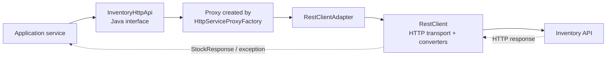
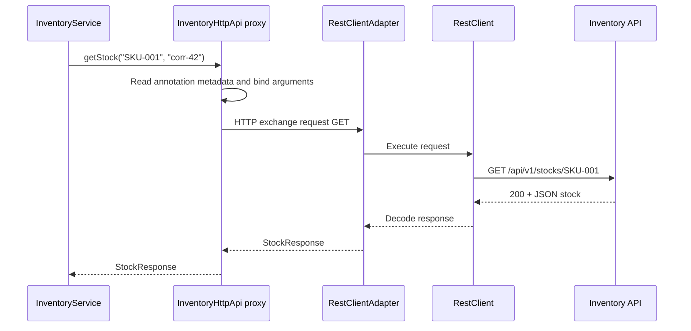
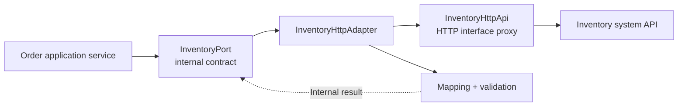
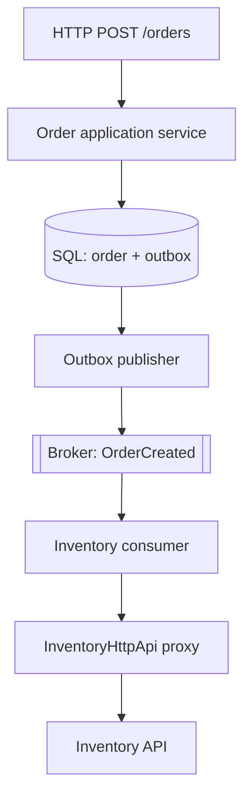

# `HttpServiceProxyFactory` and Interface Proxy Creation Mechanism

When a Spring Boot application integrates with an inventory service, payment gateway, or shipping system, HTTP calling code often repeats the same boilerplate: assembling URLs, choosing HTTP methods, passing path/query/header parameters, serializing JSON, reading responses, and handling errors. Spring Framework's **HTTP interface** lets you describe an HTTP calling contract using an **annotated Java interface**. `HttpServiceProxyFactory` creates an object implementing that interface at runtime and translates method invocations into HTTP requests through a client adapter.

This lesson belongs to the **HTTP interface** chapter of the **SPRING_BOOT_INTEGRATION** module. The module focuses on organizing system integration across HTTP clients, SQL, caches, brokers, and Spring Integration adapters; therefore, we do not just build proxies, but also examine data contracts, configuration, timeouts, network errors, idempotency, testing, and observability of integration flows.

> **Version Scope:** Primary examples use Spring Boot **3.2+**, Spring Framework **6.1+**, and Java 17+ with `RestClient` and HTTP Service Interfaces. Builder initialization APIs, supported adapters, and auto-configuration capabilities can differ across Spring versions; when using Spring Boot 4/Spring Framework 7, consult the API documentation for your actual version. This lesson explicitly shows the wiring path used in the examples rather than assuming the framework auto-creates every interface bean.

## 1. Learning Objectives

After this lesson, you will be able to:

1. Explain why Spring creates an HTTP proxy from an interface and when the actual HTTP request occurs.
2. Distinguish the roles of `@HttpExchange`, `@GetExchange`, `@PostExchange`, `HttpServiceProxyFactory`, `RestClientAdapter`, and `WebClientAdapter`.
3. Build contract-driven clients with `@PathVariable`, `@RequestParam`, `@RequestHeader`, `@RequestBody`, and appropriate return types.
4. Configure `RestClient` for endpoints, timeouts, and proxy bean creation using `@Configuration`.
5. Decouple the HTTP contract from business logic, classify errors, and apply retries/idempotency within proper boundaries.
6. Test proxies with a mock HTTP server and plan integration testing against partner systems.
7. Track latency, HTTP status codes, timeouts, and traces when an interface is used in a Spring Boot flow.

## 2. The Problem Before HTTP Service Interfaces

A common way to call an API is to use a client explicitly inside each service:

```java
StockResponse response = restClient.get()
        .uri("/api/v1/stocks/{sku}", sku)
        .header("X-Correlation-Id", correlationId)
        .retrieve()
        .body(StockResponse.class);
```

This approach is completely valid. However, when a partner exposes dozens of APIs, application code can end up repeating HTTP methods, URLs, headers, and response types. Reading the service also makes it harder to see **which operations make up the integration contract**.

With an HTTP interface, you can declare:

```java
@HttpExchange("/api/v1")
interface InventoryHttpApi {

    @GetExchange("/stocks/{sku}")
    StockResponse getStock(
            @PathVariable("sku") String sku,
            @RequestHeader("X-Correlation-Id") String correlationId);
}
```

Business code then simply calls `inventoryApi.getStock("SKU-001", "corr-42")`. Spring uses the interface metadata to construct the corresponding GET request.

**Important:** An HTTP interface is an *HTTP client contract*; it does not mean the application exposes a corresponding server endpoint. Nor is it synonymous with OpenFeign, a JPA repository, transactional RPC, or message publishing. It is a thin declarative layer sitting on top of an actual HTTP client.

## 3. Participating Components and Responsibilities

| Component | Responsibility | Example |
| --- | --- | --- |
| **Contract interface** | Declares the HTTP operations the application needs | `InventoryHttpApi` |
| **`@HttpExchange`** | Shared metadata such as URL prefix and media types | `@HttpExchange("/api/v1")` |
| **`@GetExchange`, `@PostExchange`...** | HTTP method and URL for each operation | `@GetExchange("/stocks/{sku}")` |
| **Parameter annotations** | Bind Java arguments to the request | `@PathVariable`, `@RequestHeader`, `@RequestBody` |
| **`HttpServiceProxyFactory`** | Reads interface metadata and creates an HTTP-calling proxy | `factory.createClient(InventoryHttpApi.class)` |
| **HTTP exchange adapter** | Bridges the proxy mechanism with a concrete HTTP client | `RestClientAdapter`, `WebClientAdapter` |
| **HTTP client** | Builds/sends requests, manages connections, encodes/decodes, handles responses | `RestClient` or `WebClient` |
| **Transport / remote API** | Network communication and external business execution | HTTPS to Inventory Service |

Diagram:



`HttpServiceProxyFactory` **does not send a request when `createClient(...)` is called**. It creates a proxy. **Only when an HTTP interface method is invoked** does the proxy process arguments, build an exchange, and let the client adapter execute the communication. Therefore, successful bean creation does not prove the external API is reachable.

## 4. Runtime Proxy Creation Mechanism

### 4.1. From a Java Interface to an HTTP Call

Conceptual flow:

1. The application builds a `RestClient` with a base URL, request factory, message converters, and shared configuration.
2. `RestClientAdapter` provides the bridge from the HTTP Service Interface layer to `RestClient`.
3. `HttpServiceProxyFactory.builderFor(adapter).build()` creates a factory bound to the adapter.
4. `factory.createClient(InventoryHttpApi.class)` inspects methods with `@HttpExchange` metadata and creates a proxy implementing the interface.
5. When `getStock("SKU-001", "corr-42")` is called, the proxy reads the `GET /stocks/{sku}` metadata, binds `sku` into the path, attaches headers, and dispatches via the adapter.
6. The response is decoded according to the return type; HTTP status/transport errors are handled per the HTTP client's behavior and configuration.



In Spring's implementation, the runtime proxy wires declared methods to an invocation handler mechanism. You do not need to write an implementation class like `InventoryHttpApiImpl` for every endpoint, but **you still must declare a proxy bean or use an equivalent registration mechanism** supported by your version.

### 4.2. Which Responsibilities Does the Proxy Not Replace?

There is no basis to assume an annotated interface automatically provides:

- OAuth2/API key authentication, proper TLS, or caller authorization checks.
- Retries, circuit breakers, rate limits, bulkheads, and end-to-end deadlines.
- Business error classification: does 404 mean "out of stock" or "broken contract"?
- Idempotency for order-creation or reservation operations.
- Caching, SQL transactions, or duplicate-submission prevention.
- Safe logging, metrics, correlation IDs, and complete distributed tracing.
- Semantic validation of DTOs or schema compatibility with the partner.

These remain responsibilities of HTTP client configuration, application services, integration adapters, and operational contracts.

## 5. Commonly Used HTTP Interface Annotations

### 5.1. Declaring Methods, URLs, and Media Types

Example of a multi-operation interface:

```java
package com.example.integration.inventory;

import org.springframework.http.ResponseEntity;
import org.springframework.web.bind.annotation.PathVariable;
import org.springframework.web.bind.annotation.RequestBody;
import org.springframework.web.bind.annotation.RequestHeader;
import org.springframework.web.bind.annotation.RequestParam;
import org.springframework.web.service.annotation.GetExchange;
import org.springframework.web.service.annotation.HttpExchange;
import org.springframework.web.service.annotation.PostExchange;

@HttpExchange(url = "/api/v1", accept = "application/json")
public interface InventoryHttpApi {

    @GetExchange("/stocks/{sku}")
    StockResponse getStock(
            @PathVariable("sku") String sku,
            @RequestHeader("X-Correlation-Id") String correlationId);

    @GetExchange("/stocks")
    StockResponse[] findStock(
            @RequestParam("warehouse") String warehouse,
            @RequestParam("sku") String sku);

    @PostExchange(url = "/reservations", contentType = "application/json")
    ResponseEntity<ReservationResponse> createReservation(
            @RequestHeader("Idempotency-Key") String idempotencyKey,
            @RequestBody ReservationRequest request);
}
```

Meaning:

- `@HttpExchange` sets a URL prefix and accepted media type so methods do not have to repeat them.
- `@GetExchange` and `@PostExchange` are specialized HTTP method annotations. Corresponding `@PutExchange`, `@PatchExchange`, and `@DeleteExchange` annotations also exist.
- `@PathVariable("sku")` binds path variables via URI templates. Never concatenate raw URL strings from external data.
- `@RequestParam` adds query parameters with the specified names.
- `@RequestHeader` attaches headers passed per invocation.
- `@RequestBody` passes a DTO as the request body, typically serialized to JSON by an appropriate message converter.
- `ResponseEntity<ReservationResponse>` lets callers inspect status codes and response headers when required by the contract.

### 5.2. External System DTOs

**`StockResponse.java`**

```java
package com.example.integration.inventory;

import java.time.Instant;

public record StockResponse(
        String sku,
        Integer availableQuantity,
        Instant updatedAt
) {}
```

**`ReservationRequest.java`**

```java
package com.example.integration.inventory;

public record ReservationRequest(
        String orderId,
        String sku,
        int quantity
) {}
```

**`ReservationResponse.java`**

```java
package com.example.integration.inventory;

public record ReservationResponse(
        String reservationId,
        String status
) {}
```

These records describe the **Inventory API contract in the example**, not database entities of the integrating system. In a real application, you must specify:

- Which fields are required, numeric bounds, nullability rules, and units.
- Whether `updatedAt` uses ISO 8601 with offset/UTC; for `Instant`, Jackson must be configured to support Java time.
- Can `quantity` be negative or zero? Who validates business constraints?
- Which values can reservation `status` hold? Is it forward-compatible if the partner introduces new values?
- How missing-data responses, version errors, or indeterminate states are represented.

Jackson and message converters deserialize payloads; **successful deserialization does not guarantee the business contract is valid**. You may need to map external DTOs to internal models and validate them at the adapter boundary.

### 5.3. Return Types and Considerations

| Return Type | Meaning and Context |
| --- | --- |
| `StockResponse` | Only cares about the body on a valid response |
| `ResponseEntity<ReservationResponse>` | Needs status code/headers along with the body |
| `ResponseEntity<Void>` | Needs status/headers without a body |
| `void` | Does not read response body; can still throw HTTP/transport errors |
| `Mono<StockResponse>` | Reactive model when combining HTTP interface with an appropriate adapter such as `WebClientAdapter` |

For APIs returning `204 No Content`, do not design code that blindly accesses a non-null body. If `404` needs to be converted to an `Optional` or domain result, perform an **intentional error translation**; do not assume the client automatically returns `Optional` according to business policy.

## 6. Adding Dependencies and Registering the HTTP Proxy

### 6.1. Dependencies by Stack

**Gradle (Groovy DSL)** example for Spring Boot 3.2+ with synchronous `RestClient`:

```groovy
dependencies {
    implementation 'org.springframework.boot:spring-boot-starter-web'
    testImplementation 'org.springframework.boot:spring-boot-starter-test'
}
```

The web starter brings in the required Spring Web components, JSON message conversion, and support for building `RestClient` in a standard Spring Boot configuration. If you are not building an MVC server, you can manage HTTP client dependencies differently to fit the project; the example uses the web starter for a minimal setup.

If the application uses **WebClient** and returns `Mono`/`Flux`, the appropriate Spring WebFlux infrastructure is needed, usually via `spring-boot-starter-webflux`.

**Note:** Adding a starter does not automatically turn every `@HttpExchange` interface into a bean in all Spring Boot versions. The next example creates the proxy bean **explicitly**.

### 6.2. Declaring Base URL and Timeout Configuration

Sample `application.yml`:

```yaml
integration:
  inventory:
    base-url: ${INVENTORY_BASE_URL}
    connect-timeout-ms: 2000
    read-timeout-ms: 5000
```

`INVENTORY_BASE_URL` must be provided at runtime (e.g. `https://inventory.internal.example`, an illustrative domain only). Retrieve tokens/credentials from environment variables or a secret manager and configure the HTTP client appropriately. Never hardcode secrets inside the interface.

With synchronous HTTP clients, **distinguish**:

- **Connect timeout:** limits the time to open the initial connection to the target system.
- **Read/response timeout:** limits the time waiting to read a response according to the actual request factory/client behavior.
- **Business deadline:** total time budget for an operation, which may span multiple steps, retries, and waiting on other resources.

Two basic timeouts do not equate to an **end-to-end deadline**. If retries are added, total elapsed time can exceed a single read timeout.

### 6.3. Creating a Proxy Bean with `HttpServiceProxyFactory`

**`InventoryHttpClientConfiguration.java`**

```java
package com.example.integration.inventory;

import org.springframework.beans.factory.annotation.Value;
import org.springframework.context.annotation.Bean;
import org.springframework.context.annotation.Configuration;
import org.springframework.http.client.SimpleClientHttpRequestFactory;
import org.springframework.web.client.RestClient;
import org.springframework.web.client.support.RestClientAdapter;
import org.springframework.web.service.invoker.HttpServiceProxyFactory;

@Configuration
public class InventoryHttpClientConfiguration {

    @Bean
    InventoryHttpApi inventoryHttpApi(
            RestClient.Builder builder,
            @Value("${integration.inventory.base-url}") String baseUrl,
            @Value("${integration.inventory.connect-timeout-ms}") int connectMs,
            @Value("${integration.inventory.read-timeout-ms}") int readMs) {

        var requestFactory = new SimpleClientHttpRequestFactory();
        requestFactory.setConnectTimeout(connectMs);
        requestFactory.setReadTimeout(readMs);

        RestClient restClient = builder
                .baseUrl(baseUrl)
                .requestFactory(requestFactory)
                .build();

        var adapter = RestClientAdapter.create(restClient);
        HttpServiceProxyFactory factory = HttpServiceProxyFactory
                .builderFor(adapter)
                .build();

        return factory.createClient(InventoryHttpApi.class);
    }
}
```

Here:

1. Spring Boot supplies a `RestClient.Builder` configured for the Spring ecosystem. We create **a dedicated client for the Inventory API** with its own base URL and timeouts.
2. `SimpleClientHttpRequestFactory` illustrates setting connect/read timeouts. In systems requiring HTTP connection pooling, proxies, TLS, or specialized policies, use another request factory (for example, based on Apache HttpClient) and configure its resources accordingly.
3. `RestClientAdapter.create(restClient)` wraps the client into an adapter understood by the factory.
4. `HttpServiceProxyFactory.builderFor(adapter).build().createClient(InventoryHttpApi.class)` is the **runtime proxy creation** step.
5. The returned bean has type `InventoryHttpApi`, allowing application services to inject the interface without knowing how the HTTP client was constructed.

**Clear distinction:** `@Bean` tells Spring how to register a bean. `HttpServiceProxyFactory` creates the **proxy object** implementing the interface. Both mechanisms work together but serve separate roles.

### 6.4. Calling the Proxy from the Business Layer

**`InventoryApplicationService.java`**

```java
package com.example.integration.inventory;

import org.springframework.stereotype.Service;

@Service
public class InventoryApplicationService {

    private final InventoryHttpApi inventoryApi;

    public InventoryApplicationService(InventoryHttpApi inventoryApi) {
        this.inventoryApi = inventoryApi;
    }

    public StockResponse currentStock(
            String sku, String correlationId) {
        if (sku == null || sku.isBlank()) {
            throw new IllegalArgumentException("sku is required");
        }
        return inventoryApi.getStock(sku, correlationId);
    }
}
```

`InventoryApplicationService` only knows about the injected Java contract. For business logic tests, `InventoryHttpApi` can be mocked; for HTTP client tests, create the real proxy and use a mock server to verify requests.

However, in systems with many partners, letting application services directly use the Inventory API's DTOs can increase coupling to external contracts. When needed, add an **internal port** or an adapter with a mapper `StockResponse → InventoryAvailability`, so domain code depends only on the application's own model.

## 7. When to Use `RestClientAdapter` vs `WebClientAdapter`?

### 7.1. `RestClientAdapter` for Synchronous Calls

`RestClient` provides Spring Framework 6.1+'s synchronous HTTP API. A call such as:

```java
StockResponse response =
        inventoryHttpApi.getStock("SKU-001", "corr-42");
```

typically holds the current thread while waiting for the HTTP call to complete. This model fits when:

- The Spring MVC application or background job is designed around blocking I/O.
- The caller needs the result immediately to make a decision.
- Concurrency, thread pools, and timeouts are balanced against infrastructure capacity.

If the partner is slow, the call holds a thread and resources while waiting. Therefore, concurrency limits, connection pools, timeouts, and circuit breakers can matter more than merely changing the HTTP calling syntax.

### 7.2. `WebClientAdapter` for the Reactive Model

Example interface returning a reactive type:

```java
package com.example.integration.inventory;

import org.springframework.web.bind.annotation.PathVariable;
import org.springframework.web.service.annotation.GetExchange;
import org.springframework.web.service.annotation.HttpExchange;
import reactor.core.publisher.Mono;

@HttpExchange("/api/v1")
public interface ReactiveInventoryHttpApi {

    @GetExchange("/stocks/{sku}")
    Mono<StockResponse> getStock(@PathVariable("sku") String sku);
}
```

Corresponding configuration:

```java
import org.springframework.context.annotation.Bean;
import org.springframework.context.annotation.Configuration;
import org.springframework.web.reactive.function.client.WebClient;
import org.springframework.web.reactive.function.client.support.WebClientAdapter;
import org.springframework.web.service.invoker.HttpServiceProxyFactory;

@Configuration
class ReactiveInventoryConfiguration {

    @Bean
    ReactiveInventoryHttpApi reactiveInventoryHttpApi(
            WebClient.Builder webClientBuilder) {

        WebClient client = webClientBuilder
                .baseUrl("https://inventory.example.test")
                .build();

        return HttpServiceProxyFactory
                .builderFor(WebClientAdapter.create(client))
                .build()
                .createClient(ReactiveInventoryHttpApi.class);
    }
}
```

This is an **adapter comparison example**, not a production configuration: the base URL should be externalized as a property, and authentication, timeouts, and appropriate concurrency limits should be added. When using `Mono`/`Flux`, downstream layers should preserve reactive processing and explicit error signals; do not call `block()` indiscriminately on an event-loop thread.

### 7.3. Comparison

| Criterion | RestClient + proxy | WebClient + proxy |
| --- | --- | --- |
| API Model | Synchronous/blocking | Reactive when using `Mono`/`Flux` |
| Suitable Application Layer | Spring MVC, synchronous jobs | WebFlux, async/reactive I/O flows |
| Typical Return Types | DTO, `ResponseEntity<T>` | `Mono<T>`, `Flux<T>` |
| Error Handling | Standard exceptions | Error signals in reactive pipelines |
| Controls Needed | Threads, pools, timeouts, retries | Connections, backpressure, schedulers, timeouts, retries |
| Not Included Out-of-the-Box | Auth, circuit breaker, idempotency | Auth, circuit breaker, idempotency |

Choose based on your application architecture and actual latency/load requirements. HTTP interface only provides **a declarative way to describe calls**; it does not alter the underlying client's I/O mechanism.

## 8. Data Contracts and Transformation Between Systems

Suppose the Inventory API returns:

```json
{
  "sku": "SKU-001",
  "availableQuantity": 8,
  "updatedAt": "2026-11-21T02:10:00Z"
}
```

The internal application might need:

```json
{
  "productCode": "SKU-001",
  "reservable": true,
  "stockCheckedAt": "2026-11-21T02:10:00Z"
}
```

Turning `availableQuantity > 0` into `reservable` is a **business rule** that may require extra conditions: safety stock, eligible warehouse, expiration time, or requested quantity. That is not something `HttpServiceProxyFactory` does automatically.

Recommended architecture for multi-adapter systems:



The adapter layer can:

1. Convert domain inputs into the external API's path/query/body parameters.
2. Call the proxy interface.
3. Validate the response schema and data.
4. Normalize enums, units of measure, timestamps, and error codes.
5. Return an internal result type with clear semantics.

Manage contract versions according to the partner's rollout schedule. Adding an optional JSON field is different from changing the meaning of an existing field. For critical fields, avoid silently substituting defaults like `availableQuantity = 0` when upstream omits a field, as this can mask mapping bugs.

## 9. HTTP Error Handling and Uncertainty

### 9.1. Errors at Different Layers

An operation through a proxy can fail at multiple points:

| Layer | Situation | Handling Approach |
| --- | --- | --- |
| Bind/serialize | Missing parameters, unserializable body | Fix contract/mapping; do not retry invalid data |
| Transport | DNS failure, connection refused, TLS error | Determine whether transient or permanent misconfiguration |
| Timeout | Waiting too long to connect or read response | Account for the possibility the target already processed it |
| HTTP 4xx | 400, 401, 403, 404, 409, 429 | Map per business contract; do not blindly retry all 4xx |
| HTTP 5xx | 500, 502, 503 | Controlled retries if safe to replay |
| Deserialize | Wrong JSON type / schema mismatch | Contract error; alert and run compatibility tests |
| Semantic | Invalid business status/code | Fail/map explicitly; do not treat as success |

With default `RestClient`, 4xx/5xx error statuses typically become `RestClientResponseException` and its subtypes. Network errors may be wrapped in a client/transport exception such as `ResourceAccessException`. Exact exception classes depend on the request factory and status handler configuration; testing actual failure modes is essential.

### 9.2. Example: Classifying 404 in the Adapter Layer

If the API contract states that **404 means the SKU does not exist**, the adapter can translate it into an internal `Optional.empty()` result:

```java
package com.example.integration.inventory;

import java.util.Optional;

import org.springframework.stereotype.Component;
import org.springframework.web.client.HttpClientErrorException;

@Component
public class InventoryLookupAdapter {

    private final InventoryHttpApi api;

    public InventoryLookupAdapter(InventoryHttpApi api) {
        this.api = api;
    }

    public Optional<StockResponse> find(
            String sku, String correlationId) {
        try {
            return Optional.ofNullable(api.getStock(sku, correlationId));
        } catch (HttpClientErrorException.NotFound ex) {
            return Optional.empty();
        }
    }
}
```

**Only apply this mapping when the contract explicitly confirms that 404 means SKU not found.** If 404 is caused by a wrong path or API version, returning `empty` masks a configuration bug. You may also need to inspect an `error code` in the response before deciding.

For 401/403, fix authentication/authorization; 400/422 generally require fixing the payload; 429 requires throttling and respecting `Retry-After` when present. Never collapse every exception into "out of stock".

### 9.3. Timeout: Sent Without Receiving a Result

Example request:

```text
POST /api/v1/reservations
Idempotency-Key: order-101-reserve-v1
Body: { "orderId": "order-101", "sku": "SKU-001", "quantity": 2 }
```

What can happen:

1. The Inventory API creates the reservation and commits successfully.
2. The connection drops before the client reads the response.
3. The Spring Boot application experiences a timeout.
4. Retrying with a different idempotency key could create a second reservation.

**A timeout does not prove the target failed to process the request.** For side-effecting operations like POST, retrying is only safe when the contract/target API supports idempotency or provides a way to verify outcomes by operation ID. The `Idempotency-Key` header in the example only works if the target API **enforces** that header's semantics.

### 9.4. Retries, Circuit Breakers, and Load Shedding

A sound policy for outbound external API calls typically includes:

- Bounded timeouts and an overall time budget for an operation.
- Retries with backoff/jitter only for transient errors and replay-safe operations.
- A cap on retry count to avoid request storms during partner outages.
- A circuit breaker to pause calls if error rates exceed a configured threshold.
- Bulkheads/rate limiters to cap concurrent requests or request rates per partner.
- Fallbacks only when semantically valid—for example, returning "unverified" rather than assuming "in stock".

Spring HTTP interfaces **do not automatically add** these mechanisms. Configure them in the service/adapter, HTTP client, or via an appropriate resilience library, while avoiding stacked retries across multiple layers without controlling total attempt amplification.

## 10. Transactions, SQL, Cache, and Brokers When Using HTTP Proxies

In the **SPRING_BOOT_INTEGRATION** module, an HTTP call is often **one step** in an integration flow spanning multiple resources.

Order creation example:



Key boundaries:

- `@Transactional` on a datasource ensures SQL updates occur within a local transaction; it **does not automatically roll back** completed HTTP calls or published broker messages.
- Making HTTP calls inside a long-lived SQL transaction holding locks can cause external latency and timeouts to tie up connection pools and database locks. Design ordering and transaction scopes carefully.
- A transactional outbox can record events to be published within the same SQL transaction for crash recovery; consumers still need deduplication.
- Caching can reduce HTTP calls, but requires TTL/invalidation and staleness rules. Do not cache critical decisions if stale data violates freshness requirements.
- Broker consumers may redeliver messages after failures/acknowledgment issues; outbound HTTP operations must use stable business keys or reconciliation mechanisms.

The proxy handles **defining and executing HTTP exchanges**; correctness across SQL, cache, and brokers remains the responsibility of the flow architecture.

## 11. Testing an HTTP Interface Proxy

Three testing layers should be distinguished:

1. **Application service unit tests** mocking `InventoryHttpApi` to test success/failure branching without network dependencies.
2. **HTTP client contract tests** creating the real proxy and using a mock HTTP server to verify method, URL, headers, body, response types, and HTTP error handling.
3. **Integration/contract tests against a real system or sandbox** to verify schemas, auth/TLS, versioning, rate limits, and retry/idempotency behavior in a realistic environment.

### 11.1. Testing the Real Proxy with `MockRestServiceServer`

JUnit 5, Spring Test, and `RestClient` example:

```java
package com.example.integration.inventory;

import static org.junit.jupiter.api.Assertions.assertEquals;
import static org.springframework.test.web.client.match.MockRestRequestMatchers.header;
import static org.springframework.test.web.client.match.MockRestRequestMatchers.method;
import static org.springframework.test.web.client.match.MockRestRequestMatchers.requestTo;
import static org.springframework.test.web.client.response.MockRestResponseCreators.withSuccess;

import org.junit.jupiter.api.Test;
import org.springframework.http.HttpMethod;
import org.springframework.http.MediaType;
import org.springframework.test.web.client.MockRestServiceServer;
import org.springframework.web.client.RestClient;
import org.springframework.web.client.support.RestClientAdapter;
import org.springframework.web.service.invoker.HttpServiceProxyFactory;

class InventoryHttpApiTest {

    @Test
    void bindsPathAndCorrelationHeaderAndReadsResponse() {
        RestClient.Builder builder = RestClient.builder()
                .baseUrl("https://inventory.example.test");

        MockRestServiceServer mockServer =
                MockRestServiceServer.bindTo(builder).build();

        InventoryHttpApi api = HttpServiceProxyFactory
                .builderFor(RestClientAdapter.create(builder.build()))
                .build()
                .createClient(InventoryHttpApi.class);

        mockServer.expect(requestTo(
                    "https://inventory.example.test/api/v1/stocks/SKU-001"))
                .andExpect(method(HttpMethod.GET))
                .andExpect(header("X-Correlation-Id", "corr-42"))
                .andRespond(withSuccess("""
                        {
                          "sku": "SKU-001",
                          "availableQuantity": 8,
                          "updatedAt": "2026-11-21T02:10:00Z"
                        }
                        """, MediaType.APPLICATION_JSON));

        StockResponse response = api.getStock("SKU-001", "corr-42");

        assertEquals("SKU-001", response.sku());
        assertEquals(8, response.availableQuantity());
        mockServer.verify();
    }
}
```

This test proves the proxy applies the declared URI prefix, path variable, HTTP method, headers, and JSON response mapping. `MockRestServiceServer` intercepts requests inside the HTTP client; **it does not send network traffic to the example domain**. For POST tests, add assertions for the JSON body, `Content-Type`, and `Idempotency-Key`.

**Configuration note:** When binding a mock server to `RestClient.Builder`, do not overwrite the builder's request factory afterward, or requests may go out to the real network instead of the mock server.

### 11.2. Testing HTTP Errors

Using the same technique, the mock server can return `404`, `429`, `503`, or malformed payloads. Meaningful assertions include:

| Case | What to Verify |
| --- | --- |
| 200 with valid JSON | Data and timestamps bind/deserialize accurately |
| 204 No Content | Body is not accessed as if guaranteed non-null |
| 400/422 | Classified as contract error; payload is not retried as-is |
| 401/403 | Treated as auth/permission error requiring separate handling |
| 404 | Converted to "not found" only if allowed by contract |
| 429 | Appropriate backoff policy and retry limit |
| 503 | Classified as transient error with safe logging |
| Timeout | Does not assume the request never reached the target |
| Type mismatch in JSON | Does not silently construct a "valid" domain result from bad data |
| POST retried with same key | Idempotency key remains stable across retries |

Verify **retry policy at the execution layer** and the target API's contract, rather than testing annotation mappings alone.

### 11.3. Testing Real Contracts and Real Failures

A mock server can be programmed to return any JSON, so green unit tests do not prove the real partner sends the same schema. Combine:

- Contract tests against JSON schemas/OpenAPI specs/fixtures agreed upon with the partner.
- Sandbox tests for authentication, TLS, status codes, and rate limits.
- Fault tests for timeouts, connection resets, and rate limiting.
- Integration tests with SQL/brokers when HTTP calls sit inside outbox, inbox, or consumer retry flows.

For external HTTP services that cannot be run inside containers, a local mock HTTP server for automated tests and a sandbox for contract tests are complementary layers.

## 12. Troubleshooting When `HttpServiceProxyFactory` Does Not Behave as Expected

| Symptom | Common Cause | Where to Check |
| --- | --- | --- |
| Interface bean cannot be injected | Proxy bean not created or config not scanned | `@Configuration`, `@Bean`, interface type |
| Bean created, but calls return HTTP 404 | Wrong base URL, path prefix, or API version | Actual URL received by mock server/partner |
| Unexpected query/path | Wrong annotation name or parameter binding | `@PathVariable`, `@RequestParam`, encoding |
| Incorrect JSON body | Wrong DTO, converter, or media type | `@RequestBody`, `Content-Type`, serialized JSON |
| Cannot deserialize `Instant` | Missing/misconfigured converter or Jackson Java Time module | Library version, Jackson modules, timestamp format |
| 401/403 | Missing/expired credentials or insufficient permissions | Client auth, token policy, and TLS |
| Persistent 429/503 | Excessive retries or overloaded downstream | Rate limits, timeouts, retry budget |
| Timeouts rise under high load | Saturated pools/threads or slow downstream API | Client connection pool, request latency |
| Proxy call blocks inside a reactive flow | Using synchronous `RestClient` on an event loop | Appropriate adapter and scheduling model |
| Correlation lost across broker boundary | Header/tracing context not propagated | Correlation ID creation and propagation rules |

Some failures are **client contract errors**, while others are **network/infrastructure failures** or **business errors**. Logs should retain operation code, route-template-level endpoint, HTTP status, duration, and correlation ID, while excluding credentials and sensitive full payloads.

## 13. Security and Observability in Operations

### 13.1. Safety at the HTTP Boundary

- Use HTTPS/TLS and verify server identity per policy; internal partners still require authentication and authorization.
- Manage API keys, bearer tokens, or OAuth2 client credentials via a secret manager or secured configuration. Tokens do not belong in domain DTOs.
- Limit sensitive data in request/response logs, trace spans, exceptions, and metric tags.
- Validate partner-returned data: product names, URLs, statuses, timestamps, and monetary values are not inherently trustworthy just because HTTP status is 200.
- Enforce response size limits, timeouts, and pool bounds to mitigate overload risks.
- If endpoints/hosts come from user input, enforce allowlists or validation rules to prevent turning the HTTP client into an arbitrary internal URL caller (SSRF). In our examples, base URLs come from trusted configuration.

### 13.2. Signals to Measure

| Signal | Meaning |
| --- | --- |
| HTTP call duration per operation | Identifies slow APIs and their impact on overall latency |
| Rates of 2xx/4xx/5xx and transport errors | Distinguishes contract, auth, and infrastructure issues |
| Count of timeouts/retries/open circuit breakers | Measures dependency instability |
| Queue depth and message age | Relevant when the proxy is called from background consumers |
| Duplicate events / idempotency conflicts | Detects retries or repeated processing |
| Connection pool/thread saturation | Identifies bottlenecks in the HTTP client/runtime |
| Cross-adapter correlation ID/trace ID | Connects inbound request → SQL → broker → outbound HTTP |

Spring Boot can integrate observability via Actuator/Micrometer/tracing when the appropriate dependencies and instrumentation are enabled. Metric names and automatic client instrumentation depend on framework versions and how clients are constructed; prefer using Boot-provided builders to inherit application observability settings, and verify behavior via tests or real environments.

Do not attach high-cardinality `orderId`/`eventId` values to **metric labels**; those IDs belong in controlled logs/traces. Metric tags should use dependency names, route templates, error types, or operation names with bounded value sets.

## 14. When Should You Use an HTTP Interface?

**Good fit when:**

- You integrate with a partner API exposing multiple operations and want a clear contract in Java.
- You want application services to call an interface, isolating HTTP details in configuration/adapters.
- You want consistent declaration of methods/paths/headers across multiple parts of the application.
- You want straightforward request-mapping tests using a mock HTTP server.
- You want `RestClient` or `WebClient` as the underlying transport without writing repetitive request builder code per method.

**Consider alternatives when:**

- There is only a single simple HTTP call where direct `RestClient` code is already clear enough.
- You need highly dynamic, complex HTTP exchanges that do not map naturally to interface annotations.
- The application already standardizes on another HTTP client/framework with its own retry, auth, and codegen rules; evaluate replacement costs.
- The partner provides an OpenAPI schema and the project requires generated clients with versioning tooling; manually declared proxies still require contract tests and synchronization.

Do not choose HTTP interfaces purely to reduce line counts. The real goals are **understandable contracts, centralized configuration, explicit error handling, and testability**.

## 15. Self-Check Questions

1. What does `HttpServiceProxyFactory` do during bean creation versus during method invocation on a proxy?
2. How does `@HttpExchange` differ from `@GetExchange`/`@PostExchange` in scope?
3. Why is `RestClientAdapter` needed when you already have `RestClient`?
4. If you write an interface annotated with `@GetExchange`, does Spring Boot automatically inject it as a bean in every version? If not, what extra step is needed?
5. Which parts of an HTTP request do `@PathVariable`, `@RequestParam`, `@RequestHeader`, and `@RequestBody` populate?
6. When should you return `StockResponse` versus `ResponseEntity<StockResponse>`?
7. Does an HTTP POST timeout prove the target did not persist data? How do you avoid creating a duplicate reservation?
8. Should a 404 error always be turned into `Optional.empty()`, or does it depend on the API contract?
9. Can `@Transactional` on the caller roll back an HTTP side effect already completed on the target service?
10. Which tests are needed to prove an interface declares the right path, headers, body, and decoded response?
11. Why is `WebClientAdapter` better suited when the application layer returns `Mono`/`Flux`?
12. Which metrics/logs help tell whether a slow API is caused by the network, connection pool, rate limiting, or contract errors?

### Practice Exercise

Extend `InventoryHttpApi`:

- Add operation `GET /api/v1/reservations/{reservationId}` and map a DTO with status.
- Build an internal `InventoryPort` so `ReservationResponse` is not exposed directly to the domain service.
- Write a mock-server test verifying `POST /reservations` sends the exact JSON, idempotency key header, and reads `201 Created` or `202 Accepted` per contract.
- Test `404`, `409`, `429`, `503`, malformed JSON, and timeouts; classify which cases may be retried.
- Use a stable idempotency key for a single reservation operation and verify in a sandbox that the target API supports that key.
- Add correlation ID propagation and per-operation outbound duration observability.

**Completion Criteria:** A business service can inject the internal interface, invoke the proxy via the adapter, simulate HTTP responses/errors in tests, and preserve business semantics during timeouts or retries.

## 16. Takeaways

- **`@HttpExchange` and HTTP method annotations** form a declarative contract for an HTTP client's routes, methods, parameters, and payloads.
- **`HttpServiceProxyFactory`** creates a proxy implementing the interface at runtime; it does not open network connections during proxy creation, nor does it automatically turn interfaces into beans without registration.
- **`RestClientAdapter`** and **`WebClientAdapter`** connect the proxy mechanism to underlying HTTP clients, matching synchronous or reactive execution models.
- **The proxy does not guarantee business correctness**: you still need validation, contract mapping, timeouts, authentication, bounded retries, idempotency, and observability.
- **Testing proxies with a mock HTTP server** verifies request/response mapping; contract/sandbox tests and fault injection build confidence against external systems.

In the **SPRING_BOOT_INTEGRATION** module, HTTP service interfaces offer a clean, transparent way to build outbound adapters. Placed inside flows combining SQL, caches, brokers, and Spring Integration, the proxy encapsulates the HTTP call contract while surrounding layers handle transactions, deduplication, error handling, and system recovery.
