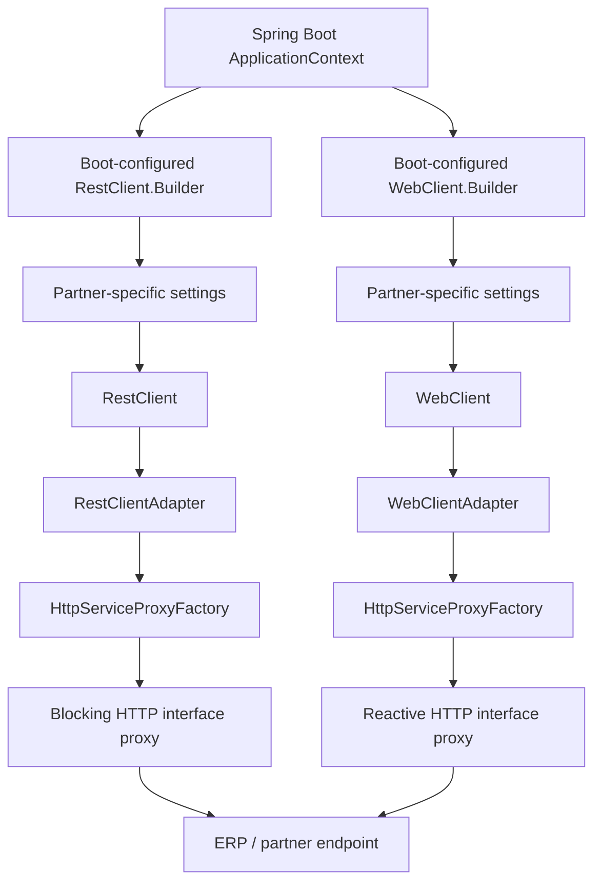
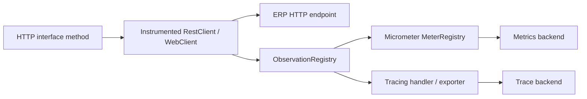
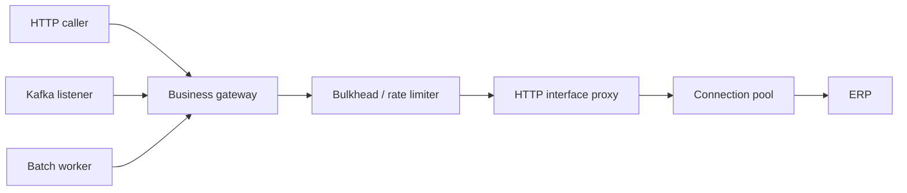

# Using Boot-Customized Builders Instead of Bypassing Shared Configuration

## 1. Problem: HTTP Interface Works Yet Loses Integration Configuration

A Spring Boot integration application often calls multiple partner APIs: querying inventory over REST, checking payment status, syncing with an ERP over HTTP, and saving results to PostgreSQL, Redis, or a message broker. Spring's **HTTP interface** lets you describe HTTP calls as a Java interface, eliminating repetitive code for building URLs, invoking clients, and deserializing payloads.

However, an HTTP interface only describes the **calling contract**. An interface proxy cannot determine timeouts, TLS, network proxies, authentication, connection pools, message converters/codecs, metrics, or tracing on its own. All of those depend on the **actual HTTP client attached to the proxy**.

A common pitfall:

```java
// Looks concise, yet bypasses Boot's RestClient.Builder customizations.
RestClient client = RestClient.create("https://erp.example.invalid");
HttpServiceProxyFactory factory =
        HttpServiceProxyFactory.builderFor(
                RestClientAdapter.create(client))
            .build();

ErpOrderApi api = factory.createClient(ErpOrderApi.class);
```

This snippet can return HTTP 200 and map JSON successfully, yet **does not automatically inherit customizers, `ObservationRegistry`, transport settings, or policies from the builder provided by Spring Boot**. As a result, one group of calls loses metrics, uses a different connection timeout, lacks correlation headers, or skips shared policies.

Within the **SPRING_BOOT_INTEGRATION** module, this lesson belongs to the **HTTP interface** chapter and aligns with the goal of organizing HTTP client, database, cache, broker, and Spring Integration flows with consistent configuration, data contracts, transactions, error handling, idempotency, testing, and observability.

**Core principle:** build the underlying `RestClient`/`WebClient` from a **Spring Boot-injected builder**, then wrap it with an adapter to create the HTTP interface proxy. `HttpServiceProxyFactory` is not a mechanism that retroactively recovers customizers that were bypassed earlier.

After this lesson, you will know how to:

- Distinguish the HTTP interface contract, client, builder, adapter, and proxy factory.
- Assemble an HTTP interface from a Boot-managed `RestClient.Builder` or `WebClient.Builder`.
- Spot initialization patterns that risk dropping shared configuration.
- Separate global, per-partner, and per-request configuration cleanly.
- Keep metrics/tracing, authentication, timeouts, connection pooling, and codecs active when creating proxies.
- Test bean wiring, real transport paths, and failure scenarios.

## 2. HTTP Interface Structure: Proxies Do Not Replace Clients

Spring Framework 6 introduced **declarative HTTP service interfaces**. With Spring Framework 6.1+ and Spring Boot 3.2+, the typical components are:

| Component | Role | Key Point |
|---|---|---|
| `@HttpExchange`, `@GetExchange`, `@PostExchange`... | Declares methods, URIs, HTTP methods, and content types. | Contract/metadata only; performs no network calls. |
| `RestClient` | Synchronous HTTP client with a fluent API. | Holds request factory, interceptors, converters, and observation. |
| `WebClient` | Reactive HTTP client. | Holds exchange connector, filters, codecs, and observation. |
| `RestClient.Builder`/`WebClient.Builder` | Configures and builds clients. | Boot can apply a suite of customizers here. |
| `RestClientAdapter`/`WebClientAdapter` | Bridges the client into the HTTP interface abstraction. | Adapter wraps an **already-built client**. |
| `HttpServiceProxyFactory` | Generates a proxy implementation for a Java interface. | Does not restore Boot settings that were skipped. |
| Service/gateway bean | Defines business boundaries, error mapping, and retries. | Avoid leaking HTTP details into the domain layer. |



In particular, `@HttpExchange` does not mean an endpoint is **exposed** like a Spring MVC controller. In this lesson, the interface describes an **outbound HTTP client**; the proxy calls an external service. Do not confuse it with `@RestController` or an HTTP server handler.

### 2.1. Version Requirements

The synchronous examples below target **Spring Boot 3.2+ and Spring Framework 6.1+** with `RestClient` and `RestClientAdapter`. Some WebClient HTTP interface features were already available in earlier Framework releases, though factory/adapter API names and configurations can change across versions.

If you are using Spring Boot 3.0/3.1, `RestClient` is not available as an option; use `WebClient` or the HTTP interface support provided by that framework version. In newer Boot releases, always verify Java version, auto-configuration, dependency BOM, and exact project APIs. Never mix newer Spring Framework dependencies into an older Boot baseline without verifying compatibility.

## 3. Defining an HTTP Interface Contract Properly

Suppose the ERP exposes:

```text
GET  /api/orders/{orderId}/status
POST /api/orders/{orderId}/refresh
```

A Java contract can be written as:

```java
package com.example.integration.erp;

import org.springframework.http.MediaType;
import org.springframework.web.bind.annotation.PathVariable;
import org.springframework.web.bind.annotation.RequestBody;
import org.springframework.web.bind.annotation.RequestHeader;
import org.springframework.web.service.annotation.GetExchange;
import org.springframework.web.service.annotation.HttpExchange;
import org.springframework.web.service.annotation.PostExchange;

@HttpExchange(
    url = "/api/orders",
    accept = MediaType.APPLICATION_JSON_VALUE,
    contentType = MediaType.APPLICATION_JSON_VALUE
)
public interface ErpOrderApi {

    @GetExchange("/{orderId}/status")
    OrderStatusResponse getStatus(
            @PathVariable("orderId") String orderId);

    @PostExchange("/{orderId}/refresh")
    RefreshResponse refresh(
            @PathVariable("orderId") String orderId,
            @RequestHeader("Idempotency-Key") String requestKey,
            @RequestBody RefreshRequest request);
}
```

Illustrative Java DTOs:

```java
public record OrderStatusResponse(
        String orderId, String status, long version) {}

public record RefreshRequest(String source) {}

public record RefreshResponse(
        String operationId, String status) {}
```

`@PathVariable("orderId")` binds the name explicitly instead of relying on Java parameters being compiled with `-parameters`. `@RequestHeader("Idempotency-Key")` passes a business key per the **contract agreed upon with the ERP**, not because the HTTP interface provides idempotency by itself.

These methods can still fail due to network timeouts, JSON deserialization errors, HTTP 429/503, or contract mismatches. A Java interface shortens the code, but does not define error-handling policies by default.

### 3.1. Relative URIs vs Absolute URIs

Contracts should use **relative** paths so the builder defines the environment-specific base URL. If business-layer code constructs full URLs from user input or passes absolute URIs into the interface, it can bypass the managed base URL and risk SSRF or sending credentials to untrusted hosts.

Better:

```yaml
integration:
  erp:
    base-url: ${ERP_BASE_URL}
```

`ERP_BASE_URL` must come from environment configuration or secret management with host and scheme allowlists matching the contract. Never take arbitrary base URLs from inbound HTTP payloads and call them directly.

## 4. The Right Way: Inject `RestClient.Builder` from Spring Boot

Spring Boot can auto-configure `RestClient.Builder` when the classpath and bean conditions match. That builder is where Boot and `RestClientCustomizer` beans apply shared settings such as message converters, request factory selection, observation registries, or application-defined customizers.

Instead of calling `RestClient.create(...)` or `RestClient.builder()` in application code, inject the builder:

```java
package com.example.integration.erp;

import org.springframework.beans.factory.annotation.Value;
import org.springframework.context.annotation.Bean;
import org.springframework.context.annotation.Configuration;
import org.springframework.web.client.RestClient;
import org.springframework.web.client.support.RestClientAdapter;
import org.springframework.web.service.invoker.HttpServiceProxyFactory;

@Configuration(proxyBeanMethods = false)
public class ErpHttpInterfaceConfiguration {

    @Bean
    ErpOrderApi erpOrderApi(
            RestClient.Builder bootBuilder,
            @Value("${integration.erp.base-url}") String baseUrl) {

        RestClient restClient = bootBuilder
                .baseUrl(baseUrl)
                .defaultHeader("X-Client-App", "order-integration")
                .build();

        HttpServiceProxyFactory factory =
                HttpServiceProxyFactory.builderFor(
                        RestClientAdapter.create(restClient))
                    .build();

        return factory.createClient(ErpOrderApi.class);
    }
}
```

Execution flow:

1. Spring injects a `RestClient.Builder` created/customized according to active auto-configuration.
2. The configuration adds only the `baseUrl` and header **specific to the ERP**.
3. `build()` produces a `RestClient` carrying the builder's settings.
4. `RestClientAdapter.create(...)` wraps the client.
5. `HttpServiceProxyFactory` generates the `ErpOrderApi` implementation.
6. Application services inject `ErpOrderApi` and invoke it like any Java interface.

Here, **the proxy makes no network calls during bean creation**. Real HTTP requests happen only when `getStatus(...)` or `refresh(...)` is invoked.

### 4.1. Example Call from an Application Service

```java
import org.springframework.stereotype.Service;

@Service
public class OrderStatusService {
    private final ErpOrderApi erpApi;

    public OrderStatusService(ErpOrderApi erpApi) {
        this.erpApi = erpApi;
    }

    public OrderStatusResponse lookup(String orderId) {
        return erpApi.getStatus(orderId);
    }
}
```

The caller knows nothing about `HttpServiceProxyFactory`, `RestClientAdapter`, HTTP headers, or connection factories. Those details stay in the **adapter/configuration layer**. When error translation, concurrency limits, or business retries are needed, wrap the proxy in a gateway facade rather than letting every service call the proxy directly and handle exceptions inconsistently.

### 4.2. Placement of Global vs Per-Partner Configuration

The `X-Client-App` header in the example is a harmless partner-level identifier. Never put ERP's `Authorization` or API key into a global customizer if the app also calls banking or CRM services. Layer settings cleanly:

| Scope | Examples | Where to Place |
|---|---|---|
| Application-wide | Observation, safe correlation logging, shared converters. | Boot-managed builder/customizers within appropriate scope. |
| Per dependency | Base URL, SSL truststore, connection pool, timeouts, API credentials. | Dedicated bean building the ERP/CRM client. |
| Per operation | `Idempotency-Key`, SOAP/HTTP operation headers, specific deadlines. | Method contract, interceptor, or gateway. |
| Per request | Trace context, business IDs, authenticated tenant/locale. | Method arguments/context propagation; never mutate a shared client. |

**Shared configuration** does not mean all dependencies share the same timeouts or credentials. The goal is to preserve Boot's foundation and specialize where required.

## 5. Comparison: Client Creation Patterns That Drop Customizations

Three ways can produce the same `RestClient` type yet **come from different configuration sources**:

```java
// A. Boot-managed builder: preferred.
RestClient fromBoot =
        bootBuilder.baseUrl(baseUrl).build();

// B. Spring Framework static factory: does not pick up Boot customizers.
RestClient direct =
        RestClient.create(baseUrl);

// C. Plain Spring Framework builder: does not pick up Boot customizers.
RestClient plain =
        RestClient.builder().baseUrl(baseUrl).build();
```

Similarly with `WebClient`:

```java
// Retains WebClientCustomizer settings applied to Boot's injected builder.
WebClient managed = bootWebClientBuilder
        .baseUrl(baseUrl).build();

// Does not automatically receive customizers from Boot's builder.
WebClient direct = WebClient.create(baseUrl);
WebClient plain = WebClient.builder().baseUrl(baseUrl).build();
```

| Behavior | Builder from Boot Context | Plain `create()` / `builder()` |
|---|---|---|
| Boot beans/customizers applied to builder | Per auto-configuration conditions. | **Not inherited automatically**. |
| Micrometer HTTP observation/tracing | Can be pre-configured on the builder. | Must instrument manually if desired. |
| Boot-customized message converters/codecs | Preserved unless replaced. | Uses plain defaults or manual config. |
| Application custom transport/SSL/proxy | Can be attached by customizer. | Not picked up from context. |
| Shared interceptors/filters | Can already be registered. | Does not receive customizer beans. |
| Can it send HTTP requests? | Yes, if endpoint/contract matches. | **Also yes**, making the bug subtle. |

To be clear: `create()` is not inherently **technically wrong**. If an application deliberately attaches its own `ObservationRegistry`, transport, SSL, authentication, and every cross-cutting concern, the client can be valid. But in a Spring Boot app needing consistent configuration, that creates **two separate configuration paths** that are hard to audit—especially when a new customizer is added later.

### 5.1. "Using the Right Factory" with the Wrong Underlying Client

A very common anti-pattern:

```java
@Bean
ErpOrderApi erpOrderApi() {
    RestClient client = RestClient.create(
            "https://erp.example.invalid");

    return HttpServiceProxyFactory.builderFor(
            RestClientAdapter.create(client))
        .build()
        .createClient(ErpOrderApi.class);
}
```

The `HttpServiceProxyFactory` API is right, the annotations are right, and method calls succeed—yet the underlying `RestClient` was created outside Boot's configuration. Fix this at **client instantiation**, not on the interface method or by inventing some annotation on `ErpOrderApi`.

## 6. Boot-Managed `WebClient.Builder` for Reactive HTTP Interfaces

If the application uses Spring WebFlux, Boot can provide a `WebClient.Builder` with codec/connector/filter/observation customizers applied. Wiring the proxy mirrors `RestClient`, differing in reactive return types:

```java
package com.example.integration.inventory;

import org.springframework.web.bind.annotation.PathVariable;
import org.springframework.web.service.annotation.GetExchange;
import org.springframework.web.service.annotation.HttpExchange;
import reactor.core.publisher.Mono;

@HttpExchange("/api/inventory")
public interface InventoryHttpApi {

    @GetExchange("/{sku}")
    Mono<InventoryResponse> getStock(
            @PathVariable("sku") String sku);
}

public record InventoryResponse(
        String sku, long available, String warehouse) {}
```

Configuration:

```java
import org.springframework.beans.factory.annotation.Value;
import org.springframework.context.annotation.Bean;
import org.springframework.context.annotation.Configuration;
import org.springframework.web.reactive.function.client.WebClient;
import org.springframework.web.reactive.function.client.support.WebClientAdapter;
import org.springframework.web.service.invoker.HttpServiceProxyFactory;

@Configuration(proxyBeanMethods = false)
public class InventoryHttpInterfaceConfiguration {

    @Bean
    InventoryHttpApi inventoryHttpApi(
            WebClient.Builder bootBuilder,
            @Value("${integration.inventory.base-url}") String baseUrl) {

        WebClient webClient = bootBuilder
                .baseUrl(baseUrl)
                .build();

        return HttpServiceProxyFactory.builderFor(
                    WebClientAdapter.create(webClient))
                .build()
                .createClient(InventoryHttpApi.class);
    }
}
```

Configuration example:

```yaml
integration:
  inventory:
    base-url: ${INVENTORY_BASE_URL}
```

**`Mono<InventoryResponse>` only describes execution**; network I/O usually begins when the publisher is subscribed. Never call `.block()` on a Netty event loop to force it synchronous. If the app is predominantly blocking JDBC/MVC, `RestClient` is simpler and better suited; choose the client based on the real concurrency model, not because HTTP interfaces force reactive code.

### 6.1. Builders Can Be Mutable

Both `RestClient.Builder` and `WebClient.Builder` expose mutating configuration operations. Spring Boot typically uses scopes/mechanisms so each injection point gets an independently customizable builder; exact details depend on version. If you store a mutable builder in a custom singleton and mutate `baseUrl`/default headers from multiple threads or clients, partners can contaminate each other's settings.

A safe pattern when reusing the same builder in your own code:

```java
RestClient erpClient =
        bootRestClientBuilder.clone()
            .baseUrl(erpUrl)
            .build();

RestClient crmClient =
        bootRestClientBuilder.clone()
            .baseUrl(crmUrl)
            .build();
```

`clone()` on Framework builders creates an independent branch from an already-customized builder. If the app injects a fresh builder from Boot per `@Bean`, keeping a shared mutable builder may not even be necessary. However, **cloning a plain builder only clones plain settings**—it does not turn it into a Boot-managed builder.

### 6.2. Do Not Wipe Out Configured Codecs

When customizing `WebClient`, you might add codecs for large payloads or tweak Jackson; do not replace `ExchangeStrategies` or connectors wholesale without checking existing customizations. A Boot-provided `WebClient` may already share a unified `ObjectMapper` and codec policy. Swapping in a brand-new transport or codec object can make behavior diverge from other clients.

## 7. Where Do Customizers Actually Run?

Spring Boot provides extension points for builders. For example, with `RestClient` in Boot 3.2+, you can register a `RestClientCustomizer` to add shared metadata to clients built from Boot-managed builders:

```java
import org.springframework.boot.web.client.RestClientCustomizer;
import org.springframework.context.annotation.Bean;
import org.springframework.context.annotation.Configuration;

@Configuration
class HttpClientDefaultsConfiguration {

    @Bean
    RestClientCustomizer identifyApp() {
        return builder -> builder
                .defaultHeader(
                    "X-Integration-Client", "order-integration");
    }
}
```

This customizer runs **on the builder**, not on `HttpServiceProxyFactory`. A `RestClient` constructed via `RestClient.create(...)` will not execute that customizer bean. In this example, the header is a non-sensitive static identifier; never apply a partner-specific secret across the whole app.

For `WebClient`, customizers can attach filters, codecs, or connectors when the builder is auto-configured. The same rule applies: **who constructed the client, and which customizers ran on that builder?**

### 7.1. Why Does Configuration Order Matter?

Suppose a Boot customizer sets a `ClientHttpRequestFactory` with connection pooling, while the ERP configuration calls `.requestFactory(...)` to install a custom transport. The later call can **replace the existing transport**, even while interceptors/observations on the builder remain intact. That may be intentional, but you must know what you replaced.

Conversely, overwriting `ObservationRegistry` with `ObservationRegistry.NOOP` or clearing filters when building the client drops metrics/tracing. Never conclude "we injected the builder, so all instrumentation is definitely active" if application code overrides settings afterward.

### 7.2. App-Wide Customizers Must Not Hold Every Partner's Secrets

A global `RestClientCustomizer` adding `Authorization: Bearer <ERP token>` can send the ERP token to CRM or other services. Keep layers distinct:

- **Global:** safe shared policies, observation, general non-secret defaults.
- **Per-client:** credentials, truststores, base URLs, timeouts, pools/bulkheads, and partner-specific headers.
- **Per-operation/request:** idempotency keys, deadlines, correlation IDs, or validated business-context locales.

Layering keeps HTTP interfaces clean without leaking credentials across systems.

## 8. Managing Endpoint Config with Typed Properties

With many endpoints, scattering URLs across `@Value` annotations invites missing validation or profile mistakes. `@ConfigurationProperties` groups a partner's settings cleanly:

```java
import java.net.URI;
import org.springframework.boot.context.properties.ConfigurationProperties;

@ConfigurationProperties(prefix = "integration.erp")
public record ErpHttpProperties(
        URI baseUrl,
        int maxAttempts) {}
```

Registering properties:

```java
import org.springframework.boot.context.properties.EnableConfigurationProperties;
import org.springframework.context.annotation.Configuration;

@Configuration(proxyBeanMethods = false)
@EnableConfigurationProperties(ErpHttpProperties.class)
class IntegrationPropertiesConfiguration {}
```

Using in the factory configuration:

```java
@Bean
ErpOrderApi erpOrderApi(
        RestClient.Builder builder,
        ErpHttpProperties config) {

    RestClient client = builder
            .baseUrl(config.baseUrl().toString())
            .build();

    return HttpServiceProxyFactory.builderFor(
                RestClientAdapter.create(client))
            .build()
            .createClient(ErpOrderApi.class);
}
```

Sample YAML:

```yaml
integration:
  erp:
    base-url: https://erp.internal.example
    max-attempts: 2
```

This address is illustrative only. In production, validate required `https` schemes, allowlisted hosts, and valid timeouts/quotas; fail fast at startup if the base URL is missing instead of failing on the first order. `max-attempts` here is a **business configuration value**—having the field does not trigger retries automatically; it must be wired into a bounded retry policy.

### 8.1. Configuration Is Not Request Input Data

Never turn a `tenantId` or `customerId` parameter into a URL host. If multi-tenancy requires distinct endpoints, resolve them through a trusted allowlist/mapping with per-tenant credentials and SSRF tests. Never let an interface accept arbitrary user-supplied absolute URIs merely for flexibility.

## 9. Timeouts and Transports: Customizing Without Breaking Shared Builders

HTTP interfaces do not provide "one single timeout for all phases". Real latency spans DNS, pool connection acquisition, TCP/TLS handshakes, request body transmission, server processing, response reading, JSON decoding, retries/backoff, and executor/bulkhead queuing.

Distinct timeout layers:

| Type | What It Measures | Problem When Unset |
|---|---|---|
| Connection acquisition | Waiting for an available HTTP connection from the pool. | Pool exhaustion stalls tasks indefinitely. |
| Connect timeout | Opening a TCP connection to the host. | Broken networks tie up threads. |
| TLS handshake | Establishing HTTPS and verifying certificates. | Security/network hangs blur into slow responses. |
| Read/response timeout | Waiting for/reading response per transport semantics. | A hung ERP traps many workers. |
| Overall deadline | Total elapsed time from task start to completion. | Retries/queues blow past SLO even with per-attempt timeouts. |

Spring Framework supports multiple `ClientHttpRequestFactory` implementations (JDK, Apache HttpComponents, ...), and WebClient supports connectors (typically Reactor Netty). **Method names for configuring timeouts/pools vary across transports and versions**. Choose the transport first, then apply configuration **on the injected builder** rather than creating a plain `RestClient`/`WebClient`.

Example showing the JDK HTTP client and request factory in Spring Framework 6.1+:

```java
import java.net.http.HttpClient;
import java.time.Duration;
import org.springframework.http.client.JdkClientHttpRequestFactory;
import org.springframework.web.client.RestClient;

RestClient createErpClient(RestClient.Builder bootBuilder,
                           String baseUrl) {
    HttpClient http = HttpClient.newBuilder()
            .connectTimeout(Duration.ofMillis(400))
            .build();

    JdkClientHttpRequestFactory factory =
            new JdkClientHttpRequestFactory(http);
    factory.setReadTimeout(Duration.ofSeconds(2));

    return bootBuilder
            .baseUrl(baseUrl)
            .requestFactory(factory)
            .build();
}
```

This example illustrates **deliberate transport replacement**. It does not imply the JDK factory shares the same connection-pool policy as Apache HttpComponents. Calling `.requestFactory(factory)` can override the factory chosen by Boot/customizers; verify TLS, pooling, request buffering, redirects, authentication, observation, and transport metrics afterward. If you need proxies or mTLS, configure them on the chosen transport; never disable certificate verification as a "quick fix" for connection failures.

### 9.1. Managing Timeouts with a Total Budget

Example: an inbound HTTP call has 1.5 seconds remaining, the app already spent 300 ms in the DB, and the task waits 200 ms for a bulkhead. Do not grant a **fresh** 1.5-second ERP read timeout and retry twice. Track an end-to-end deadline, compute remaining time before each attempt, and reject/short-circuit when budget runs out.

`CompletableFuture.orTimeout(...)` only caps how long the caller waits; it does not cancel side effects inside the ERP. Especially for order-creating `POST` calls, a timeout can happen after the ERP committed; use idempotency keys and reconciliation.

## 10. HTTP Client Observation, Metrics, and Tracing Must Be Preserved

A major reason to use Boot-managed builders is **HTTP client observation**. In properly configured Spring Boot 3.x/Micrometer setups, auto-configuration wires `ObservationRegistry` into the builder and produces HTTP client request observations whenever the client actually sends requests.

Components involved:



Distinguish four things:

1. **Instrumented client:** built from a builder carrying observation settings, or manually instrumented.
2. **Observation handlers:** handlers registered to record metrics/traces.
3. **Registry and export:** `MeterRegistry` and exporters/tracing bridges needed to ship telemetry to dashboards.
4. **HTTP request actually executes:** the method is invoked; with `WebClient`, a subscription occurs.

Having Actuator on the classpath does **not** prove every outbound HTTP client is instrumented. Calling `RestClient.create(...)` or `WebClient.create(...)` behind an HTTP interface proxy can silently skip instrumentation while still returning valid responses.

### 10.1. URI Templates and Low-Cardinality Tags

HTTP interface:

```java
@GetExchange("/{orderId}/status")
OrderStatusResponse getStatus(
        @PathVariable("orderId") String id);
```

Keep the template `/api/orders/{orderId}/status` rather than assembling an absolute URI containing individual IDs. When supported by the observation framework, templates keep the `uri` metric tag stable. Always **verify the actual emitted tags** in your Framework version, because how URIs, adapters, and custom requests are built can affect template extraction.

Never put `orderId`, `customerId`, emails, tokens, trace IDs, or request IDs into metric tags; high cardinality explodes time series and risks leaking data. Good tags include `client=erp`, `operation=order-status`, `method=GET`, `status=200/503`, or bounded values aligned with active instrumentation.

### 10.2. Measuring HTTP Attempts vs Business Operations

Suppose an ERP status check retries after HTTP 503:

```text
Business operation: lookupOrderStatus(O-42)
  HTTP attempt 1 -> 503 (150 ms)
  Backoff -> 100 ms
  HTTP attempt 2 -> 200 (220 ms)
Business operation completes in roughly 470 ms
```

HTTP client request metrics record **two HTTP attempts**, whereas the business operation performed **one lookup**. To measure user-facing SLOs, wrap the retry and backoff in a business timer/observation instead of inferring order volume from HTTP request counts.

## 11. Authentication and Security: Preserve Shared Config Without Leaking Secrets

A client built from a managed builder may already carry SSL/proxy/observation customizers. However, **partner authentication usually must be configured explicitly**; Boot cannot guess which API key or OAuth2 token the ERP expects.

Use a client-specific interceptor when needed:

```java
import org.springframework.http.HttpHeaders;
import org.springframework.http.client.ClientHttpRequestInterceptor;
import org.springframework.web.client.RestClient;

RestClient createAuthenticatedClient(
        RestClient.Builder bootBuilder,
        String endpoint,
        ErpTokenProvider tokenProvider) {

    ClientHttpRequestInterceptor auth = (request, body, execution) -> {
        String token = tokenProvider.currentToken();
        request.getHeaders().setBearerAuth(token);
        return execution.execute(request, body);
    };

    return bootBuilder
            .baseUrl(endpoint)
            .requestInterceptor(auth)
            .build();
}
```

`ErpTokenProvider` is an application-defined abstraction; this snippet does not show token issuance. If using OAuth2 client integration, prefer built-in OAuth2 support with proper grants/audiences instead of hand-rolling token logic.

Constraints:

- Never attach ERP credentials to all REST/WebClient builders via a global customizer.
- Never log `Authorization`, cookies, PII-bearing bodies, or full URIs containing secrets in query parameters.
- Never send credentials to redirect hosts outside an allowlist; verify transport redirect policies.
- Manage truststores/SSL bundles and certificate rotation; never disable hostname verification.
- If pulling headers from application context/`ThreadLocal`, mind async/reactive propagation boundaries.

### 11.1. Per-Request Headers vs Default Headers

`defaultHeader(...)` fits static values shared by all requests of a client. `@RequestHeader("Idempotency-Key")` fits values specific to each command. For trace/correlation IDs, rely on instrumentation/context propagation; never mutate a shared `RestClient.Builder` or `WebClient.Builder` per incoming request.

## 12. Custom Interceptors/Filters: Ordering, Logging, and Duplication

When an application defines multiple `RestClientCustomizer` or `WebClientCustomizer` beans, a client can accumulate multiple interceptors/filters:

- Authentication.
- Correlation headers.
- Metrics/tracing.
- Custom headers and error mapping.
- Logging/diagnostics with redaction.
- Retries, if designed at the HTTP client layer.

They can depend on **execution order**. For instance, a logging filter must not print raw tokens injected by an auth filter. Manually instrumenting a client already instrumented by Boot risks **double counting** HTTP request metrics or producing duplicate nested spans.

Never infer "exactly once" by reading code. In tests, assert actual HTTP attempt counts and observation counts, and verify header/interceptor behavior.

### 12.1. Do Not Overwrite Interceptor Lists and Wipe Earlier Entries

Some transport/builder setters **replace the entire configuration**, while others append. When customizers use `setInterceptors`/`requestInterceptors` or `exchangeStrategies`, verify whether the API **appends, mutates, or replaces**. In large integration projects, extract a clearly named helper `configureErpClient(...)` with regression tests proving that adding authentication did not strip observation or proxy settings.

## 13. Choosing the Right Layer for Error Handling

An HTTP interface can return a Java DTO, `ResponseEntity<T>`, `Mono<T>`, or other version-supported types. Yet HTTP statuses/errors do not automatically become valid domain exceptions.

Suppose the ERP returns:

| HTTP Outcome | Possible Meaning | Strategy |
|---|---|---|
| 200 + valid data | Lookup succeeded. | Map DTO to domain view. |
| 200 + `businessError` in JSON | HTTP succeeded, business failed. | Parse error code and map explicitly. |
| 400 | Request violates contract. | Do not blindly retry; inspect DTO/validation. |
| 401/403 | Invalid credentials/permissions. | Alert/reconfigure; avoid retry storms. |
| 404 | Not found or wrong endpoint. | Per contract: not found may be a normal outcome. |
| 409 | Conflict/version mismatch. | Coordinate concurrency/idempotency. |
| 429 | Partner rate-limiting. | Honor rate limits, backoff, and deadlines. |
| 500/503 | Server error/temporarily unavailable. | Bounded retry if operation is replay-safe. |
| Connect/read timeout | Full outcome never received. | Distinguish GETs from side-effecting write commands. |

With `RestClient` and `WebClient`, status handlers/filters can translate responses into classified exceptions. Avoid scattering arbitrary `onStatus` logic across every proxy method; centralize policy at the client/gateway and test error response bodies, since the HTTP interface proxy delegates to the configured client.

### 13.1. Error Mapping Belongs in the Gateway Adapter

A business facade can wrap the proxy:

```java
@Service
public class ErpOrderGateway {
    private final ErpOrderApi api;

    public ErpOrderGateway(ErpOrderApi api) {
        this.api = api;
    }

    public OrderStatusResponse getStatus(String orderId) {
        try {
            return api.getStatus(orderId);
        } catch (RestClientResponseException ex) {
            throw mapHttpFailure(ex); // Application-defined helper.
        } catch (ResourceAccessException ex) {
            throw mapTransportFailure(ex);
        }
    }
}
```

This example assumes blocking `RestClient`, imported exception classes, and `mapHttpFailure`/`mapTransportFailure` helpers. Do not infer that all HTTP clients (notably `WebClient`) throw the same exception classes. With reactive `WebClient`, error mapping belongs inside the reactive pipeline rather than a `try/catch` around an unsubscribed `Mono`.

## 14. Retries, Rate Limits, and Circuit Breakers Are Not Created by HTTP Interfaces

`@HttpExchange` does not make `POST` idempotent. If `refresh(...)` hits a read timeout, the ERP may already have started the job; retrying and spawning a second job is wrong without a stable request key.

Rules:

1. Retry only safely classified errors, capped by max attempts and backoff/jitter.
2. Assign **one single layer to own retries**; avoid 3 retries in the gateway, 3 in an HTTP filter, and 3 in a broker consumer.
3. Configure circuit breakers/bulkheads/rate limits per endpoint and total replica count.
4. For write commands, pass an idempotency key per partner contract, reusing the same key across all retries of the same intent.
5. If a timeout leaves the outcome unknown, query status/reconcile before deciding to replay.
6. Never hold a JDBC transaction open across long HTTP retries.

An interface parameter like `@RequestHeader("Idempotency-Key")` passes the key, but **only the ERP and business policy enforce real idempotency**. If the ERP does not support it, design business keys, reconciliation, or compensating workflows.

## 15. Connection Pools, Executors, and Concurrency Budgets Must Align

An HTTP interface proxy can be called from:

- Spring MVC controllers.
- `@Async` methods on a `ThreadPoolTaskExecutor`.
- Spring Integration service activators.
- Kafka/RabbitMQ listeners.
- Spring Batch steps.

Each caller has different concurrency characteristics. If 10 worker threads call the same `RestClient`, yet the HTTP transport allows only 4 connections, 6 tasks queue on the pool; if the ERP allows only 20 requests/second and you run 5 replicas, enlarging the pool will not make upstream sustain more load.



Measure at least:

| Metric | Helps Detect |
|---|---|
| HTTP client request duration/count/outcome | Latency and error rate per endpoint. |
| Connection pool active/idle/pending | Connection waits and pool saturation. |
| Thread pool queue wait/active/rejections | Queued tasks and JVM overload. |
| Bulkhead in-flight/rejections | Actual dependency quota consumption. |
| Retry count/backoff/attempts | Retry storms or upstream throttling. |
| Business operation latency | End-to-end time from business call to outcome. |

**A Boot-managed builder cannot substitute for concurrency policies.** It centralizes transport/instrumentation setup, while queuing, rate limits, and throughput still must be engineered per dependency.

## 16. Transactions and Spring Integration: Do Not Treat HTTP Calls as Part of a DB Commit

HTTP interfaces executing through `RestClient`/`WebClient` do not atomically join a JDBC transaction. If a service opens `@Transactional`, writes to the DB, and calls the ERP, a DB rollback will not roll back the ERP. While waiting on a slow ERP, the service holds DB connections/locks, starving resources.

Failure-prone flow:

```text
BEGIN DB transaction
  INSERT order
  POST ERP /refresh
  ERP accepted
  DB commit fails
=> ERP has a side effect, yet the DB has no order
```

In systems requiring reliability:

1. Validate the command and generate a business ID.
2. Persist DB state + outbox record in **one DB transaction**.
3. After commit, a worker/dispatcher picks up durable work.
4. The HTTP interface gateway calls the ERP with an idempotency key.
5. Record the outcome and reconcile when outcomes are unknown.
6. Acknowledge Kafka/RabbitMQ messages only after the durable step defined by contract.

An `ExecutorChannel` or `@Async` only switches threads; it neither creates a durable queue nor propagates transactions/contexts automatically. Never ack a broker immediately upon `executor.execute(...)` if the job must complete or be durably stored before acknowledgment.

## 17. Multiple Clients in One App: Protecting Isolation

Suppose an app uses both an ERP REST client and a Payment API client. Sharing Spring Boot-managed `RestClient.Builder` makes sense, yet you need **two independent beans**:

```java
@Bean
ErpOrderApi erpOrderApi(
        RestClient.Builder builder,
        ErpHttpProperties props) {
    RestClient client = builder.clone()
            .baseUrl(props.baseUrl().toString())
            .build();
    return HttpServiceProxyFactory.builderFor(
            RestClientAdapter.create(client))
        .build()
        .createClient(ErpOrderApi.class);
}

@Bean
PaymentApi paymentApi(
        RestClient.Builder builder,
        PaymentHttpProperties props) {
    RestClient client = builder.clone()
            .baseUrl(props.baseUrl().toString())
            .build();
    return HttpServiceProxyFactory.builderFor(
            RestClientAdapter.create(client))
        .build()
        .createClient(PaymentApi.class);
}
```

`PaymentApi` and `PaymentHttpProperties` are application-defined contracts/properties. Both methods can receive builders from the Spring container per your version's semantics; `clone()` illustrates isolating settings before `build()`. If a custom transport or auth interceptor is registered globally, verify whether it belongs on **both** clients.

Isolation rules:

- Never reuse the same bearer token across partners unless they share the same audience.
- Connection pools may be shared when topology warrants it, but per-route/per-partner quotas must be explicit.
- Never mutate `baseUrl` on a concurrently shared builder.
- Never pass ERP domain DTOs to the Payment API just because field names match.
- Isolate circuit breakers, timeouts, and `partner`/`operation` metric dimensions by workload.

## 18. Supporting Boot-Managed Builders When APIs Live in an Internal Library

An internal `partner-sdk` library might ship the HTTP interface and a proxy helper. If the helper writes:

```java
public static ErpOrderApi create(String url) {
    RestClient rest = RestClient.create(url);
    return HttpServiceProxyFactory.builderFor(
            RestClientAdapter.create(rest))
        .build()
        .createClient(ErpOrderApi.class);
}
```

then even if a Spring Boot app defines great `RestClientCustomizer` beans, the helper ignores them. Change the API design:

```java
public static ErpOrderApi create(
        RestClient.Builder configuredBuilder,
        String url) {

    RestClient rest = configuredBuilder.clone()
            .baseUrl(url)
            .build();

    return HttpServiceProxyFactory.builderFor(
            RestClientAdapter.create(rest))
        .build()
        .createClient(ErpOrderApi.class);
}
```

In the application:

```java
@Bean
ErpOrderApi erpOrderApi(
        RestClient.Builder bootBuilder,
        @Value("${integration.erp.base-url}") String baseUrl) {
    return PartnerSdk.create(bootBuilder, baseUrl);
}
```

The library does not need to import Spring Boot auto-configuration; it **accepts the externally configured dependency**. This keeps the builder testable in isolation and works in both Spring Boot and plain Spring Framework apps. If the SDK also supports accepting a pre-built `RestClient` instead of a builder, preserving transport and observation settings becomes even easier.

## 19. Testing HTTP Interfaces for Correct Configuration, Not Just DTOs

A unit test building a client with `RestClient.builder()` and asserting JSON deserialization proves interface mapping, yet **does not prove** production injects a Boot-managed builder or applies customizers.

Test at two levels:

1. **Contract/method tests:** accurate HTTP requests, URI templates, headers, bodies, responses, and error mapping.
2. **Boot wiring tests:** the HTTP interface bean flows through the real `RestClient.Builder`/`WebClient.Builder` provided by Boot/customizers; observation, auth, timeouts/transport, and related settings remain intact.

### 19.1. Testing an Interface with `MockRestServiceServer`

Spring Framework 6.1+ supports binding `MockRestServiceServer` to a `RestClient.Builder` to intercept calls from clients built by that builder. Test skeleton:

```java
import org.junit.jupiter.api.Test;
import org.springframework.beans.factory.annotation.Autowired;
import org.springframework.boot.test.context.SpringBootTest;
import org.springframework.http.MediaType;
import org.springframework.test.web.client.MockRestServiceServer;
import org.springframework.web.client.RestClient;
import org.springframework.web.client.support.RestClientAdapter;
import org.springframework.web.service.invoker.HttpServiceProxyFactory;

import static org.assertj.core.api.Assertions.assertThat;
import static org.springframework.test.web.client.match.MockRestRequestMatchers.requestTo;
import static org.springframework.test.web.client.response.MockRestResponseCreators.withSuccess;

@SpringBootTest
class ErpHttpInterfaceTest {

    @Autowired
    RestClient.Builder bootBuilder;

    @Test
    void callsExpectedEndpointThroughHttpInterface() {
        MockRestServiceServer server =
                MockRestServiceServer.bindTo(bootBuilder).build();

        RestClient client = bootBuilder
                .baseUrl("https://erp.test.invalid")
                .build();

        ErpOrderApi api = HttpServiceProxyFactory
                .builderFor(RestClientAdapter.create(client))
                .build()
                .createClient(ErpOrderApi.class);

        server.expect(requestTo(
                "https://erp.test.invalid/api/orders/O-42/status"))
            .andRespond(withSuccess("""
                {"orderId":"O-42","status":"PAID","version":3}
                """, MediaType.APPLICATION_JSON));

        OrderStatusResponse response = api.getStatus("O-42");

        assertThat(response.status()).isEqualTo("PAID");
        assertThat(response.version()).isEqualTo(3);
        server.verify();
    }
}
```

This test constructs a proxy from the **injected Boot builder** in the test context and proves mapping/call paths, without asserting every production bean uses the exact same proxy path. If production builds its client bean via another factory path, add a test calling the actual **production bean** against an HTTP stub at the test-configured URL.

### 19.2. Testing That a Shared Customizer Actually Runs

Register the example `identifyApp()` customizer and assert the header expectation:

```java
import static org.springframework.test.web.client.match.MockRestRequestMatchers.header;

server.expect(requestTo(
        "https://erp.test.invalid/api/orders/O-42/status"))
    .andExpect(header("X-Integration-Client", "order-integration"))
    .andRespond(withSuccess("""
        {"orderId":"O-42","status":"PAID","version":3}
        """, MediaType.APPLICATION_JSON));
```

This snippet **replaces the expectation block** in the previous test rather than standing alone. It proves the client applies customizers when created from Boot's builder. Swapping `bootBuilder` for `RestClient.builder()` causes the Boot customizer header to disappear.

### 19.3. Testing the Production Bean with an HTTP Stub and Dynamic Properties

A stronger test boots the real Spring context, sets `integration.erp.base-url` to an HTTP stub (e.g. MockWebServer or WireMock), injects the **production `ErpOrderApi` bean**, calls methods, and verifies:

- Real URIs, headers, auth, and content types.
- JSON serialization and exception mapping.
- Timeouts when the stub deliberately delays, redirects, and connection failures.
- HTTP client metrics/timers actually increment after calls.
- No `orderId` label inflating cardinality.
- Partner A's token is never sent to partner B.

With `WebClient`, use an HTTP stub or `MockWebServer`/`WebTestClient` at the appropriate layer; if methods return `Mono`, subscribe/await completion before asserting requests and observations. Note that Spring Boot test profiles may disable telemetry exporters; when testing Micrometer, enable a test observability/in-memory registry rather than shipping telemetry to production.

## 20. Verifying Metrics/Tracing with Measurable Test Assertions

Merely checking that `getStatus()` returns `PAID` will not catch a client created with the wrong builder. An observability test can:

1. Use a test `MeterRegistry` or `ObservationRegistry` wired with appropriate observation handlers.
2. Build the client from the **Boot-managed builder**.
3. Call an HTTP stub twice through a URI template using two distinct IDs.
4. Read the HTTP client metric emitted by your Framework version, typically named like `http.client.requests`.
5. Verify the attempt count increased as expected while the **uri tag** stays templated/low-cardinality rather than containing `O-42`/`O-99`.
6. Run a negative control using `RestClient.create(...)` to prove the configuration boundary if that regression occurred before.

Depending on Spring Boot/Micrometer versions and registries, exported timer or metric names vary—for instance, `_seconds_count` suffixes in Prometheus. Never hardcode a single exporter name across all environments. Metrics do not replace tracing: traces require bridges/exporters/sampling, and propagation to the ERP only succeeds if downstream honors trace headers.

### 20.1. Async Context Propagation

If an HTTP interface is called from `@Async` or a Spring Integration `ExecutorChannel`, correlation/trace context from the inbound thread does not always propagate automatically. You may need a `TaskDecorator` or Micrometer context propagation setup. With reactive `WebClient`, Reactor Context behaves differently from `ThreadLocal`; tests must cross the **real async boundary** to confirm traces/spans link properly.

Do not copy the entire `SecurityContext` or HTTP request object to background workers if only a business ID is needed. Pass minimal context and clear/restore thread pools properly.

## 21. Troubleshooting: HTTP Interface Loses Shared Configuration

| Symptom | Possible Cause | How to Check/Fix |
|---|---|---|
| HTTP interface succeeds yet lacks HTTP client metrics | Client built via `RestClient.create(...)`/`WebClient.create(...)`. | Inject Boot builder; test `ObservationRegistry` with HTTP stub. |
| One partner has tracing, another does not | Two different builder paths or overridden observation on one client. | Trace each `@Bean` back to its underlying client. |
| Different timeouts across two HTTP interfaces | One client uses default transport, another uses a custom request factory. | Check builder bean, factory, deadlines, and pools. |
| Missing application-wide custom header | Bypassed `RestClientCustomizer`/`WebClientCustomizer`. | Assert header via mock/stub; inject builder. |
| Customizers run, yet SSL bundle/proxy is lost | Factory/connector replaced after builder customization. | Test real transport, TLS/mTLS/proxies. |
| ERP token sent to CRM by mistake | Credentials placed in global customizer or shared mutable builder. | Isolate auth per client and assert zero leakage. |
| Client bean fails to instantiate | Missing HTTP interface class/adapter, version mismatch, ambiguous beans. | Check Boot/Framework versions, imports, bean qualifiers. |
| HTTP interface gets 404 despite matching server controller | Mismatched base URL/path joining, absolute URI override, encoding. | Inspect actual wire URL and contract. |
| WebClient method sends no request | `Mono` never subscribed. | Subscribe and assert against HTTP stub. |
| WebClient hangs when called on event loop | Calling `block()`/blocking ops on event loop. | Stay reactive or offload blocking cleanly. |
| Every request fails JSON parsing | Replaced codec/`ObjectMapper`; DTO/field version mismatch. | Test serialization contract and client build path. |
| `POST` timeout causes duplicates | Retries without a stable idempotency key. | Persist operation key, query outcomes, and cap retries. |
| CPU/threads spike when ERP slows down | Missing bulkhead/queue/connection cap or retry storm. | Monitor pools, retries, p95/p99, throttle producers. |

### 21.1. Ordered Investigation Workflow

1. Identify the Java interface and exact proxy bean injected.
2. Locate where `RestClient`/`WebClient` is built for `RestClientAdapter`/`WebClientAdapter`.
3. Confirm the builder comes from the Spring context, not a plain static factory.
4. Inspect customizers, request factory/connector, SSL, headers, and `ObservationRegistry`.
5. Hit an HTTP stub, capture requests, and inspect both metrics and trace context.
6. Separate network/transport errors from HTTP status and business errors.
7. After fixing client construction, add a regression test for the header/metric/timeout that had been dropped.

Never stare only at `@HttpExchange` and jump to conclusions. The client's configuration source lives in the **bean factory path**, not inside the annotation.

## 22. Anti-Patterns to Avoid

1. Building the proxy cleanly with `HttpServiceProxyFactory` while passing `RestClient.create(...)` underneath, silently bypassing Boot customizations.
2. Assuming adding `spring-boot-starter-actuator` automatically instruments every external HTTP library.
3. Storing auth, SSL, and timeouts for all partners inside one shared mutable singleton builder.
4. Creating a fresh builder on every request, losing connection pool reuse and observation.
5. Putting ERP's token in a global `RestClientCustomizer` and accidentally leaking it to other APIs.
6. Swapping `ClientHttpRequestFactory`/`ExchangeStrategies` without checking what got overwritten.
7. Attaching per-order correlation IDs as metric tags, causing cardinality explosions.
8. Calling `WebClient.block()` on a Reactor event loop.
9. Retrying timed-out `POST` calls without idempotency/reconciliation.
10. Holding a DB `@Transactional` open during slow ERP calls and expecting DB rollback to undo ERP writes.
11. Testing directly against `RestClient.builder()` and concluding production beans inherited Boot customizers.
12. Asserting only HTTP 200 without testing error statuses, timeouts, headers, serialization, and metrics.
13. Using user-supplied hosts/URLs as base URLs without allowlists or SSRF protection.
14. Believing `@HttpExchange` replaces circuit breakers, bulkheads, timeouts, and durable outboxes.

## 23. Checklist for Deploying HTTP Interfaces in Spring Boot

- [ ] Verify Spring Boot/Spring Framework versions and supported HTTP interface APIs.
- [ ] Declare Java interfaces with `@HttpExchange` and explicit method/parameter annotations.
- [ ] Inject `RestClient.Builder`/`WebClient.Builder` from Spring Boot's `ApplicationContext`.
- [ ] Build clients from the Boot/customizer-configured builder; **never sneak in plain `create()`** inside helpers or libraries.
- [ ] Wire `RestClientAdapter`/`WebClientAdapter` with the **properly constructed client**.
- [ ] Register the proxy as a Spring bean; application services inject the interface or a gateway facade.
- [ ] Isolate endpoints, credentials, TLS, proxies, timeouts, and pools per dependency.
- [ ] Use `@ConfigurationProperties` and validate URLs/quotas; disallow arbitrary request-driven URIs.
- [ ] Verify global customizers neither leak tokens nor send unintended headers to other partners.
- [ ] Verify request factory/connector/codec overrides do not break pre-configured settings.
- [ ] Enforce per-phase timeouts, end-to-end deadlines, connection pools, and per-dependency bulkheads.
- [ ] With WebClient, avoid blocking event loops and test subscriptions properly.
- [ ] Provide error translation distinguishing transport errors, HTTP statuses, and business errors.
- [ ] Enforce bounded retries with idempotency; mark timed-out writes `UNKNOWN` and reconcile.
- [ ] Keep local DB transactions short and out of remote HTTP calls.
- [ ] Ack brokers/`ExecutorChannel` only on durable completion, not in-memory enqueue.
- [ ] Emit HTTP client metrics/traces when instrumentation is required and verify low-cardinality URI tags.
- [ ] Test against HTTP stubs using Boot's builder, plus regression tests for custom headers/observability.
- [ ] Test production proxy beans and real TLS/transport when using mTLS or custom proxies.
- [ ] Mask tokens, customer data, and sensitive payloads in logs/traces; maintain dashboards/runbooks.

## 24. Summary

**An HTTP interface is the calling contract; `RestClient`/`WebClient` is what carries transport, codec, authentication, and observation settings.** When Spring Boot provides a managed builder, building clients via `RestClient.create(...)`, `RestClient.builder()`, or `WebClient.create(...)` without equivalent setup bypasses shared customizers even while the interface proxy appears to work over HTTP.

In **SPRING_BOOT_INTEGRATION**, always follow **inject Boot-customized builder → add per-partner settings → build client → create adapter → build HTTP interface proxy → test requests and telemetry**. Keeping this boundary clean aligns HTTP integrations to ERPs and partners with proper timeouts, transactions, idempotency, retries, tracing, and production operations.
