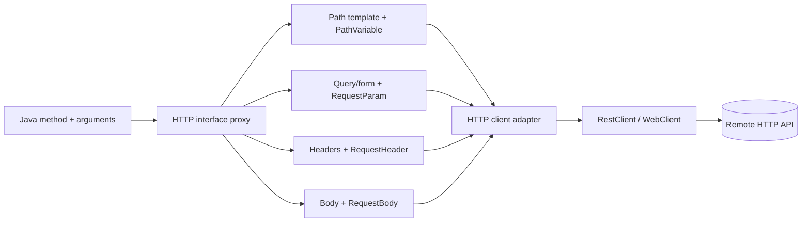
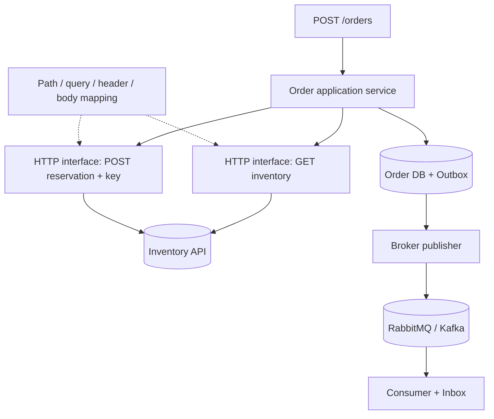

# Mapping Arguments to Path, Query, Headers, and Request Body

## 1. HTTP Interfaces Turn Java Calls into HTTP Contracts

In the **SPRING_BOOT_INTEGRATION** module, a Spring Boot service often needs to call a Catalog API, Payment API, Inventory Service, or legacy system. One option is manually writing many `RestClient`/`WebClient` calls; another is declaring an **HTTP interface** with Spring Framework annotations and generating a proxy that translates Java calls into HTTP requests.

For example:

```java
ProductView product = catalogClient.findProduct(
    "sku-123", "VN", "tenant-17"
);
```

To the caller, this is a Java method. On the wire, it can correspond to:

```http
GET /v1/products/sku-123?region=VN HTTP/1.1
Host: catalog.example.test
Accept: application/json
X-Tenant-Id: tenant-17
```

**Argument mapping** is the set of rules deciding **where each Java method parameter goes inside the HTTP request**:

- `@PathVariable`: substitutes a variable in the URL path.
- `@RequestParam`: represents a query parameter or form parameter depending on content type and adapter.
- `@RequestHeader`: sets an HTTP request header.
- `@RequestBody`: serializes an object as the request body.
- `@RequestPart`: represents parts of a multipart request when applicable.

Incorrect mapping can cause the client to hit the wrong resource, send tokens to the wrong place, produce unencoded URLs, set the wrong `Content-Type`, or emit JSON that violates the schema. Such mistakes affect data contracts, retries, idempotency, and observability across the entire flow.



This lesson belongs to the **HTTP interface** chapter and focuses directly on **"Mapping Arguments to Path, Query, Headers, and Request Body"**. It uses Spring Boot 3.2+ with Spring Framework 6.1+ for `RestClientAdapter` examples; other versions may differ in factory initialization, resolvers, and converters, so verify against the APIs in your stack. `HttpServiceProxyFactory` does not start an HTTP server or replace remote service validation.

## 2. Distinguishing HTTP Client Proxy Annotations from Controller Annotations

Annotations such as `@PathVariable`, `@RequestParam`, `@RequestHeader`, and `@RequestBody` commonly appear in Spring MVC controllers:

```java
@GetMapping("/products/{sku}")
ProductDto get(@PathVariable("sku") String sku) { /* ... */ }
```

In an HTTP interface, they also describe **how the client sends an HTTP request**, yet the direction of the method is reversed:

- Controller: receives inbound requests and **decodes** path/query/header/body into method parameters.
- HTTP interface proxy: receives Java calls and **encodes** method parameters into outbound path/query/header/body.

Example HTTP interface:

```java
import org.springframework.web.bind.annotation.PathVariable;
import org.springframework.web.bind.annotation.RequestHeader;
import org.springframework.web.bind.annotation.RequestParam;
import org.springframework.web.service.annotation.GetExchange;
import org.springframework.web.service.annotation.HttpExchange;

@HttpExchange(url = "/v1", accept = "application/json")
public interface CatalogClient {

    @GetExchange("/products/{sku}")
    ProductView findProduct(
        @PathVariable("sku") String sku,
        @RequestParam("region") String region,
        @RequestHeader("X-Tenant-Id") String tenantId
    );
}
```

`ProductView` is an application-defined DTO. This interface only describes the **outbound contract** and has no implementation yet. Spring creates the proxy via `HttpServiceProxyFactory` paired with an HTTP client adapter.

| Component | Role |
| --- | --- |
| `@HttpExchange` | Shared interface/method metadata such as relative base path, accept, content type |
| `@GetExchange` | Declares HTTP GET and method path |
| `@PostExchange` | Declares HTTP POST |
| `@PutExchange`, `@PatchExchange`, `@DeleteExchange` | Other HTTP methods |
| `@PathVariable` | Maps a value into a URI template |
| `@RequestParam` | Maps a query or form parameter depending on request |
| `@RequestHeader` | Maps a value into an HTTP header |
| `@RequestBody` | Passes an object as body for converter encoding |
| `HttpServiceProxyFactory` | Creates a Java proxy from a declarative interface |
| `RestClientAdapter`/`WebClientAdapter` | Bridges the proxy to the HTTP transport |

**Note:** sharing the `@RequestBody` annotation name does not mean the remote server automatically validates the payload. The client must serialize accurately, the server must deserialize/validate, and the API contract must define the data semantics.

## 3. Creating an HTTP Interface Proxy with Spring Boot's `RestClient.Builder`

Maven with Spring Boot dependency management:

```xml
<dependency>
    <groupId>org.springframework.boot</groupId>
    <artifactId>spring-boot-starter-web</artifactId>
</dependency>
```

This starter typically brings in Spring MVC, Jackson, and the HTTP client components needed by `RestClient`; the remote API must run separately. Configure the endpoint per environment:

```yaml
catalog:
  api:
    base-url: ${CATALOG_API_BASE_URL:https://catalog.example.test}
```

A Spring bean configuration:

```java
package example.integration.catalog;

import org.springframework.beans.factory.annotation.Value;
import org.springframework.context.annotation.Bean;
import org.springframework.context.annotation.Configuration;
import org.springframework.web.client.RestClient;
import org.springframework.web.client.support.RestClientAdapter;
import org.springframework.web.service.invoker.HttpServiceProxyFactory;

@Configuration
public class CatalogClientConfiguration {

    @Bean
    CatalogClient catalogClient(
            RestClient.Builder builder,
            @Value("${catalog.api.base-url}") String baseUrl) {

        RestClient restClient = builder
            .baseUrl(baseUrl)
            .build();

        HttpServiceProxyFactory factory =
            HttpServiceProxyFactory
                .builderFor(RestClientAdapter.create(restClient))
                .build();

        return factory.createClient(CatalogClient.class);
    }
}
```

In Spring Boot 3.2+/Spring Framework 6.1+, this is the standard pattern: **Boot supplies `RestClient.Builder`**, allowing reuse of context message converters, customizers, and observation. Settings such as SSL, timeouts, proxies, authentication, and interceptors must be configured per concrete client.

`HttpServiceProxyFactory` creates a proxy, not a server-side service. When `catalogClient.findProduct(...)` is called, the proxy invokes argument resolvers, issues the HTTP request through `RestClient`, and converts the response to the declared return type.

### 3.1. Why Use a Managed Builder?

Calling `RestClient.create("https://...")` everywhere can inadvertently skip Spring Boot or organization-wide customizations: observability, message converters, load balancing, auth, and request factories. With multiple partners, create **separate client beans** from the managed builder with distinct base URLs/configs instead of mutating one global `RestClient` across all calls.

### 3.2. Base URL and Annotation Paths Combine by Contract

Given:

```text
RestClient baseUrl = https://catalog.example.test
@HttpExchange url = /v1
@GetExchange url  = /products/{sku}
sku = sku-123
```

The expected URI is:

```text
https://catalog.example.test/v1/products/sku-123
```

Check `/` handling when joining paths, `?`, and URL encoding; if an environment's base URL already includes `/v1`, do not repeat `/v1` in the annotation or routes will duplicate.

## 4. `@PathVariable`: Mapping an Argument into a URI Template

`@PathVariable` substitutes values at `{name}` placeholders inside an HTTP path.

```java
@HttpExchange("/v1")
interface ProductQueryClient {

    @GetExchange("/products/{sku}")
    ProductView getProduct(
        @PathVariable("sku") String sku
    );

    @GetExchange("/warehouses/{warehouseId}/products/{sku}")
    InventoryView getStock(
        @PathVariable("warehouseId") String warehouseId,
        @PathVariable("sku") String sku
    );
}
```

Call:

```java
client.getStock("wh-01", "sku-123");
```

Expected:

```http
GET /v1/warehouses/wh-01/products/sku-123 HTTP/1.1
```

**Placeholder names must match:** `{warehouseId}` pairs with `@PathVariable("warehouseId")`. If the annotation mistakenly uses `"warehouse"`, the resolver lacks a key for the template and the request may fail before sending.

### 4.1. Declare Names Explicitly Rather Than Relying on Parameter Metadata

You may see code like:

```java
@GetExchange("/products/{sku}")
ProductView getProduct(@PathVariable String sku);
```

This relies on reading parameter names from bytecode/compilation (such as the `-parameters` flag) and resolver support. **Prefer `@PathVariable("sku")`** in public integration contracts to avoid coupling to build flags or Java variable renames during refactoring.

### 4.2. Never Treat Path Segments as Arbitrary Raw Strings

Values containing spaces, `/`, `?`, `#`, or Unicode characters must be encoded according to URI rules. For example:

```text
sku = "Wooden Cabinet / Model A"
```

Do not manually concatenate:

```java
// Unsafe: manual path concatenation without encoding control.
String url = "/v1/products/" + sku;
```

HTTP interfaces combined with URI templates let the HTTP adapter/URI builder apply proper encoding. However, **slash encoding rules (`%2F`), reverse proxy decoding, and path normalization vary across infrastructure**. If a business identifier genuinely permits slashes, design a suitable route contract—such as a query parameter or an opaque identifier like UUID/base64url—rather than assuming every proxy preserves encoded slashes.

### 4.3. Validate Path IDs at the Boundary

If `sku` must match `[A-Za-z0-9_-]{1,64}`, validate it at the adapter/domain boundary rather than waiting for a 404 from the remote API. `@PathVariable` controls **placement**, not whether any arbitrary string is a valid ID.

Never use path inputs to construct URLs to arbitrary hosts. Partner base URLs belong in trusted configuration to prevent server-side request forgery; treat path IDs strictly as data, never as host/protocol controls.

## 5. `@RequestParam`: Mapping into Query Strings

For GET requests, `@RequestParam` is normally placed into the URL query string:

```java
@HttpExchange("/v1")
interface SearchClient {

    @GetExchange("/products")
    SearchResult search(
        @RequestParam("keyword") String keyword,
        @RequestParam("page") int page,
        @RequestParam("size") int size
    );
}
```

Call:

```java
searchClient.search("roasted coffee", 2, 20);
```

Expect an equivalent request such as:

```http
GET /v1/products?keyword=roasted%20coffee&page=2&size=20 HTTP/1.1
```

Parameter ordering and space encoding (`%20` vs `+` in certain contexts) can differ across URI builders/encoders. In contract tests, assert **decoded name-value pairs** or expected URIs matching your client configuration rather than assuming every HTTP client serializes the exact byte sequence shown above.

### 5.1. Queries Are Filters, Not Route Identities

| Data | Path or Query? | Example |
| --- | --- | --- |
| Specific resource ID | Path | `/products/{sku}` |
| Pagination | Query | `?page=2&size=20` |
| Status filter | Query | `?status=ACTIVE` |
| Search keyword | Query | `?keyword=coffee` |
| Multiple tags | Repeated query or agreed format | `?tag=a&tag=b` |
| Complex criteria or state-mutating payloads | Body per API contract | JSON POST/PUT |

Do not stuff large JSON blobs into query strings just because `@RequestParam` is convenient; URLs can hit length limits in browsers, proxies, or servers, and query strings frequently end up in logs containing sensitive data.

### 5.2. Optional Parameters and Nulls

Example:

```java
@GetExchange("/products")
SearchResult find(
    @RequestParam("status") String status,
    @RequestParam(value = "page", required = false) Integer page
);
```

With nullable/optional arguments, verify whether passing `null` or `Optional.empty()` **omits the query parameter** in your actual Spring Framework version and resolver. Never assume `null` behaves the same as an empty string `""`:

```text
/products                 # No status filter
/products?status=         # Status filter present with empty value
/products?status=ACTIVE   # Status filter with value
```

These three forms can have different meanings on the server. For critical APIs, specify missing-vs-empty semantics clearly and write HTTP contract tests for both.

### 5.3. Lists/Collections and Multi-Valued Queries

An API might expect:

```text
GET /products?tag=book&tag=imported
```

Illustrative interface:

```java
@GetExchange("/products")
SearchResult byTags(
    @RequestParam("tag") java.util.List<String> tags
);
```

However, **how collections serialize** can depend on the argument resolver, `ConversionService`, and HTTP adapter: some backends/contracts expect repeated keys, while others expect comma-separated strings. Do not treat `List<String>` as proof that the wire format is `tag=book&tag=imported`; inspect the actual request, or build custom request logic if the remote API requires a specific encoding.

If `tags` is empty, decide whether to omit the parameter, send an empty parameter, or treat the request as invalid. Never send a list of 20,000 IDs in a URL; use a POST search endpoint with a JSON body when query inputs are large.

## 6. Distinguishing `@RequestParam` in Queries from Form Bodies

A common misconception: `@RequestParam` does not always mean **query string** regardless of HTTP method.

In Spring HTTP interfaces, mapped arguments can go into **URL parameters** or into an **`application/x-www-form-urlencoded` request body** depending on the HTTP method, content type, and adapter/client version. For example, an OAuth or legacy endpoint accepting a form:

```http
POST /oauth/token HTTP/1.1
Content-Type: application/x-www-form-urlencoded

grant_type=client_credentials&scope=inventory.read
```

Do not write a POST interface with `@RequestParam` and **guess** whether fields go into the URL or body. To express an explicit form contract, declare the content type, pass appropriate parameters, and verify the emitted body in tests:

```java
import org.springframework.web.service.annotation.PostExchange;
import org.springframework.web.bind.annotation.RequestParam;

interface OAuthFormClient {

    @PostExchange(
        url = "/oauth/token",
        contentType = "application/x-www-form-urlencoded"
    )
    TokenResponse requestToken(
        @RequestParam("grant_type") String grantType,
        @RequestParam("scope") String scope
    );
}
```

`TokenResponse` is an application DTO. Form-encoding support, per-annotation behavior, and URI/converter behavior must be verified via integration tests with your active adapter.

**Rules to avoid contract mismatches:**

- Queries are data after `?` in the URL.
- Form bodies are name-value pairs **in the body**, with `Content-Type: application/x-www-form-urlencoded`.
- JSON bodies are serialized per `application/json`.
- Multipart uses boundary-separated parts, distinct from form urlencoded.
- If you need an exact body shape beyond the default resolver's behavior, use `RestClient`/`WebClient` directly or a custom resolver instead of forcing an annotation with the wrong semantics.

## 7. `@RequestHeader`: Mapping Parameters into HTTP Headers

Headers serve many purposes: correlation, tenancy, localization, content negotiation, authorization, conditional requests, and idempotency.

```java
@HttpExchange("/v1")
interface TenantCatalogClient {

    @GetExchange("/products/{sku}")
    ProductView getProduct(
        @PathVariable("sku") String sku,
        @RequestHeader("X-Tenant-Id") String tenantId,
        @RequestHeader("X-Request-Id") String requestId,
        @RequestHeader("Accept-Language") String language
    );
}
```

Example call:

```java
client.getProduct(
    "sku-123",
    "tenant-17",
    "req-80a7",
    "en-US"
);
```

Expected headers sent:

```http
GET /v1/products/sku-123 HTTP/1.1
X-Tenant-Id: tenant-17
X-Request-Id: req-80a7
Accept-Language: en-US
```

### 7.1. `@RequestHeader` vs Statically Configured Headers

Example interface with static metadata:

```java
@HttpExchange(
    url = "/v1",
    accept = "application/json"
)
interface VersionedCatalogClient {
    @GetExchange("/products/{sku}")
    ProductView get(
        @PathVariable("sku") String sku,
        @RequestHeader("X-Request-Id") String requestId
    );
}
```

`accept = "application/json"` declares accepted response content types, while `@RequestHeader("X-Request-Id")` supplies a dynamic per-call value. Never try to solve authentication by hardcoding a token in an annotation or singleton `RestClient` builder.

### 7.2. Should `Authorization` Be a Method Parameter?

For outbound service credentials, it is usually cleaner to configure authentication via a dedicated interceptor/filter that fetches and refreshes tokens from a credential provider. Avoid forcing every business method to accept and pass around a raw token.

If an API needs an **on-behalf-of token**, define strict authorization boundaries: which tokens may be forwarded, for which audiences, with what TTL, and whether token exchange is required. Never copy all inbound HTTP headers straight from caller to downstream; doing so can leak `Cookie`, `Authorization`, or unauthorized identities.

### 7.3. Header Injection and Trustworthiness

Header values derived from untrusted inputs require validation/normalization. Specifically:

- Reject CR/LF characters or control characters to prevent header injection.
- Cap lengths, header counts, and allowlist header names.
- Never let callers control `Host`, `Content-Length`, or hop-by-hop headers through a generic API.
- Caller-supplied `X-Tenant-Id` is not proof of authorization; downstream must enforce tenant access policies.
- `X-Request-Id` supports correlation, not business deduplication unless the contract explicitly guarantees it.

## 8. `@RequestBody`: Java DTOs to JSON Request Bodies

`@RequestBody` designates an object as the **HTTP request body**. With an appropriate Jackson converter, Spring encodes the object to JSON when content type is `application/json`.

Example order creation against a Partner API:

```java
import java.math.BigDecimal;
import java.util.List;

public record OrderLineRequest(
    String sku,
    int quantity
) {}

public record CreateOrderRequest(
    String customerId,
    List<OrderLineRequest> lines
) {
    public CreateOrderRequest {
        lines = List.copyOf(lines);
    }
}

public record CreateOrderResponse(
    String orderId,
    String status
) {}
```

Interface:

```java
import org.springframework.web.bind.annotation.RequestBody;
import org.springframework.web.bind.annotation.RequestHeader;
import org.springframework.web.service.annotation.HttpExchange;
import org.springframework.web.service.annotation.PostExchange;

@HttpExchange("/v1")
public interface PartnerOrderClient {

    @PostExchange(
        url = "/orders",
        contentType = "application/json",
        accept = "application/json"
    )
    CreateOrderResponse createOrder(
        @RequestHeader("Idempotency-Key") String operationId,
        @RequestHeader("X-Tenant-Id") String tenantId,
        @RequestBody CreateOrderRequest request
    );
}
```

Call:

```java
var request = new CreateOrderRequest(
    "cus-17",
    List.of(new OrderLineRequest("sku-123", 2))
);

CreateOrderResponse response = client.createOrder(
    "reserve:ord-1024",
    "tenant-17",
    request
);
```

Expected on the wire:

```http
POST /v1/orders HTTP/1.1
Content-Type: application/json
Accept: application/json
Idempotency-Key: reserve:ord-1024
X-Tenant-Id: tenant-17

{
  "customerId": "cus-17",
  "lines": [
    {"sku": "sku-123", "quantity": 2}
  ]
}
```

**`@RequestBody` only indicates which object serves as the body**; it does not guarantee JSON schema compliance, field naming, null handling, enum encoding, or date formats expected by the provider. Those depend on `HttpMessageConverter`/`ObjectMapper`, DTO types, and remote API rules.

### 8.1. DTOs Must Not Be JPA Entities

Never pass an `OrderEntity` carrying lazy relationships, internal IDs, persistence state, tokens, or non-contract fields directly. Dedicated DTOs keep JSON stable even when database schemas or entity mappings evolve.

A record using `List.copyOf` prevents mutating the collection through that reference, yet is only a shallow copy; if elements are mutable beans, deep-copy defensively or use immutable types.

### 8.2. Nulls, Absent Fields, and Default Values

Do not rely on `@RequestBody CreateOrderRequest` to enforce non-null fields, positive quantities, or valid customers. Validate at the application boundary:

```java
public final class OrderRequestChecks {

    private OrderRequestChecks() {}

    public static void requireValid(CreateOrderRequest request) {
        if (request == null
                || request.customerId() == null
                || request.customerId().isBlank()
                || request.lines() == null
                || request.lines().isEmpty()
                || request.lines().stream().anyMatch(
                    line -> line == null
                        || line.sku() == null
                        || line.sku().isBlank()
                        || line.quantity() <= 0
                )) {
            throw new IllegalArgumentException(
                "Invalid create-order request"
            );
        }
    }
}
```

On the `CreateOrderRequest` record above, the canonical constructor should also validate `lines != null` before calling `List.copyOf` if you want a business-friendly exception. `@Valid` or Jakarta Bean Validation can be applied at boundaries, yet **do not assume a declarative HTTP client proxy automatically triggers method validation like a Spring MVC controller** unless matching method-validation/AOP setup is configured.

## 9. `Content-Type`, `Accept`, and Message Conversion Are Three Separate Concerns

Many HTTP interface errors come from conflating:

- **`Content-Type`:** format of the **request body sent by the client**.
- **`Accept`:** format of the **response desired by the client**.
- **Message converter/codec:** the component that **actually serializes/deserializes bytes**.

| Scenario | Outbound `Content-Type` | `Accept` | Converter/Codecs |
| --- | --- | --- | --- |
| GET JSON data | Usually no request body | `application/json` | Decode JSON response |
| POST JSON | `application/json` | `application/json` | Encode request DTO, decode response DTO |
| POST form | `application/x-www-form-urlencoded` | Per provider | Encode form fields, decode response |
| Multipart upload | `multipart/form-data; boundary=...` | Per provider | Multipart writer/reader |
| PUT binary | `application/octet-stream` | Per provider | `Resource`/`byte[]` writer |
| XML/SOAP or legacy | `application/xml` or specialized format | Per contract | Corresponding XML converter/codec |

`@PostExchange(contentType="application/json")` states intent, yet **cannot add a Jackson converter if none exists on the classpath/config**. If a payload cannot be serialized, failure occurs before sending; if the server replies with an unsupported response content type, deserialization failure occurs after receiving the HTTP response.

### 9.1. Content Negotiation Does Not Replace Schema Versioning

An `application/json` response might hold JSON v1 or v2; both are valid JSON syntax yet carry different business contracts. Encode schema versions in URLs, headers, or bodies per contract, and verify with provider/consumer contract tests.

### 9.2. Null Body vs Empty Body vs JSON `null`

Three distinct wire forms:

```text
HTTP request with no body
HTTP request with zero-length body
HTTP request body containing literal: null
```

If an API distinguishes PATCH/partial updates, do not rely on default serializers to guess what `null` means. For JSON Merge Patch or JSON Patch, use exact content types and schemas and test each case rather than sending a normal DTO and hoping the server treats missing fields as "unchanged".

## 10. Combining Path, Query, Headers, and Body in One Method

One request can carry all four kinds of parameters simultaneously. Example updating reservation state:

```java
import org.springframework.web.bind.annotation.PathVariable;
import org.springframework.web.bind.annotation.RequestBody;
import org.springframework.web.bind.annotation.RequestHeader;
import org.springframework.web.bind.annotation.RequestParam;
import org.springframework.web.service.annotation.HttpExchange;
import org.springframework.web.service.annotation.PutExchange;

public record UpdateReservationRequest(
    String status,
    String reason
) {}

public record ReservationView(
    String reservationId,
    String status
) {}

@HttpExchange("/v1")
public interface ReservationClient {

    @PutExchange(
        url = "/tenants/{tenantId}/reservations/{reservationId}",
        contentType = "application/json"
    )
    ReservationView update(
        @PathVariable("tenantId") String tenantId,
        @PathVariable("reservationId") String reservationId,
        @RequestParam("source") String source,
        @RequestHeader("If-Match") String versionETag,
        @RequestHeader("X-Request-Id") String requestId,
        @RequestBody UpdateReservationRequest body
    );
}
```

Call:

```java
ReservationView result = client.update(
    "tenant-17",
    "rsv-1024",
    "order-service",
    "\"v3\"",
    "req-80a7",
    new UpdateReservationRequest("CONFIRMED", "payment-ok")
);
```

Expected HTTP request:

```http
PUT /v1/tenants/tenant-17/reservations/rsv-1024?source=order-service HTTP/1.1
If-Match: "v3"
X-Request-Id: req-80a7
Content-Type: application/json

{"status":"CONFIRMED","reason":"payment-ok"}
```

| Java Argument | Annotation | Wire Location | Role |
| --- | --- | --- | --- |
| `tenantId` | `@PathVariable` | `/tenants/tenant-17` | Context/resource scope |
| `reservationId` | `@PathVariable` | `/reservations/rsv-1024` | Resource identity |
| `source` | `@RequestParam` | `?source=order-service` | Query context |
| `versionETag` | `@RequestHeader` | `If-Match` | Optimistic concurrency / conditional request |
| `requestId` | `@RequestHeader` | `X-Request-Id` | Correlation |
| `body` | `@RequestBody` | JSON body | State transition request |

If the remote service uses `If-Match` to prevent lost updates, the ETag must come from the prior response/contract. Never fabricate an ETag unrelated to the server version and expect the server to accept it.

## 11. Multi-Valued Parameters and Dynamic Headers

HTTP supports multiple query parameters or header values with the same name per protocol rules. However, mappings on declarative interfaces must be verified at the wire level.

### 11.1. Avoid String Concatenation for Multi-Valued Params

Wrong:

```java
String query = "?tag=" + String.join(",", tags);
```

This may violate the server contract, fail to encode commas and special characters, or collapse multi-valued semantics.

Prefer declaring a collection and testing the emitted request; if the provider strictly requires `tag=a&tag=b` and your current version's resolver/adapter formats it differently, use a custom argument resolver or explicit `RestClient`/`WebClient` for that endpoint.

### 11.2. Default Headers vs Per-Call Headers

Partner-wide headers such as `User-Agent`, `Accept`, or `X-Client-Version` can go into `RestClient.Builder.defaultHeader(...)`. Per-request headers such as tenant, correlation ID, delegated auth, or idempotency keys belong in method parameters or safe interceptors.

Never mutate a shared `RestClient`/`HttpHeaders` bean to set a tenant for a single request; under concurrent threads, this risks **tenant leakage** across requests.

### 11.3. HTTP Header Values Can Accept Various Java Types

Resolvers/converters can support `String`, numbers, collections, or types convertible to strings by `ConversionService`. For strict provider contracts, **pass `String` with an agreed, tested format** to avoid surprises from `Instant.toString()`, enum names, locale-dependent decimals, or comma-joined lists.

## 12. Query Encoding, URI Templates, and Double Encoding

Paths and queries must turn data into valid URIs. Key characters to watch:

| Character | Why Pay Attention? |
| --- | --- |
| Space | Can become `%20` or `+` depending on context |
| `&` in query value | Must not be parsed as a query parameter separator |
| `=` in query value | Must not split name and value prematurely |
| `?` in path | Must not start a query string |
| `/` in path variable | Can be decoded or normalized differently by proxies |
| `#` | Treated by URI clients as a fragment, excluded from HTTP request target |
| Unicode | Must be converted to valid bytes/percent-encoding |
| `%` | Can cause double encoding if caller pre-encoded the value |

Suppose a query value is:

```text
"milk tea & cake"
```

For the server to receive the literal string, callers should pass the **raw business string** into `@RequestParam`. Do not manually replace `&` with `%26` before handing it to a URI builder that will encode `%` again into `%2526`.

### 12.1. Encoding Ownership Principle

Each layer must own a clear responsibility:

- **Caller:** supplies unencoded business values.
- **HTTP interface/URI builder:** constructs the URL per encoding rules.
- **Server/gateway:** parses/decodes the request target once per contract.
- **Business service:** validates decoded fields.

When debugging 404s involving `/` or `%`, inspect the **actual wire request target** and gateway routing rather than just logging Java arguments. Test path-traversal-like inputs and reserved characters; never fix issues by disabling URI encoding.

### 12.2. Base URLs Must Never Come Arbitrarily from User Input

Avoid signatures like `fetch(String targetUrl)` that use `targetUrl` as an unchecked host. If multi-tenant endpoints are required, maintain an allowlist of trusted hosts/regions, block loopback/metadata-service/internal networks per security policy, and govern redirects. URI encoding is a technical requirement; **SSRF protection** is a distinct security responsibility.

## 13. `@RequestPart` for Multipart: Different from JSON `@RequestBody`

When an API uploads documents alongside metadata, requests usually use `multipart/form-data`, containing multiple parts with distinct names and `Content-Type` values.

Illustrative wire shape:

```http
POST /v1/documents HTTP/1.1
Content-Type: multipart/form-data; boundary=----boundary123

------boundary123
Content-Disposition: form-data; name="metadata"
Content-Type: application/json

{"documentType":"INVOICE","orderId":"ord-1024"}
------boundary123
Content-Disposition: form-data; name="file"; filename="invoice.pdf"
Content-Type: application/pdf

<binary bytes>
------boundary123--
```

This is an illustrative layout; the real boundary is generated by the client's multipart writer and **must not be hardcoded** when using an adapter that manages multipart automatically.

Spring HTTP interfaces support `@RequestPart` to declare parts in matching setups:

```java
import org.springframework.core.io.Resource;
import org.springframework.web.bind.annotation.RequestPart;
import org.springframework.web.service.annotation.PostExchange;

public record DocumentMetadata(
    String documentType, String orderId
) {}

interface DocumentUploadClient {

    @PostExchange(
        url = "/v1/documents",
        contentType = "multipart/form-data"
    )
    UploadReceipt upload(
        @RequestPart("metadata") DocumentMetadata metadata,
        @RequestPart("file") Resource file
    );
}
```

`UploadReceipt` is the response DTO. **Multipart support and part-metadata encoding depend on `HttpMessageConverter`/codecs, resource types, and the actual HTTP adapter**. Filenames can come from `Resource.getFilename()`; if the provider requires exact filenames/content types, use an appropriate `Resource` implementation and test against a real server.

### 13.1. Do Not Use `@RequestBody` for Two Separate Objects in One JSON Request

An HTTP request normally has **one body**. If an API expects an object containing multiple JSON sections, define a composite DTO:

```java
public record CreateShipmentRequest(
    Address destination,
    java.util.List<Parcel> parcels
) {}
```

and pass a single `@RequestBody CreateShipmentRequest`. Do not annotate two method parameters with `@RequestBody` and expect the framework to merge them into one JSON object.

### 13.2. Upload Limit Concerns

For file uploads:

- Enforce file size limits, allowed media types, and scanning/validation on the server.
- Tune timeouts, connection limits, and retry policies for payload sizes.
- Never auto-retry non-idempotent uploads when responses drop without an operation ID.
- Avoid buffering large files entirely in `byte[]` when safe streaming options exist.
- Never log bodies or raw file bytes, as they may contain PII.

## 14. Choosing Return Types and Handling HTTP Responses

Argument mapping is half the contract; return types also determine how responses are decoded.

```java
import org.springframework.http.ResponseEntity;
import org.springframework.web.bind.annotation.PathVariable;
import org.springframework.web.service.annotation.DeleteExchange;
import org.springframework.web.service.annotation.GetExchange;

interface ProductMutationClient {

    @GetExchange("/v1/products/{sku}")
    ProductView getBody(
        @PathVariable("sku") String sku
    );

    @GetExchange("/v1/products/{sku}")
    ResponseEntity<ProductView> getWithStatusAndHeaders(
        @PathVariable("sku") String sku
    );

    @DeleteExchange("/v1/products/{sku}")
    void delete(
        @PathVariable("sku") String sku
    );
}
```

- Return `ProductView` when callers only need the body and the HTTP adapter enforces status policies.
- Return `ResponseEntity<ProductView>` when status/headers matter, such as `ETag`/`Location` and conditional requests.
- Return `void` when the response carries no data; **no body does not mean no HTTP errors**.
- If streaming or large response bodies are needed, consider reactive `Flux<DataBuffer>`/resource streaming or explicit HTTP client APIs per adapter capabilities.

### 14.1. `204 No Content` Differs from JSON `null`

A GET may return 204 (empty body). If the method returns `ProductView`, callers might receive `null` or hit adapter-specific handling. **Define nullability/empty-response contracts** explicitly rather than interpreting every empty response as "product does not exist".

### 14.2. API Errors Still Need Mapping

`@GetExchange` and `@PostExchange` specify methods; they do not automatically construct domain exceptions when the server returns 400/409/422. Depending on the client, `RestClient`/`WebClient` typically translate 4xx/5xx into exceptions (under standard exchange handling); the business adapter should classify:

- 400/422: invalid request/schema; normally do not retry.
- 401/403: auth/authorization failure; no tight retries.
- 404: may represent resource not found per contract.
- 409/412: optimistic conflict; handle business concurrency.
- 429: throttling; inspect `Retry-After`.
- 502/503/504: transient candidates, still subject to idempotency/deadlines.
- Timeout/connection reset: side-effect status may be **unknown**; reconcile.

HTTP interface proxies do not remove the need for error contracts, retry budgets, and observability.

## 15. `RestClientAdapter` vs `WebClientAdapter`: Same Annotations, Different Execution

HTTP interfaces support both sync and reactive adapters, yet return types and lifecycles must match the intended model.

### 15.1. Blocking Client via `RestClient`

```java
RestClient restClient = restBuilder
    .baseUrl("https://catalog.example.test")
    .build();

HttpServiceProxyFactory factory =
    HttpServiceProxyFactory.builderFor(
        RestClientAdapter.create(restClient)
    ).build();

CatalogClient client = factory.createClient(
    CatalogClient.class
);
```

Calling `client.findProduct(...)` normally waits synchronously for the HTTP result. If running on a servlet thread or Spring Integration `DirectChannel`, downstream latency and timeouts block the caller.

### 15.2. Reactive Interface via `WebClient`

```java
import org.springframework.web.bind.annotation.PathVariable;
import org.springframework.web.reactive.function.client.WebClient;
import org.springframework.web.reactive.function.client.support.WebClientAdapter;
import org.springframework.web.service.annotation.GetExchange;
import org.springframework.web.service.invoker.HttpServiceProxyFactory;
import reactor.core.publisher.Mono;

public interface ReactiveCatalogClient {

    @GetExchange("/v1/products/{sku}")
    Mono<ProductView> findProduct(
        @PathVariable("sku") String sku
    );
}

// Inside client @Configuration:
WebClient webClient = webClientBuilder
    .baseUrl("https://catalog.example.test")
    .build();

ReactiveCatalogClient client = HttpServiceProxyFactory
    .builderFor(WebClientAdapter.create(webClient))
    .build()
    .createClient(ReactiveCatalogClient.class);
```

`webClientBuilder` is a `WebClient.Builder` injected from Spring Boot in the configuration class; the snippet shows proxy creation without declaring the surrounding bean. In WebFlux, returning `Mono` preserves non-blocking execution as long as downstream operators do not call `block()`. **Reactive does not mean business asynchronous "request accepted"**: the HTTP caller may still await completion before sending its own response.

### 15.3. Do Not Mix Return Types Incompatible with the Adapter

Do not declare `Mono<ProductView>` and back the proxy with a synchronous adapter without verifying conversion support. Conversely, calling `block()` arbitrarily on an event loop causes failures and defeats reactive benefits. Match interface/method return types to your transport and execution model.

## 16. Setting Timeouts, Retries, and Idempotency at the HTTP Boundary

Correct argument mapping alone does not build a reliable integration. When an HTTP interface method calls a remote API, ensure:

- **Connect timeout:** bounds connection setup.
- **Read/response timeout:** bounds waiting for responses/data per HTTP client transport.
- **Overall deadline:** time budget covering the request, retries/backoff, and DB/cache/broker steps.
- **Retry policy:** retries only classified transient errors, with backoff/jitter and attempt caps.
- **Idempotency:** ensures one logical operation does not duplicate side effects if a timeout follows a server commit.
- **Circuit breaker/bulkhead:** protects threads, connections, and downstreams during outages.

### 16.1. Idempotency Keys Must Remain Stable Across Attempts

Example using `PartnerOrderClient.createOrder(...)` from Section 8:

```java
String idempotencyKey = "create-order:" + commandId;

// All attempts for the same commandId must reuse idempotencyKey.
CreateOrderResponse result =
    partnerOrderClient.createOrder(
        idempotencyKey, tenantId, request
    );
```

If the remote server created the order yet the response was lost, the client can retry **with the same key**; the remote server must implement real deduplication. Adding `Idempotency-Key` on the client **does not guarantee** server support. If the provider does not support it, reconcile/query by business ID rather than blindly issuing another POST.

### 16.2. Avoid Waiting on HTTP Interfaces Inside Long DB Transactions

Suppose Order Service writes to PostgreSQL and then calls an inventory API inside a long `@Transactional` block; if Inventory slows down, the DB transaction holds locks/connections open. Consider:

- Performing read-only HTTP lookups before opening the transaction when allowed by contract.
- Writing an intent/outbox record and processing asynchronously when immediate results are not required.
- Using saga/compensation or workflow states for cross-service side effects.
- Never assuming `@Transactional` covers the remote HTTP API's transaction.

### 16.3. Java Method Names Hide Retry Boundaries

`client.createOrder(...)` looks like one atomic call, yet retries might exist in a `RestClient` interceptor, AOP decorator, API gateway, and remote load balancer. Count total attempts and designate a single retry owner to avoid retry multiplication.

## 17. Contract Testing: Verify the Real HTTP Request, Not Just the Java Signature

A test that only mocks `CatalogClient` and asserts the method was called **does not test mapping**. This lesson requires testing the actual HTTP request emitted by the proxy.

### 17.1. Testing Path, Query, and Headers with `MockRestServiceServer`

JUnit 5, Spring Test, and AssertJ example:

```java
import static org.assertj.core.api.Assertions.assertThat;
import static org.springframework.test.web.client.match.MockRestRequestMatchers.header;
import static org.springframework.test.web.client.match.MockRestRequestMatchers.method;
import static org.springframework.test.web.client.match.MockRestRequestMatchers.requestTo;
import static org.springframework.test.web.client.response.MockRestResponseCreators.withSuccess;

import org.junit.jupiter.api.Test;
import org.springframework.http.HttpMethod;
import org.springframework.http.MediaType;
import org.springframework.test.web.client.MockRestServiceServer;
import org.springframework.web.client.RestClient;
import org.springframework.web.client.support.RestClientAdapter;
import org.springframework.web.service.invoker.HttpServiceProxyFactory;

class CatalogInterfaceContractTest {

    @Test
    void mapsPathQueryAndTenantHeader() {
        RestClient.Builder builder = RestClient.builder()
            .baseUrl("https://catalog.example.test");

        MockRestServiceServer server =
            MockRestServiceServer.bindTo(builder).build();

        CatalogClient client = HttpServiceProxyFactory
            .builderFor(
                RestClientAdapter.create(builder.build())
            )
            .build()
            .createClient(CatalogClient.class);

        server.expect(requestTo(
                "https://catalog.example.test/v1/products/sku-123?region=VN"
            ))
            .andExpect(method(HttpMethod.GET))
            .andExpect(header("X-Tenant-Id", "tenant-17"))
            .andRespond(withSuccess(
                "{\"sku\":\"sku-123\",\"name\":\"Coffee\"}",
                MediaType.APPLICATION_JSON
            ));

        ProductView response = client.findProduct(
            "sku-123", "VN", "tenant-17"
        );

        assertThat(response.sku()).isEqualTo("sku-123");
        server.verify();
    }
}
```

The test assumes `ProductView` is a DTO/record with `sku` and `name` fields matching the JSON:

```java
public record ProductView(String sku, String name) {}
```

`CatalogClient` uses the interface from Section 2, with `@HttpExchange(url="/v1")` and `@GetExchange("/products/{sku}")`. Project imports/classes require Spring Test/AssertJ from `spring-boot-starter-test`.

**This test verifies the endpoint request combined path, query, and headers correctly.** It does not test TLS, DNS, retries, real server contracts, or authentication rules.

### 17.2. Testing JSON Body and Idempotency Header

Additional test example for `PartnerOrderClient`:

```java
import static org.springframework.test.web.client.match.MockRestRequestMatchers.jsonPath;
import static org.springframework.test.web.client.match.MockRestRequestMatchers.header;
import static org.springframework.test.web.client.match.MockRestRequestMatchers.method;
import static org.springframework.test.web.client.match.MockRestRequestMatchers.requestTo;
import static org.springframework.test.web.client.response.MockRestResponseCreators.withSuccess;

// Inside a dedicated @Test method:
RestClient.Builder builder = RestClient.builder()
    .baseUrl("https://partner.example.test");

MockRestServiceServer server =
    MockRestServiceServer.bindTo(builder).build();

PartnerOrderClient client = HttpServiceProxyFactory
    .builderFor(RestClientAdapter.create(builder.build()))
    .build()
    .createClient(PartnerOrderClient.class);

server.expect(requestTo("https://partner.example.test/v1/orders"))
    .andExpect(method(org.springframework.http.HttpMethod.POST))
    .andExpect(header("Idempotency-Key", "create-order:cmd-17"))
    .andExpect(header(
        org.springframework.http.HttpHeaders.CONTENT_TYPE,
        org.springframework.http.MediaType.APPLICATION_JSON_VALUE
    ))
    .andExpect(jsonPath("$.customerId").value("cus-17"))
    .andExpect(jsonPath("$.lines[0].sku").value("sku-123"))
    .andExpect(jsonPath("$.lines[0].quantity").value(2))
    .andRespond(withSuccess(
        "{\"orderId\":\"ord-1024\",\"status\":\"CREATED\"}",
        org.springframework.http.MediaType.APPLICATION_JSON
    ));

client.createOrder(
    "create-order:cmd-17",
    "tenant-17",
    new CreateOrderRequest(
        "cus-17",
        java.util.List.of(
            new OrderLineRequest("sku-123", 2)
        )
    )
);

server.verify();
```

**Note:** the snippet is a test method body reusing the DTOs/interface from Section 8. It checks JSON structure, content type, and headers. Other tests should cover `X-Tenant-Id`, null/invalid args, and missing/empty fields. Against real remote APIs, use provider/consumer contract testing or WireMock/Testcontainers/mock-server integration tests with proper SSL/encoding setup.

### 17.3. Argument Mapping Test Matrix

| Case | Expectation to Verify |
| --- | --- |
| `sku=sku-123` | Path `/products/sku-123` |
| `sku` with spaces/Unicode | URI encoded and decoded accurately by server |
| `sku` with slash/percent | No misrouting, traversal, or double encoding |
| `region=VN` | Query `region=VN` accurate |
| `region` null/empty | Matches missing/empty contract |
| Multi-tag query list | Repeated/CSV format matches provider |
| Query containing `&` and `=` in value | Not split into separate query params |
| Tenant/correlation headers | Accurate per request; no cross-thread leakage |
| Header containing CR/LF | Rejected/sanitized per policy |
| POST JSON body | JSON fields, content type, and encoding accurate |
| JSON null/missing | Provider contract preserved |
| Form-urlencoded POST | Body vs URL placement accurate |
| Multipart | Parts, boundary, filename, and types accurate |
| HTTP 400/401/404/409/429/503 | Explicit status/error mapping |
| HTTP timeout after POST commit | Retry key preserved; no duplicate side effects |
| Response 204 | Empty/null semantics accurate |
| Multiple base URLs | Never hits wrong host/tenant |

Never assert only Java proxy invocation counts; test **HTTP request targets, headers, and wire byte/body semantics**.

## 18. Common Pitfalls and Fixes

| Symptom | Cause | Resolution |
| --- | --- | --- |
| HTTP 404 even though SKU exists | Wrong path joining, mismatched variable name, double prefix | Check template + actual URI |
| Invalid URI when SKU has spaces | Manual path concatenation or faulty encoding | Pass raw value into URI template and test |
| Query split into multiple keys | Query value contains unencoded `&` | Let URI builder encode; avoid string concatenation |
| Query list serialized as unexpected single string | Collection conversion differs from server contract | Verify wire format or custom mapping |
| Optional query sends `status=` when it should be omitted | Divergent null/missing semantics | Test and formalize API contract |
| `X-Tenant-Id` from prior request leaks into next request | Mutable shared default headers / context leak | Use safe per-call headers |
| API returns 415 Unsupported Media Type | Wrong `Content-Type` or missing body converter | Configure `contentType` and converter |
| API returns 406 Not Acceptable | `Accept` unsupported | Verify against provider contract |
| JSON body has wrong field names | Jackson naming/DTO schema mismatch | Contract test JSON bytes |
| Body fails serialization before sending | DTO contains JPA proxies, cycles, unsupported types | Use dedicated DTOs and proper Jackson modules |
| Server returns 400 when using form | `@RequestParam` placed in query/body unexpectedly | Inspect form content type and real request |
| Multipart missing filename/content type | Inadequate `Resource`/part writer | Use proper `Resource` and test multipart |
| Sporadic 401/403 | Expired token or wrong audience | Fix credential provider/refresh; never log tokens |
| 409/412 on update | Stale ETag/`If-Match` | Re-read + conflict handling; avoid blind retries |
| POST creates duplicate orders | Timeout after server commit; retry lacks idempotency | Stable key + server dedup/reconciliation |
| MDC/trace lost on async executor | `ThreadLocal` context not propagated | Configure observation/context propagation and test |
| WebClient interface blocks event loop | Calling `block()` inside reactive chain | Return reactive types end-to-end |
| Proxy mock tests pass yet production fails | HTTP wire contract never tested | `MockRestServiceServer` + provider contract tests |

### 18.1. Separating Request Mapping Errors from Remote Service Errors

An `IllegalArgumentException` from a resolver can happen **before the request is sent** (missing path variable, invalid value). A `RestClientResponseException` usually indicates the remote returned an HTTP error. A `ResourceAccessException`/transport exception can occur before the request reaches the server, or after the server processed it and the response dropped.

This distinction matters because **retrying an unsent request** differs from retrying a POST that may already have committed. Never treat every exception as "the remote definitely did not run".

## 19. Observability: Seeing Path, Query, Headers, and Body Without Leaking Data

An HTTP interface proxy sits at the boundary between a business flow and a remote dependency. Observe:

- Outbound request counts by **partner/operation** (bounded values).
- HTTP status classes, p50/p95/p99 latency, and timeout rates.
- Retry attempts/exhausted retries, circuit breaker opens, connection pool waits.
- Payload serialization/deserialization errors.
- Correlation/trace context across HTTP and message brokers where applicable.
- Business outcomes: reservation/order created, conflicts/duplicates, eventual states.

### 19.1. Do Not Put Raw URIs or Header Values into Metric Labels

Wrong:

```text
http.client.uri=/v1/products/sku-123
http.client.uri=/v1/products/sku-124
http.client.uri=/v1/products/sku-125
...
```

A separate URI per SKU explodes label cardinality. Use **URI templates** like `/v1/products/{sku}` or a bounded set of operation names. Never put access tokens, customer IDs, or JSON bodies into metric tags.

### 19.2. Selective Logging

Structured logs should contain:

```text
operation=catalog.get_product
partner=catalog
correlationId=req-80a7
outcome=success
status=200
durationMs=142
```

Never log full `Authorization` headers, cookies, queries containing PII, or payment request bodies. When debugging argument mapping, use test/mock servers or masked logging with strict retention—not raw wire dumps in production.

### 19.3. Spring Integration Adapters and HTTP Interfaces

A Spring Integration `ServiceActivator` can call `CatalogClient`; here the interface owns only the **HTTP transport contract**. The flow must still manage:

- `DirectChannel`: HTTP exceptions typically propagate synchronously to the caller.
- `ExecutorChannel`: handler errors occur on worker threads; requires an error channel or job state.
- Broker consumers: HTTP 503 may trigger redelivery, requiring bounded retries/idempotency.
- Transactions: avoid holding long DB transactions open across HTTP requests whenever possible.
- Headers: Spring `MessageHeaders` do not automatically forward as HTTP headers; map correlation/tenant intentionally.

Never dump all inbound broker/HTTP `MessageHeaders` into an unchecked `@RequestHeader` map; enforce an allowlist and authorization boundaries.

## 20. End-to-End Scenario: Order Service Calling Inventory API

Suppose Order Service:

1. Receives `POST /orders` from a user.
2. Uses an HTTP interface to fetch stock and price from Inventory/Catalog.
3. Sends a reservation POST with `Idempotency-Key`.
4. Persists the order + outbox record in PostgreSQL.
5. Publishes `OrderCreated` via a broker; a Notification consumer updates status.
6. Uses Redis cache for reads, while the source of truth remains the owning service/database.



### 20.1. Sample Interface Wiring Each Argument Type Properly

```java
import org.springframework.web.bind.annotation.PathVariable;
import org.springframework.web.bind.annotation.RequestBody;
import org.springframework.web.bind.annotation.RequestHeader;
import org.springframework.web.bind.annotation.RequestParam;
import org.springframework.web.service.annotation.GetExchange;
import org.springframework.web.service.annotation.HttpExchange;
import org.springframework.web.service.annotation.PostExchange;

@HttpExchange(url = "/v1", accept = "application/json")
public interface InventoryHttpInterface {

    @GetExchange("/warehouses/{warehouseId}/stocks/{sku}")
    StockView getStock(
        @PathVariable("warehouseId") String warehouseId,
        @PathVariable("sku") String sku,
        @RequestParam("region") String region,
        @RequestHeader("X-Tenant-Id") String tenantId
    );

    @PostExchange(
        url = "/reservations",
        contentType = "application/json"
    )
    ReservationReply reserve(
        @RequestHeader("Idempotency-Key") String key,
        @RequestHeader("X-Tenant-Id") String tenantId,
        @RequestBody ReservationRequest request
    );
}
```

`StockView`, `ReservationReply`, and `ReservationRequest` are DTOs belonging to the Inventory API contract—not Order Service's JPA entities.

**One GET round-trip:**

```http
GET /v1/warehouses/wh-01/stocks/sku-123?region=VN HTTP/1.1
X-Tenant-Id: tenant-17
Accept: application/json
```

**One POST round-trip:**

```http
POST /v1/reservations HTTP/1.1
Idempotency-Key: reserve:ord-1024:sku-123
X-Tenant-Id: tenant-17
Content-Type: application/json
Accept: application/json

{"orderId":"ord-1024","sku":"sku-123","quantity":2}
```

### 20.2. Failure Windows to Consider

| Failure | Observed Effect | Safeguard |
| --- | --- | --- |
| GET stock timeout | Current stock status unknown | Bounded deadline/retry; never assume available stock |
| POST reservation timeout after commit | Result status unknown | Stable idempotency key + query/reconciliation |
| Wrong tenant header | Risk of cross-tenant access | Authorization in Inventory + client validation |
| JSON deviates from new schema | 400/422 or conversion error | Contract tests/versioning |
| Order DB commits yet broker publish fails | Downstream never receives event | Transactional outbox |
| Consumer receives duplicate event | Repeated side effects | Inbox / unique business event ID |
| Stale Redis cache | GET reads outdated info | TTL/invalidation and source-of-truth rules |

### 20.3. Pre-Merge Checklist for an HTTP Interface

- [ ] Do path annotations and `@PathVariable` names match exactly?
- [ ] Are raw inputs encoded accurately by the URI builder without double encoding or host injection?
- [ ] Do query params have exact names, optional/missing/empty semantics, and expected collection formats?
- [ ] Are form-urlencoded POSTs tested for body vs query placement under your adapter?
- [ ] Are dynamic headers scoped per request without leaking tenant/auth/tracing across callers?
- [ ] Are `@RequestBody` DTOs free of JPA entities/secrets and serialized matching the JSON schema?
- [ ] Do `Content-Type`, `Accept`, charset, and response types match?
- [ ] Are multipart parts, filenames, and media types tested if uploading files?
- [ ] Was `RestClientAdapter` vs `WebClientAdapter` chosen to match the execution model?
- [ ] Are timeouts, retry budgets, circuit breakers, and idempotency policies defined?
- [ ] Do tests verify HTTP targets, queries, headers, bodies, conversion errors, and status mapping?
- [ ] Do logs/traces omit tokens, PII query strings, and raw payment bodies?
- [ ] Does the flow use outbox/inbox/reconciliation when side effects span DB and brokers?

**Conclusion:** Spring **HTTP interfaces** let Java methods act as client contracts, yet correctness depends on **real wire argument mapping**: `@PathVariable` builds URI paths, `@RequestParam` builds query or form values per request, `@RequestHeader` attaches per-call HTTP metadata, and `@RequestBody` supplies objects for converters to encode into JSON or other formats. Using `HttpServiceProxyFactory` with `RestClientAdapter`/`WebClientAdapter` cuts boilerplate, yet does not replace URI encoding, schema validation, timeouts, security, retries/idempotency, provider contract tests, or observability in a Spring Boot integration flow.
