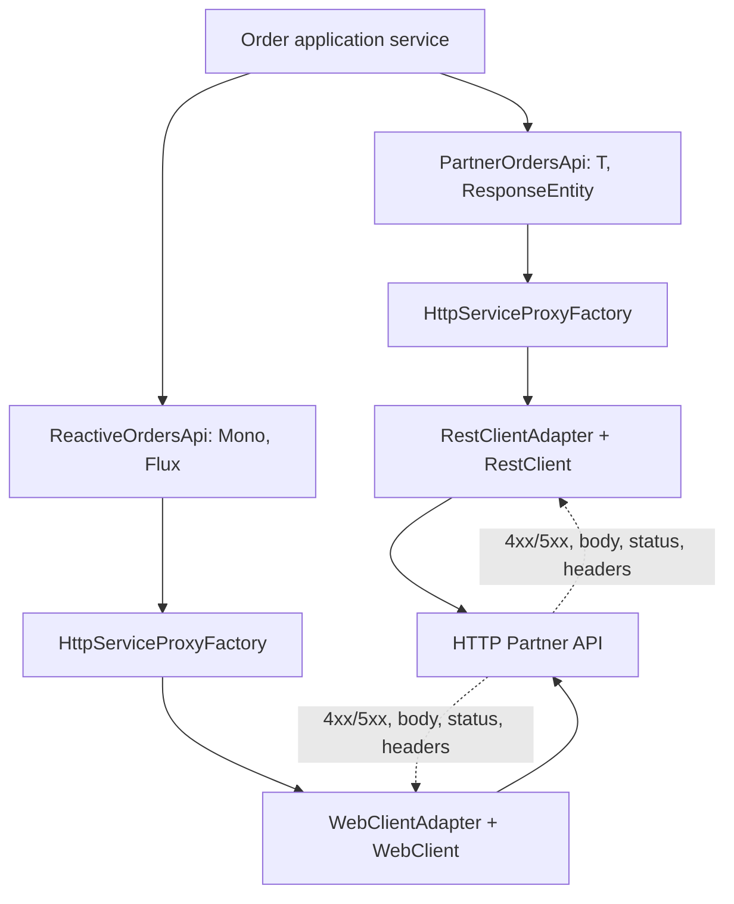
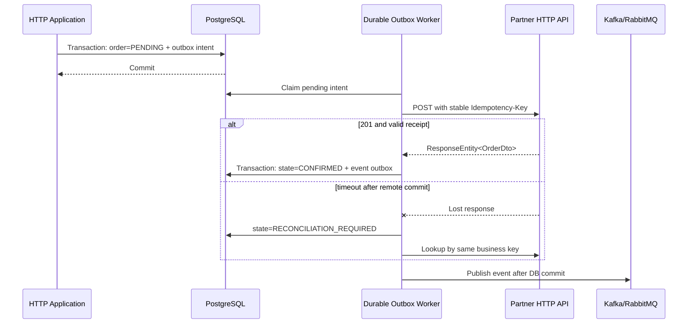
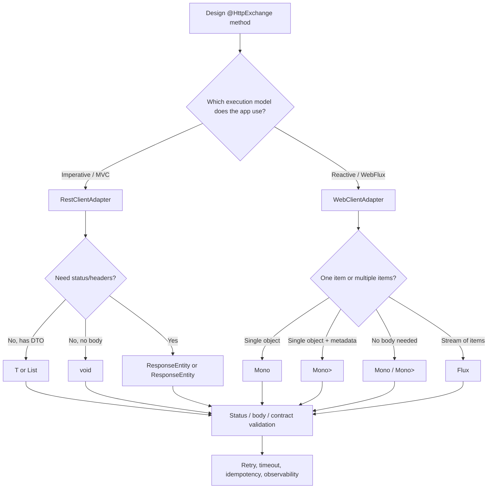

# Synchronous Return Types, `ResponseEntity`, and Reactive Return Types

> **Chapter:** HTTP interface  
> **Module:** SPRING_BOOT_INTEGRATION — integrating systems in Spring Boot across HTTP clients, databases, caches, message brokers, and Spring Integration adapters; focusing on configuration, data contracts, transactions, errors, deduplication, testing, and observability of real integration flows.

## 1. Why Are Return Types Part of the HTTP Contract?

Suppose an order service needs to call a partner API:

- `GET /v1/orders/{id}`: retrieve details for one order.
- `POST /v1/orders`: create an order and receive `201 Created` along with `Location`.
- `DELETE /v1/orders/{id}`: cancel/delete per contract, possibly receiving `204 No Content`.
- `GET /v1/orders/events`: receive a continuous stream of emitted events.

All four endpoints use HTTP, yet **they should not share the same return type**. Returning `OrderDto` from GET may suffice when only the payload is needed; however, creating via POST needs to retain **status, headers, and body** for reconciliation. A contract-compliant no-body DELETE can use `void` or `ResponseEntity<Void>`. A streaming API needs a way to represent **asynchrony, multiple items, and backpressure**, such as `Flux<OrderEvent>`.

Spring Framework supports **HTTP Service Interfaces** (declarative client interfaces) via `@HttpExchange` and annotations like `@GetExchange` and `@PostExchange`. `HttpServiceProxyFactory` creates a proxy that executes methods through an HTTP client adapter; the adapter and return type together decide how data, headers, statuses, and error signals enter your code.

### 1.1. The Problem of Choosing the Wrong Return Type

```java
// Partner specifies successful POST returns 201 and Location.
@PostExchange("/v1/orders")
OrderDto create(@RequestBody CreateOrderRequest request);
```

The interface above exposes only the body. If the business layer needs `Location` to look up the order after a timeout, the method has **discarded vital protocol information**. Instead:

```java
@PostExchange("/v1/orders")
ResponseEntity<OrderDto> create(
        @RequestBody CreateOrderRequest request);
```

Conversely, if a GET only ever needs a list of DTOs, forcing every service layer to depend on `ResponseEntity<List<OrderDto>>` can **leak HTTP details** into the domain model. The return type must match **what the application actually needs**, not "more metadata is always better".

### 1.2. Learning Objectives

After this lesson, you will be able to:

1. Build HTTP interfaces using `@HttpExchange`, `RestClientAdapter`, and `WebClientAdapter`.
2. Distinguish **synchronous** return types like `T`, `void`, `ResponseEntity<T>`, `ResponseEntity<Void>` from **reactive** ones like `Mono<T>`, `Mono<ResponseEntity<T>>`, and `Flux<T>`.
3. Decide when you need body, status, headers, `Location`, `ETag`, or `Retry-After`.
4. Handle empty responses, `204`, `202`, `304`, `404`, JSON parse errors, and contract-violating responses.
5. Understand blocking/non-blocking boundaries, subscriptions, timeouts, cancellation, and backpressure.
6. Keep HTTP data at the adapter boundary, mapping to domain results to avoid tight coupling.
7. Test synchronous proxies with `MockRestServiceServer` and reactive proxies against a real HTTP test server.

## 2. HTTP Interfaces Are Client Contracts, Not Controllers

In Spring Framework 6.1+, an HTTP interface can look like:

```java
// PartnerOrdersApi.java
import java.util.List;
import org.springframework.http.ResponseEntity;
import org.springframework.web.bind.annotation.PathVariable;
import org.springframework.web.bind.annotation.RequestBody;
import org.springframework.web.bind.annotation.RequestHeader;
import org.springframework.web.bind.annotation.RequestParam;
import org.springframework.web.service.annotation.DeleteExchange;
import org.springframework.web.service.annotation.GetExchange;
import org.springframework.web.service.annotation.HttpExchange;
import org.springframework.web.service.annotation.PostExchange;

@HttpExchange(url = "/v1/orders", accept = "application/json")
public interface PartnerOrdersApi {

    @GetExchange("/{orderId}")
    OrderDto getById(@PathVariable String orderId);

    @GetExchange
    List<OrderDto> findByCustomer(
            @RequestParam String customerId);

    @PostExchange(contentType = "application/json")
    ResponseEntity<OrderDto> create(
            @RequestBody CreateOrderRequest request,
            @RequestHeader("Idempotency-Key") String idempotencyKey);

    @DeleteExchange("/{orderId}")
    ResponseEntity<Void> delete(@PathVariable String orderId);
}
```

The annotations declare parts of the HTTP contract:

| Annotation | Meaning on the **Client** | Do Not Assume |
| --- | --- | --- |
| `@HttpExchange` | Base path, method, content type, accept at interface/method level | Auto-registers a server route in MVC |
| `@GetExchange` | HTTP GET to the declared path | Response is guaranteed 200 or non-empty |
| `@PostExchange` | HTTP POST, optionally sending a body | POST is automatically idempotent or DB-transactional |
| `@DeleteExchange` | HTTP DELETE | Response is always 204 or resource is always deleted |
| `@RequestBody` | Serializes request object | Automatically validates all business rules |
| `@PathVariable` | Binds variable into URI template | Server definitely has the resource |
| `@RequestParam` | Sends query parameter | Needs no encoding or validation |
| `@RequestHeader` | Sends per-invocation header | Eliminates token/secret management |

An HTTP service interface is a **declarative interface for a client proxy**. `@HttpExchange` can also be used by Spring MVC/WebFlux in certain server-side contract setups, but in this lesson we explicitly use it as an **outbound HTTP client** via `HttpServiceProxyFactory`, not as a substitute for `@RestController` or inbound route mapping.

### 2.1. Partner Contract DTOs

```java
import java.math.BigDecimal;
import java.time.Instant;

public record CreateOrderRequest(
        String customerId,
        BigDecimal amount,
        String currency) {
}

public record OrderDto(
        String id,
        String customerId,
        String state,
        BigDecimal amount,
        Instant createdAt) {
}
```

These DTOs are **contract examples**. Real APIs require specifying validation, nullability, field naming, enum/state versioning, currency/scale, timezones, and schema evolution policies. Never serialize JPA entities or Redis cache objects directly as public HTTP contracts.

### 2.2. Why Not Return Repository Entities?

If an HTTP interface returns `PurchaseOrderEntity`, the integration layer becomes coupled to persistence mappings: lazy-loaded associations, database column names, cache fields, and migrations can affect partner schemas. Separate the layers:

```text
Partner JSON
   ↓ Jackson / HTTP interface
PartnerOrderDto
   ↓ validate + normalize
DomainOrder / ApplicationResult
   ↓ persistence mapping
JPA entity / JDBC row / R2DBC record
```

Layer separation prevents a malformed 200 response from being treated as a valid entity and written straight to the database.

## 3. Two-Adapter Architecture and Return-Type "Worlds"



| Model | Typical Adapter | Recommended Return Types | Execution Model |
| --- | --- | --- | --- |
| **Synchronous HTTP** | `RestClientAdapter` from `RestClient` | `T`, `List<T>`, `void`, `ResponseEntity<T>`, `ResponseEntity<Void>` | Method typically blocks until response/exception |
| **Reactive HTTP** | `WebClientAdapter` from `WebClient` | `Mono<T>`, `Mono<ResponseEntity<T>>`, `Mono<Void>`, `Flux<T>` | Publisher is usually lazy; I/O runs on subscribe |
| **Metadata-only** | Adapter supporting corresponding metadata type | `ResponseEntity<Void>`, or direct `HttpHeaders`/status types per adapter API | Skips parsing a DTO body |
| **Streaming** | Typically `WebClientAdapter` | `Flux<T>` | Can emit multiple items; supports cancellation/backpressure |

In newer Spring Framework releases, supported return types may expand or change per adapter/version. This lesson illustrates common choices on **Spring Boot 3.2–3.5 / Spring Framework 6.1–6.2 / Spring WebFlux 6.x**. When upgrading to Boot 4.x, check the official return-type documentation and APIs before copying code.

**Note:** a reactive return type does not mean the server processes the business operation asynchronously. A `Mono<OrderDto>` merely describes **non-blocking client I/O until subscribed**. The partner might process synchronously and return 200/201, or return 202 and finish later—that depends on HTTP status/business contract semantics, not on using `Mono`.

## 4. Configuring a Synchronous Proxy with `RestClientAdapter`

### 4.1. Gradle Dependencies

```groovy
// Project already applies the Spring Boot plugin and compatible BOM.
dependencies {
    implementation 'org.springframework.boot:spring-boot-starter-web'
    implementation 'org.springframework.boot:spring-boot-starter-validation'

    testImplementation 'org.springframework.boot:spring-boot-starter-test'
}
```

`spring-boot-starter-web` provides MVC/Jackson infrastructure and `RestClient` on Boot 3.2+. If an application is **client-only**, you can select only the required modules without starting an HTTP server; the starter is used here for clarity. Do not add reactive WebFlux dependencies just to build a synchronous HTTP interface.

### 4.2. Externalized Configuration

```yaml
# application.yml
integration:
  partner:
    orders:
      base-url: ${PARTNER_ORDERS_BASE_URL}
```

```java
// PartnerOrdersConfiguration.java
import org.springframework.beans.factory.annotation.Value;
import org.springframework.context.annotation.Bean;
import org.springframework.context.annotation.Configuration;
import org.springframework.web.client.RestClient;
import org.springframework.web.client.support.RestClientAdapter;
import org.springframework.web.service.invoker.HttpServiceProxyFactory;

@Configuration(proxyBeanMethods = false)
class PartnerOrdersConfiguration {

    @Bean
    PartnerOrdersApi partnerOrdersApi(
            RestClient.Builder builder,
            @Value("${integration.partner.orders.base-url}")
                    String baseUrl) {

        RestClient restClient = builder.baseUrl(baseUrl).build();
        RestClientAdapter adapter = RestClientAdapter.create(restClient);

        HttpServiceProxyFactory factory =
                HttpServiceProxyFactory.builderFor(adapter).build();
        return factory.createClient(PartnerOrdersApi.class);
    }
}
```

Injecting Boot-managed `RestClient.Builder` preserves message converters, observation/customizers, and request factory/TLS configuration when configured in the application. If a project calls `RestClient.create(...)` everywhere, it easily drops security, timeouts, proxies, or correlation headers. In production, configure connect/read timeouts and an overall deadline on the actual request factory.

**Security:** `PARTNER_ORDERS_BASE_URL` is trusted deployment configuration, not a user-supplied URL; prevent SSRF and bearer-token/cookie leaks. Fetch credentials from a secret manager or environment variables rather than hardcoding them in source or YAML.

### 4.3. Synchronous Call Site

```java
import org.springframework.stereotype.Service;

@Service
public class OrderLookupService {
    private final PartnerOrdersApi partner;

    public OrderLookupService(PartnerOrdersApi partner) {
        this.partner = partner;
    }

    public String currentState(String orderId) {
        OrderDto remote = partner.getById(orderId);
        if (remote == null || remote.id() == null
                || remote.state() == null) {
            throw new IllegalStateException(
                    "Upstream returned invalid order payload");
        }
        return remote.state();
    }
}
```

`partner.getById(...)` via `RestClientAdapter` typically returns once the body is received/deserialized or throws an exception; it **occupies the caller thread while waiting for I/O**. This suits MVC/imperative workflows with bounded timeouts and concurrency. Never invoke blocking calls directly on a Reactor Netty event loop or latency-sensitive reactive thread.

### 4.4. Do Not Treat `null` as 404 by Default

With `RestClientAdapter`, HTTP 404 usually follows `RestClient` error handling (for example, `HttpClientErrorException.NotFound`). A `null` body can result from an empty response, `204`, or a JSON literal `null` depending on the API and converter. Never write "`remote == null` means the order does not exist" unless the contract specifies it and the gateway maps the status explicitly.

## 5. Synchronous Return-Type Matrix: `T`, `List<T>`, `void`, and `ResponseEntity<T>`

| HTTP Interface Declaration | When to Use | What You Receive | What Is Lost or Must Be Added |
| --- | --- | --- | --- |
| `OrderDto` | GET object needing only the body | Deserialized DTO | Status/headers hidden from caller |
| `List<OrderDto>` | GET JSON array | Typed list of DTOs | Pagination/header metadata |
| `void` | Successful endpoint needing no body | No response payload | No status/headers for branching |
| `ResponseEntity<OrderDto>` | Needs status, headers, and body | `getStatusCode()`, `getHeaders()`, `getBody()` | Must validate potentially null body |
| `ResponseEntity<Void>` | Needs status/headers without parsing body | HTTP metadata | No DTO content |
| `ResponseEntity<List<OrderDto>>` | List + pagination headers, ETag | List and metadata | Risk of leaking HTTP details into domain |

### 5.1. Returning Body `T` Fits Only When Metadata Is Unimportant

```java
@GetExchange("/{orderId}")
OrderDto getById(@PathVariable String orderId);
```

Advantage: callers receive the DTO directly, keeping the interface readable. Drawback: if you later need `ETag` for optimistic concurrency or `Retry-After`, the method signature does not expose it. Changing the return type becomes a breaking source change for callers.

### 5.2. Generic Lists vs Raw `List`

```java
@GetExchange
List<OrderDto> findByCustomer(
        @RequestParam String customerId);
```

The proxy uses the method's generic metadata to construct a type token for the converter. Never declare raw `List` or `Object` and cast elements to `OrderDto`: Jackson can deserialize elements into `LinkedHashMap`, causing delayed `ClassCastException` in the application layer. For paginated envelopes, use a DTO such as `PageEnvelope<OrderDto>` instead of assuming a JSON array.

### 5.3. `void` Means "Body Not Needed", Not "HTTP Status Ignored"

```java
@DeleteExchange("/{orderId}")
void deleteIgnoringBody(@PathVariable String orderId);
```

A properly configured client still **throws exceptions on HTTP errors**. Returning `void` simply means the caller does not receive a body or metadata as a return value. If DELETE needs to distinguish `202 Accepted`, `204 No Content`, `404 Not Found`, or read a version header, use `ResponseEntity<Void>`.

### 5.4. `ResponseEntity<T>` Preserves Body, Status, and Headers

```java
@PostExchange(contentType = "application/json")
ResponseEntity<OrderDto> create(
        @RequestBody CreateOrderRequest request,
        @RequestHeader("Idempotency-Key") String key);
```

Reading the result:

```java
ResponseEntity<OrderDto> response =
        partner.create(request, "order-42-create");

if (response.getStatusCode().value() != 201) {
    throw new IllegalStateException(
            "Expected 201 Created from partner");
}
java.net.URI location = response.getHeaders().getLocation();
OrderDto created = response.getBody();
if (location == null || created == null
        || created.id() == null || created.id().isBlank()) {
    throw new IllegalStateException(
            "Invalid success response contract");
}
```

This assumes the endpoint **specifies 201 + `Location` + valid body**. Other APIs might legitimately return 202 + job ticket, 201 + `Location` with no body, or 200 + resource. Always **write tests against the real contract**, rather than treating one partner's convention as a universal HTTP rule.

### 5.5. `ResponseEntity<Void>` Preserves Status/Headers Without a Body

```java
@DeleteExchange("/{orderId}")
ResponseEntity<Void> delete(
        @PathVariable String orderId);
```

```java
ResponseEntity<Void> response = partner.delete("order-42");
if (response.getStatusCode().value() != 204) {
    throw new IllegalStateException(
            "Partner did not return agreed 204 response");
}
```

`ResponseEntity<Void>` works well when an endpoint promises no content yet the caller still needs status, `ETag`, or an audit/correlation header. **Never** expect `getBody()` to hold a payload for generic type `Void`.

## 6. Status, Headers, and Body: Contracts That Cannot Be Inferred from Generic Types

Java return types describe only the **shape of value the client wants back**. Servers can return varying statuses, headers, empty bodies, schema-violating JSON, or network errors. Adapters must validate **protocol semantics** before translating into domain results.

### 6.1. Common HTTP Status Matrix

| Status | Typical Meaning | Considerations When Choosing Return Type |
| --- | --- | --- |
| **200 OK** | Request succeeded, usually with a representation | `T` or `ResponseEntity<T>`; body must still be validated |
| **201 Created** | Resource created | `ResponseEntity<T>` when `Location`/ETag and body are needed |
| **202 Accepted** | Request accepted for later processing | Ticket/operation-ID DTO; do not treat as business-complete |
| **204 No Content** | Success with no response body | `void` or `ResponseEntity<Void>`; do not force into a DTO |
| **206 Partial Content** | Returns partial representation | Requires Range/Content-Range support per contract |
| **304 Not Modified** | Cache validation notice, no new body | Combine with ETag/cached state; do not treat as valid empty JSON |
| **400/422** | Bad request or business validation failure | Error taxonomy; never parse as a success DTO |
| **401/403** | Authn/authz or upstream policy rejection | Do not blame end users when service credentials fail |
| **404** | Target not found per endpoint semantics | Do not auto-map to `null`/`Optional.empty()` |
| **409/412** | Conflict/optimistic concurrency | Separate idempotency replay from payload mismatch |
| **429** | Rate limited | Respect `Retry-After`, max attempts, deadlines |
| **502/503/504** | Gateway/dependency failure | For writes, outcome may be unknown despite error status |

### 6.2. HTTP 204 Should Not Be Deserialized as `OrderDto`

A `@GetExchange` method returning `OrderDto` when the server returns 204 can yield a null body or a contract mismatch. Code like:

```java
OrderDto order = partner.getById("order-42");
String state = order.state(); // Potential NullPointerException.
```

masks the root cause: **upstream violated the response contract**, not that the domain lacks a state. For endpoints required to return a JSON object, use `ResponseEntity<OrderDto>` and validate:

```java
ResponseEntity<OrderDto> response =
        partner.getWithMetadata("order-42");
if (response.getStatusCode().value() != 200
        || response.getBody() == null
        || response.getBody().id() == null) {
    throw new PartnerContractException(
            "Expected 200 with complete order body");
}
```

`getWithMetadata(...)` is an **illustrative additional method** that must be declared on the interface when used, e.g.:

```java
@GetExchange("/{orderId}")
ResponseEntity<OrderDto> getWithMetadata(
        @PathVariable String orderId);
```

Crucially, `ResponseEntity<T>` helps inspect status/headers, **not validate the full DTO**; verifying required fields, amounts, currencies, and states remains the adapter/domain boundary's job.

### 6.3. `HEAD`: Metadata Without an Entity Body

If a partner exposes `HEAD /v1/orders/{id}` returning `ETag`, `Last-Modified`, or `Content-Length`:

```java
import org.springframework.http.ResponseEntity;
import org.springframework.web.bind.annotation.PathVariable;
import org.springframework.web.service.annotation.HttpExchange;

@HttpExchange(method = "HEAD", url = "/v1/orders/{orderId}")
ResponseEntity<Void> head(@PathVariable String orderId);
```

This is a **method fragment** placed inside an appropriate interface. It is not `@GetExchange`, as it requests the `HEAD` method. `ResponseEntity<Void>` exposes status and headers; if only headers are needed, some adapters/versions support metadata return types directly like `HttpHeaders`, while `ResponseEntity<Void>` stays explicit whenever status is also needed.

**Never** declare `ResponseEntity<OrderDto>` and try to deserialize a body when a standards-compliant HTTP `HEAD` sends no representation body.

### 6.4. `ETag` and `If-Match` for Optimistic Concurrency

Suppose GET returns:

```http
HTTP/1.1 200 OK
Content-Type: application/json
ETag: "order-rev-7"

{"id":"order-42","state":"NEW"}
```

When updating the order:

```java
import org.springframework.web.bind.annotation.RequestHeader;
import org.springframework.web.service.annotation.PutExchange;

@PutExchange(
        url = "/{orderId}",
        contentType = "application/json")
ResponseEntity<OrderDto> replace(
        @PathVariable String orderId,
        @RequestHeader("If-Match") String etag,
        @RequestBody ReplaceOrderRequest request);
```

`ReplaceOrderRequest` is an illustrative DTO to define per contract. The caller reads `response.getHeaders().getETag()` from a validated GET, then passes it in `If-Match`. If the server returns `412 Precondition Failed`, reload state and evaluate whether the transition still applies; never retry the stale ETag indefinitely.

### 6.5. `Location` and `202 Accepted`

A partner might return:

```http
HTTP/1.1 202 Accepted
Location: /v1/operations/op-9f4
Retry-After: 3

{"operationId":"op-9f4","state":"PENDING"}
```

The right return type is `ResponseEntity<OperationTicket>` instead of `OrderDto`, because **the final order does not exist yet**:

```java
public record OperationTicket(
        String operationId, String state) {
}

@PostExchange(
        url = "/v1/imports",
        contentType = "application/json")
ResponseEntity<OperationTicket> startImport(
        @RequestBody ImportRequest request);
```

`ImportRequest` is a hypothetical import API DTO. The application must persist the operation ID, validate that `Location` is safe/trusted, and then poll or await a webhook/event per contract. Never return "COMPLETED" simply on HTTP 202.

### 6.6. Headers Can Carry Sensitive Data

`ResponseEntity.getHeaders()` may contain `Set-Cookie`, auth-related headers, or proxy metadata. When logging, select only safe fields: `status`, sanitized `ETag`, validated `Location`, correlation ID, or `Retry-After`. Never serialize an entire `ResponseEntity` to INFO logs in production.

## 7. Reactive Proxies with `WebClientAdapter`

In WebFlux applications or workflows requiring async composition, reactive return types preserve **non-blocking I/O** and stream processing through Reactor. Choose `WebClientAdapter` over `RestClientAdapter` when methods declare `Mono` or `Flux`.

### 7.1. Dependencies

```groovy
dependencies {
    implementation 'org.springframework.boot:spring-boot-starter-webflux'
    implementation 'org.springframework.boot:spring-boot-starter-validation'

    testImplementation 'org.springframework.boot:spring-boot-starter-test'
    testImplementation 'io.projectreactor:reactor-test'
}
```

The examples use `WebClient` and `reactor.core.publisher.Mono/Flux` in Spring Framework 6.1–6.2. Apps needing only a reactive client can include appropriate modules without running a WebFlux server. If both MVC and WebFlux starters sit on the classpath, Spring Boot defaults to MVC web application type; **do not assume adding the WebFlux dependency turns all controllers non-blocking**.

### 7.2. Reactive HTTP Interface

```java
// ReactivePartnerOrdersApi.java
import java.util.List;
import org.springframework.http.ResponseEntity;
import org.springframework.web.bind.annotation.PathVariable;
import org.springframework.web.bind.annotation.RequestBody;
import org.springframework.web.bind.annotation.RequestHeader;
import org.springframework.web.bind.annotation.RequestParam;
import org.springframework.web.service.annotation.GetExchange;
import org.springframework.web.service.annotation.HttpExchange;
import org.springframework.web.service.annotation.PostExchange;
import reactor.core.publisher.Flux;
import reactor.core.publisher.Mono;

@HttpExchange(
        url = "/v1/orders",
        accept = "application/json")
public interface ReactivePartnerOrdersApi {

    @GetExchange("/{orderId}")
    Mono<OrderDto> getById(
            @PathVariable String orderId);

    @GetExchange("/{orderId}")
    Mono<ResponseEntity<OrderDto>> getWithMetadata(
            @PathVariable String orderId);

    @GetExchange
    Mono<List<OrderDto>> findByCustomer(
            @RequestParam String customerId);

    @PostExchange(contentType = "application/json")
    Mono<ResponseEntity<OrderDto>> create(
            @RequestBody CreateOrderRequest request,
            @RequestHeader("Idempotency-Key") String key);

    @GetExchange(url = "/events", accept = "application/x-ndjson")
    Flux<OrderEvent> events();
}
```

Example `OrderEvent` definition:

```java
import java.time.Instant;

public record OrderEvent(
        String eventId,
        String orderId,
        String type,
        Instant occurredAt) {
}
```

**Two list return types differ:**

- `Mono<List<OrderDto>>` represents **one JSON array response** deserialized as a complete list (useful for small/bounded pages).
- `Flux<OrderDto>` is normally used when the client wants to consume **multiple items** from the body; with NDJSON/SSE streaming, items can be decoded incrementally if HTTP codecs and the server stream properly. Using `Flux` for a huge JSON array does not guarantee end-to-end streaming unless converters, proxies, buffers, and the server support it.

### 7.3. Creating a Proxy from `WebClientAdapter`

```java
// ReactivePartnerOrdersConfiguration.java
import org.springframework.beans.factory.annotation.Value;
import org.springframework.context.annotation.Bean;
import org.springframework.context.annotation.Configuration;
import org.springframework.web.reactive.function.client.WebClient;
import org.springframework.web.reactive.function.client.support.WebClientAdapter;
import org.springframework.web.service.invoker.HttpServiceProxyFactory;

@Configuration(proxyBeanMethods = false)
class ReactivePartnerOrdersConfiguration {

    @Bean
    ReactivePartnerOrdersApi reactivePartnerOrdersApi(
            WebClient.Builder builder,
            @Value("${integration.partner.orders.base-url}")
                    String baseUrl) {

        WebClient webClient = builder.baseUrl(baseUrl).build();
        WebClientAdapter adapter = WebClientAdapter.create(webClient);
        HttpServiceProxyFactory factory =
                HttpServiceProxyFactory.builderFor(adapter).build();
        return factory.createClient(ReactivePartnerOrdersApi.class);
    }
}
```

Injecting Boot's builder applies codecs, observation, and client connectors/TLS when configured. `WebClientAdapter` can support synchronous return types via a block timeout in matching framework versions, yet **this lesson intentionally returns `Mono`/`Flux` through the reactive adapter**; never design a proxy where every caller must call `.block()` to function.

### 7.4. `Mono<T>` Does Not Execute When Simply Created

```java
Mono<OrderDto> pending =
        reactiveApi.getById("order-42");
// Not yet subscribed by caller/framework.

pending.subscribe(order -> {
    // Async callback: illustrative only;
    // avoid fire-and-forget subscribe() calls in business services.
});
```

A `Mono` is typically **lazy/cold**, and the HTTP request executes only upon subscription. Re-subscribing to the same cold `Mono` can fire a **new request**—especially dangerous for side-effecting POSTs.

In Spring WebFlux controllers, normally **return the `Mono`/`Flux` for the framework to subscribe** instead of calling `subscribe()` manually. In the service layer, compose with `map/flatMap/then/onErrorResume` to keep execution, errors, and cancellation inside a single controlled pipeline.

### 7.5. Non-Blocking Composition

```java
import reactor.core.publisher.Mono;
import org.springframework.stereotype.Service;

@Service
class ReactiveOrderLookupService {
    private final ReactivePartnerOrdersApi partner;

    ReactiveOrderLookupService(ReactivePartnerOrdersApi partner) {
        this.partner = partner;
    }

    Mono<String> currentState(String orderId) {
        return partner.getById(orderId)
                .switchIfEmpty(Mono.error(
                        new PartnerContractException(
                                "Missing order body")))
                .flatMap(order -> {
                    if (order.id() == null
                            || order.state() == null) {
                        return Mono.error(
                                new PartnerContractException(
                                        "Invalid partner order"));
                    }
                    return Mono.just(order.state());
                });
    }
}
```

Here, errors are not thrown when obtaining the `Mono` variable; most failures surface as `onError` signals **after subscription**. A `try/catch` wrapping `partner.getById(...)` will not catch HTTP/reactive errors that occur asynchronously later.

## 8. `Mono<ResponseEntity<T>>`, `Mono<Void>`, and `Flux<T>`

### 8.1. `Mono<ResponseEntity<T>>` to Preserve Status, Headers, and Body

```java
Mono<ResponseEntity<OrderDto>> responsePublisher =
        reactiveApi.create(request, "order-42-create");

Mono<OrderDto> createdOrder =
        responsePublisher.flatMap(response -> {
            if (response.getStatusCode().value() != 201) {
                return Mono.error(
                        new PartnerContractException(
                                "Expected 201 Created"));
            }
            OrderDto body = response.getBody();
            if (body == null || body.id() == null) {
                return Mono.error(
                        new PartnerContractException(
                                "Missing order receipt"));
            }
            return Mono.just(body);
        });
```

`responsePublisher` is **a publisher emitting one `ResponseEntity`** when the response arrives. If metadata is needed without a body, declare `Mono<ResponseEntity<Void>>`. Wrapping `ResponseEntity<T>` inside `Mono` preserves reactive behavior; the status becomes available once the HTTP response is processed during subscription.

### 8.2. `Mono<Void>` vs `Mono<ResponseEntity<Void>>`

```java
@HttpExchange(method = "DELETE", url = "/{orderId}")
Mono<Void> deleteNoMetadata(
        @PathVariable String orderId);

@HttpExchange(method = "DELETE", url = "/{orderId}")
Mono<ResponseEntity<Void>> deleteWithMetadata(
        @PathVariable String orderId);
```

`Mono<Void>` finishes with `onComplete` when no value is returned; the client still emits `onError` on HTTP failures. `Mono<ResponseEntity<Void>>` emits **one metadata object** holding status/headers and no body. If the API needs to distinguish 202 vs 204, return the metadata rather than discarding it.

Never use `Mono<Void>` paired with `defaultIfEmpty(new OrderDto(...))` to "fabricate a successful response" when there is no body; that subverts the contract. `Mono.empty()` signals **zero emitted items**, not HTTP 404.

### 8.3. `Flux<T>` for Incrementally Arriving Items

When a server serves NDJSON:

```http
HTTP/1.1 200 OK
Content-Type: application/x-ndjson

{"eventId":"evt-1","orderId":"order-42","type":"CREATED"}
{"eventId":"evt-2","orderId":"order-42","type":"CONFIRMED"}
```

The client can return:

```java
@GetExchange(
        url = "/events",
        accept = "application/x-ndjson")
Flux<OrderEvent> events();
```

`Flux<OrderEvent>` fits when the body contains multiple records and the codec decodes incrementally. **Do not assume** every upstream returning a JSON array streams items in real time; if the server buffers the entire array before flushing, `Flux` may still receive elements in bursts/chunks. With SSE, media types and element types (such as `ServerSentEvent<OrderEvent>`) must match the decoder and partner contract.

### 8.4. Practical Limits of Backpressure

In Reactor, downstream subscribers can constrain demand. Still, TCP sockets, server send buffers, JSON decoders, and HTTP chunking maintain their own buffers and limits; backpressure **does not guarantee** the partner server pauses production item-by-item. For large streams:

- Limit concurrency, batch/window sizes, and in-memory buffers.
- Handle cancellation on client disconnect and release resources.
- Enforce idle timeouts or heartbeats on long-lived streams.
- Track checkpoints/cursors if reconnecting/resuming after network drops.
- Cap parse/invalid-record errors; never silently swallow malformed records.
- Never keep a PostgreSQL transaction open across an unbounded stream.

### 8.5. Reactive Return Types Do Not Make Blocking Work Non-Blocking

```java
// Anti-pattern on a Reactor event-loop:
Mono<OrderDto> load(String id) {
    OrderEntity entity = jpaRepository.findById(id).orElseThrow();
    return Mono.just(map(entity));
}
```

This runs blocking JPA **before returning the `Mono`**, potentially stalling the event loop. When integrating legacy blocking code:

```java
Mono<OrderDto> loadLegacy(String id) {
    return Mono.fromCallable(() -> {
                OrderEntity entity =
                        jpaRepository.findById(id).orElseThrow();
                return map(entity);
            })
            .subscribeOn(
                    reactor.core.scheduler.Schedulers.boundedElastic());
}
```

This is a **concurrency-bounded compatibility workaround**, not a way to make JDBC/JPA behave like R2DBC or propagate thread-bound transactions across Reactor operators. When a system is mostly imperative, `RestClientAdapter` with a sized thread model is usually cleaner.

## 9. HTTP Errors and Reactive Error Signals Must Not Collapse into One "Empty Value"

HTTP interfaces do not automatically turn error statuses into domain outcomes. Under typical defaults, HTTP adapters handle 4xx/5xx according to the underlying HTTP client:

| Layer | Common Error Types | When Errors Appear |
| --- | --- | --- |
| `RestClientAdapter` | `HttpClientErrorException`, `HttpServerErrorException`, `RestClientResponseException` | During synchronous call; thrown directly |
| `RestClientAdapter` | `ResourceAccessException` | On I/O/DNS/connection/timeout without a valid response |
| `WebClientAdapter` | `WebClientResponseException` and subclasses like `NotFound` | Emitted as `onError` signal on publisher |
| `WebClientAdapter` | `WebClientRequestException` | When request/network fails before receiving a valid response |
| Both | Conversion/decoding exceptions | Response JSON/Content-Type/schema mismatch |
| Application adapter | `PartnerContractException`/domain errors | Status/body violates agreed contract |

### 9.1. Illustrative Exception for Contract Violations

```java
// PartnerContractException.java
public final class PartnerContractException
        extends RuntimeException {

    public PartnerContractException(String message) {
        super(message);
    }

    public PartnerContractException(
            String message, Throwable cause) {
        super(message, cause);
    }
}
```

This is an application-defined exception, **not a built-in Spring class**. When logging or propagating errors to callers, avoid embedding raw response bodies in messages, as they may contain PII, tokens, or internal partner details.

### 9.2. HTTP 404 Does Not Automatically Become `Optional.empty()`

For order GETs, a contract might specify that **a 404 on this endpoint means the order does not exist**. If so, map it in the adapter layer:

```java
// Fragment of an imperative adapter:
import java.util.Optional;
import org.springframework.web.client.HttpClientErrorException;

Optional<OrderDto> find(String orderId) {
    try {
        OrderDto dto = partner.getById(orderId);
        if (dto == null) {
            throw new PartnerContractException(
                    "Missing successful order body");
        }
        return Optional.of(dto);
    } catch (HttpClientErrorException.NotFound notFound) {
        return Optional.empty();
    }
}
```

Use this mapping only when the contract guarantees 404 genuinely represents `ORDER_NOT_FOUND`. A proxy or gateway might return 404 due to a misconfigured route or stale API version; in such cases, if the contract includes a specific error code, **check that code** before concluding the resource is absent.

For reactive:

```java
import org.springframework.web.reactive.function.client.WebClientResponseException;
import reactor.core.publisher.Mono;

Mono<OrderDto> findReactive(String orderId) {
    return reactiveApi.getById(orderId)
            .onErrorResume(
                    WebClientResponseException.NotFound.class,
                    error -> Mono.empty());
}
```

This is also an **adapter method fragment** assuming a valid 404 equates to absence. `Mono.empty()` produced by such an error mapper carries meaning **explicitly defined by the adapter**; `Mono.empty()` caused by an unexpected missing body must be kept distinct from verified not-found cases.

### 9.3. `ResponseEntity<T>` Does Not "Rescue" HTTP 500 into a Success Response

```java
@GetExchange("/{orderId}")
ResponseEntity<OrderDto> getWithMetadata(
        @PathVariable String orderId);
```

For error statuses, a `RestClient`/`WebClient` adapter **still applies default error handling**. Do not assume the call above returns a `ResponseEntity<OrderDto>` holding status 503 when the server fails: by default, the HTTP client throws an exception instead of handing a 503 `ResponseEntity` to your code.

If you need to inspect all 4xx/5xx statuses as responses (e.g. a transparent proxy), configure status handlers/exchange behavior on the **underlying HTTP client** per API/version, backed by tests verifying error bodies and size limits. Never disable error handling globally and accidentally try to deserialize an HTML 503 page into `OrderDto`.

### 9.4. Do Not Catch Reactive Errors with `try/catch` Around the Method Call

```java
// Wrong expectation: outer try/catch misses async onError signals.
try {
    Mono<OrderDto> mono = reactiveApi.getById("order-42");
    return mono;
} catch (Exception ex) {
    return Mono.empty();
}
```

Most errors happen **after subscription**, requiring operators such as `onErrorMap`, `onErrorResume`, `doOnError`, and `retryWhen`. Furthermore, returning `Mono.empty()` for every exception turns outages into "order not found", breaking data integrity.

### 9.5. A 2xx Response Violating the Contract Is Its Own Error Class

Example:

```http
HTTP/1.1 200 OK
Content-Type: application/json

{"id":null,"state":"SETTLED","amount":-10.00}
```

HTTP status succeeded yet business invariants failed. Jackson can construct a DTO even with `id=null` or `amount<0`. Tests cannot check HTTP status alone:

- Validate required fields/formats and supported enums/states.
- Verify the returned ID matches the requested ID.
- For `BigDecimal` amounts, verify currency and scale/precision per contract.
- If an API uses an envelope like `{"success":false}` inside HTTP 200, inspect the business code after deserializing.
- A JSON array returned for an `OrderDto` method is a decoding failure; do not map it to an empty list.

Never blindly retry contract violations: if upstream rolled out a new schema, resending the same request 10 times only amplifies load.

## 10. Validating DTOs After Deserialization: Nullable Bodies Are Not Automatically Valid

Jakarta Validation can declare constraints on DTOs:

```java
// ValidatedOrderDto.java
import jakarta.validation.constraints.DecimalMin;
import jakarta.validation.constraints.NotBlank;
import jakarta.validation.constraints.NotNull;
import java.math.BigDecimal;
import java.time.Instant;

public record ValidatedOrderDto(
        @NotBlank String id,
        @NotBlank String customerId,
        @NotBlank String state,
        @NotNull @DecimalMin("0.01") BigDecimal amount,
        @NotNull Instant createdAt) {
}
```

**However, HTTP interfaces do not enable Bean Validation automatically on all response DTOs.** `@NotBlank` is merely constraint metadata; the adapter must invoke `Validator` or a configured, tested validation mechanism.

### 10.1. Adapter Validating Status, Body, and Identity

```java
import jakarta.validation.Validator;
import org.springframework.http.ResponseEntity;

public final class OrderResponseValidator {
    private final Validator validator;

    public OrderResponseValidator(Validator validator) {
        this.validator = validator;
    }

    public ValidatedOrderDto validate(
            ResponseEntity<ValidatedOrderDto> response,
            String expectedOrderId) {
        if (response.getStatusCode().value() != 200) {
            throw new PartnerContractException(
                    "Expected HTTP 200 for order lookup");
        }
        ValidatedOrderDto body = response.getBody();
        if (body == null || !validator.validate(body).isEmpty()) {
            throw new PartnerContractException(
                    "Invalid partner order response");
        }
        if (!expectedOrderId.equals(body.id())) {
            throw new PartnerContractException(
                    "Partner returned an unrelated order");
        }
        return body;
    }
}
```

This snippet assumes an HTTP interface method returning `ResponseEntity<ValidatedOrderDto>` and an injected `Validator` bean from Spring Boot. It intentionally **avoids logging Bean Validation violation details**, since some fields hold user data. For GET endpoints supporting `304`/ETags, implement a cache-aware branch rather than hardcoding HTTP 200.

### 10.2. Absent Data vs HTTP Absence Are Two Different Things

| Case | How to Handle |
| --- | --- |
| HTTP 404 + contract not-found error code | Adapter may return `Optional.empty()` or `Mono.empty()` |
| HTTP 200 + JSON literal `null` when contract requires object | Contract violation |
| HTTP 200 + empty body | Contract violation or no-content per explicit contract |
| HTTP 204 | Success without body; fits `void`/`ResponseEntity<Void>` |
| HTTP 200 + `[]` | Valid empty list **when the API returns a list** |
| HTTP 200 + `{}` missing ID | DTO validation failure |
| HTTP 202 + operation ticket | Pending, not the final object |

If all of those collapse into `null`, callers cannot decide whether to retry, return 404, show pending state, or investigate schema drift.

### 10.3. JSON Unknown Fields and Versioning

Allowing unknown fields helps backward compatibility, yet **does not** make required fields optional. When the server introduces a new enum state, the adapter needs a clear policy: reject `UNKNOWN_STATE` explicitly or map to a meaningful domain state rather than defaulting every unrecognized state to `COMPLETED`.

In particular, if an interface returns `List<OrderDto>` and the API changes to:

```json
{
  "items": [{"id":"order-42"}],
  "nextCursor": "page-2",
  "total": 500
}
```

you must change the return type to `PageEnvelope<OrderDto>` along with pagination logic. Do not expect Jackson to extract `items` from an object into a list without a matching converter/contract.

## 11. Choosing Between `Mono<List<T>>` and `Flux<T>` for Pagination/Streaming

### 11.1. One HTTP Page Should Be an Explicit Response

```java
import java.util.List;

public record PageEnvelope<T>(
        List<T> items,
        String nextCursor) {
}

@GetExchange
Mono<PageEnvelope<OrderDto>> page(
        @RequestParam String cursor,
        @RequestParam int limit);
```

This method is a **fragment of a reactive HTTP interface** for a hypothetical API returning a JSON object with `items` and `nextCursor`. `Mono<PageEnvelope<OrderDto>>` makes explicit that **each HTTP request corresponds to one page**. Building a `Flux<OrderDto>` over a paginated API requires bounded multi-page orchestration, such as:

```text
GET ?cursor=page-1 → items[0..99], nextCursor=page-2
GET ?cursor=page-2 → items[100..199], nextCursor=page-3
...
GET ?cursor=page-N → items[..], nextCursor=null
```

Never loop infinitely if the partner returns a repeated cursor. Enforce page/item caps, total timeouts, rate limits, and checkpoints for restarts.

### 11.2. `Flux` Over Multiple Pages Differs from `Flux` Over One Streaming Response

| Data Source | Interface Return Type | How It Works |
| --- | --- | --- |
| Single JSON page object | `Mono<PageEnvelope<T>>` | One request, one body object |
| Small JSON array | `Mono<List<T>>` | One request, full list |
| Long-lived NDJSON/SSE | `Flux<T>` | One HTTP response decoded into many items over time |
| Multi-request cursor pagination API | Usually `Mono<PageEnvelope<T>>` + external orchestration | Multiple HTTP requests; needs stop conditions and cursor retries |
| Bidirectional WebSocket | Not a standard request-response HTTP interface | Use an appropriate WebSocket client/handler |

Avoid confusing a `Flux<T>` emitting 100 items with **100 HTTP requests**: it could be one NDJSON response, or a pagination orchestrator issuing many requests. Both models differ significantly in concurrency, retries, checkpointing, and memory behavior.

### 11.3. A Mid-Stream Failure May Have Already Emitted Records

With `Flux<OrderEvent>`:

```text
onNext(evt-1)
onNext(evt-2)
network breaks
onError(connection reset)
```

The subscriber already received two events before the error. If event handling has side effects, **retrying the whole stream** can replay those two events. Use stable `eventId` values, inbox/deduplication, and a cursor/reconnect contract. Never treat `Flux.retry(3)` as a universal solution for streaming APIs.

### 11.4. Streaming and `ResponseEntity` Metadata

Some versions/adapters support combining response metadata with a reactive body, such as `ResponseEntity<Flux<T>>` or similar types. Check the **official supported return-type list for your version** before relying on advanced combinations; this lesson sticks to two widely verifiable options: `Mono<ResponseEntity<T>>` for bounded bodies and `Flux<T>` for streaming bodies.

If streaming metadata is mandatory (such as a cursor header, total sequence count, or ETag), use lower-level `WebClient` APIs to inspect `ClientResponse`/`ResponseEntity` cleanly rather than forcing every case into one annotation signature.

## 12. Timeouts, Retries, and Cancellation per Execution Model

### 12.1. Synchronous: Timeouts Throw Exceptions at the Call Site

With `RestClientAdapter`, the caller waits for the response. A timeout typically throws `ResourceAccessException` (or a request-factory-specific exception) **directly at the call site**. Configure connect/read timeouts and manage total budgets/retries at the orchestration layer.

Simple request factory configuration example, **for illustration only**:

```java
import org.springframework.http.client.SimpleClientHttpRequestFactory;
import org.springframework.web.client.RestClient;

SimpleClientHttpRequestFactory requestFactory =
        new SimpleClientHttpRequestFactory();
requestFactory.setConnectTimeout(2_000);
requestFactory.setReadTimeout(3_000);

RestClient client = RestClient.builder()
        .baseUrl(baseUrl)
        .requestFactory(requestFactory)
        .build();
```

This fragment assumes `baseUrl` is defined. In production, when using Apache HttpComponents, JDK client, proxies/TLS/connection pooling, or Boot customizers, configure timeouts on the **actual active request factory**. Never swap request factories casually and accidentally drop connection pooling or TLS policies just to copy a snippet.

### 12.2. Reactive: Timeouts Are `onError`/Cancellation Signals

```java
import java.time.Duration;
import reactor.core.publisher.Mono;

Mono<OrderDto> bounded =
        reactiveApi.getById("order-42")
                .timeout(Duration.ofSeconds(3));
```

Upon timeout, the publisher emits a timeout error and may cancel the underlying subscription/network request. **This does not mean** the server rolled back ongoing work. For POSTs, losing the response after server commit leaves the outcome **unknown**, even though it surfaces locally as `TimeoutException`.

### 12.3. Retrying a GET with a Budget; Not Retrying Every POST

```java
import java.time.Duration;
import org.springframework.web.reactive.function.client.WebClientRequestException;
import org.springframework.web.reactive.function.client.WebClientResponseException;
import reactor.util.retry.Retry;

Mono<OrderDto> resilientLookup(String orderId) {
    return reactiveApi.getById(orderId)
            .retryWhen(Retry.backoff(2, Duration.ofMillis(200))
                    .maxBackoff(Duration.ofSeconds(2))
                    .filter(error -> {
                        if (error instanceof WebClientRequestException) {
                            return true;
                        }
                        if (error instanceof WebClientResponseException ex) {
                            int code = ex.getStatusCode().value();
                            return code == 429 || code == 503
                                    || code == 504;
                        }
                        return false;
                    }))
            .timeout(Duration.ofSeconds(5));
}
```

This is a **reactive adapter fragment** assuming `reactiveApi` is injected. `Retry.backoff(2, ...)` allows up to **two extra retries after the initial attempt** per Reactor semantics, not two total requests. In production, account for `Retry-After`, global rate limiters, idempotency, jitter, per-attempt timeouts, and total deadlines; avoid conflicting retry owners across WebClient, services, and schedulers.

**Critical:** applying the same pattern to `POST /payments` can create duplicate charges if the first response is lost. Require stable idempotency keys and partner lookup/reconciliation before allowing write retries.

### 12.4. Who Owns Retries for HTTP Interfaces?

`@HttpExchange` is not a retry policy annotation. If `@Retryable`, Resilience4j, or circuit breakers exist at another layer, determine:

- Does retry wrap the HTTP interface proxy, adapter wrapper, or workflow?
- Which HTTP exceptions are transient? 400/401/409/422/schema errors are rarely equivalent to 503.
- Does the timeout cover backoff + retries, or only a single attempt?
- If a cold `Mono` is re-subscribed, is the same idempotency key preserved?
- What error type does an open circuit breaker expose to the application service?

Never write `onErrorResume(error -> Mono.empty())` for all errors just so callers "do not have to handle exceptions".

### 12.5. Request Cancellation vs Side Effects

When a caller cancels `Mono<OrderDto>`/`Flux<OrderEvent>`, `WebClient` can stop reading the response and free resources. This **does not guarantee** the HTTP partner halted processing of an already-received request. If the client cancels a POST because a user disconnected:

```text
Client disconnects / cancels subscription
    ↓
WebClient stops awaiting response
    ↓
Partner may already have committed operation
    ↓
Application must reconcile using stable request ID
```

HTTP client cancellation, Reactor subscription cancellation, and business operation cancellation are **three separate concepts**. Never assume cancelling a subscription rolled back a request on a remote service.

## 13. Return Types and Transactions: Never Pull HTTP into Database ACID

Even though `ResponseEntity<T>` reads statuses and `Mono<T>` supports async composition, **no return type turns a remote HTTP API into part of a database transaction**.

### 13.1. Anti-Pattern: Keeping a Database Transaction Open While Waiting on HTTP

```java
// Pseudocode: dangerous behavior when remote API mutates state.
@Transactional
public void placeOrder(CreateOrderRequest request) {
    orders.save(mapToEntity(request));
    ResponseEntity<OrderDto> response =
            partner.create(request, "order-42-create");
    if (response.getStatusCode().value() != 201) {
        throw new IllegalStateException("Unexpected status");
    }
}
```

This intentionally uses `orders` and `mapToEntity` as placeholders. If the partner commits the order yet PostgreSQL rolls back, **the remote write does not roll back**. If HTTP is slow, the transaction holds DB connections/locks open unnecessarily. Even with reactive `Mono<ResponseEntity<OrderDto>>`, changing the return type **does not create a distributed transaction** with R2DBC.

### 13.2. Resilient Design for Side-Effecting POSTs

A sound workflow typically looks like:



Key points:

- **`ResponseEntity`** captures status, `Location`, and business receipt for reconciliation.
- **`Idempotency-Key`** must stay stable per logical operation, including across retries.
- An HTTP timeout after sending yields **unknown outcome**, not guaranteed rollback.
- Outbox writes event publication intents inside the business DB transaction; a worker publishes post-commit.
- Broker consumers deduplicate by stable event ID upon replay.

For read-only GETs, an outbox is unnecessary. For writes requiring auditability and recovery, a clean return type **cannot substitute** for state machines and durability.

### 13.3. Reactive Pipelines and R2DBC Transaction Boundaries

```java
// Illustrative fragment — does NOT represent atomic SQL + HTTP:
Mono<OrderDto> workflow =
        reactiveApi.create(request, stableRequestKey)
                .flatMap(response -> {
                    if (response.getStatusCode().value() != 201
                            || response.getBody() == null) {
                        return Mono.error(
                                new PartnerContractException(
                                        "Unexpected create response"));
                    }
                    return orderRepository.save(
                            mapToReactiveEntity(response.getBody()))
                            .thenReturn(response.getBody());
                });
```

This assumes `orderRepository.save(...)` is a **reactive repository** returning `Mono`. The HTTP side effect occurs on the **remote service**, while any local R2DBC transaction protects only its database connection/resources. Never open an SQL transaction before an HTTP call and keep it open across tens of seconds of `Retry-After` waits; use outbox/state machines at the business boundary.

### 13.4. Do Not Call `subscribe()` Manually in Spring Integration/Batch

Suppose a Spring Integration handler or Spring Batch processor invokes a reactive proxy:

```java
reactiveApi.create(request, key)
        .subscribe(receipt -> log.info("submitted"));
return success;
```

This is an **anti-pattern**: the method returns success before the HTTP call finishes, errors go to a detached callback, and flow transactions/acknowledgments will not wait for the `Mono`. Instead:

- Use a reactive pipeline where the **framework subscribes and awaits terminal signals** at the proper boundary.
- Or, in an imperative flow, use the synchronous client with explicit timeouts.
- Or delegate to a durable worker/outbox with tracked state.

Never turn `Flux`/`Mono` into "fire and forget" just because waiting is inconvenient; whenever delivery matters, an owner must receive errors and drive recovery.

### 13.5. HTTP Metadata and Caching/Redis

If a GET returns `ETag`, an app can cache the version/content metadata in Redis to send `If-None-Match` and handle HTTP 304. However:

- `304` returns no new body; a valid cached representation must exist.
- A cache miss combined with `304` is a **condition to handle**, not a signal to return an empty object.
- Redis TTL expiring before upstream ETag complicates staleness/revalidation logic.
- Never treat cached responses as proof that a payment POST succeeded without authoritative confirmation.

On HTTP 429/503, stale cache fallback may be used **only when allowed by the business contract**, accompanied by timestamps and degradation metrics; never mask payment or permission failures as cache misses.

## 14. Testing Synchronous HTTP Interfaces with `MockRestServiceServer`

`MockRestServiceServer` simulates HTTP responses at the client layer, letting you test URIs, methods, headers, bodies, and proxy mappings without an external server. It fits `RestClientAdapter` cleanly because `RestClient.Builder` exposes a mock-server binding hook.

### 14.1. A Test Class Building `RestClientAdapter` Directly

```java
// PartnerOrdersApiTest.java
import org.junit.jupiter.api.BeforeEach;
import org.junit.jupiter.api.Test;
import org.springframework.http.HttpMethod;
import org.springframework.http.HttpStatus;
import org.springframework.http.MediaType;
import org.springframework.http.ResponseEntity;
import org.springframework.test.web.client.MockRestServiceServer;
import org.springframework.web.client.HttpClientErrorException;
import org.springframework.web.client.RestClient;
import org.springframework.web.client.support.RestClientAdapter;
import org.springframework.web.service.invoker.HttpServiceProxyFactory;

import static org.assertj.core.api.Assertions.assertThat;
import static org.assertj.core.api.Assertions.assertThatThrownBy;
import static org.springframework.test.web.client.match.MockRestRequestMatchers.*;
import static org.springframework.test.web.client.response.MockRestResponseCreators.*;

class PartnerOrdersApiTest {
    private MockRestServiceServer server;
    private PartnerOrdersApi partner;

    @BeforeEach
    void setUp() {
        RestClient.Builder builder = RestClient.builder()
                .baseUrl("https://partner.example.invalid");
        server = MockRestServiceServer.bindTo(builder).build();
        RestClient restClient = builder.build();

        partner = HttpServiceProxyFactory
                .builderFor(RestClientAdapter.create(restClient))
                .build()
                .createClient(PartnerOrdersApi.class);
    }

    @Test
    void returnsTypedBodyOn200() {
        server.expect(requestTo(
                "https://partner.example.invalid/v1/orders/order-42"))
                .andExpect(method(HttpMethod.GET))
                .andRespond(withSuccess("""
                        {
                          "id":"order-42",
                          "customerId":"cus-A",
                          "state":"CONFIRMED",
                          "amount":125.50,
                          "createdAt":"2026-11-21T09:30:00Z"
                        }
                        """, MediaType.APPLICATION_JSON));

        OrderDto result = partner.getById("order-42");
        assertThat(result.id()).isEqualTo("order-42");
        assertThat(result.state()).isEqualTo("CONFIRMED");
        server.verify();
    }

    @Test
    void preservesStatusHeadersAndBodyOn201() {
        server.expect(requestTo(
                "https://partner.example.invalid/v1/orders"))
                .andExpect(method(HttpMethod.POST))
                .andExpect(header("Idempotency-Key", "order-42-create"))
                .andRespond(withStatus(HttpStatus.CREATED)
                        .header("Location",
                                "https://partner.example.invalid/"
                                + "v1/orders/order-42")
                        .contentType(MediaType.APPLICATION_JSON)
                        .body("""
                                {
                                  "id":"order-42",
                                  "customerId":"cus-A",
                                  "state":"NEW",
                                  "amount":125.50,
                                  "createdAt":"2026-11-21T09:30:00Z"
                                }
                                """));

        ResponseEntity<OrderDto> response = partner.create(
                new CreateOrderRequest(
                        "cus-A", new java.math.BigDecimal("125.50"), "USD"),
                "order-42-create");

        assertThat(response.getStatusCode().value()).isEqualTo(201);
        assertThat(response.getHeaders().getLocation())
                .hasPath("/v1/orders/order-42");
        assertThat(response.getBody()).isNotNull();
        assertThat(response.getBody().id()).isEqualTo("order-42");
        server.verify();
    }

    @Test
    void deleteReturnsStatusWithoutBody() {
        server.expect(requestTo(
                "https://partner.example.invalid/v1/orders/order-42"))
                .andExpect(method(HttpMethod.DELETE))
                .andRespond(withStatus(HttpStatus.NO_CONTENT));

        ResponseEntity<Void> response = partner.delete("order-42");
        assertThat(response.getStatusCode().value()).isEqualTo(204);
        assertThat(response.getBody()).isNull();
        server.verify();
    }

    @Test
    void defaultClientDoesNotTurn404IntoNull() {
        server.expect(requestTo(
                "https://partner.example.invalid/v1/orders/missing"))
                .andRespond(withStatus(HttpStatus.NOT_FOUND));

        assertThatThrownBy(() -> partner.getById("missing"))
                .isInstanceOf(
                        HttpClientErrorException.NotFound.class);
        server.verify();
    }
}
```

**Requirements:** the test source uses `spring-boot-starter-test` and matching Spring Framework HTTP service classes. `OrderDto` uses `Instant`; Spring Boot/Jackson typically includes the Java Time module when starter-web is configured. If constructing an `ObjectMapper` manually in another test, register the required Jackson modules.

These tests verify the **real HTTP interface proxy** serializing URIs/headers and deserializing bodies, unlike mocking `when(partner.getById(...)).thenReturn(...)`. Still, `MockRestServiceServer` does not simulate real DNS/TLS/connection pooling or prove the partner server honors the contract.

### 14.2. Testing That 200 Without a Body Does Not Become Domain Success

```java
@Test
void missingSuccessBodyMustNotBecomeDomainSuccess() {
    server.expect(requestTo(
            "https://partner.example.invalid/v1/orders/order-42"))
            .andRespond(withStatus(HttpStatus.OK)
                    .contentType(MediaType.APPLICATION_JSON));

    // Decoder may return null or throw a conversion exception.
    // Either way, it must never return domain success.
    assertThatThrownBy(() -> {
        OrderDto dto = partner.getById("order-42");
        if (dto == null || dto.id() == null) {
            throw new PartnerContractException(
                    "Missing required order body");
        }
    }).isInstanceOfAny(
            PartnerContractException.class,
            org.springframework.web.client.RestClientException.class);
    server.verify();
}
```

This test fragment illustrates an **empty response** from `MockRestServiceServer` where the client adapter might return `null`. Do not use this test to claim every converter/version returns `null` rather than throwing a decoding exception. In application tests, assert that the adapter **never returns domain success** when a required body is missing, regardless of whether the underlying decoder throws or returns `null`.

### 14.3. Testing Headers and Generic Bodies

If a list GET endpoint requires `X-Total-Count` or `Link`:

```java
@GetExchange
ResponseEntity<List<OrderDto>> listWithMetadata(
        @RequestParam int page,
        @RequestParam int size);
```

Tests must verify status, `getHeaders().getFirst("X-Total-Count")`, and that `getBody()` holds real `OrderDto` instances rather than raw `Map` entries. For cursor pagination, test `nextCursor` and stop conditions explicitly. Never treat an empty array response as proof of completion if a cursor remains.

### 14.4. Do Not Use Mock Status Handlers to Mask Schema Failures

In addition to 404/500, test:

- 200 + JSON object missing `id` or invalid `amount`.
- 200 + JSON array when method expects `OrderDto`.
- 200 + `text/html` from a proxy login redirect.
- 204 on an endpoint required to return a body.
- 202 with an operation ticket rather than a completed `OrderDto`.
- 201 with missing `Location` or a host outside the allowlist.
- 429 + `Retry-After`, 503 with malformed body, and timeouts.

The goal is **enforcing status/headers/contract validation**, not chasing coverage with mocks that always return clean DTOs.

## 15. Testing Reactive Proxies with a Real HTTP Test Server

For `WebClientAdapter`, tests should exercise **subscription semantics**, `onNext/onComplete/onError`, statuses/headers, and real streaming over a local HTTP server. WireMock, `MockWebServer`, or any ephemeral-port server works; **OkHttp `MockWebServer`** is used below for concise simulation of HTTP statuses, bodies, and headers.

### 15.1. Test Dependencies for `MockWebServer`

```groovy
dependencies {
    testImplementation 'org.springframework.boot:spring-boot-starter-test'
    testImplementation 'io.projectreactor:reactor-test'
    // Example test server dependency; pin a version compatible with your project BOM.
    testImplementation 'com.squareup.okhttp3:mockwebserver:4.12.0'
}
```

This version is an illustrative test dependency, not a claim that every Boot BOM manages it. In OkHttp 5.x, group/artifact/API coordinates may differ; verify the version you adopt. `MockWebServer` runs on **localhost with an ephemeral port** and never hits a real partner.

### 15.2. Wiring `WebClientAdapter` in JUnit

```java
// ReactivePartnerOrdersApiTest.java
import java.io.IOException;
import java.util.concurrent.TimeUnit;
import okhttp3.mockwebserver.MockResponse;
import okhttp3.mockwebserver.MockWebServer;
import org.junit.jupiter.api.AfterEach;
import org.junit.jupiter.api.BeforeEach;
import org.junit.jupiter.api.Test;
import org.springframework.http.ResponseEntity;
import org.springframework.web.reactive.function.client.WebClient;
import org.springframework.web.reactive.function.client.WebClientResponseException;
import org.springframework.web.reactive.function.client.support.WebClientAdapter;
import org.springframework.web.service.invoker.HttpServiceProxyFactory;
import reactor.core.publisher.Mono;
import reactor.test.StepVerifier;

import static org.assertj.core.api.Assertions.assertThat;

class ReactivePartnerOrdersApiTest {
    private MockWebServer server;
    private ReactivePartnerOrdersApi partner;

    @BeforeEach
    void setUp() throws IOException {
        server = new MockWebServer();
        server.start();

        WebClient webClient = WebClient.builder()
                .baseUrl(server.url("/").toString())
                .build();
        partner = HttpServiceProxyFactory
                .builderFor(WebClientAdapter.create(webClient))
                .build()
                .createClient(ReactivePartnerOrdersApi.class);
    }

    @AfterEach
    void tearDown() throws IOException {
        server.shutdown();
    }

    @Test
    void getIsLazyAndEmitsTypedDto() {
        server.enqueue(new MockResponse()
                .setResponseCode(200)
                .addHeader("Content-Type", "application/json")
                .setBody("""
                        {
                          "id":"order-42",
                          "customerId":"cus-A",
                          "state":"CONFIRMED",
                          "amount":125.50,
                          "createdAt":"2026-11-21T09:30:00Z"
                        }
                        """));

        Mono<OrderDto> call = partner.getById("order-42");
        assertThat(server.getRequestCount()).isZero();

        StepVerifier.create(call)
                .assertNext(dto -> {
                    assertThat(dto.id()).isEqualTo("order-42");
                    assertThat(dto.state()).isEqualTo("CONFIRMED");
                })
                .verifyComplete();
        assertThat(server.getRequestCount()).isEqualTo(1);
    }

    @Test
    void getWithMetadataRetainsEtag() {
        server.enqueue(new MockResponse()
                .setResponseCode(200)
                .addHeader("Content-Type", "application/json")
                .addHeader("ETag", "\"rev-7\"")
                .setBody("""
                        {
                          "id":"order-42",
                          "customerId":"cus-A",
                          "state":"NEW",
                          "amount":125.50,
                          "createdAt":"2026-11-21T09:30:00Z"
                        }
                        """));

        StepVerifier.create(partner.getWithMetadata("order-42"))
                .assertNext(response -> {
                    assertThat(response.getStatusCode().value())
                            .isEqualTo(200);
                    assertThat(response.getHeaders().getETag())
                            .isEqualTo("\"rev-7\"");
                    assertThat(response.getBody()).isNotNull();
                })
                .verifyComplete();
    }

    @Test
    void http404BecomesOnErrorByDefault() {
        server.enqueue(new MockResponse().setResponseCode(404));

        StepVerifier.create(partner.getById("missing"))
                .expectError(
                        WebClientResponseException.NotFound.class)
                .verify();
    }

    @Test
    void ndjsonProducesMultipleEvents() {
        server.enqueue(new MockResponse()
                .setResponseCode(200)
                .addHeader(
                        "Content-Type", "application/x-ndjson")
                .setBody("""
                        {"eventId":"evt-1","orderId":"order-42","type":"CREATED","occurredAt":"2026-11-21T09:30:00Z"}
                        {"eventId":"evt-2","orderId":"order-42","type":"CONFIRMED","occurredAt":"2026-11-21T09:31:00Z"}
                        """));

        StepVerifier.create(partner.events())
                .assertNext(event ->
                        assertThat(event.eventId()).isEqualTo("evt-1"))
                .assertNext(event ->
                        assertThat(event.eventId()).isEqualTo("evt-2"))
                .verifyComplete();
    }
}
```

Note: `@BeforeEach` starts an ephemeral-port HTTP server and `@AfterEach` shuts it down. `StepVerifier` **subscribes** and awaits terminal signals. The first test asserts zero requests **prior to subscription**; understanding that each subscription triggers a new request is critical when designing retries and POST idempotency.

**NDJSON note:** each line encodes one complete JSON object separated by newlines. Do not pretty-print one object across multiple lines and expect NDJSON decoders to accept it. When a partner uses SSE instead of NDJSON, adjust the media type, element type, and tests accordingly.

### 15.3. Testing 201 Missing `Location`/Body

With `Mono<ResponseEntity<OrderDto>>`, if the server returns 201 without `Location` or body:

- The proxy may emit a `ResponseEntity<OrderDto>` with `body == null`.
- The adapter validator must emit `PartnerContractException` if the endpoint promises 201 + `Location` + receipt.
- Never use `Mono.empty()` to "pretend creation never happened": the server **may already have created the resource**.
- If the response is unreadable, rely on a stable `Idempotency-Key` and lookup/reconciliation APIs.

Another test should return 202 + a valid ticket for a method returning `Mono<ResponseEntity<OperationTicket>>`, asserting that the application keeps state `PENDING` instead of jumping straight to `COMPLETED`.

### 15.4. Testing Cancellation and Streaming with Bounds

When a stream emits one record per second, tests can:

1. Mock delayed server chunks or use a Reactor Netty server emitting on a controlled schedule.
2. Call `StepVerifier.create(partner.events()).expectNextCount(n).thenCancel().verify()` to verify callers can cancel subscriptions.
3. Assert resources are cleaned up and no further consumer side effects occur after cancellation **where the server/test harness lets you observe it**.
4. Test retry/resume using cursors and stable event IDs; never assume `Flux` recovers state automatically.

Never rely on `Thread.sleep(5000)` as primary synchronization. Use `StepVerifier` and bounded latches/condition awaits to avoid flaky CI tests.

### 15.5. Proxy Tests Alone Do Not Prove Full Integration

| Proxy Test Layer | Verified | Not Verified |
| --- | --- | --- |
| `MockRestServiceServer` + `RestClientAdapter` | URI/header/method/body/status mapping | Real TLS, connection pools, service auth |
| `MockWebServer` + `WebClientAdapter` | HTTP over local socket, `Mono`/`Flux`, status/headers | Partner staging contract, production gateway/proxy |
| WireMock/`MockWebServer` fault injection | Timeouts, connection resets, 5xx, invalid JSON | DB/broker transaction consistency |
| Spring Boot full-context test | Bean wiring, properties, filters/interceptors | Live partner, broker cluster durability |
| OpenAPI/example contract tests | Request/response schema compatibility | Business side effects, eventual 202 completion |
| Multi-service end-to-end | Events/DB/cache/broker coordination | Cannot prove "zero possible failures" |

When writing HTTP interface tests, beyond the happy path, include at least one test each for **4xx**, **5xx**, **contract-violating 2xx**, **timeout**, and **idempotency replay** whenever POSTs exist.

## 16. Observing and Diagnosing HTTP Interfaces in Production

### 16.1. Metrics Should Span Both HTTP Client and Business Workflow

| Signal | What Question It Answers | Alerting Value |
| --- | --- | --- |
| HTTP client duration p50/p95/p99 | Is upstream slowing down? | Exceeds total request budget |
| Requests by status | Are 2xx, 4xx, 429, 503, 504 rising or falling? | Separates contract bugs from rate limits |
| `response_contract_violation_total` | How many 2xx responses lacked bodies or failed schema? | Spikes after partner deployments |
| Conversion/decoder error rate | Are JSON/Jackson/codecs failing on types? | New enums/fields or wrong `Content-Type` |
| `retry_attempts_total` | How many attempts did one business op make? | Retry amplification/storms |
| HTTP client connection pool | How many requests are queued for a connection? | Pool wait/exhaustion |
| Reactive subscriptions/cancellations | Are streams cancelling or timing out frequently? | Client disconnects and broken streams |
| Stream item throughput/lag | Is `Flux` emitting records steadily? | Backpressure/cursor stalls |
| Outcome-unknown queue | POSTs missing ACKs/responses | Needs reconciliation |
| Outbox oldest pending age | DB committed yet event unpublished | Worker/broker outage |

Depending on Boot version and instrumentation, Actuator/Micrometer can emit HTTP client metrics/traces when clients use Boot-managed builders. **Never assume** every metric above appears automatically; business metrics, contract violations, and outbox states require explicit instrumentation.

### 16.2. Safe Logging Without Blowing Up Cardinality

A concise structured log might look like:

```text
traceId=2fc1...redacted
client=partnerOrders
operation=createOrder
httpMethod=POST
routeTemplate=/v1/orders
httpStatus=201
responseContract=VALID
durationMs=223
attempt=1
businessOutcome=PENDING_CONFIRMATION
```

Never place raw order IDs, customer IDs, full URL query strings, idempotency keys, `Authorization`, cookies, or response bodies into metric labels. When investigating specific events, query `eventId`/`operationId` in an access-controlled audit store rather than storing raw IDs in high-cardinality time-series metrics.

### 16.3. Traces Differ from Transactions

A single trace spanning Spring MVC/WebFlux controller → HTTP interface → PostgreSQL/outbox → RabbitMQ/Kafka consumer still comprises **multiple independent local transactions**. Trace correlation connects progress across hops; it never implies all systems share one ACID transaction. Specifically:

- An open HTTP request does not mean the JPA/R2DBC transaction has not already committed.
- A `WebClient` subscription running on another thread does not automatically join an imperative `ThreadLocal` transaction.
- A Kafka/RabbitMQ ACK does not prove the HTTP partner returned 201.
- A 201 `ResponseEntity` does not prove downstream events have been processed.

### 16.4. Symptom-Based Runbook

| Symptom | Possible Cause | How to Verify |
| --- | --- | --- |
| `HttpClientErrorException.NotFound` | Resource absent or wrong route | Error code, URL template, API version |
| `ResponseEntity<T>.getBody()==null` | 204/empty body/JSON null | Status, endpoint contract, `Content-Type` |
| GET 200 yet JSON fails parsing | DTO schema drift/decoder mismatch | JSON fixture, Jackson modules, required fields |
| `ClassCastException LinkedHashMap` | Raw `List.class` instead of generic return | Typed method signature/`ParameterizedTypeReference` |
| 202 treated as 201 | Unhandled async ticket | Status, `Location`, polling/webhook contract |
| PUT 412 | Stale ETag/version | `If-Match`, re-read current state, concurrency |
| Excessive 429/503 retries | Multi-layer retries or missing budget | Attempt count, deadline, `Retry-After` |
| POST timeout yet partner DB created resource | Lost response after remote commit | Idempotency lookup/reconciliation |
| `Mono` sends no request | Nobody subscribed | WebFlux handler/`StepVerifier`, returned publisher |
| `Mono` sends two requests | Two subscriptions or retries | Stable key, cold publisher semantics |
| Event loop blocked | Blocking `RestClient`/JPA in reactive callback | Thread dump, BlockHound/test instrumentation |
| `Flux` leaks memory | Unbounded buffers or fast upstream | Operator buffers, backpressure, limits |
| Stream retry causes duplicates | Re-subscribes from start without cursor | `eventId`/inbox, resume token |
| 304 leaves UI/caller with no data | Cache miss combined with conditional request | ETag + cached representation |
| HTTP proxy fails over TLS | Truststore/proxy/redirect/config | Request factory/connector, certificate chain |
| Tests pass yet production lacks auth header | Tests skipped Boot client config | Integration wiring test, HTTP exchange assertions |

### 16.5. When Should You Split an Interface into Two Contracts?

If some callers are MVC/imperative and others are WebFlux/reactive, avoid creating a single interface mixing `OrderDto get(...)` and `Mono<OrderDto> getAsync(...)` just for "sharing" without clear design. Better options:

- Split into two interfaces by execution model while sharing DTOs and endpoint contracts.
- Wire two separate adapters with `RestClientAdapter` and `WebClientAdapter`.
- Have domain services depend on a **business** interface (not raw HTTP-specific return types) if multiple transports coexist.
- Enforce identical validation, idempotency, error taxonomy, and observability policies across both implementations.
- Use contract tests to verify both adapters yield equivalent business outcomes for critical statuses, bodies, and headers.

A single proxy class cannot guarantee the right thread model for every caller.

## 17. Decision Tree for Choosing Return Types



### 17.1. Do Not Default to the Most Complex Type

If looking up an order only uses `id` and `state`, `OrderDto` via `RestClientAdapter` is the cleanest fit. If `ETag` is needed for conditional updates, `ResponseEntity<OrderDto>` adds real value. If a WebFlux API consumes server-streamed events, `Flux<OrderEvent>` makes sense; for a single bounded JSON array page, `Mono<List<OrderDto>>` is simpler to orchestrate and validate.

**Three priorities in order:**

1. **Endpoint contract:** body shape, valid success statuses, required headers, error formats, and streaming semantics.
2. **Application execution model:** blocking vs reactive, who subscribes, and who owns the lifecycle.
3. **Caller needs:** domain DTO alone vs protocol metadata required for reconciliation.

### 17.2. Selection Table by Integration Scenario

| Scenario | Suggested Return Type | Success Condition |
| --- | --- | --- |
| MVC order detail lookup | `OrderDto` | 200 + valid JSON body |
| MVC small record list lookup | `List<OrderDto>` | 200 + valid JSON array |
| MVC order creation using `Location` | `ResponseEntity<OrderDto>` | 201 + `Location` + body per contract |
| MVC DELETE needing only completion | `void` | Appropriate default status handling |
| MVC DELETE distinguishing 202/204 | `ResponseEntity<Void>` | Inspect status/headers; expect no body |
| MVC checking ETag | `ResponseEntity<Void>` on HEAD or `ResponseEntity<T>` on GET | Valid ETag captured and stored |
| WebFlux GET single order | `Mono<OrderDto>` | 200 + valid DTO upon subscription |
| WebFlux GET with ETag | `Mono<ResponseEntity<OrderDto>>` | Validate status/headers/body |
| WebFlux no-content DELETE | `Mono<Void>` | `onComplete`; failures via `onError` |
| WebFlux POST needing `Location` | `Mono<ResponseEntity<OrderDto>>` | Stable idempotency key, 201 contract |
| WebFlux consuming NDJSON events | `Flux<OrderEvent>` | Multi-item, cancellation/resume/dedup |
| WebFlux reading one paginated page | `Mono<PageEnvelope<OrderDto>>` | Contains items/`nextCursor` per contract |
| API returning 202 operation ticket | `ResponseEntity<OperationTicket>` or reactive equivalent | `state=PENDING`; poll/reconcile later |

## 18. Practice Exercise and Production Checklist

### 18.1. Exercise: Two HTTP Interfaces for One Partner API

**Context:** a Spring Boot application integrates with a partner's order service. The partner supports:

```text
GET    /v1/orders/{id}
  200 + JSON OrderDto, ETag
  404 + {"code":"ORDER_NOT_FOUND"}

POST   /v1/orders
  Idempotency-Key header
  201 + Location + JSON OrderDto
  409 + {"code":"IDEMPOTENCY_REPLAY" | "PAYLOAD_MISMATCH"}
  429 + Retry-After
  503 + error payload

DELETE /v1/orders/{id}
  204 No Content
  202 Accepted + operation ticket (if processed asynchronously)

GET    /v1/orders/events
  200 + application/x-ndjson streaming events
```

**Tasks:**

1. Create DTOs for `CreateOrderRequest`, `OrderDto`, `OperationTicket`, and `OrderEvent`. Define required fields and business invariants.
2. Declare `PartnerOrdersApi` with `RestClientAdapter`: GET returns DTO, POST returns `ResponseEntity<OrderDto>`, DELETE returns `ResponseEntity<Void>` if the contract is 204-only; if DELETE can return a 202 ticket, design a response type/endpoint variant that retains metadata.
3. Declare the matching `ReactivePartnerOrdersApi`: `Mono<OrderDto>`, `Mono<ResponseEntity<OrderDto>>`, `Mono<ResponseEntity<Void>>`, and `Flux<OrderEvent>`.
4. Configure proxies via `HttpServiceProxyFactory.builderFor(...)` with environment-driven base URL, timeouts, TLS, and credentials handled safely.
5. Implement adapter validation: 200 body non-null, ID matches request, valid amount/`Instant`/currency; 201 includes a verified `Location`.
6. Classify 404 by provider error code; never map 503 into an empty result or 404.
7. On 202, persist the operation ID and track pending status instead of marking the order `COMPLETED` immediately.
8. Build a conditional GET flow using `ETag`/`If-None-Match` and cache; handle 304 when a cached representation is valid.
9. For POST, pass a business-bound idempotency key, simulate a timeout after partner commit, and reconcile using the original key before retrying.
10. Write unit tests for DTOs/validators and `MockRestServiceServer` tests checking URIs, request headers, and 200/201/204/404/429/503.
11. Use `MockWebServer` or WireMock to test the reactive proxy: **no request before subscribe**, `onError` on 404, body + metadata on 201, and multi-item NDJSON streams.
12. Subscribe twice to a cold `Mono` from a POST; verify idempotency prevents creating a second business operation.
13. Simulate stream disconnect after two events, retry/resume with cursor, and deduplicate on the consumer via `eventId`.
14. Add metrics/tracing for duration, statuses, contract violations, retries, cancellations, and unknown outcomes.
15. If integrating downstream PostgreSQL/Kafka/RabbitMQ, use outbox/inbox to verify recovery between SQL commits and event publishing.

**Acceptance Criteria:** interfaces faithfully capture status/body/headers and never swallow HTTP errors or contract-breaking JSON; imperative code never blocks an event loop; `Mono`/`Flux` adhere to subscription lifecycles; HTTP writes enforce deduplication/reconciliation; tests verify both happy paths and failure paths.

### 18.2. Pre-Merge Review Checklist

- [ ] Does the interface use `@HttpExchange`/`@GetExchange`/`@PostExchange` and URI templates matching the API contract?
- [ ] Is the client proxy built via `HttpServiceProxyFactory` with the right adapter for your Boot/Framework version?
- [ ] Are `@HttpExchange` client interfaces kept distinct from server controllers?
- [ ] Does synchronous `RestClient` return `T`, `void`, or `ResponseEntity<T>` appropriately without dropping required metadata?
- [ ] Does reactive `WebClient` return `Mono<T>`, `Mono<ResponseEntity<T>>`, `Mono<Void>`, or `Flux<T>` aligned with lifecycle rules?
- [ ] Are `Mono<List<T>>` vs `Flux<T>`, and single JSON pages vs streaming NDJSON/SSE clearly distinguished?
- [ ] Are raw `List`/`Object` avoided when typed DTO deserialization is expected?
- [ ] Are 200, 201, 202, 204, 206, and 304 handled per contract without assuming every 2xx carries a body?
- [ ] Are 404/409/412/429/5xx mapped per method and error body rather than collapsed into null/empty?
- [ ] Is post-deserialization validation enforced for IDs, amounts, currencies, timestamps, enums, and versions?
- [ ] Is `ResponseEntity<T>` not mistakenly expected to return 4xx/5xx responses as objects under default error handling?
- [ ] Are connect/read/pool timeouts and overall deadlines configured on the actual HTTP client in use?
- [ ] Is there a single retry owner with backoff, budget, rate limits, and transient/permanent/unknown-outcome classification?
- [ ] Do side-effecting POSTs use stable idempotency keys and lookup/reconciliation when timeouts lose ACKs?
- [ ] Are detached `subscribe()` calls in services and `block()` calls on Reactor event loops avoided?
- [ ] Do `Flux` streams handle cancellation, backpressure/memory limits, reconnection, and deduplication?
- [ ] Are JDBC/JPA transactions kept out of long HTTP retries and never assumed to span remote HTTP calls?
- [ ] Are base URLs and credential headers isolated from untrusted inputs, avoiding SSRF and redirect token leaks?
- [ ] Are synchronous proxies tested with `MockRestServiceServer` and reactive proxies with an HTTP test server?
- [ ] Do metrics/logs/traces capture statuses, contract failures, and retries without putting PII or raw IDs in metric labels?

### 18.3. Self-Check Questions

1. How does an HTTP service interface differ from a Spring MVC `@RestController`?
2. What are the roles of `HttpServiceProxyFactory`, `RestClientAdapter`, and `WebClientAdapter`?
3. When is `OrderDto` preferable to `ResponseEntity<OrderDto>`?
4. How do HTTP `201 Created` and `202 Accepted` differ in terms of business completion?
5. Why does `void` not mean "ignore HTTP errors"?
6. When a DELETE API returns `204 No Content`, what value does `ResponseEntity<Void>` add?
7. Why doesn't `ResponseEntity` automatically validate DTOs or always return an object for status 503?
8. Does 404 automatically become `Optional.empty()` or `Mono.empty()` in an HTTP interface?
9. How do `Mono<List<OrderDto>>` and `Flux<OrderDto>` differ in response shape and streaming behavior?
10. Why might a `Mono<OrderDto>` not have sent an HTTP request when the method returns?
11. Can subscribing twice to the same cold `Mono` issue a second request? How must POSTs be protected?
12. Is `Mono<Void>` equivalent to `Mono<ResponseEntity<Void>>` regarding status/header access?
13. When receiving 304, can you parse the response body into a new `OrderDto`?
14. How do `ETag` and `If-Match` help prevent lost updates?
15. On a 200 JSON response missing a required field, should you return success, an empty result, or a contract error?
16. Does a `try/catch` around a method returning `Mono` catch all errors emitted after subscription?
17. How do HTTP 429 with `Retry-After` and a 400 validation error differ in retry policy?
18. Does cancelling a `Flux`/`Mono` guarantee the server rolled back a POST?
19. Why should you never call blocking `RestClient` or JPA directly on a Reactor event loop?
20. Why doesn't `@Transactional` guarantee atomicity between PostgreSQL and an HTTP partner?
21. How does testing with `MockRestServiceServer` and `MockWebServer` differ from mocking an interface directly?
22. For an HTTP stream with retries, why are a stable `eventId` and resume cursor required?

**Takeaway:** An HTTP interface returns **`T`/`void`** when callers only need the body or completion; **`ResponseEntity<T>`/`ResponseEntity<Void>`** when status/headers drive decisions; and **`Mono<T>`/`Mono<ResponseEntity<T>>`/`Flux<T>`** when maintaining a reactive execution model. Return types do not replace **HTTP contracts, validation, timeouts, idempotency, transaction boundaries, or testing**. A `200` can carry invalid data; a `202` is not yet finished; a timed-out POST may already have committed at the partner.

### References

- [Spring Framework — HTTP Interface](https://docs.spring.io/spring-framework/reference/integration/rest-clients.html#rest-http-interface)
- [Spring Framework — REST Clients (RestClient, WebClient)](https://docs.spring.io/spring-framework/reference/integration/rest-clients.html)
- [Spring Framework — HttpServiceProxyFactory Javadoc](https://docs.spring.io/spring-framework/docs/6.2.x/javadoc-api/org/springframework/web/service/invoker/HttpServiceProxyFactory.html)
- [Spring Framework — RestClientAdapter Javadoc](https://docs.spring.io/spring-framework/docs/6.2.x/javadoc-api/org/springframework/web/client/support/RestClientAdapter.html)
- [Spring Framework — WebClientAdapter Javadoc](https://docs.spring.io/spring-framework/docs/6.2.x/javadoc-api/org/springframework/web/reactive/function/client/support/WebClientAdapter.html)
- [Spring Framework — HTTP Message Conversion](https://docs.spring.io/spring-framework/reference/web/webmvc/message-converters.html)
- [Spring Framework — WebFlux WebClient](https://docs.spring.io/spring-framework/reference/web/webflux-webclient.html)
- [Spring Framework — HTTP Client Testing](https://docs.spring.io/spring-framework/reference/testing/spring-mvc-test-client.html)
- [Spring Boot 3.5 — Calling REST Services](https://docs.spring.io/spring-boot/3.5/reference/io/rest-client.html)
- [Spring Boot 3.5 — Testing Applications](https://docs.spring.io/spring-boot/3.5/reference/testing/spring-boot-applications.html)
- [Project Reactor — Reference](https://projectreactor.io/docs/core/release/reference/)
- [RFC 9110 — HTTP Semantics](https://www.rfc-editor.org/rfc/rfc9110)
- [RFC 9457 — Problem Details for HTTP APIs](https://www.rfc-editor.org/rfc/rfc9457)
