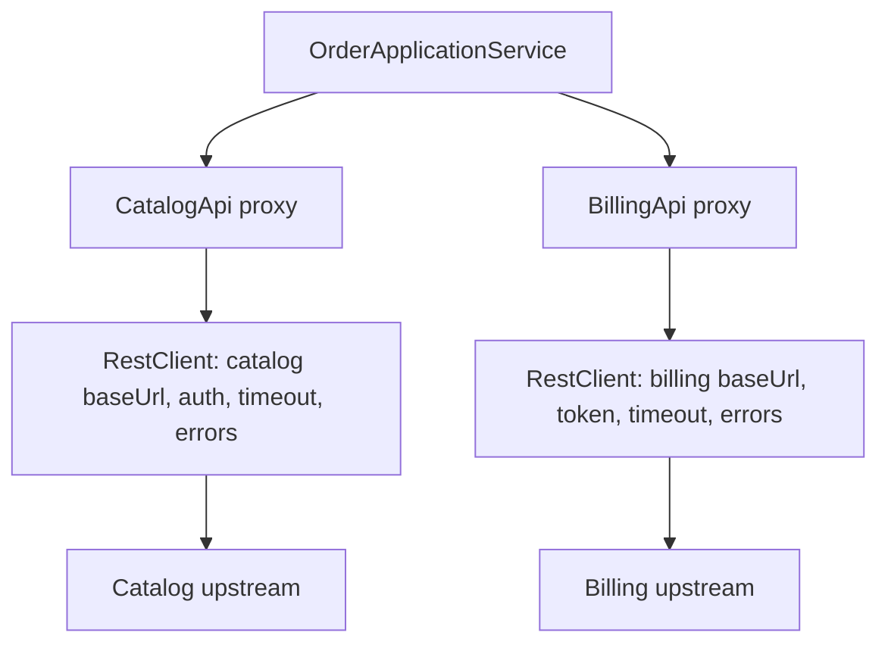
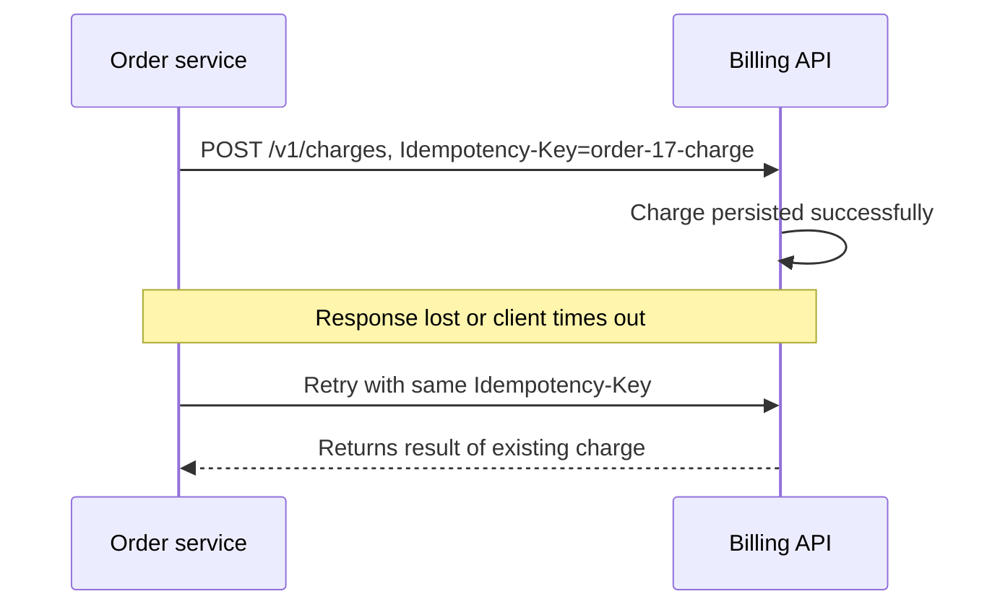
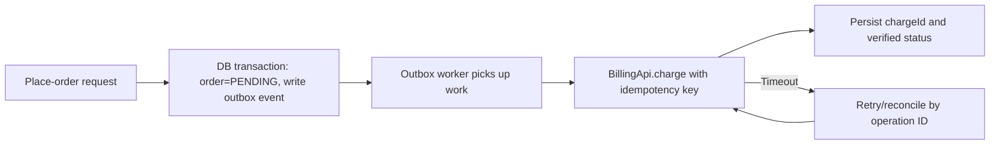

# Injecting Multiple HTTP Interfaces with Dedicated Addresses and Policies

When building a Spring Boot application that integrates with multiple systems, you often need to call **several HTTP APIs** with distinct contracts and operational requirements. For instance, an order service reads product details from a *Catalog API* while sending payment charges to a *Billing API*. The two systems have different hostnames, authentication schemes, timeouts, retry policies, error formats, and rate limits. Sharing a single globally configured HTTP client makes it easy to leak tokens, hit the wrong address, or apply dangerous retries to payment operations.

The **HTTP interface** chapter of the **SPRING_BOOT_INTEGRATION** module focuses on using Spring's **declarative HTTP interfaces** to define HTTP calling contracts in Java interfaces, creating proxies with `HttpServiceProxyFactory`, registering multiple beans, injecting the right client into services, and managing errors, transactions, deduplication, testing, and observability in real integration flows.

This lesson primarily uses **Spring Framework 6.1+ and Spring Boot 3.2+** for examples. API names and configuration approaches can change across versions, especially in newer Spring Boot/Spring Framework releases. Always cross-check against the actual dependency versions running in your project.

## 1. Learning Outcomes

After this lesson, you will be able to:

1. Explain why an HTTP interface is a contract, while `RestClient` or `WebClient` owns connections and transport policies.
2. Create two HTTP interfaces for two upstreams, each with its own `baseUrl`, timeouts, headers, and error handling.
3. Inject clients by **Java type** when interfaces differ, and use `@Qualifier` when multiple beans share the same interface type.
4. Prevent credential leakage and bugs caused by mutating a shared mutable builder.
5. Design timeouts, retries, rate limits, circuit breakers, and idempotency tailored to each API.
6. Independently test target addresses, headers, requests/responses, status codes, and failure modes per bean.
7. Operate multi-upstream integrations using structured logs, metrics, traces, and environment-specific configuration.

## 2. Why Multiple HTTP Interfaces Instead of One Shared HTTP Client?

Suppose `order-service` calls two systems:

| Property | Catalog API | Billing API |
|---|---|---|
| Purpose | Read prices, stock | Create payment charges |
| Address | `https://catalog.internal.example` | `https://billing.internal.example` |
| Auth | mTLS or catalog-scoped credentials | Bearer token dedicated to billing |
| Target timeouts | Connect 1 s, read 2 s | Connect 2 s, read 5 s |
| Retries | Safe GET per contract; may retry transient failures | POST retried only with idempotency key |
| 404 handling | Product does not exist | Does not mean "product does not exist" |
| Concurrency limit | High read volume | Tightly controlled payment volume |
| Telemetry | `dependency=catalog` | `dependency=billing` |

Using a single `RestClient` with global URL, headers, timeouts, and error handling can trigger bugs such as:

- Billing tokens getting attached to Catalog requests.
- A relative path `/v1/products` resolving against the Billing base URL.
- Automatic retries firing on side-effecting POSTs without idempotency keys.
- One slow upstream exhausting a shared connection pool and starving the other.
- Logs and metrics reporting only "HTTP client failed" without identifying which dependency failed.

The solution is **one interface per API contract** and **one separately configured transport client per connection policy**. Beans are explicitly named and injected cleanly where used.

## 3. Four-Layer Model



| Layer | Responsibility |
|---|---|
| **Java HTTP interface** | Defines methods, HTTP verbs, URI paths, request parameters, headers, and data types |
| **HTTP service proxy** | Implements the interface by translating Java invocations into HTTP requests |
| **RestClient/WebClient** | Manages base URL, authentication, codecs, network timeouts, interceptors/filters, error mapping, and observation |
| **Application service** | Coordinates business logic, overall deadlines, valid retries, transactions, idempotency, and fallbacks |

An `HttpServiceProxyFactory` constructs proxies from an adapter (such as `RestClientAdapter`). The interface itself **does not know any server address** and opens no connections until a proxy is created. Proxy beans of the interface type can be constructor-injected like any other Spring bean.

The key idea of declarative HTTP clients: **HTTP contracts are expressed as Java methods**. Method signatures and annotations govern request construction, while transport policies belong to the client backing the proxy.

## 4. Business Scenario and Project Structure

`order-service` has two flows:

1. Takes `productSku` and queries Catalog API for current pricing.
2. Once order and business rules are validated, submits `charge` to Billing API with a stable idempotency key.

Example layout:

```text
order-service
├── integration/
│   ├── catalog/CatalogApi.java
│   ├── billing/BillingApi.java
│   ├── config/PartnerHttpProperties.java
│   ├── config/PartnerHttpConfiguration.java
│   └── security/BillingTokenProvider.java
├── application/OrderApplicationService.java
└── domain/...
```

This layout illustrates responsibility separation; there is no requirement to use exact package names or split into multiple Java modules.

### 4.1. Dependencies

For Spring Boot 3.2+ using synchronous `RestClient` transport, you can use the web starter:

```groovy
dependencies {
    implementation("org.springframework.boot:spring-boot-starter-web")
    implementation("org.springframework.boot:spring-boot-starter-validation")

    testImplementation("org.springframework.boot:spring-boot-starter-test")
}
```

Spring Web provides `@HttpExchange`, `@GetExchange`, `@PostExchange`, `RestClient`, and `HttpServiceProxyFactory`. Spring Cloud OpenFeign is not needed here. The validation starter is optional for configuration property validation if the project uses Jakarta Bean Validation.

If the application is reactive or prefers `WebClient`, include the appropriate WebFlux dependencies (shown later). Avoid mixing blocking and reactive models unless blocking boundaries are explicitly isolated.

## 5. Defining the First HTTP Interface: Catalog API

```java
package example.integration.catalog;

import org.springframework.http.MediaType;
import org.springframework.web.bind.annotation.PathVariable;
import org.springframework.web.service.annotation.GetExchange;
import org.springframework.web.service.annotation.HttpExchange;

@HttpExchange(
    url = "/v1/products",
    accept = MediaType.APPLICATION_JSON_VALUE
)
public interface CatalogApi {

    @GetExchange("/{sku}")
    ProductView getProduct(@PathVariable("sku") String sku);
}
```

Illustrative DTO:

```java
package example.integration.catalog;

import java.math.BigDecimal;

public record ProductView(
    String sku,
    String name,
    BigDecimal price,
    String currency
) {}
```

When the client is built with `baseUrl=https://catalog.internal.example`:

```text
catalogApi.getProduct("SKU-42")
  -> GET https://catalog.internal.example/v1/products/SKU-42
     Accept: application/json
  <- 200 OK
     {"sku":"SKU-42","name":"Keyboard","price":125.00,"currency":"USD"}
```

`@GetExchange` maps the method to GET. `@PathVariable` substitutes the path variable into the URL; path/query encoding is handled during URI construction by the client. Inputs containing special characters must be treated as **values**, never manually concatenated into URL strings.

If upstream returns 404, times out, or returns schema-invalid JSON, the method is not guaranteed to return a `ProductView`. The application must handle transport failures, HTTP errors, and data-contract violations separately.

## 6. Defining the Second HTTP Interface: Billing API

```java
package example.integration.billing;

import org.springframework.http.MediaType;
import org.springframework.web.bind.annotation.RequestBody;
import org.springframework.web.bind.annotation.RequestHeader;
import org.springframework.web.service.annotation.HttpExchange;
import org.springframework.web.service.annotation.PostExchange;

@HttpExchange(
    url = "/v1/charges",
    accept = MediaType.APPLICATION_JSON_VALUE,
    contentType = MediaType.APPLICATION_JSON_VALUE
)
public interface BillingApi {

    @PostExchange
    ChargeResult charge(
        @RequestBody ChargeRequest request,
        @RequestHeader("Idempotency-Key") String idempotencyKey
    );
}
```

```java
package example.integration.billing;

import java.math.BigDecimal;

public record ChargeRequest(
    String orderId,
    BigDecimal amount,
    String currency
) {}

public record ChargeResult(
    String chargeId,
    String status
) {}
```

Note: these two records are **two top-level public Java records** and should be placed in separate Java files when implemented; they are shown together here for brevity.

Calling `charge(...)` supplies an idempotency key passed down from the application service. If a connection times out **after** Billing already processed the charge, the application must reuse **that exact key** on retry instead of generating a new one.

Annotations only describe the request contract. They **do not determine**:

- Which server to call;
- Where to obtain the Bearer token;
- Connect/read timeout durations;
- Whether to retry POST;
- How Billing HTTP 409 or 422 maps to business exceptions.

Those decisions belong in transport configuration and application policy.

## 7. Configuring Multiple Upstreams per Environment

Use an explicit configuration namespace to avoid confusion with the application's own HTTP server settings:

```yaml
# application.yml; addresses and durations are illustrative only
integrations:
  catalog:
    base-url: https://catalog.internal.example
    connect-timeout: 1s
    read-timeout: 2s
  billing:
    base-url: https://billing.internal.example
    connect-timeout: 2s
    read-timeout: 5s
```

Locally, override via profiles or environment variables:

```yaml
# application-local.yml
integrations:
  catalog:
    base-url: http://localhost:18081
  billing:
    base-url: http://localhost:18082
```

In Docker Compose, applications running **inside containers** typically use service DNS names like `http://catalog:8080` and `http://billing:8080` instead of `localhost`. With Testcontainers or WireMock, ports may be assigned dynamically; tests should inject the runtime-provided URL.

**Never hardcode credentials** in `application.yml` or Git. Fetch tokens from a secret manager, identity provider, or runtime environment, and never log entire bound configuration objects.

### 7.1. Binding Configuration into Typed Records

A composite configuration type using records:

```java
package example.integration.config;

import java.net.URI;
import java.time.Duration;
import org.springframework.boot.context.properties.ConfigurationProperties;

@ConfigurationProperties(prefix = "integrations")
public record PartnerHttpProperties(
    Endpoint catalog,
    Endpoint billing
) {
    public record Endpoint(
        URI baseUrl,
        Duration connectTimeout,
        Duration readTimeout
    ) {}
}
```

In Spring Boot 3.x, a record with a single canonical constructor naturally supports constructor binding. `Duration` binds from values like `1s`, `500ms`, or `2m`. Using `URI` clearly separates server addresses from arbitrary config strings.

In real applications, add validation: URIs must use `http` or `https` per environment, hosts must match an allowlist, timeouts must be positive, and fields must be non-null. Use Bean Validation on configuration properties and test startup failure on invalid configs rather than waiting until the first request to discover a missing `base-url`.

## 8. Creating Two Beans with `RestClient` and `HttpServiceProxyFactory`

Each bean receives its own configuration, creates a dedicated `RestClient`, and binds an adapter to `HttpServiceProxyFactory`.

```java
package example.integration.config;

import example.integration.catalog.CatalogApi;
import example.integration.billing.BillingApi;
import example.integration.security.BillingTokenProvider;
import org.springframework.boot.context.properties.EnableConfigurationProperties;
import org.springframework.context.annotation.Bean;
import org.springframework.context.annotation.Configuration;
import org.springframework.http.HttpHeaders;
import org.springframework.http.MediaType;
import org.springframework.http.client.SimpleClientHttpRequestFactory;
import org.springframework.web.client.RestClient;
import org.springframework.web.client.support.RestClientAdapter;
import org.springframework.web.service.invoker.HttpServiceProxyFactory;

@Configuration(proxyBeanMethods = false)
@EnableConfigurationProperties(PartnerHttpProperties.class)
public class PartnerHttpConfiguration {

    @Bean
    CatalogApi catalogApi(
            RestClient.Builder builder,
            PartnerHttpProperties props) {

        var options = props.catalog();
        RestClient client = builder.clone()
            .baseUrl(options.baseUrl().toString())
            .requestFactory(requestFactory(options))
            .defaultHeader(HttpHeaders.ACCEPT,
                MediaType.APPLICATION_JSON_VALUE)
            .build();

        return HttpServiceProxyFactory
            .builderFor(RestClientAdapter.create(client))
            .build()
            .createClient(CatalogApi.class);
    }

    @Bean
    BillingApi billingApi(
            RestClient.Builder builder,
            PartnerHttpProperties props,
            BillingTokenProvider tokenProvider) {

        var options = props.billing();
        RestClient client = builder.clone()
            .baseUrl(options.baseUrl().toString())
            .requestFactory(requestFactory(options))
            .requestInterceptor((request, body, execution) -> {
                // Read token at request time to support rotation.
                request.getHeaders().setBearerAuth(tokenProvider.accessToken());
                return execution.execute(request, body);
            })
            .build();

        return HttpServiceProxyFactory
            .builderFor(RestClientAdapter.create(client))
            .build()
            .createClient(BillingApi.class);
    }

    private static SimpleClientHttpRequestFactory requestFactory(
            PartnerHttpProperties.Endpoint options) {

        var factory = new SimpleClientHttpRequestFactory();
        factory.setConnectTimeout(Math.toIntExact(
            options.connectTimeout().toMillis()));
        factory.setReadTimeout(Math.toIntExact(
            options.readTimeout().toMillis()));
        return factory;
    }
}
```

This example uses `SimpleClientHttpRequestFactory` to keep connect/read timeouts clear and readable. For production workloads needing high throughput, connection pooling, proxies, HTTP/2, or custom TLS, choose an appropriate request factory/HTTP transport such as Apache HttpClient or JDK HttpClient and configure pools per upstream. Timeout configuration APIs vary across Spring Framework versions and transports.

`Math.toIntExact(...)` fails clearly if an oversized timeout overflows `int` milliseconds. Combine with positive-duration validation; the sample omits null/negative checks for brevity.

### 8.1. `TokenProvider` Is Dedicated to Billing

In the example:

```java
package example.integration.security;

public interface BillingTokenProvider {
    String accessToken();
}
```

The application must provide a **bean implementing** this interface backed by a real credential source (OAuth2 client, vault, or secret provider). The example deliberately avoids embedding dummy tokens in source code; wire this with your system's `BillingTokenProvider` bean before running.

Key practices:

- Never share or send Billing's Bearer token to Catalog.
- Refresh expired tokens; do not read a token once and cache it forever if rotation is enforced.
- Never write tokens into logs, metric tags, or exception messages.
- In tests, supply a fake test token and assert it only appears on Billing requests.

### 8.2. Why Use `builder.clone()`?

`RestClient.Builder` is a **mutable builder**. Calling `baseUrl(...)`, `defaultHeader(...)`, or `requestInterceptor(...)` mutates builder state. Reusing one mutable builder across two upstreams without isolation can accidentally leak one bean's settings into the other.

A Boot-configured `RestClient.Builder` can carry message converters and observation customizations. Cloning before configuring lets each bean keep isolated settings while inheriting shared baseline configuration:

```java
RestClient catalog = bootBuilder.clone()
    .baseUrl("https://catalog.internal.example")
    .build();

RestClient billing = bootBuilder.clone()
    .baseUrl("https://billing.internal.example")
    .build();
```

Calling `RestClient.builder()` directly still builds a client, yet may skip customizations Spring Boot applies to injected builders. Verify observation, codecs, TLS, and customizers before switching from a Boot-managed builder to a manual one.

### 8.3. Why Separate Timeout Configuration?

- **Connect timeout**: limits time to establish the network connection.
- **Read/response timeout**: limits time waiting to read data or receive responses per transport semantics.
- **Business deadline**: limits total time allowed for a business operation, potentially spanning multiple requests and retries.

Never assume `read-timeout: 5s` guarantees "every call finishes within 5 seconds" across all transports, streaming bodies, retries, and TLS/DNS/connection-pool acquisition phases. Verify real transport timeout behavior and enforce overall deadlines in the service layer when needed.

## 9. Injecting Two Interfaces of Different Types: Constructor Injection

Because `CatalogApi` and `BillingApi` are distinct Java types, Spring resolves each bean by type without needing `@Qualifier`:

```java
package example.application;

import example.integration.catalog.CatalogApi;
import example.integration.catalog.ProductView;
import example.integration.billing.BillingApi;
import example.integration.billing.ChargeRequest;
import example.integration.billing.ChargeResult;
import java.math.BigDecimal;
import org.springframework.stereotype.Service;

@Service
public class OrderApplicationService {

    private final CatalogApi catalogApi;
    private final BillingApi billingApi;

    public OrderApplicationService(
            CatalogApi catalogApi,
            BillingApi billingApi) {
        this.catalogApi = catalogApi;
        this.billingApi = billingApi;
    }

    public ProductView lookup(String sku) {
        return catalogApi.getProduct(sku);
    }

    public ChargeResult charge(
            String orderId,
            BigDecimal amount,
            String currency,
            String stableIdempotencyKey) {
        return billingApi.charge(
            new ChargeRequest(orderId, amount, currency),
            stableIdempotencyKey
        );
    }
}
```

Here:

1. Spring automatically injects the `CatalogApi` proxy built from Catalog's `RestClient`.
2. Spring automatically injects the `BillingApi` proxy built from Billing's `RestClient`.
3. The application service needs no knowledge of base URLs, tokens, or HTTP request construction.

This example shows how to coordinate both calls; it **does not** make Catalog, Billing, and the database atomic. In real payment workflows, the idempotency key must be deterministically derived or durably persisted so retries and restarts reuse it. Avoid placing slow HTTP calls inside long-running SQL transactions when a safer workflow/outbox design is viable.

## 10. When One Interface Must Target Multiple Addresses

Another common case is using the same contract across multiple environments, regions, or tenants. Suppose `CatalogApi` has two instances:

- `catalogPrimaryApi` in the primary region;
- `catalogBackupApi` in the backup region.

Both beans share the **Java type `CatalogApi`**. If a service declares a constructor parameter `CatalogApi catalogApi`, Spring throws `NoUniqueBeanDefinitionException` because multiple candidates match.

### 10.1. Declaring Distinctly Named Beans

The code below illustrates **an alternative configuration** to the single `CatalogApi` bean in Section 8; do not combine both configurations verbatim in the same project without adjusting bean counts:

```java
@Configuration(proxyBeanMethods = false)
class RegionalCatalogConfiguration {

    @Bean("catalogPrimaryApi")
    CatalogApi catalogPrimaryApi(RestClient.Builder builder) {
        RestClient client = builder.clone()
            .baseUrl("https://catalog-primary.internal.example")
            .build();
        return proxy(client);
    }

    @Bean("catalogBackupApi")
    CatalogApi catalogBackupApi(RestClient.Builder builder) {
        RestClient client = builder.clone()
            .baseUrl("https://catalog-backup.internal.example")
            .build();
        return proxy(client);
    }

    private static CatalogApi proxy(RestClient client) {
        return HttpServiceProxyFactory
            .builderFor(RestClientAdapter.create(client))
            .build()
            .createClient(CatalogApi.class);
    }
}
```

These hostnames are illustrative; in production, bind them from `@ConfigurationProperties` or managed config sources, and add region-specific auth and timeouts.

### 10.2. Injecting Explicitly with `@Qualifier`

```java
@Service
public class CatalogComparisonService {

    private final CatalogApi primary;
    private final CatalogApi backup;

    public CatalogComparisonService(
            @Qualifier("catalogPrimaryApi") CatalogApi primary,
            @Qualifier("catalogBackupApi") CatalogApi backup) {
        this.primary = primary;
        this.backup = backup;
    }

    public ProductView loadPrimary(String sku) {
        return primary.getProduct(sku);
    }
}
```

Import `org.springframework.beans.factory.annotation.Qualifier`, `org.springframework.stereotype.Service`, and the corresponding DTO/interface. Constructor injection with `@Qualifier` is explicit and works cleanly even when multiple beans share a type.

### 10.3. Is `@Primary` Appropriate?

`@Primary` marks a preferred candidate when an injection point sees multiple beans of the same type. It helps when a system genuinely has **one default client** and others are exceptions.

However, in payments, multi-region setups, or multi-tenant apps, silent defaults risk hitting the wrong upstream. Whenever each client has distinct business meaning, prefer explicit qualifiers over `@Primary` masking ambiguity.

### 10.4. Name Beans by Role, Not Arbitrary Labels

Names like `catalogPrimaryApi`/`catalogBackupApi` communicate intent. Names like `client1`/`client2` obscure code reviews and metrics. In larger projects, consider custom qualifier annotations like `@PrimaryCatalog` or `@BackupCatalog` used across injection points.

Never reuse a Catalog bean name for a completely different policy domain (such as Billing); whenever the HTTP contract differs, define a separate interface.

## 11. Relative Addresses, Absolute URLs, and Security Boundaries

Given:

```java
@HttpExchange(url = "/v1/products")
interface CatalogApi {
    @GetExchange("/{sku}")
    ProductView getProduct(@PathVariable String sku);
}
```

Relative paths combine with the `RestClient`/`WebClient` URI policy, typically anchored to the configured base URL. Never hardcode hostnames inside annotations if the same contract runs against local, staging, and production environments.

Controls to enforce:

1. An **absolute URI** passed to APIs supporting dynamic URIs can override the base URL. Avoid accepting arbitrary user-supplied URLs on clients holding internal credentials; if unavoidable, enforce host/scheme allowlists and strict redirect policies.
2. Encode path variables properly. Never build paths by concatenating untrusted strings.
3. Isolate `baseUrl` per upstream and environment; host-published ports differ from internal Docker Compose/Kubernetes service addresses.
4. For HTTP redirects, verify whether the transport forwards `Authorization` headers. Never let tokens follow redirects outside your trust boundary.
5. With custom URI resolvers, explicitly test base paths and slashes so `/api/v1` is neither dropped nor duplicated.

If supporting many tenants with dynamic endpoints, do not spawn unbounded HTTP clients per request. Maintain a validated tenant → config mapping with bounded caches/pools, token lifecycles, and cleanup. Qualifier-based injection fits a **small, controlled set of static configurations**.

## 12. Authentication and Headers Must Be Scoped to the Right Upstream

A system may use different authentication mechanisms per upstream:

| Type | Typical Configuration Point | Notes |
|---|---|---|
| Static API key with rotation | Client-specific interceptor/request customizer | Never expose in source/logs |
| OAuth2 Bearer token | Per-upstream token provider or OAuth2 client integration | Manage expiry, refresh, scopes |
| mTLS | Dedicated HTTP transport/SSL bundle | Verify server identity and client certificates |
| Basic Auth | Client-specific policy if required | Use only over HTTPS; protect secrets |
| Trace/correlation ID | Observation/tracing filter or request parameter | Never use as authentication |
| Idempotency key | Argument on side-effecting operations | Keep stable across retries |

In the Billing example, the interceptor fetches the token at request execution time:

```java
.requestInterceptor((request, body, execution) -> {
    request.getHeaders().setBearerAuth(tokenProvider.accessToken());
    return execution.execute(request, body);
})
```

Never attach this interceptor to the Catalog bean. Using a global `RestClientCustomizer` to inject Billing's `Authorization` header risks leaking tokens across clients. Global settings should include only safe cross-cutting defaults like tracing/correlation and message converters.

### 12.1. Dynamic Request Headers

For values that vary per call, method parameters are clear and readable:

```java
@GetExchange("/{sku}")
ProductView getProduct(
    @PathVariable String sku,
    @RequestHeader("X-Correlation-Id") String correlationId
);
```

This is a **method variant** illustrating dynamic headers; update callers if you adopt it. Avoid passing sensitive tokens as raw method arguments that might accidentally be recorded by parameter-capturing tracing.

### 12.2. TLS, Proxies, and Connection Pools

In production, timeouts are not the only transport policy. Each upstream may require:

- Different truststores/certificate bundles; mTLS for one upstream and not another.
- Corporate proxies or non-proxy host exclusions.
- Distinct connection pool sizes, idle timeouts, and connection TTLs.
- Specific DNS TTLs, HTTP/2 settings, keep-alives, and concurrent request caps.

Configure these at the **HTTP transport** before creating the `RestClient`/`WebClient` adapter, and reuse the client across requests. Never allocate a new pooled transport per service call, or you will leak connections/threads and pay repeated handshakes.

## 13. Each Upstream Needs Its Own HTTP Status Handling Policy

Do not lump every `4xx`/`5xx` into one generic exception and lose business semantics.

Example:

| Status | Catalog | Billing |
|---|---|---|
| `200` | Product found | May not apply to POST |
| `201` | Rare | Charge created |
| `400` | Invalid SKU/query | Invalid currency or amount payload |
| `401/403` | Bad Catalog credentials/permissions | Invalid Billing token or scope |
| `404` | Product not found | Wrong route or unknown charge reference, per contract |
| `409` | Version/inventory conflict | Idempotency conflict or incompatible payment state |
| `422` | Business validation failure | Payment rule rejected |
| `429` | Catalog throttling | Billing throttling |
| `502/503/504` | Temporary gateway/upstream outage | Failure that may occur after payment was executed |

By default, `RestClient` throws exceptions for HTTP error statuses. You can register a `defaultStatusHandler` on a **specific client** to translate errors into domain-meaningful exceptions.

Catalog example:

```java
RestClient catalogRestClient = builder.clone()
    .baseUrl(catalogUrl)
    .defaultStatusHandler(
        status -> status.value() == 404,
        (request, response) -> {
            throw new CatalogProductNotFoundException(
                "Catalog product was not found");
        })
    .build();
```

`CatalogProductNotFoundException` is an application-defined exception. This snippet illustrates mapping 404; other statuses keep defaults or follow upstream contract mappings. Never copy Catalog's status handler straight to Billing if 404 means something different there.

### 13.1. Keep Errors Rich Enough to Diagnose

A useful HTTP error for the application layer captures at least:

- upstream identity (`catalog`/`billing`);
- operation (`lookupProduct`/`charge`);
- HTTP status or network failure category;
- upstream error code from the response body if present;
- request ID/correlation ID;
- whether the error is retryable or non-retryable per contract.

At the same time, **redact sensitive data**: never log `Authorization`, cookies, card details, sensitive amounts, PII, or full responses unless explicitly permitted. Never include URLs containing query tokens in exception messages.

### 13.2. Parsing Problem Details Error Payloads

Many APIs return JSON problem/error envelopes. Map error bodies in the adapter/gateway layer into domain exceptions rather than forcing application services to parse raw HTTP responses. When using a custom status handler, remember the response body is a stream; read it once and deserialize safely if you need the error code. Test empty bodies, non-JSON error responses, and varying charsets.

## 14. Retries Are a Business Policy, Not an Inherent Interface Property

An interface carrying `@PostExchange` does not know whether a request is safe to retry. `RestClient` and proxies do not automatically invent safe retry policies per operation.

### 14.1. Classification by Operation

| Operation | Default Retry Consideration | Rationale |
|---|---|---|
| Catalog GET product | May retry select connection/`503` errors within budget | Read-mostly; confirm upstream GET is genuinely side-effect free |
| Billing POST create charge | Retry only with idempotency key and contract support | Timeout does not prove server never processed |
| Billing GET charge status | May retry transient errors under stable contract | Used to inspect state after an ambiguous request |
| Cancel/refund POST | Tightly bound to idempotency key and state transitions | Must not issue duplicate refunds |
| `400`, `401`, `403`, `422` | Normally never auto-retry | Input, config, or credentials need fixing |
| `429` | Retry respecting rate limits and `Retry-After` if allowed | Avoid hammering overloaded service |

### 14.2. Overall Deadline Matters More Than a Single Timeout

Suppose Billing has a 2-second connect timeout and 5-second read timeout, while the application request has an 8-second deadline. If a retry layer blindly attempts three calls without checking remaining budget, callers can wait far longer than 8 seconds.

Illustrative policy:

```text
Business deadline: 8 seconds
Attempt 1: timeout bounded by remaining budget
If transient failure and budget remains:
   backoff + jitter
Attempt 2: reuse same Idempotency-Key
If budget exhausted:
   return unknown outcome or transition to charge-status verification
```

Retries can be implemented with Spring Retry, Resilience4j, or application policy. Whichever library you pick, prevent **multi-layer retry amplification**: 3 retries in the gateway, 3 in the service, and 3 at the edge yield 27 calls.

### 14.3. Retrying a Payment After Timeout



This flow is safe **only if Billing API implements real idempotency**. Sending the header alone does not deduplicate on the backend; if the partner ignores the header, use another strategy such as persisting operation IDs, querying status, or running reconciliation.

## 15. Per-Upstream Circuit Breakers, Bulkheads, Rate Limits, and Fallbacks

If Catalog constantly times out, it must not exhaust resources needed by Billing.

- **Catalog circuit breaker:** trips when Catalog errors exceed threshold; probes recovery after a configured wait duration.
- **Billing circuit breaker:** separate thresholds and failure predicates from Catalog; Billing business 4xx errors do not necessarily count as system outages.
- **Bulkheads/connection pools:** reserve per-dependency concurrency caps so one slow upstream cannot consume all threads/connections.
- **Rate limiters:** respect quotas per API key or tenant.
- **Fallbacks:** serve cached data when business rules permit; never "fake a successful payment" as a fallback.

Example policies:

| Dependency | Circuit | Fallback | Correctness Condition |
|---|---|---|---|
| Catalog | Opens on rising timeouts | TTL-bounded cached price, if allowed | Stale price can misprice orders; track price version |
| Billing | Opens on rising system errors | Save `PENDING_PAYMENT` state and process asynchronously | Never return `PAID` before charge is confirmed |

Circuit breaker settings should never match merely because two beans use `RestClient`. Use distinct policy names like `catalogCircuit` and `billingCircuit` to keep configuration and telemetry separate.

## 16. Protecting Transactions and Data from HTTP Side Effects

In `OrderApplicationService`, which updates SQL and calls Billing, answer this question:

> If the database commit succeeds yet Billing times out, what state must the order be in?

Neither an HTTP interface nor standard JDBC `@Transactional` creates an atomic distributed transaction with the Billing API.

### 16.1. Anti-Pattern: Holding an SQL Transaction Open During a Slow HTTP Call

```java
@Transactional
public void placeOrder(...) {
    repository.save(order);
    billingApi.charge(...); // May wait seconds or time out
    repository.markPaid(...);
}
```

This snippet carries severe risks:

- The transaction holds DB locks/connections while waiting on the network.
- JDBC rollback does not undo a charge already executed by Billing.
- Retrying the whole method can produce multiple external side effects.

A more reliable pattern in many use cases is a **transactional outbox or state machine**:



Here, the application commits acceptance durably first, and a worker executes payment afterward. API response states must tell the truth: `PENDING` must never masquerade as `PAID`.

### 16.2. When a REST Client Is Called from a Kafka Listener

If a Kafka listener consumes `OrderConfirmedEvent` and calls `BillingApi.charge(...)`:

1. The event must carry a stable identifier usable as a deduplication/idempotency key.
2. Acknowledge the Kafka offset only after fulfilling the **consumption contract** (e.g., durably storing an outbox intent, or confirming the charge and updating DB safely).
3. If a timeout leaves Billing's outcome unknown, never ack and lose track of the work.
4. Provide retries, a DLT, or reconciliation with clear ownership and metrics.

HTTP interfaces handle API invocation; **Kafka offset commit / DB transaction / outbox** boundaries still require explicit design.

## 17. Using `WebClient` for Reactive Applications

HTTP interfaces also work over `WebClientAdapter`. In WebFlux/Reactor apps returning `Mono<T>`, declare a separate reactive interface:

```java
import org.springframework.web.bind.annotation.PathVariable;
import org.springframework.web.service.annotation.GetExchange;
import org.springframework.web.service.annotation.HttpExchange;
import reactor.core.publisher.Mono;

@HttpExchange("/v1/products")
public interface ReactiveCatalogApi {

    @GetExchange("/{sku}")
    Mono<ProductView> getProduct(@PathVariable("sku") String sku);
}
```

Creating the proxy:

```java
import org.springframework.web.reactive.function.client.WebClient;
import org.springframework.web.reactive.function.client.support.WebClientAdapter;
import org.springframework.web.service.invoker.HttpServiceProxyFactory;

WebClient catalogWebClient = WebClient.builder()
    .baseUrl("https://catalog.internal.example")
    .build();

ReactiveCatalogApi api = HttpServiceProxyFactory
    .builderFor(WebClientAdapter.create(catalogWebClient))
    .build()
    .createClient(ReactiveCatalogApi.class);
```

Just like `RestClient`, build a separate `WebClient` per upstream to attach WebClient filters, authentication, Reactor Netty connectors, timeouts, and limits. When Boot provides a customized `WebClient.Builder`, inject that builder instead of creating an unconfigured builder.

Never call `.block()` inside a WebFlux event-loop thread merely to convert reactive calls into synchronous ones; that stalls the event loop. If a service is a traditional Servlet app with blocking APIs, `RestClient` is normally easier to reason about.

### 17.1. Reactive Timeouts Do Not Automatically Match `RestClient`

With Reactor Netty, connect timeout, response timeout, pool acquisition, and TLS handshake timeouts live on Reactor Netty's `HttpClient`, passed via `ReactorClientHttpConnector` per `WebClient`. Putting `.timeout(Duration.ofSeconds(3))` on `Mono` is a reactive-chain timeout; it does not necessarily equal a transport timeout or halt work already received upstream.

### 17.2. Refactoring Between `WebClient` and `RestClient`

When swapping transports:

- Keep method contracts only where return types, headers, and encoding remain compatible.
- Replace `WebClientAdapter` with `RestClientAdapter` and adjust sync/reactive return types.
- Re-validate timeouts, error mapping, observability, and retries instead of copying policies blindly as if the APIs were identical.
- Watch blocked thread counts and connection pools under load.

Never swap adapters and assume identical operational behavior.

## 18. Dynamic Clients and Multi-Tenancy: When Qualifiers Are Not Enough

`@Qualifier` works well for two or a handful of static beans. When serving hundreds of tenants with different endpoints, declaring one bean per tenant does not scale.

A suitable pattern:

```text
Caller provides tenantId (authenticated)
    ↓
TenantRoutingService looks up registry tenantId -> policy
    ↓
Validate URI/scheme/host allowlist and tenant permissions
    ↓
Retrieve bounded cached client or construct managed client
    ↓
Invoke appropriate HTTP interface
```

Required safeguards:

- Never trust a raw `baseUrl` supplied by a request/user. That is an SSRF boundary.
- Isolate credentials per tenant; never cache tokens in an improperly scoped shared bean.
- Bound the number of transport clients, connection pools, and thread resources.
- Aggregate metrics by **service type** and a bounded label set; never put arbitrary user IDs/URLs in metric tags.
- Support config refresh/revocation and evict/close old clients when topology changes.

When you only have a few stable regions or partners, named beans + qualifiers remain clearer than a dynamic client registry.

## 19. Common Mistakes When Declaring Multiple HTTP Interfaces

| Symptom | Common Cause | Fix |
|---|---|---|
| `NoSuchBeanDefinitionException` for `CatalogApi` | Declared interface without creating proxy bean | Create bean via `HttpServiceProxyFactory`; check component scan/config |
| `NoUniqueBeanDefinitionException` | Multiple beans of same interface without qualifier | Use `@Qualifier` or custom qualifier annotations |
| Requests hit wrong hostname | Shared mutable builder or broken URI joining | Isolate builders, set base URL per bean, test exact URLs |
| Billing receives Catalog's token | Global auth interceptor/shared headers | Separate auth interceptors per client |
| App in Docker cannot reach `localhost` | `localhost` refers to the container itself | Use service DNS or topology-appropriate addresses |
| HTTP 404 turns into a system-wide failure | Missing contract-specific error mapping | Map Catalog not-found to a valid domain outcome/exception |
| Duplicate Billing charge after timeout | Retries dropped or rotated idempotency key | Stable key; query/reconcile unknown outcomes |
| Connection exhaustion under load | Creating clients per request or mis-sized pools | Reuse clients; configure pools/bulkheads per upstream |
| Logs leak Bearer tokens | Logging full headers/requests | Redact tokens/PII; sample safely |
| Single request timeout runs unexpectedly long | Uncapped total deadline across retries | Configure per-phase timeouts + business deadline |
| Tests pass despite hitting wrong upstream | Shared mock server missing URL/header assertions | Separate mocks per bean and assert exact requests |
| Missing telemetry despite Boot observability | Used manual `RestClient.builder()` dropping customizers | Inject Boot's builder and verify instrumentation |

## 20. Testing Each Client Independently

Good tests catch **wrong-upstream calls** and **header leaks**. Mocking `CatalogApi` with Mockito in application service tests is useful for business logic, yet does not check how the Spring HTTP interface proxy constructs requests.

### 20.1. Verifying Bean Wiring via `ApplicationContext`

With two distinct interfaces:

```java
@Autowired CatalogApi catalogApi;
@Autowired BillingApi billingApi;

@Test
void bothProxiesExist() {
    assertThat(catalogApi).isNotNull();
    assertThat(billingApi).isNotNull();
}
```

This is a basic smoke test; it does not prove addresses or headers are right. With two beans sharing one type, test `@Qualifier` wiring in a realistic context test.

### 20.2. HTTP-Level Tests with `MockRestServiceServer`

Spring Test provides `MockRestServiceServer` to verify HTTP requests emitted by `RestClient`. The key principle is **one dedicated mock server per builder/client**:

```java
import static org.springframework.test.web.client.match.MockRestRequestMatchers.requestTo;
import static org.springframework.test.web.client.response.MockRestResponseCreators.withSuccess;

import org.junit.jupiter.api.Test;
import org.springframework.http.MediaType;
import org.springframework.test.web.client.MockRestServiceServer;
import org.springframework.web.client.RestClient;
import org.springframework.web.client.support.RestClientAdapter;
import org.springframework.web.service.invoker.HttpServiceProxyFactory;

class CatalogProxyTest {

    @Test
    void buildsRequestAgainstCatalogBaseUrl() {
        RestClient.Builder builder = RestClient.builder()
            .baseUrl("https://catalog.test");

        MockRestServiceServer server =
            MockRestServiceServer.bindTo(builder).build();

        CatalogApi api = HttpServiceProxyFactory
            .builderFor(RestClientAdapter.create(builder.build()))
            .build()
            .createClient(CatalogApi.class);

        server.expect(requestTo(
                "https://catalog.test/v1/products/SKU-42"))
            .andRespond(withSuccess("""
                {"sku":"SKU-42","name":"Keyboard","price":125.00,
                 "currency":"USD"}
                """, MediaType.APPLICATION_JSON));

        ProductView product = api.getProduct("SKU-42");
        org.assertj.core.api.Assertions.assertThat(product.sku())
            .isEqualTo("SKU-42");
        server.verify();
    }
}
```

This snippet assumes `CatalogApi` and `ProductView` are imported from above alongside test libraries. It checks the exact URL and JSON mapping. In production test suites, add assertions for HTTP verb, `Accept`, **absence** of `Authorization` on Catalog, and transport timeouts.

### 20.3. Testing Zero Header Leakage and Client Isolation

Create two mock servers:

```text
catalogMock:
  expect GET /v1/products/SKU-42
  assert Host: catalog.test
  assert Authorization header absent (when Catalog contract does not use Bearer)

billingMock:
  expect POST /v1/charges
  assert Host: billing.test
  assert Authorization: Bearer <test token>
  assert Idempotency-Key: order-17-charge
  assert Content-Type: application/json
```

Invoke both proxies sequentially and concurrently (where client/transport permits) to catch shared mutable builder/header leaks. Never embed real tokens in fixtures or log snapshots.

### 20.4. Contract Tests and Integration Tests

`MockRestServiceServer` works well for Spring request mapping, yet does not simulate:

- DNS/TLS/mTLS, proxies, HTTP/2, or connection pooling;
- connect/read timeouts over real sockets;
- partner response changes when upstream schemas evolve;
- retries/circuit breakers interacting with threads and network failures.

For critical integrations, combine:

1. **Unit tests** of the application service mocking the interface.
2. **HTTP proxy tests** with `MockRestServiceServer`/WireMock verifying URLs, headers, JSON, and statuses.
3. **Integration tests** with a WireMock server or stub over real TCP for timeouts, retries, and connection pools.
4. **Consumer-driven contract tests** or partner sandbox runs when your organization manages API contracts.

## 21. Failure Testing Matrix

| Test Case | Fault Injected | Expected Outcome |
|---|---|---|
| Two distinct base URLs | Catalog and Billing hit two separate stubs | Zero cross-host calls |
| Two distinct auth policies | Only Billing requires Bearer | Sensitive header never leaks to Catalog |
| Same interface, two beans | Inject primary and backup via qualifiers | Service targets the right URL |
| Catalog returns 404 | Stub returns missing product | Domain handles "product absent"; no infinite 404 retry |
| Catalog returns 503 | Stub simulates transient error | Bounded retries, accurate metrics |
| Billing POST times out after server commit | Stub records charge then drops response | Retry reuses idempotency key or reconciles |
| Billing returns 401/403 | Invalid/under-scoped token | No infinite retry with stale token |
| Billing returns 409 | Idempotency conflict | Distinguished from valid duplicate replay per contract |
| Invalid JSON | Stub returns schema-broken body | Deserialization failure handled; never treated as success |
| Connection refused | Stub port closed | Timeout/retry budget prevents hanging |
| Slow upstream | Stub delays response | Client timeout and business deadline fire properly |
| Burst traffic | Many concurrent requests | One upstream's pool/bulkhead does not starve the other |
| Token rotation | Provider issues fresh token on next call | Request picks up updated token when policy requires |
| Invalid endpoint config | Missing scheme or disallowed host | Startup fails fast with clear error |
| Trace propagation | Tracing enabled on `RestClient.Builder` | Trace/correlation IDs propagate without exposing secrets |

For trivial config tweaks, avoid redundant tests that merely echo hardcoded strings. For failures risking **hitting the wrong server or leaking credentials**, an HTTP-level test verifying exact URLs and headers is high value.

## 22. Per-Dependency Observability in Operations

When a request traverses Catalog, Billing, and a database, operators need to pinpoint where failures occurred and which calls succeeded. A trace may look like:

```text
POST /orders
  ├─ catalog.getProduct [HTTP GET]  85 ms  200
  ├─ orders-db.transaction           23 ms  COMMIT
  └─ billing.charge [HTTP POST]    5000 ms  TIMEOUT
       └─ business state = PENDING_PAYMENT
```

Recommended telemetry dimensions:

- Stable **dependency name**: `catalog`, `billing`, without full URLs containing user inputs.
- **Operation**: `getProduct`, `charge`.
- **HTTP method**, status group, timeout/error category.
- **Latency** p50/p95/p99, connect failures, pool wait, retry counts, and circuit states.
- **Trace ID** linking inbound requests to outbound calls.
- **Idempotency key** logged only in permitted, sanitized ways.

Spring Boot can auto-configure observation/tracing for `RestClient`/`WebClient` constructed via Boot builders when relevant dependencies are present. Verify instrumentation in your actual version rather than assuming bean injection guarantees trace propagation. Never put access tokens, cookies, or financial details in metric tags.

### 22.1. Grouping Metrics by Host vs Logical Dependency

Hostnames can change behind load balancers or across environments. A `dependency=billing` label aggregates dashboards far more reliably than raw URLs. When distinguishing regions, use a bounded label such as `region=primary/backup`. Avoid raw paths with arbitrary order IDs or SKUs as labels, which cause unbounded cardinality.

## 23. Incident Runbook: Billing Fails While Catalog Remains Healthy

When production alerts on "orders cannot be paid", follow a structured runbook:

1. **Confirm affected upstream** via metrics/traces: are errors on Billing or Catalog? Did base URL or routing change?
2. **Classify the error**: DNS/TLS/auth/4xx/5xx/timeout/pool exhaustion/serialization.
3. **Check contract and idempotency**: could Billing have completed the charge before the response was lost?
4. **Cross-check internal state**: order status, outbox jobs, `chargeId`, idempotency key, and retry history.
5. **Remediate within scope**: refresh Billing token, scale the right pool, fix URI/ACL, trip circuit temporarily, retry/reconcile under control.
6. **Verify recovery**: Billing success rate recovers, `PENDING` orders resolve without duplicate charges, and Catalog remains unaffected.

An HTTP 504 from a gateway **does not prove** Billing did not execute the charge. Never generate a fresh idempotency key to "try again" before verifying the prior transaction's state.

## 24. Review Questions and Exercises

**Exercise A — Two Different Interface Types.** An app defines one `CatalogApi` bean and one `BillingApi` bean. Do constructors taking both parameters need qualifiers?

*Hint:* Usually no, because Spring resolves them by distinct Java types. Only when multiple beans share the same type do you need qualifiers or precedence rules.

**Exercise B — Same Interface for Two Regions.** A project registers two `CatalogApi` beans from two base URLs. A service injects `CatalogApi catalogApi` and fails with an ambiguous bean error.

*Hint:* Assign explicit bean names and `@Qualifier` at the injection point. Naming by region/role and testing exact hostnames prevents mix-ups.

**Exercise C — Leaked Bearer Token.** A global `RestClientCustomizer` adds Billing's Authorization header to every `RestClient`.

*Hint:* Move Billing authentication onto Billing's dedicated client; keep global customizers strictly for safe shared policies. Write a test proving Catalog never receives Billing's token.

**Exercise D — Payment Timeout.** Billing persisted a charge, yet the response dropped. The retry layer generates a new UUID for the second POST.

*Hint:* Risks double charging. Idempotency keys must be stable per operation and honored by Billing; when state is unknown, query/reconcile before initiating another side-effecting call.

**Exercise E — HTTP 404 Semantics.** Catalog 404 means the SKU does not exist, whereas Billing 404 means a wrong route or missing charge reference. Should both share one global status handler?

*Hint:* No. Map per upstream contract and maintain distinct business exceptions.

**Exercise F — "Ignored" Timeout.** Read timeout is configured as 5 seconds, yet the application request takes over 15 seconds due to three retries.

*Hint:* A per-attempt timeout is not an overall workflow deadline. Enforce an end-to-end budget and cap retry attempts.

**Exercise G — `WebClient` Inside WebFlux.** A reactive service calls `Mono.block()` on an event-loop thread to use a synchronous DTO-returning interface.

*Hint:* This can stall the event loop. Use a `Mono<T>` interface with `WebClientAdapter` and reactive composition, or offload blocking work onto an appropriate scheduler if unavoidable.

## 25. Multi-HTTP-Interface Implementation Checklist

- [ ] Each upstream has a dedicated Java interface reflecting its real API contract.
- [ ] Each proxy is backed by a transport with explicit **base URL** and **policies**.
- [ ] Configuration is externalized, validated, and free of secrets in Git.
- [ ] Distinct types are injected directly; shared types use `@Qualifier` or custom qualifiers.
- [ ] Mutable builders, token interceptors, and error handlers are never shared across incompatible scopes.
- [ ] Connect/read/response timeouts are clearly separated from overall business deadlines.
- [ ] Retries apply only to operations and error classes proven safe.
- [ ] Side-effecting POSTs carry durable idempotency keys where supported upstream.
- [ ] Circuit breakers, bulkheads, pools, and rate limits are tuned independently per dependency.
- [ ] Remote HTTP calls are never treated as part of a fake distributed JDBC transaction.
- [ ] Error statuses/bodies are mapped per upstream without logging credentials or PII.
- [ ] Tests verify exact URLs, HTTP methods, headers, JSON, auth isolation, and timeouts.
- [ ] Metrics/traces distinguish logical dependencies and operations with low cardinality.
- [ ] Reconciliation workflows exist whenever external calls end with unknown outcomes.

## 26. Takeaways

**The HTTP interface defines how to call an API; the HTTP transport determines where and under what policies the call runs.** For two upstreams with different contracts, declare two interfaces and two clear proxy beans so Spring injects cleanly by type. For multiple endpoints implementing the same interface, register distinctly named beans and inject via `@Qualifier` so selection intent stays explicit.

In Spring Boot Integration, reliable multi-interface wiring goes well beyond setting the right `baseUrl`. It requires isolated authentication, per-dependency timeouts, contract-driven error mapping, safe retries, idempotency for side-effecting writes, proper transaction/outbox boundaries, and tests verifying actual wire URLs and headers. Giving each dependency its own policies and observability makes incidents far easier to diagnose and contains blast radius when a partner fails.
