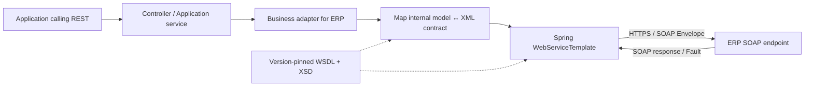

# SOAP, WSDL, XML Schema, and Legacy System Integration Scenarios

## 1. Why Do Spring Boot Applications Still Need to Understand SOAP?

In many enterprises, new systems written in Spring Boot must exchange data with long-running ERPs, core banking platforms, insurance systems, warehouse management systems, or government service portals. These systems may expose **SOAP web services** instead of REST APIs. The goal of integration is usually not to replace the legacy system immediately, but to exchange data with it under a well-defined contract, with error control and long-term operational reliability.

Within the scope of **SPRING_BOOT_INTEGRATION**, this lesson connects to organizing system integration across HTTP clients, databases, caches, message brokers, and Spring Integration adapters. SOAP is a typical case of **synchronous integration over HTTP**: the Spring Boot side calls an external service, converts the XML contract into an internal model, and controls timeouts, errors, transactions, duplicates, testing, and observability.

After this lesson, you will be able to:

- Distinguish the roles of **XML**, **XML Schema (XSD)**, **SOAP**, and **WSDL** within a single integration contract.
- Read a WSDL to identify operations, data types, service addresses, protocols, and SOAPAction requirements.
- Design a SOAP client in Spring Boot using Spring Web Services without letting business layers depend directly on classes generated from WSDL.
- Recognize common scenarios when connecting to legacy systems: contract changes, data formatting, SOAP Faults, timeouts, retries, security, and state mismatches.

> **Running scenario:** A `customer-api` service built with Spring Boot needs to retrieve customer information from a legacy ERP system. The ERP only exposes the `GetCustomer` operation over SOAP. The new application exposes a REST API to internal users, while using a SOAP client behind the scenes to call the ERP.

## 2. Four Concepts to Keep Separate

| Component | Question it answers | Role in integration |
|---|---|---|
| **XML** | How is the data represented? | Hierarchical syntax using elements, attributes, namespaces, and text content. |
| **XML Schema (XSD)** | Which XML documents are considered valid? | Declares elements, data types, ordering, optionality/requiredness, occurrences, and constraints. |
| **SOAP** | What structure does the exchanged message have? | Defines `Envelope`, `Header`, `Body`, `Fault`, and how messages are packaged per SOAP version. |
| **WSDL** | What operations does the service offer and how are they invoked? | Describes operations, input/output, data types, bindings, endpoints, and other contract details. |

Do not conflate them: a valid XML document is not necessarily a valid SOAP message; a structurally sound SOAP Envelope does not necessarily satisfy the operation's XSD; and XML accepted by an XSD is not necessarily the message the endpoint expects according to the WSDL.

The implementation flow typically looks like this:



Key design point: **WSDL/XSD is a contract at the integration boundary**, not the canonical data model of the entire application. When the ERP changes its contract, the ideal blast radius stays confined within the adapter.

## 3. What Does a SOAP Message Contain?

SOAP is an XML-based message exchange protocol; HTTP is a common transport, but SOAP is not synonymous with HTTP. A SOAP message consists of an `Envelope` wrapping a `Body` and an optional `Header` section.

Example SOAP 1.1 request calling `GetCustomer`:

```xml
<?xml version="1.0" encoding="UTF-8"?>
<soapenv:Envelope
    xmlns:soapenv="http://schemas.xmlsoap.org/soap/envelope/"
    xmlns:cus="urn:legacy:customer:v1">
  <soapenv:Header>
    <cus:correlationId>req-7f92</cus:correlationId>
  </soapenv:Header>
  <soapenv:Body>
    <cus:GetCustomerRequest>
      <cus:customerId>42</cus:customerId>
    </cus:GetCustomerRequest>
  </soapenv:Body>
</soapenv:Envelope>
```

Example successful response:

```xml
<soapenv:Envelope
    xmlns:soapenv="http://schemas.xmlsoap.org/soap/envelope/"
    xmlns:cus="urn:legacy:customer:v1">
  <soapenv:Body>
    <cus:GetCustomerResponse>
      <cus:customer>
        <cus:id>42</cus:id>
        <cus:name>Nguyen Van A</cus:name>
      </cus:customer>
    </cus:GetCustomerResponse>
  </soapenv:Body>
</soapenv:Envelope>
```

Here, the prefixes `soapenv` and `cus` are only aliases; **the namespace URI is what identifies an element's name**. Two elements with the same name `GetCustomerRequest` in different namespaces are two different elements. That is why namespace errors frequently cause a request that looks like "valid XML" to still be rejected by the service.

Key differences between the two common versions:

| Characteristic | SOAP 1.1 | SOAP 1.2 |
|---|---|---|
| `Envelope` namespace | `http://schemas.xmlsoap.org/soap/envelope/` | `http://www.w3.org/2003/05/soap-envelope` |
| Common HTTP `Content-Type` | `text/xml; charset=utf-8` | `application/soap+xml; charset=utf-8` |
| Action identification | HTTP `SOAPAction` header typically appears | May use the `action` parameter in `application/soap+xml` |
| `Fault` structure | `faultcode`, `faultstring`, `detail` | `Code`, `Reason`, `Detail` |

The SOAP version must match the **WSDL binding** and endpoint capabilities. Do not switch from 1.1 to 1.2 just because both use XML.

### SOAP Fault Is a Protocol-Level Response

When the ERP cannot process a request, it may return a SOAP Fault:

```xml
<soapenv:Envelope xmlns:soapenv="http://schemas.xmlsoap.org/soap/envelope/">
  <soapenv:Body>
    <soapenv:Fault>
      <faultcode>soapenv:Client</faultcode>
      <faultstring>Invalid customer identifier</faultstring>
      <detail>
        <errorCode xmlns="urn:legacy:errors:v1">CUSTOMER_ID_INVALID</errorCode>
      </detail>
    </soapenv:Fault>
  </soapenv:Body>
</soapenv:Envelope>
```

A SOAP Fault is not simply equivalent to an HTTP status code. A SOAP 1.1 server typically returns HTTP 500 when a SOAP processing error occurs, but in real-world deployments, gateways and legacy services may return inconsistent status codes. Clients must read **both the HTTP layer and the SOAP Body/Fault**. An HTTP 200 message also does not guarantee business success if the response contract carries its own business error code.

## 4. XML Schema (XSD): The Actual Data Contract

XSD defines the structure that requests and responses must conform to. Example contract for `GetCustomer`:

```xml
<?xml version="1.0" encoding="UTF-8"?>
<xs:schema
    xmlns:xs="http://www.w3.org/2001/XMLSchema"
    xmlns:tns="urn:legacy:customer:v1"
    targetNamespace="urn:legacy:customer:v1"
    elementFormDefault="qualified">

  <xs:element name="GetCustomerRequest">
    <xs:complexType>
      <xs:sequence>
        <xs:element name="customerId" type="xs:long"/>
      </xs:sequence>
    </xs:complexType>
  </xs:element>

  <xs:element name="GetCustomerResponse">
    <xs:complexType>
      <xs:sequence>
        <xs:element name="customer" type="tns:CustomerType"/>
      </xs:sequence>
    </xs:complexType>
  </xs:element>

  <xs:complexType name="CustomerType">
    <xs:sequence>
      <xs:element name="id" type="xs:long"/>
      <xs:element name="name" type="xs:string"/>
    </xs:sequence>
  </xs:complexType>
</xs:schema>
```

With `elementFormDefault="qualified"`, child elements `customerId`, `customer`, `id`, and `name` must also reside in the `urn:legacy:customer:v1` namespace. Depending on the actual XSD, some child elements may **not** be required to carry a namespace; always check the schema instead of guessing by name.

XSD constraints that require special attention when writing an adapter:

| Constraint | Meaning | Typical integration bug |
|---|---|---|
| `xs:sequence` | Element order is significant | XML has all fields but sends them in the wrong order. |
| `minOccurs="0"` | Element may be absent | Confusing **absent** with an empty value. |
| `nillable="true"` | May send `xsi:nil="true"` | Confusing `nil`, an empty string, and omitting the element. |
| `maxOccurs="unbounded"` | Element repeats as a list | Reading only the first element and losing data. |
| `xs:decimal` | Decimal number in XML lexical form | Monetary rounding errors from using `double` instead of `BigDecimal`. |
| `xs:dateTime` | Timestamp per ISO 8601, optionally with timezone | Incorrect conversion when offset is missing or server local time is used. |
| `xs:enumeration` | Only accepts a specified set of values | ERP adds a new status code that the old adapter does not understand. |

**Distinguish three states**: omitting `<name>`, sending `<name/>`, and sending `<name xsi:nil="true"/>` can carry different meanings. The fact that JAXB generates `null` in Java is not enough to assume the legacy system treats all three states identically.

### Namespaces and Contract Evolution

A namespace may contain a version suffix such as `:v1`, but **having or not having a version in the namespace does not automatically determine compatibility**. An XSD change can break clients even if the endpoint or namespace stays the same. Before upgrading a version, compare the set of required elements, data types, ordering, enums, constraints, and SOAP operations.

## 5. WSDL Describes Operations, Bindings, and Endpoints

WSDL 1.1 is very common in legacy systems. It answers three groups of questions:

1. **Logical contract:** Which operations exist? What are the input/output messages? Which XSD elements do they reference?
2. **Transport contract:** Does it use SOAP 1.1 or SOAP 1.2? `document/literal` or `rpc/encoded`? What is the action?
3. **Physical address:** Which URL to send to, over HTTP or HTTPS, and are there multiple service ports?

Abbreviated WSDL 1.1 example for the schema above:

```xml
<wsdl:definitions
    xmlns:wsdl="http://schemas.xmlsoap.org/wsdl/"
    xmlns:soap="http://schemas.xmlsoap.org/wsdl/soap/"
    xmlns:xs="http://www.w3.org/2001/XMLSchema"
    xmlns:tns="urn:legacy:customer:v1"
    targetNamespace="urn:legacy:customer:v1">

  <wsdl:types>
    <xs:schema>
      <xs:import namespace="urn:legacy:customer:v1"
                 schemaLocation="customer.xsd"/>
    </xs:schema>
  </wsdl:types>

  <wsdl:message name="GetCustomerInput">
    <wsdl:part name="parameters" element="tns:GetCustomerRequest"/>
  </wsdl:message>
  <wsdl:message name="GetCustomerOutput">
    <wsdl:part name="parameters" element="tns:GetCustomerResponse"/>
  </wsdl:message>

  <wsdl:portType name="CustomerPortType">
    <wsdl:operation name="GetCustomer">
      <wsdl:input message="tns:GetCustomerInput"/>
      <wsdl:output message="tns:GetCustomerOutput"/>
    </wsdl:operation>
  </wsdl:portType>

  <wsdl:binding name="CustomerSoapBinding" type="tns:CustomerPortType">
    <soap:binding style="document"
                  transport="http://schemas.xmlsoap.org/soap/http"/>
    <wsdl:operation name="GetCustomer">
      <soap:operation soapAction="urn:legacy:customer:v1/GetCustomer"/>
      <wsdl:input><soap:body use="literal"/></wsdl:input>
      <wsdl:output><soap:body use="literal"/></wsdl:output>
    </wsdl:operation>
  </wsdl:binding>

  <wsdl:service name="CustomerService">
    <wsdl:port name="CustomerPort" binding="tns:CustomerSoapBinding">
      <soap:address location="https://erp.example.invalid/soap/customer"/>
    </wsdl:port>
  </wsdl:service>
</wsdl:definitions>
```

`https://erp.example.invalid/...` is an **illustrative** address, not a callable endpoint. In real environments, the endpoint may differ across dev, test, and production even when all of them use the same WSDL/XSD. Avoid hardcoding the address appearing in the WSDL into source code; configure the endpoint per environment.

When receiving a WSDL from a partner, read it in the order **`service/port` → `binding` → `portType/operation` → `message/part` → `types/XSD`** to quickly trace from the URL down to the XML element to send. With `document/literal`, the SOAP Body typically contains the elements specified directly by the XSD. If you encounter `rpc/encoded`, check your chosen library's support; it is an older, more complex style and you should not assume a `document/literal` client will be compatible.

> A WSDL retrieval path like `.../CustomerService?wsdl` is where you download the **contract description**. The actual SOAP invocation URL is the address in `soap:address`, which may be completely different. Do not send SOAP requests to the `?wsdl` URL.

## 6. Organizing a SOAP Client in Spring Boot

With Spring Boot, a popular choice for a SOAP client is **Spring Web Services (Spring-WS)** with `WebServiceTemplate`. The client can marshal Java objects into XML, send the SOAP Envelope, and unmarshal the response. This is an integration approach at the application boundary; the application does not need SOAP to leak into controllers or business services.

The data flow should be separated into three models:

```text
REST request / domain command
    → CustomerErpAdapter (mapping rules, errors, retries)
    → JAXB request (per ERP's XSD/WSDL)
    → WebServiceTemplate → ERP SOAP endpoint
    ← JAXB response
    ← Domain Customer / Result
```

### 6.1. Managing Dependencies and Generating Contract Classes

A Spring Boot application using a Spring-WS client typically needs the Spring Web Services library, JAXB marshalling, and the corresponding XML binding runtime. Example Maven declaration (version managed by the project's BOM when appropriate):

```xml
<dependency>
  <groupId>org.springframework.boot</groupId>
  <artifactId>spring-boot-starter-web-services</artifactId>
</dependency>
```

Check the Java/Spring Boot version and `jakarta.xml.bind` versus `javax.xml.bind`: Spring Boot 3 and later are based on Jakarta APIs. JAXB code generated under the old Java namespace (`javax.*`) may not be compatible with a runtime using `jakarta.*`. Starting from Java 11, JAX-WS/JAXB tools are no longer bundled as in some earlier JDKs; manage code generation tools as standalone build dependencies/plugins.

A common implementation workflow:

1. Obtain the verified and version-pinned **WSDL and all imported XSDs** from the ERP team.
2. Use the chosen JAXB model or SOAP client generator (for example, JAXB XJC or Apache CXF codegen), and verify the Java namespace of the generated code.
3. Place generated classes in a dedicated package, for example `com.example.integration.erp.generated`.
4. Write an adapter converting JAXB classes to the application model. Do not use JAXB classes directly as REST API response DTOs.
5. When the contract changes, regenerate code in a controlled manner and evaluate the impact inside the adapter.

The code snippets below assume the XSD generated `GetCustomerRequest`, `GetCustomerResponse`, and the customer class under `com.example.integration.erp.generated`. Actual class names may vary depending on the generator and XSD design.

### 6.2. Configuring `WebServiceTemplate`

```yaml
# application.yml
legacy:
  customer:
    endpoint: ${LEGACY_CUSTOMER_SOAP_URL}
```

```java
import org.springframework.beans.factory.annotation.Value;
import org.springframework.context.annotation.Bean;
import org.springframework.context.annotation.Configuration;
import org.springframework.oxm.jaxb.Jaxb2Marshaller;
import org.springframework.ws.client.core.WebServiceTemplate;

@Configuration
public class ErpSoapConfiguration {

    @Bean
    Jaxb2Marshaller erpMarshaller() {
        Jaxb2Marshaller marshaller = new Jaxb2Marshaller();
        marshaller.setContextPath("com.example.integration.erp.generated");
        return marshaller;
    }

    @Bean
    WebServiceTemplate erpWebServiceTemplate(
            Jaxb2Marshaller erpMarshaller,
            @Value("${legacy.customer.endpoint}") String endpoint) {

        WebServiceTemplate template = new WebServiceTemplate();
        template.setMarshaller(erpMarshaller);
        template.setUnmarshaller(erpMarshaller);
        template.setDefaultUri(endpoint);
        return template;
    }
}
```

`setContextPath(...)` must match the generated JAXB package and contain appropriate JAXB metadata, such as `ObjectFactory` or `jaxb.index`. For some schemas, objects must be wrapped in a `JAXBElement` created by `ObjectFactory`; the example below assumes the generated request/response map directly to XML root elements.

In a real project, you must **explicitly configure connection timeout, read/response timeout, TLS, authentication, and connection limits** on the transport/message sender corresponding to your library version. Do not use unbounded timeouts; do not arbitrarily set a single blanket timeout for every upstream. Configure them separately per partner and SLA.

### 6.3. Sending Requests According to the WSDL

```java
import com.example.integration.erp.generated.GetCustomerRequest;
import com.example.integration.erp.generated.GetCustomerResponse;
import org.springframework.stereotype.Component;
import org.springframework.ws.client.core.WebServiceTemplate;
import org.springframework.ws.soap.client.core.SoapActionCallback;

@Component
public class ErpCustomerSoapClient {

    private final WebServiceTemplate template;

    public ErpCustomerSoapClient(WebServiceTemplate erpWebServiceTemplate) {
        this.template = erpWebServiceTemplate;
    }

    public GetCustomerResponse getCustomer(long customerId) {
        GetCustomerRequest request = new GetCustomerRequest();
        request.setCustomerId(customerId);

        Object response = template.marshalSendAndReceive(
                request,
                new SoapActionCallback("urn:legacy:customer:v1/GetCustomer")
        );

        if (!(response instanceof GetCustomerResponse result)) {
            throw new IllegalStateException("Unexpected ERP SOAP response type");
        }
        return result;
    }
}
```

`SoapActionCallback` illustrates the SOAPAction of the **SOAP 1.1 binding** in the example WSDL. Do not infer the SOAPAction value from the Java method name: read `soap:operation` in the actual binding. With SOAP 1.2, verify how the message factory and transport emit the appropriate `action` parameter.

A `CustomerErpAdapter` class should call this client, convert `GetCustomerResponse` into the internal `Customer`, and map ERP errors to application error types. When switching from ERP SOAP to another data source, controllers and business rules will not need changes per XML element.

### 6.4. When Do You Need CXF or a JAX-WS Client?

If a partner requires extensive WS-* policies, complex contract styles, MTOM, WS-Addressing, or already has stable JAX-WS client tooling, Apache CXF may be a good fit. Base the decision on the WSDL, security policies, SOAP standards, and existing operations—not merely on whether codegen produces Java stubs. Avoid mixing multiple SOAP stacks unnecessarily within the same integration.

## 7. An Adapter to Shield Against Legacy System Coupling

For long-lived core banking or ERP systems, differences in business language are often larger than differences in technology. The ERP may call a customer `AccountHolder`, represent status with `A/I/S`, use `yyyyMMdd` date strings, or use empty strings in place of missing values.

The adapter must translate by **semantics** rather than merely copying fields:

| ERP SOAP contract | Internal model | Decision required |
|---|---|---|
| `ACTIVE_FLAG = "Y"/"N"` | `active: boolean` | Is there a third state such as "unspecified"? |
| `CustomerNo` as string | `customerId: String` | Are there leading zeros? Do not coerce to `long` if it is an identifier code. |
| `Balance` as `xs:decimal` | `BigDecimal` + currency | Currency unit, scale, and rounding rules. |
| `LastUpdated` without offset | Domain timestamp | What is the actual timezone assumed by the ERP? |
| SOAP Fault `CUSTOMER_NOT_FOUND` | Domain error `CustomerNotFound` | Should this error be retried or not? |

A good adapter can also normalize error codes and contract versions, sanitize data, attach correlation IDs, and shield the application layer from minor XML changes. However, the adapter **must not guess** missing values or hide contradictory data; conversion rules must be agreed upon with the source system owner.

### Gradual Legacy Replacement Scenario

When a new application exposes REST while depending on SOAP behind the scenes, the REST API can keep a stable contract for new clients. The integration layer gradually shifts individual operations to modern services without forcing all clients to understand WSDL. This pattern is only safe if the source of truth, write flows, and consistent read visibility during migration are clearly managed.

## 8. Errors, Timeouts, Retries, Transactions, and Duplicate Handling

SOAP over HTTP still faces all the challenges of distributed networks. The tricky part is that sometimes **the client does not know whether the ERP processed the request**: the connection drops after the ERP commits but before the client receives the response.

Classify the scenario before handling it:

| Case | Example | Strategy |
|---|---|---|
| Authentication or contract mismatch error | HTTP 401/403, wrong XML namespace, schema mismatch | Fix configuration/contract; do not retry blindly. |
| Business SOAP Fault | Customer does not exist, limit exceeded | Map to a domain result or error; usually do not retry. |
| Transient infrastructure error | Timeout, connection reset, ERP overloaded | Bounded retry with backoff if the operation is safe; monitor error rate. |
| Timeout after sending a write command | `CreatePayment`, `CreateOrder` | Treat the outcome as **unknown**; check status or reconcile before resending. |
| Incompatible response XML | New field, unknown enum, wrong namespace | Record contract error and alert; do not silently drop critical data. |

When handling errors with Spring-WS, distinguish transport errors from `SoapFaultClientException` and marshal/unmarshal errors. Do not catch all exceptions and return `null`; that discards the information needed for retries, alerting, or tracing.

### Conditional Retries

- For read-only operations like `GetCustomer`, timeouts or selective 5xx errors may be retried, **bounded in count, with backoff and jitter**, while counting toward the caller's overall timeout budget.
- For operations that create/deposit/place orders, do not retry when it is unknown whether the server committed, unless the ERP supports an **idempotency key**, a unique request ID, or a safe transaction lookup mechanism.
- Separate the **business key** from the **request/correlation ID**: correlation IDs are for tracing; idempotency keys are for preventing duplicate execution. The two are not interchangeable by default.
- When integrating asynchronously via a queue, expect the same message to be delivered multiple times, track the idempotency key at the SOAP processing step, and have a DLQ/reconciliation mechanism.

### Cross-System Transactions

A `@Transactional` database transaction in Spring Boot **does not automatically cover** a SOAP call executed against the ERP. For instance, rolling back the internal database does not automatically cancel an order in the ERP. For multi-system workflows, consider persisting intermediate state, using an outbox, compensation steps, status checks, and periodic reconciliation instead of assuming an ACID transaction across HTTP.

## 9. SOAP/XML Security

SOAP integrations often involve sensitive data or core enterprise functions; both transport-level and message-level security must be addressed.

**At the transport layer:** use HTTPS, verify server certificates, manage truststores, consider mutual TLS if required by the partner, restrict outbound network access, and store credentials in a secret manager. If using HTTP Basic, gateway OAuth tokens, or client certificates, configuration must match the ERP contract.

**At the message layer:** some partners require WS-Security such as `UsernameToken`, timestamps, XML signatures, or partial SOAP Body encryption. TLS **does not replace** WS-Security in systems requiring message-level authentication/signing across intermediaries. Spring-WS provides WS-Security integration, such as WSS4J-based interceptors, but configuration must match the partner's policy, algorithms, and certificates.

**At the XML parser layer:** defend against XXE, DTD/external entity loading, entity expansion, and oversized XML. Do not enable external entity processing just to "make the XML parse." If coding directly with DOM, SAX, StAX, or `TransformerFactory`, configure secure parser settings and appropriate resource limits. Only load WSDL/XSD from trusted sources and control imported/included resources.

**At the logging layer:** SOAP Envelopes may contain account numbers, national IDs, addresses, or WS-Security tokens. Prefer logging the operation name, correlation ID, duration, size, error category, and sanitized error code. Only store payloads under strict controls, masking sensitive data, limiting retention, and enforcing access control.

## 10. Testing Contracts and Error Flows

Testing a SOAP client requires multiple levels, each answering a different question:

| Test level | What to verify | Suggested approach |
|---|---|---|
| Mapping | Are domain fields converted accurately to JAXB and back? | Unit test the adapter with fixtures containing empty fields, `nil`, enums, and datetimes. |
| XML contract | Does the payload have the right namespace, order, data types, and required elements? | Marshal and validate against the pinned XSD; check SOAPAction if required. |
| SOAP client | Does the client handle SOAP responses and Faults correctly? | Spring-WS `MockWebServiceServer` or an HTTP stub returning SOAP Envelopes. |
| Partner integration | Does the real endpoint accept the contract, TLS, and authentication? | Test in a sandbox/UAT environment managed by the ERP. |
| Operational | Do timeouts, disconnects, retries, and metrics work properly? | Controlled fault-injection tests, especially for write operations. |

Conceptual example with the Spring-WS test client:

```java
// Test dependency: org.springframework.ws:spring-ws-test
MockWebServiceServer mockServer =
        MockWebServiceServer.createServer(webServiceTemplate);

mockServer.expect(payload(new StringSource(expectedRequestPayload)))
        .andRespond(withPayload(new StringSource(responsePayload)));

soapClient.getCustomer(42L);
mockServer.verify();
```

`expectedRequestPayload` and `responsePayload` here are the **payload elements inside the SOAP Body**, not the entire Envelope. Import the appropriate Spring-WS test static matchers and response creators in real tests. To test SOAPAction headers, SOAP Faults, timeouts, and specific header contents, add the corresponding matchers/stubs; the example above only illustrates the success path.

At minimum, maintain fixtures for: a valid response, `CUSTOMER_NOT_FOUND`, a technical SOAP Fault, wrong namespace, missing required element, unknown enum value, `nil` value, timeout, and authentication failure. Fixtures must match the WSDL/XSD actually deployed by the partner.

## 11. Observing Integrations in Production

A single HTTP call can carry any SOAP business operation, so monitoring only the URL is insufficient. For each call, track:

- **Metrics:** request count, p50/p95/p99 latency, SOAP Fault rate by category, timeouts, retries, open circuit breakers, and unparseable response rate.
- **Traces:** outbound span tagged by `GetCustomer` or operation name; link traces from the REST request through the adapter and HTTP transport. If the legacy system does not support trace headers, at least preserve the correlation ID in application and gateway logs.
- **Logs:** endpoint alias, operation, correlation ID, normalized error code, attempt count, elapsed time; do not log payloads containing secrets by default.
- **Alerts:** rising error/timeout rates, latency exceeding SLA, growing number of transactions needing reconciliation, or schema mismatches after partner changes.

Metric labels should not contain `customerId`, `requestId`, or arbitrary high-cardinality values. For write operations, dashboards must clearly distinguish **succeeded**, **definitively failed**, and **unknown outcome** so operations teams do not accidentally create duplicate transactions.

## 12. Design Decision Example: Fetching Customer Info and Creating Orders

Suppose the ERP exposes two operations:

| Operation | `GetCustomer` | `CreateOrder` |
|---|---|---|
| Operation type | Read | Write |
| Retry on timeout | Allowed, bounded | Only if the ERP guarantees idempotency or non-creation is verified |
| Caching | Short TTL may be considered if data permits | Never cache execution results as a deduplication mechanism |
| Handling unknown outcome | Report error and retry in a controlled way | Persist `PENDING_RECONCILIATION`, query status before resending |
| DB transaction coupling | No distributed transaction needed | Store workflow state/outbox; design compensation if needed |
| What to log | Operation, latency, sanitized result | Additionally log protected business key and idempotency key |

A practical flow might look like:

1. The REST API receives an order creation command; it validates the input and persists a `PENDING` record with a unique business key.
2. The adapter builds XML according to the XSD and sends the SOAP request with a request ID/idempotency key **if the ERP supports that contract**.
3. If it returns success, save the ERP order ID and transition to `CONFIRMED`.
4. If a definitive business SOAP Fault is returned, transition to `REJECTED` per business rules.
5. If it times out after sending, transition to `UNKNOWN` or `PENDING_RECONCILIATION`; check via a lookup operation or reconciliation report before deciding to resend.

This is why "calling SOAP successfully" is only part of system integration: **business state correctness** and fault recovery matter just as much as XML syntax.

## 13. Checklist Before Connecting to a Legacy SOAP Service

- [ ] Have the version-pinned WSDL **and all imported/included XSDs**; know who owns the contract.
- [ ] Identified `service`, `port`, `binding`, SOAP version, operation, SOAPAction, and endpoint per environment.
- [ ] Clarified `document/literal`, XML structure, namespaces, optional elements, `nil`, enums, datetimes, and currency types.
- [ ] Verified compatible Spring Boot/Java/JAXB stack; isolated generated classes inside an integration package.
- [ ] Designed an adapter translating ERP contract ↔ internal model; normalized SOAP Faults and business error codes.
- [ ] Configured HTTPS, certificates, credentials/WS-Security if needed, secure XML parser, and payload limits.
- [ ] Configured timeouts, connection pool, and retries/circuit breakers according to **per-operation** characteristics.
- [ ] Implemented idempotency/reconciliation for write operations; did not assume `@Transactional` covers SOAP.
- [ ] Have test fixtures for SOAP Faults, XSD errors, timeouts, contract changes, and UAT against the partner's endpoint.
- [ ] Monitored latency, faults, timeouts, correlation IDs, and unknown-outcome transactions; masked sensitive data in logs.

## 14. Summary

**XML** describes data shape; **XSD** constrains valid data; **SOAP** standardizes the message envelope; **WSDL** publishes operations, bindings, and service addresses. Reading all four layers helps avoid common integration mistakes such as confusing the `?wsdl` endpoint, wrong namespaces, wrong SOAPAction, and mistaking HTTP 200 for business success.

In Spring Boot, treat SOAP as an **adapter at the system boundary**: use the right library to marshal/unmarshal, keep generated models separate from the domain, enforce timeouts, and manage errors explicitly. With legacy systems, decisions around retries, idempotency, transactions, reconciliation, XML security, and observability often determine reliability more than the lines of code that send the SOAP request itself.
