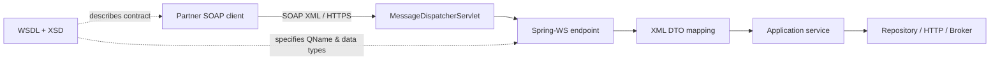
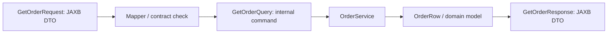

# Setting Up `spring-boot-starter-webservices`

In **SPRING_BOOT_INTEGRATION**, systems do not always communicate over REST/JSON. Banks, insurers, ERP systems, and many long-standing partners still use **SOAP/XML**, often accompanied by **WSDL**, **XSD**, specific authentication requirements, and strict data type contracts. When a Spring Boot service must expose or call a SOAP API, `spring-boot-starter-webservices` integrates **Spring Web Services (Spring-WS)** with Spring Boot's infrastructure.

This lesson is part of the **SOAP and XML** chapter and focuses on setting up the starter, configuring endpoints and clients, publishing WSDL, mapping XML, as well as the boundaries around data contracts, transactions, errors, duplicate prevention, testing, and observability. Examples are based on **Java 17+ and Spring Boot 3.x/Spring-WS 4.x**; when a project uses a different generation, verify APIs and dependencies against its corresponding BOM.

## 1. Learning Objectives

After this lesson, you will be able to:

1. Explain the roles of SOAP Envelope, WSDL, XSD, and Spring-WS in an integration flow.
2. Add the right `spring-boot-starter-webservices` starter and distinguish what Spring Boot auto-configures from what the application must declare.
3. Build a SOAP endpoint from an XML schema, publish a WSDL, and handle requests with `@Endpoint`.
4. Separate XML/JAXB DTOs from the domain model and internal persistence model.
5. Call external SOAP services with `WebServiceTemplate`, handling SOAP Faults, timeouts, and retries.
6. Design XML security defenses, transactions, idempotency, tests, and observability for real-world SOAP flows.

## 2. SOAP, WSDL, and XSD Solve Different Problems

| Concept | Purpose | Things to remember |
| --- | --- | --- |
| **SOAP** | Defines the XML message structure: envelope, header, body, and fault | It is a message exchange protocol; not synonymous with how data is stored. |
| **WSDL** | Describes operations, messages, bindings, endpoints, and how to invoke the service | It is the contract document used by clients to generate code and check compatibility. |
| **XSD** | Defines XML elements, namespaces, types, ordering, and data constraints | Controls payload format per contract; does not automatically verify all business rules. |
| **Spring-WS** | Processes SOAP messages, selects endpoints, converts payloads, and calls SOAP services | Different from Spring MVC REST controllers and different from a JAX-WS runtime. |
| **Spring Boot starter** | Pulls in required dependencies and activates conditional auto-configuration | Does not write WSDLs or application business logic for you. |



An example SOAP 1.1 request might look like this:

```xml
<soapenv:Envelope
    xmlns:soapenv="http://schemas.xmlsoap.org/soap/envelope/"
    xmlns:ord="https://api.example.org/contracts/orders/v1">
  <soapenv:Header/>
  <soapenv:Body>
    <ord:GetOrderRequest>
      <ord:orderId>ORD-2026-001</ord:orderId>
    </ord:GetOrderRequest>
  </soapenv:Body>
</soapenv:Envelope>
```

The **SOAP Body** contains the business element `GetOrderRequest`; the **SOAP Header** carries metadata per standards or partner contracts, such as routing info, correlation IDs, or WS-Security tokens. An XML element's namespace URI is part of its identity (QName). Two elements with the same name `GetOrderRequest` but different namespaces are **not** the same message under the contract.

SOAP 1.1 commonly uses `Content-Type: text/xml`; SOAP 1.2 commonly uses `application/soap+xml`, with differences in envelope namespace and how actions are represented. Do not switch versions merely by editing an HTTP header; the client, message factory, WSDL binding, and server must agree.

## 3. Initializing the Project and Adding the Right Dependencies

The exact Maven artifact is **`org.springframework.boot:spring-boot-starter-webservices`**. This is also the starter name on Spring Initializr when selecting **Spring Web Services**.

Maven example, using the Spring Boot parent/BOM to manage compatible library versions:

```xml
<dependencies>
    <dependency>
        <groupId>org.springframework.boot</groupId>
        <artifactId>spring-boot-starter-webservices</artifactId>
    </dependency>

    <!-- Required when dynamically generating WSDL 1.1 from XSD with DefaultWsdl11Definition. -->
    <dependency>
        <groupId>wsdl4j</groupId>
        <artifactId>wsdl4j</artifactId>
        <scope>runtime</scope>
    </dependency>

    <dependency>
        <groupId>org.springframework.boot</groupId>
        <artifactId>spring-boot-starter-test</artifactId>
        <scope>test</scope>
    </dependency>
    <dependency>
        <groupId>org.springframework.ws</groupId>
        <artifactId>spring-ws-test</artifactId>
        <scope>test</scope>
    </dependency>
</dependencies>
```

Equivalent Gradle Groovy DSL example:

```groovy
dependencies {
    implementation 'org.springframework.boot:spring-boot-starter-webservices'
    runtimeOnly 'wsdl4j:wsdl4j'
    testImplementation 'org.springframework.boot:spring-boot-starter-test'
    testImplementation 'org.springframework.ws:spring-ws-test'
}
```

**You do not need to add `spring-boot-starter-web` just to create a SOAP endpoint**, if the application already gets a Servlet web server from the Web Services starter and does not use Spring MVC controllers. When an application serves both REST and SOAP, both starters can be used in the same process, but keep `MessageDispatcherServlet` SOAP paths distinct from MVC routes.

JAXB/Jakarta XML Binding handles converting XML into Java objects. On modern Java, generated JAXB classes use the `jakarta.xml.bind.*` package; do not mix legacy Java EE `javax.xml.bind.*` classes with Spring Boot 3.x's Jakarta stack. If generating code from XSD, configure the XJC plugin at build time; never manually edit generated Java classes.

## 4. How Much Does Spring Boot Auto-Configure?

When running a **Servlet** application with Spring-WS on the classpath and auto-configuration conditions satisfied, Spring Boot provides the infrastructure to receive SOAP requests via `MessageDispatcherServlet`. Boot also supports registering and publishing WSDL/XSD resources found in configured locations. However, Boot does **not** automatically know your system's operations, business logic, exposed schemas, error mappings, or partner SOAP service URLs.

| Component | What Spring Boot/Spring-WS can provide | What the application must decide |
| --- | --- | --- |
| SOAP transport servlet | `MessageDispatcherServlet` and servlet mapping per Boot config when conditions are met | Public path, proxy, TLS, and authorization |
| Endpoint routing | Spring-WS scans for `@Endpoint`/`@PayloadRoot` in the Spring context | Operations, namespaces, handler methods, and business processing |
| Publishing WSDL/XSD | Integrates `WsdlDefinition`/`XsdSchema` beans; can pick up resources from `spring.webservices.wsdl-locations` | Schema contents and contract versioning policy |
| SOAP client | Auto-configures `WebServiceTemplateBuilder` | Create needed `WebServiceTemplate` beans, URI, marshaller, auth, timeouts, interceptors |
| Faults and retries | Extension points for mapping errors and SOAP faults | Business fault policy, retryability, and idempotency |
| Database/broker/cache | Corresponding auto-configuration when dependencies and properties are added | Transactions, outbox, DTOs, consistency, and integration flow |

Example `application.yml` configuration:

```yaml
server:
  port: 8080

spring:
  webservices:
    path: /services
```

`spring.webservices.path` controls the mapping of the Boot-configured SOAP servlet; it is **not** the URL of a partner's SOAP system. In projects with multiple servlets, `server.servlet.context-path` or a reverse proxy may add a prefix to the external URL.

If you only need to publish static WSDL/XSD files provided in `src/main/resources/wsdl/`, you can configure:

```yaml
spring:
  webservices:
    path: /services
    wsdl-locations: classpath:/wsdl/
```

Boot has a mechanism to create `SimpleWsdl11Definition` and `SimpleXsdSchema` beans for matching resources in that location. When you want to generate a **dynamic WSDL from XSD**, the application still must declare the corresponding `DefaultWsdl11Definition`. Do not mistake `wsdl-locations` for a mechanism that auto-generates business operations.

When using Boot's auto-configuration path, **do not add `@EnableWs` and do not manually register an extra `MessageDispatcherServlet` just because older examples did so**. Manual Spring-WS configuration can interfere with auto-configuration conditions, leading to two servlets or unexpected mappings. Only configure manually when you genuinely need to override Boot's behavior and have verified the bean conditions.

## 5. XSD-First Example: Exposing an Order Lookup Service

Suppose a partner system calls `GetOrder` via SOAP and receives the processing status of an order. We define the schema first; endpoint code, Java bindings, and WSDL must conform to that schema.

### 5.1. Creating the XSD as the Contract

Illustrative file `src/main/resources/xsd/orders.xsd`:

```xml
<?xml version="1.0" encoding="UTF-8"?>
<xs:schema
    xmlns:xs="http://www.w3.org/2001/XMLSchema"
    xmlns:tns="https://api.example.org/contracts/orders/v1"
    targetNamespace="https://api.example.org/contracts/orders/v1"
    elementFormDefault="qualified">

  <xs:element name="GetOrderRequest">
    <xs:complexType>
      <xs:sequence>
        <xs:element name="orderId" type="xs:string"/>
      </xs:sequence>
    </xs:complexType>
  </xs:element>

  <xs:element name="GetOrderResponse">
    <xs:complexType>
      <xs:sequence>
        <xs:element name="orderId" type="xs:string"/>
        <xs:element name="status" type="xs:string"/>
      </xs:sequence>
    </xs:complexType>
  </xs:element>
</xs:schema>
```

The two root elements `GetOrderRequest` and `GetOrderResponse` follow the suffix convention of `DefaultWsdl11Definition`. The WSDL generator can infer the **GetOrder** operation from this pair of names. The namespace URI is a contract identifier and does not need to be HTTP-reachable.

The schema above is intentionally minimal to learn the wiring. In a real system, specify length limits for `orderId`, valid enum values for `status`, optional fields, timezones, currency, and schema evolution policy. XSD validation does not replace checking the partner's permission to query an order.

### 5.2. Registering the XSD and WSDL Beans

```java
import org.springframework.context.annotation.Bean;
import org.springframework.context.annotation.Configuration;
import org.springframework.core.io.ClassPathResource;
import org.springframework.ws.wsdl.wsdl11.DefaultWsdl11Definition;
import org.springframework.xml.xsd.SimpleXsdSchema;
import org.springframework.xml.xsd.XsdSchema;

@Configuration(proxyBeanMethods = false)
public class OrderWsdlConfiguration {

    @Bean
    XsdSchema ordersSchema() {
        return new SimpleXsdSchema(new ClassPathResource("xsd/orders.xsd"));
    }

    @Bean(name = "orders")
    DefaultWsdl11Definition ordersWsdl(XsdSchema ordersSchema) {
        var definition = new DefaultWsdl11Definition();
        definition.setPortTypeName("OrdersPort");
        definition.setLocationUri("/services");
        definition.setTargetNamespace("https://api.example.org/contracts/orders/v1");
        definition.setSchema(ordersSchema);
        return definition;
    }
}
```

When the application runs on `localhost:8080`, the WSDL can be inspected at **`http://localhost:8080/services/orders.wsdl`**. The bean name `orders` becomes the published WSDL resource name. SOAP requests are sent to **`http://localhost:8080/services`**, not the `.wsdl` URL.

`DefaultWsdl11Definition` is convenient when creating a new service; partners with a signed WSDL contract typically require a **fixed, versioned, change-controlled WSDL**. If external consumers rely on the WSDL long-term, review and publish a stable WSDL document and check schema/WSDL diffs in CI. Do not assume library upgrades will never alter convention-generated WSDL details.

> If the project has multiple `XsdSchema` beans, name them clearly and use `@Qualifier` at injection points to select the right schema; avoid implicitly relying on a single bean.

## 6. Generating Java XML DTOs from XSD with JAXB/XJC

Spring-WS can process XML using low-level APIs like `Source`, but SOAP services with stable contracts are usually easier to maintain using Java classes **generated from XSD**. The XJC plugin is a build step that produces `GetOrderRequest` and `GetOrderResponse` with JAXB annotations, reducing errors from manually editing fields or namespaces.

Example `jaxb2-maven-plugin` configuration:

```xml
<build>
  <plugins>
    <plugin>
      <groupId>org.codehaus.mojo</groupId>
      <artifactId>jaxb2-maven-plugin</artifactId>
      <version>4.0.0</version>
      <executions>
        <execution>
          <id>generate-soap-types</id>
          <goals>
            <goal>xjc</goal>
          </goals>
        </execution>
      </executions>
      <configuration>
        <sources>
          <source>src/main/resources/xsd/orders.xsd</source>
        </sources>
        <packageName>org.example.integration.soap.contract</packageName>
      </configuration>
    </plugin>
  </plugins>
</build>
```

After running the corresponding code-generation build phase (for example `mvn generate-sources`), classes are placed in the generated sources directory and the IDE/build tool must recognize that directory. The package path in the example is an illustrative convention; your project's binding configuration and plugin version determine the actual output. **Do not copy and manually edit generated files**; change the XSD or binding file and regenerate.

Some XSDs produce a `JAXBElement<T>` wrapper via `ObjectFactory` instead of a direct `@XmlRootElement` class. In that case, endpoints or clients must use the exact type generated by the tool; do not cast arbitrarily. The code snippets that follow assume XJC generates `GetOrderRequest`/`GetOrderResponse` usable directly as root elements from the illustrative XSD structure.

### Data Boundaries

Classes generated from XSD are strictly **SOAP DTOs**; their fields and types serve the external contract. Do not assign database persistence or transaction management responsibilities to them. The flow should remain clear:



If `orders.status_code` changes in the database while the SOAP contract still publishes `status`, the mapper absorbs that change. When a partner requests a new SOAP schema, evaluate compatibility separately rather than dragging every DB structure change into the WSDL.

## 7. Writing an `@Endpoint` to Handle SOAP Requests

Once JAXB DTOs are ready, the endpoint uses `@PayloadRoot` to select a handler by the **namespace and local name** of the root element in the SOAP Body.

```java
import org.example.integration.soap.contract.GetOrderRequest;
import org.example.integration.soap.contract.GetOrderResponse;
import org.springframework.ws.server.endpoint.annotation.Endpoint;
import org.springframework.ws.server.endpoint.annotation.PayloadRoot;
import org.springframework.ws.server.endpoint.annotation.RequestPayload;
import org.springframework.ws.server.endpoint.annotation.ResponsePayload;

@Endpoint
public class OrderSoapEndpoint {
    static final String NS = "https://api.example.org/contracts/orders/v1";

    private final OrderService orderService;

    public OrderSoapEndpoint(OrderService orderService) {
        this.orderService = orderService;
    }

    @PayloadRoot(namespace = NS, localPart = "GetOrderRequest")
    @ResponsePayload
    public GetOrderResponse getOrder(@RequestPayload GetOrderRequest request) {
        OrderSummary summary = orderService.findOrder(request.getOrderId());

        var response = new GetOrderResponse();
        response.setOrderId(summary.orderId());
        response.setStatus(summary.status());
        return response;
    }
}
```

`OrderService` and `OrderSummary` in the example are **application components** you implement yourself, not generated by Spring-WS. For example, `OrderSummary` could be `record OrderSummary(String orderId, String status) {}`, while `OrderService` queries the database and checks the partner's access permissions.

Meaning of the annotations:

| Annotation | Effect |
| --- | --- |
| `@Endpoint` | Marks a Spring bean as a SOAP endpoint discoverable by Spring-WS. |
| `@PayloadRoot(namespace, localPart)` | Selects the method by the QName of the request element in the SOAP Body. |
| `@RequestPayload` | Instructs Spring-WS to convert the payload into the appropriate method parameter. |
| `@ResponsePayload` | Converts the return value into the XML payload of the SOAP response. |

Do not use `@RestController`/`@RequestMapping` instead of `@Endpoint` when the goal is to receive a **SOAP Envelope** via Spring-WS. SOAP methods may be invoked over HTTP POST like REST, but routing, schema handling, headers, and error structures are completely different.

### Invalid Data and Business Rules

The fact that Spring-WS matched an endpoint and JAXB unmarshalled successfully **does not mean** the request passed full XSD validation or business rules. Depending on configuration, you can add `PayloadValidatingInterceptor` to validate payloads against the XSD before the handler runs. Checking partner permissions, order existence, status visibility, or lifecycle validity still belongs in the service/domain layer.

For read endpoints like the example, you can place a `readOnly` transaction on the appropriate service/repository. Do not hold a DB transaction open while the endpoint synchronously calls a partner SOAP/HTTP service, as network delays can hold connections and locks for too long.

## 8. Sending a SOAP Request and Inspecting the Response

With `GetOrderRequest` defined, a complete XML request example is:

```xml
<?xml version="1.0" encoding="UTF-8"?>
<soapenv:Envelope
    xmlns:soapenv="http://schemas.xmlsoap.org/soap/envelope/"
    xmlns:ord="https://api.example.org/contracts/orders/v1">
  <soapenv:Header/>
  <soapenv:Body>
    <ord:GetOrderRequest>
      <ord:orderId>ORD-2026-001</ord:orderId>
    </ord:GetOrderRequest>
  </soapenv:Body>
</soapenv:Envelope>
```

Save the request as `request.xml` outside the application source code, then test it with curl against the running service:

```bash
curl --fail-with-body \
  --header 'Content-Type: text/xml; charset=utf-8' \
  --data-binary @request.xml \
  http://localhost:8080/services
```

With SOAP 1.1, some partners require the HTTP `SOAPAction` header; use the exact value specified in their WSDL/contract. Do not guess the action from the Java method name or HTTP path. `--fail-with-body` preserves response body output when HTTP returns an error status; still inspect the protocol-level SOAP Fault rather than relying solely on exit code.

Example successful response:

```xml
<soapenv:Envelope xmlns:soapenv="http://schemas.xmlsoap.org/soap/envelope/">
  <soapenv:Body>
    <ord:GetOrderResponse
        xmlns:ord="https://api.example.org/contracts/orders/v1">
      <ord:orderId>ORD-2026-001</ord:orderId>
      <ord:status>PROCESSING</ord:status>
    </ord:GetOrderResponse>
  </soapenv:Body>
</soapenv:Envelope>
```

Prefix names such as `ord` carry no independent identity; namespace URI and local name identify the element. XML tests should not rely on raw string matching when differences in prefixes, whitespace, or attribute order are valid XML.

## 9. Calling a Partner SOAP API with `WebServiceTemplate`

`spring-boot-starter-webservices` supports both **SOAP servers** and **SOAP clients**. For outbound calls, Spring Boot can provide a `WebServiceTemplateBuilder`, but it **does not automatically create a single fully configured `WebServiceTemplate` suited for every partner**. The application must specify the URI, XML marshaller/unmarshaller, timeouts, SOAP action, authentication, and error handling.

Example adapter-specific property configuration:

```yaml
app:
  partners:
    order-soap:
      uri: https://sandbox.partner.example.org/soap/orders
      soap-action: https://partner.example.org/contracts/orders/GetOrder
```

This is an **application-defined** `app.*` namespace, not a property Boot understands automatically. In production systems, URLs should come from environment variables, secret stores, or config management and be bound via validated `@ConfigurationProperties`. The example below uses `@Value` for brevity.

```java
import org.springframework.beans.factory.annotation.Value;
import org.springframework.boot.webservices.client.WebServiceTemplateBuilder;
import org.springframework.context.annotation.Bean;
import org.springframework.context.annotation.Configuration;
import org.springframework.oxm.jaxb.Jaxb2Marshaller;
import org.springframework.ws.client.core.WebServiceTemplate;

@Configuration(proxyBeanMethods = false)
public class PartnerSoapClientConfiguration {

    @Bean
    Jaxb2Marshaller partnerMarshaller() {
        var marshaller = new Jaxb2Marshaller();
        marshaller.setContextPath("org.example.integration.soap.contract");
        return marshaller;
    }

    @Bean
    WebServiceTemplate partnerWebServiceTemplate(
            WebServiceTemplateBuilder builder,
            Jaxb2Marshaller partnerMarshaller,
            @Value("${app.partners.order-soap.uri}") String uri) {

        return builder
                .setDefaultUri(uri)
                .setMarshaller(partnerMarshaller)
                .setUnmarshaller(partnerMarshaller)
                .build();
    }
}
```

`@Value` reads `app.partners.order-soap.uri` from environment configuration; as parameters grow, switch to `@ConfigurationProperties` to manage and validate the adapter's property set. `Jaxb2Marshaller` must point to the exact package containing generated/bound JAXB classes; a wrong package or missing JAXB runtime causes marshalling/unmarshalling failures. If the partner uses a different XSD, define a **separate marshaller and DTOs for that partner**: do not reuse your exposed SOAP endpoint classes just because both contracts describe orders.

Calling the SOAP API:

```java
import org.example.integration.soap.contract.GetOrderRequest;
import org.example.integration.soap.contract.GetOrderResponse;
import org.springframework.beans.factory.annotation.Value;
import org.springframework.beans.factory.annotation.Qualifier;
import org.springframework.stereotype.Component;
import org.springframework.ws.client.core.WebServiceTemplate;
import org.springframework.ws.soap.client.core.SoapActionCallback;

@Component
public class PartnerOrderSoapAdapter {
    private final WebServiceTemplate template;
    private final String soapAction;

    public PartnerOrderSoapAdapter(
            @Qualifier("partnerWebServiceTemplate") WebServiceTemplate template,
            @Value("${app.partners.order-soap.soap-action}") String soapAction) {
        this.template = template;
        this.soapAction = soapAction;
    }

    public GetOrderResponse fetch(String orderId) {
        var request = new GetOrderRequest();
        request.setOrderId(orderId);

        Object response = template.marshalSendAndReceive(
                request,
                new SoapActionCallback(soapAction));

        return (GetOrderResponse) response;
    }
}
```

In this example, the URI is the **default URI**, so `marshalSendAndReceive(request, callback)` sends to the configured address. `SoapActionCallback` supplies the SOAPAction per contract and is especially common in SOAP 1.1; do not treat it as an authentication mechanism.

**Set explicit timeouts:** connect and read timeouts must align with the partner's SLA, overall request deadlines, and retry policy. HTTP message sender configuration APIs can differ across Boot versions; Boot 3.4+ projects can customize via `WebServiceTemplateBuilder.httpMessageSenderFactory(...)` and `WebServiceMessageSenderFactory`, whereas older versions use different builder/sender mechanisms. Always verify against your actual version before applying timeout snippets from another version's documentation.

## 10. SOAP Faults, HTTP Statuses, and Error Handling Policies

A **SOAP Fault** is a protocol-level error structure in SOAP, not equivalent to a REST JSON error body. In SOAP 1.1, a Fault may include `faultcode`, `faultstring`, `faultactor`, and `detail`. In SOAP 1.2, the fault structure differs; do not match against hardcoded raw strings across all versions.

Illustrative SOAP 1.1 Fault example:

```xml
<soapenv:Envelope xmlns:soapenv="http://schemas.xmlsoap.org/soap/envelope/">
  <soapenv:Body>
    <soapenv:Fault>
      <faultcode>soapenv:Client</faultcode>
      <faultstring>Invalid order identifier</faultstring>
      <detail>
        <ord:error xmlns:ord="https://api.example.org/contracts/orders/v1">
          <ord:code>ORDER_ID_INVALID</ord:code>
        </ord:error>
      </detail>
    </soapenv:Fault>
  </soapenv:Body>
</soapenv:Envelope>
```

| Scenario | Meaning | Appropriate handling |
| --- | --- | --- |
| Malformed XML or wrong namespace | Request does not match contract | Return a SOAP Fault per service policy; record error category, do not retry infinitely. |
| Business rule violation / unauthorized | Contract is valid, but cannot be processed | Fault with a stable business code and useful detail, without leaking sensitive data. |
| Partner returns a SOAP Fault | Application-level response from external service | Classify fault code/detail and map to the adapter's domain errors. |
| Timeout / connection failure | Unknown whether the partner processed it | Bounded retry only if safe by idempotency; track overall deadline. |
| DB/broker unavailable | Internal infrastructure error | Roll back transactions appropriately; do not expose stack traces or SQL in the fault. |

Spring-WS provides `SoapFaultMappingExceptionResolver`, `@SoapFault`, and extension points to map exceptions to Faults. Pick a clear strategy and test namespaces, codes, and details; avoid dumping every error into a generic meaningless fault. On the client side, `WebServiceTemplate` detects SOAP Faults (commonly surfacing as `SoapFaultClientException` depending on configuration); translate protocol errors into meaningful domain exceptions or results.

Both HTTP status and SOAP Fault must be inspected: a response with a Fault body—even with an unusual HTTP status code—still contains important protocol information. Conversely, a connection failure has no SOAP Envelope, so you cannot "read the fault code" to decide on retries.

## 11. XML Security, Authentication, and Access Control

SOAP/XML has its own attack surfaces. Adding the starter only sets up SOAP processing infrastructure; it does **not** automatically enable WS-Security, block all dangerous XML payloads, or ensure only authorized partners can call the API.

Controls to consider during implementation:

- **Transport:** use HTTPS/TLS; consider mutual TLS if the partner requires two-way authentication. Never accept untrusted certificates just to make production work.
- **WS-Security:** if the contract requires UsernameToken, XML signatures, timestamps, or message encryption, configure Spring-WS Security/WSS4J and the appropriate interceptors; distinguish SOAP Header credentials from HTTP `Authorization`.
- **XML parser:** block unnecessary external entities/DTDs, protect against XXE/SSRF and XML entity expansion; verify parser, marshaller, and runtime library settings.
- **Resource limits:** cap body size, XML depth, parse duration, concurrent requests, and timeouts to prevent overload.
- **XSD validation:** enable and test against the exact schema; XSD validation does not replace authorization, business logic, or DB lookups.
- **Logging hygiene:** do not log full SOAP Envelopes containing personal info, tokens, or signatures; if debugging is needed, enable redacted logging temporarily.
- **Versions and dependencies:** apply security patches via a compatible BOM; do not mix `javax.*` and `jakarta.*` in Jakarta-generation XML bindings.

With XML signatures, be especially careful when extracting verified data from a message: ensure the application uses the exact signed element and prevents signature wrapping. Test cases for missing headers, invalid signatures, expired timestamps, insufficient identity permissions, and invalid XML payloads.

## 12. Transactions, Duplicate Prevention, and Integrating with Other Systems

The `GetOrder` example is a read query. When a SOAP operation **writes data** (creating orders, issuing refunds, confirming transactions), integration properties become critical:

1. **Transaction boundaries:** place `@Transactional` around database operations that must be atomic in the application service. A JDBC transaction does not automatically include outbound SOAP calls, HTTP requests, brokers, or Redis.
2. **Idempotency:** if a request may be resent after a timeout, the protocol/contract should carry a stable `requestId` or `businessKey`. Persist the processing record in the same database as the business effect with an appropriate unique constraint.
3. **Event publishing:** if an operation must write to the DB and publish a Kafka/AMQP message, consider the **transactional outbox**: write business data and the outbox record in one transaction, then have a publisher send messages and handle duplicate deliveries.
4. **Error recovery:** use bounded retries with backoff for transient errors; do not blindly retry business Faults or operations lacking an idempotency key.
5. **Cache synchronization:** identify the source of truth; invalidate or update caches appropriately after commit and monitor for stale reads.

Example SOAP write flow:

```mermaid
sequenceDiagram
    participant C as SOAP client
    participant E as @Endpoint
    participant S as Application service
    participant D as Database
    participant O as Outbox publisher
    participant B as Broker
    C->>E: SubmitOrderRequest(requestId)
    E->>S: submit(command)
    S->>D: BEGIN; unique requestId + order + outbox; COMMIT
    S-->>E: Result
    E-->>C: SubmitOrderResponse
    O->>D: Read unsent outbox rows
    O->>B: Publish event
    Note over O,B: May be redelivered; consumer must be idempotent
```

If a SOAP client times out right **after the server commits** but before receiving the response, the client does not know whether the request succeeded. A retry keeping the same `requestId` must return a consistent result or report a duplicate per the contract—never create a second order. If the same `requestId` arrives with a different payload, define it clearly as a conflict instead of treating both as the same valid request.

## 13. Observing and Operating a SOAP Service

A SOAP API may return HTTP 200, 500, or a Fault across different situations; tracking HTTP status codes alone is not enough to diagnose operational issues.

| Signal | Purpose |
| --- | --- |
| Processing time per operation | Distinguish whether `GetOrder` is slow due to XML parsing, database queries, or outbound HTTP. |
| SOAP Fault rate by category | Detect schema violations, permission errors, business errors, and server errors. |
| Partner latency / connectivity | Identify timeouts and outages of external SOAP services. |
| Connection pool, DB transactions | Detect bottlenecks when a SOAP operation executes multiple queries. |
| Retries and idempotency hits | Track resent requests after timeouts and deduplication effectiveness. |
| Outbox backlog / broker lag | Observe asynchronous post-processing after a SOAP operation finishes. |
| Correlation ID and request ID | Link requests from partners through services, DB, cache, and brokers. |

Spring Boot Actuator/Micrometer helps implement metrics, health checks, and tracing depending on dependencies and configuration. Do not assume every SOAP operation gets custom metrics automatically just by adding the starter. Instrument timings and error classifications at the adapter/service level, tagging operation names and correlation IDs while avoiding high-cardinality metric tags like `orderId`, email, or transaction ID.

When running behind an API gateway or reverse proxy, verify that the scheme, host, and path published in the WSDL reflect the real address partners use; configure forwarded headers and controlled WSDL rewrite policies if needed. Never expose sensitive Actuator endpoints or configuration details just to troubleshoot WSDL paths.

## 14. Testing SOAP at Each Boundary

| Test level | Goal | Suggested approach |
| --- | --- | --- |
| Mapper/service unit tests | Business logic, DTO normalization, and error branches | JUnit 5, fake/mock repository, no Spring context required. |
| SOAP endpoint test | QName, request XML, handler, response payload or SOAP Fault | `MockWebServiceClient` from `spring-ws-test`. |
| SOAP client integration test | Outbound URI, SOAPAction, marshalling, timeouts, and fault mapping | `MockWebServiceServer` attached to `WebServiceTemplate`. |
| Contract test | WSDL/XSD, namespaces, field ordering, partner readability | XML/XSD validation, schema diffs, fixtures from older WSDL versions. |
| Full integration / E2E | Real HTTP through Servlet, real DB/broker/cache per test scope | `@SpringBootTest(RANDOM_PORT)`, Testcontainers, and final-state assertions. |

### 14.1. Testing Endpoints Without Opening an HTTP Port

Example test structure using `MockWebServiceClient`:

```java
import static org.springframework.ws.test.server.RequestCreators.withPayload;
import static org.springframework.ws.test.server.ResponseMatchers.noFault;

import javax.xml.transform.Source;
import javax.xml.transform.stream.StreamSource;
import java.io.StringReader;

import org.junit.jupiter.api.BeforeEach;
import org.junit.jupiter.api.Test;
import org.springframework.beans.factory.annotation.Autowired;
import org.springframework.boot.test.context.SpringBootTest;
import org.springframework.context.ApplicationContext;
import org.springframework.ws.test.server.MockWebServiceClient;

@SpringBootTest
class OrderSoapEndpointTest {
    @Autowired ApplicationContext context;
    MockWebServiceClient client;

    @BeforeEach
    void setUp() {
        client = MockWebServiceClient.createClient(context);
    }

    @Test
    void getOrderReturnsSoapResponseWithoutFault() {
        Source payload = new StreamSource(new StringReader("""
            <ord:GetOrderRequest
                xmlns:ord="https://api.example.org/contracts/orders/v1">
              <ord:orderId>ORD-2026-001</ord:orderId>
            </ord:GetOrderRequest>
            """));

        client.sendRequest(withPayload(payload)).andExpect(noFault());
    }
}
```

The illustrative test only verifies **no Fault is returned**; a real test suite should add `payload(...)` or XPath assertions for `orderId`, `status`, namespace, and exact values. The service/repository must have sufficient fixture data to return `ORD-2026-001`; you can import fake beans or use test data. When testing business errors, assert the exact SOAP Fault code/detail rather than only checking that a method throws a Java exception.

### 14.2. Testing the SOAP Client with a Mock Server at the Spring-WS Layer

`MockWebServiceServer` intercepts messages sent by `WebServiceTemplate` and replies with controlled SOAP payloads. This allows testing marshalling, SOAPAction, request content, and SOAP errors without calling a real partner system. This test differs from unit tests mocking a Java interface and also does not prove DNS, TLS, or the real partner environment.

In a high-confidence test suite, explicitly verify: unmarshalling fails when the namespace is wrong; SOAP 1.1/1.2 content type mismatches; timeouts; business faults; responses containing optional elements; and WSDL changes that break clients generated from older schemas.

### 14.3. Real HTTP Tests Through to the Database and Adapters

When you need to prove that Servlet mapping, endpoint routing, authentication, transactions, and repositories work together, use `@SpringBootTest(webEnvironment = RANDOM_PORT)` and send a SOAP Envelope over a real HTTP client to `/services`. If the handler accesses PostgreSQL, run migrations and a matching dialect database via Testcontainers. If it also publishes to Kafka, only label it a **full end-to-end** test when the broker and consumer actually participate in the test scope.

For operations with side effects, you must test **duplicate submissions with the same request ID** and **timeouts after commit**: these are failure modes that a single successful mocked endpoint call cannot prove. For asynchronous XML messages over files, brokers, or Spring Integration, verify retries, message identity, and completion state after restarts.

## 15. Common Configuration Errors and How to Isolate Them

| Symptom | Likely cause | How to verify |
| --- | --- | --- |
| Cannot find `/services/orders.wsdl` | Missing `DefaultWsdl11Definition` bean, wrong bean name, different servlet/context path, missing WSDL4J | Inspect bean definitions, condition report, startup logs, and published path. |
| SOAP POST returns 404 | Wrong `spring.webservices.path`, servlet not registered, Boot config overridden by manual config | Check Servlet mappings and auto-configuration conditions. |
| Payload does not reach endpoint | QName differs from `@PayloadRoot`, wrong SOAP version, or wrong body root | Compare namespace URI, local name, and Envelope namespace against XSD/WSDL. |
| JAXB marshalling error | Generated classes have wrong namespace/package, missing `JAXBElement` wrapper or runtime | Check XJC output, `ObjectFactory`, context path, and root object. |
| Outbound SOAP client fails | Wrong URL, TLS, proxy, SOAPAction, timeout, or credentials | Separate connection/HTTP errors from SOAP Faults and compare with partner WSDL. |
| Returns SOAP message violating schema | Validation disabled or mapper drops/alters fields | Check XSD, actual payload, and contract tests. |
| One transaction creates duplicate records | Request retried after timeout without a durable idempotency key | Check unique constraints, transactions, request ID trail, and duplicate response behavior. |
| WSDL advertises internal URL | Reverse proxy/TLS termination, `locationUri`, or forwarded headers out of sync | Fetch WSDL from the partner's side and compare `soap:address` against the public URL. |

When debugging auto-configuration, you can enable the condition evaluation report with `--debug` in a controlled environment; never enable logging of SOAP bodies containing personal data or tokens by default.

## 16. Checklist for Deploying SOAP in an Integration System

Before bringing `spring-boot-starter-webservices` into production, verify:

1. **Contract:** Are WSDL and XSD versioned with stable namespaces, documenting optional fields, Faults, SOAPAction, and SOAP 1.1/1.2 accurately?
2. **Dependencies:** Exact starter name, compatible Spring Boot BOM, WSDL4J if dynamically generating WSDL, and Jakarta-compatible JAXB/XJC for your Boot version?
3. **Server:** Do `spring.webservices.path`, WSDL beans, and `@PayloadRoot` align without duplicate servlet registrations or accidentally disabling auto-configuration?
4. **Client:** Are partner URLs per environment, marshallers, SOAPAction, credentials, TLS, connect/read timeouts, and fault mappings clearly defined?
5. **Data:** Are XML DTOs separated from DB/domain models, with XSD validation and business rules enforced at the right boundaries?
6. **Security:** Are HTTPS/mTLS or WS-Security per contract, XXE/DTD protection, body size limits, replay protection, access control, and log redaction in place?
7. **Reliability:** Are DB transactions, idempotency keys, bounded retries, outbox/inbox patterns, and recovery for lost responses designed?
8. **Testing:** Have endpoint/client tests, schema/contract tests, SOAP Faults, timeouts, reverse-proxied WSDL, transactions, and duplicate requests been verified?
9. **Observability:** Are per-operation and per-fault-type metrics, cross-adapter correlation IDs, outbound latency, DB pool, and broker/outbox backlog monitored?

## Official References

- [Spring Boot – Web Services](https://docs.spring.io/spring-boot/3.5/reference/io/webservices.html): auto-configuration, `spring-boot-starter-webservices`, and `WebServiceTemplateBuilder`.
- [Spring Guide – Producing a SOAP web service](https://spring.io/guides/gs/producing-web-service/): schema-first, `DefaultWsdl11Definition`, JAXB, and testing SOAP requests.
- [Spring Web Services – Reference Documentation](https://docs.spring.io/spring-ws/reference/): endpoints, WSDL/XSD, SOAP Faults, and client/server testing.

**Key takeaway:** `spring-boot-starter-webservices` is the starting point for running SOAP on Spring Boot, but integration reliability rests on **contract-accurate WSDL/XSD, deliberately mapped XML DTOs, properly configured endpoints/clients, XML security, and tested transactions and idempotency**. Boot helps wire the infrastructure; the application owns the entire business behavior when SOAP connects to databases, caches, brokers, and external systems.
