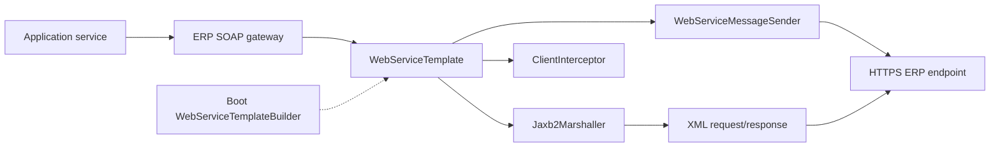
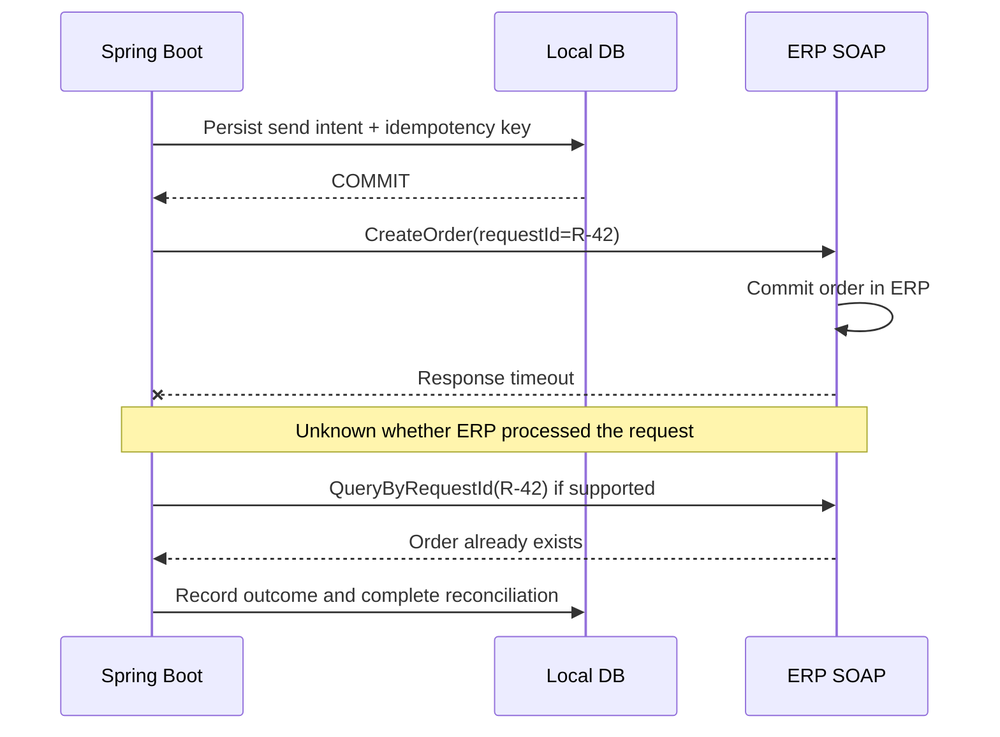
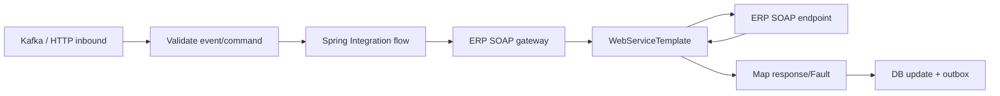

# WebServiceTemplateBuilder and Creating WebServiceTemplate

## 1. The Problem: Calling SOAP Safely from a Spring Boot Application

Many ERP, banking, insurance, and long-standing service portals still expose **SOAP** interfaces with **WSDL/XSD** contracts. A Spring Boot application may need to call a `GetCustomer` service to look up profiles, `CreateOrder` to submit orders, or `ConfirmPayment` to update a transaction. Unlike REST clients that typically send JSON, SOAP clients exchange **XML Envelopes**, use namespaces and typed schemas, and sometimes require `SOAPAction`, WS-Security, digital signatures, or mutual certificates.

In the **SPRING_BOOT_INTEGRATION** module, calling SOAP is one branch of integration alongside HTTP clients, databases, caches, message brokers, and Spring Integration adapters. To implement it reliably, we must manage **endpoint configuration, XML contracts, connections/timeouts, transactions, errors, retries, idempotency, testing, and observability**.

Spring Web Services provides **`WebServiceTemplate`**, a high-level client for sending SOAP messages and handling responses. Spring Boot provides **`WebServiceTemplateBuilder`** to build templates with the application context's configured settings and customizers applied. That is the core point of this lesson: **Boot typically does not create a single shared `WebServiceTemplate` for all partners; Boot provides a builder so each client can construct a template tailored to its own contract**.

Running example: an `order-integration` application calls an ERP's SOAP endpoint to check order status. The application also calls another SOAP endpoint to look up customers. The two endpoints may use different WSDLs/XSDs, certificates, and timeouts, so you should never accidentally share a single template's configuration across all calls.

After this lesson, you will be able to:

- Distinguish `WebServiceTemplate`, `WebServiceTemplateBuilder`, `WebServiceTemplateCustomizer`, and `Jaxb2Marshaller`.
- Create SOAP client beans from the Spring Boot-managed builder and separate configuration per partner.
- Send and receive XML with `marshalSendAndReceive`, properly configuring endpoints, `SOAPAction`, and interceptors.
- Distinguish SOAP Faults, HTTP/transport errors, XML mapping errors, and business errors.
- Design timeouts, authentication, WS-Security, retries/idempotency, and transaction boundaries.
- Write SOAP client tests with `MockWebServiceServer` and observe runtime behavior in real environments.

## 2. SOAP Client Architecture: Classes You Must Understand

Before creating a template, map out the contract between your application and the partner system:

| Component | Role | Questions to answer |
|---|---|---|
| **WSDL** | Describes operations, messages, bindings, and service endpoints. | Does the operation use SOAP 1.1 or SOAP 1.2? Is there a `SOAPAction`? |
| **XSD** | Describes XML structure, data types, and constraints. | Which namespace? What are the required fields, `nillable` settings, and element order? |
| **JAXB classes** | Java classes generated for or matching the XML schema. | Do request/response types have `@XmlRootElement`, or do they use `JAXBElement`? |
| **Marshaller/Unmarshaller** | Converts Java objects ↔ XML via JAXB/OXM. | Which XSD contract do the Java classes match? |
| **`WebServiceTemplate`** | Orchestrates the request-send and response/fault-receive lifecycle. | Which URI, message factory, sender, and interceptors? |
| **`WebServiceTemplateBuilder`** | Assists in constructing templates and applying configuration/template customizers. | Does this template use the Boot-managed builder? |
| **`WebServiceMessageSender`** | Sends messages over transport (typically HTTP/HTTPS). | What are the connect/read timeouts, TLS, pool, proxy, and auth settings? |
| **`ClientInterceptor`** | Intercepts before/after requests and on faults. | Correlation ID, audit, WS-Security, redaction? |



**`WebServiceTemplate` is not a `RestTemplate` for SOAP.** It operates on `WebServiceMessage`/SOAP Envelopes and Spring-WS abstractions. Its XML mapping and fault mechanisms differ from sending JSON via `RestClient`.

## 3. Dependency Setup and Auto-Configuration Conditions

Maven example for Spring Boot 3.x:

```xml
<dependency>
    <groupId>org.springframework.boot</groupId>
    <artifactId>spring-boot-starter-web-services</artifactId>
</dependency>

<!-- When the application needs JAXB mapping and the runtime does not already supply a suitable provider,
     declare a JAXB implementation compatible with the project BOM/version. -->
```

Or Gradle Kotlin DSL:

```kotlin
dependencies {
    implementation("org.springframework.boot:spring-boot-starter-web-services")
    // Declare a compatible JAXB runtime if the dependency graph does not already include one.
}
```

With **Spring Boot 3.x / Spring Framework 6+ / Spring Web Services 4.x**, libraries use the Jakarta namespace (`jakarta.xml.bind`) for JAXB. Classes generated by legacy tools using `javax.xml.bind` (typically tied to the Spring 5/Boot 2 generation) cannot be assumed automatically compatible; verify generator, JAXB version, and contract.

In standard Boot configurations, when Spring Web Services classes are present and auto-configuration conditions match, Boot can provide **`WebServiceTemplateBuilder`** along with customizer support. However, **Boot does not necessarily pre-register a single `WebServiceTemplate` bean** because each partner requires its own endpoint, marshaller, message sender, and security policy.

Reasons the builder or customization support may not appear as expected:

1. `spring-boot-starter-webservices` is missing or the classpath lacks required libraries.
2. An application-defined builder/configuration bean causes auto-configuration to back off or bypasses customizers.
3. Spring Boot/Spring-WS/Spring Framework dependencies are pinned to incompatible versions.
4. The profile/test context does not initialize all application configurations or customizers.
5. With multiple templates, injection lacks qualifiers and selects the wrong endpoint.

When in doubt, inspect the **Condition Evaluation Report** for your running Spring Boot version instead of guessing from bean names.

### 3.1. What Does a Managed Builder Provide?

`WebServiceTemplateBuilder` is the path for building templates with appropriate customizations applied. Customizers can configure message senders, interceptors, marshallers, default URIs, or other properties depending on application code and Boot version. The builder **does not know which WSDL belongs to the ERP**, does not generate JAXB classes, and does not automatically supply credentials or certificates for an endpoint.

If you instantiate `new WebServiceTemplate()` directly elsewhere, that template **does not automatically inherit Spring Boot-managed customizers**. Manual instantiation is not wrong, but every required component must be configured intentionally.

## 4. Creating a `WebServiceTemplate` Using the Spring-Injected Builder

Suppose the application generated JAXB classes matching the ERP's WSDL/XSD in package `com.example.integration.erp.soap`. A simple configuration:

```java
import org.springframework.beans.factory.annotation.Qualifier;
import org.springframework.beans.factory.annotation.Value;
import org.springframework.boot.webservices.client.WebServiceTemplateBuilder;
import org.springframework.context.annotation.Bean;
import org.springframework.context.annotation.Configuration;
import org.springframework.oxm.jaxb.Jaxb2Marshaller;
import org.springframework.ws.client.core.WebServiceTemplate;

@Configuration
public class ErpSoapClientConfiguration {

    @Bean("erpMarshaller")
    Jaxb2Marshaller erpMarshaller() {
        Jaxb2Marshaller marshaller = new Jaxb2Marshaller();
        marshaller.setContextPath("com.example.integration.erp.soap");
        return marshaller;
    }

    @Bean("erpWebServiceTemplate")
    WebServiceTemplate erpWebServiceTemplate(
            WebServiceTemplateBuilder builder,
            @Qualifier("erpMarshaller") Jaxb2Marshaller marshaller,
            @Value("${integration.erp.soap.endpoint}") String endpoint) {

        WebServiceTemplate template = builder.build();
        template.setDefaultUri(endpoint);
        template.setMarshaller(marshaller);
        template.setUnmarshaller(marshaller);
        return template;
    }
}
```

Externalized configuration:

```yaml
integration:
  erp:
    soap:
      endpoint: ${ERP_SOAP_ENDPOINT}
```

Key points to note:

- **The builder is Spring-injected**, giving builder customizers an opportunity to apply. `builder.build()` creates the template for the application to configure partner-specific settings.
- `setDefaultUri(...)` specifies the default address for calls that do not explicitly pass a URI. This is the **actual SOAP service endpoint**, not necessarily the `?wsdl` URL.
- `setMarshaller(...)` and `setUnmarshaller(...)` share the same `Jaxb2Marshaller` when requests and responses belong to the same JAXB context.
- `setContextPath(...)` requires the package to have proper JAXB structure, typically `ObjectFactory` or `jaxb.index` from code generation. Hand-written POJOs lacking full JAXB metadata can fail initialization.
- A `WebServiceTemplate` bean is reused across many requests. **Do not mutate the endpoint, marshaller, or interceptors of a shared template before each call**, because multiple threads may be using it concurrently.
- If a global customizer and post-`build()` configuration set the same property, the later setting can override the earlier one. Decide intentionally what belongs at global vs. per-client scope.

The property expression `@Value("${integration.erp.soap.endpoint}")` in the code is illustrative; real systems should supply URIs via environment-specific configuration and never hardcode endpoints or credentials.

### 4.1. Avoid Assuming One Template Fits All Partners

ERP A has a different namespace, SOAPAction, and certificate from Partner B. Create two separate templates:

```java
@Bean("partnerWebServiceTemplate")
WebServiceTemplate partnerWebServiceTemplate(
        WebServiceTemplateBuilder builder,
        @Qualifier("partnerMarshaller") Jaxb2Marshaller marshaller,
        @Value("${integration.partner.soap.endpoint}") String endpoint) {

    WebServiceTemplate template = builder.build();
    template.setDefaultUri(endpoint);
    template.setMarshaller(marshaller);
    template.setUnmarshaller(marshaller);
    return template;
}
```

This snippet assumes a `partnerMarshaller` bean has been defined for the partner's schema. Injecting into gateways must use `@Qualifier`; never rely on method names or bean creation order to determine which template is injected.

## 5. `WebServiceTemplateBuilder`, Customizers, and Configuration Order

A common requirement is that all SOAP clients attach an interceptor for correlation IDs or standardized logging. In Spring Boot 3.x, `WebServiceTemplateCustomizer` is the extension point for applying customizations to templates created via a builder with customizer discovery.

Example illustrating a customizer that sets a shared property:

```java
import org.springframework.boot.webservices.client.WebServiceTemplateCustomizer;
import org.springframework.context.annotation.Bean;
import org.springframework.context.annotation.Configuration;

@Configuration
class SoapTemplateDefaultsConfiguration {

    @Bean
    WebServiceTemplateCustomizer soapTemplateDefaults() {
        return template -> {
            // Illustrates a safe property only; do not apply the ERP endpoint to all partners.
            template.setCheckConnectionForError(true);
        };
    }
}
```

**Version note:** customizer auto-discovery and specific builder methods can vary across Spring Boot versions. If an application manually constructs a new builder via its constructor or bypasses the injected builder, you cannot assume customizer beans will apply automatically. Verify actual behavior with tests.

Do not put `setDefaultUri("https://erp...")` in a global customizer if the application calls SOAP services on other systems. Likewise, an interceptor attaching ERP tokens must not be applied to every SOAP endpoint. Categorize configuration:

| Configuration scope | Examples | How to manage |
|---|---|---|
| Application-wide | Safe XML policy, naming/metric conventions, shared redaction. | General customizer if appropriate. |
| Per-partner | Endpoint, truststore, WS-Security, HTTP authentication, SOAP version. | Dedicated bean/template/transport. |
| Per-operation | `SOAPAction`, operation-specific request timeout, business ID, idempotency key. | Explicit callback, adapter, or client policy. |
| Per-request | Correlation ID, transaction code, remaining deadline. | Request/callback data; never mutate the shared template. |

If customization requirements differ completely across partners, configuring each `@Bean` explicitly can be clearer than writing a global customizer full of conditionals.

## 6. XML Mapping with JAXB: Java Objects Are Not Enough If the Contract Is Wrong

`WebServiceTemplate` offers several send/receive methods; when using JAXB, the convenient choice is `marshalSendAndReceive(...)`. The marshaller creates XML from a Java object, and the unmarshaller creates a Java object from the SOAP response payload.

Example XSD describing the payload (abbreviated):

```xml
<xs:schema xmlns:xs="http://www.w3.org/2001/XMLSchema"
           targetNamespace="urn:acme:erp:order:v1"
           xmlns:tns="urn:acme:erp:order:v1"
           elementFormDefault="qualified">

  <xs:element name="GetOrderStatusRequest">
    <xs:complexType>
      <xs:sequence>
        <xs:element name="OrderId" type="xs:string"/>
      </xs:sequence>
    </xs:complexType>
  </xs:element>

  <xs:element name="GetOrderStatusResponse">
    <xs:complexType>
      <xs:sequence>
        <xs:element name="Status" type="xs:string"/>
      </xs:sequence>
    </xs:complexType>
  </xs:element>
</xs:schema>
```

A corresponding SOAP 1.1 request looks like:

```xml
<soapenv:Envelope
    xmlns:soapenv="http://schemas.xmlsoap.org/soap/envelope/"
    xmlns:ord="urn:acme:erp:order:v1">
  <soapenv:Header/>
  <soapenv:Body>
    <ord:GetOrderStatusRequest>
      <ord:OrderId>O-10042</ord:OrderId>
    </ord:GetOrderStatusRequest>
  </soapenv:Body>
</soapenv:Envelope>
```

`WebServiceTemplate` and Spring-WS handle the Envelope/Body, while JAXB typically maps the **Body payload**. The namespace `urn:acme:erp:order:v1`, element names, and element ordering are part of the contract, not arbitrary formatting details.

### 6.1. Generating Classes from WSDL/XSD

Projects typically generate JAXB classes from WSDL/XSD during the build using an appropriate plugin/codegen tool, then either version-control generated sources or define a reproducible generation step. Do not modify a single Java class when a partner's XSD changes: update the contract, regenerate, and run contract tests.

In Spring Boot 3.x, choose a codegen tool supporting **Jakarta JAXB**. Classes annotated with `@XmlRootElement` can be passed directly; some tools generate Java classes with an `ObjectFactory` producing `JAXBElement<T>` for root elements. In that case, the adapter must use the wrapper with the exact QName/namespace. Never assume every class named `GetOrderStatusRequest` can be marshalled directly.

### 6.2. XML Errors Often Differ from Transport Errors

| Symptom | Common root cause |
|---|---|
| Marshaller reports unknown class | JAXB context is missing the package/`@XmlSeeAlso`/`ObjectFactory` or the type is unregistered. |
| ERP reports invalid element | Wrong namespace/QName, casing, or `xs:sequence` order. |
| `nil`/optional error | Difference between an omitted element and `xsi:nil="true"`. |
| Incorrect monetary amounts | Using `float/double` instead of exact decimal mapping; wrong scale/currency. |
| Shifted datetimes | Confusing timezone/offset with local time during `xs:dateTime` conversion. |
| Server rejects message | Incompatible SOAP version, content type, SOAPAction, or security header. |

If a SOAP request is structurally valid but rejected by business logic due to an invalid order code, that is a **contract/business** error, not a builder initialization issue.

## 7. Sending Requests and Reading Responses with `marshalSendAndReceive`

Assuming `GetOrderStatusRequest` and `GetOrderStatusResponse` were generated from the ERP WSDL, a gateway isolates SOAP from the application service:

```java
import org.springframework.beans.factory.annotation.Qualifier;
import org.springframework.stereotype.Component;
import org.springframework.ws.client.core.WebServiceTemplate;
import org.springframework.ws.soap.client.core.SoapActionCallback;

@Component
public class ErpOrderSoapGateway {

    private final WebServiceTemplate soap;

    public ErpOrderSoapGateway(
            @Qualifier("erpWebServiceTemplate") WebServiceTemplate soap) {
        this.soap = soap;
    }

    public String getStatus(String orderId) {
        GetOrderStatusRequest request = new GetOrderStatusRequest();
        request.setOrderId(orderId);

        Object reply = soap.marshalSendAndReceive(
                request,
                new SoapActionCallback("urn:acme:erp:order:v1:GetOrderStatus")
        );

        GetOrderStatusResponse response = (GetOrderStatusResponse) reply;
        return response.getStatus();
    }
}
```

**This example assumes** the generated JAXB classes have root element annotations and matching getters/setters. If the generator produces a `JAXBElement` wrapper, use `ObjectFactory` to build the request and unwrap the response; do not cast directly when the returned object is actually `JAXBElement<GetOrderStatusResponse>`.

`SoapActionCallback` is the standard tool for supplying the SOAP Action for an operation per contract. **The Action value must come from the WSDL/binding or official partner documentation**, not guessed from method names, URLs, or namespaces using ad-hoc rules.

If `WebServiceTemplate` has a `defaultUri`, the method above uses that endpoint. When you intentionally need to call another URI, `WebServiceTemplate` provides overloads accepting a URI:

```java
Object response = soap.marshalSendAndReceive(
    "https://partner.example.invalid/soap/orders",
    request,
    new SoapActionCallback("urn:acme:erp:order:v1:GetOrderStatus")
);
```

This is an illustrative URL with a `.invalid` suffix, not a real endpoint. **Never take an arbitrary URI from user input** to prevent SSRF and leaking credentials or WS-Security headers to untrusted hosts. Select endpoints from a per-partner configured allowlist.

### 7.1. Reminder on SOAPAction and SOAP Versions

With SOAP 1.1 over HTTP, SOAPAction is typically a required HTTP header whose value depends on the WSDL binding/partner. With SOAP 1.2, the action is usually attached to the `application/soap+xml` media type per contract, so SOAP 1.1 rules cannot be applied blindly to all services. If the ERP uses SOAP 1.2, configure the corresponding message factory/version and test the exact content type and action.

## 8. Choosing `WebServiceMessageFactory` and SOAP 1.1/1.2

`WebServiceTemplate` uses `WebServiceMessageFactory` to create and read messages; Spring-WS typically defaults to a factory that creates SOAP messages suitable for the libraries present. When a partner requires a specific SOAP version, configure a factory consistent with the WSDL binding and transport.

Comparison table:

| Aspect | SOAP 1.1 | SOAP 1.2 |
|---|---|---|
| Envelope namespace | `http://schemas.xmlsoap.org/soap/envelope/` | `http://www.w3.org/2003/05/soap-envelope` |
| Common HTTP media type | `text/xml` | `application/soap+xml` |
| How action is expressed | Typically uses the `SOAPAction` HTTP header. | May use the `action` parameter per standard/contract. |
| Fault structure | `faultcode`, `faultstring`, `detail`. | `Code`, `Reason`, `Detail`, and corresponding elements. |

**Do not manually swap the XML namespace** while keeping an old message factory/HTTP header. When testing, verify Envelope namespace, media type, and Action together. If using WS-Addressing, `wsa:Action` is a separate mechanism from the HTTP SOAPAction; do not confuse the two headers.

A template should generally fix one SOAP version configuration for a given group of endpoints. If two partners use different versions, declare separate beans to avoid mutating the message factory while multiple threads are calling concurrently.

## 9. HTTP Transport: Connect/Read Timeouts, Pooling, and TLS

`WebServiceTemplate` orchestrates the request/response, while **`WebServiceMessageSender`** determines how connections are opened and data is sent. For SOAP over HTTP/HTTPS, you must answer at least:

- **Connection acquisition:** if using an HTTP pool, how long can a request wait to lease a connection?
- **TCP connect:** maximum time to establish a connection?
- **TLS handshake:** certificate/hostname verification and handshake duration?
- **Response/read:** maximum time to wait for a response or socket data?
- **Overall deadline:** how long may acquisition + connect + send + wait + XML parse + retries take in total?
- **Pool:** what are the max connections per host and total per instance? What is the total across all replicas?

Spring-WS offers multiple sender types depending on version, such as JDK HTTP-based and Apache HttpComponents-based senders. Class names, timeout method signatures (`int` or `Duration`), and pooling support depend on the Spring-WS version and HTTP client backend. Therefore this section uses **policy pseudocode** to avoid copying one transport's API onto another:

```text
erpSoapTransport:
  connectTimeout: 300 ms
  connectionAcquireTimeout: 100 ms
  readOrResponseTimeout: 1.5 s
  maxConnectionsPerRoute: 16
  maxConnectionsTotal: 32

erpSoapOperation:
  overallDeadline: min(2 s, remainingCallerDeadline)
  maxInFlight: 12
  retries: only for classified safe/idempotent cases
```

These **are not built-in Spring Boot or Spring-WS YAML properties**. The application must translate these decisions into `WebServiceMessageSender`/HTTP client configuration and corresponding bulkheads. Setting a 1.5s read timeout does not mean the overall operation always finishes within 2s when queue wait, parsing, or retries are involved.

### 9.1. Passing a Sender into the Template

Java-level configuration pattern:

```java
@Bean("erpWebServiceTemplate")
WebServiceTemplate erpWebServiceTemplate(
        WebServiceTemplateBuilder builder,
        @Qualifier("erpMarshaller") Jaxb2Marshaller marshaller,
        @Qualifier("erpMessageSender") WebServiceMessageSender sender,
        @Value("${integration.erp.soap.endpoint}") String endpoint) {

    WebServiceTemplate template = builder.build();
    template.setDefaultUri(endpoint);
    template.setMarshaller(marshaller);
    template.setUnmarshaller(marshaller);
    template.setMessageSender(sender);
    return template;
}
```

In the example, `erpMessageSender` is an application-configured transport-layer bean that may hold a truststore, proxy, and timeouts. Calling `setMessageSender` after `build()` **can override a sender set by a global customizer**; that is an intentional per-ERP decision and should be documented clearly.

Use **HTTPS**, verify certificate chains and hostnames per standard; never disable TLS verification as a "quick fix" for environment issues. If a partner requires mTLS, manage keystores/truststores and rotation via a secret manager or protected configuration. Token/password expirations must be tracked separately.

### 9.2. Do Not Call SOAP Inside Long Database Transactions

A `@Transactional` JDBC method that reads from the DB and then waits 3 seconds on the ERP holds its connection and locks for that entire duration. Under concurrent load, the DB pool can be exhausted even when SQL queries are fast. Split short DB transactions from SOAP calls using an explicit state workflow, and use outbox/saga/reconciliation for multi-system writes.

## 10. SOAP Headers, `ClientInterceptor`, and Callbacks

A SOAP message has an **Envelope**, **Header**, and **Body**. The Header commonly carries authentication, WS-Addressing, correlation, or partner-specific metadata. Spring-WS lets you customize messages at several points:

| Extension point | When to use | Notes |
|---|---|---|
| `SoapActionCallback` | Specify the Action for an operation. | Action must match the WSDL/binding. |
| `WebServiceMessageCallback` | Add/modify request at the message level. | Do not mutate a shared template; avoid inserting unchecked raw XML. |
| `ClientInterceptor` | Apply cross-cutting logic before request, after response, or on fault. | Correlation, security, logging redaction; do not consume the stream while reading payload. |
| `WebServiceMessageSender` | Transport: TLS, HTTP auth, proxy, timeouts, pooling. | Handle authentication at the exact layer required by the partner. |
| `Jaxb2Marshaller` | Map XML payload ↔ Java. | Not responsible for HTTP auth or WS-Security. |

For correlation IDs, pass a business/trace value in the SOAP Header or HTTP header if specified by the partner. Do not invent an arbitrary element and assume the ERP understands it. If the partner API requires WS-Addressing or WS-Security, use standard support rather than crafting custom headers with the same name.

**Security caution:** never log full SOAP Envelopes containing passwords, tokens, account numbers, customer profiles, or signatures. If enabling Spring-WS message tracing for investigation, enable it only in controlled environments, redact payloads, and turn it off afterward.

## 11. SOAP Security: HTTPS, HTTP Auth, and WS-Security Are Three Separate Layers

Many SOAP integrations require multiple mechanisms at once:

1. **HTTPS/TLS:** protects the network connection; mTLS authenticates both client and server certificates when required by the contract.
2. **HTTP authentication:** Basic, Bearer, or gateway mechanisms on the HTTP request.
3. **WS-Security:** SOAP message-level security such as UsernameToken, XML signatures, timestamps, and element encryption; must match WS-SecurityPolicy and algorithm suites.

Never claim "HTTPS is enough" if the WSDL/policy requires message signatures. Conversely, XML signing does not replace TLS endpoint verification. With Spring-WS, some scenarios use a version-compatible `Wss4jSecurityInterceptor` to apply WS-Security. Exact configuration depends on token types, key aliases, cryptographic providers, clock skew, signature coverage, and partner specifications.

Operational safeguards:

- Keep private keys in keystores or secret stores; never commit passwords into source code.
- Manage certificate and secret validity windows and rotation; test before expiration.
- Cap XML size and parse duration, and enable protections against XML external entities (XXE)/DTDs when using parsers accepting external XML.
- Never load schemas/DTDs from untrusted sources during request processing.
- Verify exact endpoints/hosts before sending credentials or signed headers.

## 12. Classifying SOAP Faults, Transport Errors, and Mapping Errors

A SOAP error may appear as a **SOAP Fault** inside the Envelope, not just via HTTP status. In SOAP 1.1, servers commonly return HTTP 500 with a Fault; real-world implementations vary. Therefore **do not retry every HTTP 500 as an infrastructure error**—read and classify the Fault first.

Spring-WS typically throws `SoapFaultClientException` when it detects a recognized Fault. There are also connection/transport, timeout, marshalling/unmarshalling, and protocol exceptions. The application service must distinguish:

| Outcome type | Indicators | Recommended policy |
|---|---|---|
| SOAP/HTTP success, valid body | Response DTO unmarshals cleanly. | Process result per business contract. |
| SOAP Fault due to invalid data | Fault code/detail indicates validation/business error. | Do not retry blindly; return contract error or route for data handling. |
| SOAP Fault due to partner busy | Fault code/detail matches agreed transient rules. | Bounded retry if operation is safe; enforce backoff/deadline. |
| HTTP 401/403 | Wrong HTTP auth or authorization policy. | Check credentials/rotation/permissions; do not retry in bulk. |
| TCP/TLS/connect failure | Unable to establish communication channel. | Check network/certificates; safe retry per policy. |
| Read timeout after write request | No response within limit. | **Business outcome may be unknown**; reconcile before resending. |
| JAXB mapping error | Namespace/element/schema version mismatch. | Fix contract/codegen; usually not transient. |
| Oversized/invalid XML | Parse limit or schema error. | Reject/log safely; prevent unbounded resource load. |

Example adapter catching errors by layer:

```java
public OrderStatus getStatus(String orderId) {
    try {
        return translateSoapResponse(erpSoapGateway.getStatus(orderId));
    } catch (SoapFaultClientException fault) {
        // Map fault code/detail to a business error or classified upstream error.
        throw classifyFault(fault);
    } catch (WebServiceIOException transportFailure) {
        // Do not assume the server did not process it: consider the operation being called.
        throw classifyTransportFailure(transportFailure);
    }
}
```

This is an **illustrative skeleton**: `translateSoapResponse`, `classifyFault`, `classifyTransportFailure`, and related types are application-defined. If other mapping exceptions occur, error handling must ensure they are not swallowed into a fake success result.

In particular, never log raw Fault details if the partner might place sensitive data inside `detail`. Log the fault type, operation, masked correlation ID, and policy-compliant metadata.

## 13. Retries, Idempotency, and Cross-System Transactions

A read-only SOAP method like `GetOrderStatus` can usually be retried in a controlled way on connect timeout or upstream 503 if the contract has no side effects. A `CreateOrder` method may have **already created the order in the ERP** even if the caller receives a read timeout. Resending with a new ID risks creating two orders.

Mental model:



Strategies:

- **Idempotency key:** use a fixed identifier for the same business request if the ERP supports it.
- **Business key and status lookup:** query the order by external key when a response is lost.
- **Transactional outbox:** write local DB changes and send/publish intent in the same transaction; a worker processes after commit.
- **Retry budget:** attempt count, backoff, jitter, and total deadline; avoid stacking retries across multiple layers.
- **Compensation/saga:** when business flows require compensating across multiple systems, document which steps can be undone and which need manual reconciliation.

`@Transactional` on a Spring service **only** protects resources coordinated by the transaction manager. It does not make the ERP SOAP service automatically roll back when the local DB rolls back. A SOAP write with an unknown result must be saved as `UNKNOWN`/`PENDING_RECONCILIATION` per contract instead of being treated as a definite failure.

### 13.1. Timeouts Must Account for Resource Wait Time

If an HTTP API has a 1.2-second deadline and a 700 ms SOAP budget, and the request already waited 500 ms for a bulkhead/connection pool, the ERP should not be given another full 700 ms that pushes the response past the deadline. Compute the remaining time per attempt, covering queue wait, connect, response, parsing, and retries.

`WebServiceTemplate` is a synchronous API in typical usage. Calling it from `@Async` or an executor only moves work to another thread; ERP timeouts and quotas still need dedicated limits.

## 14. Integrating `WebServiceTemplate` with Spring Integration

Spring Integration provides several ways to structure flows: message channels, service activators, gateways, transformers, and outbound adapters. For SOAP, the most controllable pattern is **wrapping `WebServiceTemplate` in a dedicated gateway bean** and invoking that bean from the flow.



Decisions to make before implementation:

- A flow using `DirectChannel` blocks the caller thread while the outbound SOAP call waits. Switching to `ExecutorChannel` means caller transaction/thread-local context is not automatically preserved.
- Enqueuing a message into an in-memory executor/queue **does not mean it has been durably processed**. Do not acknowledge Kafka/RabbitMQ messages early just because a worker accepted the task if business semantics require full completion.
- If the broker redelivers a message after a DB commit/ack failure, the SOAP adapter may be invoked again; idempotency by business ID is essential.
- Per-endpoint bulkheads and pools prevent a slow ERP from exhausting threads/connections for other integrations.

Do not place heavy business logic inside a `ClientInterceptor`. Interceptors should handle communication cross-cutting concerns like correlation, security, and safe auditing; order state, business retries, and reconciliation belong in the application service/adapter.

## 15. Testing the SOAP Client with `MockWebServiceServer`

Spring Web Services includes `spring-ws-test` to test `WebServiceTemplate` without calling a real ERP. Tests can verify payloads, SOAPAction/headers, responses, and Faults. Declare the test dependency if not already present:

```xml
<dependency>
    <groupId>org.springframework.ws</groupId>
    <artifactId>spring-ws-test</artifactId>
    <scope>test</scope>
</dependency>
```

Plain XML test skeleton (illustrating the Spring-WS test API):

```java
import javax.xml.transform.Source;
import javax.xml.transform.stream.StreamSource;
import java.io.StringReader;
import org.junit.jupiter.api.Test;
import org.springframework.beans.factory.annotation.Autowired;
import org.springframework.beans.factory.annotation.Qualifier;
import org.springframework.boot.test.context.SpringBootTest;
import org.springframework.ws.client.core.WebServiceTemplate;
import org.springframework.ws.test.client.MockWebServiceServer;

import static org.junit.jupiter.api.Assertions.assertEquals;
import static org.springframework.ws.test.client.RequestMatchers.payload;
import static org.springframework.ws.test.client.ResponseCreators.withPayload;

@SpringBootTest(properties =
        "integration.erp.soap.endpoint=http://localhost:18080/soap")
class ErpSoapClientTest {

    @Autowired
    @Qualifier("erpWebServiceTemplate")
    WebServiceTemplate template;

    @Autowired
    ErpOrderSoapGateway gateway;

    @Test
    void sendsExpectedPayload() {
        MockWebServiceServer server =
                MockWebServiceServer.createServer(template);

        Source expectedRequest = new StreamSource(new StringReader("""
            <ord:GetOrderStatusRequest xmlns:ord="urn:acme:erp:order:v1">
                <ord:OrderId>O-10042</ord:OrderId>
            </ord:GetOrderStatusRequest>
            """));

        Source responsePayload = new StreamSource(new StringReader("""
            <ord:GetOrderStatusResponse xmlns:ord="urn:acme:erp:order:v1">
                <ord:Status>PAID</ord:Status>
            </ord:GetOrderStatusResponse>
            """));

        server.expect(payload(expectedRequest))
              .andRespond(withPayload(responsePayload));

        assertEquals("PAID", gateway.getStatus("O-10042"));
        server.verify();
    }
}
```

This is an **integration test skeleton**: the project must supply `ErpOrderSoapGateway`, the template, JAXB classes, marshaller, Spring Boot application, and test dependencies as shown earlier. Calling `gateway.getStatus(...)` executes through the exact template bound to the mock server; `server.verify()` confirms expectations were met. The localhost URI in test properties is only a placeholder; requests are handled in-process by `MockWebServiceServer`, not sent to a real ERP.

You can use `MockWebServiceServer` with a builder-created `WebServiceTemplate` in a Spring test context. What matters is that **the mock server and the gateway share the exact same template instance**. If the gateway instantiates `new WebServiceTemplate()` inside a method, the mock server will not intercept requests as expected.

### 15.1. What Should You Test?

| Test | What to verify |
|---|---|
| Valid request | Namespace, root element, element order, data types, and SOAPAction. |
| Success response | JAXB unmarshals to the right type; domain mapping is accurate. |
| SOAP Fault | Fault code/detail is classified; never returns a false success. |
| Transport timeout | Timeout/error mapping follows the appropriate retry policy. |
| XML validation | Required fields, `xsi:nil`, decimal, datetime, encoding. |
| Two endpoints | `@Qualifier` and marshallers are correct; never sends to the wrong partner. |
| Security headers | WS-Security/TLS/HTTP auth configured accurately in an appropriate integration test. |
| Idempotency | Retrying after a write timeout does not create duplicate side effects. |
| Resource behavior | Pool/bulkhead are bounded; queues do not grow unboundedly when the ERP slows down. |
| Observability | Operation metrics, masked request IDs, logs do not leak sensitive payloads. |

Unit/mock tests verify serialization and invocation; to test **TLS/mTLS, HTTP pooling, proxies, real timeouts, and HTTP headers**, add integration tests using a local/mock HTTP server with real transport or an appropriate staging environment. `MockWebServiceServer` replaces the transport to simulate message exchanges, so it is **not sufficient** to prove TLS and connection pools are configured properly.

## 16. Observing SOAP Clients: Do Not Equate the Builder with Automatic Metrics

A common misconception is: "I used Spring Boot's builder, so I definitely have SOAP metrics." `WebServiceTemplateBuilder` helps apply customizers, but **HTTP client metrics/tracing emission depends on instrumentations and the transport in use**. Do not assume every Spring-WS call automatically produces the same `http.client.requests` timer as `RestClient` or `WebClient`.

For SOAP, track at least two groups:

**Business-operation metrics:**

- `soap.erp.get-order-status.duration` or a stable operation metric name.
- Total calls, successes, SOAP Faults by category, network timeouts, and parse errors.
- Retry attempts, bulkhead rejections, and number of requests needing reconciliation due to unknown write outcomes.

**Transport/resource metrics:**

- Active/idle/pending HTTP connections and acquisition timeouts if the sender uses an instrumented pool.
- Connect/read timeouts, TLS handshake errors, and remote HTTP statuses if exposed by the transport.
- Thread pool/bulkhead saturation, queue wait, and end-to-end latency.

The metric names above are **application suggestions**, not a claim that Spring-WS emits them out of the box. You can wrap the gateway with a Micrometer `Timer` or `Observation` to measure *one logical operation*; if retries make multiple HTTP attempts, track attempt counts separately.

### 16.1. Low-Cardinality Tags and Sensitive Information

Tags should be bounded: `partner=erp-a`, `operation=get-order-status`, `outcome=success|fault|timeout`. **Do not** use `orderId`, account numbers, correlation IDs, raw endpoint URLs with dynamic queries, or raw SOAP Fault details as metric tags. When needed for troubleshooting, those details belong only in controlled logs/traces with secret masking and retention policies.

If correlating via SOAP Header or HTTP header, define how it is generated, propagated, and secured. When crossing threads with `@Async` or a Spring Integration executor, MDC/trace context does not propagate automatically everywhere; use a tested `TaskDecorator` or context propagation mechanism.

## 17. Troubleshooting: From Bean Errors to SOAP Faults

| Symptom | Causes to check | Resolution |
|---|---|---|
| Cannot inject `WebServiceTemplateBuilder` | Missing starter/classpath, auto-config backed off, or version mismatch. | Check the dependency graph and Condition Evaluation Report. |
| Builder exists, but no `WebServiceTemplate` bean | Boot does not create a single shared template by default. | Define `@Bean` instances from the builder per partner. |
| Gateway calls wrong ERP endpoint | Wrong default URI/qualifier, or URI overridden at call time. | Separate templates per partner and test the URI. |
| `marshalSendAndReceive` fails before sending | JAXB context missing class/root, or `JAXBElement` request is wrong. | Inspect generated classes, `ObjectFactory`, and marshaller config. |
| SOAP Fault due to invalid message | Wrong namespace, SOAP version, SOAPAction, or header. | Compare against WSDL/XSD and sanitized captured requests. |
| HTTP 401/403 | Incompatible HTTP auth/token/cert. | Distinguish HTTP auth, mTLS, and WS-Security. |
| Signature / time skew error | Wrong XML signature/WS-Security timestamp/key alias. | Check clock skew, keystore, policy, and signed parts. |
| Increasing connect timeouts | DNS/network/TLS/pool/resources or upstream down. | Inspect each phase; do not retry infinitely. |
| Read timeout on `CreateOrder` | ERP may have committed, but response was lost. | Mark as UNKNOWN and reconcile using the idempotency key. |
| Pool out of connections | Many blocking requests, retry storm, connection leak. | Cap concurrency, monitor pending/leased, review timeouts and pool sizing. |
| Actuator present, but no SOAP metrics | No instrumentation on template/sender/gateway. | Instrument operations explicitly and check transport metrics. |
| Mock server test does not intercept calls | Gateway uses a different template instance or instantiates a new one. | Inject the exact same bean into both gateway and mock server. |
| XML parsing consumes excessive CPU/RAM | Oversized payload, unsafe XXE/DTD/namespace handling. | Cap size/complexity and configure a hardened parser. |

### 17.1. Ordered Investigation Workflow

1. Verify **how the application creates `WebServiceTemplate`** and which bean is injected.
2. Cross-check endpoint, WSDL binding, SOAP version, Action, and namespace.
3. Test `Jaxb2Marshaller`/generated classes against a fixed test payload.
4. If a network request was sent, distinguish connection/TLS/auth timeouts from SOAP Faults.
5. Inspect pool, pending, in-flight, retries, request deadlines, and redacted logs/traces.
6. For timed-out write commands, perform a lookup/reconciliation; **never manually retry when the state is unknown**.
7. Write a regression test for the identified root cause, including builder wiring if the bug came from manual client instantiation.

## 18. When Should You Not Use `WebServiceTemplate`?

`WebServiceTemplate` fits synchronous SOAP request/response models in Spring Boot well, but it is not the only option:

| Need | Tool/design to consider |
|---|---|
| Clear SOAP contract, JAXB XML, in-JVM request/response | `WebServiceTemplate` and JAXB/OXM. |
| Complex SOAP/WS-Security policies, WS-ReliableMessaging, or specialized standards | Evaluate Apache CXF or a specialized SOAP stack matching the contract. |
| Partner provides REST/JSON | `RestClient`/`WebClient` instead of forcing SOAP. |
| File flows with millions of records | Spring Batch with a rate-limited SOAP adapter where needed. |
| Command delivery that must survive restarts | Durable queue/outbox + restartable worker; the template is only the transport layer. |
| Consistency across multiple systems | Saga/compensation, idempotency, and reconciliation; the template does not provide distributed ACID. |

Do not use SOAP just because the web-services starter is already in the app; choose based on the **upstream's actual contract**. Conversely, if the ERP only exposes SOAP, do not invent an untested JSON proxy without contract tests at the translation boundary.

## 19. Production Deployment Checklist

- [ ] WSDL/XSD are versioned or managed alongside reproducible dependency/code generation.
- [ ] Spring Boot, Spring-WS, and JAXB runtime/generator share a compatible Jakarta or javax generation.
- [ ] `WebServiceTemplateBuilder` is injected from the Spring context rather than creating ad-hoc templates per request.
- [ ] Each partner has its own template bean, endpoint, marshaller, message sender, and qualifier as needed.
- [ ] Default URI is the executable SOAP endpoint, not the WSDL URL.
- [ ] JAXB roots/QNames/namespaces/`xs:sequence`, optional/nillable, money, and date/time fields are tested.
- [ ] SOAP 1.1/1.2, SOAPAction, and WS-Addressing actions are configured per binding.
- [ ] HTTP connect/acquire/read timeouts and overall deadlines are designed alongside retry budgets.
- [ ] Connection pools, in-flight bulkheads, and rate limits match partner quotas and replica counts.
- [ ] HTTPS/mTLS, HTTP auth, WS-Security, key rotation, and hardened XML parsers are verified.
- [ ] SOAP Faults, transport errors, mapping errors, and business errors have distinct policies.
- [ ] SOAP writes have idempotency keys/status lookups and never blindly retry on timeout.
- [ ] Long local DB transactions are not held open while waiting on ERP; outbox/reconciliation is used when needed.
- [ ] Request/response/Fault tests exist with `MockWebServiceServer` plus integration tests for transport/TLS.
- [ ] Gateways emit operation/timeout/retry metrics and redacted logs/traces.
- [ ] Runbooks distinguish schema, auth, TLS, pool, Fault, and unknown-outcome write errors.

## 20. Summary

**`WebServiceTemplate` is the SOAP client that sends, receives, and processes XML; Spring Boot's `WebServiceTemplateBuilder` is the tool for building templates with appropriate configurations and customizers applied.** Boot generally provides a builder rather than a single `WebServiceTemplate` for all endpoints, because each partner has different WSDLs/XSDs, marshallers, SOAP versions, transports, and security policies.

In **SPRING_BOOT_INTEGRATION**, successfully sending and receiving a SOAP message is only the first step. A reliable integration requires **accurate XML contracts, explicit timeouts/pools, security, Fault classification, idempotent retries, transaction boundaries, testing, and observability**. Isolating SOAP behind gateway beans built from the managed builder makes these decisions testable, maintainable, and operable without leaking XML details throughout the business domain.
