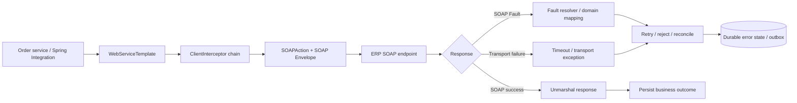
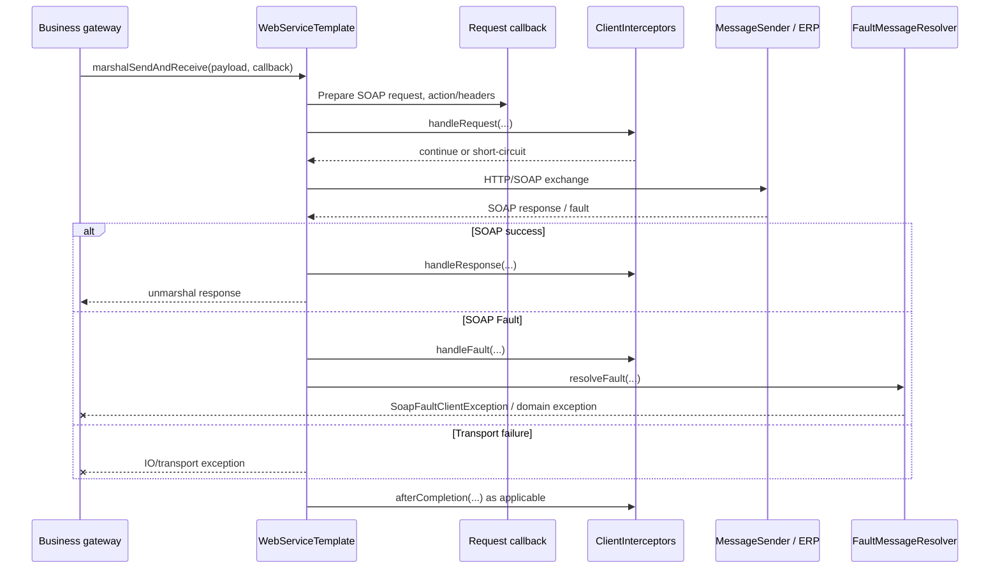
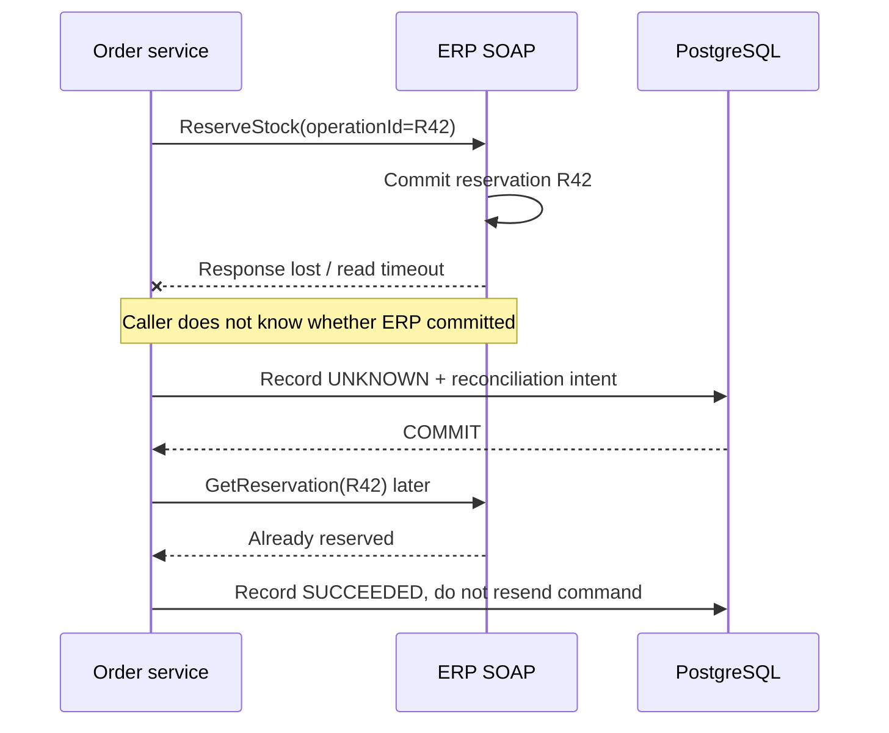

# SOAPAction, Interceptors, and Handling SOAP Faults

## 1. Why Do These Three Topics Determine SOAP Integration Reliability?

In the **SPRING_BOOT_INTEGRATION** module, a Spring Boot application does not only handle HTTP clients, databases, caches, brokers, and Spring Integration adapters; it must also interact with legacy SOAP/XML services of ERPs, accounting systems, insurers, or external vendors. A business operation might persist state in PostgreSQL, send a SOAP command to reserve inventory, and then emit a Kafka event; if SOAP returns a contract-violating response or times out after executing the command, the retry decision directly affects business correctness.

Three components must be understood together:

- **SOAPAction** indicates the intent of the SOAP operation at the protocol boundary when required by the contract/binding; it does not replace the body QName or WS-Addressing action.
- **Client interceptors** in Spring Web Services (Spring-WS) observe or intercept steps before/after a `WebServiceTemplate` call, supporting cross-cutting concerns such as safe logging, auditing, and security.
- **SOAP Fault** is SOAP's structured error message. An HTTP 500 can carry a SOAP Fault, yet HTTP/transport errors and business faults are not identical; the client must classify them before retrying or returning a result.

An example flow:



This lesson belongs to the **SOAP and XML** chapter; the goal is to trace the real path of requests and responses in Spring Boot, use WSDL/XSD as the data contract, preserve transactions and idempotency at the SOAP boundary, and test and observe both success and failure flows accurately.

After this lesson, you will be able to:

1. Read a WSDL to determine the operation and appropriate SOAPAction instead of guessing from a Java method name.
2. Configure `WebServiceTemplate`, `SoapActionCallback`, and interceptors with clear responsibilities.
3. Distinguish SOAP 1.1, SOAP 1.2, HTTP headers, SOAP headers, and WS-Addressing.
4. Catch `SoapFaultClientException`, read fault codes/details, and map them safely to domain errors.
5. Decide on retries, DLQ/reconciliation, and broker acknowledgements without duplicating side effects.
6. Test SOAPAction, interceptor lifecycles, fault mapping, timeouts, security, and observability.

## 2. SOAP Request/Response Structure: Three Layers Not to Confuse

SOAP commonly runs over HTTP, but the SOAP message and HTTP transport do not belong to the same layer:

```text
HTTP request
  - method: POST
  - URL: https://erp.example/soap/InventoryService
  - Content-Type: text/xml; charset=utf-8   (SOAP 1.1 example)
  - SOAPAction: "urn:erp:ReserveStock"        (SOAP 1.1 binding example)
  - Authorization / TLS / proxy metadata
  Body:
    <soap:Envelope>
      <soap:Header>...</soap:Header>
      <soap:Body>
        <erp:ReserveStockRequest>...</erp:ReserveStockRequest>
      </soap:Body>
    </soap:Envelope>
```

| Layer | Examples | Who is responsible? |
|---|---|---|
| **HTTP transport** | URL, HTTP status, media type, SOAPAction HTTP header. | Transport sender, HTTP server/proxy. |
| **SOAP envelope** | `Envelope`, `Header`, `Body`, `Fault`. | SOAP message factory, marshalling/unmarshalling, security interceptor. |
| **Business contract** | `ReserveStockRequest`, `OrderId`, `Quantity`, error `INSUFFICIENT_STOCK`. | WSDL/XSD and ERP rules. |
| **Application workflow** | `operationId`, idempotency, transactions, outbox, retries. | Spring Boot service and integration flow. |

In the SOAP body, **namespace URI and local name** identify the element; the prefix `erp` is merely an XML alias. Two XML documents using different prefixes can still share the exact same QName and conform to the XSD.

Do not confuse `SOAPAction` with the endpoint URL. Multiple operations are sent to the same URL with different bodies and actions.

## 3. SOAP 1.1 and SOAP 1.2: Differences Related to Action and Faults

| Aspect | SOAP 1.1 | SOAP 1.2 |
|---|---|---|
| Envelope namespace | `http://schemas.xmlsoap.org/soap/envelope/` | `http://www.w3.org/2003/05/soap-envelope` |
| Typical HTTP Content-Type | `text/xml` | `application/soap+xml` |
| Action over HTTP | `SOAPAction` header per SOAP 1.1 HTTP binding. | `action` parameter of `application/soap+xml` when used by binding. |
| Base fault codes | `Client`, `Server`, `VersionMismatch`, `MustUnderstand`. | `Sender`, `Receiver`, `VersionMismatch`, `MustUnderstand`, `DataEncodingUnknown`. |
| SOAP Fault layout | `faultcode`, `faultstring`, `faultactor`, `detail`. | `Code`, `Reason`, `Node`, `Role`, `Detail`; may include `Subcode`. |

Interpret those fault code names **according to the exact SOAP version**—do not write code comparing against `Client` for SOAP 1.2 and conclude the server is misbehaving.

### 3.1. The SOAPAction HTTP Header in SOAP 1.1

Wire example:

```http
POST /soap/InventoryService HTTP/1.1
Host: erp.example
Content-Type: text/xml; charset=utf-8
SOAPAction: "urn:erp:inventory:ReserveStock"
```

The action value is defined by the **WSDL binding/service contract**. Some legacy services require an exact action including URI and casing; others accept an empty action or do not dispatch by action. Do not infer an action from the class name `ReserveStockRequest` or add `/`, `#` arbitrarily if the WSDL does not specify it.

### 3.2. SOAP 1.2 Should Not Be Treated Like SOAP 1.1

SOAP 1.2 media type example:

```http
POST /soap/InventoryService HTTP/1.1
Content-Type: application/soap+xml; charset=utf-8; action="urn:erp:inventory:ReserveStock"
```

This **is not the same required header mechanism** as SOAP 1.1's `SOAPAction` header. The Spring-WS SOAP message factory must match the endpoint's version; changing an HTTP header alone will not turn a 1.1 envelope into SOAP 1.2.

A `VersionMismatch` error may result from sending the wrong envelope namespace or content type, not from the Java DTO itself.

## 4. Where Does the WSDL Specify SOAPAction?

In WSDL 1.1, a SOAP operation binding can declare the action, for example:

```xml
<wsdl:definitions
    xmlns:wsdl="http://schemas.xmlsoap.org/wsdl/"
    xmlns:soap="http://schemas.xmlsoap.org/wsdl/soap/"
    xmlns:tns="urn:erp:inventory:v1"
    targetNamespace="urn:erp:inventory:v1">

  <!-- message, portType, types, and service omitted -->
  <wsdl:binding name="InventorySoap11Binding"
                type="tns:InventoryPortType">
    <soap:binding style="document"
                  transport="http://schemas.xmlsoap.org/soap/http"/>
    <wsdl:operation name="ReserveStock">
      <soap:operation
          soapAction="urn:erp:inventory:ReserveStock"/>
      <wsdl:input>
        <soap:body use="literal"/>
      </wsdl:input>
      <wsdl:output>
        <soap:body use="literal"/>
      </wsdl:output>
    </wsdl:operation>
  </wsdl:binding>
</wsdl:definitions>
```

The snippet above is an **illustrative WSDL fragment**, not a complete WSDL: `types`, `message`, `portType`, `service`, and corresponding bindings are needed for full client generation/validation.

Distinguish clearly:

- `wsdl:operation name="ReserveStock"`: operation name in the contract.
- `soap:operation soapAction="..."`: action URI for the corresponding SOAP/HTTP binding.
- `wsdl:input`/`wsdl:output`: messages and schemas in the WSDL.
- `soap:address location="..."`: endpoint URL when the WSDL contains `service/port`.
- `tns:ReserveStockRequest`: QName of the payload element per XSD; often used for server-side dispatch.

**Never take the action from a SOAP 1.1 WSDL binding and apply it blindly to a different SOAP 1.2 binding.** Systems can expose multiple ports/bindings with separate actions and endpoints.

### 4.1. Checklist When Integrating a Partner's WSDL

1. Select the right service/port/binding/environment (test, staging, production).
2. Determine the SOAP version from the binding.
3. Check `soapAction` or the corresponding action semantics.
4. Inspect the namespace/QName of request and response root elements.
5. Determine whether WS-Addressing `Action`, WS-Security, MTOM, or mTLS is required.
6. Read `wsdl:fault`/XSD fault details, business codes, and retry contracts.
7. Check timeouts, idempotency, and operation lookup after lost responses.
8. Encode this contract into integration tests rather than relying only on manual SoapUI runs.

## 5. SOAPAction Is Not WS-Addressing Action

Some services support WS-Addressing. In that case, an XML header may appear:

```xml
<wsa:Action xmlns:wsa="http://www.w3.org/2005/08/addressing">
  urn:erp:inventory:ReserveStock
</wsa:Action>
```

Although the string value is sometimes identical, **WS-Addressing `wsa:Action` resides in the SOAP Header**, whereas SOAP 1.1 `SOAPAction` resides in an HTTP header. A server may validate **both** per policy and reject requests if they conflict.

Related WS-Addressing headers include `To`, `MessageID`, `ReplyTo`, and `RelatesTo`. They handle message routing and correlation, and **do not automatically act as an idempotency key** for inventory reservation.

When WSDL/policy requires WS-Addressing, use **dedicated Spring-WS support/callbacks or a version-appropriate WS stack** instead of hand-building XML strings. A `SoapActionCallback` only sets SOAPAction per its mechanism and **does not** build all WS-Addressing headers.

## 6. Spring-WS Client Pipeline: Callbacks, Interceptors, and Fault Resolvers

`WebServiceTemplate` is Spring Web Services' primary entry point for SOAP/XML clients. It uses a marshaller/unmarshaller (or raw XML `Source`), message factory, transport sender, and interceptors.

Conceptual lifecycle:



Abbreviated diagram: exact ordering and short-circuiting depend on interceptor contracts, response/fault checks, and Spring-WS version. **Callbacks run while preparing the request; interceptors participate in the exchange; the fault resolver defines how SOAP errors are reported back to the caller.** Do not interchange them arbitrarily.

### 6.1. Key Extension Points

| Extension point | Purpose |
|---|---|
| `WebServiceMessageCallback` | Customize the request message after creation: SOAPAction, XML headers, attachments via API. |
| `SoapActionCallback` | Built-in callback to set SOAPAction on a SOAP request. |
| `ClientInterceptor` | Cross-cutting hook before request, after response, on fault, and after completion. |
| `FaultMessageResolver` | Decides which exception or policy applies when a SOAP response is a Fault. |
| `Jaxb2Marshaller` | Binds Java objects with an XML schema-based model. |
| `WebServiceMessageSender` | Executes HTTP/HTTPS or other stack-supported transport. |
| `SoapMessageFactory` | Creates SOAP messages per version/implementation. |

An interceptor **is not automatically attached** to every `WebServiceTemplate` simply because it is a Spring bean; the template must be explicitly configured with its interceptor list.

## 7. Dependencies and SOAP Client Configuration in Spring Boot

For Spring Boot generations supporting Spring Web Services, use the starter:

```kotlin
dependencies {
    implementation("org.springframework.boot:spring-boot-starter-web-services")

    // When using JAXB-generated classes on modern Java:
    implementation("org.glassfish.jaxb:jaxb-runtime")

    testImplementation("org.springframework.boot:spring-boot-starter-test")
    testImplementation("org.springframework.ws:spring-ws-test")
}
```

Versions of Jakarta XML Binding, the SAAJ implementation, and Spring-WS must align with the **Spring Boot BOM**. Older versions used `javax.xml.bind`, while Spring Boot 3.x/Spring-WS 4.x standardize on `jakarta.*`. Do not mix `javax.*` generated classes with a `jakarta.*` runtime without a migration strategy.

Spring Boot provides `WebServiceTemplateBuilder` to configure clients consistently per version, though builder APIs can evolve across major releases. In the examples below, we configure **Spring-WS `WebServiceTemplate` directly** to make each responsibility explicit; in real projects, combine it with the sender, security, observability, and customizations managed by your application.

### 7.1. Properties for the ERP SOAP Endpoint

```yaml
integration:
  erp:
    soap:
      uri: https://erp.internal.example/soap/InventoryService
      action:
        reserve-stock: urn:erp:inventory:ReserveStock
        get-reservation: urn:erp:inventory:GetReservation
      connect-timeout: 2s
      read-timeout: 5s
```

These are **application-specific properties**. Spring Boot does not automatically bind `integration.erp.soap.*` to a message sender, client template, or retry policy; the application must declare `@ConfigurationProperties` or `@Value` and pass them to the right beans. The URI/actions in the example are fictional and must come from the real environment contract.

Never use a production URL as a silent fallback in test profiles, especially when tests issue write commands.

## 8. Building `WebServiceTemplate` with JAXB and Properly Scoped Interceptors

Suppose XJC/JAXB generated request/response classes from the WSDL/XSD in `com.example.integration.erp.soap.generated`.

```java
import org.springframework.beans.factory.annotation.Qualifier;
import org.springframework.beans.factory.annotation.Value;
import org.springframework.context.annotation.Bean;
import org.springframework.context.annotation.Configuration;
import org.springframework.oxm.jaxb.Jaxb2Marshaller;
import org.springframework.ws.client.core.WebServiceTemplate;
import org.springframework.ws.client.support.interceptor.ClientInterceptor;

@Configuration(proxyBeanMethods = false)
class ErpSoapConfiguration {

    @Bean
    Jaxb2Marshaller erpMarshaller() {
        Jaxb2Marshaller marshaller = new Jaxb2Marshaller();
        marshaller.setContextPath(
                "com.example.integration.erp.soap.generated");
        return marshaller;
    }

    @Bean("erpSoapTemplate")
    WebServiceTemplate erpSoapTemplate(
            Jaxb2Marshaller erpMarshaller,
            @Qualifier("erpSoapAuditInterceptor")
            ClientInterceptor audit,
            @Value("${integration.erp.soap.uri}")
            String endpointUri) {

        WebServiceTemplate template = new WebServiceTemplate();
        template.setDefaultUri(endpointUri);
        template.setMarshaller(erpMarshaller);
        template.setUnmarshaller(erpMarshaller);
        template.setInterceptors(new ClientInterceptor[]{audit});
        return template;
    }
}
```

**Prerequisites for this example to run:** generated JAXB classes with `ObjectFactory`/`@XmlRootElement` or `JAXBElement` as appropriate, a configured SAAJ/SOAP message factory on the classpath, the interceptor bean below, a reachable endpoint URI, and proper security/transport configuration. The code illustrates the wiring mechanism and does not automatically build a WSDL, TLS truststore, or timeout settings.

If the application uses multiple SOAP endpoints, create separate templates/gateways per dependency or binding; never change `defaultUri` or `interceptors` on a singleton template per request or tenant via mutable state.

### 8.1. SOAP Version Must Be Configured per Binding

For SOAP 1.2, depending on the Spring-WS implementation/version, `SaajSoapMessageFactory` can be configured with `SoapVersion.SOAP_12` and attached to the template. For SOAP 1.1, use the corresponding factory/version. Do not tweak the `SOAPAction` HTTP header to fix an envelope version error.

Example configuring a SOAP 1.2 message factory in Spring configuration:

```java
import org.springframework.context.annotation.Bean;
import org.springframework.ws.soap.SoapVersion;
import org.springframework.ws.soap.saaj.SaajSoapMessageFactory;

@Bean
SaajSoapMessageFactory erpSoap12MessageFactory() {
    SaajSoapMessageFactory factory = new SaajSoapMessageFactory();
    factory.setSoapVersion(SoapVersion.SOAP_12);
    return factory;
}
```

When choosing SOAP 1.2, pass this factory to `WebServiceTemplate` via `setMessageFactory(...)` before the template is used. Do not initialize a SOAP 1.1 message factory, set a 1.2-style SOAPAction, and expect the two bindings to interoperate automatically. The factory bean's lifecycle is managed by Spring and requires a compatible SAAJ implementation on the classpath.

Verify on the wire: media type, SOAP envelope namespace, SOAPAction/action parameter, and body QName **must all belong to the same binding**.

## 9. `SoapActionCallback`: Standard API to Set SOAPAction

Spring-WS provides `org.springframework.ws.soap.client.core.SoapActionCallback`. This callback uses the `SoapMessage` API to set the action before sending the request.

```java
import org.springframework.beans.factory.annotation.Qualifier;
import org.springframework.stereotype.Component;
import org.springframework.ws.client.core.WebServiceTemplate;
import org.springframework.ws.soap.client.core.SoapActionCallback;

@Component
class ErpStockGateway {

    private final WebServiceTemplate template;

    ErpStockGateway(
            @Qualifier("erpSoapTemplate")
            WebServiceTemplate template) {
        this.template = template;
    }

    ReserveStockResponse reserve(ReserveStockRequest request) {
        Object response = template.marshalSendAndReceive(
                request,
                new SoapActionCallback(
                    "urn:erp:inventory:ReserveStock"));

        return (ReserveStockResponse) response;
    }
}
```

`ReserveStockRequest`/`ReserveStockResponse` are **generated JAXB types or DTOs marshalled according to the WSDL**, not arbitrary Java records sent without JAXB mappings. Depending on WSDL codegen, `marshalSendAndReceive` may return a `JAXBElement<...>` rather than `ReserveStockResponse` directly; the gateway must handle the real generated contract instead of casting blindly in production.

### 9.1. When to Use the URI Overload?

If a template has a default endpoint but a specific call needs another **configured/allowlisted trusted endpoint**, Spring-WS supports an overload taking a URI:

```java
Object response = template.marshalSendAndReceive(
        configuredEndpointUri,
        request,
        new SoapActionCallback(configuredAction));
```

Never take `configuredEndpointUri` directly from untrusted user input and send tokens or WS-Security signatures to arbitrary hosts; that creates SSRF and credential-leakage risks. With multiple partners, prefer dedicated gateways or client factories.

### 9.2. Actions Should Belong to the Operation Contract

Declare constants or typed configuration per operation rather than copying strings across controllers, services, and retry callbacks:

```java
final class ErpSoapActions {
    static final String RESERVE_STOCK =
            "urn:erp:inventory:ReserveStock";
    static final String GET_RESERVATION =
            "urn:erp:inventory:GetReservation";

    private ErpSoapActions() {}
}
```

If the partner updates the WSDL/action, update the adapter and run regression tests. Do not reuse one action across multiple operations if the WSDL specifies distinct actions.

## 10. Custom Request Callbacks: Setting Actions and SOAP Headers Safely

`SoapActionCallback` is the default choice when you only need to set the action. If you also need to add SOAP headers such as correlation/message IDs or ERP-specific metadata, use `WebServiceMessageCallback`:

```java
import org.springframework.ws.WebServiceMessage;
import org.springframework.ws.client.core.WebServiceMessageCallback;
import org.springframework.ws.soap.SoapMessage;

WebServiceMessageCallback callback = (WebServiceMessage message) -> {
    if (!(message instanceof SoapMessage soapMessage)) {
        throw new IllegalStateException("Expected a SOAP message");
    }

    soapMessage.setSoapAction(
            "urn:erp:inventory:ReserveStock");

    // If the ERP requires a custom SOAP header:
    // use the SoapHeader API/Transformer/JAXB with the contract-defined
    // namespace QName; do not inject unescaped raw XML strings.
};
```

Do not use this pseudo-code to hand-roll WS-Security signatures; XML signing requires exact canonicalization, timestamps, nonces, reference IDs, key materials, and policies. Always use a dedicated security interceptor/library.

### 10.1. Placing Headers at the Right Layer

| What to send | Where to set it |
|---|---|
| SOAP 1.1 action | `SoapActionCallback`/`SoapMessage.setSoapAction`. |
| WS-Addressing `Action`/`MessageID` | SOAP header via WS-Addressing support. |
| Business correlation per WSDL | SOAP header QName or payload if required by contract. |
| HTTP Basic auth / OAuth2 bearer | Transport sender/client auth config or corresponding header policy. |
| WS-Security UsernameToken/signature | WS-Security interceptor/message policy. |
| TLS client certificate | HTTPS connection factory/SSL context. |
| Retry/idempotency key | Operation envelope or SOAP header/payload agreed with the ERP. |

**Not every header named "Action" means the same thing.** Partners may check WS-Addressing Action, SOAPAction, and the Body QName together. Decide based on WSDL + policy + wire tests.

## 11. `ClientInterceptor`: What Do the Hooks Mean?

Spring-WS defines `org.springframework.ws.client.support.interceptor.ClientInterceptor` with these hooks:

```java
public interface ClientInterceptor {
    boolean handleRequest(MessageContext messageContext)
            throws WebServiceClientException;

    boolean handleResponse(MessageContext messageContext)
            throws WebServiceClientException;

    boolean handleFault(MessageContext messageContext)
            throws WebServiceClientException;

    void afterCompletion(
            MessageContext messageContext, Exception ex)
            throws WebServiceClientException;
}
```

This is an **abbreviated API signature** for study, not an interface you need to create yourself. `MessageContext` holds the exchange's request/response messages; it is not an `HttpServletRequest` and not a JDBC transaction context.

| Hook | Typical timing | Appropriate responsibility |
|---|---|---|
| `handleRequest` | SOAP request built, before transport call. | Header/correlation policy, metadata logging, safe validation. |
| `handleResponse` | Response treated as SOAP success. | Audit status/timing, inspect metadata without consuming the body. |
| `handleFault` | Response identified as a SOAP Fault. | Record fault category, tracing, operations; does not replace fault resolver. |
| `afterCompletion` | Cleanup after exchange per interceptor lifecycle. | Release opened scopes/resources, exception diagnostics. |

`handleRequest`/`handleResponse`/`handleFault` return a boolean to control continuing the chain per API contract. **Returning `false` is not the standard way to signal business success**; it can short-circuit and affect downstream interceptors or response handling.

### 11.1. Interceptors Differ from HTTP Client Filters

`ClientInterceptor` is a **Spring Web Services** mechanism, not WebClient's `ExchangeFilterFunction`, a Servlet Filter, or a Spring MVC `HandlerInterceptor`. It inspects `WebServiceMessage`/`MessageContext`; to adjust HTTP socket settings, TLS, or proxies, configure the message sender.

Interceptors fit cross-cutting concerns well, but should not hold full business logic or DB transactions. An interceptor may execute multiple times when a gateway retries.

## 12. Example Interceptor Logging Metadata Without Consuming the Payload

```java
import org.slf4j.Logger;
import org.slf4j.LoggerFactory;
import org.springframework.stereotype.Component;
import org.springframework.ws.context.MessageContext;
import org.springframework.ws.client.WebServiceClientException;
import org.springframework.ws.client.support.interceptor.ClientInterceptor;
import org.springframework.ws.soap.SoapMessage;

@Component("erpSoapAuditInterceptor")
public class ErpSoapAuditInterceptor implements ClientInterceptor {

    private static final Logger log =
            LoggerFactory.getLogger(ErpSoapAuditInterceptor.class);

    @Override
    public boolean handleRequest(MessageContext context)
            throws WebServiceClientException {

        if (context.getRequest() instanceof SoapMessage soap) {
            // Map action to a bounded operation name.
            log.debug("ERP SOAP request action={}",
                    safeOperation(soap.getSoapAction()));
        }
        return true;
    }

    @Override
    public boolean handleResponse(MessageContext context)
            throws WebServiceClientException {

        log.debug("ERP SOAP success response received");
        return true;
    }

    @Override
    public boolean handleFault(MessageContext context)
            throws WebServiceClientException {

        log.warn("ERP SOAP Fault received");
        return true;
    }

    @Override
    public void afterCompletion(
            MessageContext context, Exception ex)
            throws WebServiceClientException {

        if (ex != null) {
            log.warn("ERP SOAP exchange aborted, type={}",
                    ex.getClass().getSimpleName());
        }
    }

    private static String safeOperation(String action) {
        if ("urn:erp:inventory:ReserveStock".equals(action)) {
            return "reserve-stock";
        }
        if ("urn:erp:inventory:GetReservation".equals(action)) {
            return "get-reservation";
        }
        return "unknown-action";
    }
}
```

Real implementations should use `ObservationRegistry`/Micrometer and bounded tags; the minimal logging above avoids accidentally writing raw SOAP bodies, `Authorization`, UsernameTokens, or payment info. `safeOperation` maps only known actions, avoiding unbounded actions as metric tags.

### 12.1. Never Consume the Body Just to Log It

An interceptor calling `message.writeTo(OutputStream)` may serialize the entire envelope into a buffer/file; depending on message implementation, streaming, attachments, and buffering, this increases memory/CPU, risks leaking secrets, and can affect downstream reading of remaining data.

In production, prefer **metadata + redaction + sampling**. If payload inspection is needed during debugging, use size-bounded logging with sensitive data masked, test with MTOM/large payloads, and enable only under time-bounded operational procedures.

## 13. Interceptor Ordering and the Response/Fault Path

If a template has the chain:

```java
template.setInterceptors(new ClientInterceptor[]{
    correlationInterceptor,
    wsSecurityInterceptor,
    auditInterceptor
});
```

Requests typically traverse the chain in registration order; response/fault/completion follow Spring-WS orchestration, typically in **reverse order** for interceptors that participated earlier. Never make an interceptor depend on a side effect of a later hook without testing the lifecycle—especially when an earlier interceptor returns `false` or throws an exception.

### 13.1. Practical Risks of Ordering

- If a SOAP header is added **after** WS-Security signs the message, the signature may exclude the new header or become invalid under policy.
- If logging runs before redaction, logs can leak tokens/PII; better yet, never log raw envelopes at all.
- If a correlation interceptor needs the action set by a request callback, ensure the callback sets the action **before** the hook that reads it in the pipeline.
- If a security interceptor faults or returns false during the request stage, downstream interceptors will not see a response as a simple test might assume.
- If two interceptors both modify SOAPAction, the last one overrides the operation's action; assign **a single owner** for the action.

**A well-observed pipeline must be tested across success, SOAP Fault, and transport failure paths**, not just the happy path.

## 14. What Is a SOAP Fault? Looking at the Real Envelope

A SOAP Fault is an error structure in the **SOAP Body**, not merely an HTTP status code or Java exception.

SOAP 1.1 example:

```xml
<soap:Envelope
    xmlns:soap="http://schemas.xmlsoap.org/soap/envelope/"
    xmlns:erp="urn:erp:inventory:v1">
  <soap:Body>
    <soap:Fault>
      <faultcode>soap:Client</faultcode>
      <faultstring>Invalid reservation request</faultstring>
      <detail>
        <erp:InventoryFault>
          <erp:code>INVALID_QUANTITY</erp:code>
          <erp:message>Quantity must be positive</erp:message>
        </erp:InventoryFault>
      </detail>
    </soap:Fault>
  </soap:Body>
</soap:Envelope>
```

Components:

- `faultcode`: SOAP protocol-level classification (e.g., Client/Server); **insufficient** to capture all business error codes.
- `faultstring`: human-readable explanation; not a stable machine classifier.
- `detail`: service-defined structured data; may follow a fault XSD contract.
- `faultactor` (if present in SOAP 1.1): actor responsible in the processing chain.

### 14.1. SOAP 1.2 Fault

Abbreviated example:

```xml
<env:Envelope
    xmlns:env="http://www.w3.org/2003/05/soap-envelope">
  <env:Body>
    <env:Fault>
      <env:Code>
        <env:Value>env:Receiver</env:Value>
      </env:Code>
      <env:Reason>
        <env:Text xml:lang="en">Temporary ERP failure</env:Text>
      </env:Reason>
      <env:Detail>
        <errorCode xmlns="urn:erp:faults">UPSTREAM_UNAVAILABLE</errorCode>
      </env:Detail>
    </env:Fault>
  </env:Body>
</env:Envelope>
```

SOAP 1.2 also supports `Subcode`/`Node`/`Role` when needed. Never point a SOAP 1.1 XPath expecting `faultstring` at a SOAP 1.2 response.

## 15. SOAP Faults, HTTP 500, and Transport Errors Are Not Synonymous

Possible combinations:

| Observation | Interpretation |
|---|---|
| HTTP 500 with SOAP Envelope containing `Fault` | Usually a valid SOAP fault per binding; process SOAP fault code/detail. |
| HTTP 500 with reverse-proxy HTML | Likely a gateway/proxy/transport/server failure, **not a SOAP Fault**. |
| HTTP 401/403 without a SOAP body | Authentication/authorization/transport failure. |
| HTTP 200 with a SOAP Fault | Can occur with non-compliant servers or intermediaries; verify fault detection config and test. |
| HTTP 200 with XML business error and no `Fault` | Application must read the business response and classify per contract; fault resolver will not trigger automatically. |
| Timeout before receiving response | Unknown whether the remote write executed or not. |
| Malformed XML / wrong namespace | Parse/unmarshal/contract error; may never have reached business logic. |

For SOAP over HTTP, never write logic like "status 500 => transient retry" because a **Client/Sender fault may be a validation error**, and retrying the same payload will fail every time. Similarly, never treat HTTP 200 as business success when the SOAP body carries a business rejection status.

## 16. How Does `WebServiceTemplate` Handle Faults by Default?

`WebServiceTemplate` has fault detection and a `FaultMessageResolver`. Under standard configuration, the default `SoapFaultMessageResolver` converts a SOAP Fault into `SoapFaultClientException`.

Example:

```java
import org.springframework.ws.soap.client.SoapFaultClientException;

try {
    Object response = template.marshalSendAndReceive(
            request,
            new SoapActionCallback(ErpSoapActions.RESERVE_STOCK));

    // Process valid response per JAXB/WSDL.
} catch (SoapFaultClientException fault) {
    // Received a structured SOAP Fault; inspect code/detail.
}
```

`SoapFaultClientException` provides methods for **fault code QName** and **fault string/reason**; you can access the underlying `SoapFault` to read structured details per your Spring-WS API/version.

### 16.1. Exception Categories to Distinguish

| Scenario | Exception/group you may see | Handling approach |
|---|---|---|
| Valid SOAP Fault | `SoapFaultClientException` under default resolver. | Classify fault code/detail; map domain outcome. |
| HTTP transport status that is not a SOAP Fault | `WebServiceTransportException` or corresponding transport error. | Check status/network; do not parse as a fake fault. |
| I/O, reset, timeout | `WebServiceIOException` or wrapper around I/O cause. | Consider operation semantics and uncertain outcome. |
| XML marshalling/unmarshalling error | Corresponding Spring OXM/JAXB exception. | Check schema/binding; usually do not hot-retry. |
| WS-Security validation failure | Service fault or security exception in interceptor. | Fix signature/clock/cert/credentials; do not retry infinitely. |
| Business rejection in normal response | DTO/status code in SOAP body. | Map per application contract. |

Exact exception classes depend on the **message sender, factory, JAXB provider, and Spring-WS version**. Never write a handler catching a single class and assuming everything else is a "SOAP Fault."

### 16.2. HTTP-Status Heuristics and Interoperability

`WebServiceTemplate` exposes options for checking transport connections for errors/faults, such as `setCheckConnectionForError` and `setCheckConnectionForFault`. These may matter when integrating legacy services that return non-standard HTTP statuses.

**Do not disable these checks out of habit.** Changing them alters when HTTP 500 is treated as a transport error vs. when the body is inspected for a fault. Verify behavior with wire fixtures and integration tests against the real endpoint, while keeping SOAP faults distinct from HTML/JSON gateway errors.

## 17. Reading Fault Code and Detail Without Relying on `faultstring`

A fault may say `soap:Client`, while the application needs to know whether the error is `INVALID_QUANTITY`, `OUT_OF_STOCK`, or `DUPLICATE_RESERVATION`.

Example mapper at the gateway boundary:

```java
import javax.xml.namespace.QName;
import org.springframework.ws.soap.client.SoapFaultClientException;

public final class ErpFaultClassifier {

    public ErpFailure classify(SoapFaultClientException fault) {
        QName code = fault.getFaultCode();

        // Read structured detail via JAXB/secure DOM parser
        // per the ERP's fault XSD contract.
        String vendorCode = extractAllowedErrorCode(fault);

        if ("INVALID_QUANTITY".equals(vendorCode)) {
            return ErpFailure.validation("INVALID_QUANTITY");
        }
        if ("OUT_OF_STOCK".equals(vendorCode)) {
            return ErpFailure.rejected("OUT_OF_STOCK");
        }
        if ("UPSTREAM_UNAVAILABLE".equals(vendorCode)) {
            return ErpFailure.transientFailure("UPSTREAM_UNAVAILABLE");
        }

        return ErpFailure.unknown(
                code == null ? "UNKNOWN_SOAP_CODE"
                        : code.getLocalPart());
    }

    private String extractAllowedErrorCode(
            SoapFaultClientException fault) {
        // Implement per the partner's SOAP Fault detail QName/XSD.
        return null;
    }
}
```

`ErpFailure` is an application-defined domain type with policy-appropriate factory methods; `extractAllowedErrorCode` is **unimplemented**. The example only clarifies classification principles, not a standalone runnable class. In production, parse exact QNames/namespaces/versions, validate nulls and lengths, and enforce an allowlist of error codes.

### 17.1. Why Not Parse `getFaultStringOrReason()`?

`faultstring` can change by locale, ERP version, or dynamic details like order numbers or customer names. If you write `message.contains("out of stock")`, a language or wording change upstream can break your retry policy.

Prefer **schema-defined fault details or stable error codes**. If a partner only supplies `faultstring`, document that contract limitation and fall back safely; never treat string matching as a guarantee of correctness.

### 17.2. Unknown Fault Codes Need an Explicit Destination

A fault with missing details or a new code after an ERP deployment should be classified as `UNKNOWN_REMOTE_FAULT`, logged with operation ID/correlation, and alerted—never continuously retried or turned into business success.

## 18. Mapping SOAP Faults to Domain Errors and API Responses

The SOAP gateway layer should **isolate** Spring-WS exceptions from controllers and consumer business logic. For example:

```java
public sealed interface ReserveStockOutcome
        permits ReservationAccepted, ReservationRejected,
                ReservationPendingReconciliation {}

public record ReservationAccepted(String reservationId)
        implements ReserveStockOutcome {}

public record ReservationRejected(String code)
        implements ReserveStockOutcome {}

public record ReservationPendingReconciliation(String operationId)
        implements ReserveStockOutcome {}
```

In the application, the gateway can:

- Return `ReservationAccepted` when the response contract confirms the ERP committed.
- Return `ReservationRejected` when fault details indicate an explicit business rejection.
- Record `UNKNOWN`/pending reconciliation when a write POST times out and the ERP may have committed.
- Throw/surface a classified technical error to the retry coordinator when the service is temporarily unavailable.
- Persist a durable failure/quarantine record when schema/security/configuration needs intervention.

### 18.1. Contextual Mapping Table

| SOAP/transport outcome | Typical appropriate application policy |
|---|---|
| Fault Sender/Client + `INVALID_QUANTITY` | Reject payload, no hot retry; HTTP 400/422 if matching API contract. |
| Business fault `OUT_OF_STOCK` | Record business rejection; maybe HTTP 409/422 per contract, not blindly 500. |
| Fault Receiver/Server + `UPSTREAM_UNAVAILABLE` | Bounded retry if operation is safe, or durable retry. |
| Security fault `INVALID_SIGNATURE` | Stop hot retries; alert on config/signature/certificate. |
| SOAP version/binding mismatch | Fix client/message factory/WSDL; do not retry. |
| Connection timeout before sending | May retry after classification; still assess side effects. |
| Read timeout after write request | Outcome `UNKNOWN`; query ERP by operation ID before replaying. |
| HTTP 200 response with business error DTO | Map from response schema; does not go through `FaultMessageResolver`. |

Never expose raw SOAP Fault XML, stack traces, or URIs with credentials on public APIs. Spring Boot error responses should contain a business error code, public message, controlled correlation ID, and clear processing status.

## 19. Customizing `FaultMessageResolver` When a Shared Policy Is Needed

When multiple calls share the same template and fault-mapping rules, you can configure a custom `FaultMessageResolver`:

```java
import org.springframework.ws.WebServiceMessage;
import org.springframework.ws.client.core.FaultMessageResolver;
import org.springframework.ws.soap.SoapFault;
import org.springframework.ws.soap.SoapMessage;

class ErpFaultMessageResolver implements FaultMessageResolver {

    @Override
    public void resolveFault(WebServiceMessage message) {
        if (!(message instanceof SoapMessage soap)) {
            throw new IllegalStateException(
                    "Expected SOAP fault message");
        }

        SoapFault fault = soap.getSoapBody().getFault();

        // Production code: read QName/code/detail per the ERP WSDL/XSD.
        String safeCode =
                fault == null ? "SOAP_FAULT_UNAVAILABLE"
                        : fault.getFaultCode().getLocalPart();

        throw new ErpRemoteFaultException(safeCode);
    }
}
```

`ErpRemoteFaultException` is a custom runtime exception you define; preserve causes and vetted fault metadata where appropriate. This snippet is an **adapter pattern**, and cannot map full business semantics without parsing typed details. Check nullable `getFaultCode()` and API versions in real implementations.

Attach to the template:

```java
template.setFaultMessageResolver(
        new ErpFaultMessageResolver());
```

**Risk:** a shared resolver applies to **every operation on that template**. If different SOAP operations have different fault schemas, a gateway-level `catch (SoapFaultClientException)` mapped per operation can be easier to control. Never swallow a Fault in a resolver and return normally, causing callers to receive `null` and mistake it for success.

### 19.1. Interceptor `handleFault` Is Not a Fault Resolver

`handleFault` observes or intercepts the message for cross-cutting policies, while `FaultMessageResolver` decides how a SOAP Fault becomes an exception. Returning `true` from an interceptor **does not mean the fault was successfully handled for business logic**. If a business rejection is a valid outcome, return a typed outcome at the gateway/application boundary instead of turning the error path into an empty response.

## 20. Fault Details, JAXB, and Validation Need Clear Boundaries

A SOAP Fault `detail` may carry XML defined by its own XSD, separate from the request/response JAXB model. Things to handle:

1. Locate the exact fault detail element by **QName**, not local name alone.
2. Bound the number of detail elements and XML size.
3. Parse using a known JAXB binding or hardened XML parser; disallow untrusted types.
4. Validate schema/version when contract integrity matters.
5. Do not treat fault details as validated input: a malfunctioning proxy or partner may return unexpected content.
6. Distinguish SOAP 1.1 `detail` from SOAP 1.2 `Detail`.
7. Store vendor codes; never dump full raw XML into metrics or logs.
8. On unknown schema/version, assign a fallback code and alert rather than throwing a parse error that hides the root cause.

### 20.1. XXE and XML Parser Hardening

SOAP/XML may contain unwanted external entities, DOCTYPEs, or references. In custom parsers (DOM/SAX/StAX/Transformer), disable DTD/external entity resolution, limit expansion/depth/size, and apply **secure processing**. Different Spring-WS/SAAJ/JAXB versions have different protective defaults, so never assume safety merely because code uses `WebServiceTemplate`.

If consuming WSDL/XSD from remote URLs during build or runtime, restrict network access/allowlists and pin artifacts/schemas to avoid SSRF, loading untrusted documents, or unexpected changes.

## 21. Retrying SOAP Faults: Only Retry with Contract Evidence

There are two fundamentally different decisions:

- **Retryable technical fault**: temporary backend failure, throttling, or lock contention per contract code.
- **Non-retryable contract/business fault**: invalid payload, insufficient stock, unauthorized, wrong SOAPAction/version.

Do not assume every `SoapFaultClientException` is transient, nor assume a `Server`/`Receiver` SOAP fault is always safe to retry for a write command. A server may return a fault after partially committing work, or partner fault semantics may differ from standard expectations.

### 21.1. Retry Matrix for SOAP Operations

| Operation and error | Recommended action |
|---|---|
| `GetReservation` (read-only) + transient transport failure | Bounded retry with backoff within deadline if read contract is safe. |
| `ReserveStock` (write) + request validation Fault | Do not retry; fix payload/contract. |
| `ReserveStock` + `OUT_OF_STOCK` business Fault | Record rejected; do not hot-retry. |
| `ReserveStock` + transient fault confirmed not committed | May retry with the same key per contract. |
| `ReserveStock` + read timeout with unknown side effects | Record `UNKNOWN`; query status before retrying. |
| SOAPAction mismatch / `mustUnderstand` / version fault | Fix binding/headers/security; do not retry. |
| Authentication / certificate / signature failure | Alert on config and permissions; avoid retry storms. |
| ERP 503 gateway HTML | Classify as transport/service failure; do not parse as a fake SOAP Fault. |

### 21.2. Overall Time Budget

An integration can retry at the HTTP client sender, `Spring Retry`/`RequestHandlerRetryAdvice`, Spring Integration poller, and broker consumer. If every layer retries three times, a single business command can trigger dozens of ERP calls. Choose **one owner** for the retry policy, specifying max attempts, backoff, jitter, deadlines, rate/bulkhead limits, and handoff to durable retry or quarantine.

Do not hold JDBC transactions or connection pool slots while sleeping through long backoffs or waiting on a slow ERP. Prefer an **outbox/durable worker** for prolonged outages.

## 22. SOAP Write Timeouts: `UNKNOWN` Outcome and Idempotency

A dangerous failure mode:



Generate `operationId`/`idempotencyKey` **before** the first attempt and keep it across retries and replays. It can live in the SOAP body or a custom header per WSDL. However, **merely sending an arbitrary header with a key does not make the ERP idempotent**: the upstream must actually enforce the key or provide a business lookup/reconciliation API.

### 22.1. Distinguishing Application States

| Application state | What is known |
|---|---|
| `SUCCEEDED` | Reliable confirmation that the ERP executed the operation. |
| `REJECTED` | Business response confirming the operation was not executed per contract. |
| `RETRY_WAIT` | Transient error and command is safe to resend per policy. |
| `UNKNOWN` | Unknown whether the ERP committed the write command. |
| `QUARANTINED` | Needs contract/configuration fix or manual replay approval. |

These states belong to the **domain workflow**, not `WebServiceTemplate` defaults. SOAPAction, interceptors, and fault resolvers cannot replace a durable state machine.

## 23. SOAP in Spring Integration: Routing Errors at the Right Boundary

In Spring Integration, a service activator may call a SOAP gateway:

```text
Kafka / HTTP inbound
  -> Validate ReserveStock command
  -> Persist intent (outbox/job)
  -> Spring Integration service activator
  -> ErpStockGateway (WebServiceTemplate)
  -> ERP SOAP endpoint
  -> Persist result / durable failure / reconciliation
  -> Ack broker at commit checkpoint
```

Failure behaviors to watch:

- `SoapFaultClientException` from `marshalSendAndReceive` propagates directly when the handler runs on a synchronous `DirectChannel`.
- With an `ExecutorChannel` or poller, exceptions generally do not return to the caller thread; configure recovery/`errorChannel` on the endpoint properly.
- `RequestHandlerRetryAdvice` can retry the service activator, but error classification and idempotency must still hold at the business boundary.
- `ErrorMessageSendingRecoverer` forwards errors to an error channel; it does **not** automatically persist to a durable DLQ or complete business work.
- Acknowledging Kafka/RabbitMQ immediately after enqueuing an in-memory task can lose work.
- When handling/quarantining errors, durably record `operationId`, `eventId`, normalized SOAP fault/transport category, and a safe payload reference.

Wrapping retry advice around a handler that also inserts database rows can re-run **all handler side effects** on retry. Separate the domain transaction from the SOAP operation boundary cleanly, typically using an outbox and worker to avoid dual-write failures.

### 23.1. A SOAP Fault Does Not Always Belong in a DLQ

A business Fault such as `OUT_OF_STOCK` is a **terminal business outcome** (rejected), not necessarily a "poison message." You can persist the rejected outcome and acknowledge the source message after commit. Conversely, schema errors, unparseable XML, or SOAPAction mismatches should be quarantined and alerted to fix configuration rather than retried infinitely.

## 24. WS-Security, TLS, and SOAPAction: Do Not Conflate Them

SOAP endpoints may require:

- HTTPS/TLS server certificate validation.
- mTLS client certificates.
- HTTP Basic authentication or OAuth2 tokens per policy.
- WS-Security UsernameToken, timestamp, nonce, signature/encryption.
- Exact WS-Addressing headers and SOAPAction.
- Client IP allowlists or proxy headers.

In Spring-WS, `Wss4jSecurityInterceptor` can implement WS-Security when the matching module/version is included, but **not all WSS4J options stay identical across major versions**. Follow the WSDL/WS-Policy, use separate test/staging keystores and truststores, and verify signed elements and algorithm suites in practice.

### 24.1. Order of Modifying Headers and XML Signing

If an interceptor adds a business SOAP header **after the message has been signed**, the signature will not cover the new data or signature references may fail validation. Similarly, inconsistent SOAPAction or WS-Addressing Action values may be rejected by intermediaries before the business handler runs.

Use an interceptor order tested on the wire against the sandbox/service. Never disable signature verification, hostname verification, or XML security parser protections just to get a test passing.

### 24.2. Preventing Credential Leaks Through Shared Templates

A `WebServiceTemplate` carrying WS-Security credentials or an HTTP sender with `Authorization` should belong to **one trust boundary/partner**. Never let user input pick an arbitrary URI and route a credentialed template to an external host. A template can be thread-safe once immutably configured, but **changing default URI, interceptors, marshallers, or credentials per request on a singleton** is an anti-pattern.

## 25. Correlating and Observing Across SOAP, HTTP, and Brokers

Tracing can generate HTTP client spans for supported transports; however, **`ClientInterceptor` does not automatically produce complete distributed traces**, and `WebServiceTemplate` is not necessarily instrumented identically to Boot-managed `RestClient`/`WebClient`. Verify actual Spring-WS transport/tracer integration for your version.

An operational strategy:

| Signal | Where collected | What to distinguish |
|---|---|---|
| SOAP operation | Gateway/`ClientInterceptor`, action → logical operation. | Do not tag unbounded raw URIs or actions. |
| HTTP status/timeouts | Transport sender / HTTP instrumentation. | HTTP 500 SOAP Fault vs. HTML proxy error. |
| SOAP Fault category | Fault mapper after parsing detail. | Business rejection vs. transient/server fault. |
| Business operation state | DB/job/outbox table. | `UNKNOWN` is not equivalent to failed. |
| Retry attempts/exhausted | Retry coordinator / Integration advice. | Total attempts across all layers. |
| Broker lag/DLQ depth | Kafka/RabbitMQ metrics. | Upstream SOAP failures can cause consumer backlog. |
| Correlation/event/operation ID | Trusted envelope / log context. | Never use as metric labels. |
| Trace spans | Appropriate Micrometer/OpenTelemetry instrumentation. | Do not craft `traceparent` manually by string formatting. |

### 25.1. Log Security

Avoid logging:

- SOAP Headers containing UsernameTokens, signatures, or security tokens.
- Payload bodies containing emails, IDs, customer profiles, or payment data.
- HTTP Authorization/Cookie headers or certificate secrets.
- Unredacted full Fault details (which may contain raw business data).
- Full URLs with secret query strings.

Safe things to log include `operation=reserve-stock`, `outcome=fault`, `faultCategory=validation`, `durationMs`, and a protected correlation ID. Metric tags must have bounded values; never tag by `orderId`, `operationId`, exception messages, or dynamic SOAPActions.

## 26. Testing `SoapActionCallback` with `MockWebServiceServer`

The Spring-WS test module includes `MockWebServiceServer`. It tests calls **through the actual `WebServiceTemplate`** without a real ERP, allowing assertions on SOAPAction, body QName, and fault mapping.

Example using XML `Source` so it does not depend on generated JAXB classes:

```java
import org.junit.jupiter.api.Test;
import org.springframework.xml.transform.StringResult;
import org.springframework.xml.transform.StringSource;
import org.springframework.ws.client.core.WebServiceTemplate;
import org.springframework.ws.soap.client.core.SoapActionCallback;
import org.springframework.ws.test.client.MockWebServiceServer;

import static org.junit.jupiter.api.Assertions.assertTrue;
import static org.springframework.ws.test.client.RequestMatchers.*;
import static org.springframework.ws.test.client.ResponseCreators.*;

class ErpSoapActionTest {

    private final WebServiceTemplate template =
            new WebServiceTemplate();

    @Test
    void reserveStockSendsActionAndCorrectBody() {
        template.setDefaultUri("http://erp.test.invalid/soap");
        String requestXml = """
            <erp:ReserveStockRequest
                xmlns:erp="urn:erp:inventory:v1">
              <erp:orderId>O-42</erp:orderId>
              <erp:quantity>1</erp:quantity>
            </erp:ReserveStockRequest>
            """;

        String responseXml = """
            <erp:ReserveStockResponse
                xmlns:erp="urn:erp:inventory:v1">
              <erp:reservationId>R-42</erp:reservationId>
            </erp:ReserveStockResponse>
            """;

        MockWebServiceServer server =
                MockWebServiceServer.createServer(template);

        server.expect(soapAction(
                    "urn:erp:inventory:ReserveStock"))
              .andExpect(payload(new StringSource(requestXml)))
              .andRespond(withPayload(new StringSource(responseXml)));

        StringResult response = new StringResult();

        boolean received = template.sendSourceAndReceiveToResult(
                new StringSource(requestXml),
                new SoapActionCallback(
                    "urn:erp:inventory:ReserveStock"),
                response);

        assertTrue(received);
        server.verify();
    }
}
```

This test template requires a compatible `spring-ws-test` dependency and a working SOAP message factory. `sendSourceAndReceiveToResult` sends the **body XML payload** while Spring-WS constructs the Envelope; do not pass an entire SOAP Envelope into the `StringSource` payload or it will double-nest the envelope. Tests can add assertions on the response body/namespace via XML matchers or a secure DOM parser instead of arbitrary substring checks.

### 26.1. What Does the Mock Server Prove?

- The template actually sends a SOAP request carrying the expected action.
- The body payload is generated with the expected QName and contents.
- A sample fault/response is handled properly by the client.
- `ClientInterceptor` instances attached to the template execute when testing the real bean.

The mock server **does not** prove HTTPS handshakes, proxies, certificates, real HTTP status behavior, or the live ERP WSDL. Complement it with transport/integration tests when correctness depends on those layers.

## 27. Testing SOAP Faults: Verifying Errors Reach the Right Layer

An additional test can stub a mock response as a SOAP Fault:

```java
import java.util.Locale;
import org.junit.jupiter.api.Test;
import org.springframework.ws.soap.client.SoapFaultClientException;
import org.springframework.xml.transform.StringResult;
import org.springframework.xml.transform.StringSource;
import org.springframework.ws.soap.client.core.SoapActionCallback;
import org.springframework.ws.test.client.MockWebServiceServer;

import static org.junit.jupiter.api.Assertions.assertThrows;
import static org.springframework.ws.test.client.RequestMatchers.soapAction;
import static org.springframework.ws.test.client.ResponseCreators.withServerOrReceiverFault;

@Test
void soapFaultIsNotMistakenForSuccess() {
    template.setDefaultUri("http://erp.test.invalid/soap");
    String requestXml = """
        <erp:ReserveStockRequest
            xmlns:erp="urn:erp:inventory:v1">
          <erp:orderId>O-42</erp:orderId>
          <erp:quantity>1</erp:quantity>
        </erp:ReserveStockRequest>
        """;

    MockWebServiceServer server =
            MockWebServiceServer.createServer(template);

    server.expect(soapAction(
                "urn:erp:inventory:ReserveStock"))
          .andRespond(withServerOrReceiverFault(
                "ERP temporarily unavailable", Locale.ENGLISH));

    assertThrows(SoapFaultClientException.class, () ->
            template.sendSourceAndReceiveToResult(
                new StringSource(requestXml),
                new SoapActionCallback(
                    "urn:erp:inventory:ReserveStock"),
                new StringResult()));

    server.verify();
}
```

This is a **test method added to the corresponding test class from the previous section** (reusing the `template` field); imports are included to clarify dependencies. The `.invalid` URI is a placeholder and makes no network call because `MockWebServiceServer` replaces the message sender during the test. `withServerOrReceiverFault` creates a server/receiver SOAP Fault adapting to the message factory's SOAP version. If the template uses a custom `FaultMessageResolver`, assert the **resolver's domain exception** instead of `SoapFaultClientException`.

### 27.1. Required Fault Test Matrix

| Test | Expectation |
|---|---|
| Right action, right body, valid response. | Unmarshals into the appropriate DTO. |
| Missing or wrong action. | Mock matcher fails or sandbox returns fault per policy. |
| Wrong body QName/namespace. | Contract validation/mapping errors; never treated as business success. |
| SOAP 1.1 Client Fault + typed detail. | Maps to validation/rejection; no retry. |
| SOAP 1.2 Sender/Receiver Fault. | Parsed per version and classified accurately. |
| Unknown Fault code/detail version. | Fallback classification + durable error/alert. |
| HTTP 500 HTML proxy response. | Transport/parsing exception; **never** faked as a business SOAP Fault. |
| HTTP 200 carrying SOAP Fault from non-compliant server. | Fault detection tested per interoperability policy. |
| Security/signature/clock-skew fault. | No hot retry; configuration alert. |
| Timeout after SOAP write side effect. | Record UNKNOWN/reconciliation; never generate a new idempotency key. |
| Interceptor request/response/fault hooks. | Hooks run along each path without consuming the body. |
| Fault resolver throws. | Gateway converts into the right business/technical error. |
| Retries exhausted. | Durable state/queue recorded; never silently ack source. |
| Two simultaneous SOAP calls. | No header/credential/operation ID leakage across callers. |

## 28. Testing Real HTTP Transport and WSDL Contracts

`MockWebServiceServer` fits the Spring-WS layer well, but some failures only surface **outside the mock**:

- HTTP status and `SOAPAction` headers passing through a proxy.
- SOAP 1.2 `application/soap+xml; action="..."` media types.
- mTLS handshakes, truststores, and hostname verification.
- Basic/OAuth/WS-Security policies.
- Connection/read timeouts, mid-exchange resets, and keep-alive connection reuse.
- Intermediaries rejecting `mustUnderstand` or WS-Addressing headers.
- Large XML/MTOM attachments and memory bounds.
- Real ERP returning a different fault detail XSD version.

Use an HTTP stub (WireMock/MockWebServer or custom container) serving raw SOAP Envelopes and HTTP responses, and run your **production-configured `WebServiceTemplate`** against its dynamic URI. With Testcontainers, retrieve host/port via `getHost()`/`getMappedPort(...)` and `@DynamicPropertySource`; never hardcode `localhost:8080` in CI or remote Docker.

### 28.1. Testing Database/Outbox Alongside SOAP Operations

An integration test for `ReserveStock` can combine a PostgreSQL Testcontainer and an HTTP SOAP stub:

1. Persist `ReserveStockCommand(operationId=R42)`/outbox in the DB within a transaction.
2. Worker sends the contract SOAP body and action to the stub.
3. Stub returns SOAP success; assert operation state `SUCCEEDED`.
4. Stub returns business Fault `OUT_OF_STOCK`; assert `REJECTED` with no hot retry.
5. Stub returns transient SOAP Receiver fault; assert retry budget compliance.
6. Stub accepts request then closes connection before responding; assert `UNKNOWN`, and no command issued with a new key.
7. Restart worker / simulate broker redelivery; assert idempotent reconciliation.
8. Change SOAPAction to an invalid value; the test must fail on contract, never stay green via a mocked client method.

Never use test-level `@Transactional` to hide after-commit/outbox behavior: worker/listener transactions execute on separate threads, so assert durable state after real commits.

## 29. Timeouts, Connection Pools, and Overload Handling

SOAP clients often call ERPs with high latency and tight concurrency quotas. Budget the flow:

```text
HTTP inbound deadline or async job SLO
  = queue wait
  + connection acquisition
  + DNS/TLS/connect
  + SOAP serialization
  + remote processing
  + response download/unmarshal
  + optional backoff/retry
```

`WebServiceMessageSender` and the underlying HTTP library control connect/read/socket timeouts. Spring-WS transports may use `HttpUrlConnectionMessageSender`, Apache HttpComponents senders, or custom implementations; setter APIs vary across versions. Always configure timeouts **on the template's actual sender**, rather than putting `integration.erp.soap.read-timeout` in YAML and assuming Spring applies it automatically.

Monitor:

- Active/idle/pending connections and pool limits.
- SOAP response latency per operation.
- Error rates broken down by SOAP Fault category vs. transport errors.
- Retry attempts/exhaustion, timeouts, and circuit breakers.
- Integration flow queue depth, broker lag, and outbox pending age.
- End-to-end task error budgets/SLOs, not merely HTTP 200/500.

If a request thread holds a JDBC transaction open while waiting 30 seconds on an ERP, DB pools and lock contention can trigger secondary outages. Decouple local commit/outbox from remote SOAP workers whenever operations may block.

## 30. Troubleshooting: Why Does the ERP Return a Fault or Reject the Operation?

| Symptom | Possible cause | What to check |
|---|---|---|
| ERP says "operation not found" despite valid body. | Missing/wrong SOAPAction, wrong binding, or endpoint dispatch policy. | WSDL `soap:operation`, wire SOAPAction, target URL. |
| `SOAPAction` is right, yet ERP rejects. | Wrong body QName/namespace, WS-Addressing `Action`, or SOAP version. | Inspect Envelope, action consistency, and XSD. |
| HTTP 415 Unsupported Media Type. | SOAP 1.1/1.2 content-type mismatch. | Message factory SOAP version and HTTP Content-Type. |
| Fault `VersionMismatch`. | Wrong Envelope namespace/version. | SOAP 1.1 vs. 1.2 factory and binding. |
| Fault `MustUnderstand`. | Mandatory header/actor/role or security policy unhandled. | SOAP Header QName, `mustUnderstand`, intermediaries. |
| HTTP 500 without `SoapFaultClientException`. | Proxy returned HTML, different transport fault check, or custom resolver. | Raw HTTP response + content type + template config. |
| HTTP 200 yet throws Fault. | SOAP Body actually contains a Fault despite non-standard status. | Body inspection, fault detection tests. |
| `handleFault` does not run. | Error occurred before receiving SOAP Fault (connect, marshalling, security) or interceptor not wired. | Check exception layer and template interceptor list. |
| `handleResponse` runs despite business error. | Normal XML response carries a business rejection. | Unmarshal DTO and map domain status. |
| Fault mapper reads wrong code. | Parsing `faultstring` instead of detail, or different schema version. | Typed detail QName/XSD and test fixtures. |
| Fault received yet controller returns 200. | Resolver/gateway swallowed exception, returned `null`, treated as success. | Check mapping contract and tests. |
| Retry creates two ERP reservations. | Write SOAP timeout yielded UNKNOWN; new key generated per attempt. | Stable `operationId`, ERP lookup/reconciliation. |
| Some requests carry another caller's headers. | Shared mutable template/interceptor state. | Concurrency tests; pass context per invocation. |
| Invalid WS-Security signature. | Header modified after signing, clock skew, cert, or canonicalization. | Interceptor order, signed parts, WSS4J config. |
| Logs leak UsernameToken/PII. | Unredacted payload-dumping interceptor. | Disable raw dumps; bounded metadata logging. |
| CI mocks pass, staging fails. | Tested SOAP Body only, not HTTP/SOAPAction/TLS/WS-Addressing. | Transport tests with wire-level fixtures. |
| Hung SOAP call triggers Kafka consumer rebalance. | Excessively long read timeout blocking listener poll thread. | Durable worker, poll interval, concurrency/timeout budgets. |

### 30.1. Layer-by-Layer Investigation Runbook

1. Capture `operationId`, SOAP operation name, endpoint URI, and failure timestamp.
2. Verify WSDL port/binding, SOAP 1.1/1.2, action, and request Body QName.
3. Determine whether the failure is in **request construction**, interceptors, transport, SOAP Fault, or business response DTO.
4. On SOAP Faults: capture fault code QName + **typed detail code**; never rely on `faultstring`.
5. On write transport timeouts: look up ERP state by business key before retrying.
6. Reconcile database/outbox/inbox/broker acks with recovery state so jobs are not lost.
7. Check TLS/security, header mappings, interceptor order, and WSDL compatibility.
8. Check deadlines, pool saturation, retry storms, and ensure metrics/logs/traces leak no secrets.
9. Write a regression test at the exact failure boundary before shipping production policy fixes.

## 31. Anti-Patterns to Avoid

1. **Guessing SOAPAction from Java method names** instead of reading the WSDL binding.
2. **Confusing the SOAPAction HTTP header with WS-Addressing `wsa:Action`**.
3. **Using a SOAP 1.1 message factory for a SOAP 1.2 endpoint** and manually patching HTTP Content-Type.
4. **Applying one global SOAPAction to all operations** when the WSDL defines distinct actions.
5. **Mutating a singleton `WebServiceTemplate` per request** to swap endpoints, credentials, or actions.
6. **Putting funds-transfer or reservation business logic inside a `ClientInterceptor`** instead of the application service.
7. **Assuming `handleFault` returning true means the fault was successfully handled for business logic**.
8. **Catching `SoapFaultClientException` and returning `null`**, causing callers to mistake it for success.
9. **Retrying every SOAP Fault or every HTTP 500** without reading typed fault details.
10. **Parsing `faultstring` with `contains`** to drive critical business decisions.
11. **Retrying a timed-out mutating SOAP POST with a brand-new `operationId`**.
12. **Reading/raw-logging SOAP Headers or Bodies containing tokens/PII** via interceptors.
13. **Hand-crafting WS-Security signatures or WS-Addressing headers** when dedicated libraries exist.
14. **Modifying XML after the security interceptor has signed it** without checking signature policy.
15. **Skipping validation and parser hardening on untrusted XML or fault details**.
16. **Acknowledging Kafka/RabbitMQ after merely enqueuing a SOAP task in RAM**.
17. **Using JDBC `@Transactional` and assuming ERP SOAP side effects roll back too**.
18. **Testing only with mocked Java gateways** without asserting on-wire SOAPAction, body, or faults.
19. **Missing SOAP Faults when a server returns non-standard HTTP status codes**.
20. **Lacking a runbook for error channels, quarantine, and post-timeout reconciliation**.

## 32. Production Checklist for SOAPAction, Interceptors, and SOAP Faults

- [ ] Selected the right WSDL/XSD service/port/binding and environment.
- [ ] SOAP version, content type, and envelope namespace match the binding.
- [ ] Action is taken from the WSDL and set via `SoapActionCallback` / appropriate API.
- [ ] If using WS-Addressing, Action/To/MessageID headers are configured explicitly.
- [ ] Body QNames, namespaces, request/response, and fault detail JAXB mappings are tested.
- [ ] `WebServiceTemplate` has matching marshaller/unmarshaller and version-correct message factory.
- [ ] Each partner/trust boundary has its own endpoint, TLS/auth, and client configuration.
- [ ] `ClientInterceptor`s are attached to the right template with verified ordering.
- [ ] Interceptors log only safe metadata without consuming bodies or leaking raw secrets.
- [ ] WS-Security signs/verifies per policy without disabling signature or hostname checks.
- [ ] Fault handling separates SOAP Faults, transport errors, parser errors, and business responses.
- [ ] `SoapFaultClientException` is mapped via code QName and typed details with explicit unknown fallback.
- [ ] `faultstring` is not parsed in place of stable error codes when structured details exist.
- [ ] API HTTP responses never expose raw Fault XML, server addresses, or stack traces.
- [ ] Retries apply only to transient errors and safe commands, with budgets/backoff/jitter/deadlines.
- [ ] Write SOAP timeouts preserve a stable `operationId` and transition to `UNKNOWN`/reconciliation.
- [ ] Local DB business/outbox transactions are not assumed to wrap remote SOAP calls.
- [ ] Kafka/RabbitMQ acks happen only after durable business state or durable handoff.
- [ ] Error channels/quarantine stores and replay policies exist for non-self-healing faults.
- [ ] Connect/read/pool timeouts are set on the actual sender, with concurrency capped for the ERP.
- [ ] Logs/traces/metrics distinguish operations, fault categories, and transport failures.
- [ ] `MockWebServiceServer` tests verify SOAPAction, request Body QName, and Faults.
- [ ] Transport-level tests verify TLS/SOAP 1.2/WS-Addressing/intermediaries where required.
- [ ] Tests cover SOAP timeout after remote commit, duplicate retries, producer/consumer crashes, and auditing.
- [ ] Concurrency tests verify no credential or header leakage across requests.
- [ ] Runbooks and alerts exist for rising SOAP Faults/timeouts and oldest `UNKNOWN` job age.

## 33. Summary

**SOAPAction** is part of the SOAP/HTTP operation contract in bindings that require it: in SOAP 1.1 it is typically the HTTP `SOAPAction` header, while SOAP 1.2 expresses action semantics via media type; **WS-Addressing Action** is a separate concept inside the SOAP Header. Spring-WS supports setting the action cleanly with `SoapActionCallback` without building raw HTTP requests or guessing actions from DTOs.

**ClientInterceptor** handles cross-cutting concerns across request, response, and fault lifecycles, but does not replace `FaultMessageResolver`, should not hold business transactions, and should not convert faults into success. **SOAP Faults** must be classified by version, fault code, and typed details; HTTP statuses, transport timeouts, and XML schema errors belong at distinct layers.

In **SPRING_BOOT_INTEGRATION**, SOAP is simply one dependency across the boundaries of Spring Boot, JDBC/JPA, brokers, and Spring Integration. A reliable integration does not stop at sending the right action—it **preserves idempotency keys, isolates `UNKNOWN` outcomes after write timeouts, caps retries, persists durable error states, protects secrets, tests wire-level contracts, and measures every stage**. Done properly, SOAP/XML fits cleanly into larger integration flows without losing data or creating duplicate work.
