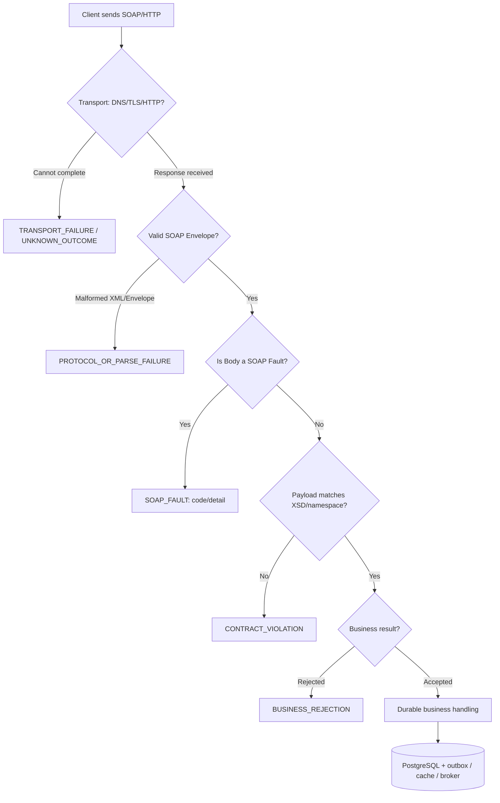
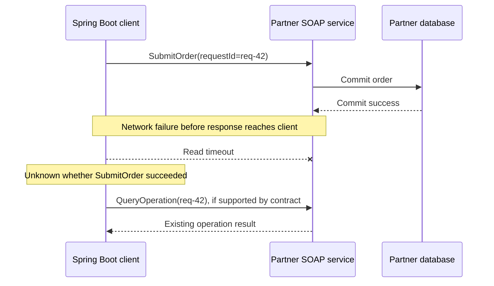
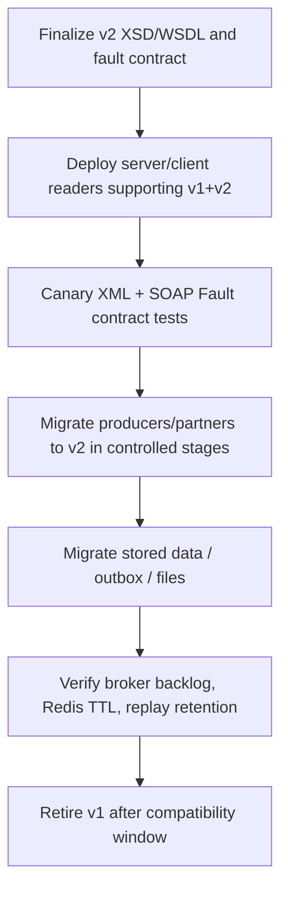
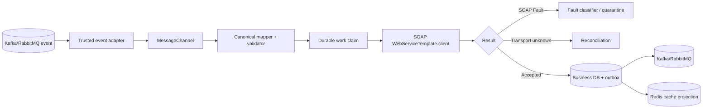

# Validating XML Structure and Distinguishing Transport Errors from Service Errors

In **SPRING_BOOT_INTEGRATION**, a Spring Boot application may call a SOAP service to create orders, reconcile payments, or sync shipping status, then write results to PostgreSQL, update Redis, and emit events to Kafka/RabbitMQ. An error at the SOAP step can originate from a **TLS connection**, an **HTTP proxy**, **XML failing XSD validation**, a **business SOAP Fault**, or **syntactically valid XML violating business rules**. Lumping all of these into "SOAP failed" and retrying can double-charge a payment or corrupt state by misreading responses.

This lesson belongs to the **SOAP and XML** chapter and focuses on two capabilities that must work together: **validating XML structure against contracts** and **distinguishing transport errors from service errors**. We will design clear boundaries across the SOAP Envelope, namespaces/XSD, XML parser security, business validation, HTTP/TLS, and SOAP Faults, then build Spring Web Services flows handling retries, idempotency, transactions, testing, and observability properly.

> Examples use Java 17+, Spring Boot 3.x, Spring Web Services 4.x, and Jakarta JAXB matching the application BOM. Service names, the namespace `urn:example:orders:v1`, endpoints, and payloads in this lesson are **fictional**. APIs and defaults across SOAP 1.1, SOAP 1.2, Spring-WS, and HTTP message senders are not identical; verify them with tests on your actual versions and SOAP bindings.

## 1. Learning Objectives

After this lesson, you will be able to:

1. Identify the exact role of **HTTP/TLS**, **SOAP Envelope**, **Body payload**, **XSD**, **SOAP Fault**, and **business validation** in a request/response.
2. Distinguish **well-formed**, **namespace-correct**, **schema-valid**, and **semantically valid** XML; never equate a successful parse with a valid business outcome.
3. Design XSDs with types, element ordering, cardinality, required values, and decimal constraints, while understanding XSD's limits for business rules.
4. Use Spring Web Services `@Endpoint`, `@PayloadRoot`, JAXB marshallers, and `PayloadValidatingInterceptor` to enforce XML contracts.
5. Separate **timeout/TLS/DNS/HTTP status** errors from **SOAP 1.1/1.2 Faults** and response parse/validation failures to choose the right retry policy.
6. Design SOAP Faults that leak no sensitive data, expose stable fault codes/details, and distinguish caller errors from system errors.
7. Harden XML parsers against **XXE/DTD/entity expansion** and verify SOAP security/signatures in the right order.
8. Write XSD unit tests, Spring-WS endpoint/client tests, and integration tests for transport, schema, fault, duplicate, and recovery scenarios.

## 2. Four Distinct Outcomes of a SOAP Call

Suppose the application sends `SubmitOrderRequest` to a partner:

| Outcome | Examples | Nature | Typically appropriate behavior |
| --- | --- | --- | --- |
| **Transport error** | DNS failure, connect timeout, TLS handshake fail, HTTP proxy returning HTML 502 | No valid SOAP response received from partner; **uncertain** whether remote side processed it on post-send timeouts | Bounded retry **only when safe**; query operation status when outcome is unknown. |
| **SOAP Fault** | SOAP Body contains `Fault` with Sender/Client or Receiver/Server code | Peer returned a SOAP Fault message; may be request, policy, auth, internal service, or workflow error | Classify fault code/subcode/detail per contract; do not rely solely on HTTP status. |
| **XML/schema failure** | Response contains `OrderState` in wrong namespace or `amount="abc"` violating XSD | Bytes/response arrived, but **violate structural contract** or fail deserialization | Alert on contract drift, quarantine/troubleshoot; blind retry is usually futile. |
| **Business rejection/success** | Schema-valid response with `status=REJECTED` or `status=ACCEPTED` | Service returned a **business outcome represented in the payload** | Apply domain logic and transactions; `REJECTED` is not a network failure. |

A single request may not fit cleanly into one naive bucket: for example, **HTTP 500 with a SOAP Fault** is a service error delivered as a SOAP Fault, not merely an HTTP transport failure. Conversely, **HTTP 200 with a SOAP Fault** can occur with non-standard integrations/bindings; verify payload and binding before calling it a success. **HTTP 200 + parseable XML** can still violate XSD, violate business invariants, or arrive in an unsupported message version.

### 2.1. Layered Processing Flow



**Crucial point:** XSD validation **does not replace** authentication/authorization, signature verification, schema version policy, or idempotency. A structurally valid XML document can still be an unauthorized business command.

## 3. SOAP Envelope, Body, Header, and Binding Versions

SOAP is an XML-based messaging protocol with an Envelope and Body; the Header can carry metadata like WS-Security, WS-Addressing, and correlation information.

SOAP 1.1 request example:

```http
POST /services/orders HTTP/1.1
Host: partner.example.org
Content-Type: text/xml; charset=utf-8
SOAPAction: "urn:example:orders:SubmitOrder"
```

```xml
<?xml version="1.0" encoding="UTF-8"?>
<soapenv:Envelope
    xmlns:soapenv="http://schemas.xmlsoap.org/soap/envelope/"
    xmlns:ord="urn:example:orders:v1">
  <soapenv:Header/>
  <soapenv:Body>
    <ord:SubmitOrderRequest>
      <ord:requestId>req-42</ord:requestId>
      <ord:orderId>ORD-42</ord:orderId>
      <ord:amount>125.00</ord:amount>
      <ord:currency>USD</ord:currency>
      <ord:occurredAt>2026-11-20T10:30:00Z</ord:occurredAt>
    </ord:SubmitOrderRequest>
  </soapenv:Body>
</soapenv:Envelope>
```

Response example:

```xml
<soapenv:Envelope
    xmlns:soapenv="http://schemas.xmlsoap.org/soap/envelope/"
    xmlns:ord="urn:example:orders:v1">
  <soapenv:Body>
    <ord:SubmitOrderResponse>
      <ord:requestId>req-42</ord:requestId>
      <ord:status>ACCEPTED</ord:status>
      <ord:operationId>op-729</ord:operationId>
    </ord:SubmitOrderResponse>
  </soapenv:Body>
</soapenv:Envelope>
```

### 3.1. SOAP 1.1 and SOAP 1.2 Do Not Share Namespaces

| Aspect | SOAP 1.1 | SOAP 1.2 |
| --- | --- | --- |
| Envelope namespace | `http://schemas.xmlsoap.org/soap/envelope/` | `http://www.w3.org/2003/05/soap-envelope` |
| Common HTTP media type | `text/xml`, may use HTTP `SOAPAction` | `application/soap+xml`, action may be in media type |
| Primary fault codes | `Client` / `Server` | `Sender` / `Receiver`, may include Subcode |
| Fault structure | `faultcode`, `faultstring`, `faultactor`, `detail` | `Code`, `Reason`, `Node`, `Role`, `Detail` |
| HTTP binding | SOAP 1.1 HTTP binding commonly uses HTTP 500 for Faults | SOAP 1.2 HTTP binding has distinct status rules, e.g., Sender/Receiver typically 400/500 depending on case |

Do not just swap namespace strings in an XSD payload and assume you switched SOAP 1.1 → 1.2: **message factory, Content-Type, Fault format, and WS-* interoperability** must also align. Partners may use HTTP status codes that deviate slightly from the standard; correct handling relies on **binding, response headers, SOAP envelope, and the application fault contract together**.

### 3.2. Namespace Prefixes Are Not Element Identities

These two tags share the exact same qualified name:

```xml
<o:orderId xmlns:o="urn:example:orders:v1">ORD-42</o:orderId>
```

```xml
<x:orderId xmlns:x="urn:example:orders:v1">ORD-42</x:orderId>
```

However, an unnamespaced `<orderId>` element **differs** from `{urn:example:orders:v1}orderId`. XSD/JAXB compare **namespace URI + local name**, never prefix strings.

### 3.3. SOAP Faults Belong to Body, Not Normal Business Responses

Receiving an XML body does not mean it is a `SubmitOrderResponse`. Clients must detect SOAP Faults before unmarshalling into a success DTO. A service may also return a "business rejection" via `SubmitOrderResponse.status=REJECTED` if that is a normal contract outcome; **do not automatically turn every non-ACCEPTED outcome into a Fault**.

## 4. Well-Formed, Schema-Valid, and Business-Valid Are Three Distinct Levels

| Verification level | What it checks | Examples |
| --- | --- | --- |
| **Well-formed XML** | Matching tags, valid quotes/encoding, single root, XML syntax | `<orderId>ORD-42</orderId>`. |
| **Namespace/Envelope valid** | Root is valid SOAP Envelope per version; Body payload matches QName | `{urn:example:orders:v1}SubmitOrderRequest`. |
| **XSD schema valid** | Element/attribute names, sequence, min/max occurrences, XML types, enumerations/facets | `amount` must be positive decimal, `currency` only USD/VND. |
| **Semantically valid** | Business rules XSD cannot fully verify | Currency-specific scale, tenant permissions, order not already paid, `occurredAt` must include timezone. |

XML can be **well-formed yet schema-invalid**:

```xml
<ord:SubmitOrderRequest xmlns:ord="urn:example:orders:v1">
  <ord:orderId>ORD-42</ord:orderId>
  <ord:requestId>req-42</ord:requestId>
  <ord:amount>ABC</ord:amount>
  <ord:currency>USD</ord:currency>
  <ord:occurredAt>2026-11-20T10:30:00Z</ord:occurredAt>
</ord:SubmitOrderRequest>
```

Even when every field is present, placing `orderId` before `requestId` fails when the XSD specifies `xsd:sequence` in the opposite order; `amount=ABC` cannot be an `xsd:decimal`. Never "fix" XML like this by disabling XSD validation globally and letting the service guess.

### 4.1. XSD Validation Does Not Inspect the Entire SOAP Message

In Spring-WS, `PayloadValidatingInterceptor` typically validates the **payload (the business content inside SOAP Body)** against the XSD, rather than verifying every SOAP Header/WS-Security token, signature, TLS certificate, or outer envelope. Envelope/message parsing happens at another framework layer; security/authentication rules and business invariants require separate configuration.

### 4.2. XSD 1.0 `dateTime` Can Omit Timezones

`xsd:dateTime` in XML Schema 1.0 allows values without a timezone. Therefore:

```xml
<ord:occurredAt>2026-11-20T10:30:00</ord:occurredAt>
```

can be valid **per the XSD datatype**, yet insufficient to determine a unique `Instant`. When a business contract needs exact event instants, **enforce timezone/offset validation in application code** or via specific schema rules. Never default to the JVM host timezone.

## 5. Writing XSD as an Explicit Structural Contract

Example `src/main/resources/xsd/orders-v1.xsd`:

```xml
<?xml version="1.0" encoding="UTF-8"?>
<xsd:schema
    xmlns:xsd="http://www.w3.org/2001/XMLSchema"
    xmlns:tns="urn:example:orders:v1"
    targetNamespace="urn:example:orders:v1"
    elementFormDefault="qualified">

  <xsd:simpleType name="IdType">
    <xsd:restriction base="xsd:string">
      <xsd:minLength value="1"/>
      <xsd:maxLength value="128"/>
      <xsd:pattern value="[A-Za-z0-9._-]+"/>
    </xsd:restriction>
  </xsd:simpleType>

  <xsd:simpleType name="CurrencyType">
    <xsd:restriction base="xsd:string">
      <xsd:enumeration value="USD"/>
      <xsd:enumeration value="VND"/>
    </xsd:restriction>
  </xsd:simpleType>

  <xsd:simpleType name="AmountType">
    <xsd:restriction base="xsd:decimal">
      <xsd:totalDigits value="18"/>
      <xsd:fractionDigits value="2"/>
      <xsd:minExclusive value="0"/>
    </xsd:restriction>
  </xsd:simpleType>

  <xsd:simpleType name="SubmitStatusType">
    <xsd:restriction base="xsd:string">
      <xsd:enumeration value="ACCEPTED"/>
      <xsd:enumeration value="REJECTED"/>
    </xsd:restriction>
  </xsd:simpleType>

  <xsd:element name="SubmitOrderRequest">
    <xsd:complexType>
      <xsd:sequence>
        <xsd:element name="requestId" type="tns:IdType"/>
        <xsd:element name="orderId" type="tns:IdType"/>
        <xsd:element name="amount" type="tns:AmountType"/>
        <xsd:element name="currency" type="tns:CurrencyType"/>
        <xsd:element name="occurredAt" type="xsd:dateTime"/>
      </xsd:sequence>
    </xsd:complexType>
  </xsd:element>

  <xsd:element name="SubmitOrderResponse">
    <xsd:complexType>
      <xsd:sequence>
        <xsd:element name="requestId" type="tns:IdType"/>
        <xsd:element name="status" type="tns:SubmitStatusType"/>
        <xsd:element name="operationId"
                     type="tns:IdType" minOccurs="0"/>
      </xsd:sequence>
    </xsd:complexType>
  </xsd:element>
</xsd:schema>
```

### 5.1. What the XSD Above Guarantees

- Root payload must be `{urn:example:orders:v1}SubmitOrderRequest` or `SubmitOrderResponse`.
- Child elements must have the right namespace, **exact `xsd:sequence` order**, and default occurrence bounds.
- `requestId` and `orderId` must match the published pattern and length bounds.
- `amount` is a positive decimal constrained by total digits and fraction digits.
- `currency` accepts only `USD` or `VND` per the illustrative enum, rejecting arbitrary codes.
- `status` can only be `ACCEPTED` or `REJECTED`.
- `operationId` may be omitted thanks to `minOccurs="0"`.

In this example, `IdType` restricts `xsd:string` rather than `xsd:token` to avoid **collapsing whitespace** during validation. With `xsd:token`, leading/trailing whitespace may be normalized before pattern checks; for **idempotency IDs** or order IDs where exact characters matter, choose an explicit policy and test `"req-42"` against `" req-42 "` instead of silently folding them into one key.

### 5.2. What the XSD Above Does **Not** Guarantee

1. **Currency-specific scales:** `125.50 VND` may violate money policy if VND requires zero decimal places; `fractionDigits=2` cannot couple currency and scale rules.
2. **Timezones:** `xsd:dateTime` can omit offsets; the service must enforce timezone presence before converting to `Instant`.
3. **Permissions:** a valid `orderId` pattern does not mean the caller may view or modify that order.
4. **Uniqueness:** `requestId` is not inherently unique across partners/tenants; enforce uniqueness at the source of truth.
5. **Business state:** `status=ACCEPTED` does not prove a payment has settled downstream.
6. **Cross-field invariants:** the schema allows `status=ACCEPTED` with no `operationId`; the service may need to reject that combination.
7. **Authenticity and origin:** valid XML can still be a spoofed message.

Do not force XSD to carry all domain validation. Use XSD for the **structural contract**, then normalize and enforce business invariants in the application service.

### 5.3. `include`, `import`, `schemaLocation`, and Versioning

When XSDs span multiple files, `xsd:include` combines schemas in the same namespace while `xsd:import` brings in schemas from other namespaces. `schemaLocation` attributes can point to local paths or network URLs. In production:

- Pin schema dependencies to **specific versions**.
- Prefer classpath/local resources and avoid uncontrolled external fetches during request handling.
- Allowlist only needed paths; configure `LSResourceResolver`/catalogs when schemas require valid imports.
- Never treat an incoming `xsi:schemaLocation` URL from a client as a schema location the server may fetch automatically.
- For breaking changes, introduce a new namespace/contract version or agreed discriminator rather than silently changing field meanings in an old XSD.

## 6. Dependencies and Spring Boot Configuration for SOAP/XML

With Maven:

```xml
<dependency>
    <groupId>org.springframework.boot</groupId>
    <artifactId>spring-boot-starter-web-services</artifactId>
</dependency>
<dependency>
    <groupId>org.springframework.boot</groupId>
    <artifactId>spring-boot-starter-validation</artifactId>
</dependency>
<dependency>
    <groupId>org.glassfish.jaxb</groupId>
    <artifactId>jaxb-runtime</artifactId>
</dependency>
<dependency>
    <groupId>org.springframework.boot</groupId>
    <artifactId>spring-boot-starter-test</artifactId>
    <scope>test</scope>
</dependency>
<dependency>
    <groupId>org.springframework.ws</groupId>
    <artifactId>spring-ws-test</artifactId>
    <scope>test</scope>
</dependency>
```

These illustrative dependencies rely on the Spring Boot BOM for version management. For SOAP 1.2/SAAJ and Java 17, verify the **SAAJ/Jakarta XML SOAP runtime** brought onto the classpath; never mix Java EE's `javax.xml.bind` with Spring Boot 3's `jakarta.xml.bind` without verifying binary compatibility.

If an application acts solely as a **SOAP client** and exposes no SOAP endpoint, it still needs SOAP client/JAXB/message factory libraries as applicable, **without registering a server servlet**. If it also uses Spring Integration, Kafka, or JDBC, add those starters/drivers per adapter; the SOAP starter does not configure Kafka listeners, SQL migrations, or cache policies.

### 6.1. Server SOAP Endpoint Path

Example Spring Boot configuration:

```yaml
spring:
  webservices:
    path: /ws
app:
  soap:
    contract-version: v1
```

`spring.webservices.path` is the property for servlet/web-services auto-configuration in supported Boot versions. `app.soap.contract-version` is **an application-defined property** and does not trigger schema routing automatically. When declaring `MessageDispatcherServlet` manually instead of using Boot auto-configuration, check for overlapping mappings; never register **two servlets competing** for the same URL.

### 6.2. Generating WSDL 1.1 from XSD with Spring-WS

`DefaultWsdl11Definition` can publish a WSDL generated from a schema and naming conventions:

```java
import org.springframework.context.annotation.Bean;
import org.springframework.context.annotation.Configuration;
import org.springframework.core.io.ClassPathResource;
import org.springframework.ws.wsdl.wsdl11.DefaultWsdl11Definition;
import org.springframework.xml.xsd.SimpleXsdSchema;
import org.springframework.xml.xsd.XsdSchema;

@Configuration(proxyBeanMethods = false)
public class OrdersContractConfiguration {
    public static final String NS = "urn:example:orders:v1";

    @Bean
    XsdSchema ordersSchema() {
        return new SimpleXsdSchema(
                new ClassPathResource("xsd/orders-v1.xsd"));
    }

    @Bean(name = "orders")
    DefaultWsdl11Definition ordersWsdl(XsdSchema ordersSchema) {
        var wsdl = new DefaultWsdl11Definition();
        wsdl.setPortTypeName("OrdersPort");
        wsdl.setLocationUri("/ws");
        wsdl.setTargetNamespace(NS);
        wsdl.setSchema(ordersSchema);
        return wsdl;
    }
}
```

With matching servlet configuration, the WSDL is typically exposed at `/ws/orders.wsdl`. Still, **never guess the final URL** when context paths, ingress rewrites, servlet mappings, or reverse proxies are involved; verify via HTTP from a realistic client environment. Partners requiring WS-Security/WS-Policy or complex WSDL/XSD layouts often need a separately managed static WSDL instead of convention-based generation.

## 7. Enabling Request/Response XSD Validation in Spring-WS

Spring-WS provides `PayloadValidatingInterceptor` to validate XML payloads against an XSD for matching `@Endpoint` handlers. An illustrative server configuration:

```java
import org.springframework.context.annotation.Bean;
import org.springframework.context.annotation.Configuration;
import org.springframework.xml.xsd.XsdSchema;
import org.springframework.ws.soap.server.endpoint.interceptor.PayloadValidatingInterceptor;

@Configuration(proxyBeanMethods = false)
public class OrdersValidationConfiguration {

    @Bean
    PayloadValidatingInterceptor ordersPayloadValidator(
            XsdSchema ordersSchema) {
        var validator = new PayloadValidatingInterceptor();
        validator.setXsdSchema(ordersSchema);
        validator.setValidateRequest(true);
        validator.setValidateResponse(true);
        return validator;
    }
}
```

Registering the interceptor:

```java
import java.util.List;
import org.springframework.context.annotation.Configuration;
import org.springframework.ws.config.annotation.EnableWs;
import org.springframework.ws.config.annotation.WsConfigurer;
import org.springframework.ws.server.EndpointInterceptor;
import org.springframework.ws.soap.server.endpoint.interceptor.PayloadValidatingInterceptor;

@Configuration(proxyBeanMethods = false)
@EnableWs
public class OrdersWsConfiguration implements WsConfigurer {
    private final PayloadValidatingInterceptor validator;

    public OrdersWsConfiguration(
            PayloadValidatingInterceptor validator) {
        this.validator = validator;
    }

    @Override
    public void addInterceptors(
            List<EndpointInterceptor> interceptors) {
        interceptors.add(validator);
    }
}
```

**Configuration limitation:** these snippets assume the application serves **one contract/schema `orders-v1.xsd`** on the handled endpoint path. When hosting multiple SOAP operations or v1/v2 namespaces, a global interceptor bound to a single XSD can reject payloads belonging to other operations. Use schema composition, routing, or per-endpoint interceptor mappings per contract. For **response** validation, enable it in tests and adopt a deliberate production strategy since a response validation failure is a **server bug producing invalid output**, not a caller mistake; error handling and logs must not leak raw responses.

### 7.1. Request Schema Failures Should Never Reach Business Services

```text
HTTP request -> MessageDispatcherServlet
     -> Parse SOAP Envelope
     -> Endpoint mapping by payload QName
     -> Request schema validation
          | fail -> SOAP Fault / safe error, NO business write
          v
     -> JAXB unmarshal / @Endpoint method
     -> Domain validation + authorization
     -> Transactional write / idempotency
     -> JAXB marshal response
     -> Response schema validation
     -> HTTP SOAP response
```

Do not use `try/catch` inside an endpoint method expecting to catch requests rejected by the interceptor **before the method is invoked**. When clients need field/line feedback, return a bounded **contract error code/fault detail**, never raw XML or internal XSD file paths in public SOAP Faults.

### 7.2. JAXB Mapping and Java 17

JAXB maps XML elements to Java classes per XSD. On Java 17, JAXB is no longer bundled in the JDK; use the matching Jakarta JAXB API/runtime. A robust approach is to **generate source types from XSD/WSDL** using a version-pinned XJC plugin into a dedicated package like `com.example.integration.soap.v1.generated`, without hand-editing generated classes.

```text
orders-v1.xsd / WSDL
    -> JAXB generated types (request/response, ObjectFactory)
    -> @Endpoint / WebServiceTemplate marshaller
    -> application DTO / business service
```

Generated JAXB bindings may represent root elements via `@XmlRootElement` on the class **or** via `JAXBElement<T>` created by `ObjectFactory`, depending on schema/binding structure. When adapting `@RequestPayload SubmitOrderRequest` examples, inspect the **actual types** generated by XJC; never force-cast `JAXBElement` or edit annotations arbitrarily without testing marshalling/unmarshalling.

### 7.3. JAXB Does Not Replace XSD Validation

An XML unmarshaller can accept malformed semantics or missing fields depending on annotations and configuration. `@XmlElement(required=true)` is binding metadata, **not a guarantee that the framework runs full XSD validation** on every deserialization. Test that your schema validator/interceptor actually runs, while keeping business validation in place for domain invariants.

## 8. Endpoints Isolate XML Boundaries from Business Logic

An `@Endpoint` should accept a JAXB request **already verified at the SOAP Envelope and request XSD layers** (when the interceptor is configured), enforce rules that XSD cannot express, and delegate to an **application service**. Never turn JAXB-generated classes into JPA entities or Kafka event DTOs.

Example endpoint, assuming JAXB codegen generated `SubmitOrderRequest`, `SubmitOrderResponse`, and `SubmitStatusType` from the XSD in section 5:

```java
import java.time.Instant;
import javax.xml.datatype.DatatypeConstants;
import org.springframework.stereotype.Component;
import org.springframework.ws.server.endpoint.annotation.Endpoint;
import org.springframework.ws.server.endpoint.annotation.PayloadRoot;
import org.springframework.ws.server.endpoint.annotation.RequestPayload;
import org.springframework.ws.server.endpoint.annotation.ResponsePayload;

@Endpoint
public class OrdersEndpoint {
    private static final String NS = "urn:example:orders:v1";

    private final SubmitOrderUseCase useCase;

    public OrdersEndpoint(SubmitOrderUseCase useCase) {
        this.useCase = useCase;
    }

    @PayloadRoot(namespace = NS, localPart = "SubmitOrderRequest")
    @ResponsePayload
    public SubmitOrderResponse submit(
            @RequestPayload SubmitOrderRequest request) {

        if (request.getOccurredAt() == null
                || request.getOccurredAt().getTimezone()
                    == DatatypeConstants.FIELD_UNDEFINED) {
            throw new OrderContractException(
                    "TIMEZONE_REQUIRED");
        }

        Instant occurredAt = request.getOccurredAt()
                .toGregorianCalendar()
                .toZonedDateTime()
                .toInstant();

        SubmissionOutcome outcome = useCase.submit(
                request.getRequestId(),
                request.getOrderId(),
                request.getAmount(),
                request.getCurrency(),
                occurredAt);

        SubmitOrderResponse response = new SubmitOrderResponse();
        response.setRequestId(request.getRequestId());
        response.setStatus(outcome.accepted()
                ? SubmitStatusType.ACCEPTED
                : SubmitStatusType.REJECTED);
        if (outcome.accepted()) {
            response.setOperationId(outcome.operationId());
        }
        return response;
    }
}
```

Application interface and outcome types:

```java
import java.math.BigDecimal;
import java.time.Instant;

public interface SubmitOrderUseCase {
    SubmissionOutcome submit(
            String requestId,
            String orderId,
            BigDecimal amount,
            String currency,
            Instant occurredAt);
}

public record SubmissionOutcome(
        boolean accepted,
        String operationId) {}

public class OrderContractException extends RuntimeException {
    public OrderContractException(String code) {
        super(code);
    }
}
```

Each top-level `public` type belongs in its own `.java` file. `SubmitOrderUseCase` must have an application-registered Spring service bean; this snippet omits database or partner HTTP implementations. When an XJC binding generates `JAXBElement<SubmitOrderRequest>` and `JAXBElement<SubmitOrderResponse>` instead of direct root classes, adjust the endpoint signature and `ObjectFactory` calls accordingly; **do not assume every XSD produces the exact same Java shape**.

### 8.1. Domain Validation Must Know Real State

In the application service, beyond XSD, check:

- Is the caller/partner authenticated and authorized to act on `orderId`?
- Has `requestId` already been seen in this source/tenant namespace? If duplicated, does the payload actually match the original?
- Are currency and fraction digits valid for this business operation?
- What state is the order currently in, and does the request violate state transitions?
- Must it call a partner HTTP service, write SQL, and emit events? Where do transactions and outbox belong?
- If the request matches a prior submission, should it return the **same idempotent result** or a conflict per contract?

When the business outcome is `REJECTED`, the endpoint can return a schema-valid `SubmitOrderResponse` with `status=REJECTED`. When the request violates the contract or the caller lacks permissions, return a SOAP Fault with a stable fault classification. Never set `accepted=true` merely because the XML passed XSD validation.

### 8.2. Validating Responses Also Tests the Server

When the service builds `SubmitOrderResponse`, response validation can catch server bugs (such as an invalid status enum or invalid characters in `operationId`). **That is a service defect**, not proof the caller sent bad input. Before production, test:

1. XSD-invalid requests never invoke the use case.
2. XSD-valid requests missing a timezone are rejected by domain validation.
3. Valid requests yield schema-valid `ACCEPTED`/`REJECTED` responses.
4. Response mapping on internal errors never leaks stack traces or SQL details.
5. Retrying a request with the same key creates no extra business side effects.

## 9. Designing Accurate and Safe SOAP Faults

A SOAP Fault is a **protocol message** representing an error while processing a SOAP request. Illustrative SOAP 1.1 Fault:

```xml
<soapenv:Envelope
    xmlns:soapenv="http://schemas.xmlsoap.org/soap/envelope/"
    xmlns:ord="urn:example:orders:v1">
  <soapenv:Body>
    <soapenv:Fault>
      <faultcode>soapenv:Client</faultcode>
      <faultstring>Order request violates contract</faultstring>
      <detail>
        <ord:OrderError>
          <ord:code>TIMEZONE_REQUIRED</ord:code>
          <ord:correlationId>trace-123</ord:correlationId>
        </ord:OrderError>
      </detail>
    </soapenv:Fault>
  </soapenv:Body>
</soapenv:Envelope>
```

Equivalent SOAP 1.2 example:

```xml
<env:Envelope
    xmlns:env="http://www.w3.org/2003/05/soap-envelope"
    xmlns:ord="urn:example:orders:v1">
  <env:Body>
    <env:Fault>
      <env:Code>
        <env:Value>env:Sender</env:Value>
      </env:Code>
      <env:Reason>
        <env:Text xml:lang="en">Invalid order request</env:Text>
      </env:Reason>
      <env:Detail>
        <ord:OrderError>
          <ord:code>TIMEZONE_REQUIRED</ord:code>
        </ord:OrderError>
      </env:Detail>
    </env:Fault>
  </env:Body>
</env:Envelope>
```

A fault may omit `Detail` or carry subcodes and business-specific details defined by WSDL/WS-Policy. **Never parse free-form fault strings to decide retries** when the partner exposes stable fault codes/details; fault strings target human readers and can change across locales or versions.

### 9.1. Mapping Errors to Faults by Root Cause

| Scenario | General fault code | Policy |
| --- | --- | --- |
| XML Body violates XSD/namespace | SOAP 1.1 Client / SOAP 1.2 Sender, per binding | Do not retry identical request; return safe validation code. |
| Unauthorized to run operation | Sender/Client or contract-specific fault | Do not retry without fixing credentials/authorization. |
| Same idempotency ID with different payload | Business conflict fault | Caller investigation required; never treat as valid replay. |
| Backend SQL unavailable or partner HTTP 503 | Receiver/Server if SOAP service reports processing failure | Client retries only per contract and idempotency. |
| Programming / response serialization bug | Receiver/Server with safe message | Alert server team; never leak exception traces. |
| Normal business rejection | May be `status=REJECTED`, **not necessarily a Fault** | Follow the signed WSDL/contract. |

### 9.2. `SoapFaultMappingExceptionResolver` on the Server

Spring-WS provides an exception resolver to convert endpoint Java exceptions into SOAP Faults. Example mapping a contract exception to a Client fault with a Server fault default:

```java
import java.util.Properties;
import org.springframework.context.annotation.Bean;
import org.springframework.context.annotation.Configuration;
import org.springframework.ws.soap.server.endpoint.SoapFaultDefinition;
import org.springframework.ws.soap.server.endpoint.SoapFaultMappingExceptionResolver;

@Configuration(proxyBeanMethods = false)
public class OrdersFaultConfiguration {

    @Bean
    SoapFaultMappingExceptionResolver ordersFaultResolver() {
        var resolver = new SoapFaultMappingExceptionResolver();
        Properties mappings = new Properties();
        mappings.setProperty(
                OrderContractException.class.getName(),
                "CLIENT,Invalid order contract");
        resolver.setExceptionMappings(mappings);

        var defaultFault = new SoapFaultDefinition();
        defaultFault.setFaultCode(SoapFaultDefinition.SERVER);
        defaultFault.setFaultStringOrReason(
                "Internal SOAP service error");
        resolver.setDefaultFault(defaultFault);
        resolver.setOrder(1);
        return resolver;
    }
}
```

Imports can be formatted cleanly in a real project; the definition reflects the Spring-WS 4.x API per compatible BOM. For SOAP 1.2, test fault code translation and binding rather than assuming SOAP 1.1's `CLIENT` literal maps to an arbitrary XML prefix. **Never let runtime exception messages automatically become `faultstring`** when they may contain raw SQL, credentials, XML payloads, or PII.

### 9.3. Request XSD Interceptors Follow a Different Fault Path

Errors rejected by `PayloadValidatingInterceptor` **before the endpoint** do not necessarily pass through the same exception resolver used for exceptions thrown inside endpoint methods. If you need uniform `OrderError` details, customize the interceptor's error handling or wire an ordered server SOAP error policy, and test it with real invalid requests.

Do not enable response validation assuming response schema errors will look like Client faults: **invalid responses produced by the service** are server errors. In production, response schema checking can carry measurable overhead; if disabled for performance, maintain **golden contract tests** and serialization error monitoring, and never remove business validation.

## 10. XML Parser Hardening: Preventing XXE, DTD, and External Resource Access

XSD validation **does not mean the parser is safe**. XML includes features such as DTDs and external entity resolution. If a parser is permitted by default to access the filesystem or network, an attacker-controlled message can trigger **XXE**, SSRF, or resource-exhaustion attacks.

### 10.1. Malicious XML That Must Never Be Resolved

Payload strictly for **negative security tests**—never allow this in production:

```xml
<?xml version="1.0"?>
<!DOCTYPE SubmitOrderRequest [
  <!ENTITY external SYSTEM "file:///private/should-not-read">
]>
<SubmitOrderRequest>&external;</SubmitOrderRequest>
```

A properly hardened XML parser must **never resolve entities from files or networks** and must block DTDs per security policy rather than hoping XSD validation eventually rejects the payload.

### 10.2. Hardening a StAX Parser Before Reading Input

```java
import java.io.Reader;
import javax.xml.stream.XMLInputFactory;
import javax.xml.stream.XMLStreamException;
import javax.xml.stream.XMLStreamReader;

public final class SecureStax {
    private SecureStax() {}

    public static XMLStreamReader open(Reader input)
            throws XMLStreamException {

        XMLInputFactory factory = XMLInputFactory.newFactory();
        factory.setProperty(XMLInputFactory.SUPPORT_DTD, false);
        factory.setProperty(
                XMLInputFactory.IS_SUPPORTING_EXTERNAL_ENTITIES, false);

        return factory.createXMLStreamReader(input);
    }
}
```

JAXP/StAX providers vary in which security properties they support; if a provider does not support a required setting, **fail closed** and use a verified parser/provider. Always bound **request bytes, XML depth/node counts, parse duration, decompressed size, and memory** at the HTTP/adapter layer; disabling DTDs alone does not stop every denial-of-service vector.

### 10.3. XSD `SchemaFactory` Restricting External Resource Imports

```java
import javax.xml.XMLConstants;
import javax.xml.validation.Schema;
import javax.xml.validation.SchemaFactory;
import javax.xml.transform.stream.StreamSource;
import java.io.InputStream;

public final class SecureSchemaLoader {
    private SecureSchemaLoader() {}

    public static Schema loadOrdersXsd(InputStream localSchema)
            throws org.xml.sax.SAXException {

        SchemaFactory factory = SchemaFactory.newInstance(
                XMLConstants.W3C_XML_SCHEMA_NS_URI);

        factory.setProperty(XMLConstants.ACCESS_EXTERNAL_DTD, "");
        factory.setProperty(XMLConstants.ACCESS_EXTERNAL_SCHEMA, "");

        return factory.newSchema(new StreamSource(localSchema));
    }
}
```

With `ACCESS_EXTERNAL_SCHEMA=""`, schema imports/includes over external URIs are blocked. When combining local XSDs, use a **trusted catalog/resource resolver** or package a schema bundle and test on the real provider; never open unrestricted `http` or `file` access just to "make XSD work." `Schema` is thread-safe per JAXP contract, whereas **`Validator` is mutable and not thread-safe**—create a new `Validator` per validation when using the API directly.

### 10.4. Example Validating with a Secure `StAXSource`

```java
import java.io.Reader;
import javax.xml.transform.stax.StAXSource;
import javax.xml.validation.Schema;
import javax.xml.validation.Validator;

public final class SecureXmlValidator {
    private final Schema schema;

    public SecureXmlValidator(Schema schema) {
        this.schema = schema;
    }

    public void validate(Reader xml) throws Exception {
        var streamReader = SecureStax.open(xml);
        try {
            Validator validator = schema.newValidator();
            validator.setProperty(
                    javax.xml.XMLConstants.ACCESS_EXTERNAL_DTD, "");
            validator.setProperty(
                    javax.xml.XMLConstants.ACCESS_EXTERNAL_SCHEMA, "");
            validator.validate(new StAXSource(streamReader));
        } finally {
            streamReader.close();
        }
    }
}
```

This is a **standalone XML payload validation helper**, not a replacement for Spring-WS's full message-level parsing. Passing an entire SOAP Envelope into a validator built from a **payload XSD** will reject the `Envelope` root; extract the Body payload after proper SOAP protocol processing and **verify security before trusting contents**. Test your exact XML provider, as implementations differ in `StAXSource`, JAXP properties, and secure processing support.

### 10.5. WS-Security Signatures and XML Canonicalization

When a sender signs a SOAP message:

```text
TLS / authenticated channel
    -> SOAP parse with secure parser
    -> WS-Security signature/token verification
    -> timestamp/replay/audience checks
    -> XSD validation / namespace routing
    -> canonical DTO + business validation
    -> durable commit/ack
```

The exact order depends on the WS-Security policy: some systems encrypt or sign specific parts of the SOAP Header/Body. Never alter whitespace, namespace prefixes, Unicode normalization, or signed bytes before the signature library performs canonicalization/verification per policy. **Passing XSD does not prove a message was signed or sent by an authorized party**, and TLS does not replace WS-Security when message-level security is required.

## 11. Building a SOAP Client with `WebServiceTemplate` and Validation

On the outbound side, Spring-WS `WebServiceTemplate` acts as a SOAP-specific client: creating SOAP messages, marshalling Java requests to XML, sending via a message sender, receiving responses, and resolving Faults/unmarshalling. Never call a SOAP URL with a generic HTTP JSON converter and assume you can handle Envelopes and Faults manually.

### 11.1. Explicit Marshaller and HTTP Transport Configuration

Example using the generated JAXB package `com.example.integration.soap.v1.generated`:

```java
import org.springframework.beans.factory.annotation.Value;
import org.springframework.context.annotation.Bean;
import org.springframework.context.annotation.Configuration;
import org.springframework.core.io.ClassPathResource;
import org.springframework.oxm.jaxb.Jaxb2Marshaller;
import org.springframework.ws.client.core.WebServiceTemplate;
import org.springframework.ws.transport.http.HttpUrlConnectionMessageSender;

@Configuration(proxyBeanMethods = false)
public class PartnerOrdersSoapClientConfiguration {

    @Bean
    Jaxb2Marshaller ordersJaxbMarshaller() {
        var marshaller = new Jaxb2Marshaller();
        marshaller.setContextPath(
                "com.example.integration.soap.v1.generated");
        marshaller.setSchema(
                new ClassPathResource("xsd/orders-v1.xsd"));
        return marshaller;
    }

    @Bean("partnerOrdersWebServiceTemplate")
    WebServiceTemplate partnerOrdersTemplate(
            Jaxb2Marshaller ordersJaxbMarshaller,
            @Value("${partner.orders.soap-uri}") String endpointUri) {

        var sender = new HttpUrlConnectionMessageSender();
        sender.setConnectionTimeout(2_000); // ms
        sender.setReadTimeout(5_000);       // ms

        var template = new WebServiceTemplate();
        template.setDefaultUri(endpointUri);
        template.setMarshaller(ordersJaxbMarshaller);
        template.setUnmarshaller(ordersJaxbMarshaller);
        template.setMessageSender(sender);
        return template;
    }
}
```

And example properties:

```yaml
partner:
  orders:
    soap-uri: ${PARTNER_ORDERS_SOAP_URI:https://partner.example.org/services/orders}
```

**API note:** `HttpUrlConnectionMessageSender` accepts timeouts in milliseconds in the Spring-WS 4.x line illustrated; when upgrading frameworks, verify the actual overloads and test against a slow endpoint. **Connect timeout** bounds opening the connection, while **read timeout** bounds waiting for socket data per transport semantics—it is **not** an overall deadline across the whole SOAP call and retries. For heavy workloads needing keep-alive, pooling, proxies, or TLS tuning, consider an Apache HttpClient-based sender matching your Spring-WS version.

`Jaxb2Marshaller.setSchema(...)` enforces schema validation during JAXB marshalling/unmarshalling as configured, but **does not automatically validate SOAP Headers, signatures, HTTP statuses, or business responses**. A partner with multiple XSD operations or versions requires schema composition or dedicated marshallers. Never treat JAXB validation as a substitute for server-side `PayloadValidatingInterceptor` on inbound traffic.

### 11.2. SOAP 1.1/1.2 Message Factory and Actions

`WebServiceTemplate` must construct SOAP messages matching the partner's binding. SOAP 1.1 commonly uses the `SOAPAction` HTTP header, whereas SOAP 1.2 passes action via media type; Spring-WS varies behavior by `SoapMessageFactory`. You can configure `SaajSoapMessageFactory` for SOAP 1.2 using `SoapVersion.SOAP_12` when supported by your app and SAAJ runtime, but **never switch to SOAP 1.2 merely because a backend returned HTTP 500**.

When an endpoint requires an action:

```java
import org.springframework.ws.soap.client.core.SoapActionCallback;

var callback = new SoapActionCallback(
        "urn:example:orders:SubmitOrder");
```

For WS-Addressing, security tokens, mTLS, or custom SOAP Headers, use dedicated message callbacks/interceptors, verifying signing order and transport settings; `SOAPAction` is **not** authentication or a namespace version.

### 11.3. Client Adapter Catching the Right Error Families

```java
import jakarta.xml.bind.JAXBElement;
import org.springframework.beans.factory.annotation.Qualifier;
import org.springframework.oxm.XmlMappingException;
import org.springframework.stereotype.Component;
import org.springframework.ws.client.WebServiceIOException;
import org.springframework.ws.client.WebServiceTransportException;
import org.springframework.ws.client.core.WebServiceTemplate;
import org.springframework.ws.soap.client.SoapFaultClientException;
import org.springframework.ws.soap.client.core.SoapActionCallback;

@Component
public class PartnerOrdersSoapClient {
    private final WebServiceTemplate template;

    public PartnerOrdersSoapClient(
            @Qualifier("partnerOrdersWebServiceTemplate")
            WebServiceTemplate template) {
        this.template = template;
    }

    public SubmitOrderResponse submit(SubmitOrderRequest request) {
        try {
            Object message = template.marshalSendAndReceive(
                    request,
                    new SoapActionCallback(
                            "urn:example:orders:SubmitOrder"));

            // Depending on JAXB bindings, this may return JAXBElement<T>.
            Object payload = message instanceof JAXBElement<?> element
                    ? element.getValue() : message;
            if (!(payload instanceof SubmitOrderResponse response)) {
                throw new PartnerResponseContractException(
                        "UNEXPECTED_SOAP_RESPONSE_TYPE");
            }
            return response;

        } catch (SoapFaultClientException fault) {
            throw new PartnerSoapFaultFailure(
                    "SOAP_FAULT_FROM_PARTNER", fault);

        } catch (WebServiceTransportException transport) {
            throw new PartnerTransportFailure(
                    "SOAP_HTTP_TRANSPORT_FAILURE", transport);

        } catch (WebServiceIOException transportIo) {
            throw new PartnerTransportFailure(
                    "SOAP_NETWORK_OR_IO_FAILURE", transportIo);

        } catch (XmlMappingException mapping) {
            throw new PartnerResponseContractException(
                    "SOAP_RESPONSE_MAPPING_FAILURE", mapping);
        }
    }

    public static final class PartnerSoapFaultFailure
            extends RuntimeException {
        public PartnerSoapFaultFailure(
                String code, Throwable cause) {
            super(code, cause);
        }
    }

    public static final class PartnerTransportFailure
            extends RuntimeException {
        public PartnerTransportFailure(
                String code, Throwable cause) {
            super(code, cause);
        }
    }

    public static final class PartnerResponseContractException
            extends RuntimeException {
        public PartnerResponseContractException(String code) {
            super(code);
        }

        public PartnerResponseContractException(
                String code, Throwable cause) {
            super(code, cause);
        }
    }
}
```

`SubmitOrderRequest`/`SubmitOrderResponse` are JAXB-generated from the XSD and require imports from the real package. **Do not retry directly inside these catch blocks**: the adapter only classifies, while the application service decides retries based on operation type, fault code, and idempotency state. If the client uses a custom `FaultMessageResolver`, the thrown exception may not be `SoapFaultClientException` as in the default; always test the real error path.

### 11.4. SOAP Faults Often Arrive with HTTP 500

This is a frequent implementation pitfall:

```text
HTTP/1.1 500 Internal Server Error
Content-Type: text/xml; charset=utf-8

<soap:Envelope ...>
  <soap:Body><soap:Fault>...</soap:Fault></soap:Body>
</soap:Envelope>
```

When HTTP status is 500 and the Body is a valid SOAP Fault per binding, a SOAP-aware client like `WebServiceTemplate` can route it through the **fault path** rather than raising only `WebServiceTransportException`. Never attach an HTTP interceptor that throws an exception for every status != 200 before the SOAP Fault resolver can inspect the body; at the same time, never disable transport error checks and accept proxy HTML 502 responses as SOAP successes.

## 12. Decision Table: Transport, Protocol, SOAP Fault, Contract, and Business Results

| External observation | What to check first | Appropriate classification | Retry? |
| --- | --- | --- | --- |
| DNS resolution fails | Host/service discovery, endpoint URI, DNS | `TRANSPORT_DNS` | Bounded if operation is safe; request likely never sent. |
| TLS handshake fails | Truststore, hostname/SNI, mTLS/cert chain | `TRANSPORT_TLS` | No hot-loop retry; fix trust/cert/secrets/config. |
| Connect timeout | Firewall, routing, pool, partner availability | `TRANSPORT_CONNECT_TIMEOUT` | Bounded retry if operation/key is safe. |
| Read timeout after sending request | Partner may have **committed** and response never arrived | `UNKNOWN_OUTCOME` | **No blind retry** of non-idempotent POSTs. |
| HTTP 401/403 without SOAP body | Auth gateway/proxy, token expiry, policy | `TRANSPORT_AUTHORIZATION` | Fix credentials/permissions; no infinite retries. |
| HTTP 429/503 + `Retry-After`, no SOAP | Rate limit or temporary unavailability | `TRANSPORT_TRANSIENT` | Bounded backoff per partner contract. |
| HTTP 500 + SOAP 1.1 `Server` Fault | Actual fault body/code/detail | `SOAP_RECEIVER_FAULT` | Depends on fault semantics and idempotency. |
| HTTP 400 + SOAP 1.2 `Sender` Fault | Sender fault detail and request schema | `SOAP_SENDER_FAULT` | Usually do not retry identical payload. |
| HTTP 200 + SOAP Fault | Binding/proxy interoperability and SOAP body | `SOAP_FAULT` (after checking binding) | Decide by fault code, not status 200. |
| HTTP 200 + non-well-formed XML | Truncated response, XML parser, charset | `PROTOCOL_PARSE_FAILURE` | Investigate; POST outcome may be UNKNOWN. |
| HTTP 200 + valid XML violating XSD | Namespace/version, schema drift, serializer | `CONTRACT_VIOLATION` | Usually do not retry same payload. |
| HTTP 200 + response `status=REJECTED` | Business status/operation semantics | `BUSINESS_REJECTION` | Not a transient fault. |
| HTTP 200 + accepted response and business operation ID | Response XSD/domain validation, correlation | `SUCCESS` | Commit local business effects in proper transaction. |

**Never assume "SOAP Faults are always retryable on HTTP 500."** A `Server` Fault may indicate a temporary backend issue, or it may indicate a deterministic configuration bug, unsupported schema version, or policy change. Ideally, partners publish a **stable fault code/detail taxonomy** such as `RATE_LIMIT`, `CONTRACT_VERSION_UNSUPPORTED`, `ORDER_ALREADY_EXISTS`, `INTERNAL_TEMPORARY_FAILURE` with explicit retry guidance.

### 12.1. SOAP 1.1 Fault Codes and SOAP 1.2 Subcodes

SOAP 1.1 `Client`/`Server` is a **very coarse** classification. SOAP 1.2 `Sender`/`Receiver` and `Subcode` enable finer classification, though providers may define custom namespaces. Never hardcode string matching against `"timeout"` or `"Internal Error"` when codes/details are published.

Build a **fault classifier** at the adapter layer:

```text
SOAP fault
  -> identify SOAP version
  -> parse Fault Code (QName) / Subcode(s)
  -> parse allowlisted business error code from Detail
  -> map to domain error category
  -> preserve safe correlation ID and retry hint
  -> do NOT expose raw partner detail to untrusted HTTP callers
```

Spring-WS `SoapFaultClientException` provides APIs such as `getFaultCode()` and `getFaultStringOrReason()` to aid logging and classification. To read structured `detail`, use the SOAP model and known schema with namespace validation and payload limits; never parse arbitrary text via substring matching.

### 12.2. Exceptions Are Thrown at Different Stages

```text
WebServiceTemplate.marshalSendAndReceive(...)
  | outbound JAXB marshal failure
  | HTTP/TLS/network failure
  | HTTP response status/content-type/protocol mismatch
  | SOAP Envelope parsing
  | SOAP Fault recognition + fault resolver
  | inbound JAXB unmarshal + schema validation
  | application response validation
```

Therefore **catch ordering and exception types** in the client adapter must match the real message sender, JAXB binding, and custom fault resolver. A response XSD error may surface as `XmlMappingException`/unmarshal failure in one configuration, or as a validation interceptor exception in another. Write integration tests for the real execution path rather than guessing which Java exception will be thrown.

## 13. Retrying SOAP Calls Without Duplicating Transactions

A SOAP **read** request is far safer to retry than an **order creation or payment capture** request. With SOAP POST, the HTTP method is POST even for read-only business operations; hence **never infer idempotency from the HTTP method**. Inspect the operation's WSDL/contract and determine its real side effects.

### 13.1. Four Failure Points



| Where error occurred | Can side effects be known for sure? | Strategy |
| --- | --- | --- |
| DNS fails before opening connection | Usually request not sent to host | Bounded retry after checking config. |
| TLS handshake fails before SOAP body | Usually SOAP request not sent | Fix trust/credentials; do not loop infinitely. |
| Read timeout after body sent | **No**; partner may have committed | Query operation by stable ID, or retry under provider idempotency contract. |
| SOAP Fault `ORDER_ALREADY_EXISTS` | Prior operation may already exist | Check requestId/payload and real state; do not blindly assume fail or success. |

### 13.2. `requestId` Must Stay Stable Across Retries

Example idempotency key used in the XSD:

```text
sourceSystem = partner-A
requestId = req-42
businessOrderId = ORD-42
operationType = SUBMIT_ORDER

stable key = (sourceSystem, operationType, requestId)
```

The SOAP provider **must implement matching semantics**: same `requestId` with same payload returns the same result or a reconcilable duplicate error; same `requestId` with a different payload returns a conflict. Merely sending a `requestId` when the partner does not deduplicate on it **does not make the operation idempotent**.

On the Spring Boot client, you can persist a workflow table:

```sql
CREATE TABLE soap_operation (
    partner_id VARCHAR(64) NOT NULL,
    request_id VARCHAR(128) NOT NULL,
    order_id VARCHAR(128) NOT NULL,
    payload_hash CHAR(64) NOT NULL,
    state VARCHAR(24) NOT NULL,
    partner_operation_id VARCHAR(128),
    updated_at TIMESTAMPTZ NOT NULL,
    PRIMARY KEY (partner_id, request_id)
);
```

`state` can hold `PENDING`, `ACCEPTED`, `REJECTED`, or `UNKNOWN` per contract with clear business transitions. A post-send HTTP timeout must **record or keep `UNKNOWN`** and reconcile, never mark it failed and mint a new `requestId`.

### 13.3. Transaction Boundaries When Combining SOAP with Databases and Brokers

```text
Begin business operation / durable claim
  -> store stable request ID and payload hash
Commit local DB transaction

Call partner SOAP (outside long DB transaction)
  -> validate SOAP response/Fault/unknown outcome

Open SHORT business transaction
  -> transition local operation state conditionally
  -> update local projection / inbox
  -> append outbox event
Commit

Outbox publisher sends Kafka/RabbitMQ message separately
```

Never hold a PostgreSQL transaction open for 30 seconds waiting on a SOAP server. Local DB commits and remote SOAP commits are **not atomic**; if the partner committed and the local DB update fails, use **reconciliation by request ID**, not a new SOAP POST with a fresh ID.

If the SOAP response only returns `ACCEPTED` (asynchronously accepted), that **does not prove the order completed**. Track partner operation status/callbacks, then update the state machine and outbox via durable transitions.

### 13.4. Do Not Auto-Retry Every `SoapFaultClientException`

Sensible retries combine:

- **Operation kind:** read-only, idempotent write, non-idempotent payment.
- **Error origin:** transport before-send vs. after-send/unknown; SOAP Sender/Receiver subcode; XSD invalid.
- **Limits:** maximum attempts, exponential backoff/jitter, deadline, and rate limit.
- **Identity:** reuse `requestId` and payload hash; never bump business sequences arbitrarily.
- **Side effects:** inspect local inbox/outbox, payment status, partner operation lookup.
- **Operational controls:** circuit breakers/bulkheads when partners go down; quarantine for contract mismatches.

**Invalid XSD and SOAP Client/Sender Faults will not become valid after 10 retries.** Conversely, a SOAP Receiver Fault may still require manual reconciliation if the operation has side effects and an uncertain outcome.

## 14. WSDL/XSD Changes: Structural and Semantic Compatibility

A SOAP partner may publish a new XSD/WSDL while older messages are still sitting in queues, file archives, outboxes, or Redis caches. A new consumer must understand not only the current XSD, but also **which versions can be replayed**.

### 14.1. Contract Change Matrix

| Change | Impact on older client/server | Upgrade approach |
| --- | --- | --- |
| Adding an element with `minOccurs="0"` | May be compatible with readers ignoring unknown elements; strict v1 schemas may **reject** | Test both directions with real XML/XSD tests; never assume additive = compatible. |
| Adding a required element | Old sender omits it; new XSD rejects | Consumer-server temporarily accepts v1/v2 or versioned endpoint; backfill/default explicitly. |
| Changing namespace URI | **Different QName**, not just a string tweak | Register a separate v2 endpoint/schema or explicit contract routing. |
| Reordering elements in `xsd:sequence` | Old XSD rejects even with identical fields | Update bindings/migrations and golden ordering fixtures. |
| Changing `decimal` → `string` | Java/XSD generated types and validation behavior change | Review business semantics; use separate version/mapper. |
| Changing money major → minor units | Breaking semantic change even when type stays number/string | Version XSD/contract to v2 with explicit units; convert per currency policy. |
| Changing `xsd:dateTime` to epoch millis | Breaks both syntax and semantics | Separate versions; test timezone/epoch units. |
| Adding WS-Addressing / WS-Security headers | New headers/interceptors, signatures/IDs | Update message factory, callbacks, policies, credentials, and test end-to-end. |
| Changing Fault codes/details | Client classifier may mis-retry or return wrong API errors | Write contract tests for **errors**, not just success responses. |

**Do not** treat XML namespace versions as application release versions: schema v1 may span many Java releases and data migrations. WSDL filenames, QNames, SOAPActions, JAXB packages, fault schemas, and XSD imports all form a managed compatibility surface.

### 14.2. Two Ways to Coexist Across v1 and v2

**Approach A — separate endpoints/versions:**

```text
/ws/orders/v1  -> urn:example:orders:v1 -> generated JAXB package v1
/ws/orders/v2  -> urn:example:orders:v2 -> generated JAXB package v2
```

Pros: clean boundaries, independent XSD/validation. Cons: more message dispatchers/mappings or servlet paths to manage; changing a URL path does not create endpoint routing automatically.

**Approach B — single endpoint path, routed by payload QName:**

```text
/ws/orders
  -> {urn:example:orders:v1}SubmitOrderRequest -> v1 handler/adapter
  -> {urn:example:orders:v2}SubmitOrderRequest -> v2 handler/adapter
```

Pros: keeps one URL; Spring-WS `@PayloadRoot` distinguishes QNames. Cons: validation interceptors and marshallers must **select the matching schema**; a v1-only validator will reject all v2 requests before the endpoint runs. Never bypass validation based on raw `SOAPAction` or unauthenticated custom headers.

### 14.3. Expand → Migrate → Contract Workflow



During rolling deployments, older pods may only understand v1 QNames. If ingress routes a v2 request to an old pod, even a small error rate causes incidents. Use **version-aware routing** at the gateway or roll out v2 readers across all pods before enabling v2 producers. Rollbacks must also account for v2 records already written that v1 cannot read; merely redeploying an old binary is not automatically safe.

### 14.4. XSD Is Not the Whole Contract

Every SOAP operation should document:

- HTTP method/path, SOAP version, action, WSDL port/binding.
- Authentication, TLS/mTLS, WS-Security signatures/encryption, and replay windows.
- Input/output payload QNames and XSD versions.
- Optional/required fields, null/nil, Unicode, decimal scale, timezone.
- Business statuses, SOAP Fault codes/details, and retry semantics.
- Idempotency key/scope, duplicate behavior, and operation status lookup.
- Latency/deadlines, response size, and streaming/attachment policies.
- Retention, compatibility, rollback plans, and consumer inventory.

An internal schema registry or WSDL URL helps track structure, but **cannot tell you** that an HTTP timeout might mean the operation committed, or that `amount=12500` is in minor units.

## 15. Integrating SOAP with Spring Integration and Brokers

Spring Integration can coordinate SOAP adapters alongside HTTP, databases, Redis, or message brokers. Good architecture separates the **SOAP transport adapter** from **canonical business commands** so business services stay decoupled from JAXB/XSD:



### 15.1. Transformers Only Translate Contracts; Services Own Side Effects

A translator layer should take a validated SOAP response and produce an **application DTO**:

```java
import java.time.Instant;

public record OrderSubmissionResult(
        String requestId,
        String orderId,
        String operationId,
        SubmissionState state,
        Instant acknowledgedAt
) {}

public enum SubmissionState {
    ACCEPTED,
    REJECTED,
    UNKNOWN
}
```

Never treat `UNKNOWN` like `ACCEPTED` and emit an order-paid event. `OrderSubmissionResult` may have `operationId=null` on `REJECTED` or `UNKNOWN`, so document and validate invariants when constructing the DTO. `acknowledgedAt` is when the adapter received the SOAP response, not the partner's settlement timestamp.

In Spring Integration, `@Transformer` or `IntegrationFlow.transform(...)` can convert SOAP response DTOs to `OrderSubmissionResult`. Calling `WebServiceTemplate` to produce side effects belongs in a **service activator/application service with explicit retry/transaction policies**, never mixed into a pure normalizer function and never publishing Kafka events directly before SQL commits.

### 15.2. Sync vs. Async Channels Change Error Boundaries

| Flow type | Where are SOAP errors seen? | Risks |
| --- | --- | --- |
| Synchronous `DirectChannel` | Exceptions propagate back to the caller/adapter on the same thread | If the HTTP request times out, the client may resend; idempotency is required. |
| `ExecutorChannel` | Exceptions route to `errorChannel`/error flow; caller already returned | Without a durable handoff, in-flight work is lost on process crash. |
| Poller/`QueueChannel` | Errors in poller/handler; metadata store/transactions depend on config | In-memory queues and error channels are not durable by default. |
| Kafka/RabbitMQ inbound | Error listener/container; offset/ack in broker adapter | Acking early before DB/partner outcomes can lose events. |

**A `Message<?>` crossing a channel is not durable by default.** If a webhook/REST endpoint returns 200 before asynchronous SOAP execution, persist a durable work table row, broker confirm, or outbox record before acknowledging per SLA.

### 15.3. Routing a SOAP Fault to `errorChannel` Does Not Mean It Is Handled

If a handler catches `SoapFaultClientException` and sends an `ErrorMessage` to `errorChannel`:

1. Check whether `errorChannel` is synchronous or asynchronous and whether it has persistent storage.
2. Classify faults as permanent/transient/unknown; never resend the same `requestId` infinitely.
3. To preserve failed work, write a durable quarantine/retry record carrying the **original event/operation ID**.
4. Only acknowledge Kafka/RabbitMQ per policy after work is committed or durably stored on the error path.
5. For schema-invalid responses, keep a secure payload reference/checksum; never log raw SOAP headers with credentials.

### 15.4. Do Not Use Redis Cache to Prove a SOAP Operation Completed

Redis can store `order-status:v2:...` projections for fast reads, but keys have TTLs and evictions. Duplicate Kafka events cannot be deduplicated durably in all cases using only `Redis SETNX processed=true`, because Redis keys can expire and are not atomic with PostgreSQL or the partner. Use **database unique business keys/inbox/outbox**, state machines, and partner idempotency/reconciliation. Redis fits caching or rate limiting with its own semantics.

## 16. Testing XSD Parsers and XML Security Before Starting the Spring Context

Start by testing schema validity at the Java/JAXP layer—independently of HTTP, Spring-WS, and JAXB. Golden fixtures should include **valid payloads, wrong namespaces, wrong element order, missing elements, non-decimal amounts, and timestamps missing offsets**.

### 16.1. Testing Valid XSD and Structural Failures

```java
import static org.junit.jupiter.api.Assertions.*;
import java.io.StringReader;
import javax.xml.validation.Schema;
import org.junit.jupiter.api.Test;

class OrdersXsdValidationTest {
    private static final String VALID = """
            <o:SubmitOrderRequest xmlns:o="urn:example:orders:v1">
              <o:requestId>req-42</o:requestId>
              <o:orderId>ORD-42</o:orderId>
              <o:amount>125.00</o:amount>
              <o:currency>USD</o:currency>
              <o:occurredAt>2026-11-20T10:30:00Z</o:occurredAt>
            </o:SubmitOrderRequest>
            """;

    private Schema loadSchema() throws Exception {
        try (var in = getClass()
                .getClassLoader()
                .getResourceAsStream("xsd/orders-v1.xsd")) {
            assertNotNull(in, "XSD should be on classpath");
            return SecureSchemaLoader.loadOrdersXsd(in);
        }
    }

    @Test
    void acceptsValidPayload() throws Exception {
        var validator = new SecureXmlValidator(loadSchema());
        assertDoesNotThrow(
                () -> validator.validate(new StringReader(VALID)));
    }

    @Test
    void rejectsWrongNamespace() throws Exception {
        String bad = VALID.replace(
                "urn:example:orders:v1", "urn:example:orders:v2");
        var validator = new SecureXmlValidator(loadSchema());
        assertThrows(Exception.class,
                () -> validator.validate(new StringReader(bad)));
    }

    @Test
    void rejectsNonDecimalAmount() throws Exception {
        String bad = VALID.replace(
                "<o:amount>125.00</o:amount>",
                "<o:amount>not-a-decimal</o:amount>");
        var validator = new SecureXmlValidator(loadSchema());
        assertThrows(Exception.class,
                () -> validator.validate(new StringReader(bad)));
    }

    @Test
    void rejectsWrongSequence() throws Exception {
        String bad = """
                <o:SubmitOrderRequest xmlns:o="urn:example:orders:v1">
                  <o:orderId>ORD-42</o:orderId>
                  <o:requestId>req-42</o:requestId>
                  <o:amount>125.00</o:amount>
                  <o:currency>USD</o:currency>
                  <o:occurredAt>2026-11-20T10:30:00Z</o:occurredAt>
                </o:SubmitOrderRequest>
                """;
        var validator = new SecureXmlValidator(loadSchema());
        assertThrows(Exception.class,
                () -> validator.validate(new StringReader(bad)));
    }
}
```

The swapped-order test proves `xsd:sequence` checks not just field names and types, but **element position**. If an XSD uses `xsd:all` or `xsd:choice`, ordering/grouping semantics differ; test against **your real schema** rather than hardcoding assumptions for all XSDs.

### 16.2. XSD Unit Tests Differ from Security Tests

To test XXE/DTD defenses, construct a payload with a `DOCTYPE`/entity URL **pointing to neither a real file nor a real service**, and verify the secure parser **performs no network or file access** per policy rather than only asserting an exception:

```xml
<?xml version="1.0"?>
<!DOCTYPE SubmitOrderRequest [
  <!ENTITY xxe SYSTEM "http://127.0.0.1:9/not-allowed">
]>
<SubmitOrderRequest>&xxe;</SubmitOrderRequest>
```

Run tests on the same XML parser provider and JDK runtime as production, failing closed if security properties are unsupported. Cap XML size/depth/node counts and use fuzz/negative fixtures for entity expansion, malformed encodings, and unusual namespaces; a valid XSD does not replace parser hardening.

### 16.3. Testing Timezones at the Business Layer

An XSD-only check may **accept**:

```xml
<o:occurredAt xmlns:o="urn:example:orders:v1">
  2026-11-20T10:30:00
</o:occurredAt>
```

This snippet illustrates **field content only**, not a complete valid root request per `orders-v1.xsd`. In real tests, place this timestamp inside a structurally valid `SubmitOrderRequest` and assert that the **application service/endpoint** returns the `TIMEZONE_REQUIRED` fault instead of converting to `Instant` using the JVM's default timezone.

## 17. Testing Spring-WS Server and Client Instead of Only DTOs

JAXP unit tests in section 16 prove schema validity. They **do not** prove the Spring-WS servlet receives the SOAP Envelope properly, maps endpoints by QName, runs interceptors, maps JAXB types, generates Faults, or returns HTTP statuses per binding. Test at each layer.

### 17.1. Testing Server Endpoints with `MockWebServiceClient`

Spring Web Services Test provides `MockWebServiceClient` to dispatch payloads to endpoints in the Spring context without opening an external HTTP listener.

```java
import static org.springframework.ws.test.server.RequestCreators.withPayload;
import static org.springframework.ws.test.server.ResponseMatchers.noFault;
import static org.springframework.ws.test.server.ResponseMatchers.clientOrSenderFault;

import org.junit.jupiter.api.Test;
import org.springframework.beans.factory.annotation.Autowired;
import org.springframework.boot.test.context.SpringBootTest;
import org.springframework.context.ApplicationContext;
import org.springframework.xml.transform.StringSource;
import org.springframework.ws.test.server.MockWebServiceClient;

@SpringBootTest
class OrdersEndpointIT {
    @Autowired ApplicationContext applicationContext;

    @Test
    void xsdInvalidRequestProducesClientFault() {
        String wrong = """
                <o:SubmitOrderRequest xmlns:o="urn:example:orders:v1">
                  <o:requestId>req-42</o:requestId>
                  <o:orderId>ORD-42</o:orderId>
                  <o:amount>ABC</o:amount>
                  <o:currency>USD</o:currency>
                  <o:occurredAt>2026-11-20T10:30:00Z</o:occurredAt>
                </o:SubmitOrderRequest>
                """;

        MockWebServiceClient client =
                MockWebServiceClient.createClient(applicationContext);
        client.sendRequest(withPayload(new StringSource(wrong)))
                .andExpect(clientOrSenderFault());
    }

    @Test
    void validRequestProducesNonFaultResponse() {
        String valid = """
                <o:SubmitOrderRequest xmlns:o="urn:example:orders:v1">
                  <o:requestId>req-42</o:requestId>
                  <o:orderId>ORD-42</o:orderId>
                  <o:amount>125.00</o:amount>
                  <o:currency>USD</o:currency>
                  <o:occurredAt>2026-11-20T10:30:00Z</o:occurredAt>
                </o:SubmitOrderRequest>
                """;

        MockWebServiceClient client =
                MockWebServiceClient.createClient(applicationContext);
        client.sendRequest(withPayload(new StringSource(valid)))
                .andExpect(noFault());
    }
}
```

**Test prerequisites:** the application context must contain `OrdersWsConfiguration`, `OrdersValidationConfiguration`, the XSD resource, the endpoint, JAXB-generated types, and a **`SubmitOrderUseCase` bean**. For the valid case, wire a fake service returning `SubmissionOutcome(ACCEPTED, "op-729")` and assert that the service receives the normalized values; for the invalid case, assert that **the service was never invoked**. If a test context uses the real production service, it might accidentally write to a DB or call a partner, so isolate with `@TestConfiguration`/mocks/fakes appropriately.

`MockWebServiceClient` tests endpoint dispatch, interceptors, and responses, **not real HTTP statuses, TLS, or proxies**. Separate HTTP tests are covered next.

### 17.2. Testing `WebServiceTemplate` with `MockWebServiceServer`

Spring Web Services Test provides `MockWebServiceServer` for the SOAP **client**, verifying request serialization and how the client handles SOAP Faults:

```java
import static org.junit.jupiter.api.Assertions.*;
import static org.springframework.ws.test.client.RequestMatchers.payload;
import static org.springframework.ws.test.client.ResponseCreators.withPayload;
import static org.springframework.ws.test.client.ResponseCreators.withServerOrReceiverFault;

import java.math.BigDecimal;
import java.util.Locale;
import javax.xml.datatype.DatatypeFactory;
import org.junit.jupiter.api.Test;
import org.junit.jupiter.api.extension.ExtendWith;
import org.springframework.beans.factory.annotation.Autowired;
import org.springframework.beans.factory.annotation.Qualifier;
import org.springframework.test.context.ContextConfiguration;
import org.springframework.test.context.TestPropertySource;
import org.springframework.test.context.junit.jupiter.SpringExtension;
import org.springframework.xml.transform.StringSource;
import org.springframework.ws.client.core.WebServiceTemplate;
import org.springframework.ws.soap.client.SoapFaultClientException;
import org.springframework.ws.test.client.MockWebServiceServer;

@ExtendWith(SpringExtension.class)
@ContextConfiguration(classes = PartnerOrdersSoapClientConfiguration.class)
@TestPropertySource(properties =
        "partner.orders.soap-uri=http://localhost/unused-test-url")
class OrdersSoapClientTest {
    @Autowired
    @Qualifier("partnerOrdersWebServiceTemplate")
    WebServiceTemplate template;

    private SubmitOrderRequest validRequest() throws Exception {
        SubmitOrderRequest req = new SubmitOrderRequest();
        req.setRequestId("req-42");
        req.setOrderId("ORD-42");
        req.setAmount(new BigDecimal("125.00"));
        req.setCurrency("USD");
        req.setOccurredAt(DatatypeFactory.newInstance()
                .newXMLGregorianCalendar("2026-11-20T10:30:00Z"));
        return req;
    }

    @Test
    void readsValidBusinessResponse() throws Exception {
        var server = MockWebServiceServer.createServer(template);
        String request = """
                <o:SubmitOrderRequest xmlns:o="urn:example:orders:v1">
                  <o:requestId>req-42</o:requestId>
                  <o:orderId>ORD-42</o:orderId>
                  <o:amount>125.00</o:amount>
                  <o:currency>USD</o:currency>
                  <o:occurredAt>2026-11-20T10:30:00Z</o:occurredAt>
                </o:SubmitOrderRequest>
                """;
        String response = """
                <o:SubmitOrderResponse xmlns:o="urn:example:orders:v1">
                  <o:requestId>req-42</o:requestId>
                  <o:status>ACCEPTED</o:status>
                  <o:operationId>op-729</o:operationId>
                </o:SubmitOrderResponse>
                """;

        server.expect(payload(new StringSource(request)))
                .andRespond(withPayload(new StringSource(response)));

        Object reply = template.marshalSendAndReceive(validRequest());
        assertNotNull(reply);
        server.verify();
    }

    @Test
    void serverFaultIsNotTreatedAsSuccessfulResponse()
            throws Exception {
        var server = MockWebServiceServer.createServer(template);
        server.expect(payload(new StringSource("""
                    <o:SubmitOrderRequest
                        xmlns:o="urn:example:orders:v1">
                      <o:requestId>req-42</o:requestId>
                      <o:orderId>ORD-42</o:orderId>
                      <o:amount>125.00</o:amount>
                      <o:currency>USD</o:currency>
                      <o:occurredAt>2026-11-20T10:30:00Z</o:occurredAt>
                    </o:SubmitOrderRequest>
                    """)))
                .andRespond(withServerOrReceiverFault(
                        "Partner internal error", Locale.ENGLISH));

        assertThrows(SoapFaultClientException.class,
                () -> template.marshalSendAndReceive(validRequest()));
        server.verify();
    }
}
```

This test uses Spring TestContext to load `PartnerOrdersSoapClientConfiguration` with the lesson's JAXB/SOAP settings; `MockWebServiceServer` replaces the transport sender with a mock so `localhost/unused-test-url` **makes no network call**. Beyond `assertNotNull`, verify `requestId`, `operationId`, `status`, and the JAXB root type; if XJC generated `JAXBElement`, unmarshalling must handle the element wrapper properly.

**Main bug this test catches:** a SOAP Fault is a *separate path*; a server returning a business/technical fault must never silently turn into a valid `SubmitOrderResponse`. Conversely, client transport faults over sockets/TLS still require testing outside `MockWebServiceServer`.

### 17.3. Testing Server Response Validation and Fault Mapping

A test suite should include:

| Request/response | Expectation |
| --- | --- |
| Well-formed XML + valid XSD | Endpoint invoked; non-Fault response; valid domain state. |
| Wrong root QName/namespace | Business endpoint not invoked; classified as contract/endpoint mapping error. |
| Wrong `xsd:sequence` | Rejected by validator; no database write. |
| `amount=ABC` or `currency=EUR` outside allowlist | SOAP Client/Sender Fault per policy; use case not called. |
| XSD-valid XML with `occurredAt` missing offset | Domain validator rejects with `TIMEZONE_REQUIRED`. |
| Same `requestId` + same payload | Returns idempotent result per contract; no extra order/outbox row. |
| Same `requestId` + different payload | Conflict Fault; existing order not overwritten. |
| Response mapper produces schema-invalid XML | Server error logged/alerted; never returns a fabricated success. |
| Application SQL/partner 503 exception | Sanitized Server/Receiver Fault; no exception trace leaked. |
| Auth/WS-Security failure | Security layer blocks before business logic; fault/challenge per binding. |

**Server-side validation alone does not prove accurate SOAP Fault HTTP statuses**: verify over the network binding with a real container/web server, especially if a reverse proxy or load balancer alters status codes or Content-Type headers.

## 18. Testing Real Transport, Fault Injection, and Unknown Outcomes

`MockWebServiceClient` and `MockWebServiceServer` bypass network transport. To reliably distinguish **HTTP/TLS errors** from **SOAP Faults**, run integration tests against a real HTTP server or programmable mock server such as MockWebServer/WireMock using the production `WebServiceTemplate` and message sender.

### 18.1. Required Transport-Level Test Matrix

| Mock server behavior | What to assert |
| --- | --- |
| Returns SOAP 1.1 response HTTP 200 + `text/xml` | Client unmarshals right DTO; validation passes. |
| Returns HTTP 500 + SOAP 1.1 `Server` Fault | Client takes SOAP Fault path/classifier, not default `WebServiceTransportException`. |
| Returns HTTP 400 + SOAP 1.2 `Sender` Fault | Valid only when client message factory/binding is SOAP 1.2; fault classification accurate. |
| Returns HTTP 502 + `text/html` | Transport/protocol failure; never parses HTML as a SOAP Fault. |
| Returns HTTP 200 + JSON content type | Rejects protocol/content-type mismatch per client/transport policy. |
| Returns HTTP 200 + malformed SOAP XML | Parse/contract error; never returns success. |
| Returns HTTP 200 + valid XML with wrong namespace/XSD | Contract validation failure; never invokes business-success mapper. |
| Accepts request then drops socket before response | Outcome **UNKNOWN**, keeps request ID; never generates a new ID on reconcile. |
| Server reads body then delays past read timeout | Bounded timeout, never holds worker infinitely; idempotency protects side effects. |
| Returns redirect to another host | Redirect/credential forwarding follows allowlist policy only; never leaks tokens to foreign hosts. |
| Expired TLS cert / wrong hostname | TLS exception, never converted into SOAP Fault or retry storm. |
| Large MTOM/attachment | Payload schema and attachment/content size limits; SOAP Body validation does not validate binary contents automatically. |

**The distinction between "HTTP 500 with a SOAP Fault" and "HTTP 500 with an HTML proxy error" must be tested with your actual production libraries and message sender.** A Mockito-thrown exception cannot prove the body/Fault is parsed properly per binding.

### 18.2. Fault Injection Around Commit Order

For a side-effecting `SubmitOrder`, critical tests are:

1. **Timeout before connect:** HTTP request never reached the mock server; verify retry budget and no `ACCEPTED` business state created.
2. **Timeout after partner commit:** mock server records operation `req-42` then drops the socket; client marks `UNKNOWN` and queries/retries with the **same requestId** per contract.
3. **Permanent SOAP Fault response:** caller gets a safe code; no infinite retries.
4. **Schema-invalid response:** never mapped arbitrarily to rejected/accepted; contract mismatch quarantined.
5. **Local DB commits before Kafka publish:** pending outbox row remains if publisher fails, allowing republish with the same `eventId`.
6. **Kafka/Rabbit consumer redelivery:** durable inbox/unique constraint prevents duplicate business application.
7. **Redis unavailable after business commit:** cache invalidated/refilled or temporarily missed; never rolls back an already-committed payment due to Redis failure.

Never run fault-injection tests using real payment commands in production. Use sandboxes, mocks, or idempotent test accounts with resettable data.

### 18.3. Regression Tests for Rolling XSD/WSDL Upgrades

Do not test only XSD v2 with v2 payloads:

```text
XSD/WSDL v1 + JAXB/client v1  -> v1 golden request/response/fault
XSD/WSDL v1 + JAXB/client v2  -> legacy read/route policy
XSD/WSDL v2 + JAXB/client v2  -> v2 success/fault
XSD/WSDL v2 + JAXB/client v1  -> fail-safe/compatible behavior
Mixed pods v1/v2              -> ingress routing, no incorrect schema
Old outbox/queue XML          -> replay after v2 deploy
Rollback v2 -> v1             -> no unexpected v2 XML consumed by v1
```

A v2 producer may **not** be allowed to send v2 messages to an old consumer. Without backward compatibility, enforce versioned endpoints/namespaces/routing, consumer-first rollouts, and draining of in-flight messages before cutover.

## 19. Observability and Production Debugging for SOAP/XML

SOAP issues often surface as "HTTP client timeout," making it hard to tell whether the root cause was a proxy, partner backend, XSD version, XML signature, or business rejection without layered observability. Systems need **observability for both the protocol and the business outcome**.

### 19.1. High-Value Signals

| Signal | Source | Question it answers |
| --- | --- | --- |
| SOAP operation attempts/successes | Client adapter/`WebServiceTemplate` | Which operation is affected? |
| Transport connect/read timeout count | HTTP message sender/metrics | Cannot connect, or responses arriving too slowly? |
| TLS/authentication failures | TLS stack, proxy/API gateway | Are certs, trust, mTLS, tokens, or permissions broken? |
| SOAP Fault code/subcode count | SOAP fault classifier | Are Sender/Receiver Faults spiking on a specific operation? |
| Request schema validation failures | `PayloadValidatingInterceptor` or validation telemetry | Which partner is sending XML drifting from XSD/namespace? |
| Response schema validation failures | Client unmarshalling/validator, server response interceptor | Is the producer/server emitting contract-invalid XML? |
| Business reject/accept/unknown counts | Application service/workflow DB | Are valid rejections occurring, or are operation outcomes unknown? |
| SOAP response latency p50/p95/p99 | Client observations | Where are deadlines, partner SLAs, or pools saturating? |
| Pending `UNKNOWN` operations age | Business database | Are operations awaiting post-timeout reconciliation? |
| Inbox duplicate/conflict count | DB unique keys, reconciliation service | Are retries creating duplicates or producers reusing IDs wrongly? |
| Outbox pending / consumer lag | PostgreSQL outbox, Kafka/RabbitMQ | SOAP succeeded, but did downstream finish? |
| Redis stale/miss after SOAP updates | Cache projection metrics | Do cached reads reflect the source of truth? |

**Never use raw XML, `requestId`/`orderId`, partner user IDs, or URLs with PII as metric labels.** Use bounded sets such as `operation=SubmitOrder`, `soapVersion=1.1`, `errorCategory=SOAP_FAULT`, and safe fault codes. Correlation IDs and operation IDs belong in traces and audit logs with controlled access and retention.

### 19.2. Safe Logging Separating Error Layers

Example log for a SOAP Fault:

```text
component=partner-orders-soap
direction=outbound
operation=SubmitOrder
soap_version=1.1
contract_version=v1
outcome=soap_fault
http_status=500
fault_class=Receiver
fault_code=INTERNAL_TEMPORARY_FAILURE
error_category=SOAP_SERVICE_FAULT
request_id_ref=op-ref-42
correlation_id=trace-123
duration_ms=850
```

Example log for an inbound XSD error:

```text
component=orders-soap-endpoint
direction=inbound
operation=SubmitOrder
soap_version=1.1
contract_version=v1
outcome=rejected
error_category=XML_SCHEMA_VIOLATION
error_code=INVALID_AMOUNT_TYPE
correlation_id=trace-124
duration_ms=3
business_write_attempted=false
```

These are **recommended** log fields, not a built-in Spring-WS format. `fault_code` should be extracted by the classifier from an **allowlisted schema detail**, never copied verbatim from an arbitrary partner `faultstring`. Never log WS-Security Headers (UsernameTokens, binary certs, signature materials), full XML Bodies, SOAP attachments, or header credentials.

### 19.3. Troubleshooting Matrix

| Symptom | Likely root cause | Investigation steps / fix |
| --- | --- | --- |
| `@PayloadRoot` fails to invoke endpoint | Root payload QName has wrong namespace/localPart or message mapping unregistered | Check SOAP Body root namespace URI, endpoint mapping, servlet path. |
| Spring-WS cannot parse Envelope | SOAP 1.1/1.2 mismatch, wrong Content-Type, malformed XML | Check SOAP version, message factory, HTTP media type, WSDL binding. |
| HTTP 500 yet client sees no Fault | Proxy returned HTML; Fault parser blocked by HTTP interceptor; wrong SOAP binding | Safely inspect raw response headers/body, message sender, fault resolver. |
| XSD fails though XML "looks right" | Wrong `xsd:sequence` order, different namespace, or missing child | Validate real XML fixture against exact XSD; do not look only at local tag names. |
| XSD passes yet `Instant` is wrong | `xsd:dateTime` missing timezone; JVM used default timezone | Require offset in domain validator; test UTC and local-date-time inputs. |
| JAXB reports unsupported class/element | JAXB API/runtime or generated package/type mismatch | Check Jakarta JAXB, `ObjectFactory`/`JAXBElement`, WSDL version. |
| Missing or wrong SOAPAction | Partner requires action; SOAP 1.1 vs. SOAP 1.2 binding differs | Check WSDL binding, `SoapActionCallback`/message factory. |
| HTTP 415 or Content-Type mismatch | Sending `application/json`/`application/soap+xml` to a SOAP 1.1 endpoint | Use matching HTTP media type and Envelope version. |
| TLS handshake fails after cert rotation | Wrong truststore/cert chain/mTLS/SNI hostname | Check truststore/keystore, cert expiry, and endpoint hostname. |
| XML parser calls unexpected URLs | XXE/DTD/external schema imports unrestricted | Harden parser properties, local schema resolver, security tests. |
| `Client` SOAP Fault on XSD-valid request | WS-Security, auth, business policy, or different schema version | Read fault subcode/detail per contract; do not assume all faults are XSD. |
| `Server` SOAP Fault retried infinitely | Every Fault treated as transient with no retry budget | Add fault classifier, backoff, deadline, idempotency. |
| Client times out yet partner has new order | Partner committed before network failure | Keep stable `requestId`, query operation status, reconcile. |
| Response `ACCEPTED` yet Kafka event missing | Outbox publisher lag or async workflow incomplete | Check workflow DB/outbox/broker; do not treat SOAP 200 as downstream completion. |
| Redis shows stale state | Wrong cache invalidation/versioning after SOAP transaction | Use source-of-truth/transactional outbox and cache refresh. |
| v2 release causes 20% request failures | Old pods do not recognize v2 namespace/XSD | Consumer-first rollout or route by version/namespace. |
| Valid SOAP request rejected as client error | Domain validation/authorization differs from XSD | Inspect business error code, request ID, verified policy/version. |
| XML response errors occur only under load | Shared mutable JAXB marshaller/unmarshaller/validator misused | Use thread-safe Spring components per contract; never share mutable JAXP `Validator`. |

### 19.4. 10-Step Runbook

1. **Identify operation and version:** `SubmitOrder` or `GetStatus`, SOAP 1.1/1.2, WSDL/XSD v1/v2, actual endpoint URL (after proxy rewrites).
2. **Identify failure phase:** DNS/connect/TLS, HTTP status, SOAP Envelope parser, SOAP Fault, payload schema, JAXB mapping, or domain validation.
3. **Preserve minimal evidence:** timestamp, trace ID, safe operation ID, HTTP status, Content-Type, fault code, XSD version, secure payload reference; never dump raw SOAP with secrets.
4. **Check transport:** cert/truststore, SNI/mTLS, DNS, proxy, connect/read timeouts, redirects, HTTP server logs.
5. **Check SOAP binding:** Envelope namespace, Content-Type, SOAPAction/WS-Addressing, Fault layout, and message factory.
6. **Check XSD:** Body payload QName, namespace URI, element order, required/nillable/types/facets; test fixture against pinned XSD.
7. **Check security:** verify signatures/headers, replay timestamps, authorization, and input size/XXE safeguards.
8. **Classify outcome:** permanent sender fault, transient receiver fault, network unknown, or business rejection; reconcile remote operation if side-effecting.
9. **Recover cleanly across transactions:** DB inbox/unique keys, pending outbox, broker acks/offsets, Redis invalidation, and controlled quarantine/redrive.
10. **Run canary/golden tests:** using exact WSDL, JAXB runtime, HTTP message sender, and partner sandbox; verify schema/Fault/`UNKNOWN` rates drop before ramping traffic.

**Never** fix a namespace mismatch by increasing timeouts; **never** fix a post-POST timeout by replaying with a new `requestId`; **never** disable XSD validation globally just because a partner changed element order. Identifying the exact error layer yields the safe remediation.

## 20. Verified SOAP/XML Deployment Checklist

Before deploying a SOAP integration or schema upgrade:

1. **Contract:** Are WSDL/XSD sources versioned, with clear SOAP 1.1/1.2 binding, action, namespace, and endpoint ownership?
2. **Payload:** Are request/response QNames, element order, cardinality, nil/missing, dateTime, decimal, enums, and attachments tested?
3. **Schema validation:** Do server `PayloadValidatingInterceptor` and JAXB/client validation actually run against the right namespace/version XSD without confusing Envelope vs. Body validation?
4. **Security parser:** Are XXE/DTD/external entities and external XSD imports restricted, with adequate XML size/depth/decompression limits?
5. **WS-Security:** Are signature/encryption/token/timestamp/replay and TLS/mTLS authentication verified in order without normalizing signed content first?
6. **JAXB:** Are generated classes/packages/`JAXBElement` bindings compatible with Jakarta JAXB/runtime on Java 17 and the active SOAP version?
7. **Fault taxonomy:** Do SOAP Client/Sender vs. Server/Receiver/subcodes, structured details, business rejections, and sanitized errors have explicit mappings?
8. **Transport policy:** Are DNS/TLS/connect/read timeouts, HTTP 4xx/5xx/429/503, redirects/proxies/content types, and response sizes tested?
9. **HTTP 500 + SOAP Fault:** Does `WebServiceTemplate` still handle Fault bodies rather than an HTTP interceptor converting them into generic exceptions first?
10. **Unknown outcomes:** Do post-send SOAP POST timeouts reconcile via stable `requestId`/partner operation ID without blind retries?
11. **Business semantics:** Does code avoid equating XSD-valid with authorized/successful, enforcing transactions, state transitions, and money/timezone policies?
12. **Idempotency:** Are same source/`requestId`/payload handled idempotently, same ID/different payload flagged as conflict, and duplicate broker deliveries safe?
13. **Transactions:** Are long DB transactions avoided over network calls, with inbox/projection/outbox using durable transactions and recovery for external effects?
14. **Spring Integration:** Are sync/async channels, transformers, `errorChannel`, and broker acks/offsets confirmed only after durable handoff/commit?
15. **Schema evolution:** Are v1/v2 XSDs/namespaces, generated code, data-at-rest/replays, consumer-first rollouts, and rollback plans covered?
16. **Golden tests:** Are XSD pass/fail, wrong QName, wrong order, missing timezone, XML security, Fault responses, normal results, and negative contract fixtures tested?
17. **Transport tests:** Are HTTP 500 SOAP Fault vs. HTML 502, 200 malformed response, read timeout after commit, TLS/redirects, and SOAP 1.2 bindings tested?
18. **Operational safety:** Are retry budgets/backoff/circuit breakers/rate limits tailored per Fault/operation without infinitely retrying poison XML?
19. **Observability:** Are metrics per operation/contractVersion/fault code, traces/correlation, and alerts on pending `UNKNOWN`/outbox lag active without logging raw XML/PII?
20. **Runbook:** Are partner/schema owners, reconciliation procedures, quarantine/redrive, canary, rollback, and cache/broker consistency steps documented?

**Key takeaway:** SOAP over HTTP involves at least three distinct decision layers: **whether transport succeeded**, **whether SOAP returned a Fault**, and **whether the XML Body satisfies XSD and business semantics**. XSD verifies payload structure, but does not replace SOAP Fault parsing, TLS/WS-Security, domain validation, or idempotency. An **HTTP 500 with a SOAP Fault** is not the same as an **HTML 502 from a proxy**; a **read timeout after POST** can occur after the partner has already committed. In Spring Boot Integration, use Spring-WS/JAXB and secure XML validation to enforce contracts, classify errors by boundary, keep **stable request IDs + business checkpoints + outbox/inbox** for recovery, and test SOAP successes, SOAP Faults, schema errors, and network failures before upgrading or enabling retries.
