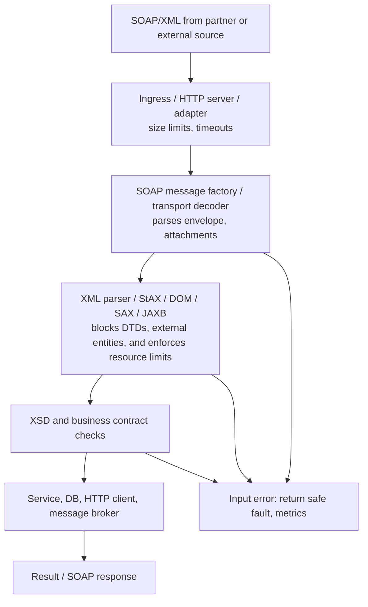

# Controlling XML Parsers, XXE, and Message Sizes

## 1. Context in Spring Boot Integrations

In integration systems, XML commonly appears when Spring Boot exchanges SOAP messages with ERPs, banks, shipping systems, payment gateways, or partners using WSDL/XSD contracts. An application can act as both a **SOAP client** (calling external services) and a **SOAP server** (receiving requests); XML can also arrive via SFTP, JMS, Kafka, HTTP, or files processed by Spring Integration.

XML is a structured format, yet parsing XML can also trigger external resource access and heavy resource consumption. Two primary risk groups exist:

- **XML External Entity (XXE):** the parser processes DTDs/entities or external references, potentially attempting to read local files, access internal URLs, or turn the XML endpoint into an origin for unintended network requests.
- **Denial of Service (DoS) via XML:** input containing repeated entities, deeply nested structures, huge attributes, oversized payloads, or high-ratio compressed data consumes CPU, heap, request worker threads, and connections.

For the `SPRING_BOOT_INTEGRATION` module, protecting XML parsers is part of **integration contract integrity and reliability**: beyond parsing valid data, the system must bound inputs, control resource access, classify errors, keep transactions safe, test thoroughly, and maintain observability.

**Lesson goal:** understand which parsers XML passes through, configure JAXP/StAX/JAXB safely, enforce limits at the right SOAP processing layer, and verify protections using real failure cases. This cannot be achieved merely by checking for a `.xml` extension or enabling XSD validation alone.

## 2. Identifying Trust Boundaries and Parser Locations

A SOAP request typically passes through several layers before reaching business code:



Surfaces to review include:

| Where XML is parsed | Practical examples | Required controls |
| --- | --- | --- |
| SOAP server | Spring Web Services `@Endpoint`, SOAP servlet | Limit requests **before** message factory; safe SOAP parser |
| SOAP client | `WebServiceTemplate` receiving external responses | Limit responses, configure message factory parser, timeouts |
| Custom XML adapter | `DocumentBuilderFactory`, `SAXParserFactory`, `XMLInputFactory` | Disable external entities and unnecessary DTDs; cap bytes/nesting |
| JAXB binding | `Unmarshaller` converting XML into DTOs | Pass an already safely parsed XML source; do not trust default input streams |
| XSD validation | `SchemaFactory`, `Validator` | Block external XSD/DTD access unless explicitly permitted |
| XSLT transformation | `TransformerFactory`, stylesheets | Block external stylesheet/DTD access and resource-fetching functions |
| Spring Integration | Inbound channel adapters, transformers, XML flows | Check both pre-flow decoders and in-transformer parsers |

A single request can pass through **multiple parsers**. For instance, Spring-WS's message factory parses the SOAP envelope, then JAXB unmarshals the payload, and then a service parses an embedded XML string inside the payload. Hardening one parser does not automatically protect the others.

In particular, if an `@Endpoint` receives a `Document` or JAXB object already constructed by the framework, checking inside the endpoint method is **too late** to prevent XXE/DoS in parsers that ran earlier. Evaluate both the SOAP stack and the transport layer.

## 3. How Does XXE Work?

XML allows Document Type Definitions (DTDs) and entities. If a parser permits resolving external entities, it can read resources referenced by `SYSTEM` or `PUBLIC`.

Illustrative example of **untrusted input** (file path is fictional):

```xml
<?xml version="1.0" encoding="UTF-8"?>
<!DOCTYPE lookup [
  <!ENTITY external SYSTEM "file:///opt/example/private-config.xml">
]>
<lookup>
  <customerId>&external;</customerId>
</lookup>
```

An insecure parser may attempt to open the `file:` path and substitute `&external;` with its contents. Another entity could point to `http:`, causing the parser to make network requests to services reachable from the application's network. Depending on the library and data path, this can cause:

- **Unauthorized resource reads:** configuration files or local contents.
- **Server-Side Request Forgery (SSRF):** issuing requests from the service's network zone to internal or external addresses.
- **DoS:** entity expansion inflating the parsed data size.
- **Hard-to-trace failures:** behavior triggered inside the parser before business endpoint code ever runs.

Two concepts to distinguish:

1. **Internal entities:** values defined inline within the DTD; can be abused to generate massive output upon expansion.
2. **External entities:** declarations referencing files, URLs, or other external resources; create unauthorized access risks.

The example above is strictly to recognize what to block; never use real sensitive files in tests. When a partner's SOAP/XSD format **does not require DTDs**, the simplest and most verifiable safeguard is to **reject all `DOCTYPE` declarations**. If a legitimate partner must use DTDs, explicitly design resolution against a controlled resource catalog (XML Catalog/resource resolver), restrict network access, and validate entity types. Never enable unrestricted DTDs just so one special document parses.

## 4. XML Bombs: Small Messages Can Cause Massive Resource Consumption

Some XML DoS attacks do not even need external file reads:

| Input pattern | Overload mechanism | Defense |
| --- | --- | --- |
| Repeated / nested entity expansion | Expanded content dwarfs original payload size | Reject DTDs when unneeded; entity limits |
| Deeply nested XML | Parser/validator/mapper consumes stack or CPU | Element depth limits |
| Excessive attributes or long names | Increases allocation and structural overhead | Limits on attributes, name lengths, and total size |
| Huge text or Base64 elements | Spikes heap during DOM/JAXB reads or decoding | Cap input bytes and decoded capacity |
| SOAP with large MTOM/attachments | Consumes disk, memory, network, and processing time | Cap envelope, per-attachment, and total attachment sizes |
| Heavily compressed content | Small wire payload expands hugely after decompression | Count bytes **after decompression**; cap ratio/output |
| Pathological structures/schemas | Validation or XPath/XSLT burns CPU | Parse quotas, deadlines, and contract complexity caps |

Configuring `max request bytes` alone is not enough: a small valid-sized XML payload can still exhaust resources when the parser expands entities or builds a DOM tree. Conversely, blocking DTDs alone does not protect a service from a raw 200 MB XML document.

Distinguish three sizes:

- **Wire size:** HTTP/gRPC/transport bytes received, possibly compressed.
- **Actual XML size fed to the parser:** bytes after transport decoding/decompression.
- **Post-parse structural size:** DOM tree, JAXB object graph, or expanded entity contents.

A safe pipeline enforces limits at **all three** layers.

## 5. Defense-in-Depth Model

A practical design layers these controls:

1. **Input contract:** accept only expected SOAP versions, content types, XML namespaces, schema versions, and business-appropriate sizes.
2. **Ingress/transport:** cap actual received bytes, deadlines, connect/read timeouts, concurrency, and attachment sizes; cover both requests and responses.
3. **Parser:** disable DTDs/external entities, XInclude, and unnecessary resource lookups; enable JAXP secure processing and limits.
4. **Validation:** use approved XSDs, verify data types and business rules; never resolve schemas from URLs inside payloads.
5. **Business processing:** bound record counts, transformation counts, execution duration, and downstream DB/HTTP fan-out per request.
6. **Observability and recovery:** log errors safely, track blocked requests, sizes, parse durations, and system impact.

No single property replaces the whole model. `FEATURE_SECURE_PROCESSING` enables several JAXP limits, but **must not be treated as an absolute guarantee** that all external entities/DTDs are disabled on every provider. Configure explicit settings and test your actual runtime parser.

## 6. Hardening DOM with `DocumentBuilderFactory`

DOM builds the entire XML tree in memory, convenient for small documents but costly in heap. Whenever processing DOM, configure `DocumentBuilderFactory` **before parsing**.

### 6.1. Fail-Closed Java Configuration Example

Suitable for Java 17+ and built-in JDK JAXP without Spring dependencies:

```java
import java.io.FilterInputStream;
import java.io.IOException;
import java.io.InputStream;
import javax.xml.XMLConstants;
import javax.xml.parsers.DocumentBuilder;
import javax.xml.parsers.DocumentBuilderFactory;
import javax.xml.parsers.ParserConfigurationException;
import org.w3c.dom.Document;
import org.xml.sax.InputSource;
import org.xml.sax.SAXException;

public final class SecureXmlDocuments {

    private static final long MAX_XML_BYTES = 1_048_576L; // Example: 1 MiB

    private SecureXmlDocuments() {}

    public static Document parse(InputStream source)
            throws IOException, SAXException, ParserConfigurationException {

        DocumentBuilderFactory factory = DocumentBuilderFactory.newInstance();
        factory.setNamespaceAware(true);
        factory.setXIncludeAware(false);
        factory.setExpandEntityReferences(false);

        factory.setFeature(XMLConstants.FEATURE_SECURE_PROCESSING, true);
        factory.setFeature(
                "http://apache.org/xml/features/disallow-doctype-decl", true);
        factory.setFeature(
                "http://xml.org/sax/features/external-general-entities", false);
        factory.setFeature(
                "http://xml.org/sax/features/external-parameter-entities", false);
        factory.setFeature(
                "http://apache.org/xml/features/nonvalidating/load-external-dtd",
                false);

        factory.setAttribute(XMLConstants.ACCESS_EXTERNAL_DTD, "");
        factory.setAttribute(XMLConstants.ACCESS_EXTERNAL_SCHEMA, "");

        DocumentBuilder builder = factory.newDocumentBuilder();
        builder.setEntityResolver((publicId, systemId) -> {
            throw new SAXException("External entity resolution is forbidden");
        });

        // Count actual bytes read by the parser; also closes the input stream when done.
        try (InputStream bounded =
                new ByteLimitInputStream(source, MAX_XML_BYTES)) {
            return builder.parse(new InputSource(bounded));
        }
    }

    private static final class ByteLimitInputStream
            extends FilterInputStream {

        private final long maxBytes;
        private long consumed;

        private ByteLimitInputStream(InputStream input, long maxBytes) {
            super(input);
            this.maxBytes = maxBytes;
        }

        private void count(long bytes) throws IOException {
            if (bytes > 0) {
                if (consumed > maxBytes - bytes) {
                    throw new IOException("XML payload exceeds byte limit");
                }
                consumed += bytes;
            }
        }

        @Override
        public int read() throws IOException {
            int value = in.read();
            if (value >= 0) {
                count(1);
            }
            return value;
        }

        @Override
        public int read(byte[] bytes, int offset, int length)
                throws IOException {
            int result = in.read(bytes, offset, length);
            if (result > 0) {
                count(result);
            }
            return result;
        }

        @Override
        public long skip(long bytes) throws IOException {
            long skipped = in.skip(bytes);
            count(skipped);
            return skipped;
        }
    }
}
```

Usage:

```java
try (InputStream xml = remoteResponseBodyStream) {
    Document document = SecureXmlDocuments.parse(xml);
    // Continue checking root element, namespace, XSD, and business rules.
}
```

This is a pattern for **explicit parsing from an `InputStream`**, not automatic configuration for the entire SOAP stack. If data was already materialized into a massive `byte[]` or `String` before entering `parse`, wrapping the stream here cannot undo the memory cost already incurred. Apply limits **at the network/file read boundary before any materialization**.

### 6.2. Purpose of Each Setting

| Setting | Purpose |
| --- | --- |
| `setNamespaceAware(true)` | Properly handles XML namespaces in SOAP/XSD |
| `setXIncludeAware(false)` | Prevents automatic inclusion of resources via XInclude |
| `setExpandEntityReferences(false)` | Limits expanding entity nodes in DOM; **insufficient alone to block XXE** |
| `FEATURE_SECURE_PROCESSING=true` | Instructs provider to enforce safe processing bounds |
| `disallow-doctype-decl=true` | Rejects all DTD/DOCTYPE declarations when contract does not need them |
| `external-general-entities=false` | Disables external general entities |
| `external-parameter-entities=false` | Disables external parameter entities |
| `load-external-dtd=false` | Prevents loading external DTDs on parsers supporting this feature |
| `ACCESS_EXTERNAL_DTD=""` | Blocks all protocols for accessing external DTDs |
| `ACCESS_EXTERNAL_SCHEMA=""` | Blocks external schemas from any protocol |
| Rejecting `EntityResolver` | Defense-in-depth fallback if the parser attempts to resolve a resource |

URI-based features are implementation-dependent. If `setFeature` or `setAttribute` is rejected, code should **fail initialization / report a configuration error** rather than catching and ignoring it. A parser that does not support blocking mechanisms must be replaced with a verified implementation or backed by a proven alternative. JAXP provider behavior can change across JDK/library versions; verify your deployment's actual provider.

Wrapping the parser with `ByteLimitInputStream` counts input bytes read. For pipelines with decoders or decompression, wrap **after decompression** at the actual parse boundary while also keeping ingress limits intact. `1 MiB` is only illustrative; choose limits based on real payload sizes and system characteristics.

## 7. Hardening SAX and StAX for Large Streams

When holding the full XML tree is unnecessary, SAX or StAX reduces heap usage compared to DOM. However, streaming **does not automatically prevent XXE** if the parser still resolves external entities.

### 7.1. SAX: Blocking DTDs/Entities Before Parsing

```java
import javax.xml.XMLConstants;
import javax.xml.parsers.SAXParserFactory;
import org.xml.sax.XMLReader;

SAXParserFactory factory = SAXParserFactory.newInstance();
factory.setNamespaceAware(true);
factory.setFeature(XMLConstants.FEATURE_SECURE_PROCESSING, true);
factory.setFeature(
        "http://apache.org/xml/features/disallow-doctype-decl", true);
factory.setFeature(
        "http://xml.org/sax/features/external-general-entities", false);
factory.setFeature(
        "http://xml.org/sax/features/external-parameter-entities", false);
factory.setFeature(
        "http://apache.org/xml/features/nonvalidating/load-external-dtd", false);

XMLReader reader = factory.newSAXParser().getXMLReader();
reader.setProperty(XMLConstants.ACCESS_EXTERNAL_DTD, "");
reader.setProperty(XMLConstants.ACCESS_EXTERNAL_SCHEMA, "");
reader.setEntityResolver((publicId, systemId) -> {
    throw new org.xml.sax.SAXException("External entity not allowed");
});

// reader.setContentHandler(handler);
// reader.parse(new InputSource(boundedInputStream));
```

`XMLReader` and `SAXParserFactory` have different configuration APIs from DOM; this snippet illustrates securing the specific parser. Wrap the input stream with a byte counter as in section 6, and fail closed if the provider rejects any security feature or property.

### 7.2. StAX: Never Enable DTDs or External Entities

```java
import javax.xml.XMLConstants;
import javax.xml.stream.XMLInputFactory;
import javax.xml.stream.XMLStreamReader;

XMLInputFactory factory = XMLInputFactory.newFactory();
factory.setProperty(XMLInputFactory.SUPPORT_DTD, false);
factory.setProperty(
        XMLInputFactory.IS_SUPPORTING_EXTERNAL_ENTITIES, false);
factory.setProperty(XMLConstants.ACCESS_EXTERNAL_DTD, "");

// InputStream must already be byte-bounded.
XMLStreamReader reader = factory.createXMLStreamReader(boundedInputStream);
try {
    while (reader.hasNext()) {
        reader.next();
        // Process token by token; count elements/depth/fields as needed.
    }
} finally {
    reader.close();
}
```

Supported properties and defaults vary across StAX providers. If a protective property is unsupported, do not silently ignore it. When using non-JDK providers (such as Woodstox), verify features, quotas, and behavior using tests that intentionally include DTDs and entities.

With StAX, application code should also track nesting depth and element counts when the protocol needs strict bounds. Streaming keeps memory low, yet an unbounded stream can still cause DoS without stream byte limits.

## 8. JAXB: Never Parse Uncontrolled Sources

JAXB maps XML to Java objects; in Spring Boot 3.x and Jakarta XML Binding, APIs reside in `jakarta.xml.bind`. The crucial rule is that **the parser feeding JAXB must be controlled**. Calling `unmarshaller.unmarshal(InputStream)` without knowing which parser/provider is used leaves XXE policy up to implicit library defaults.

One clean pattern is creating an `XMLStreamReader` with DTDs and external entities disabled, then passing that reader to JAXB:

```java
import jakarta.xml.bind.JAXBContext;
import jakarta.xml.bind.JAXBElement;
import jakarta.xml.bind.Unmarshaller;
import javax.xml.XMLConstants;
import javax.xml.stream.XMLInputFactory;
import javax.xml.stream.XMLStreamReader;

// PurchaseOrder is a JAXB class declared per the XML contract.
JAXBContext context = JAXBContext.newInstance(PurchaseOrder.class);
Unmarshaller unmarshaller = context.createUnmarshaller();

XMLInputFactory xmlFactory = XMLInputFactory.newFactory();
xmlFactory.setProperty(XMLInputFactory.SUPPORT_DTD, false);
xmlFactory.setProperty(
        XMLInputFactory.IS_SUPPORTING_EXTERNAL_ENTITIES, false);
xmlFactory.setProperty(XMLConstants.ACCESS_EXTERNAL_DTD, "");

XMLStreamReader streamReader =
        xmlFactory.createXMLStreamReader(boundedInputStream);
try {
    JAXBElement<PurchaseOrder> result =
            unmarshaller.unmarshal(streamReader, PurchaseOrder.class);
    PurchaseOrder order = result.getValue();
} finally {
    streamReader.close();
}
```

In this example, `boundedInputStream` is a stream with a pre-applied byte limit. Production code must manage input stream lifecycles, schema validation, error mapping, and serializer choices for requests/responses. Deserializing XML into an object does not prove business validity; verify namespaces, required fields, lengths, value ranges, and contract versions.

When using Spring OXM's `Jaxb2Marshaller` or JAXB through Spring-WS, verify the **actual `Source` path and parser entering the marshaller/unmarshaller**. A `StreamSource` or `DOMSource` built earlier elsewhere could bypass settings—you cannot conclude safety solely from configuring an `Unmarshaller` bean.

## 9. Hardening XSD and XSLT: Two Frequently Overlooked Spots

Even when the primary parser blocks entities, validation or transformation steps can independently fetch external resources.

### 9.1. `SchemaFactory` and `Validator`

```java
import javax.xml.XMLConstants;
import javax.xml.validation.Schema;
import javax.xml.validation.SchemaFactory;
import javax.xml.transform.stream.StreamSource;
import java.io.InputStream;

SchemaFactory schemaFactory =
        SchemaFactory.newInstance(XMLConstants.W3C_XML_SCHEMA_NS_URI);
schemaFactory.setFeature(XMLConstants.FEATURE_SECURE_PROCESSING, true);
schemaFactory.setProperty(XMLConstants.ACCESS_EXTERNAL_DTD, "");
schemaFactory.setProperty(XMLConstants.ACCESS_EXTERNAL_SCHEMA, "");

try (InputStream xsd =
        MyService.class.getResourceAsStream("/xsd/purchase-order.xsd")) {
    if (xsd == null) {
        throw new IllegalStateException("Missing local XSD");
    }
    Schema schema = schemaFactory.newSchema(new StreamSource(xsd));

    // If the validator uses a resolver or receives custom sources,
    // keep controlling those inputs and referenced URIs as well.
}
```

`xs:include`/`xs:import` inside an XSD may reference other resources. For canonical application schemas, bundle XSDs on the classpath or in a vetted resource repository and use an explicit resolver/catalog. Blocking all external schemas may cause some relative `import`s to fail; treat that as a cue to **configure controlled local resource resolution**, not to open arbitrary URL fetching.

When validating, a `Schema` built from trusted XSDs can be reused per contract; `Validator` instances must follow the API's lifecycle and non-thread-safety rules. Never extract an `xsi:schemaLocation` URL from an external payload and fetch it directly.

### 9.2. `TransformerFactory` and XSLT

```java
import javax.xml.XMLConstants;
import javax.xml.transform.TransformerFactory;

TransformerFactory transformerFactory = TransformerFactory.newInstance();
transformerFactory.setFeature(
        XMLConstants.FEATURE_SECURE_PROCESSING, true);
transformerFactory.setAttribute(
        XMLConstants.ACCESS_EXTERNAL_DTD, "");
transformerFactory.setAttribute(
        XMLConstants.ACCESS_EXTERNAL_STYLESHEET, "");
```

XSLT can use `xsl:import`, `xsl:include`, or document-fetching functions like `document()` depending on the processor. If stylesheets come from untrusted sources, the risk goes beyond XXE because the transformation program itself is untrusted. Run only reviewed stylesheets, bound execution time and data sizes, and use an allowlisted `URIResolver` if importing local resources is truly required.

**Never equate "XSD-valid XML" with "safe to parse."** XML must be parsed before or during validation; if the parser or validator fetches external resources, validation itself can trigger XXE.

## 10. Enforcing Size Limits at HTTP, SOAP Message Factory, and Parser Layers

### 10.1. Enforcing Limits Before the Message Factory Runs

A Spring-WS SOAP server typically uses `MessageDispatcherServlet` with a `WebServiceMessageFactory` such as SAAJ or Axiom. Much of the envelope parsing happens **before** `@Endpoint`.

Therefore:

1. Enforce physical request body limits at the **gateway/reverse proxy/ingress** or servlet input-reading layer.
2. Enforce byte limits **after decompression** if `Content-Encoding` is allowed; do not rely solely on `Content-Length`.
3. Verify the **actual SOAP message factory/provider** settings to confirm DTDs/external entities are blocked and which resources are permitted.
4. Bound total XML/attachment contents and the parser used for inner payloads.
5. Reject oversized requests before allocating large DOM trees or JAXB object graphs.

`Content-Length` is only a hint. Requests may use chunked transfer encoding, omit the header, or have it altered by proxies; **count actual bytes read**, not just the header.

Do not confuse these properties/layers:

| Setting / layer | What it covers | Limitations |
| --- | --- | --- |
| Reverse proxy / ingress body limit | Incoming HTTP requests, depending on config | May count compressed wire bytes; verify decompression path |
| Counting servlet filter / request wrapper | Servlet request stream when placed properly | Must run before SOAP parsing and handle streams/async/errors cleanly |
| `spring.servlet.multipart.max-file-size` | Servlet multipart file uploads | Does not automatically cap all SOAP XML or `multipart/related` MTOM |
| `spring.codec.max-in-memory-size` | Supported WebFlux codecs | Does not automatically apply to Spring-WS servlet/SAAJ |
| `server.tomcat.max-http-form-post-size` | Tomcat form POST limits | Not a general cap for arbitrary SOAP XML bodies |
| Byte counter around the parser | Stream read directly by parser | Cannot undo memory already used by earlier materialization |
| JAXP / entity / depth limits | Structural complexity of XML | Does not replace transport-level body size limits |

Property names and behavior depend on your server and framework. With embedded servlet containers in Spring Boot, verify the actual request path rather than assuming any setting with `max` in its name suffices.

### 10.2. SOAP Clients Also Need Response Size Limits

Applications calling partners via `WebServiceTemplate` must still treat SOAP responses as **untrusted input**. A buggy or compromised server can return massive XML or entity-laden payloads.

When configuring a SOAP client:

- Set transport connect and read timeouts.
- Cap response size before the message factory parses it—for both success responses and SOAP Faults.
- Enforce redirect policies, endpoint allowlists, and TLS per integration requirements.
- Verify the XML parser used internally by the message factory and unmarshaller.
- Cap concurrent requests, retries, and connection retention under slow responses.

If `WebServiceTemplate` has already materialized the response into an object before application code receives it, checking object size in the service layer is too late to stop parse-time DoS.

### 10.3. MTOM, MIME Attachments, and Compressed Content

SOAP MTOM packages the envelope alongside binary attachments using `multipart/related`. A tiny few-KB envelope can still carry hundreds of megabytes of attachments. Therefore:

- Cap total request/response bytes, attachment count, and maximum size **per attachment**.
- Avoid Base64 decoding or loading attachments into memory needlessly; stream and spool to temporary storage with quotas and cleanup.
- Validate filenames, media types, checksums, and temporary retention limits per contract.
- Separate decoded content limits from compressed wire sizes; cap total decompressed output.
- Abort parsing/reading and release resources as soon as limits are exceeded.

A single SOAP request can combine an XML bomb with oversized attachments; protect both the XML parser and MIME/transport layers.

## 11. JAXP Limits and Business Limits

Alongside disabling DTDs, modern JAXP providers offer limits to mitigate XML DoS. In the Java JDK, properties include:

| Limit category | Example JDK property | Meaning |
| --- | --- | --- |
| Entity expansion count | `jdk.xml.entityExpansionLimit` | Caps total entity expansions |
| Total entity size | `jdk.xml.totalEntitySizeLimit` | Caps expanded entity character volume |
| XML depth | `jdk.xml.maxElementDepth` | Prevents excessively deep XML trees |
| Attributes per element | `jdk.xml.elementAttributeLimit` | Caps attributes on any single element |
| XML name length | `jdk.xml.maxXMLNameLimit` | Prevents absurdly long tag/attribute names |

**Reference** JVM startup flags:

```text
-Djdk.xml.entityExpansionLimit=1000
-Djdk.xml.totalEntitySizeLimit=100000
-Djdk.xml.maxElementDepth=64
-Djdk.xml.elementAttributeLimit=100
```

These numbers **are not universal safe defaults**. Measure against real valid payloads, derive limits from your contract, and observe in pre-production environments. Parser vendors, JDK versions, and precedence among system properties, `jaxp.properties`, and direct factory properties can differ; verify with post-deploy tests.

Even when all DTDs are rejected, `entityExpansionLimit` serves as defense-in-depth—not a reason to allow external entities. Additional JAXP limits exist for name lengths, parameter entity sizes, and schema occurrence repeats; do not tune all of them to arbitrary numbers without checking compatibility.

At the business layer, add domain caps such as:

- Number of invoices per request: e.g., maximum 500, rather than relying on byte counts alone.
- Lengths of `customerName`, `orderLine`, reference codes, and corresponding XML element counts.
- Concurrent requests per partner, processing steps, and execution duration.
- Fan-out caps: a single request must not trigger unbounded HTTP calls, SQL queries, or broker messages.

Combining structural and business bounds stops syntactically valid XML with abnormal volume before it overloads the system.

## 12. XSD Validation, Namespaces, and Data Contract Checks

A hardened parser only prevents the parser from taking dangerous actions. A SOAP request still needs verification for:

1. **Content-Type and SOAP version:** SOAP 1.1 typically uses `text/xml`, SOAP 1.2 typically uses `application/soap+xml`; enforce per contract.
2. **Namespace and root element:** avoid matching local names while ignoring namespaces.
3. **XSD:** validate data types, element ordering, cardinality, and required attributes.
4. **Business constraints:** cap record counts, amounts, statuses, key relationships, and contract versions.
5. **Error handling policy:** distinguish malformed XML, XSD violations, authentication errors, and backend failures.

Example payload:

```xml
<ord:CreateOrderRequest
    xmlns:ord="urn:example:order:v1">
    <ord:externalOrderId>ORD-4711</ord:externalOrderId>
    <ord:lineCount>3</ord:lineCount>
</ord:CreateOrderRequest>
```

Even when the XSD permits `lineCount` as an integer, the application must verify it matches the actual number of `orderLine` items and business limits. XSD catches structural mistakes, not all business invariants.

When using WS-Security, XML signatures, timestamps, or nonces, verify the full processing pipeline: hardened parser, signature verification of the exact processed node, replay protection, and identity checks. **Enabling WS-Security does not automatically block XXE.** With XML Signatures, prevent signature wrapping (processing a different node than the signed one) by using standard libraries and strict verification workflows.

## 13. Safe Error Handling: Returning Proper Responses Without Leaking Data

Invalid requests can be blocked at different layers:

| Error | Where detected | Recommended response |
| --- | --- | --- |
| Request body exceeds limit | Gateway/transport, before SOAP parser | Reject request, typically HTTP 413 if appropriate for stack |
| Forbidden `DOCTYPE`/external entity | XML parser | Abort parsing; return client fault / bad request per SOAP version |
| Malformed XML syntax | XML parser | Never enter business handler; report malformed XML |
| XSD validation failure | Schema validator | SOAP client/sender fault with safe contract error code |
| Valid XML violating business caps | Service validation | Business fault; perform no side effects |
| Misconfigured parser or schema provider | Startup/config validation | Fail fast and alert operations; never silently relax protections |
| Slow/failing backend | HTTP/DB/broker adapter | Bounded timeout/retry; prevent backend errors from leaking internal details |

SOAP 1.1 uses `Client`/`Server` faults while SOAP 1.2 uses `Sender`/`Receiver`; exact HTTP status codes depend on stack and contract. An error occurring **before the envelope parses as a SOAP message** may warrant a plain HTTP error instead of trying to build a SOAP Fault from unsafe input.

Never include file paths, internal URIs, stack traces, usernames, SQL, or raw XML containing customer data in error responses. Logs should capture only controlled error codes, request/correlation IDs, sizes, endpoints, parser types, durations, and authorized caller identities. If raw payloads must be retained for forensics, store them in an access-controlled vault with strict retention.

## 14. Testing XXE and Resource Limits

Parser configuration is only effective once **tested on the actual runtime provider and processing path**. Tests should exercise both direct parsers and SOAP endpoints/`WebServiceTemplate` when using Spring-WS.

| Scenario | Expected outcome |
| --- | --- |
| Valid SOAP XML, no DTD | Parses and processes per contract |
| XML with `DOCTYPE` and `file:` external entity | Rejected; no file read |
| XML with `http:` external entity | Rejected; test server records zero network requests |
| XML with nested entity expansion | Rejected or bounded before CPU/heap spikes |
| XML exceeding depth threshold | Parsing stops at depth limit |
| XML exceeding `MAX_XML_BYTES` | Rejected without building full DOM/JAXB objects |
| Chunked request without `Content-Length` | Byte counter still blocks over-limit payloads |
| Small compressed HTTP payload expanding hugely | Decompressed byte limit still triggers |
| SOAP MTOM total attachments exceed quota | No RAM/disk exhaustion; temp resources cleaned up |
| Partner SOAP response exceeds limit | Client rejects before unmarshalling |
| `SchemaFactory` or XSLT attempts external URI load | Blocked or restricted to approved catalog URIs |
| Parser provider lacks security feature support | Initialization/test fails explicitly instead of running insecurely |

### 14.1. JUnit DOM Test Example

```java
import static org.junit.jupiter.api.Assertions.assertThrows;
import java.io.ByteArrayInputStream;
import java.nio.charset.StandardCharsets;
import org.junit.jupiter.api.Test;
import org.xml.sax.SAXException;

class SecureXmlDocumentsTest {

    @Test
    void rejectsDoctypeWithExternalEntity() {
        String untrustedXml = """
                <?xml version="1.0"?>
                <!DOCTYPE invoice [
                  <!ENTITY x SYSTEM "file:///opt/example/test.xml">
                ]>
                <invoice>&x;</invoice>
                """;

        assertThrows(SAXException.class, () ->
                SecureXmlDocuments.parse(new ByteArrayInputStream(
                        untrustedXml.getBytes(StandardCharsets.UTF_8))));
    }

    @Test
    void rejectsOversizedXml() {
        String largeXml = "<invoice>" + "x".repeat(1_100_000) + "</invoice>";

        assertThrows(java.io.IOException.class, () ->
                SecureXmlDocuments.parse(new ByteArrayInputStream(
                        largeXml.getBytes(StandardCharsets.UTF_8))));
    }
}
```

These tests demonstrate **DTD rejection** and **byte limits**, and do not replace integration tests running through the servlet and message factory. When testing SSRF, point to a controlled local HTTP stub and assert **zero requests were received**; never point tests at real endpoints or sensitive files. Run XML bomb tests only in resource-bounded environments without building huge payloads that stall CI runners.

### 14.2. Testing the Real SOAP Pipeline

With Spring-WS:

- Send requests to endpoints through the real configured servlet and message factory.
- Intentionally send chunked requests and ingress-oversized requests.
- Send DTD-bearing XML to the endpoint even when JAXB/unmarshallers have separate settings.
- Test SOAP responses from a mock partner through `WebServiceTemplate`, not just parser calls in business methods.
- Test MTOM/attachments using the exact content types handled at runtime.
- Observe heap, CPU, duration, and DB/HTTP side effects when requests are rejected.

Tests must prove that **an attacked layer makes no external network/file calls, stays within resource budgets, and triggers no side effects**. Asserting only HTTP 500 is not enough to prove the parser is safe.

## 15. Operational Observability and XML Incident Handling

When an integration service receives SOAP/XML, track at minimum:

- Total XML/SOAP requests by endpoint, SOAP version, and error type.
- Actual request/response sizes (histograms, percentiles) and percentage rejected for size.
- Parse duration, XSD validation duration, and overall handling duration.
- Errors involving `DOCTYPE`, external entities, schema validation, excessive depth, and excessive attributes.
- CPU, heap, GC, thread pools, connection pools, and timeouts during size or error spikes.
- Requests producing DB/HTTP/broker side effects post-parse; rejected inputs must produce zero side effects.
- Error rates broken down by partner, XSD version, release, and parser config changes.

Never put raw payloads or sensitive identifiers into high-cardinality Prometheus metric labels. Use structured logs with `correlationId` and error codes; restrict access to sensitive payloads via authorized forensic channels.

Short runbook for XML error spikes:

1. Distinguish whether new errors stem from a **partner contract change** or abnormal/malicious input.
2. Check changes in Content-Type, namespace, XSD version, message factory, and JDK/parser provider.
3. Determine whether limits are tripping at ingress or the XML parser; inspect CPU/heap and request sizes.
4. Never disable `disallow-doctype-decl` or `ACCESS_EXTERNAL_DTD` as a temporary workaround for an uninvestigated contract error.
5. If a legitimate DTD/XSD resource must be supported, add an allowlisted resolver/catalog and external-access tests before releasing.
6. Verify whether failed requests entered business services; if partial side effects occurred, run idempotency/reconciliation per integration policy.
7. Document parser/provider changes and add regression tests for the failure sample.

## 16. End-to-End Scenario: Receiving Partner SOAP Invoices

Suppose Spring Boot exposes a `SubmitInvoice` SOAP endpoint for an ERP partner. Each message can have up to 200 invoice lines, and occasionally an MTOM PDF attachment. When valid, the service writes the invoice to PostgreSQL and emits an `InvoiceAccepted` broker message.

Defense design:

1. **Ingress:** accept traffic only from authenticated channels, enforce body limits and timeouts suited to invoice sizes, and count actual received bytes including chunked requests.
2. **Message factory:** verify the active SAAJ/Axiom provider does not resolve DTDs/external entities; inspect both SOAP Faults and attachment handling paths.
3. **Parser:** reject `DOCTYPE`, external entities, and external XSDs; enforce byte budgets, element depth, and structural caps.
4. **Validation:** load XSDs from the classpath; check namespace, version, and invoice line counts; cap decoded PDF bytes.
5. **Business transaction:** insert the invoice with a unique partner idempotency key; if publishing events needs atomicity with DB state, use a transactional outbox.
6. **Failure handling:** malformed XML or oversized requests create no invoice, make no downstream calls, and never write raw payloads to logs.
7. **Monitoring:** measure parser error rates, payload sizes, latency, and block counts; alert on partner anomalies.
8. **Testing:** run integration tests through the real SOAP servlet and client stack covering external entities, overly deep XML, compressed requests, oversized MTOM attachments, and partner error responses.

Here, XML is treated as an **untrusted perimeter input** with an explicit contract and resource budget. Protections apply from initial byte ingestion right up to DB writes or broker publishes, reducing the risk that parser defects destabilize the integration pipeline.

## 17. Common Misconceptions

| Misconception | Reality to verify |
| --- | --- |
| "I'm using a SOAP framework, so I don't need to worry about XXE." | Frameworks still rely on underlying parsers/message factories; verify configuration and versions |
| "I enabled XSD validation, so XXE is blocked." | Validation itself can resolve external DTDs/XSDs; harden `SchemaFactory` and parsers |
| "`setExpandEntityReferences(false)` is enough." | Does not replace blocking `DOCTYPE`/external entities and capping input size |
| "`FEATURE_SECURE_PROCESSING` makes every provider safe." | It is one layer; still apply explicit settings and regression tests |
| "`Content-Length` is under 1 MB, so the XML is safe." | Header can be absent, compressed payloads expand, and XML structure can burn resources |
| "Blocking at JAXB is sufficient." | The SOAP envelope may already be parsed before JAXB runs |
| "SOAP MTOM attachments aren't XML, so they don't need limits." | Attachments require separate quotas and total size caps |
| "SAX/StAX streaming is immune to DoS." | Unbounded XML, entities, deep nesting, or slow processing can still exhaust resources |
| "Only inbound SOAP servers need protection." | SOAP clients parsing partner responses face similar risks |
| "If XML parsing fails, no side effects could have happened." | Check which step failed, especially in flows with multiple parsers |

## 18. Implementation Checklist

- [ ] Inventoried every XML entry point: SOAP server/client, files, message brokers, Spring Integration XML flows.
- [ ] Verified actual SOAP message factory, JAXP/StAX/JAXB providers, and runtime versions.
- [ ] Disabled DTDs, external entities, and XInclude fail-closed wherever the contract does not need them.
- [ ] `SchemaFactory` and `TransformerFactory` cannot fetch DTDs/XSDs/XSLTs outside approved catalogs.
- [ ] Enforced request **and response** size limits before SOAP parsing or materialization runs.
- [ ] Capped decompressed bytes, XML depth, entity expansions, and MTOM/attachment capacities.
- [ ] Validated Content-Type, SOAP version, namespaces, XSDs, and business constraints.
- [ ] Excluded raw XML, stack traces, internal URLs, and customer data from public logs and faults.
- [ ] Configured safe error responses, metrics, and alerts for parser/size rejections.
- [ ] Tested file/URL XXE, entity expansion, deep nesting, chunked bodies, compression, SOAP responses, and MTOM.
- [ ] Rejected requests trigger zero DB, HTTP, or broker side effects; retries/idempotency remain controlled.
- [ ] Documented runbooks for partner XML contract changes or JDK/parser provider updates.

**Desired outcome:** your Spring Boot application processes contract-compliant SOAP/XML reliably, rejects inputs capable of triggering XXE, and strictly bounds resource consumption from the moment requests or responses arrive. Parsers are hardened, message sizes are capped, and validation or business side effects run only after inputs clear every defense layer.
