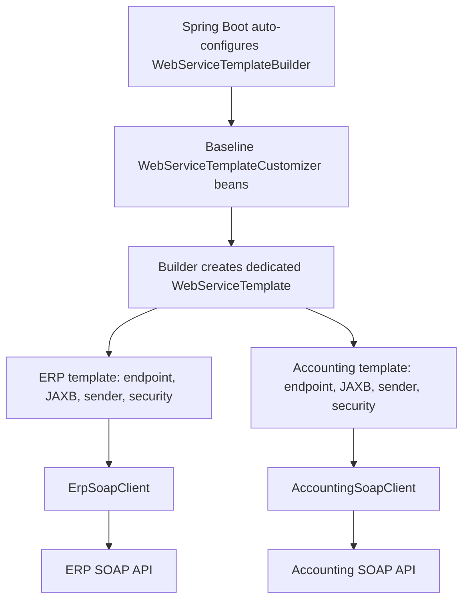
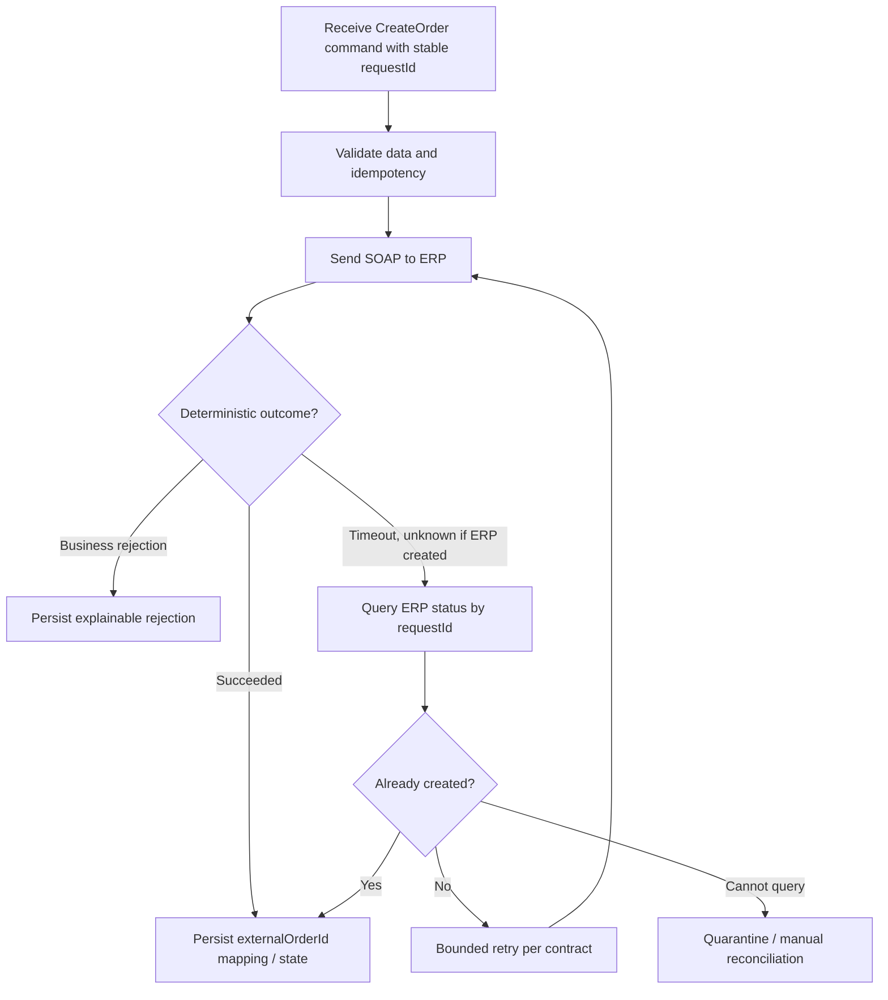

# WebServiceTemplateCustomizer and Per-Service Configuration

## 1. The Problem: Multiple SOAP Services, Multiple Integration Policies

In a single Spring Boot application, an enterprise may call several SOAP APIs simultaneously: an ERP to submit orders, an accounting system to issue invoices, a shipping partner to create waybills, and a bank to query transactions. All use SOAP/XML, yet they rarely share the same WSDL, endpoint, JAXB model, authentication, certificates, timeouts, or error rules.

For example:

| Property | ERP | Accounting |
| --- | --- | --- |
| Endpoint | `https://erp.example.test/ws/orders` | `https://accounting.example.test/ws/invoices` |
| Contract | `OrderService.wsdl`, namespace `urn:erp:orders:v1` | `InvoiceService.wsdl`, namespace `urn:acc:invoice:v2` |
| Java/XML binding | Order DTOs | Invoice DTOs |
| Security channel | mTLS or WS-Security per ERP contract | HTTP authentication or separate WS-Security |
| Connect/read timeout | e.g., 3 s / 12 s | e.g., 2 s / 25 s |
| Retries | Idempotent operations only | Never auto-retry invoice issuance without reconciliation |

If you share one `WebServiceTemplate` bean and swap `defaultUri` per call, the application can call the wrong destination or leak credentials across partners. Conversely, if you manually instantiate `new WebServiceTemplate()` everywhere, each instance can bypass shared defaults configured by Spring Boot.

This lesson belongs to the **SOAP and XML** chapter of `SPRING_BOOT_INTEGRATION`. Its focus is using `WebServiceTemplateCustomizer` and `WebServiceTemplateBuilder` to standardize shared conventions while isolating each SOAP service's configuration as an independent integration adapter: endpoint, marshaller, message sender, interceptors, security, errors, testing, and observability.

**Design rule:** a policy that applies to *every* SOAP client belongs in a shared customizer; a decision tied to *one* partner belongs in that partner's template/client bean. Never use global configuration to carry secrets, URIs, or schemas belonging to a single service.

## 2. Roles of `WebServiceTemplate` and `WebServiceTemplateCustomizer`

### 2.1. Components in Spring Web Services

- `WebServiceTemplate` is the Spring Web Services client API for sending SOAP requests and receiving SOAP responses. It executes marshal/send/receive/unmarshal steps and handles messages/faults per configuration.
- `WebServiceMessageFactory` creates and reads SOAP messages, including envelope, header, and body. It may use SAAJ or another implementation compatible with the active stack.
- `Marshaller` and `Unmarshaller` convert between Java objects and XML payloads; typically `Jaxb2Marshaller` for XSD-based contracts.
- `WebServiceMessageSender` handles transport communication, usually HTTP or HTTPS, encapsulating timeouts, authentication, and TLS.
- `ClientInterceptor` intercepts request/response/fault hooks to add headers, tracing, or WS-Security.
- `FaultMessageResolver` maps received SOAP Faults to exceptions or error-handling policies.

Spring Boot supplies `WebServiceTemplateBuilder` to construct templates with shared defaults. `WebServiceTemplateCustomizer` is a callback extension point that customizes instances built **through a builder wired with those customizers**.

### 2.2. Two Layers of Configuration



Distinguish clearly:

1. **Shared customizer:** configures rules that are safe for every `WebServiceTemplate` created from the builder, such as connection error checks or non-sensitive observability interceptors.
2. **Per-service customizer/configuration:** sets `defaultUri`, marshaller, sender, SOAPAction, and security for an individual service, typically when defining that service's `WebServiceTemplate` bean.

A `WebServiceTemplateCustomizer` is a **customization mechanism**, not a repository for all configuration and not a scheduler that sends SOAP requests. Requests are sent only when the application uses a template to invoke a service.

### 2.3. The Builder Does Not Auto-Create Business Clients per WSDL

Spring Boot can auto-configure a `WebServiceTemplateBuilder` bean when dependencies and conditions are satisfied, but it does not automatically generate `ErpSoapClient`, `AccountingSoapClient`, or DTO mappings for every WSDL. The application must still declare the template/client beans and configure their contracts.

Moreover, `WebServiceTemplateCustomizer` only affects templates built via the corresponding builder. If an external library calls `new WebServiceTemplate()` directly or defines a template without the builder, **do not assume Boot's customizers have run**.

## 3. Dependencies and Versions in Spring Boot

Maven example using Spring Boot dependency management:

```xml
<dependency>
    <groupId>org.springframework.boot</groupId>
    <artifactId>spring-boot-starter-web-services</artifactId>
</dependency>
```

The starter brings in the Spring Web Services components matching your Boot version. When generating DTOs from XSD/WSDL or using JAXB, the project needs compatible binding classes and runtime dependencies. In Spring Boot 3.x, JAXB APIs live in `jakarta.xml.bind`, not the `javax.xml.bind` package of older releases.

Do not copy SOAP, Apache HttpClient, or JAXB runtime dependencies from Spring Boot 2.x guides into Boot 3.x without checking compatibility. In particular, HTTP message sender class names, timeout setters, XML parsers, and WS-Security interceptors can change across major releases.

This lesson uses common Spring Boot 3.x/Spring-WS 4.x APIs to illustrate the architecture. Snippets for business DTOs, secure senders, and external integrations must be adapted to your real contract and stack version. Verifying exact framework details is part of QA and integration testing before deployment.

## 4. Shared Customizers: For Baseline Rules, Never Partner-Specific Settings

Declaring a customizer applied to templates built by Boot's builder:

```java
import org.springframework.boot.webservices.client.WebServiceTemplateCustomizer;
import org.springframework.context.annotation.Bean;
import org.springframework.context.annotation.Configuration;

@Configuration(proxyBeanMethods = false)
public class CommonSoapConfiguration {

    @Bean
    WebServiceTemplateCustomizer commonSoapCustomizer() {
        return template -> {
            template.setCheckConnectionForError(true);
            template.setCheckConnectionForFault(true);
        };
    }
}
```

In this example:

- `setCheckConnectionForError(true)` preserves checking transport responses for errors.
- `setCheckConnectionForFault(true)` preserves detecting SOAP Faults per appropriate connection/response signals.
- Both may reflect existing Spring-WS defaults; the example illustrates the `customize` callback, **not a claim that these two setters are newly required for SOAP safety**.
- Never place the ERP URL, accounting password, or a single `Jaxb2Marshaller` shared across incompatible schemas inside this customizer.

Note: SOAP Faults can accompany non-200 HTTP status codes, such as HTTP 500 in SOAP 1.1. Disabling error/fault checks carelessly changes how the client interprets responses. If a partner follows non-standard HTTP conventions, verify with contract tests before adjusting.

### 4.1. Customizers Scope to the Builder

```java
@Bean("erpWebServiceTemplate")
WebServiceTemplate erpTemplate(WebServiceTemplateBuilder builder) {
    WebServiceTemplate template = builder.build();
    // WebServiceTemplateCustomizers attached to the builder have already run.
    // Continue with ERP-specific configuration.
    return template;
}
```

Do not think of `WebServiceTemplateCustomizer` as a Spring `BeanPostProcessor` that automatically modifies **every** `WebServiceTemplate` in the `ApplicationContext`. If you call `new WebServiceTemplate()` directly, you must ensure required policies are applied yourself; using the Boot-provided builder is clearer.

### 4.2. Avoid Ambiguous Override Ordering

Suppose a shared customizer sets `Marshaller A`, while per-service configuration sets `Marshaller B`. When multiple places write the same property, readers struggle to tell which object the template ultimately uses.

Categorize cleanly:

| Configuration | Where it belongs |
| --- | --- |
| Shared transport/fault checks | Global customizer if safe for every service |
| Shared safe tracing/correlation | Shared interceptor with log-redaction controls |
| Default URI | Specific template or client |
| JAXB context / XSD | Specific template or client |
| HTTP Basic / OAuth token / mTLS | Per-service sender/security |
| SOAPAction / WS-Addressing action | Per-operation in client and WSDL contract |
| Timeouts, pooling, retries | Per-service sender/client per partner SLA |
| Business Fault mapping | Partner's adapter |
| Circuit breakers, idempotency | Business-aware application integration layer |

Ordering matters when multiple customizers mutate the same property; the cleaner approach is to **avoid conflicts altogether** and assert final settings in tests. If relying on explicit ordering, check the order rules of your running builder version rather than assuming an earlier bean always wins.

## 5. Designing Per-Service Configuration with `@ConfigurationProperties`

Separate configuration into distinct namespaces with strong types so Spring Boot validates them before sending requests.

Example `application-local.yml`:

```yaml
integration:
  soap:
    erp:
      endpoint: http://localhost:18080/mock-erp/orders
      connect-timeout: 3s
      read-timeout: 12s
    accounting:
      endpoint: http://localhost:18081/mock-accounting/invoices
      connect-timeout: 2s
      read-timeout: 25s
```

With Java records:

```java
import java.net.URI;
import java.time.Duration;
import org.springframework.boot.context.properties.ConfigurationProperties;

@ConfigurationProperties(prefix = "integration.soap.erp")
public record ErpSoapProperties(
        URI endpoint,
        Duration connectTimeout,
        Duration readTimeout) {
}

@ConfigurationProperties(prefix = "integration.soap.accounting")
public record AccountingSoapProperties(
        URI endpoint,
        Duration connectTimeout,
        Duration readTimeout) {
}
```

Register the configuration properties (one way is on a configuration class):

```java
import org.springframework.boot.context.properties.EnableConfigurationProperties;
import org.springframework.context.annotation.Configuration;

@Configuration(proxyBeanMethods = false)
@EnableConfigurationProperties({
    ErpSoapProperties.class,
    AccountingSoapProperties.class
})
public class SoapPropertiesConfiguration {
}
```

You can add `@Validated`, `@NotNull`, and policy-driven constraints—such as requiring HTTPS endpoints in production and positive bounded timeouts.

**Never place passwords, private keys, or tokens directly into committed source or YAML files.** Retrieve secrets from environment variables, secret managers, or runtime credential providers, and inject them only into the right service's beans.

### 5.1. Do Not Share One Global Property Across Two Endpoints

A configuration like:

```yaml
integration:
  soap:
    endpoint: http://localhost:18080
```

is insufficient for two clients with distinct endpoints unless an explicit, controlled routing layer sits above them. Separating `integration.soap.erp.*` and `integration.soap.accounting.*` makes reviews easier, limits access scopes, and prevents accidentally deploying one client against another partner's endpoint.

### 5.2. Configuration Namespaces Do Not Replace SSRF Protection

Even when endpoints come from configuration, verify schemes, hosts, and certificates. If an endpoint were passed from an incoming user HTTP request into `marshalSendAndReceive(String uri, ...)` without validation, the SOAP client could become an SSRF vector into internal networks.

When endpoints are fixed per partner, prefer `defaultUri` from controlled configuration and never let external callers supply arbitrary URIs.

## 6. Example: Two Independent `WebServiceTemplate` Beans

Assume the project has JAXB DTOs generated from XSD/WSDL or declared per contract: `ErpCreateOrderRequest`, `ErpCreateOrderResponse`, `AccountingCreateInvoiceRequest`, and `AccountingCreateInvoiceResponse`. These are **illustrative domain classes** that must exist in the project for the code to compile.

### 6.1. Separate Marshallers per Schema

```java
import org.springframework.context.annotation.Bean;
import org.springframework.context.annotation.Configuration;
import org.springframework.oxm.jaxb.Jaxb2Marshaller;

@Configuration(proxyBeanMethods = false)
public class SoapMarshallerConfiguration {

    @Bean("erpMarshaller")
    Jaxb2Marshaller erpMarshaller() {
        Jaxb2Marshaller marshaller = new Jaxb2Marshaller();
        marshaller.setClassesToBeBound(
                ErpCreateOrderRequest.class,
                ErpCreateOrderResponse.class);
        return marshaller;
    }

    @Bean("accountingMarshaller")
    Jaxb2Marshaller accountingMarshaller() {
        Jaxb2Marshaller marshaller = new Jaxb2Marshaller();
        marshaller.setClassesToBeBound(
                AccountingCreateInvoiceRequest.class,
                AccountingCreateInvoiceResponse.class);
        return marshaller;
    }
}
```

In real WSDL integrations, JAXB may also require `JAXBElement<T>`, `ObjectFactory`, `@XmlRootElement`, or an XJC context path. Never assume every response can be cast straight to the DTO when XML binding returns a wrapper. Each marshaller must match the exact namespace, root element, and model of its target service.

If using `setSchema(...)` to validate payloads, ensure the XSD/`SchemaFactory` cannot resolve external resources outside an allowlist. Schema validation does not replace hardening parsers against XXE.

### 6.2. Defining Two Templates with the Builder

```java
import org.springframework.beans.factory.annotation.Qualifier;
import org.springframework.boot.webservices.client.WebServiceTemplateBuilder;
import org.springframework.context.annotation.Bean;
import org.springframework.context.annotation.Configuration;
import org.springframework.oxm.jaxb.Jaxb2Marshaller;
import org.springframework.ws.client.core.WebServiceTemplate;
import org.springframework.ws.transport.WebServiceMessageSender;

@Configuration(proxyBeanMethods = false)
public class SoapClientTemplatesConfiguration {

    @Bean("erpWebServiceTemplate")
    WebServiceTemplate erpWebServiceTemplate(
            WebServiceTemplateBuilder builder,
            ErpSoapProperties properties,
            @Qualifier("erpMarshaller") Jaxb2Marshaller marshaller,
            @Qualifier("erpMessageSender") WebServiceMessageSender sender) {

        WebServiceTemplate template = builder.build();
        template.setDefaultUri(properties.endpoint().toString());
        template.setMarshaller(marshaller);
        template.setUnmarshaller(marshaller);
        template.setMessageSender(sender);
        return template;
    }

    @Bean("accountingWebServiceTemplate")
    WebServiceTemplate accountingWebServiceTemplate(
            WebServiceTemplateBuilder builder,
            AccountingSoapProperties properties,
            @Qualifier("accountingMarshaller") Jaxb2Marshaller marshaller,
            @Qualifier("accountingMessageSender") WebServiceMessageSender sender) {

        WebServiceTemplate template = builder.build();
        template.setDefaultUri(properties.endpoint().toString());
        template.setMarshaller(marshaller);
        template.setUnmarshaller(marshaller);
        template.setMessageSender(sender);
        return template;
    }
}
```

Here, `erpMessageSender` and `accountingMessageSender` are **two separate transport beans that must be declared** with each partner's HTTP client, TLS, credentials, and timeouts (shown in section 8). Injection explicitly uses `@Qualifier` to avoid colliding with any global sender.

Benefits:

1. Each `builder.build()` creates a distinct template instance with baseline customizers applied.
2. `setDefaultUri` pins the configured endpoint for that specific partner.
3. Marshallers/unmarshallers are isolated by XSD and Java package.
4. Senders are isolated by timeout, credentials, and connection policies.
5. No shared template state is mutated while concurrent requests are in flight.

**Note on call order:** in this example, per-service settings are applied after `builder.build()` and therefore can override values set by baseline customizers. Never put per-service secrets or marshallers inside a global customizer and rely on "overwriting later" as your isolation mechanism.

### 6.3. What If There Is Truly Only One Service?

For an app calling only one SOAP API, declaring one template and one client keeps things simple without over-engineering abstractions. Still use `WebServiceTemplateBuilder` to stay consistent with global policies and avoid under-configured templates.

## 7. Creating Client Wrappers with `@Qualifier` and `SOAPAction`

Do not inject unqualified `WebServiceTemplate` beans directly into every business service when multiple beans of the same type exist. Wrap each in a dedicated adapter instead.

```java
import org.springframework.beans.factory.annotation.Qualifier;
import org.springframework.stereotype.Component;
import org.springframework.ws.client.core.WebServiceTemplate;
import org.springframework.ws.soap.client.core.SoapActionCallback;

@Component
public class ErpSoapClient {

    private final WebServiceTemplate template;

    public ErpSoapClient(
            @Qualifier("erpWebServiceTemplate")
            WebServiceTemplate template) {
        this.template = template;
    }

    public ErpCreateOrderResponse createOrder(
            ErpCreateOrderRequest request) {

        Object response = template.marshalSendAndReceive(
                request,
                new SoapActionCallback("urn:erp:orders:v1:CreateOrder"));

        return (ErpCreateOrderResponse) response;
    }
}
```

Another adapter:

```java
@Component
public class AccountingSoapClient {

    private final WebServiceTemplate template;

    public AccountingSoapClient(
            @Qualifier("accountingWebServiceTemplate")
            WebServiceTemplate template) {
        this.template = template;
    }

    public AccountingCreateInvoiceResponse createInvoice(
            AccountingCreateInvoiceRequest request) {

        Object response = template.marshalSendAndReceive(
                request,
                new SoapActionCallback(
                        "urn:acc:invoice:v2:CreateInvoice"));

        return (AccountingCreateInvoiceResponse) response;
    }
}
```

The DTOs, SOAPActions, and URIs here are illustrative. In real integrations, pull SOAPAction, namespaces, elements, and response types from each partner's WSDL/contract. Sometimes `marshalSendAndReceive` returns `JAXBElement<...>`; the adapter must unwrap per actual binding instead of casting unchecked.

Wrapping `WebServiceTemplate` inside a client adapter is superior to calling it directly from controllers:

- Business layers remain unaware of SOAPAction, JAXB, or HTTP senders.
- There is one consistent place to classify SOAP Faults, normalize outcomes, and apply idempotency.
- Mocking the adapter in unit tests is straightforward, while contract/SOAP envelope tests stay cleanly isolated.
- Eliminates the temptation to reconfigure a single template's endpoint per request.

## 8. Per-Service HTTP Message Senders, Timeouts, Connection Pools, and TLS

`WebServiceMessageSender` is the boundary to HTTP/HTTPS. When two partners have different SLAs and security requirements, never share one sender with identical timeouts and credentials unless explicitly intended.

### 8.1. Two Senders, Two Transport Configurations

Bean layout:

```text
erpWebServiceTemplate
  + erpMarshaller
  + erpMessageSender
       - connect timeout: 3s
       - response/read timeout: 12s
       - ERP TLS trust/identity
       - ERP pool/connection policy

accountingWebServiceTemplate
  + accountingMarshaller
  + accountingMessageSender
       - connect timeout: 2s
       - response/read timeout: 25s
       - Accounting TLS trust/identity
       - Accounting pool/connection policy
```

Spring-WS provides HTTP senders backed by the JDK or Apache HttpClient depending on version. You can declare:

```java
@Bean("erpMessageSender")
WebServiceMessageSender erpMessageSender(
        ErpSoapProperties properties) {
    // Build sender backed by the chosen HTTP transport.
    // Configure ERP's connectTimeout, read/responseTimeout, TLS, and pool.
    // Return WebServiceMessageSender so the template stays decoupled
    // from a concrete HTTP client implementation.
    return createConfiguredErpMessageSender(properties);
}

@Bean("accountingMessageSender")
WebServiceMessageSender accountingMessageSender(
        AccountingSoapProperties properties) {
    // Build a separate sender with accounting's credentials and timeouts.
    return createConfiguredAccountingMessageSender(properties);
}
```

**Both `createConfigured...` helpers are intentional pseudocode**, not built-in Spring APIs. In real projects, use `HttpUrlConnectionMessageSender` or the HttpComponents sender compatible with your Spring-WS version, set timeouts using that implementation's API, configure managed auth/TLS, and return the `WebServiceMessageSender` bean.

The example keeps the interface level because HTTP sender and HttpClient timeout signatures vary across major versions. Never paste a timeout setter from another version and assume configuration is complete.

### 8.2. Three Kinds of Wait Time

| Timeout type | What it controls | Scenario |
| --- | --- | --- |
| Connect timeout | Time to establish TCP connection to endpoint | DNS/network/firewall issue or server not accepting connections |
| Connection acquisition timeout | Time spent waiting for a connection from the pool (if pooled) | Pool exhausted under high concurrency |
| Read/response timeout | Time spent waiting for response data from the server | Slow partner processing or stalled stream |
| End-to-end deadline | Total time cap for an operation including retries | Prevents breaching caller SLA or holding transactions too long |

Individual socket timeouts do not automatically cap total operation duration across retries, DNS/TLS, or large bodies. Enforce overall deadlines and circuit breakers/bulkheads at the application layer.

### 8.3. TLS, mTLS, and Authentication Credentials

- **TLS:** clients must verify the partner's real certificate and hostname; never disable certificate/hostname verification to make HTTPS "stop failing."
- **mTLS:** if the ERP requires a client certificate while accounting does not, bind the keystore/SSL context only to the ERP sender rather than sharing mTLS credentials across all services.
- **HTTP authentication:** Basic or bearer tokens may be configured at transport; accounting tokens must never be sent to the ERP.
- **WS-Security:** username tokens, digital signatures, or XML encryption operate at the SOAP envelope layer, distinct from HTTP Basic/mTLS.
- **Secret rotation:** senders/HTTP clients may need recreation or safe credential refresh support; never mutate fields on an actively shared template without a thread-safe design.

A single mistyped URL can cause the client to send data and credentials to an unauthorized host. Maintain an explicit allowlist of trusted endpoints per environment, especially when multiple partners share a platform.

### 8.4. Response Size Limits and XML Parsers

Timeouts do not stop a multi-hundred-megabyte SOAP response or XML containing external entities. Clients must cap input bytes, MTOM attachments, XML parser/`SchemaFactory` external access, parse durations, and maximum object graphs per contract.

Adding `WebServiceTemplateCustomizer` or an HTTP sender does not automatically harden JAXB parsers. Inspect the entire SOAP receive path across `WebServiceMessageFactory`, XML parsers, and unmarshallers; disable unnecessary XXE/DOCTYPE processing and enforce real resource limits.

## 9. Global Interceptors vs. Partner-Specific Interceptors

Spring Web Services allows attaching `ClientInterceptor` instances to handle requests, responses, and faults. Examples:

- A global correlation interceptor attaches allowed `correlationId` or trace metadata without logging raw SOAP bodies.
- An ERP WS-Security interceptor signs SOAP bodies/headers using the ERP key.
- An accounting interceptor attaches a UsernameToken or partner-specific header per contract.
- An observation interceptor records metrics for the specific adapter name without leaking sensitive fields.

Interface example:

```java
import org.springframework.ws.client.support.interceptor.ClientInterceptor;
import org.springframework.ws.context.MessageContext;

public class SafeSoapObservationInterceptor implements ClientInterceptor {

    @Override
    public boolean handleRequest(MessageContext messageContext) {
        // Attach correlation/tracing headers per contract; never dump payload.
        return true;
    }

    @Override
    public boolean handleResponse(MessageContext messageContext) {
        return true;
    }

    @Override
    public boolean handleFault(MessageContext messageContext) {
        return true;
    }

    @Override
    public void afterCompletion(
            MessageContext messageContext, Exception ex) {
        // Record duration and sanitized exception code.
    }
}
```

`ClientInterceptor` illustrates the lifecycle only. When adding real SOAP headers, interact with `SoapMessage` and compatible XML namespace/WS-Security APIs, verifying signatures and contract compliance. For tracing, prefer instrumentation compatible with your application's distributed tracing stack.

### 9.1. Be Careful with `setInterceptors`

`WebServiceTemplate.setInterceptors(...)` sets the template's interceptor array. If a global customizer attached a shared interceptor and per-service code later calls `setInterceptors(new ClientInterceptor[]{erpSecurity})`, the earlier observation interceptor gets **replaced**.

Designate a single owner for the final interceptor list or **merge** interceptors in an explicit order instead of letting multiple beans silently overwrite each other. When interceptors sign or verify SOAP headers, ordering directly affects security semantics and must be tested against the partner's WSDL/WS-Security policy.

### 9.2. Never Store Per-Request State on Shared Interceptors

An interceptor holding `currentUsername`, `currentSoapAction`, or `lastRequest` in fields causes race conditions under concurrent requests. Per-request state belongs in local variables, `MessageContext`, or a properly scoped context propagation mechanism.

## 10. SOAP Message Factory and SOAP 1.1/1.2

Not all SOAP partners use the same protocol version.

| Factor | SOAP 1.1 | SOAP 1.2 |
| --- | --- | --- |
| Envelope namespace | `http://schemas.xmlsoap.org/soap/envelope/` | `http://www.w3.org/2003/05/soap-envelope` |
| Common Content-Type | `text/xml` | `application/soap+xml` |
| How action is carried | Typically via HTTP `SOAPAction` | May use the `action` parameter in Content-Type per binding |
| Fault | `Client`/`Server` | `Sender`/`Receiver` |

Do not assume `SoapActionCallback` in examples is the sole mechanism for setting actions across every SOAP 1.2 binding. Verify against the WSDL and active message factory/transport.

If ERP uses SOAP 1.1 and accounting uses SOAP 1.2, configure **separate message factories for each template** instead of forcing one shared factory.

Conceptual layout:

```text
ERP template
  -> SAAJ message factory configured for SOAP 1.1
  -> ERP JAXB/WS-Security/HTTP sender

Accounting template
  -> SAAJ message factory configured for SOAP 1.2
  -> Accounting JAXB/WS-Security/HTTP sender
```

With `SaajSoapMessageFactory`, the SOAP version is configured via the corresponding Spring-WS API. Verify SAAJ, Jakarta Activation, and JAXB provider compatibility—especially after major Spring Boot upgrades.

**What to test:** do not assert only the SOAP body; verify envelope namespace, HTTP Content-Type, action, fault layout, and attachments/MTOM where required by contract.

## 11. SOAP Faults Differ from HTTP Transport and XML Mapping Errors

A generic "SOAP call failed" error spans distinct categories requiring different policies:

| Error | Indicators | Recommended action |
| --- | --- | --- |
| Transport/network | Connection refused, timeout, TLS handshake, HTTP error without valid SOAP Fault | Bounded retry if operation permits; alert on endpoint health |
| Business SOAP Fault | SOAP envelope carries Fault code and detail per contract | Map fault to domain error; never auto-retry blindly |
| System SOAP Fault | Transient Server/Receiver fault | Consider retry/backoff if idempotent and contract-supported |
| XML marshalling | Java DTO fails JAXB serialization | Fix contract/mapping; retrying the same payload won't help |
| XML unmarshalling | Response violates schema/namespace or incompatible model | Investigate schema version/partner; store redacted evidence |
| Authentication/authorization | HTTP 401/403, WS-Security fault, or invalid cert | Fix credentials/certs/policy; never retry infinitely |
| Business validation | Invalid invoice number, rejected order state | Return outcome to business logic or quarantine data |
| Unknown outcome | Timeout after request may have been processed | Query status with partner before resending |

Spring-WS surfaces groups like `WebServiceIOException`, `SoapFaultClientException`, and OXM/XML binding exceptions, though **exact classes and Fault payloads** depend on library versions. A service adapter should translate them into an internal taxonomy such as `PartnerUnavailable`, `PartnerRejectedRequest`, `PartnerAuthenticationFailure`, and `PartnerAmbiguousOutcome` so business logic handles them consistently.

Pseudocode example:

```java
public ErpOrderResult submitOrder(ErpCreateOrderRequest request) {
    try {
        return convert(erpSoapClient.createOrder(request));
    } catch (SoapFaultClientException fault) {
        throw erpFaultMapper.toDomainException(fault);
    } catch (WebServiceIOException transportFailure) {
        throw new ErpTransportException(
                "ERP transport failed", transportFailure);
    }
}
```

`convert`, `erpFaultMapper`, `ErpOrderResult`, and `ErpTransportException` are illustrative business types. Never pass raw SOAP Faults or stack traces containing sensitive data out to public REST APIs.

## 12. Retries and Idempotency Must Be Configured per Operation, Not Only per Template

One `WebServiceTemplate` can call multiple operations on the same endpoint:

- `GetOrderStatus` is a query; bounded retries on transient network/HTTP errors are usually safe if allowed by contract.
- `CreateOrder` writes data; retrying on timeout can create two orders unless the partner supports idempotency.
- `IssueInvoice` or `CapturePayment` causes financial side effects; require idempotency keys, reconciliation, or compensating workflows rather than blind retries.

Therefore, even though each partner has its own timeouts, retry policies belong in the **operation adapter** or a contract-aware resilience layer. Never attach a global interceptor that retries every SOAP request on any exception.

Safe workflow example for `CreateOrder`:



When commands originate from a database and also publish to a broker, use a transactional outbox and idempotent consumers to avoid losing or duplicating side effects across DB, SOAP, and broker boundaries. The SOAP template only performs request/response; it **does not provide distributed transactions** across systems.

## 13. Separating Local, Staging, and Production Environments

Never hardcode fixed endpoints in Java code or share secrets across environments.

```yaml
# application-local.yml
integration:
  soap:
    erp:
      endpoint: http://localhost:18080/mock-erp/orders
      connect-timeout: 3s
      read-timeout: 12s
    accounting:
      endpoint: http://localhost:18081/mock-accounting/invoices
      connect-timeout: 2s
      read-timeout: 25s
```

```yaml
# application-prod.yml
integration:
  soap:
    erp:
      endpoint: ${ERP_SOAP_ENDPOINT}
      connect-timeout: 3s
      read-timeout: 12s
    accounting:
      endpoint: ${ACCOUNTING_SOAP_ENDPOINT}
      connect-timeout: 2s
      read-timeout: 25s
```

Production endpoints, secrets, key/truststores, and mTLS policies must come from access-controlled configuration/secret systems. When running local mocks, mock each partner's real contract faithfully; never silently disable schema validation or security in a way that makes tests pass locally while failing in production.

Environment variables configure Spring Boot's runtime only; they do not sync automatically with external containers. In Docker Compose, a DNS name like `erp-mock` works only between containers on the same network, whereas a Java process running on the host typically uses the published host port.

### 13.1. Environment Sanity Checks Before Sending Live Data

For clients handling real finances or customer data, validate before the application marks itself ready:

1. Production endpoints use HTTPS when required by contract.
2. Hosts match the approved partner and environment allowlist.
3. Certificates and truststores match the configured endpoints.
4. Each service uses its own credentials without falling back to another partner's config.
5. Local/test profiles cannot be active when production processes live traffic.

Avoid silently falling back to production when a local endpoint fails to respond. Configuration errors should fail fast instead of quietly routing live data elsewhere.

## 14. Interacting with Spring Integration and HTTP Adapters

When using Spring Integration for orchestration, a `WebServiceTemplate` can be invoked from a service activator/handler instead of directly from a controller:

```text
Kafka / RabbitMQ / HTTP inbound
          |
          v
  Validate event + dedupe
          |
          v
  Transform to SOAP DTO
          |
          v
   ERP SOAP adapter
     (ERP template)
          |
          v
  Interpret SOAP response/fault
          |
          v
  Persist outcome + publish next event
```

Responsibilities here:

- Channels/flows control **when** the ERP is called, while `WebServiceTemplate` controls **how** SOAP messages are built, read, and transported.
- For asynchronous flows, never acknowledge the source message just because a SOAP task was submitted to an executor.
- Route timeouts or SOAP Faults to an error channel, retry/quarantine, or compensating step per source semantics.
- If the SOAP response updates a DB, define explicit transaction boundaries; broker acks and SOAP calls are not one atomic transaction.
- Propagate the source message's correlation ID into logs/traces and allowed SOAP headers, without logging secrets or sensitive fields.

Never place a single mutable shared template inside an `IntegrationFlow` and overwrite its `defaultUri` from message headers without allowlist checks and thread safety. Use separate adapters injected with dedicated templates per business type; if dynamic routing is needed, map vetted logical keys to the matching client bean.

## 15. When One Service Needs Multiple Endpoints or Failover

Some partners expose primary and standby endpoints:

```yaml
integration:
  soap:
    erp:
      primary-endpoint: https://erp-primary.example.test/ws
      standby-endpoint: https://erp-standby.example.test/ws
```

Do not implement failover by calling `template.setDefaultUri(...)` on a singleton shared by concurrent threads. Instead:

1. Create **two separate templates** sharing the marshaller/contract, each with its own sender and URI.
2. Or have an adapter hold an allowlisted endpoint list and pass the URI per-request using `marshalSendAndReceive(uri, ...)` under an explicit routing policy—never accepting arbitrary user URIs.
3. Decide whether failing over mid-business-transaction is safe; a primary timeout can leave an **unknown** outcome, so you cannot blindly treat standby as a fresh command.
4. Carry idempotency keys and reconciliation per partner contract, especially when primary and standby share a backend.
5. Maintain separate circuit breakers and failover metrics per endpoint.

When primary and standby differ in security policies or TLS identities, **two separate senders** are easier to audit than reconfiguring one sender at runtime.

## 16. Testing `WebServiceTemplateCustomizer` and Each Client

A test suite must prove both **correct bean wiring** and **contract-compliant message exchange**. Mocking `ErpSoapClient` alone cannot catch wrong SOAPActions, marshallers, or mis-injected templates.

### 16.1. Configuration Unit Tests

Verify the Spring context holds two distinct beans:

- `erpWebServiceTemplate` and `accountingWebServiceTemplate` are **two separate instances**.
- ERP uses ERP's URI, JAXB context, sender, and interceptors; accounting uses accounting's.
- Global customizers were applied by the builder, while per-service policies do not overwrite each other unexpectedly.
- Changing `integration.soap.erp.endpoint` does not alter accounting's endpoint.
- The application has not bypassed required baseline policies via ad-hoc `WebServiceTemplate` instantiation.

To test a customizer in isolation, instantiate a template, invoke `commonSoapCustomizer.customize(template)`, and assert the properties modified by the callback. Still, this tests only the callback itself; also verify the builder applies it inside the application context.

### 16.2. `MockWebServiceServer` for SOAP Payloads and Actions

Spring Web Services provides `MockWebServiceServer` to test SOAP requests and responses without calling external systems. Skeleton example:

```java
import org.junit.jupiter.api.Test;
import org.springframework.beans.factory.annotation.Qualifier;
import org.springframework.beans.factory.annotation.Autowired;
import org.springframework.boot.test.context.SpringBootTest;
import org.springframework.ws.client.core.WebServiceTemplate;
import org.springframework.ws.test.client.MockWebServiceServer;
import org.springframework.xml.transform.StringSource;

import static org.springframework.ws.test.client.RequestMatchers.payload;
import static org.springframework.ws.test.client.ResponseCreators.withPayload;

@SpringBootTest
class ErpSoapClientContractTest {

    @Autowired
    @Qualifier("erpWebServiceTemplate")
    WebServiceTemplate erpTemplate;

    @Test
    void sendsExpectedPayload() {
        MockWebServiceServer server =
                MockWebServiceServer.createServer(erpTemplate);

        String requestXml = """
                <e:CreateOrderRequest xmlns:e="urn:erp:orders:v1">
                  <e:orderId>O-4711</e:orderId>
                </e:CreateOrderRequest>
                """;
        String responseXml = """
                <e:CreateOrderResponse xmlns:e="urn:erp:orders:v1">
                  <e:accepted>true</e:accepted>
                </e:CreateOrderResponse>
                """;

        server.expect(payload(new StringSource(requestXml)))
                .andRespond(withPayload(new StringSource(responseXml)));

        // Call ErpSoapClient.createOrder(...) with the appropriate JAXB DTO.
        // Must actually invoke the client so MockWebServiceServer receives the request.
        // erpSoapClient.createOrder(...);

        // Verify only after the client call has executed:
        // server.verify();
    }
}
```

The client call is commented out because it depends on your project's real JAXB DTOs. **This is a test skeleton**, not a self-contained runnable test; when implementing, uncomment, supply JAXB fixtures, and invoke `server.verify()`. Tests should assert SOAPAction, headers, namespaces, SOAP Faults, and that the right template was used per WSDL.

With two separate templates, create **two separate `MockWebServiceServer` instances**; invoking the ERP adapter must never send requests to accounting's mock server.

### 16.3. Integration Tests with an HTTP Stub / Mock Partner

`MockWebServiceServer` tests Spring-WS behavior well, but does not reproduce real HTTP transport. Use a controlled HTTP stub (or partner test environment) to verify:

| Scenario | What to verify |
| --- | --- |
| ERP returns valid SOAP 1.1 response | Marshalling/unmarshalling and SOAPAction are accurate |
| Accounting returns valid SOAP 1.2 response | Message factory, Content-Type, and action are accurate |
| ERP times out while accounting stays healthy | Timeout policies are isolated per client |
| ERP requires mTLS | Only ERP sender carries the matching client certificate |
| Accounting returns a business SOAP Fault | Mapped to domain error without blind retries |
| Response has wrong XML namespace | Unmarshaller/contract test reports clear error |
| Oversized SOAP response / XXE | Parser/size limits block before large allocations or resource reads |
| Two concurrent requests | Endpoints/headers/credentials do not bleed across calls |
| External message broker redelivery | Target side effects are not duplicated on redelivery |
| Switching local/staging/prod configs | Never calls another environment's endpoint |

Network error tests should separate connect timeouts, response timeouts, and TLS handshakes. For non-idempotent operations, tests must verify reconciliation when timeouts produce unknown outcomes.

### 16.4. Contract Tests Against Real WSDL/XSD

WSDLs specify more than URIs: operation names, XML namespaces, SOAP bindings, message parts, and actions. After updating a WSDL:

1. Regenerate/update JAXB DTOs via your schema-management workflow.
2. Verify request and response XML for every operation.
3. Verify binding version, SOAPAction, and required headers.
4. Verify standard and partner-specific SOAP Faults.
5. Verify parser, XSD validator, and resource limits.
6. Ensure adapters still classify errors and protect idempotency.

Never use "HTTP 200 + some XML" as sufficient proof of SOAP integration compatibility.

## 17. Observing and Operating Multiple SOAP Clients

When an application calls multiple SOAP services, metrics and logs must identify **which service** failed without exposing endpoints or secrets.

Useful fields:

- Logical adapter name: `erp`, `accounting`, `shipping` (low cardinality).
- Operation name: `CreateOrder`, `IssueInvoice`, `GetStatus`.
- Total duration, connect/read timeouts, retry counts, and active connections.
- SOAP Fault rates by normalized code category.
- XML marshalling/unmarshalling errors and WSDL/schema mismatches.
- Count of unknown-outcome operations awaiting reconciliation.
- Correlation ID/request ID in structured logs/traces.
- Post-SOAP DB/outbox or broker outcomes.

**Never** log full SOAP bodies, UsernameTokens, XML signatures, passwords, private keys, account numbers, or PII. If message archival is needed for investigations, use a secure store with strict retention and access controls. Never put token-bearing URIs or customer IDs into metric labels.

Basic incident runbook:

1. Identify affected adapter and operation; is one partner impacted or all?
2. Verify active Spring profile and endpoint properties, DNS, TLS, and credentials.
3. Verify SOAP message format, SOAPAction, namespace, and JAXB contract.
4. Distinguish HTTP transport errors, SOAP Faults, and XML mapping errors.
5. Check timeouts, pool saturation, circuit breakers, and retry budgets.
6. Reconcile unknown-outcome operations before replaying.
7. Review customizer or template beans changed in recent deployments.
8. Preserve redacted error evidence, add contract tests, and update alerts.

If both ERP and accounting fail together after a deploy, suspect shared configuration, shared transport, or infrastructure. If only ERP fails while accounting stays healthy, focus on ERP's template, credentials, and schema.

## 18. End-to-End Scenario: Receiving Orders and Issuing Invoices

An integration flow:

1. `order-service` writes the order to PostgreSQL and saves an `OrderAccepted` outbox event.
2. The outbox publisher pushes the event to Kafka/RabbitMQ.
3. A Spring Boot consumer checks idempotency and calls `ErpSoapClient.createOrder`.
4. Once ERP confirms, the service updates the mapping and emits `OrderSynchronized`.
5. Another consumer calls `AccountingSoapClient.createInvoice`.
6. The system persists outcomes and exposes reconciliation status for operators.

Each SOAP client owns:

| Component | ERP | Accounting |
| --- | --- | --- |
| Template bean | `erpWebServiceTemplate` | `accountingWebServiceTemplate` |
| JAXB | `erpMarshaller` | `accountingMarshaller` |
| Sender | `erpMessageSender` | `accountingMessageSender` |
| Endpoint | `integration.soap.erp.endpoint` | `integration.soap.accounting.endpoint` |
| SOAPAction | Per ERP WSDL | Per accounting WSDL |
| Security | Per ERP policy | Per accounting policy |
| Retries | Per order-creation semantics | Per invoice-issuance semantics |

Shared customizers only establish safe baseline observability/transport/fault settings for both. **Never** share a single credential-bearing authentication interceptor across two partners.

If ERP times out after creating an order, the worker queries the ERP using a stable request ID before retrying. If accounting issued an invoice but its response was lost, the worker reconciles instead of issuing a second invoice on broker redelivery. That is system-level transaction/idempotency design—not something `WebServiceTemplateCustomizer` solves automatically.

## 19. Common Mistakes

| Mistake | Consequence | Right approach |
| --- | --- | --- |
| Using one singleton template and calling `setDefaultUri` per request | Race conditions, calling wrong partner | Separate template bean per partner, immutable after startup |
| Putting ERP credentials in a global customizer | Leaking credentials to accounting | Per-service security and sender |
| Creating templates with `new WebServiceTemplate()` ignoring baseline | Skips shared customizers and monitoring | Use `WebServiceTemplateBuilder` or equivalent explicit setup |
| Sharing one JAXB context across incompatible schemas | Wrong namespaces/models, unmarshalling errors | Separate marshaller per contract |
| Calling `setInterceptors` multiple times without merging | Drops earlier security/tracing interceptors | Single owner for final ordered interceptor list |
| Omitting `@Qualifier` with multiple templates | Wrong bean injected or ambiguity failure | Explicit names/qualifiers and client wrappers |
| Using identical connect/read timeouts for every partner | Overload or premature failures on slower partners | Timeouts aligned to per-partner SLAs and operation deadlines |
| Treating HTTP 500 as always a transport error | Ignores valid SOAP Faults | Distinguish SOAP Faults from HTTP transport errors |
| Retrying every SOAP Fault | Repeats business errors, duplicates side effects | Classify faults and enforce idempotency |
| Mutating endpoint at runtime on a singleton for failover | Breaks isolation across concurrent requests | Separate templates or per-call URI from allowlist |
| Testing only JAXB objects | Leaves envelopes, SOAPAction, HTTP/TLS untested | Separate contract and integration tests |
| Logging full SOAP XML | Leaks PII/WS-Security headers | Structured logs with redacted metadata |

## 20. Checklist for Implementing `WebServiceTemplateCustomizer`

- [ ] Inventoried all SOAP services/operations and their corresponding WSDLs/XSDs.
- [ ] Defined a baseline customizer containing only safe shared policies.
- [ ] Created a dedicated `WebServiceTemplate` per partner via the builder where appropriate.
- [ ] Used `@Qualifier` or client wrappers to inject the exact template.
- [ ] Aligned endpoints, SOAPAction, JAXB namespaces, and message factories with contracts.
- [ ] Configured per-service HTTP senders with tailored timeouts, pools, TLS/mTLS, and auth.
- [ ] Prevented secrets and WS-Security tokens from leaking across templates or into logs.
- [ ] Composed interceptors in explicit order without overwriting tracing or security hooks.
- [ ] Enforced XML parser hardening, XXE defenses, XSD validation, and SOAP/MTOM size limits.
- [ ] Classified business SOAP Faults separately from transport timeouts and XML mapping errors.
- [ ] Enforced per-operation retry policies and idempotency/reconciliation for side effects.
- [ ] Isolated local/staging/prod profiles so endpoints and credentials never cross environments.
- [ ] Tested builder/customizers, `MockWebServiceServer`, HTTP stubs, and WSDL contracts.
- [ ] Emitted per-adapter metrics/logs without high-cardinality labels or raw payloads.
- [ ] Maintained runbooks explaining when to retry, stop, quarantine, and reconcile data.

**Conclusion:** `WebServiceTemplateCustomizer` is the tool for establishing **shared baseline policies** across templates built with `WebServiceTemplateBuilder`; it does not replace per-service design for each SOAP client. In Spring Boot Integration, a sound setup keeps endpoints, JAXB contexts, transports, security, SOAP Fault handling, and retries isolated per partner while maintaining testing, idempotency, and observability end to end.
