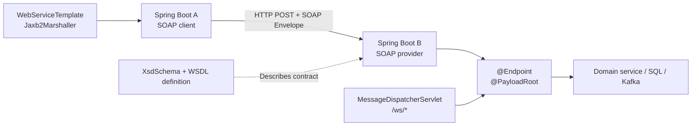
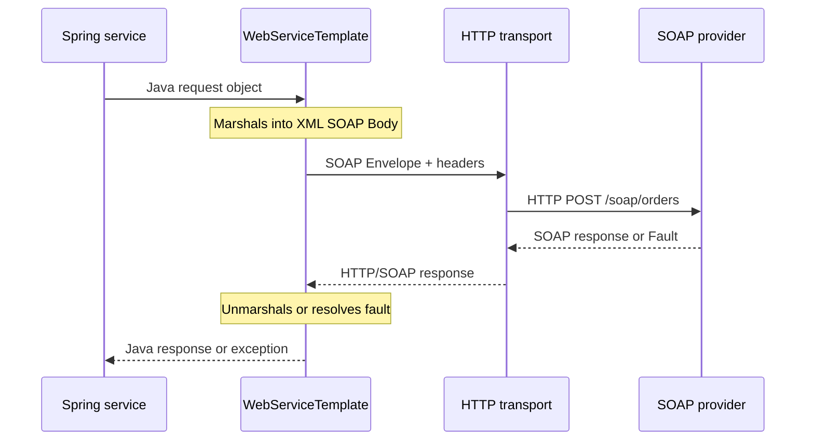
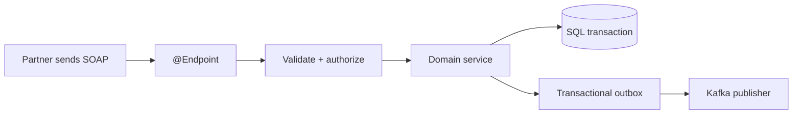
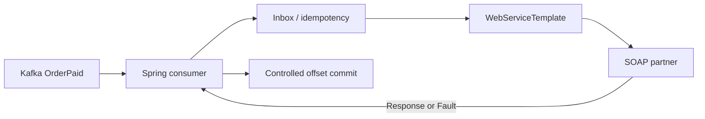

# Distinguishing Calling SOAP from Exposing SOAP Endpoints and XsdSchema

## 1. A Spring Boot Application Can Stand on Either Side of SOAP

In the **SPRING_BOOT_INTEGRATION** module, a Spring Boot application integrates systems via HTTP clients, databases, caches, message brokers, and Spring Integration adapters. When a partner requires **SOAP/XML** communication, there are two independent roles:

1. **SOAP client (caller):** our application **sends requests** to a SOAP endpoint published by another system, receives a SOAP response or SOAP Fault, and translates it into a business result.
2. **SOAP provider/server (publisher):** our application **receives incoming SOAP requests**, maps the XML element to a handler method, invokes services/databases/brokers, and returns a SOAP response or SOAP Fault.

Both roles use XML, SOAP Envelopes, namespaces, and often JAXB; however, their **configuration, data flow, contract responsibilities, and testing approaches differ**. You cannot expose an endpoint merely by creating a `WebServiceTemplate`, nor can you call a partner merely by creating an `@Endpoint`.



Running example: the **OrderHub** system needs to expose a `GetOrderStatus` operation to partners. When OrderHub receives requests from partners, it is a SOAP **server**. When OrderHub calls a bank's SOAP payment service to reconcile status, it is a SOAP **client**. The same application can play **both roles**, though packages/configuration, security, and operations should be kept separate for each direction.

### Learning Objectives

After this lesson, learners can:

- Read a requirement and identify which side **calls** and which side **exposes** SOAP.
- Distinguish SOAP Envelope, XML namespace, **XSD**, **WSDL**, and endpoint URL.
- Configure Spring-WS `WebServiceTemplate` to call an existing SOAP service.
- Use `@Endpoint`, `@PayloadRoot`, and `MessageDispatcherServlet` to expose an endpoint in Spring Boot.
- Use `XsdSchema` with `DefaultWsdl11Definition` in their exact roles, understanding that exposing XSD/WSDL **does not automatically validate every payload**.
- Handle faults, timeouts, authentication, untrusted XML, retries/idempotency, and testing on each side.

## 2. How Do SOAP, XSD, and WSDL Differ?

| Component | Function | Example |
| --- | --- | --- |
| **SOAP** | Defines message exchange format with Envelope, Header, Body, and Fault mechanism | `<soap:Envelope>...` |
| **XSD (XML Schema Definition)** | Defines **XML structure and data types**: element names, occurrences, types, constraints | `GetOrderStatusRequest` contains string `orderId` |
| **WSDL** | Describes the **service contract**: messages/operations, binding/protocol, and service location | Operation `GetOrderStatus`, address `/ws` |
| **Endpoint URL** | HTTP address to which clients send SOAP messages | `https://api.example.test/ws` |
| **JAXB mapping** | Maps XML to Java objects and back | `GetOrderStatusRequest` Java class |
| **Spring-WS** | Framework handling SOAP client/server, endpoint mapping, message conversion, Faults | `WebServiceTemplate`, `@Endpoint` |

**XSD only defines what a piece of XML data looks like**; it does not supply HTTP URLs, operation bindings, or TLS policies. **WSDL captures the service contract** and may reference XSDs. An XSD file is neither an endpoint receiving requests nor a client capable of sending SOAP.

### What Is a SOAP Message?

Here is a simple SOAP 1.1 request:

```xml
<soapenv:Envelope
    xmlns:soapenv="http://schemas.xmlsoap.org/soap/envelope/"
    xmlns:ord="urn:example:orders:soap:v1">
  <soapenv:Header/>
  <soapenv:Body>
    <ord:GetOrderStatusRequest>
      <ord:orderId>ORD-204</ord:orderId>
    </ord:GetOrderStatusRequest>
  </soapenv:Body>
</soapenv:Envelope>
```

Key details:

- `Envelope` and `Body` belong to the SOAP 1.1 namespace.
- `ord:GetOrderStatusRequest` belongs to the **business contract namespace**: `urn:example:orders:soap:v1`.
- Prefixes like `ord` or `soapenv` are merely **namespace aliases**; changing a prefix while keeping the namespace URI unchanged does not alter XML semantics.
- With `@PayloadRoot`, Spring-WS routes based on the **namespace URI and local name** of the root element inside the **SOAP Body**, not by prefix name or URL query parameters.
- SOAP 1.2 uses a different Envelope namespace: `http://www.w3.org/2003/05/soap-envelope`, along with differences in content type/binding and fault layout. Client and server must use matching SOAP versions.

A SOAP response:

```xml
<soapenv:Envelope
    xmlns:soapenv="http://schemas.xmlsoap.org/soap/envelope/"
    xmlns:ord="urn:example:orders:soap:v1">
  <soapenv:Body>
    <ord:GetOrderStatusResponse>
      <ord:status>PAID</ord:status>
    </ord:GetOrderStatusResponse>
  </soapenv:Body>
</soapenv:Envelope>
```

XML contracts must explicitly define required fields, namespaces, versions, business errors, and size limits. Syntactically valid XML can still be **semantically invalid or unauthorized**.

## 3. Comparison Table of the Two Integration Directions

| Criterion | **Calling SOAP** | **Exposing a SOAP endpoint** |
| --- | --- | --- |
| Role | Consumer/client of another service | Provider/server exposing a service |
| Core Spring-WS class | `WebServiceTemplate` | `@Endpoint` + `MessageDispatcherServlet` |
| Configuration targets | Target URI, HTTP sender, JAXB marshaller/unmarshaller, timeouts, auth | Servlet mapping, endpoint beans, WSDL/XSD, interceptors, security |
| Who owns the contract? | Client must conform to provider's WSDL/XSD | Provider versions and publishes the contract for consumers |
| HTTP send/receive | Client **sends** outbound POSTs | Server **receives** inbound POSTs |
| SOAP Fault handling | Classifies error responses from partner | Maps exceptions to contract-compliant SOAP Faults |
| Schema validation | Can validate request/response on client side | Can validate request/response on server side |
| Primary tests | Mock server/downstream SOAP, timeouts, faults, security | Mock SOAP requests to endpoint, WSDL/XSD, mappings, faults |
| Observability | Outbound latency, timeouts, remote faults | Inbound latency, validation failures, request counts |

**Question to determine direction:** "Who owns the HTTP URL that the other side calls?" If the partner owns the URL and our app sends requests there, we write a client. If our app owns the URL and partners send requests to it, we expose an endpoint.

## 4. Designing XSD as the Data Contract

Suppose OrderHub defines version 1 of its schema. In a real Spring Boot project, the illustrative file lives at `src/main/resources/xsd/orders.xsd`:

```xml
<?xml version="1.0" encoding="UTF-8"?>
<xsd:schema
    xmlns:xsd="http://www.w3.org/2001/XMLSchema"
    xmlns:tns="urn:example:orders:soap:v1"
    targetNamespace="urn:example:orders:soap:v1"
    elementFormDefault="qualified">

  <xsd:element name="GetOrderStatusRequest">
    <xsd:complexType>
      <xsd:sequence>
        <xsd:element name="orderId">
          <xsd:simpleType>
            <xsd:restriction base="xsd:string">
              <xsd:minLength value="1"/>
              <xsd:maxLength value="64"/>
            </xsd:restriction>
          </xsd:simpleType>
        </xsd:element>
      </xsd:sequence>
    </xsd:complexType>
  </xsd:element>

  <xsd:element name="GetOrderStatusResponse">
    <xsd:complexType>
      <xsd:sequence>
        <xsd:element name="status" type="xsd:string"/>
      </xsd:sequence>
    </xsd:complexType>
  </xsd:element>
</xsd:schema>
```

The two global elements `GetOrderStatusRequest` and `GetOrderStatusResponse` model the operation using the **Request/Response suffix convention** that Spring-WS `DefaultWsdl11Definition` can use when generating WSDLs. This naming convention is helpful for WSDL generation, though **not a mandatory rule of the SOAP standard**.

For a system with an existing WSDL published by a partner or organization, treat the existing WSDL/XSD as the **contract source**—avoid inventing a new XSD with a different namespace and assuming compatibility.

### When Is XSD Not Enough?

XSD can check string types, lengths, element counts, and XML structure, but it cannot verify:

- Whether the sender is authorized to query that `orderId`.
- Whether the order's state is valid per the domain state machine.
- Whether the request was already processed earlier.
- Whether the message was authenticated via mTLS or WS-Security.
- Whether the endpoint meets timeouts, rate limits, and SLAs.

Therefore combine XSD validation with authentication/authorization and business checks in the service layer.

## 5. Implementing the **Server**: Exposing a SOAP Endpoint

A Spring Boot SOAP server needs at minimum: Spring-WS infrastructure, inbound HTTP servlet, endpoint mapper, payload/response mapping, and business service. Publishing WSDL/XSD is part of the contract, though it executes no business logic on its own.

### Example Dependencies

```groovy
dependencies {
    implementation 'org.springframework.boot:spring-boot-starter-web-services'

    // If field/domain validation via Bean Validation is needed:
    implementation 'org.springframework.boot:spring-boot-starter-validation'

    // For JAXB Java classes generated from XSD,
    // check JAXB runtime/transitive dependencies against the Boot BOM.
    testImplementation 'org.springframework.ws:spring-ws-test'
    testImplementation 'org.springframework.boot:spring-boot-starter-test'
}
```

The example targets Spring Boot 3.x, Java 17+, and Spring Web Services 4.x. When using JAXB on modern JDKs, **JAXB is no longer bundled in the JDK as in older releases**; configure a codegen plugin and matching JAXB implementation. Do not add both `javax.xml.bind` and `jakarta.xml.bind` to the same mapping path without explicit compatibility verification.

### Declaring `MessageDispatcherServlet` and `XsdSchema`

```java
import org.springframework.boot.web.servlet.ServletRegistrationBean;
import org.springframework.context.ApplicationContext;
import org.springframework.context.annotation.Bean;
import org.springframework.context.annotation.Configuration;
import org.springframework.core.io.ClassPathResource;
import org.springframework.ws.config.annotation.EnableWs;
import org.springframework.ws.transport.http.MessageDispatcherServlet;
import org.springframework.ws.wsdl.wsdl11.DefaultWsdl11Definition;
import org.springframework.xml.xsd.SimpleXsdSchema;
import org.springframework.xml.xsd.XsdSchema;

@EnableWs
@Configuration
public class OrderSoapServerConfig {
    public static final String NAMESPACE =
            "urn:example:orders:soap:v1";

    @Bean
    public ServletRegistrationBean<MessageDispatcherServlet>
    messageDispatcherServlet(ApplicationContext applicationContext) {
        var servlet = new MessageDispatcherServlet();
        servlet.setApplicationContext(applicationContext);
        servlet.setTransformWsdlLocations(true);
        return new ServletRegistrationBean<>(servlet, "/ws/*");
    }

    @Bean
    public XsdSchema ordersSchema() {
        return new SimpleXsdSchema(
                new ClassPathResource("xsd/orders.xsd"));
    }

    @Bean(name = "orders")
    public DefaultWsdl11Definition ordersWsdl(XsdSchema ordersSchema) {
        var wsdl = new DefaultWsdl11Definition();
        wsdl.setPortTypeName("OrdersPort");
        wsdl.setLocationUri("/ws");
        wsdl.setTargetNamespace(NAMESPACE);
        wsdl.setSchema(ordersSchema);
        return wsdl;
    }
}
```

Role of each part:

- `@EnableWs` enables Spring-WS server-side configuration. In Spring Boot, web-services auto-configuration may already create a `MessageDispatcherServlet`; here it is **explicitly registered** to illustrate the `/ws/*` URL. In a real app, pick **one consistent approach** to avoid registering duplicate servlets or mappings.
- `MessageDispatcherServlet` receives SOAP HTTP requests and dispatches them to endpoints; it differs from Spring MVC's `DispatcherServlet` used for `@RestController`.
- `XsdSchema` is Spring XML's abstraction for an XSD; `SimpleXsdSchema` loads the resource from the classpath.
- `DefaultWsdl11Definition` uses the XSD and conventions to generate a **WSDL 1.1** describing portType/binding/service; it supplies no business handlers.
- Naming the bean `orders` publishes the WSDL at a URL like **`GET /ws/orders.wsdl`** when the servlet mapping and WSDL bean match the example.
- `locationUri="/ws"` declares the SOAP service address in the WSDL. Behind an ingress or reverse proxy, inspect the final URL, scheme/host, and WSDL location rewriting; never assume every deployment gets the public URL right automatically.

`setTransformWsdlLocations(true)` helps adapt addresses in the WSDL based on the incoming request when appropriate, yet **does not replace** forwarded header configuration, reverse proxy rules, and verifying actual paths. In production, fetch the WSDL from outside the ingress to verify what address clients will see.

### Endpoint Handling Requests

Assuming `GetOrderStatusRequest` and `GetOrderStatusResponse` JAXB classes were generated from the schema in section 4:

```java
import org.springframework.ws.server.endpoint.annotation.Endpoint;
import org.springframework.ws.server.endpoint.annotation.PayloadRoot;
import org.springframework.ws.server.endpoint.annotation.RequestPayload;
import org.springframework.ws.server.endpoint.annotation.ResponsePayload;

@Endpoint
public class OrderStatusEndpoint {
    private static final String NS =
            "urn:example:orders:soap:v1";

    private final OrderStatusService orders;

    public OrderStatusEndpoint(OrderStatusService orders) {
        this.orders = orders;
    }

    @PayloadRoot(namespace = NS, localPart = "GetOrderStatusRequest")
    @ResponsePayload
    public GetOrderStatusResponse status(
            @RequestPayload GetOrderStatusRequest request) {

        String status = orders.getStatus(request.getOrderId());
        var response = new GetOrderStatusResponse();
        response.setStatus(status);
        return response;
    }
}
```

`OrderStatusService` is an application business service you implement; the Java classes for `GetOrderStatusRequest`/`Response` are generated by JAXB codegen or written manually with equivalent JAXB annotations. This is an illustrative example—copying an endpoint class alone is insufficient without the schema and mappings.

**Dispatch mechanism:** Spring-WS inspects the root element inside the SOAP Body, matches `{urn:example:orders:soap:v1}GetOrderStatusRequest`, and invokes `status(...)`. If the namespace or local name differs, the method **will not be mapped**, even if `/ws` and the Java class exist.

### Real HTTP Request

With SOAP 1.1, requests are POSTed to the endpoint:

```http
POST /ws HTTP/1.1
Host: localhost:8080
Content-Type: text/xml; charset=utf-8
SOAPAction: ""

<soapenv:Envelope xmlns:soapenv="http://schemas.xmlsoap.org/soap/envelope/"
                  xmlns:ord="urn:example:orders:soap:v1">
  <soapenv:Body>
    <ord:GetOrderStatusRequest>
      <ord:orderId>ORD-204</ord:orderId>
    </ord:GetOrderStatusRequest>
  </soapenv:Body>
</soapenv:Envelope>
```

Here `POST /ws` **invokes the operation**, whereas `GET /ws/orders.wsdl` **downloads the contract description**. Depending on the WSDL binding, clients may need a specific `SOAPAction` value; never assume every service accepts an empty string. SOAP 1.2 typically uses `application/soap+xml`, so headers cannot simply be equated with SOAP 1.1.

## 6. JAXB and Java Classes Generated from XSD/WSDL

In the `@Endpoint` example earlier, Spring-WS received a `GetOrderStatusRequest` rather than a raw XML string. That requires XML ↔ Java mapping.

A common **contract-first** workflow:

1. Verify the XSD and WSDL have the expected namespaces and request/response elements.
2. Run JAXB XJC or a suitable build plugin to generate Java classes from the XSD. For WSDLs with multiple schemas/imports, configure code generation accordingly.
3. Use the JAXB-annotated classes or `JAXBElement` wrappers exactly as produced by the generator.
4. Include generated sources in compilation; never hand-edit generated classes after each run.
5. Add contract tests to verify marshalling/unmarshalling against XML fixtures and catch unintended namespace drift.

Example project layout (illustrative only):

```text
src/main/resources/xsd/orders.xsd
src/main/java/com/example/orders/ws/OrderStatusEndpoint.java
src/main/java/com/example/orders/soap/OrderSoapGateway.java
build/generated/sources/xjc/.../GetOrderStatusRequest.java
build/generated/sources/xjc/.../GetOrderStatusResponse.java
```

On Java 17+, you need JAXB API/runtime dependencies and a plugin compatible with **Jakarta XML Binding**. Plugins and Gradle/Maven syntax vary by project; do not assume `spring-boot-starter-web-services` alone runs XJC. **Spring-WS does not generate JAXB Java classes from XSD at runtime.**

Some schemas generate a `JAXBElement<T>` wrapper around elements instead of direct `@XmlRootElement` classes. In those cases, endpoints and clients must handle the wrapper and pick a compatible marshaller rather than casting arbitrarily. Inspect the generated Java code before writing method signatures.

### Contract-First or Code-First?

| Design style | Advantages | Risks to manage |
| --- | --- | --- |
| **Contract-first**: design/accept WSDL/XSD first | Both sides agree on XML types, namespaces, and compatibility | Requires codegen/versioning; avoid ad-hoc schema edits |
| Code-first: start from Java objects and try to export schema/WSDL | Convenient in Java-only internal systems | Changing Java classes can accidentally break the wire contract; not all mappings are explicit |

In enterprise integrations spanning heterogeneous clients, contract-first helps preserve interface stability. Still, the **contract source must be the version agreed upon with the partner/service owner**, not an ad-hoc XML file written just to make code compile.

## 7. Implementing the **Client**: Calling SOAP with `WebServiceTemplate`

On the client side, the application does not need to register `MessageDispatcherServlet` to send requests. It needs:

- The provider's endpoint URL, read from environment configuration.
- The agreed WSDL/XSD contract to build requests with matching namespaces/operations.
- `Jaxb2Marshaller` or another payload conversion mechanism.
- `WebServiceTemplate` to send and receive SOAP messages.
- HTTP transport, timeouts, auth/TLS, fault mapping, and observability.

### Configuring the JAXB Marshaller and `WebServiceTemplate`

```java
import org.springframework.context.annotation.Bean;
import org.springframework.context.annotation.Configuration;
import org.springframework.beans.factory.annotation.Value;
import org.springframework.oxm.jaxb.Jaxb2Marshaller;
import org.springframework.ws.client.core.WebServiceTemplate;

@Configuration
public class OrderSoapClientConfig {

    @Bean
    public Jaxb2Marshaller orderSoapMarshaller() {
        var marshaller = new Jaxb2Marshaller();
        // Package generated by JAXB/XJC with matching JAXB metadata.
        marshaller.setContextPath("com.example.orders.ws.generated");
        return marshaller;
    }

    @Bean
    public WebServiceTemplate orderWebServiceTemplate(
            Jaxb2Marshaller orderSoapMarshaller,
            @Value("${partner.soap.order-uri}") String endpointUri) {
        var template = new WebServiceTemplate();
        template.setMarshaller(orderSoapMarshaller);
        template.setUnmarshaller(orderSoapMarshaller);
        template.setDefaultUri(endpointUri);
        return template;
    }
}
```

```yaml
# application.yml — URL is an illustrative placeholder.
partner:
  soap:
    order-uri: ${ORDER_SOAP_URI:https://partner.example.test/soap/orders}
```

**Important:** `setDefaultUri` expects the **executable SOAP endpoint URL**, not the `?wsdl` address. For example, `https://partner.example.test/soap/orders?wsdl` fetches the WSDL contract, which is not necessarily the URL to POST SOAP requests to.

This configuration focuses on marshalling and endpoint wiring. Production requires adding an **HTTP message sender/transport** with bounded connect/read timeouts, connection pooling, and TLS; exact timeout configuration APIs depend on the message sender and Spring-WS version. Never let partner calls block indefinitely—especially inside Kafka/RabbitMQ consumers.

### Calling from an Application Service

```java
import org.springframework.stereotype.Service;
import org.springframework.ws.client.core.WebServiceTemplate;
import org.springframework.ws.client.core.support.WebServiceGatewaySupport;
import org.springframework.ws.soap.client.core.SoapActionCallback;

@Service
public class OrderSoapGateway {
    private final WebServiceTemplate soap;

    public OrderSoapGateway(WebServiceTemplate orderWebServiceTemplate) {
        this.soap = orderWebServiceTemplate;
    }

    public String getOrderStatus(String orderId) {
        var request = new GetOrderStatusRequest();
        request.setOrderId(orderId);

        Object rawResponse = soap.marshalSendAndReceive(
                request,
                new SoapActionCallback("urn:GetOrderStatus"));

        if (!(rawResponse instanceof GetOrderStatusResponse response)) {
            throw new IllegalStateException(
                    "Unexpected SOAP response type");
        }
        return response.getStatus();
    }
}
```

`SoapActionCallback` is included **only if the WSDL binding requires that SOAPAction**. Do not invent `urn:GetOrderStatus` for a real partner: some services use different values or require none. For SOAP 1.2 or WS-Addressing, configure the message factory and headers per contract rather than altering SOAPAction alone.

`WebServiceGatewaySupport` can be extended to build a client gateway, but **is not required** to use `WebServiceTemplate`. The example uses constructor injection to make the bean dependency explicit.

### What Does `WebServiceTemplate` Actually Do?



The client **does not** use `@PayloadRoot` to select an operation on the partner side. Operations are selected by the wire contract, payload element, and required binding/SOAPAction. `WebServiceTemplate` sends SOAP; it neither builds the partner's WSDL nor knows request types without a configured marshaller/mapping.

### One Client Calling Multiple Endpoints

You can configure multiple named/`@Qualifier` `WebServiceTemplate` beans or pass an explicit URI per call. Whenever two partners have **different namespaces, truststores, credentials, or retry policies**, separate their gateways and configurations so tokens, client certificates, or requests are never sent to the wrong destination.

If a single service acts as both SOAP provider and SOAP client, avoid unconditionally sharing XSDs, JAXB contexts, timeouts, and security settings: inbound and outbound flows often have **two different contracts, owners, and release lifecycles**.

## 8. What Does `XsdSchema` Actually Do — and What Does It Not Do?

`XsdSchema` in Spring XML is an abstraction representing an XSD schema, used when:

- Supplying a schema to `DefaultWsdl11Definition` to generate a convention-based WSDL.
- Configuring `PayloadValidatingInterceptor` on a SOAP server to validate payloads.
- Supplying a schema to a client validation component if configured explicitly by the app.

It **does not** create REST controllers, register SOAP endpoints, generate JAXB Java classes at runtime, or **automatically validate requests/responses merely because an `XsdSchema` bean exists**.

### Adding Validation to a SOAP Provider

Example interceptor validating both requests and responses against the published schema:

```java
import java.util.List;
import org.springframework.context.annotation.Bean;
import org.springframework.context.annotation.Configuration;
import org.springframework.ws.config.annotation.WsConfigurer;
import org.springframework.ws.server.EndpointInterceptor;
import org.springframework.ws.server.endpoint.interceptor.PayloadValidatingInterceptor;
import org.springframework.xml.xsd.XsdSchema;

@Configuration(proxyBeanMethods = false)
public class OrderSoapValidationConfig {

    @Bean
    public PayloadValidatingInterceptor orderPayloadValidator(
            XsdSchema ordersSchema) {
        var validator = new PayloadValidatingInterceptor();
        validator.setXsdSchema(ordersSchema);
        validator.setValidateRequest(true);
        validator.setValidateResponse(true);
        return validator;
    }

    @Bean
    public WsConfigurer orderWsConfigurer(
            PayloadValidatingInterceptor orderPayloadValidator) {
        return new WsConfigurer() {
            @Override
            public void addInterceptors(
                    List<EndpointInterceptor> interceptors) {
                interceptors.add(orderPayloadValidator);
            }
        };
    }
}
```

`PayloadValidatingInterceptor` validates the **SOAP Body payload** against the configured XSD. Response validation catches server bugs generating schema-invalid XML, though it adds overhead and can turn response errors into Faults. Test with real DTO/JAXB classes and schemas—especially optional elements, `xsi:nil`, namespaces, and XSD imports.

If the application exposes **multiple SOAP endpoints with distinct schemas**, do not apply a single validator globally if its schema does not cover all of their elements. Use interceptor mappings or split configuration so validation matches each endpoint.

Never confuse **XML schema validation** with authorization or WS-Security. An XSD-valid message can still come from an unauthorized caller or reference another tenant's `orderId`.

## 9. Publishing a Static WSDL vs. Generating WSDL from XSD

In Spring-WS, two approaches are common:

| Model | Approach | When is it suitable? |
| --- | --- | --- |
| **XSD-generated WSDL** | `XsdSchema` + `DefaultWsdl11Definition` using naming conventions | Relatively simple contracts where Spring manages schema and service metadata |
| **Approved static WSDL** | Publish an existing WSDL (and imported XSDs) via the appropriate `WsdlDefinition` | Strict partner contracts, complex bindings/SOAPActions/policies, exact file preservation |

`DefaultWsdl11Definition` **does not magically infer your entire Java codebase**. It relies on XSD elements and naming conventions to structure requests, responses, and operations. For complex WSDLs with multiple bindings, custom headers, WS-Security policies, or signed partner specs, a **static WSDL** avoids accidental contract changes.

Spring-WS offers `SimpleWsdl11Definition` to publish existing WSDLs. When WSDLs use relative paths and `xsd:import`/`wsdl:import`, verify how related resources are exposed so external clients can fetch and resolve them.

### WSDL URL vs. Executable SOAP Path

```text
GET  https://orders.example.test/ws/orders.wsdl
     -> returns contract WSDL

POST https://orders.example.test/ws
     -> accepts SOAP Envelope and dispatches to @Endpoint
```

Paths are examples based on section 5's configuration. With an application context path or reverse proxy prefix, actual URLs may differ.

Downloading the WSDL only proves the **contract is published**; proving the endpoint works requires sending a valid SOAP POST and checking the response. Conversely, SOAP POSTs can work even if the provider does not publish the WSDL publicly (when contracts are distributed out-of-band).

### Contract Versioning

Never casually alter `targetNamespace`, global element names, element ordering, or field types because clients generated from the previous XSD may break. For breaking changes, introduce a new versioned namespace/endpoint or an agreed compatibility policy. Bumping a Java package version does not change wire namespaces.

When adding optional fields, check `minOccurs` and old-client compatibility. Adding a required element that existing clients do not send causes validation to reject live requests even though the server boots cleanly.

## 10. SOAP Faults, HTTP Statuses, and Retry Classification

SOAP defines a **Fault** structure inside the Envelope. SOAP errors do not map 1:1 to HTTP 4xx/5xx status codes, even though HTTP bindings use HTTP status codes to convey failures.

SOAP 1.1 Fault example:

```xml
<soap:Envelope xmlns:soap="http://schemas.xmlsoap.org/soap/envelope/">
  <soap:Body>
    <soap:Fault>
      <faultcode>soap:Client</faultcode>
      <faultstring>Invalid request</faultstring>
    </soap:Fault>
  </soap:Body>
</soap:Envelope>
```

On the server side, distinguish error types:

| Category | Examples | Appropriate response |
| --- | --- | --- |
| Malformed XML or schema mismatch | Missing `orderId`, wrong namespace | Client/request fault per SOAP version and policy |
| Deterministic business error | Order not found / caller unauthorized | Controlled business fault code without leaking internal details |
| Transient system error | DB timeout, downstream 503 | Server/receiver fault or contract-defined response |
| AuthN/AuthZ failure | Invalid mTLS/WS-Security | Reject early per security policy without sensitive details |

In Spring-WS, `SoapFaultMappingExceptionResolver` maps server exceptions to SOAP Faults per configuration. Never let exception stack traces, connection strings, tokens, or SQL queries leak into `faultstring` or `detail` in production.

On the client side, `WebServiceTemplate` throws `SoapFaultClientException` on SOAP Faults, or transport/unmarshalling exceptions on network/XML errors. Retry policies must **classify errors**, never retrying everything:

- Faults indicating invalid requests/schema mismatches: generally **do not retry**, as the payload will not change.
- Timeouts, connection resets, HTTP 503: bounded retries if the operation is **idempotent**, or reconcile status before retrying.
- Business faults meaning "already processed" may signal deduplication; check contract definitions.
- Client deserialization errors from out-of-contract responses: alert and fix compatibility rather than retrying endlessly.

**Critical for side-effecting operations:** a timeout after SOAP POST **does not prove the server failed to execute**. If a payment call committed on the partner side while the response was lost in transit, blind retries create duplicate transactions. Use idempotency keys, request IDs, or status-lookup APIs when supported by the contract.

## 11. SOAP/XML Security and Sensitive Data

A SOAP message over HTTP(S) may carry order details, customer records, tokens, or XML signatures. Defense requires multiple layers:

| Layer | Control | Limitation |
| --- | --- | --- |
| TLS | HTTPS and certificate/hostname verification | Does not verify business permissions |
| mTLS | Client certificate for connection-level authentication | Does not authorize individual `orderId`s in the payload |
| WS-Security | UsernameToken, message signing/encryption per contract profile | Requires exact policy, trust, keys, and canonicalization |
| XSD validation | Validates payload structure/types | Does not authenticate the sender |
| Authorization | Verifies principal can access target resources | Depends on domain/tenant context |
| Size/depth limits | Stops oversized XML, deep nesting, entity expansion | Must be enforced at gateway/parser/transport layers |
| Redaction/retention | Prevents leaks in logs, traces, DLTs | Cannot scrub data already written outside |

Spring-WS provides WS-Security integration such as `Wss4jSecurityInterceptor` when the right dependency is added. However, **WS-Security is not enabled automatically simply by using SOAP**. If a partner requires XML signatures, timestamps, UsernameTokens, nonces, or encryption, implement per WSDL/policy/contract and verify with partner fixtures.

### Preventing XML External Entity and Parser Abuse

XML from partners or users is **untrusted input**. Never instantiate `DocumentBuilderFactory`, `SAXParserFactory`, or StAX parsers permitting DTD/external entity resolution without risk assessment. That exposes XXE, SSRF, local file reads, and resource exhaustion.

Best practices:

- Prefer framework parsers and marshallers configured securely; verify behavior in your exact Spring-WS, JAXB, and parser provider versions.
- Disable external DTDs/entities unless strictly required; bound entity expansion and nesting depth.
- Enforce **HTTP body byte caps** at ingress and application layers; `@Size`/XSD field limits do not replace pre-parse protection.
- For XSDs with `include/import`, block untrusted URIs from network/filesystem access during validation.
- Cap concurrent requests, timeouts, response sizes, and logging/tracing paths.
- Never print raw XML Envelopes when SOAP Headers contain credentials, signatures, or PII.

In Kafka/RabbitMQ pipelines, rejected SOAP/XML messages should not go verbatim into public DLTs. If replay is required, store metadata, event IDs, and payloads in a restricted store with RBAC, encryption, and retention policies.

## 12. Testing a SOAP Server Differs from Testing a SOAP Client

Tests that only verify Java services work **do not prove** SOAP wire format, namespaces, WSDL, or fault mappings are right. Split tests by **integration direction**.

### Server-Side: `MockWebServiceClient`

Spring-WS provides `MockWebServiceClient` to send SOAP payloads directly to endpoints in the Spring application context without opening a real HTTP port. The test below assumes `OrderStatusService` returns `PAID` for `ORD-204`:

```java
import static org.springframework.ws.test.server.RequestCreators.withPayload;
import static org.springframework.ws.test.server.ResponseMatchers.payload;

import org.junit.jupiter.api.Test;
import org.springframework.beans.factory.annotation.Autowired;
import org.springframework.boot.test.context.SpringBootTest;
import org.springframework.context.ApplicationContext;
import org.springframework.ws.test.server.MockWebServiceClient;
import org.springframework.xml.transform.StringSource;

@SpringBootTest
class OrderStatusEndpointTest {

    @Autowired
    ApplicationContext applicationContext;

    @Test
    void respondsWithPaidStatus() {
        var client = MockWebServiceClient.createClient(applicationContext);

        var request = new StringSource("""
                <ord:GetOrderStatusRequest
                    xmlns:ord="urn:example:orders:soap:v1">
                  <ord:orderId>ORD-204</ord:orderId>
                </ord:GetOrderStatusRequest>
                """);

        var response = new StringSource("""
                <ord:GetOrderStatusResponse
                    xmlns:ord="urn:example:orders:soap:v1">
                  <ord:status>PAID</ord:status>
                </ord:GetOrderStatusResponse>
                """);

        client.sendRequest(withPayload(request))
                .andExpect(payload(response));
    }
}
```

This is a test skeleton: provide a fixture/service stub or test data for `ORD-204` alongside valid JAXB mappings. `withPayload` and `payload` assert the SOAP Body element without requiring a full SOAP Envelope.

Things **this test does not prove**:

- Is the real servlet mapped to `/ws/*` in deployment?
- Can the WSDL be downloaded from `/ws/orders.wsdl` outside the reverse proxy?
- Are TLS/mTLS, authentication, and HTTP/proxy headers configured right?
- Can the partner client deserialize the response and use matching SOAP version/binding?

Therefore also run tests against a real/embedded servlet container, fetch the WSDL, and send SOAP requests over HTTP(S).

### Client-Side: `MockWebServiceServer`

Conversely, when building the **SOAP caller**, use `MockWebServiceServer` to mock the partner without running a real `@Endpoint` server:

```java
import static org.springframework.ws.test.client.RequestMatchers.payload;
import static org.springframework.ws.test.client.ResponseCreators.withPayload;

import org.junit.jupiter.api.Test;
import org.springframework.beans.factory.annotation.Autowired;
import org.springframework.boot.test.context.SpringBootTest;
import org.springframework.ws.client.core.WebServiceTemplate;
import org.springframework.ws.test.client.MockWebServiceServer;
import org.springframework.xml.transform.StringSource;

@SpringBootTest
class OrderSoapGatewayTest {

    @Autowired
    WebServiceTemplate orderWebServiceTemplate;

    @Autowired
    OrderSoapGateway gateway;

    @Test
    void marshalsRequestAndReadsResponse() {
        var server = MockWebServiceServer.createServer(
                orderWebServiceTemplate);

        var expectedRequest = new StringSource("""
                <ord:GetOrderStatusRequest
                    xmlns:ord="urn:example:orders:soap:v1">
                  <ord:orderId>ORD-204</ord:orderId>
                </ord:GetOrderStatusRequest>
                """);

        var mockedResponse = new StringSource("""
                <ord:GetOrderStatusResponse
                    xmlns:ord="urn:example:orders:soap:v1">
                  <ord:status>PAID</ord:status>
                </ord:GetOrderStatusResponse>
                """);

        server.expect(payload(expectedRequest))
                .andRespond(withPayload(mockedResponse));

        org.junit.jupiter.api.Assertions.assertEquals(
                "PAID", gateway.getOrderStatus("ORD-204"));
        server.verify();
    }
}
```

This is also a skeleton: test fixtures must wire the beans, JAXB package, and mappings. `MockWebServiceServer` verifies the outbound request format and gateway response parsing; it does not test DNS, TLS, HTTP timeouts, or the live partner contract. When integrating with a real vendor, test in their sandbox against their **exact versioned WSDL/XSD**.

### Minimum Test Matrix for Both Roles

| Scenario | SOAP client | SOAP provider |
| --- | --- | --- |
| Valid request/response XML | Serializes right, parses response | Maps endpoint right, returns valid payload |
| Wrong namespace or local name | Detects contract mismatch, never guesses element names | Does not dispatch wrong operation; responds per error policy |
| Missing `orderId` | Validates before sending if applicable | XSD interceptor/service rejects |
| Business SOAP Fault | No infinite retry; maps to domain error | Never exposes stack traces/SQL/tokens |
| Partner HTTP timeout | Bounded retries and idempotency check | Downstream timeout leaves no corrupted half-written state |
| SOAP 1.1/1.2 mismatch | Content type/message factory matches version | Contract version/binding explicit |
| WSDL/XSD version upgrade | Test JAXB-generated code against new and old XML | Verify backward compatibility and WSDL URL |
| Oversized payload / XXE | Blocked before deep processing | Blocked at ingress/parser; other workers unaffected |
| TLS / mTLS / WS-Security | Verifies server identity, signs contract tokens | Only authorized callers may invoke operations |
| Crash after DB commit before broker ACK | Does not call partner to duplicate side effect on replay | If provider publishes to broker, no lost/duplicated events |

Do not rely only on `contextLoads()`: an app can boot cleanly while having a wrong WSDL URL, wrong JAXB namespace, or missing `@PayloadRoot` on the endpoint.

## 13. Integrating SOAP with Databases, Caches, and Message Brokers

When SOAP is one step in a larger flow, transaction and idempotency boundaries behave like any other HTTP protocol.

### Pattern A: Inbound SOAP → SQL → Kafka



Suppose OrderHub receives `ConfirmOrderRequest` via SOAP, updates SQL, and emits `OrderConfirmed` to Kafka. **There is no default SQL transaction spanning a SOAP response and a Kafka publish.** If SQL succeeds and Kafka publish fails, systems drift out of sync.

Safeguards:

1. Use a **transactional outbox** to persist the event to publish inside the same SQL transaction as the business update, then have a worker publish from the outbox.
2. Use a stable request ID / event ID to handle duplicates safely if the partner resends the SOAP request after a timeout.
3. Return business confirmation matching **confirmed durable commitments**—never claim Kafka subscribers finished processing when only SQL/outbox committed.
4. For synchronous SLA demands, design timeouts and intermediate-status contracts accordingly.

### Pattern B: Kafka → SOAP Client → Partner



A dangerous failure:

1. Consumer reads Kafka `OrderPaid`.
2. Sends SOAP `CreateShipment`; partner **creates** the shipment.
3. Connection drops before receiving the SOAP response.
4. Consumer retries and creates a **second** shipment if the partner lacks idempotency.

**The solution is not merely retrying:** you need an idempotency key agreed between producer/consumer and enforced by the SOAP provider, or a read/lookup operation to inspect state before re-invoking. If the SOAP contract supports neither, design reconciliation/manual review instead of treating timeouts as definite failures.

If a SOAP client runs inside a long SQL transaction, network timeouts hold DB connections open and exhaust the pool. Separate state machines/outboxes, asynchronous processing, and operation timeouts.

### Caching Does Not Replace the SOAP Contract

Redis or in-memory caches can offload status lookups, yet stale caches cannot fix version mismatches. Cached SOAP responses must still respect authorization and data rules; never serve another tenant's status just because a cache key used `orderId` without a tenant scope.

## 14. Operations, Observability, and Troubleshooting

Measure **SOAP client** and **SOAP provider** separately because each direction has a distinct owner:

| Signal group | Client calling partner | Server exposing SOAP |
| --- | --- | --- |
| Latency | Connect/read/overall request latency, timeouts | Processing latency, queue/thread saturation |
| Availability | DNS/TCP/TLS errors, remote HTTP statuses | HTTP errors, servlet readiness, overload |
| Contract | Unmarshal errors, schema version mismatches | XML/XSD validation errors, unmapped payload roots |
| SOAP Faults | Fault codes from partners | Fault types returned to clients |
| Security | Credential/WS-Security failures, certificate expiry | AuthN/AuthZ failures, invalid signatures, tenant violations |
| Business | Retries, reconciliation, duplicate remote calls | Duplicate request IDs, SQL failures, Kafka outbox backlog |

Structured logs should prioritize `correlationId`, operation name, contract version, logical partner, duration, HTTP/SOAP fault code, and internal error code. **Never log raw SOAP Envelopes by default**: SOAP Headers can carry UsernameTokens/signatures and SOAP Bodies can carry PII or payment details.

### Common Error Matrix

| Symptom | Common cause | What to inspect |
| --- | --- | --- |
| `GET /ws/orders.wsdl` returns 404 | WSDL bean unregistered, wrong bean name, or wrong servlet mapping | `@Bean(name="orders")`, `DefaultWsdl11Definition`, servlet mapping |
| WSDL loads, yet POST fails | Wrong execution URL or request never hits `MessageDispatcherServlet` | `soap:address` in WSDL, reverse proxy, POST path |
| POST returns endpoint-not-found error | `@PayloadRoot` mismatches namespace/localPart | Actual payload root, not just XML prefix |
| JAXB unmarshal exception | Wrong generated classes/context path or different schema version | Namespace, `ObjectFactory`, `@XmlRootElement`/`JAXBElement` |
| Client receives SOAP Fault | Server reported contract/business/infra failure | Controlled SOAP fault code/detail, HTTP status |
| `415 Unsupported Media Type` or SOAP version mismatch | Sending SOAP 1.1 to a 1.2 endpoint or vice versa | Content-Type, SOAP Envelope namespace, binding |
| XSD error when using `include/import` | Unresolved resource or wrong version/schema URI | Classpath, resolver, packaged resources |
| WSDL displays internal address | Misconfigured proxy forwarded headers or location rewrite | `soap:address` over public URL, HTTPS scheme |
| TLS handshake error | CA, SAN/hostname, client cert, TLS version | Truststore, keystore, certificate chain |
| Local tests pass, production fails | Added auth/WS-Security, reverse proxy, or different contract | Version-accurate partner sandbox/WSDL, real topology |
| Consumer calls SOAP multiple times | Broker redelivery + HTTP timeout + missing idempotency | Event ID, retry count, partner status |

**Never fix every error by raising timeouts or adding retries.** Wrong namespaces, invalid XSDs, missing permissions, or missing certificates will not heal by resending the same message.

## 15. Practice Lab: One Application Both Exposing and Calling SOAP

**Context:** OrderHub exposes `GetOrderStatus` for Partner A under namespace `urn:example:orders:soap:v1`. Meanwhile, upon consuming `OrderPaid` from Kafka, OrderHub calls Partner B's `ConfirmSettlement` SOAP service. The two sides may differ in namespaces, JAXB packages, TLS trust, and error policies.

### Tasks

1. Design an XSD containing `GetOrderStatusRequest` and `GetOrderStatusResponse`, specifying max lengths, namespace, and version.
2. Configure `MessageDispatcherServlet` at `/ws/*`; publish `orders.wsdl` via `DefaultWsdl11Definition` or use a static WSDL if a formal contract exists.
3. Create an `@Endpoint` using `@PayloadRoot`; invoke a service looking up status by `orderId` and authenticated principal/tenant.
4. Generate JAXB classes from the XSD and verify response marshalling and invalid-request handling.
5. Register `PayloadValidatingInterceptor` for the right schema and endpoint scope; test XML missing `orderId`.
6. Create a separate `WebServiceTemplate` gateway to call Partner B using B's WSDL/XSD and the executable SOAP POST URI.
7. Verify SOAPAction/binding and TLS trust; add WS-Security if Partner B requires it—never use trust-all.
8. Inject SOAP Faults, timeouts, and wrong-namespace XML responses; separate retryable from permanent errors.
9. Simulate a Kafka record redelivery after Partner B processed the command successfully but before the consumer committed its offset; prove no duplicate settlement is created when the contract supports idempotency.
10. Measure fault codes, validation errors, retry attempts, latencies, and outbox/inbox states without logging sensitive raw XML.

### Acceptance Criteria

| Verification | Expected outcome |
| --- | --- |
| WSDL | `GET /ws/orders.wsdl` succeeds, describing accurate operations and public SOAP address |
| Server mapping | SOAP POST with valid payload root reaches the matching `@Endpoint` |
| XSD validation | Structurally invalid XML is rejected; valid XML still undergoes business authorization |
| JAXB | Requests/responses carry accurate namespaces and interoperate with external clients |
| Client gateway | `WebServiceTemplate` calls the right provider URL and parses responses/faults cleanly |
| Infrastructure errors | Timeouts/503 have bounded retries; consumers never block indefinitely |
| SOAP security | TLS/WS-Security matches contract; no credentials or PII logged |
| Broker recovery | Redelivery after DB/remote commit produces no duplicate business effects |
| Monitoring | Distinguishes inbound SOAP faults from outbound SOAP faults |

## 16. Misconceptions to Avoid

1. **Thinking creating `@Endpoint` calls a partner:** `@Endpoint` is strictly an inbound handler.
2. **Thinking creating `WebServiceTemplate` exposes a URL:** the template is an outbound client, not a servlet.
3. **Passing the `?wsdl` URL into `setDefaultUri`:** the WSDL URL fetches the contract, whereas SOAP messages POST to the service address.
4. **Thinking an `XsdSchema` bean automatically validates every request:** you must wire the matching validator/interceptor.
5. **Thinking XSD replaces WSDL:** XSD does not define service addresses, bindings, or operations.
6. **Thinking WSDL generation writes Java handlers:** Spring-WS never generates business logic from schemas.
7. **Routing by XML prefix:** the real QName is **namespace URI + local name**, independent of prefixes like `ord`.
8. **Switching SOAP 1.1 to SOAP 1.2 just by changing Content-Type:** envelope namespaces, bindings, and fault semantics also change.
9. **Disabling TLS verification or DTD security as a "quick fix":** introduces MITM, XXE, or resource exhaustion vulnerabilities.
10. **Retrying every SOAP Fault:** many faults reflect schema or authorization errors that never self-heal.
11. **Believing SOAP participates in SQL/Kafka transactions:** cross-system flows require outboxes, idempotency, and reconciliation.
12. **Skipping WSDL checks through the ingress:** `soap:address` may advertise the wrong host, scheme, or context path.

## 17. Self-Check Questions

1. When a Spring Boot service **sends** a SOAP POST to a bank, is it a client or a server? Which Spring-WS class is typically used?
2. When a partner sends a SOAP POST to `/ws` on our application, what receives and routes the request?
3. What are the two distinct roles of `XsdSchema` and `DefaultWsdl11Definition`?
4. Why does `GET /ws/orders.wsdl` returning 200 not prove `@Endpoint` handles SOAP POSTs properly?
5. Does `@PayloadRoot(namespace=..., localPart=...)` match the namespace URI or the XML prefix?
6. Why must `@ResponsePayload` and JAXB mappings use Java classes/annotations aligned with the XSD?
7. Once you have an `XsdSchema` bean, what must you add to reject schema-invalid requests?
8. How do you distinguish a SOAP Fault caused by invalid data from an HTTP timeout error?
9. Must the WSDL/XSD of a client calling a partner match the WSDL/XSD of the server exposed by your application?
10. When a Kafka consumer calls SOAP to create a shipment and crashes before committing its offset, why is idempotency required on the target system?
11. Which scenarios require testing over real HTTP(S) instead of only `MockWebServiceClient` or `MockWebServiceServer`?

## Summary

**Calling SOAP** and **exposing SOAP endpoints** are two distinct integration directions in Spring Boot. The caller uses `WebServiceTemplate` with a marshaller, endpoint URI, transport, and response/fault handling; the publisher uses `MessageDispatcherServlet`, `@Endpoint`, and `@PayloadRoot` to receive and route SOAP requests. `XsdSchema` describes payloads and supports WSDL generation/validation, while `DefaultWsdl11Definition` generates WSDL contracts by convention; **neither creates handlers nor enables validation automatically**. When integrated with SQL, HTTP, Kafka, and RabbitMQ, flows still require timeouts, TLS/WS-Security, untrusted XML controls, idempotency, outboxes/inboxes, tests in both directions, and explicit error observability.

### References

- [Spring Web Services — Reference Documentation](https://docs.spring.io/spring-ws/docs/current/reference/html/)
- [Spring Boot Reference — Web Services](https://docs.spring.io/spring-boot/reference/io/webservices.html)
- [Spring Web Services — API Documentation](https://docs.spring.io/spring-ws/docs/current/api/)
- [Spring Framework — XML Marshalling](https://docs.spring.io/spring-framework/reference/data-access/oxm.html)
- [W3C — XML Schema Definition Language](https://www.w3.org/XML/Schema)
- [W3C — SOAP Version 1.2](https://www.w3.org/TR/soap12/)
