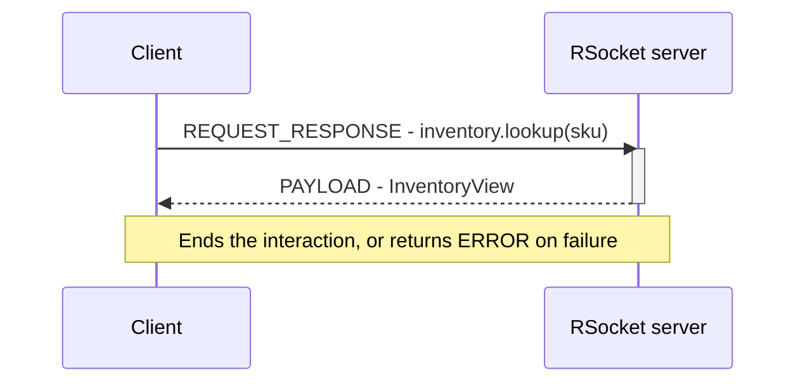
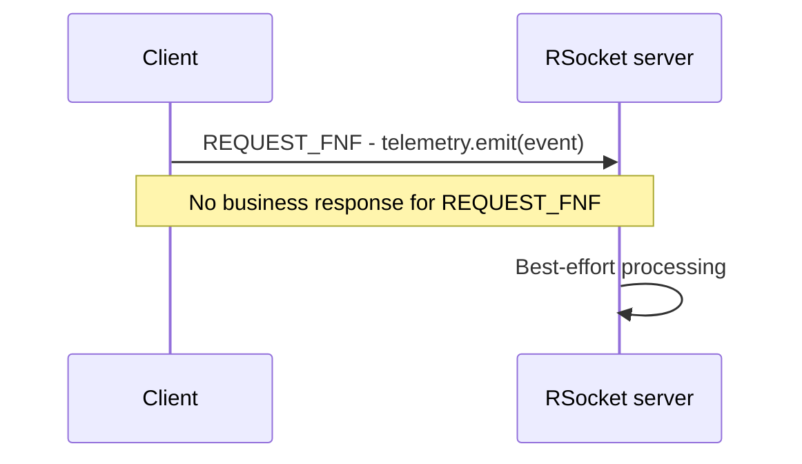
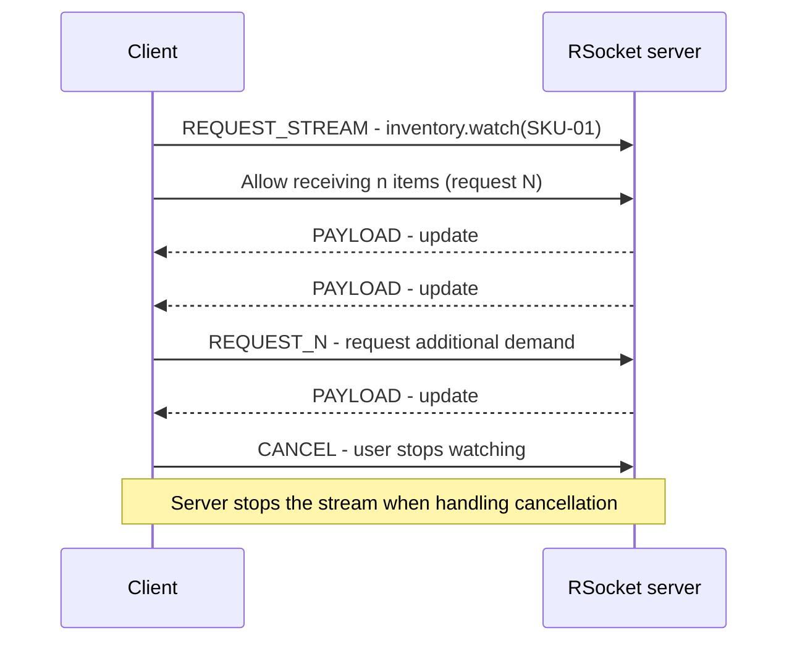
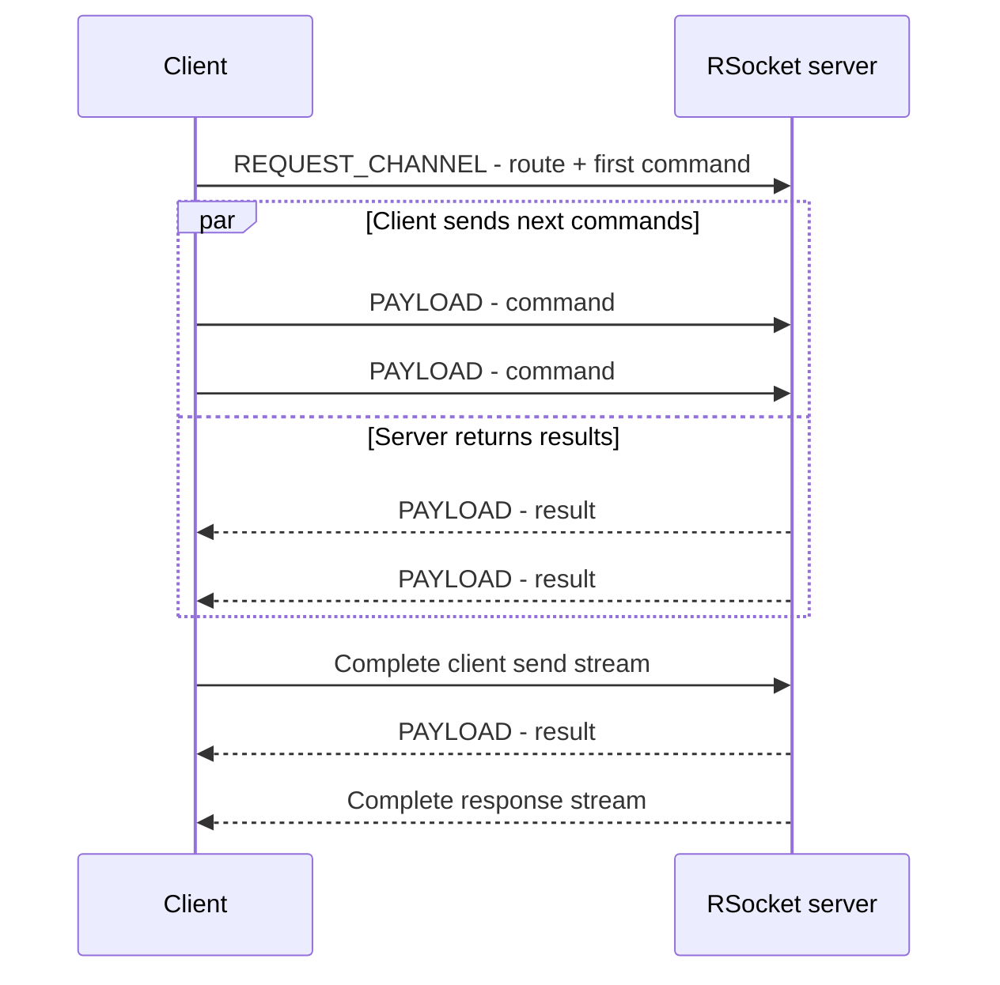

# Request-response, fire-and-forget, stream, and channel models

> **Chapter:** RSocket  
> **Scope:** Within the **SPRING_BOOT_INTEGRATION** module, RSocket is a communication option between components of a Spring Boot integration system, alongside HTTP clients, databases, caches, message brokers, and Spring Integration adapters. This article analyzes the four interaction models, implementation examples, data contracts, error handling, transactions, deduplication, testing, and operational observability.

## 1. What is RSocket and why are there four models?

**RSocket** is a bidirectional, message-oriented communication protocol that supports asynchronous data streams and protocol-level **backpressure**. Two connected endpoints exchange messages containing data payloads and metadata; they can communicate over transports such as TCP or WebSocket. RSocket allows multiple logical interaction streams to share a single physical connection.

Its defining characteristic is that the protocol explicitly expresses **how many messages each side is expected to send and receive**. Instead of forcing every operation into “send one request, receive one response,” RSocket provides four *interaction models*:

| Model | Caller sends | Handler returns | Nature | Example in an integration system |
| --- | --- | --- | --- | --- |
| **Request-response** | One request | At most one result or error | Lookup/command invocation requiring a result | Checking inventory for an SKU |
| **Fire-and-forget** | One message | No application response | Sending without waiting for a remote processing result | Emitting telemetry signals where loss is acceptable |
| **Request-stream** | One request | Zero, one, or many results over time | Subscribing to receive a stream | Watching inventory changes |
| **Request-channel** | A stream of messages | A stream of messages | Bidirectional | Continuously sending validation commands and receiving results |

Here, **“at most one” differs from “exactly one”**: a request can complete without a value or terminate with an error. Likewise, “no response” in fire-and-forget **does not mean the message is durably stored** or guaranteed to have been processed.

In Spring, these four models are commonly mapped respectively to `Mono<T>`, `Mono<Void>`, `Flux<T>`, and the `Flux<In> → Flux<Out>` combination. This is the programming style using Reactor/Spring Messaging; RSocket itself is a protocol and does not depend on Java types.

## 2. Request-response: one request, one result

### Mechanism

The client sends one request message. The server processes it and returns **at most one result payload** or reports an error. The interaction ends once the result has been returned or when a completion/error signal is received. It is similar to HTTP request-response in the number of results, but runs over a reusable RSocket connection.



**When to choose:** querying state, validating a parameter, fetching current configuration, or executing a command where the caller needs to know success/failure. If the call **mutates data**, idempotency and duplicate-processing prevention must be clearly defined before enabling automatic retries.

**Failure cases:** a client timeout does not prove the server did not process the request. The server may have already committed to the DB while the response was lost when the connection dropped. For an order-creation command, a retry without an idempotency key can create duplicate data.

## 3. Fire-and-forget: send once, no application result

The client sends **one** payload; the server does not send a business response for that interaction. This model is appropriate when the sender does not need to know the processing outcome and message loss is accepted by the business contract.



**Common misconception:** `send()` on the client returns a `Mono<Void>` to track the send operation on the client side. Completion of that publisher **is not confirmation from the server that the event was processed, committed, or durably stored**. If the server reports an error while processing, the sender does not receive a business response through that fire-and-forget request itself.

Fire-and-forget fits non-critical signals or telemetry that has separate aggregation mechanisms. For events that must not be lost (for example payments, order recording, balance changes), choose a model with business acknowledgment or use a durable messaging system, along with idempotency/retry as required. Do not treat fire-and-forget as an *at-least-once* or *exactly-once* guarantee.

## 4. Request-stream: one request, many results

The client sends **one** message to subscribe to a stream. The server can push **0..N** elements over time and complete the stream, or terminate with an error. The client can cancel the subscription when results are no longer needed.

Example: a dashboard sends `inventory.watch("SKU-01")` once, then receives inventory updates whenever changes occur.



**Backpressure** is the key difference compared to pushing data indefinitely without regard to consumption speed. RSocket exchanges consumption demand via `REQUEST_N` signals; the server must not send more data elements than the demand granted on the stream. In Reactor, operations such as `request(n)`, `limitRate()`, and `take(n)` affect how the client requests or cancels a stream.

However, backpressure on the connection **does not automatically protect every upstream source behind it**. If a broker, sensor, or polling task pushes data faster than the processing rate, the adapter still needs a bounded buffer policy, sampling, or overflow handling. Only use `onBackpressureDrop`/`onBackpressureLatest` when dropping updates conforms to the contract; never apply them arbitrarily to orders or financial transactions.

**Lifecycle:** a stream can be long-lived, complete normally, error out, or be canceled. Subscriptions to data sources, timers, and resources must be released when the client cancels; avoid holding a DB transaction/connection open for the entire lifetime of a stream.

## 5. Request-channel: two independent streams on the same interaction

With request-channel, the client sends **an inbound stream of messages** and receives **an outbound stream of messages**. Both streams can proceed concurrently: the server can return results while the client continues sending requests. Each direction has its own lifecycle and consumption demand.



Example: the client continuously sends partner data validation commands; the server returns validation results for each command. In practice, the server can also proactively emit data without a 1:1 relationship to input commands, as long as the data contract is clearly defined.

**Distinction from request-stream:** request-stream has only *one initial request*; channel receives multiple request payloads over time. Request-channel suits two-way collaboration, continuous exchange sessions, progress synchronization, or a gateway that receives commands and returns events. By default, it is not a durable queue, does not provide “exactly-once,” and does not guarantee a corresponding response for every item.

## 6. Understanding protocol signals and data flow

Conceptually, the initiator uses the corresponding request frame types `REQUEST_RESPONSE`, `REQUEST_FNF`, `REQUEST_STREAM`, and `REQUEST_CHANNEL`. Subsequent data is transmitted in payload frames; `REQUEST_N` signals express demand, `CANCEL` requests termination, and completion or error states are represented within the interaction stream.

| Signal / concept | Key takeaway |
| --- | --- |
| **Route metadata** | Spring uses route metadata to dispatch messages to `@MessageMapping` handlers; metadata must have compatible encoding and configuration |
| **Payload** | Business data, such as JSON or an agreed serialization format |
| **Request N** | Additional demand granted to the producer in multi-element streams |
| **Cancel** | The consumer no longer wants further items; resources on the producer side must be cleaned up |
| **Error / completion** | A stream can terminate with success or failure; with fire-and-forget there is no business response back to the client |
| **Connection / stream** | One physical connection can carry many logical interactions; a connection failure can affect multiple streams |

RSocket operates over long-lived connections, but **does not guarantee that streams automatically resume at the exact position after a network drop**. Reconnect/resume capabilities must be configured and tested separately where supported; protocol-level resume also does not replace business checkpoints, idempotency, or durable storage.

## 7. Illustrative implementation with Spring Boot

### 7.1. Minimal configuration

Add the dependency to a Maven-based Spring Boot application (version managed by Spring Boot dependency management):

```xml
<dependency>
    <groupId>org.springframework.boot</groupId>
    <artifactId>spring-boot-starter-rsocket</artifactId>
</dependency>
```

Example server listening for RSocket over TCP:

```yaml
spring:
  rsocket:
    server:
      transport: tcp
      port: 7000
```

In this example, `@MessageMapping` routes are registered on the RSocket server, not as REST URLs. For WebSocket transport, the corresponding server/path must be configured and the client must use WebSocket. Do not assume TCP and WebSocket configurations are interchangeable without adjusting the transport/endpoint.

### 7.2. Server: four handlers corresponding to the four models

The example below uses mock data to focus on the interaction models. In a real application, replace the mock logic with adapters reading from a DB, HTTP, cache, or broker with dedicated error strategies. The example uses Java 17+ and the Spring Boot 3.x namespace:

```java
package com.example.integration.rsocket;

import java.time.Duration;
import org.slf4j.Logger;
import org.slf4j.LoggerFactory;
import org.springframework.messaging.handler.annotation.MessageMapping;
import org.springframework.stereotype.Controller;
import reactor.core.publisher.Flux;
import reactor.core.publisher.Mono;

@Controller
class IntegrationRSocketController {
    private static final Logger log =
            LoggerFactory.getLogger(IntegrationRSocketController.class);

    // 1 request -> at most 1 response
    @MessageMapping("inventory.lookup")
    Mono<StockView> lookup(StockQuery query) {
        return Mono.just(new StockView(query.sku(), 24));
    }

    // 1 message -> no business response
    @MessageMapping("telemetry.emit")
    Mono<Void> emit(TelemetryEvent event) {
        return Mono.fromRunnable(() ->
                log.info("Telemetry eventId={}", event.eventId())
        ).then();
    }

    // 1 request -> multiple responses, completes after 5 updates
    @MessageMapping("inventory.watch")
    Flux<StockUpdate> watch(StockQuery query) {
        return Flux.interval(Duration.ofSeconds(1))
                .take(5)
                .map(sequence ->
                        new StockUpdate(query.sku(), sequence, 24));
    }

    // Inbound command stream -> outbound result stream
    @MessageMapping("commands.validate")
    Flux<ValidationResult> validate(Flux<ValidationCommand> commands) {
        return commands.concatMap(command -> Mono.just(
                new ValidationResult(
                        command.commandId(),
                        command.quantity() > 0
                )
        ));
    }
}

record StockQuery(String sku) {}
record StockView(String sku, int available) {}
record StockUpdate(String sku, long sequence, int available) {}
record TelemetryEvent(String eventId, String source) {}
record ValidationCommand(String commandId, int quantity) {}
record ValidationResult(String commandId, boolean accepted) {}
```

Each handler serves a different purpose:

- `lookup` is a finite query; it returns `Mono<StockView>`.
- `emit` produces no business result; it returns `Mono<Void>`. Logging in the example only aids observability and does not represent durable processing.
- `watch` returns `Flux<StockUpdate>`; `take(5)` allows the demo to finish in a controlled manner, whereas real streams may live longer.
- `validate` accepts `Flux<ValidationCommand>` and returns `Flux<ValidationResult>`. `concatMap` preserves order and processes sequentially in the example; if parallel execution is allowed, ordering and concurrency level must be explicitly specified.

Message schema definitions should include required fields, validation rules, size limits, correlation/idempotency identifiers, and contract versions. Using records in the example is just a Java DTO choice; cross-language systems need agreed-upon content types and serialization.

### 7.3. Client: RSocketRequester and the four calls

Spring provides `RSocketRequester` to declare the route, payload, and expected result type. The example below assumes Spring has injected `RSocketRequester.Builder`:

```java
import java.time.Duration;
import org.springframework.messaging.rsocket.RSocketRequester;
import reactor.core.publisher.Flux;
import reactor.core.publisher.Mono;

RSocketRequester requester = builder.tcp("localhost", 7000);

// 1. Request-response
Mono<StockView> one = requester
        .route("inventory.lookup")
        .data(new StockQuery("SKU-01"))
        .retrieveMono(StockView.class)
        .timeout(Duration.ofSeconds(3));

// 2. Fire-and-forget
Mono<Void> sent = requester
        .route("telemetry.emit")
        .data(new TelemetryEvent("evt-1001", "gateway-A"))
        .send();

// 3. Request-stream: cancel after the client receives 3 items
Flux<StockUpdate> updates = requester
        .route("inventory.watch")
        .data(new StockQuery("SKU-01"))
        .retrieveFlux(StockUpdate.class)
        .take(3);

// 4. Request-channel: send a Flux and receive a Flux
Flux<ValidationCommand> commands = Flux.just(
        new ValidationCommand("cmd-1", 2),
        new ValidationCommand("cmd-2", -1)
);

Flux<ValidationResult> results = requester
        .route("commands.validate")
        .data(commands, ValidationCommand.class)
        .retrieveFlux(ValidationResult.class);
```

In real code, these snippets belong inside methods/classes with an injected `builder` and share DTOs with the server contract; the snippet is presented to compare the four calls. **Reactor publishers are typically lazy:** creating a `Mono`/`Flux` variable does not necessarily trigger communication; a subscriber or framework must consume the publisher. In WebFlux applications, publishers are usually returned to the framework for handling; do not call `block()` on the event loop.

**Reading the API semantics accurately:** `retrieveMono(...)` → response with at most one item; `send()` → fire-and-forget; `retrieveFlux(...)` after a single payload → request-stream; `retrieveFlux(...)` with a `Flux` input → request-channel. Spring selects the interaction based on the terminal method used and the shape of the request data.

## 8. Choosing a model based on the business contract

| Requirement | Suitable model | Additional design points |
| --- | --- | --- |
| Gateway checks quota before recording a transaction | Request-response | Timeout, clear error codes, idempotency if there are side effects |
| Emitting non-critical telemetry signals | Fire-and-forget | Accept event loss, logging/metrics to detect failures |
| Dashboard continuously receiving device status | Request-stream | Backpressure, unsubscribe, reconnect, and potential missed updates |
| Synchronizing commands and results in a continuous session | Request-channel | Correlation ID, ordering, completion of each direction, buffer limits |
| Submitting orders that must not be lost when the broker/DB fails | Not derived from a single RSocket model | Durable persistence, acknowledgment, outbox/inbox, retry, and deduplication |

**Example distinguishing stream from channel:** A dashboard that only receives status updates after a subscription request ⇒ request-stream. A device that continuously sends measurements *and* receives alerts/controls in the same session ⇒ request-channel.

## 9. Transactions, errors, and duplicate handling in integration flows

### 9.1. Transaction boundaries

RSocket defines how messages are exchanged; **it does not create a distributed transaction** spanning RSocket, databases, and brokers. For a “receive command → write DB → emit event” flow:

1. Validate the schema and business identifier of the command.
2. Write data and deduplication key in a short DB transaction; if reliable event emission is needed, write an outbox record in the same transaction.
3. Commit the DB, then let a separate worker publish the outbox to the broker.
4. Consumers use the idempotency key to tolerate publishing occurring more than once.

Do not keep a DB transaction open across a long-lived request-stream/channel; design writes per message or per finite batch.

RSocket and Reactor follow a reactive style, yet calling blocking JPA/JDBC directly inside a handler can block the event loop and degrade throughput. For reactive SQL, consider R2DBC and reactive transaction management; when a blocking adapter is needed, isolate it on an appropriate scheduler/thread and re-evaluate transaction management. Avoid assuming that merely changing a return type to `Mono` makes the entire flow non-blocking.

### 9.2. Timeouts, retries, and per-item errors

- **Request-response:** set a timeout; only auto-retry if the operation is safe or carries an idempotency key. A request timeout can occur after the server has already completed side effects.
- **Fire-and-forget:** the sender receives no business response. If confirmation of processing outcome is required, change the contract or choose durable messaging.
- **Request-stream:** specify what to do when a stream errors or disconnects: re-subscribe, read a fresh snapshot, resume from a cursor/version, or accept missed data.
- **Request-channel:** an error can terminate the entire stream. If a separate error result per command is needed while continuing, use an envelope type such as `ValidationResult(commandId, status, errorCode)` and handle errors per item.

In all models, the server may terminate abnormally due to validation, authorization, overload, incompatible codecs, or downstream errors. A connection error does not mean the business outcome “did not happen”; check the idempotency contract and final state.

### 9.3. Backpressure and resource protection

Backpressure limits demand on an RSocket stream; it does not replace resource protection:

- Bound the number of connections, concurrent streams, payload sizes, and buffers according to service capacity.
- Limit concurrency when each message calls an HTTP client or queries a DB; set timeouts on each downstream dependency.
- For state-change streams, explicitly decide whether updates may be coalesced/dropped or every change must be preserved.
- Clean up timers, subscriptions, queues, and resources upon cancel/connection closed; verify this behavior in tests.

## 10. Observability, security, and testing

### Operational observability

Record the **route**, interaction model, request/correlation ID, outcome, latency, error/timeout/cancel counts, and data sizes. For streams/channels, in addition to stream lifetime, measure **produce–consume rates, item counts, backlog, and abnormal terminations**. Traces should link RSocket requests to downstream HTTP/DB/broker calls, while keeping sensitive payload data out of logs.

### Security

RSocket runs over a transport such as TCP/WebSocket; the transport must be configured with TLS when exchanging sensitive data. Define authentication, per-route authorization, schema validation, payload limits, and appropriate connection revocation/closing mechanisms. Do not assume an RSocket endpoint inherits the same security layers as an HTTP REST endpoint.

### Minimal test cases

| Test case | What to verify |
| --- | --- |
| Request-response with a valid/invalid SKU | Expected DTO or contract error, explicit timeout |
| Fire-and-forget emitting telemetry | Sender does not rely on processing response; server records corresponding metric/log on receipt |
| Request-stream with a slow subscriber | Does not push beyond demand, bounded buffering, and cancel releases resources |
| Request-channel sending multiple commands while reading results | Concurrent exchange works, correlation ID mapping and completion are accurate |
| Disconnect and reconnect | Retry/re-subscribe policy, duplicate handling, and update loss match guarantees |
| Mid-flight DB/broker failure | Rollback/outbox/idempotency leave no inconsistent business state |
| Invalid schema, route, or access denied | Consistent error handling and operational security |

`StepVerifier` can be used for publishers in unit tests, and a real RSocket server/client in integration tests to verify interactions across routing, serialization, completion/cancellation signals, and networking. For logic depending on a DB or broker, test additionally with real infrastructure or Testcontainers to catch transaction/constraint issues that mocks cannot reveal.

## 11. Common misconceptions

1. **“Fire-and-forget guarantees successful delivery.”** False: there is no business response confirming processing.
2. **“Request-stream is just request-response returning a list.”** False: a stream emits progressively, supports backpressure, and can be canceled before completion.
3. **“A channel always has one response per request.”** False: the two directions are separate streams; ratio, ordering, and correlation must be specified.
4. **“Using `Flux` means the DB is non-blocking.”** False: JDBC/JPA adapters remain blocking unless execution is structured appropriately.
5. **“RSocket automatically guarantees no lost or duplicate messages on network failures.”** False: cursor/checkpoint, durable storage, deduplication, or appropriate resume mechanisms are required.
6. **“Backpressure eliminates all out-of-memory risks.”** False: sources that do not support backpressure can still cause excessive buffering if the adapter is poorly designed.

## 12. Self-check questions

1. Why is an inventory lookup suited to request-response, while watching inventory suits request-stream?
2. Does a `Mono<Void>` completing from `RSocketRequester.send()` prove the server's DB committed?
3. In request-channel, can the client receive results before finishing sending all commands?
4. What problems do `REQUEST_N` and `CANCEL` solve? Do they replace buffer limits in downstream adapters?
5. If an order-creation request-response times out after committing, what mechanism is needed before retrying?
6. How can channel messages be correlated with results when results arrive out of order?
7. Why should a single JPA transaction not be kept open for a stream lasting hours?

**Key takeaway:** Use **request-response** when one result is needed; **fire-and-forget** when no business reply is required; **request-stream** when one request expects multiple results; and **request-channel** when both sides need to stream data simultaneously. RSocket provides multiplexed communication and flow control, while the correctness of an integration system depends on data contracts, idempotency, transactions, error handling, testing, and observability.
