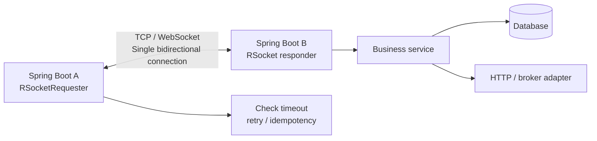
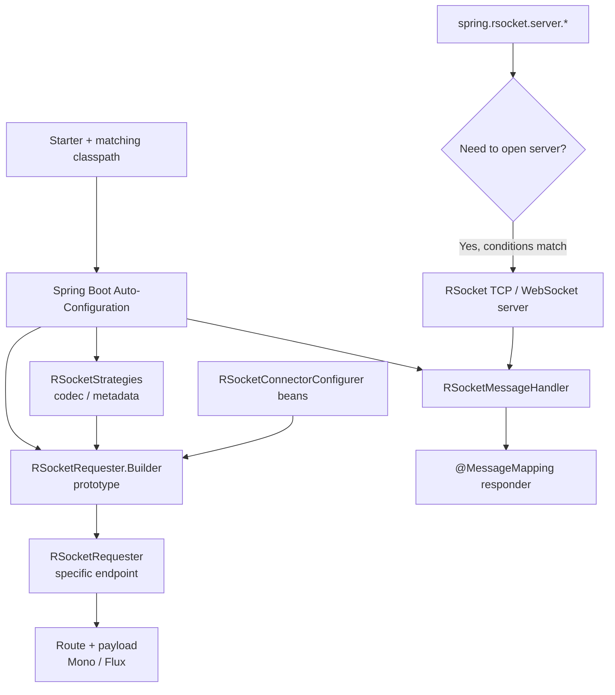
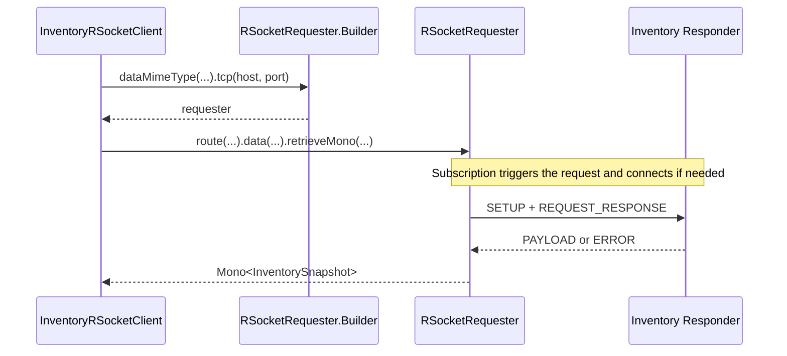
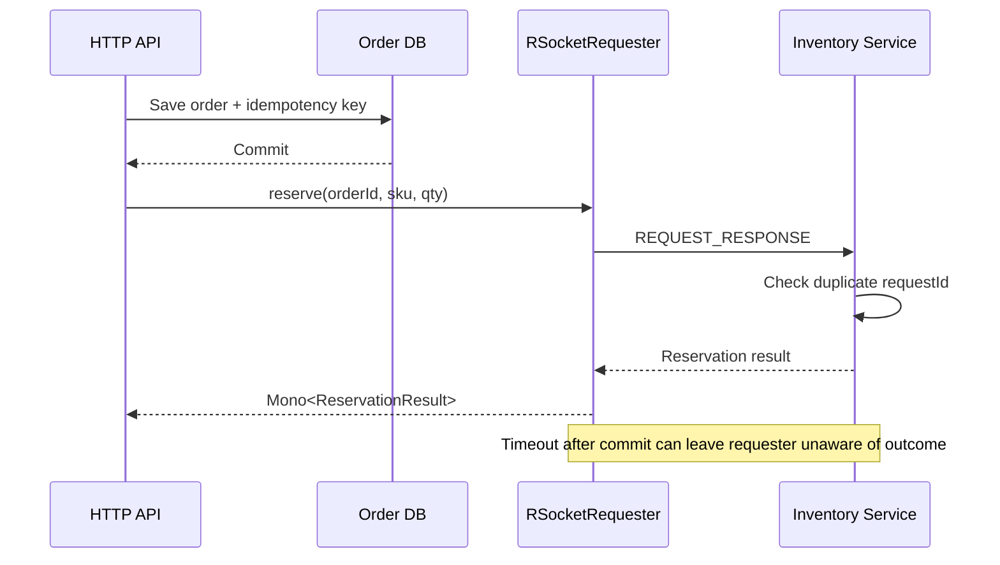

# RSocketRequester.Builder and Spring Boot Auto-Configuration

## 1. Why understand RSocketRequester.Builder?

Within the **SPRING_BOOT_INTEGRATION** module, applications can integrate via HTTP clients, databases, caches, message brokers, and Spring Integration adapters. Alongside those options, **RSocket** fits scenarios where two services need asynchronous message exchange, persistent connections, and streaming data with **backpressure**.

For example, an order system may query inventory on demand, watch continuous stock updates, or stream status events between two services. `RSocketRequester` is the client-side API that initiates requests, while `RSocketRequester.Builder` determines how a requester is constructed: transport, codecs, connection session metadata, and lower-level RSocket client customizations.

In Spring Boot, you normally **do not need to create a builder manually with `RSocketRequester.builder()`**. When dependencies and auto-configuration conditions are met, Boot provides an `RSocketRequester.Builder` bean sharing the application context's `RSocketStrategies`. You inject this builder and create a requester for the target endpoint.

Goals of this lesson:

1. Understand the roles of `RSocketRequester.Builder`, `RSocketRequester`, `RSocketStrategies`, and `RSocketMessageHandler`.
2. Distinguish **client-side auto-configuration** from **starting an RSocket server**.
3. Use the starter, TCP/WebSocket, setup metadata, codecs, routes, and the four interaction models.
4. Design endpoint configuration, timeouts, retries, security, duplicate handling, testing, and observability for real integration flows.

> The Java examples below illustrate modern Spring Boot 3.x/4.x and Spring Framework style (Java supporting `record`). Package names or options may vary across major versions; follow dependency management and documentation for your application's exact version.

## 2. Distinguishing RSocket from other integration mechanisms

RSocket is a binary message-passing protocol that can run over TCP or WebSocket. A single connection can multiplex multiple concurrent requests, allows both sides to initiate requests, and supports reactive streams driven by receiver demand.

| RSocket model | Sent payloads | Received payloads | Usage in integration |
| --- | --- | --- | --- |
| **Request-Response** | One request | One response | Inventory lookup, partner status check |
| **Fire-and-Forget** | One message | No response payload | Emitting signals without protocol-level reply |
| **Request-Stream** | One request | A stream of multiple responses | Watching stock/status updates |
| **Request-Channel** | A stream of requests | A stream of responses | Bidirectional streaming synchronization |



**RSocket is not a durable message broker.** Backpressure regulates stream data flow; it does not replace message queues, dead-letter queues, transactions, or replay capability when a system goes offline. A fire-and-forget command sent successfully at the transport level does not prove the partner's business logic committed.

If the goal is command delivery with long-term persistence, producer/consumer decoupling, and reprocessing after downtime, consider RabbitMQ/Kafka or a transactional outbox. If interactive communication or bidirectional streaming is needed, RSocket can be a better fit than short-lived HTTP requests.

## 3. Adding spring-boot-starter-rsocket

### Maven

If the application uses the Spring Boot parent or BOM for version management:

```xml
<dependency>
    <groupId>org.springframework.boot</groupId>
    <artifactId>spring-boot-starter-rsocket</artifactId>
</dependency>
```

### Gradle

```groovy
dependencies {
    implementation 'org.springframework.boot:spring-boot-starter-rsocket'
}
```

The starter brings in the required components for RSocket, Spring Messaging, Reactor, and related transports. Depending on the application type, you may also need `spring-boot-starter-webflux` if you want to mount an RSocket-over-WebSocket endpoint onto a WebFlux web server.

Do not mix versions of `rsocket-core`, `rsocket-transport-netty`, `spring-messaging`, and Reactor outside the Spring Boot BOM without a clear compatibility reason. `NoSuchMethodError` or `ClassNotFoundException` errors after upgrades often stem from mismatched dependency versions.

**The starter does not automatically decide where a server listens or which endpoint a client connects to.** Those two decisions require separate configuration, explained in the sections below.

## 4. Beans Spring Boot can auto-configure

When the classpath and conditions are satisfied, Spring Boot provides common RSocket infrastructure:

| Component | Role | Scope / notes |
| --- | --- | --- |
| `RSocketStrategies` | Configures encoders, decoders, route matchers, and metadata extraction | Typically shared across application components |
| `RSocketRequester.Builder` | Prepares client-side requesters with codecs and connector customizers | **Prototype** bean, because the builder is stateful |
| `RSocketMessageHandler` | Dispatches requests to responder handlers such as `@MessageMapping` | Requires actual route handlers to process requests |
| RSocket server infrastructure | Listens on TCP or WebSocket if server configuration is valid | Not required for an application acting solely as a client |
| Connector customizations | Applies application-provided `RSocketConnectorConfigurer` beans to the builder | Scope depends on bean registration and version |



**Auto-configuration is conditional:** having classes on the classpath is insufficient if related configuration is excluded, a custom bean causes Boot to back off, or the context type does not match. To diagnose missing beans, use `--debug` or a secured `/actuator/conditions` endpoint to inspect match/non-match reasons.

### Why is the builder prototype-scoped?

The builder holds settings that will be applied to a requester: data MIME type, setup metadata, connector customizations, and transport choice. If a singleton builder were mutated concurrently by multiple parts of the application, partner A's configuration could accidentally affect partner B's requester.

Spring Boot defines the `RSocketRequester.Builder` bean with **prototype** scope: each request to the bean factory yields a fresh builder. However, **injecting a prototype into a singleton happens only once when the singleton is created**. Therefore:

- A service targeting **one fixed endpoint** can inject the builder in its constructor, configure it, and build `RSocketRequester` once.
- A factory creating requesters for **multiple distinct endpoints** should use `ObjectProvider<RSocketRequester.Builder>` to obtain a fresh builder each time.
- A constructed `RSocketRequester` is normally reused across many requests to the same endpoint; do not create a new connection/requester per message.

## 5. RSocketStrategies, codecs, and MIME types

RSocket carries **data** and **metadata** separately. The builder uses `RSocketStrategies` to encode Java DTOs to bytes and decode returned data. Spring Boot configures available codecs based on the classpath; modern Boot versions typically register CBOR and JSON with Jackson when the corresponding dependencies are present.

| Component | Question to answer |
| --- | --- |
| `dataMimeType` | Which format encodes the connection's payloads? |
| `metadataMimeType` | Which format wraps metadata such as routing/authentication? |
| `RSocketStrategies` | Are encoders and decoders actually registered for the chosen DTOs and MIME types? |
| `RSocketStrategiesCustomizer` | Do we need additional codecs, route matchers, or specialized metadata extraction? |
| `@MessageMapping` | Which method does the route target, and what data types does it accept/return? |

Example explicitly selecting JSON on the client:

```java
import org.springframework.http.MediaType;
import org.springframework.messaging.rsocket.RSocketRequester;

RSocketRequester requester = builder
    .dataMimeType(MediaType.APPLICATION_JSON)
    .tcp("localhost", 9898);
```

This snippet assumes `builder` is an injected `RSocketRequester.Builder`. When choosing `application/json`, both sides must have compatible JSON codecs and agree on field names, data types, and DTO versions.

**Do not assume “adding the starter makes every payload type work.”** Custom DTOs, Protobuf, CBOR, generic structures, or custom metadata may require matching encoders/decoders. If one side uses CBOR and the other only accepts JSON, setup or requests can fail even when TCP connects successfully.

### Centralized codec customization

Spring Boot supports `RSocketStrategiesCustomizer` beans to add codecs or customize strategies. When multiple customizers exist, execution order (`@Order`) can affect codec precedence. Only define a complete replacement `RSocketStrategies` bean when you truly intend to replace defaults; creating an empty strategies bean easily drops Boot's auto-configured codecs/infrastructure.

For applications acting as both server and client, keep serialization policies consistent. Even so, **service-to-service contracts** still require versioning and independent testing; sharing `RSocketStrategies` within a single process does not guarantee compatibility between two separate deployments.

## 6. Configuring a standalone TCP RSocket server

An application acting as a responder can open its own TCP RSocket server. Example `application.yml`:

```yaml
spring:
  rsocket:
    server:
      address: 0.0.0.0
      port: 9898
      transport: tcp
```

In this example:

- `spring.rsocket.server.port` requests creating a server listening on port `9898` if auto-configuration conditions match.
- `spring.rsocket.server.transport` selects `tcp`.
- `spring.rsocket.server.address` is the **server bind address**, not the downstream host a client connects to.
- This is an **RSocket TCP** port, distinct from the HTTP `server.port`. Standard HTTP clients cannot send HTTP JSON to this RSocket TCP port.

During local development, you can bind `127.0.0.1` to restrict access locally. In containers, `0.0.0.0` listens across interfaces; appropriate network and security policies must still be enforced.

Successful startup does not prove a route such as `inventory.snapshot` exists. You must declare responder routes using `@Controller` + `@MessageMapping` or an equivalent responder mechanism.

## 7. Configuring RSocket over WebSocket

When RSocket should share a WebFlux web server running on Reactor Netty, a common configuration is:

```yaml
server:
  port: 8080

spring:
  rsocket:
    server:
      transport: websocket
      mapping-path: /rsocket
```

Provided the web application is **reactive** and uses **Reactor Netty**, the RSocket endpoint is mounted at path `/rsocket` on the WebSocket server. In this setup, do not also configure `spring.rsocket.server.port` for a standalone RSocket server.

On the client side, use the WebSocket transport:

```java
import java.net.URI;
import org.springframework.messaging.rsocket.RSocketRequester;

RSocketRequester requester =
    builder.webSocket(URI.create("ws://localhost:8080/rsocket"));
```

In production with TLS, endpoints are typically `wss://...`, accompanied by certificate verification/trust and reverse proxy configuration supporting WebSocket upgrade. `spring.rsocket.server.mapping-path` is a server WebSocket setting; it does not alter the path of a requester created with `tcp(...)`.

| Model | Request entry point | Notable requirements |
| --- | --- | --- |
| Standalone RSocket TCP | `tcp(host, port)` | RSocket server port, TCP networking, TLS policy |
| Standalone RSocket WebSocket | `webSocket(URI)` | WebSocket transport, standalone server endpoint |
| RSocket WebSocket on WebFlux | `webSocket(URI)` | Reactive WebFlux, Reactor Netty, matching `mapping-path` |
| Standard HTTP REST | HTTP client such as `WebClient` | Do not use `RSocketRequester` to call REST endpoints |

**Do not conflate `spring.rsocket.server.port` with `server.port` as if they are always the same port.** Depending on configuration, an application may expose two distinct servers/ports or solely a WebSocket mapping on the existing web server.

## 8. Creating RSocketRequester with the Boot-managed builder

Scenario: the order service needs to call the `inventory.snapshot` route on the inventory service over TCP.

### 8.1. Shared data contract

The example uses two Java records. In a real project, place them in appropriate Java files and packages; both producer and responder must understand the same schema:

```java
public record InventoryQuery(String sku) {}

public record InventorySnapshot(
    String sku,
    long available,
    String source
) {}
```

### 8.2. Client application endpoint configuration

```yaml
integration:
  rsocket:
    inventory:
      host: ${INVENTORY_RSOCKET_HOST:localhost}
      port: ${INVENTORY_RSOCKET_PORT:9898}
```

The prefix `integration.rsocket.inventory.*` in the example is an **application-defined property group**, not a Spring Boot RSocket client auto-configuration property. Its purpose is to clearly separate **the endpoint the client connects to** from `spring.rsocket.server.*` (which only configures the server).

### 8.3. Service using the builder

```java
import java.time.Duration;

import org.springframework.beans.factory.annotation.Value;
import org.springframework.http.MediaType;
import org.springframework.messaging.rsocket.RSocketRequester;
import org.springframework.stereotype.Service;
import reactor.core.publisher.Mono;

@Service
public class InventoryRSocketClient {

    private final RSocketRequester requester;

    public InventoryRSocketClient(
            RSocketRequester.Builder builder,
            @Value("${integration.rsocket.inventory.host}") String host,
            @Value("${integration.rsocket.inventory.port}") int port) {

        this.requester = builder
            .dataMimeType(MediaType.APPLICATION_JSON)
            .tcp(host, port);
    }

    public Mono<InventorySnapshot> getSnapshot(String sku) {
        return requester
            .route("inventory.snapshot")
            .data(new InventoryQuery(sku))
            .retrieveMono(InventorySnapshot.class)
            .timeout(Duration.ofSeconds(3));
    }
}
```

Execution flow:

1. Spring Boot injects the builder configured with the context's `RSocketStrategies` and connector customizers.
2. The constructor sets the data MIME type and endpoint, then builds a reusable `RSocketRequester`.
3. `getSnapshot` creates a request targeting route `inventory.snapshot` and expects **one** response.
4. `Mono<InventorySnapshot>` is a reactive pipeline. Merely calling the method **does not perform a network request**; the request is triggered upon subscription.
5. `timeout` bounds how long to wait for a response on this pipeline; a timeout error does not prove the server did not execute the business logic.

In modern `tcp(host, port)` APIs, creating the requester **does not necessarily open the connection immediately inside the constructor**. The shared connection is typically established on demand when a request is subscribed and can be re-established as needed. Thus, successful application startup does not mean the inventory endpoint is ready.

### 8.4. Responder on the inventory service

In the application listening on `spring.rsocket.server.port=9898`:

```java
import org.springframework.messaging.handler.annotation.MessageMapping;
import org.springframework.stereotype.Controller;
import reactor.core.publisher.Mono;

@Controller
public class InventoryRSocketController {

    @MessageMapping("inventory.snapshot")
    public Mono<InventorySnapshot> snapshot(InventoryQuery query) {
        // Illustration: replace with a service reading real inventory data.
        return Mono.just(
            new InventorySnapshot(query.sku(), 42, "warehouse-a")
        );
    }
}
```

A `@MessageMapping` method is a **responder route**, distinct from HTTP `@GetMapping`. The cardinality of the return type must match the interaction model expected by the requester. If adding blocking JDBC reads, do not invoke a blocking database directly on the Reactor Netty event loop; design an appropriate scheduler/adapter or use a reactive driver/repository.

## 9. Key Builder configuration methods

`RSocketRequester.Builder` lets you configure both **SETUP frame** data and client behavior:

| API | Effect | Notes |
| --- | --- | --- |
| `dataMimeType(MimeType)` | Chooses data format for the connection | Must match codecs on both sides |
| `metadataMimeType(MimeType)` | Chooses metadata format for the connection | Typically defaults to composite metadata |
| `setupData(Object)` | Attaches data to the SETUP frame | Not per-request payload |
| `setupRoute(String,...)` | Declares a SETUP route for server handling on connect | Distinct from per-request routes |
| `setupMetadata(Object, MimeType)` | Attaches metadata to SETUP | Can carry connection metadata if required by contract |
| `rsocketStrategies(...)` | Sets/customizes codecs and metadata extraction | Take care not to drop Boot's strategies |
| `rsocketConnector(...)` | Lower-level customization of `RSocketConnector` | Keepalive, interceptors, session settings, etc. |
| `tcp(host, port)` | Creates a requester over TCP | Does not accept HTTP URLs |
| `webSocket(uri)` | Creates a requester over WebSocket | URI must match scheme/path/port |
| `transport(clientTransport)` | Creates a requester over a custom transport | Used for SSL, proxy, or custom client transport settings |



Key distinctions:

- `setupRoute("bootstrap")` specifies the route for **SETUP**, whereas `requester.route("inventory.snapshot")` is the route for **an individual request**.
- `dataMimeType` and `metadataMimeType` generally apply at the **connection** level and do not automatically switch codecs per method call.
- `rsocketConnector` is a low-level API; avoid unnecessary usage if defaults satisfy requirements.
- `connectTcp(...)` and `connectWebSocket(...)` are older APIs marked deprecated in recent Spring Framework versions; modern examples should use `tcp(...)` and `webSocket(...)`.

## 10. The four interaction models via RSocketRequester

### 10.1. Request-Response

Send one query, receive one result:

```java
Mono<InventorySnapshot> result = requester
    .route("inventory.snapshot")
    .data(new InventoryQuery("SKU-001"))
    .retrieveMono(InventorySnapshot.class);
```

Used for operations similar to HTTP GET or request/reply, keeping in mind that RSocket does not assign HTTP 2xx/4xx/5xx status codes. Errors on the responder side propagate via RSocket/Reactive Streams error signals and must be mapped to domain errors.

### 10.2. Fire-and-Forget

Send a signal without receiving a response payload:

```java
Mono<Void> sent = requester
    .route("inventory.invalidate-cache")
    .data("SKU-001")
    .send();
```

`send()` returns `Mono<Void>`. Completion of this Mono indicates sending at the API/protocol level; it **does not** prove the responder updated the cache, persisted to a DB, or finished processing. For work requiring durability and crash recovery, use separate persistence/business acknowledgment mechanisms.

### 10.3. Request-Stream

Send one request, receive multiple messages:

```java
Flux<InventorySnapshot> updates = requester
    .route("inventory.watch")
    .data(new InventoryQuery("SKU-001"))
    .retrieveFlux(InventorySnapshot.class)
    .take(10);
```

Illustrative responder:

```java
import java.time.Duration;
import org.springframework.messaging.handler.annotation.MessageMapping;
import org.springframework.stereotype.Controller;
import reactor.core.publisher.Flux;

@Controller
public class InventoryWatchController {

    @MessageMapping("inventory.watch")
    public Flux<InventorySnapshot> watch(InventoryQuery query) {
        return Flux.interval(Duration.ofSeconds(1))
            .map(index -> new InventorySnapshot(
                query.sku(), 42 + index, "warehouse-a"
            ));
    }
}
```

The example emits synthetic timer-driven data; production code typically attaches to a business event stream. When the client cancels after 10 messages, cancellation propagates back to the stream source if upstream components support it. **Backpressure** controls flow rate on an active stream; it does not guarantee missed message history is retained.

### 10.4. Request-Channel

Both sides emit multiple values, such as streaming synchronization updates. Conceptually:

```java
Flux<InventoryQuery> queries = Flux.just(
    new InventoryQuery("SKU-001"),
    new InventoryQuery("SKU-002")
);

Flux<InventorySnapshot> replies = requester
    .route("inventory.batch-channel")
    .data(queries, InventoryQuery.class)
    .retrieveFlux(InventorySnapshot.class);
```

The responder needs a matching handler accepting `Flux<InventoryQuery>` and can return `Flux<InventorySnapshot>`. Keep interaction types consistent: **many-to-one** within a single RSocket request is not a standard combination in the requester API for request-channel; to aggregate multiple messages for a single result, define a different contract or aggregate at the application level first.

### Quick API comparison

| Expectation | Requester API |
| --- | --- |
| Single response | `retrieveMono(T.class)` |
| Stream of responses | `retrieveFlux(T.class)` |
| Send without expecting a response payload | `send()` |
| Metadata push | `sendMetadata()` with appropriate metadata configuration |

Do not call `subscribe()` inside a service just to “make sure it runs” and ignore errors. At the reactive application layer, return `Mono`/`Flux` to the caller so it controls lifecycle, cancellation, tracing, and errors. At an integration layer that must run in the background, a dedicated component must manage subscriptions, retries, and outcomes.

## 11. Prototype builder when calling multiple partners

If there are multiple RSocket servers with distinct setup configurations, do not reuse **one** mutable builder while repeatedly swapping hosts/metadata. Use `ObjectProvider` to obtain a fresh builder whenever creating a requester:

```java
import org.springframework.beans.factory.ObjectProvider;
import org.springframework.http.MediaType;
import org.springframework.messaging.rsocket.RSocketRequester;
import org.springframework.stereotype.Component;

@Component
public class PartnerRSocketRequesterFactory {

    private final ObjectProvider<RSocketRequester.Builder> builders;

    public PartnerRSocketRequesterFactory(
            ObjectProvider<RSocketRequester.Builder> builders) {
        this.builders = builders;
    }

    public RSocketRequester forEndpoint(String host, int port) {
        return builders.getObject()
            .dataMimeType(MediaType.APPLICATION_JSON)
            .tcp(host, port);
    }
}
```

This example only illustrates **scope**. In production, do not accept `host`/`port` directly from untrusted user input, as that can cause connections to unintended endpoints. Endpoints must come from managed configuration or secure service discovery.

If many requests target the same partner, create the requester once and reuse it. When a partner rotates endpoints or credentials, build a controlled requester replacement mechanism and dispose associated resources according to the API/version. Avoid creating unbounded connections under load or creating a requester per HTTP request.

## 12. Setup frame, routing metadata, and security

An RSocket connection begins with a **SETUP frame**. SETUP can contain MIME types, keepalive settings, initial data, and metadata. Subsequent requests can carry distinct routes/metadata.

Example setup metadata carrying a client identifier (not a secret):

```java
import org.springframework.util.MimeTypeUtils;

RSocketRequester requester = builder
    .dataMimeType(MimeTypeUtils.APPLICATION_JSON)
    .setupMetadata(
        "order-service",
        MimeTypeUtils.parseMimeType("text/plain")
    )
    .tcp("inventory.internal", 9898);
```

This example only shows the API; for the server to read a custom metadata type, configure metadata extraction or an appropriate handler. **Do not assume arbitrary `setupMetadata` automatically appears as a Spring `@Header` in the responder.**

When sending per-request metadata, use `metadata(value, mimeType)` alongside the route:

```java
import org.springframework.util.MimeType;
import org.springframework.util.MimeTypeUtils;

MimeType tenantType =
    MimeTypeUtils.parseMimeType("text/x-tenant-id");

Mono<InventorySnapshot> result = requester
    .route("inventory.snapshot")
    .metadata("tenant-42", tenantType)
    .data(new InventoryQuery("SKU-001"))
    .retrieveMono(InventorySnapshot.class);
```

This is custom-contract metadata; the server must register a corresponding decoder/extractor and enforce tenant authorization. Never treat a raw `tenantId` string in metadata as proof of caller identity.

Regarding security:

- Use **TLS** over untrusted networks. On the server side, Spring Boot's `spring.rsocket.server.ssl.*` properties can be used where supported; on the client side, configure SSL/TLS on the **requester transport** accordingly.
- Configure RSocket **authentication and authorization** using Spring Security or a verified mechanism. Routes may have different permissions even on the same connection.
- Do not log bearer tokens, passwords, or sensitive metadata; do not hardcode secrets in code or sample documentation.
- When connecting via WebSocket over `wss://`, verify certificate chains, hostnames, reverse proxies, and WebSocket upgrade policies.
- Define clear security boundaries between `setupMetadata` (connection-level) and per-request metadata.

RSocket does not automatically understand HTTP cookies, sessions, or bearer tokens merely because it runs over WebSocket. Explicitly design how Spring Security extracts and validates credentials in RSocket payload/metadata.

## 13. Customizing RSocketConnector and connection recovery

Spring Boot can apply `RSocketConnectorConfigurer` beans to the auto-configured builder. Through `rsocketConnector(...)`, you can access lower-level settings on `io.rsocket.core.RSocketConnector`, such as keepalive, interceptors, or capabilities supported by your RSocket version.

Example configuring the connector for a specific requester:

```java
import java.time.Duration;
import org.springframework.messaging.rsocket.RSocketRequester;

RSocketRequester requester = builder
    .rsocketConnector(connector -> connector.keepAlive(
        Duration.ofSeconds(20),
        Duration.ofSeconds(90)
    ))
    .tcp("inventory.internal", 9898);
```

Keepalive parameters must align with the network, proxies/load balancers, and server. Ping/keepalive detects certain broken connections, but does not confirm that a business side effect committed on the remote peer.

In modern Spring Framework, a requester can re-establish a shared connection when a new request needs it. Distinguish carefully:

- **Connection recovery:** establishing a new TCP/WebSocket connection when the old one drops.
- **Business request retry:** re-invoking a failed or timed-out route.
- **Stream recovery:** re-subscribing to a stream and deciding which offset to replay from.
- **Business exactly-once:** requires dedicated idempotency/transaction design.

Automatic reconnect **does not** mean in-flight requests are replayed exactly once or streams resume without message loss.

## 14. Timeouts, retries, and backpressure

### Timeout at the call site

APIs returning `Mono`/`Flux` let you apply timeouts per use case. For a **read-only** lookup route:

```java
import java.time.Duration;
import reactor.core.publisher.Mono;
import reactor.util.retry.Retry;

public Mono<InventorySnapshot> readInventory(String sku) {
    return requester.route("inventory.snapshot")
        .data(new InventoryQuery(sku))
        .retrieveMono(InventorySnapshot.class)
        .timeout(Duration.ofSeconds(2))
        .retryWhen(
            Retry.backoff(2, Duration.ofMillis(200))
        );
}
```

This example limits the duration per attempt and retries up to two additional times; because no exception filter is specified, it can also retry non-recoverable errors. **Use only to illustrate operators**; production code should filter transient failures and pair retries with an overall deadline, backoff, circuit breaker, bulkhead, or rate limiter as appropriate.

Do not blindly retry every route:

| Operation type | Retry risk | Recommendation |
| --- | --- | --- |
| Read-only inventory lookup | Increases load, typically no duplicate side effects | Bounded retry is acceptable for transient network errors |
| Order creation | Server may have saved the order before client timed out | Requires `requestId`/idempotency key and DB constraints |
| Fire-and-forget signaling | Client does not know business outcome | Needs delivery state tracking, business ack, or a broker if guaranteed delivery is required |
| Event streaming | Reconnect may lose or duplicate messages | Requires offset/cursor, replay, and deduplication |

### What does backpressure mean?

With `retrieveFlux`, downstream controls how many items it wants to receive. RSocket propagates demand across the network boundary so the responder regulates the stream if upstream supports it. However:

- If the responder runs blocking JDBC and collects everything into a list before emitting, backpressure cannot undo memory pressure already incurred.
- `Flux.interval` or external streams may have specific behaviors when downstream is slow; load-test and verify cancellation.
- Backpressure does not replace timeouts, concurrency limits, query pagination, or rate limits toward HTTP partners.
- Canceling a subscription does not automatically roll back a transaction or undo committed side effects.

## 15. Correctness of integration flows: contracts, transactions, duplicates

In a **SPRING_BOOT_INTEGRATION** application, an `RSocketRequester` is often just one adapter in a chain such as HTTP → database → RSocket → message broker or vice versa. When a request spans multiple systems, a single local ACID transaction cannot cover side effects outside the database.

Order example:



To handle safely:

1. **Data contract:** agree on routes, data MIME type, metadata MIME type, DTO schema version, required fields, and error payloads.
2. **Idempotency key:** send a stable `orderId`/`requestId` so the receiving service can return the prior result on duplicate requests.
3. **Transaction boundaries:** the receiving service must commit state changes and processing records in an appropriate transaction; account for connection loss right after commit.
4. **Error handling:** separate validation errors, permission errors, timeouts, unavailability, and transient errors; never retry infinitely.
5. **Resilience:** if a side effect must occur even if the app crashes, use an outbox, broker, or durable retry job to persist intent.
6. **Observability:** correlate HTTP trace IDs with RSocket routes, event IDs, and downstream outcomes; never log secrets.

RSocket has no durable queue or DLQ by default. If a critical message must survive both peers going offline, a **separate message storage layer** is required.

## 16. Environment configuration, addresses, and secrets

A configuration separating server and client:

```yaml
spring:
  rsocket:
    server:
      address: ${RSOCKET_BIND_ADDRESS:127.0.0.1}
      port: ${RSOCKET_SERVER_PORT:9898}
      transport: tcp

integration:
  rsocket:
    inventory:
      host: ${INVENTORY_RSOCKET_HOST:localhost}
      port: ${INVENTORY_RSOCKET_PORT:9898}
```

This illustrates an app acting as both server and client, not a requirement that every RSocket app open a port. If an application is **client-only**, `spring.rsocket.server.port` is normally omitted.

When running in Docker/Kubernetes:

- `localhost` inside a container refers to that container itself; use Kubernetes Service/DNS or provisioned endpoints for downstream RSocket peers.
- TCP RSocket and WebSocket RSocket must use matching ports, protocols, and ingress/load balancers. HTTP health endpoints do not automatically appear on a TCP RSocket port.
- Secrets or tokens should come from a secret manager or environment variables and be passed via the designed authentication mechanism.
- If two environments use different codecs or route versions, changing host/port alone is insufficient; run compatibility contract tests.
- Configure readiness/health checks for business-critical dependencies. Constructing an `RSocketRequester` does not verify downstream readiness at startup.

Use `@ConfigurationProperties` for multi-endpoint configurations and validate host/port/transport with Bean Validation at the configuration boundary. The `@Value` usage in section 8 is convenient for learning the API; as partner count grows, typed properties help prevent copy-paste mistakes and misrouted endpoints.

## 17. Debugging RSocketRequester.Builder auto-configuration

A typical error:

```text
UnsatisfiedDependencyException:
  Error creating bean with name 'inventoryRSocketClient':
  No qualifying bean of type
  'org.springframework.messaging.rsocket.RSocketRequester$Builder'
  available
```

This indicates **no builder bean is available for injection**; it does not mean the remote server is disconnected. Check:

1. Is `spring-boot-starter-rsocket` on the **runtime classpath of the running module**, rather than only in a submodule/test scope?
2. Are Spring Messaging, RSocket core, and Reactor Netty transport classes present with compatible versions?
3. Are RSocketRequester/strategies auto-configurations evaluated and matching? Is an exclusion or custom bean causing Boot to back off?
4. Which Spring Boot version is running? Were dependencies or the classpath altered after an upgrade?
5. Is the bean being injected inside a test slice that excludes RSocket auto-configuration?
6. Are there multiple custom beans/qualifiers preventing injection from resolving unambiguously?

Enable the report:

```bash
java -jar integration-service.jar --debug
```

In controlled investigations, `/actuator/conditions` and `/actuator/beans` are also helpful if Actuator is enabled, endpoints are properly exposed, and access is secured. Auto-configuration class names can change across Spring Boot generations; search the report for **RSocketRequester / RSocketStrategies** rather than hardcoding a single package name.

### Other errors after the builder is available

| Symptom | Possible error class | Specific checks |
| --- | --- | --- |
| `Connection refused` | TCP server not listening / wrong host-port | `spring.rsocket.server.port`, network/DNS, client endpoint |
| `404`/WebSocket upgrade failure | Wrong `mapping-path`, proxy, or web server type | WebFlux + Reactor Netty, `ws/wss` URI, ingress |
| `No handler for destination` | Missing `@MessageMapping` or wrong route | Requester route, component scan, responder mapping |
| Codec/serialization error | MIME type or DTO mismatch | `RSocketStrategies`, codecs, schema version, DTO constructors |
| Connection open but request never completes | Blocking responder, missing subscription, missing timeout | Reactor threads, operators, duration, downstream |
| Error calling `webSocket` against TCP port | Transport mismatch | Match builder method to server transport |
| Unexpected empty result | Route returns `Mono.empty()`, differs from response model | Verify data contract, error/empty semantics |
| Event processed twice | Timeout/reconnect/retry after side effect | Idempotency key and business transaction |
| App starts fine even when server is down | Lazy requester connect | Test real requests and define appropriate health checks |
| Latency spikes under large streams | Slow downstream, buffer/CPU/DB bottleneck | Demand, event loop, schedulers, codecs, and throughput |

Distinguish **bean exists**, **connection established**, **route matched**, **payload decoded**, and **business logic completed**. Each step exhibits different failures; fixing one step does not prove the rest are correct.

## 18. Integration testing with a real server

Mocking `RSocketRequester` can be useful for service unit tests, but it does not verify SETUP frames, transport, codecs, routing, or `Mono`/`Flux` interaction. For real integration, start an embedded RSocket server and send requests through Spring Boot's injected `RSocketRequester.Builder`.

Example test starting a TCP server on a fixed test port:

```java
import static org.assertj.core.api.Assertions.assertThat;

import java.time.Duration;

import org.junit.jupiter.api.Test;
import org.springframework.beans.factory.annotation.Autowired;
import org.springframework.boot.test.context.SpringBootTest;

@SpringBootTest(properties = {
    "spring.rsocket.server.port=9899",
    "integration.rsocket.inventory.host=localhost",
    "integration.rsocket.inventory.port=9899"
})
class InventoryRSocketIT {

    @Autowired
    InventoryRSocketClient client;

    @Test
    void canRequestSnapshot() {
        InventorySnapshot response =
            client.getSnapshot("SKU-001").block(Duration.ofSeconds(5));

        assertThat(response).isNotNull();
        assertThat(response.sku()).isEqualTo("SKU-001");
        assertThat(response.available()).isEqualTo(42);
    }
}
```

This test **is illustrative only** and assumes the same test context includes `InventoryRSocketController` returning sample data. In real projects, use dynamically assigned test ports or isolated environments to avoid conflicts during parallel runs; check how to obtain the actual bound RSocket port for your Spring Boot version. Using `block(Duration)` in synchronous tests is acceptable; do not block like this on the event loop in production flows.

Additional scenarios to test:

| Scenario | Expected outcome |
| --- | --- |
| Server port not open | Requester reports connection error on subscription; error is classified properly |
| Valid Request-Response | Correct route, DTO, MIME type, trace/correlation ID |
| Wrong WebSocket mapping | Observable handshake failure, not confused with codec error |
| Server returns business error | Client receives and maps error per contract |
| Sending same `requestId` twice | Business side effect is applied only once |
| Connection drop during side-effect request | Retry/recovery follows policy without duplicating side effects |
| Request-Stream canceled | Producer stops or frees resources as designed |
| JSON/CBOR codec mismatch | Test catches mismatch before deployment |
| Client slower than server | Demand/backpressure and memory usage remain within acceptable bounds |
| DTO/route version upgrade | Old/new consumers and providers still satisfy published contract |

If the application uses Spring Integration RSocket inbound/outbound gateways, also verify `MessageChannel`, header mapping, error channels, and flow timeouts in addition to RSocket transport tests.

## 19. Observability and operations

Every important RSocket call should record:

- **Correlation:** request ID, route, client/service name, trace/span ID, business event ID. Do not log sensitive full payloads.
- **Timing:** connect latency, time to first response, stream duration, timeouts, and retry counts.
- **Outcomes:** success/failure counts per route, codec errors, unknown routes, authentication/authorization rejections.
- **Resources:** active connections, concurrent request counts, cancellations, event-loop/thread-pool utilization, memory/buffers.
- **Business:** actual orders/inventory updates applied, duplicate requests, failed syncs, and outbox backlog if applicable.

Spring Boot Actuator, Micrometer, Reactor/Netty instrumentation, or tracing tools can assist depending on dependencies and how instrumentation is enabled for your version. Do not assume all detailed RSocket metrics are exported automatically just by adding the starter.

**Health checks** must reflect real conditions: a requester bean existing does not mean the peer is healthy; an open connection does not mean business routes are operational; a sent request does not mean database updates committed.

## 20. Implementation checklist in integration services

1. Choose RSocket because **interaction/streaming** is genuinely needed, not merely to replace HTTP.
2. Add `spring-boot-starter-rsocket` to the right runtime module and align dependencies with the Spring Boot BOM.
3. Decide whether the app is **client, server, or both**; only configure `spring.rsocket.server.*` when exposing a responder.
4. Inject `RSocketRequester.Builder` from Boot and build a requester for the specific endpoint; remember the builder is **prototype** and stateful.
5. Distinguish `tcp(host, port)` vs. `webSocket(uri)`, URI/mapping-path, TLS, and ports.
6. Align data MIME type, metadata MIME type, codecs, routes, DTO versions, and error handling.
7. Reuse requesters for stable endpoints; for multiple endpoints, obtain a fresh builder per requester.
8. Configure timeouts, bounded retries, load limits, backpressure handling, and proper cancellation.
9. Deduplicate requests with side effects; use transactions/outbox when crash recovery is needed.
10. Test request-response, fire-and-forget, request-stream/channel if used, connection failures, codec mismatches, authorization, and reconnects.
11. Monitor route-level latency, errors, retries, connection health, and business outcomes; protect tokens/metadata.
12. On version upgrades, review dependency graphs, auto-configuration conditions, deprecated APIs, and SSL/codec settings in staging before rollout.

## 21. Self-assessment scenario

A Spring Boot order management service receives HTTP requests and needs to make RSocket calls to an inventory service. The team encounters four failures:

- The application starts up, but the first request fails with `Connection refused`.
- The client calls `tcp("inventory.internal", 9898)` while the server only exposes `wss://inventory.example.com/rsocket`.
- After fixing the transport, DTOs still fail to decode because the client chose JSON while the responder expects a different codec.
- During certain timeouts, the stock reservation command executes twice because the client retries automatically.

Resolution path:

1. **Startup success does not prove connectivity:** `RSocketRequester` is built upfront, whereas the network connect typically happens when a request is subscribed.
2. **Transports must match:** For a WebSocket/TLS server, use `builder.webSocket(URI.create("wss://inventory.example.com/rsocket"))` and ensure valid proxy/certificate configuration.
3. **Codecs must match:** Compare `dataMimeType`, `RSocketStrategies`, DTOs, and contract versions on both sides.
4. **Side effects must be idempotent:** Reservation commands must carry a stable request ID; the inventory service stores the outcome or deduplication marker within a transaction. Backoff retries do not replace this mechanism.
5. **Verify across all layers:** Test builder + connection + route + DTO + retry/idempotency + metrics rather than stopping once the context creates the bean.

**Key takeaway:** Spring Boot auto-configures a **prototype `RSocketRequester.Builder`** with matching strategies; the application uses that builder to construct requesters targeting specific TCP or WebSocket endpoints. The reliability of a **Spring Boot Integration** flow further depends on payload contracts, metadata, security, timeouts, error handling, idempotency, testing, and end-to-end observability.

## References

- [Spring Boot Reference – RSocket](https://docs.spring.io/spring-boot/reference/messaging/rsocket.html): auto-configuration of strategies, server, message handler, and requester builder.
- [Spring Framework Reference – RSocket](https://docs.spring.io/spring-framework/reference/rsocket.html): request patterns, SETUP, data/metadata, codecs, requester, and responder.
- [Spring Boot – Common Application Properties](https://docs.spring.io/spring-boot/appendix/application-properties/): check `spring.rsocket.server.*` keys supported in your version.

When working with older Spring Boot releases, always consult the **exact version** of the references above to avoid copying deprecated APIs or relocated properties.
