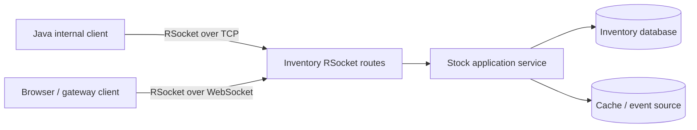
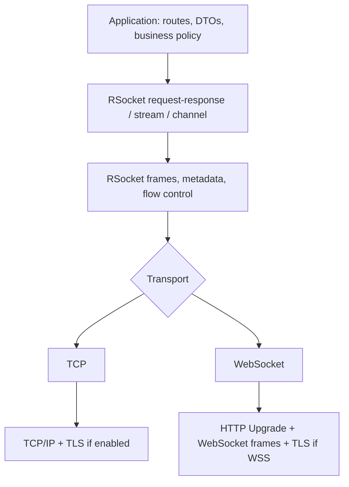
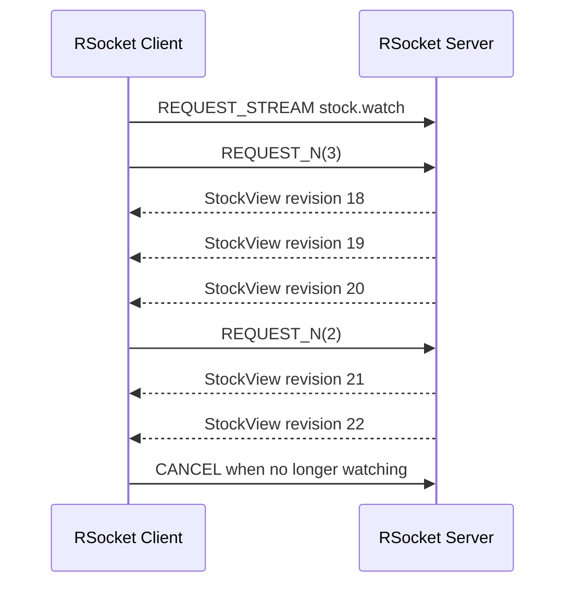
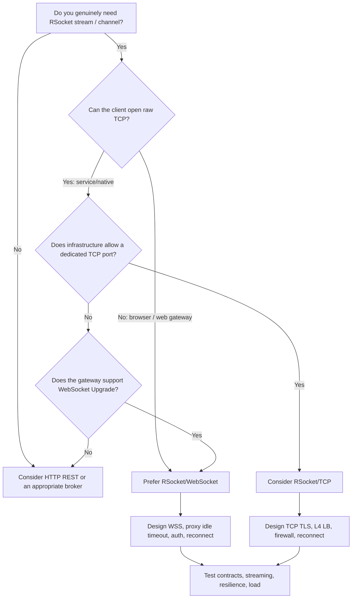

# Choosing TCP or WebSocket for RSocket Connections

## 1. Context and objectives

A Spring Boot service can exchange data over HTTP, databases, caches, message brokers, or direct application-to-application protocols. When a bidirectional connection is needed that can stream data continuously and control how many items the receiver is ready to accept, **RSocket** is worth considering. RSocket supports request–response, fire-and-forget, request–stream, and channel interaction models. These interaction models can run over multiple **transports**, including **TCP** and **WebSocket**.

Within the **SPRING_BOOT_INTEGRATION** module, choosing a transport is an integration architecture decision: it requires considering environment configuration, payload/metadata contracts, transport security, disconnection error handling, business consistency, testing, and observing real flows. The module also covers HTTP clients, databases, caches, message brokers, and Spring Integration adapters; therefore, it is important to understand where RSocket complements and differs from those systems.

This lesson belongs to the **RSocket** chapter and focuses directly on the question: **when should you use RSocket over TCP, when should you use RSocket over WebSocket, and how do you configure each option in Spring Boot?**

After completing this lesson, you will be able to:

- Distinguish the **RSocket protocol**, **TCP/WebSocket transports**, and application **interaction models**.
- Make a transport choice based on client type, proxies/load balancers, deployment network, TLS, latency, and operations.
- Configure the Spring Boot server and `RSocketRequester` for each transport.
- Design routes, DTOs, timeouts, backpressure, disconnect handling, and security according to an explicit contract.
- Write integration tests proving the client actually communicates over TCP or WebSocket, including error cases and resource limits.

> **Technical baseline:** Examples target Java 17+, Spring Boot 3.2+, and Spring Framework 6.1+ with Reactor/RSocket Java. Configuration keys, transport capabilities, and dependencies may differ in other Boot or RSocket library versions. When applying examples to a specific version, check the corresponding APIs and applicable network/TLS policies.

### Running scenario

An **Order Console** monitors inventory from an **Inventory Service**. The Order backend needs to read current inventory via request–response; the web UI needs to view continuous updates. Inventory Service exposes two RSocket routes:

- `stock.get`: accepts a SKU code and returns a single `StockView`.
- `stock.watch`: accepts a SKU code and returns a `Flux<StockView>` as updates occur per the contract.

Java applications running inside the same data-center network can use RSocket/TCP; browsers or clients traversing HTTP/WebSocket gateways can use RSocket/WebSocket. **The route and payload contract can remain the same**, while the way connections are established changes.



The diagram illustrates **two deployment/access paths** to the same route logic; it does not imply that a single Spring Boot instance with default auto-configuration simultaneously exposes both TCP and WebSocket. Serving both transports from the same application may require manually configuring additional endpoints/servers or placing an appropriate gateway, rather than merely combining two sets of YAML properties.

## 2. Separating three concepts: RSocket, interaction model, and transport

**RSocket** defines frames, connection setup, data streams, metadata, error signaling, and receiver demand control. The **transport** moves those frames between both endpoints. The **interaction model** is the exchange semantics desired by the application.

| RSocket model | Common Java type | When to use |
|---|---|---|
| Request–response | `Mono<T>` | Looking up a single result, e.g., stock for a SKU |
| Fire-and-forget | `Mono<Void>` on the sender | Notifications requiring no response payload |
| Request–stream | `Flux<T>` | Watching stock changes, events over time |
| Request–channel | `Flux<Input>` ↔ `Flux<Output>` | Bidirectional multi-item exchange within one logical interaction |

For example, `stock.get` over TCP and over WebSocket are both request–response at the RSocket layer. Choosing WebSocket does not turn a request into a stream, nor does it alter the business contract.



### 2.1. RSocket over TCP

RSocket/TCP uses a TCP connection to carry RSocket frames; no initial HTTP Upgrade is required. This deployment style fits when both endpoints are applications or SDKs capable of opening direct TCP connections. In infrastructure, connections typically pass through Layer 4 load balancers, firewalls, and internal network routing; to secure traffic across untrusted networks, configure TLS properly on client/server or an equivalent protective transport layer.

### 2.2. RSocket over WebSocket

RSocket/WebSocket begins with an HTTP/HTTPS **Upgrade** request to a WebSocket endpoint. After the handshake succeeds, WebSocket frames carry RSocket payloads over a long-lived connection. WebSocket can traverse reverse proxies or gateways designed for HTTP/WebSocket. Standard browsers cannot open arbitrary raw TCP sockets, making WebSocket the natural transport when a frontend uses RSocket JavaScript.

**WebSocket is not a new HTTP REST request per message.** After the HTTP Upgrade, data flows over the upgraded connection; responses inside RSocket are RSocket frames/protocol signals, without per-route HTTP `200`/`404` status codes.

### 2.3. RSocket does not replace a broker

RSocket provides direct connectivity and interaction. A disconnected stream **does not inherently offer durable replay like a broker queue/topic**. If events or commands must survive downtime and support guaranteed replay, design persistence/outbox/broker storage or application-level cursors/replay. Nor can fire-and-forget be treated as proof that the receiver's database committed successfully.

## 3. Comparison table: choosing TCP or WebSocket

| Criterion | RSocket/TCP | RSocket/WebSocket |
|---|---|---|
| Suitable clients | Java/native services, SDKs with TCP access | Browsers, frontends, clients behind HTTP/WebSocket gateways |
| Connection setup | TCP connect, direct RSocket setup | HTTP Upgrade to WebSocket, then RSocket setup |
| Port/path | Host + TCP port | `ws://` or `wss://` URL with path |
| Network infrastructure | Often needs dedicated TCP port allowed, L4 load balancing | Can share web port and L7 proxies supporting WebSocket Upgrade |
| TLS | Must configure client/server TCP transport TLS or suitable security layer | `wss://` uses web endpoint TLS; can leverage existing HTTPS/WSS policies |
| Proxies | Standard HTTP proxies do not forward raw RSocket TCP frames | Must support WebSocket Upgrade and long-lived connections; not all HTTP proxies do |
| Performance | Can avoid WebSocket framing/Upgrade overhead under identical conditions | Additional framing/Upgrade; actual difference depends on workload and infrastructure |
| RSocket backpressure | Yes | Yes; `request(n)` semantics are identical across transports |
| Observability | TCP connections, TLS handshakes, frames/routes, reconnects | Also HTTP Upgrade, WebSocket disconnects, proxy idle timeouts |
| Browsers | Cannot open raw TCP via standard web APIs | Supported via browser WebSocket API |
| Spring Boot deployment | RSocket server listening on dedicated port | With Spring WebFlux, can mount RSocket endpoint onto the HTTP server |

### Context-based selection rules

1. **Internal Java-to-Java communication**, where the network permits TCP to a dedicated port and operations control the infrastructure: consider **TCP** for fewer protocol layers.
2. **Browser clients** or paths traversing WebSocket-capable proxies/gateways sharing HTTPS ingress: choose **WebSocket**, preferring `wss://` over production networks.
3. **Gateways supporting only HTTP request/response without Upgrade**: WebSocket will not work if infrastructure blocks Upgrade; adjust the gateway or choose a supported protocol (such as an HTTP API).
4. **Applications requiring message persistence while receivers are offline, controlled retries, or durable replay**: consider a message broker and outbox. Choosing TCP or WebSocket does not provide these guarantees.
5. **Applications calling only a few simple request–response APIs**: REST/`RestClient` may be simpler to build and observe; RSocket fits better when there is a clear need for streams/channels and long-lived connections.

When both transports are viable, do not decide solely on the assumption “TCP is always faster.” Measure p95/p99 latency, throughput, CPU, connection count, TLS cost, reconnect rate, and proxy behavior under expected workloads.

## 4. Creating a transport-independent RSocket contract

### 4.1. Dependencies

With Maven and the Spring Boot parent/BOM:

```xml
<dependencies>
    <dependency>
        <groupId>org.springframework.boot</groupId>
        <artifactId>spring-boot-starter-rsocket</artifactId>
    </dependency>
    <dependency>
        <groupId>org.springframework.boot</groupId>
        <artifactId>spring-boot-starter-test</artifactId>
        <scope>test</scope>
    </dependency>
    <dependency>
        <groupId>io.projectreactor</groupId>
        <artifactId>reactor-test</artifactId>
        <scope>test</scope>
    </dependency>
</dependencies>
```

To use a **WebSocket server sharing the HTTP/WebFlux server**, add:

```xml
<dependency>
    <groupId>org.springframework.boot</groupId>
    <artifactId>spring-boot-starter-webflux</artifactId>
</dependency>
```

Do not blindly add `spring-boot-starter-web` just because WebSocket uses an HTTP handshake: the WebSocket example here relies on **reactive WebFlux** infrastructure. If a project includes both MVC and WebFlux starters, Spring Boot may choose the servlet web application type; verify the web application type and RSocket mapping setup before expecting WebFlux properties to take effect.

### 4.2. Defining DTOs with an explicit contract

```java
// StockQuery.java
public record StockQuery(String sku) {}

// StockView.java
public record StockView(
        String sku,
        long available,
        long revision,
        Instant observedAt
) {}
```

`revision` represents the data version defined by Inventory; `observedAt` is the observation timestamp and should not be used as an idempotency key. For evolving data, producer and consumer must agree on required fields, optional fields, handling of new versions, error routes/codes, and payload size limits. Regardless of transport, failing to deserialize invalid JSON remains a data contract failure.

### 4.3. Mapping routes with `@MessageMapping`

```java
// StockRSocketController.java — imports omitted
@Controller
public class StockRSocketController {
    private final StockApplicationService service;

    public StockRSocketController(StockApplicationService service) {
        this.service = service;
    }

    @MessageMapping("stock.get")
    public Mono<StockView> getStock(StockQuery query) {
        return validate(query)
                .flatMap(value -> service.findCurrent(value.sku()));
    }

    @MessageMapping("stock.watch")
    public Flux<StockView> watchStock(StockQuery query) {
        return validate(query)
                .flatMapMany(value -> service.watch(value.sku()));
    }

    private Mono<StockQuery> validate(StockQuery query) {
        if (query == null || query.sku() == null
                || query.sku().isBlank()) {
            return Mono.error(new IllegalArgumentException(
                    "sku must have a value"));
        }
        return Mono.just(query);
    }
}
```

`StockApplicationService` is an internal contract backed by a real database/cache/event source, for example:

```java
public interface StockApplicationService {
    Mono<StockView> findCurrent(String sku);
    Flux<StockView> watch(String sku);
}
```

Server method `stock.get` returns a single result or an error signal; `stock.watch` returns a stream. A `Flux` does not have to emit items immediately; for long-lived streams, the client must define behavior when no events arrive, when the connection drops, and when to unsubscribe. This application contract is **independent of TCP or WebSocket**.

Spring RSocket uses message codec/metadata strategies to translate routes and payloads between frames and Java DTOs. The example assumes the Jackson JSON converter is configured by the starter; if the service/client uses another codec such as CBOR, Protobuf, or a custom content type, both sides must agree on the MIME type and codec.

## 5. RSocket/TCP in Spring Boot

### 5.1. Server listening on a TCP port

In an RSocket server application with the appropriate starter, configure:

```yaml
# application-rsocket-tcp.yml
spring:
  rsocket:
    server:
      transport: tcp
      port: 7000
```

With this configuration, the RSocket server listens on TCP port `7000` (provided the port is available and the RSocket server starts cleanly). This is not an HTTP endpoint `http://localhost:7000`. Clients must connect using the RSocket/TCP protocol. Port `7000` is merely an example; production should source ports from environment config and apply firewall/network policies.

If the application also exposes HTTP APIs, the HTTP server and RSocket/TCP can run on **separate ports**. Health checks, load balancing, TLS, and firewall policies must be evaluated per endpoint.

### 5.2. Client using `RSocketRequester.Builder.tcp`

```yaml
# client application.yml
integration:
  inventory:
    rsocket:
      host: ${INVENTORY_RSOCKET_HOST:localhost}
      port: ${INVENTORY_RSOCKET_PORT:7000}
```

```java
// InventoryTcpRequesterConfiguration.java — imports omitted
@Configuration(proxyBeanMethods = false)
public class InventoryTcpRequesterConfiguration {

    @Bean
    RSocketRequester inventoryRequester(
            RSocketRequester.Builder builder,
            @Value("${integration.inventory.rsocket.host}") String host,
            @Value("${integration.inventory.rsocket.port}") int port
    ) {
        return builder.tcp(host, port);
    }
}
```

`RSocketRequester.Builder` is configured by Spring Boot when the corresponding dependencies are present. The requester should be managed as a reusable client rather than creating a new connection for every request. Connection establishment, reconnection, and resource lifecycles must be controlled according to RSocket Java and application configuration.

### 5.3. Sending request–response and receiving request–stream

```java
// InventoryRSocketGateway.java — imports omitted
@Service
public class InventoryRSocketGateway {
    private final RSocketRequester requester;

    public InventoryRSocketGateway(
            @Qualifier("inventoryRequester")
            RSocketRequester requester
    ) {
        this.requester = requester;
    }

    public Mono<StockView> getStock(String sku) {
        return requester.route("stock.get")
                .data(new StockQuery(sku))
                .retrieveMono(StockView.class)
                .timeout(Duration.ofSeconds(3));
    }

    public Flux<StockView> watchStock(String sku) {
        return requester.route("stock.watch")
                .data(new StockQuery(sku))
                .retrieveFlux(StockView.class);
    }
}
```

`retrieveMono` requests a single result via request–response; `retrieveFlux` represents a stream via request–stream. `timeout(Duration.ofSeconds(3))` sets a deadline on the Publisher when subscribed, and **does not** guarantee that a server-side database transaction rolled back if the request is canceled. For long-lived streams, placing a timeout on the **entire stream** can terminate it unexpectedly; define heartbeats/idle timeouts, per-update timeouts, or subscription age limits per SLA.

**Reactive applications should let the caller manage subscription.** Do not call `.block()` inside a WebFlux controller or on a Reactor event loop; doing so defeats non-blocking execution and can cause runtime errors on threads that forbid blocking.

## 6. RSocket/WebSocket in Spring Boot

### 6.1. Serving RSocket through the WebFlux HTTP server

When an application includes `spring-boot-starter-rsocket` together with `spring-boot-starter-webflux`, Spring Boot supports mapping RSocket/WebSocket onto the reactive web server. For example:

```yaml
# application-rsocket-websocket.yml
server:
  port: 8080

spring:
  rsocket:
    server:
      transport: websocket
      mapping-path: /rsocket
```

With this setup, the local WebSocket endpoint for clients is `ws://localhost:8080/rsocket`. The `/rsocket` path is used for the **WebSocket handshake**, while application routes inside RSocket frames remain `stock.get` or `stock.watch`. Do not send a plain HTTP `GET /rsocket` expecting inventory JSON.

**Important configuration point:** When integrating with the WebFlux server, use the web server's `server.port` and `spring.rsocket.server.mapping-path` for the WebSocket endpoint; **do not declare `spring.rsocket.server.port`** as in standalone TCP mode if the goal is to share the HTTP listener. Setting a separate RSocket port may cause Spring Boot to start a standalone RSocket server instead of mapping onto the web server as intended. Verify actual configuration when an app combines multiple web starters or custom servers.

### 6.2. WebSocket client with `RSocketRequester.Builder`

```yaml
# client application.yml
integration:
  inventory:
    rsocket:
      websocket-uri: ${INVENTORY_RSOCKET_WS_URI:ws://localhost:8080/rsocket}
```

```java
// InventoryWebSocketRequesterConfiguration.java
@Configuration(proxyBeanMethods = false)
public class InventoryWebSocketRequesterConfiguration {

    @Bean
    RSocketRequester inventoryRequester(
            RSocketRequester.Builder builder,
            @Value("${integration.inventory.rsocket.websocket-uri}")
            URI websocketUri
    ) {
        return builder.webSocket(websocketUri);
    }
}
```

The `InventoryRSocketGateway` adapter in section 5 **needs no changes**: it receives an `RSocketRequester`, calls routes, and returns `Mono`/`Flux`. Only requester creation changes according to transport. The TCP and WebSocket configurations in sections 5–6 are **mutually exclusive alternatives**: do not define both `inventoryRequester` beans with the same name in one application context.

In production, replace `ws://` with `wss://` when traffic traverses untrusted networks; verify certificates, hostnames, proxy TLS termination, and internal security rules. The URI belongs to client configuration and should not be taken from arbitrary user input to prevent connections to unauthorized endpoints.

### 6.3. When the frontend is a browser

In browser environments, JavaScript applications typically use a WebSocket-compatible RSocket client. Browsers primarily provide the WebSocket API for this style of connection; raw TCP sockets are unavailable to ordinary web pages.

Practical considerations:

- Browsers connect to `wss://inventory.example.org/rsocket` from HTTPS pages to avoid mixed-content blocks or browser security restrictions.
- Gateways must **support WebSocket Upgrade**, forward bidirectional frames on long-lived connections, and not drop connections after standard short HTTP request timeouts.
- `Origin`/CORS policies, authentication, and authorization must be verified according to the WebFlux/gateway architecture; **Origin checks do not replace authentication** and WebSocket does not automatically grant route permissions.
- If the browser should not hold Inventory service credentials, place a backend-for-frontend as an application proxy or issue appropriately scoped tokens; never embed long-lived service secrets in JavaScript code.
- Never pass bearer tokens, passwords, or sensitive data in query parameters, because URLs commonly appear in access logs.

Choosing WebSocket only solves the transport path into the application; user/tenant authorization to read inventory must still be enforced inside RSocket request handling.

## 7. TLS and security for both options

### 7.1. WebSocket: `ws://` vs. `wss://`

`ws://` is WebSocket without TLS protection; `wss://` runs WebSocket over TLS. If RSocket/WebSocket runs directly on the Spring Boot WebFlux server, TLS can be configured just like an HTTPS server:

```yaml
# Conceptual example for direct WebFlux TLS/WSS deployment
server:
  port: 8443
  ssl:
    enabled: true
    key-store: ${SERVER_KEYSTORE_LOCATION}
    key-store-password: ${SERVER_KEYSTORE_PASSWORD}
    key-store-type: PKCS12

spring:
  rsocket:
    server:
      transport: websocket
      mapping-path: /rsocket
```

With a valid certificate/keystore, the endpoint is `wss://inventory.example.org:8443/rsocket`, where the hostname matches the certificate SAN and the client trusts the issuing CA. Secrets come from the environment/secret manager; never commit passwords or private keys to the repository.

If TLS terminates at an ingress/reverse proxy, the backend app may receive unencrypted WebSocket traffic on the internal network. In that case, evaluate **the entire proxy → backend hop**, restrict network access, or re-encrypt with TLS if policy requires. Clients must verify the `wss://` endpoint's certificate; never disable hostname verification or use trust-all configurations to bypass TLS errors.

### 7.2. TCP: encryption with TLS requires transport configuration

Basic RSocket/TCP can run over a plaintext TCP port. To protect traffic, configure **TLS on the TCP transport of both server and client** (typically via RSocket Java/Reactor Netty or a controlled secure transport layer).

Do not replace `tcp://host:7000` with `https://...` and assume TLS is active. `RSocketRequester.Builder.tcp(host, port)` describes a plain TCP connection; enabling custom TLS requires supplying a client transport/SSL context or configuration supported by your specific version. The server also needs matching mode, certificates/keys, and trust policy. Web server SSL properties such as `server.ssl.*` **do not automatically protect a standalone RSocket TCP port**.

For TCP TLS, verify at minimum: trusted CA chain, hostname/SAN, certificate expiration, valid TLS protocols and ciphers, credential rotation, and mTLS if mutual certificate authentication is required. If operations lacks experience managing custom TCP TLS, using a WSS gateway with mature HTTPS policies may be simpler, though it must still be measured and tested.

### 7.3. TLS does not replace RSocket route authorization

Whether using TCP or WebSocket, transport security and **business authorization** are distinct concerns. RSocket includes metadata for routing, MIME types, authentication, and tracing. Spring Security can integrate RSocket authentication/authorization when configured properly; verify allowed routes per identity and tenant.

| Protection layer | What must be ensured |
|---|---|
| Network | Open only necessary TCP/WebSocket ports, clear firewall/ingress policies |
| TLS | Valid certificates, proper CA and hostname checks, avoid plaintext where disallowed |
| Authentication | Verify client/service identity via an approved mechanism |
| Authorization | Enforce route, action, tenant, and data permissions; deny arbitrary calls |
| Input validation | Bound SKUs, payload sizes, request rates, and concurrent streams |
| Logging | Never log tokens, sensitive payloads, private keys, or secret metadata |

Do not enforce authorization only at connection handshake; if one connection carries requests across multiple business scopes, application policies must enforce checks at route and data levels.

## 8. Proxies, load balancers, and connection lifecycles

RSocket targets **long-lived connections**. This differs from short-lived HTTP request–response, where a load balancer can pick a different backend per request. With RSocket, frames on one connection typically remain pinned to the same backend for the lifetime of that connection.

### 8.1. With TCP

- Ensure the RSocket port is permitted through firewalls, network policies, and appropriate TCP load balancers.
- With an L4 load balancer, check how **new connections** are distributed, how health checks work, and how backend draining is handled.
- Losing a backend does not transparently migrate in-flight requests/streams to another instance.
- OS TCP keepalive and RSocket protocol keepalive are separate mechanisms; enabling only one does not guarantee gateways will keep the connection open long enough.

### 8.2. With WebSocket

- Reverse proxies/ingress must support HTTP Upgrade, required headers, and bidirectional proxying.
- Configure idle/read timeouts for long-lived WebSocket connections; defaults meant for short HTTP requests can close healthy streams prematurely.
- Load balancers distribute **at connection creation**, after which RSocket requests on that connection generally hit the same backend.
- During rolling updates, implement graceful shutdown/drain, client reconnect, and resubscribe policies.
- If TLS terminates at the proxy, verify trust and security policies for the backend hop.

### 8.3. Reconnect is not business resume

If the network drops while Order Console is running `stock.watch`, the client may need to reconnect and **re-subscribe** to the route. Some libraries/protocols support resumption under specific conditions, but do not assume it is enabled by default or guarantees complete replay. A disconnect can cause:

1. A request never sent.
2. A request that reached the server without the client receiving the response.
3. A stream canceled after some events, missing updates during the outage window.

For `stock.watch` when missed events are unacceptable, design a **cursor/sequence number** or snapshot + replay API keyed by `revision`, backed by a reliable event store. Upon reconnect, the client fetches a fresh snapshot and resumes from a contract-defined position. For write commands, use an **idempotency key** and a status lookup API; do not blindly replay commands when a response is missing.

## 9. Backpressure, timeouts, and error handling

### 9.1. Backpressure belongs to RSocket, independent of TCP/WebSocket

In request–stream or channel models, the receiver signals how many elements may be emitted next (`request(n)`). RSocket implements Reactive Streams flow control to prevent producers from flooding slower consumers.



Backpressure does not make memory or databases infinite; if an upstream source does not support throttling, the application still needs bounded buffers, sampling, drop/coalesce policies, or rate limits per business SLA. A stream without active consumption can still accumulate data in a cache/event source if code builds an unbounded queue; that remains a design flaw.

### 9.2. Error patterns and handling

| Error | Can occur on | Appropriate behavior |
|---|---|---|
| Host/port unreachable | TCP and WebSocket | Connection fails; emit error signal, retry with bounded backoff |
| WebSocket Upgrade rejected | WebSocket | Check URL/path, proxy, auth, HTTP handshake status |
| Invalid TLS certificate/hostname | TCP TLS or WSS | Reject connection, fix CA/SAN; never bypass checks |
| Route does not exist | Both | Fix route or contract version; do not retry infinitely |
| Payload fails to decode | Both | Check codec/MIME/schema, record contract error |
| Backend closes connection | Both | Handle error/termination; reconnect/resubscribe per policy |
| Client timeout after write command | Both | Server outcome may be unknown; use operation ID and reconcile |
| Stream too fast | Both | Check demand, buffers, consumer concurrency, and source |

An RSocket route emits errors via RSocket error signals/frames, **not per-route HTTP `404` or `503` codes**, even over WebSocket. HTTP status codes apply during the WebSocket handshake before the RSocket connection is established. Standardize application error codes/metadata rather than matching raw Java exception messages.

### 9.3. Retries, cancellation, and deadlines

- Connection retries need **exponential backoff with jitter**, bounded by attempt count or duration to avoid reconnection storms after outages.
- When request–response times out, the caller receives an error; canceling may send a cancel signal, yet **does not prove the server rolled back database or external API changes**.
- Long-lived streams need explicit lifecycle rules: idle timeout, keepalive, reconnect, resubscribe, subscription limits, and cleanup on cancel.
- Write operations need a stable `operationId` and idempotent state persistence on the receiver; never generate a fresh UUID for each retry of the same command.
- Set timeouts according to the **end-to-end flow budget**: connect/handshake, request, retries, and database/broker processing. Multi-layer timeouts do not automatically add up to a reliable overall deadline.

## 10. Fitting RSocket into real integration flows

### 10.1. Databases and caches

The `stock.get` route may read from a Redis cache or R2DBC repository. However, caches can be stale; an inventory watch screen might tolerate slight lag, whereas a reservation command must enforce consistency at the source database or transaction. RSocket streams do not alter PostgreSQL/JPA/R2DBC transaction rules.

### 10.2. Message brokers and event streams

If Inventory needs to broadcast stock updates to multiple clients, a stream from a message broker can be adapted into a `Flux<StockView>` for RSocket subscriptions. Define retention, replay capability, consumer limits, and duplicate event handling. **RSocket backpressure throttles the outbound stream to the client**, but does not automatically propagate the same policy back to Kafka/JMS/RabbitMQ or the underlying database.

### 10.3. Write commands and idempotency

For a hypothetical `stock.reserve` route, a timeout after the server reserves stock leaves the client uncertain whether the command succeeded. Whether using TCP or WebSocket, requests should carry a unique `operationId` per **business transaction**. Inventory records the operation ID with a unique constraint and processing status; if the client retries with the same ID, return the prior result per contract.

A `@Transactional` annotation on an Inventory service covers only resources managed by the transaction manager, not RSocket connections or brokers atomically. When emitting events after a database update, consider a transactional outbox, idempotent consumers, and reconciliation workflows. This is a requirement of integration systems, not a feature of TCP or WebSocket transport.

### 10.4. Spring Integration

Spring Integration provides channels, routers, transformers, and adapters to structure message flows. When pairing an RSocket endpoint with these flows, define clear boundaries: where Publishers are created, where subscriptions occur, how metadata is mapped, how errors are routed, how demand is controlled, and how correlation IDs are preserved. Do not assume that defining Spring Integration beans or RSocket routes automatically gives distributed transactions or durable message replay.

## 11. Testing both TCP and WebSocket

A unit test invoking `StockApplicationService.findCurrent` directly does not prove the RSocket transport works. When choosing a transport, run at least an **integration test that creates a real requester, sends routes, encodes payloads, and receives responses** over the actual deployed transport. Keep transport integration tests separate from pure service business-logic tests.

### 11.1. Testing RSocket/WebSocket on a random HTTP port

The example below assumes the project includes `spring-boot-starter-rsocket`, `spring-boot-starter-webflux`, `spring-boot-starter-test`, and `reactor-test`. The test starts an embedded WebFlux server on a random port, configures the RSocket/WebSocket `/rsocket` endpoint, and uses `RSocketRequester` over a real WebSocket connection.

```java
// StockRSocketWebSocketIT.java — imports omitted
@SpringBootTest(
        webEnvironment = SpringBootTest.WebEnvironment.RANDOM_PORT,
        properties = {
                "spring.rsocket.server.transport=websocket",
                "spring.rsocket.server.mapping-path=/rsocket"
        }
)
class StockRSocketWebSocketIT {

    @LocalServerPort
    int httpPort;

    @Autowired
    RSocketRequester.Builder requesterBuilder;

    @Test
    void getsStockThroughWebSocket() {
        URI uri = URI.create(
                "ws://localhost:" + httpPort + "/rsocket");
        RSocketRequester requester =
                requesterBuilder.webSocket(uri);

        Mono<StockView> response =
                requester.route("stock.get")
                        .data(new StockQuery("SKU-42"))
                        .retrieveMono(StockView.class);

        StepVerifier.create(response)
                .assertNext(stock -> {
                    assertEquals("SKU-42", stock.sku());
                    assertEquals(8L, stock.available());
                })
                .verifyComplete();
    }

    // Self-contained fixture, independent of a real Inventory DB.
    @TestConfiguration(proxyBeanMethods = false)
    static class StockFixture {
        @Bean
        @Primary
        StockApplicationService stockApplicationService() {
            return new StockApplicationService() {
                @Override
                public Mono<StockView> findCurrent(String sku) {
                    return Mono.just(new StockView(
                            sku, 8L, 17L,
                            Instant.parse("2026-01-01T00:00:00Z")));
                }

                @Override
                public Flux<StockView> watch(String sku) {
                    return Flux.just(new StockView(
                            sku, 8L, 17L,
                            Instant.parse("2026-01-01T00:00:00Z")));
                }
            };
        }
    }
}
```

The example uses `@Primary` so Spring prefers the fixture bean when injecting `StockApplicationService`. If the real application has a backend bean with initialization side effects, `@Primary` **does not necessarily prevent that bean from starting**; when full isolation is required, use appropriate test profiles/overrides. The fixture resides inside the test class's nested `@TestConfiguration`, not in production configuration.

`@LocalServerPort` comes from `org.springframework.boot.test.web.server`; `StepVerifier` comes from `reactor.test`. The test HTTP server opens a real port and exercises WebSocket Upgrade plus RSocket request/response; however, it **does not verify TLS**, because the local URI uses `ws://`. Testing `wss://` requires a test server configured with certificates and matching client trust settings.

### 11.2. Testing RSocket/TCP

Example TCP connection to a test RSocket server listening on port `7000`:

```java
// StockRSocketTcpIT.java — imports omitted
@SpringBootTest(
        webEnvironment = SpringBootTest.WebEnvironment.NONE,
        properties = {
                "spring.rsocket.server.transport=tcp",
                "spring.rsocket.server.port=7000"
        }
)
class StockRSocketTcpIT {

    @Autowired
    RSocketRequester.Builder requesterBuilder;

    @Test
    void getsStockThroughTcp() {
        RSocketRequester requester =
                requesterBuilder.tcp("localhost", 7000);

        StepVerifier.create(requester
                .route("stock.get")
                .data(new StockQuery("SKU-42"))
                .retrieveMono(StockView.class))
                .assertNext(stock ->
                        assertEquals("SKU-42", stock.sku()))
                .verifyComplete();
    }
}
```

The TCP test requires a `StockApplicationService` implementation such as the fixture in the WebSocket example or another test service; if only the interface exists without a bean, the context fails to start. Port `7000` keeps the illustration simple but **is unsuitable when multiple tests run concurrently on the same host**; in CI, assign dynamic ports/isolated environments and bind the client to the server's actual port. Avoid port collisions between TCP tests and local running apps.

When testing real RSocket client/server connections, manage requester lifecycles and close connections after tests where supported by the API; leaving live connections open across tests can exhaust resources and hang CI.

### 11.3. Testing request–stream and cancellation

Example using a service fixture emitting finite updates:

```java
StepVerifier.create(requester
        .route("stock.watch")
        .data(new StockQuery("SKU-42"))
        .retrieveFlux(StockView.class))
        .expectNextCount(1)
        .thenCancel()
        .verify();
```

This requests exactly one item and cancels the subscription; it verifies the client can receive and cancel a stream under fixture conditions. It **does not yet prove** a database/broker source released resources, nor does it verify backpressure under load or reconnect after network loss. For production streams, add tests for cancellation cleanup, small demand, slow subscribers, and server disconnects.

### 11.4. Test matrix for the transport decision

| Test case | TCP | WebSocket |
|---|---|---|
| Successful connect | Verify host/port, RSocket setup | Verify URL/path, HTTP Upgrade, RSocket setup |
| Request–response route | Send DTO and read `Mono` | Same |
| Request–stream | Verify multiple items, demand, cancellation | Same |
| Non-existent route | RSocket error propagated properly | RSocket error after handshake |
| Invalid payload | Codec/validation emits contract error | Same |
| Unexpected server stop | Client receives connection error, reconnect policy | Client receives close/error over WebSocket and reconnects |
| Invalid TLS CA/hostname | With TCP TLS, handshake is rejected | With `wss://`, handshake is rejected |
| Proxy drops idle connection | L4/network idle behavior | L7 WebSocket idle/read timeout |
| Client sends too fast | Test flow control, bounded buffers | Test flow control, bounded buffers |
| Command timeout after processing | Business state not duplicated | Same, requires idempotency |
| Rollout/scaling | Verify connection draining and reconnection | Verify WebSocket proxy/LB and reconnection |

**Name tests after the boundary they actually verify.** A local `ws://` test exercises WebSocket/RSocket framing and route mapping, not production WSS. Plaintext TCP tests do not prove mTLS or certificate validation. Mocking the service directly verifies business logic without proving codecs/transport, whereas a real socket-backed test server verifies far more protocol details.

## 12. Operational observability of RSocket connections

In production, long-lived connections increase the need to monitor connection lifetimes and active stream counts. Do not count only successful requests as with short-lived HTTP APIs.

| Signal group | What to measure/record |
|---|---|
| Connection | Active connections, connect/reconnect rate, setup latency, disconnect reasons |
| TLS/handshake | TLS failures, certificate expiration, HTTP Upgrade status for WebSocket |
| RSocket route | Requests per route, p95/p99 latency, error ratio, request–stream duration |
| Backpressure | Concurrent streams, demand/consumer lag, buffer occupancy if app buffers exist |
| Proxy/LB | Idle timeouts, dropped connections, churn during rolling deployments |
| Business | Missing `revision` updates after reconnect, duplicate commands, `UNKNOWN` outcomes |
| Downstream | Query latency, cache hit/miss, broker lag, connection pools, and timeouts |

Spring Boot Actuator and Micrometer can provide telemetry depending on dependencies/instrumentation; do not assume all RSocket signals listed above appear automatically. Instrument routes/gateways, Reactor operators, network layers, and proxies, and correlate trace/correlation IDs across systems.

**Avoid high-cardinality tags:** Never use `sku`, `orderId`, JWTs, user IDs, or dynamic parameterized URIs as metric labels; use route templates like `stock.get` and transports like `tcp`/`websocket`. Error logs should capture error category, route, safe internal connection ID, duration, and policy-compliant correlation IDs. Never log tokens or sensitive message payloads.

Signals warranting alerts:

1. WebSocket disconnects spike after changing ingress/read timeouts.
2. Simultaneous TCP reconnect storms after backend restarts or network blips.
3. Open stream counts grow while useful consumer throughput stalls, indicating leaked subscriptions.
4. A SKU jumps `revision` after reconnect, indicating the client may have missed updates.
5. Latency rises while Netty CPU stays low because database/cache/broker is slow.
6. Authorization/handshake failure rates spike after certificate or token policy changes.

## 13. Decision tree and implementation checklist

### 13.1. Decision tree



### 13.2. Adoption checklist

| Item | Acceptance question |
|---|---|
| Need | Is request–stream/channel or full-duplex genuinely required? |
| Client | Browser/WebSocket or Java/native with TCP access? |
| Configuration | Does TCP use the RSocket port; does WebSocket use WebFlux web port + mapping path? |
| Contract | Are routes, DTOs/MIME, error codes, revisions, and schema versions clear? |
| Security | Are TLS/WSS, trust, hostname verification, route auth, and least privilege in place? |
| Gateway | Have Upgrade, idle/read timeouts, connection drain, and scaling been tested? |
| Backpressure | Does upstream respect demand, are buffers bounded, does cancel clean up? |
| Errors | How are timeouts, remote errors, reconnects, resubscribes, and duplicate commands handled? |
| Consistency | Do streams need replay, and do write commands have operation IDs/outbox/idempotency? |
| Testing | Have real integration tests run with transport, TLS, and production-like proxies? |
| Observability | Are disconnects, streams, route latencies, backends, and missing revisions monitored? |

### 13.3. Decision examples

**Case A — Two Spring Boot services inside an internal network.** Both use RSocket Java without browsers or HTTP gateways, needing request–response and request–stream. Choose **TCP** if the infrastructure team manages ports, TLS, load balancers, and reconnects; benchmark real performance. If the app only performs a few standard request–response calls, still compare against REST.

**Case B — Browser-based dashboard.** Users watch near-real-time updates. Browsers provide the WebSocket API, and ingress supports Upgrade and WSS. Choose **RSocket/WebSocket**, authenticate tokens per web policy, apply long-lived connection timeouts, and manage subscriptions as users navigate pages.

**Case C — Corporate network with strict HTTP proxies.** Raw TCP to custom ports is blocked, while the gateway supports WebSocket. Choose **WebSocket** after verifying HTTP Upgrade, TLS, proxy idle timeouts, and concurrent connection limits; if proxies block Upgrade, work with networking or use an alternative HTTP API.

**Case D — Order system requiring zero lost reservation commands.** Orders must survive Inventory downtime with reprocessing and reconciliation. Do not rely solely on TCP/WebSocket fire-and-forget; use a **transactional outbox + broker + idempotent consumer**, while optionally using RSocket for status dashboards or instant queries.

### Self-check questions

1. At what conceptual layer does RSocket differ from TCP and WebSocket? Why can the `stock.get` route stay identical across both transports?
2. When should you choose TCP versus WebSocket in Spring Boot?
3. Why is `ws://localhost:8080/rsocket` not a REST endpoint that accepts individual HTTP GETs returning JSON?
4. How do the roles of `spring.rsocket.server.port` and `spring.rsocket.server.mapping-path` differ?
5. Why is RSocket/TCP difficult for standard browsers, whereas RSocket/WebSocket works?
6. Does using `wss://` automatically guarantee every RSocket route is authorized?
7. How does load balancing an RSocket connection differ from short HTTP requests?
8. What does RSocket backpressure guarantee, and what limits must still be placed on upstream/buffers?
9. When the network drops mid-stream or right after sending a command, how should the app reconnect and reconcile?
10. Why does an integration test over `ws://` not prove production WSS/TLS correctness?
11. If a message must be durably preserved while the receiver is offline, why consider a broker and outbox alongside RSocket?

**Key takeaway:** **RSocket/TCP** fits service/native client communication when the network permits direct TCP connections and operations can manage TLS/L4 infrastructure. **RSocket/WebSocket** fits browsers and infrastructures already supporting HTTP/WebSocket gateways, with attention to WSS, HTTP Upgrade, proxy timeouts, and long-lived connections. Both share **the same RSocket semantics** for routes, request–response/stream/channel, and backpressure; choosing a transport does not replace designing data contracts, security, reconnect, replay, transactions, duplicate handling, testing, and system observability.
