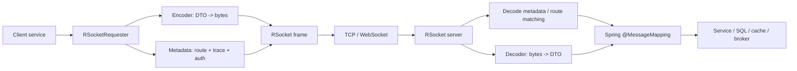
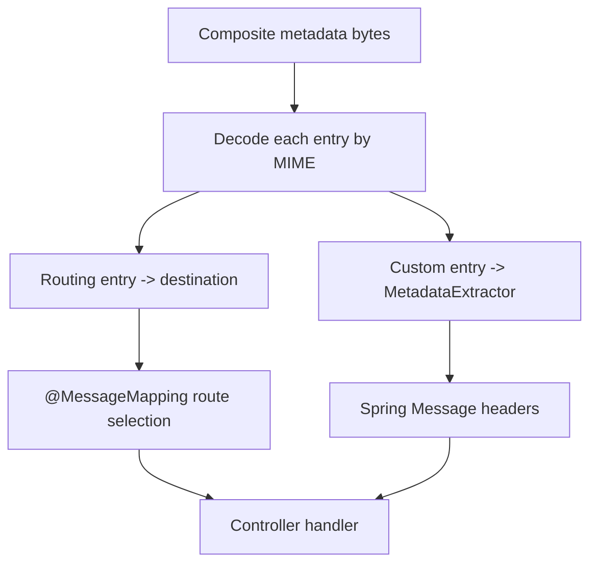
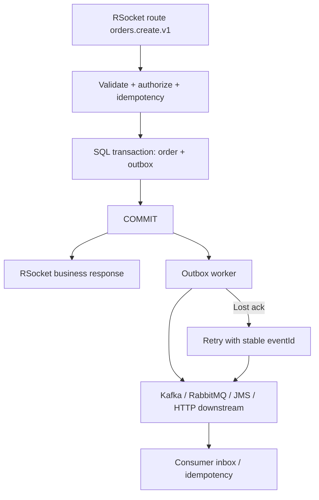

# Routes, metadata, data formats, and codecs

> **Chapter:** RSocket  
> **Scope:** Within the **SPRING_BOOT_INTEGRATION** module, Spring Boot structures communication with external systems via HTTP clients, databases, caches, message brokers, and Spring Integration adapters. This lesson focuses on RSocket **routes**, **metadata**, **data formats**, and **codecs**, establishing service-to-service contracts, error handling, timeouts, security, data versioning, duplicate handling, testing, and observability.

## 1. RSocket has two parts to understand separately: interaction and content

RSocket is a message-based communication protocol supporting **request-response**, **fire-and-forget**, **request-stream**, and **request-channel** interaction models. An RSocket connection can run over transports such as TCP or WebSocket. Data transmission is modeled through protocol frames rather than standard HTTP request/response cycles.

However, **knowing the interaction model is not enough for two systems to understand each other**. Callers must also agree on:

- **Route:** the target operation/handler, such as `orders.lookup.v1`.
- **Data payload:** the order, query, or event being exchanged.
- **Data MIME type:** how to decode the payload, such as `application/json`.
- **Metadata MIME type:** how the metadata section of a frame is encoded, such as composite metadata.
- **Metadata entries:** routing, authentication, tracing, or additional business context, each with its own meaning and encoding.
- **Codecs:** encoders/decoders on both sides converting Java objects to bytes and back.
- **Schema and semantics:** required fields, nulls, monetary amounts, timestamps, IDs, error handling, and version evolution.

**An RSocket route is not equivalent to an HTTP URL.** A route is primarily metadata used by Spring Messaging to select the matching `@MessageMapping`; calling `RSocketRequester.route(...)` does not expose a corresponding HTTP endpoint.

### 1.1. Visualizing the processing flow



Do not conflate **transport** with **payload encoding**: TCP/WebSocket governs how frames travel, whereas JSON/CBOR/Protobuf governs byte layout inside the data section.

## 2. Routes are used to select handlers

In Spring Messaging for RSocket, `@MessageMapping` names a destination pattern. `RSocketRequester` typically sends the route via **routing metadata**.

```java
@Controller
class OrderRSocketController {

    @MessageMapping("orders.lookup.v1")
    Mono<OrderStatus> lookup(OrderLookup request) {
        return orderService.find(request);
    }
}
```

Caller side:

```java
Mono<OrderStatus> result = requester
        .route("orders.lookup.v1")
        .data(new OrderLookup("tenant-a", "ORD-0042"))
        .retrieveMono(OrderStatus.class);
```

These are two **illustrative snippets showing the route–handler relationship**: `requester` is a connected `RSocketRequester`; `OrderLookup`, `OrderStatus`, and `orderService` are defined in the complete example in section 6.

When a message's route matches no mapping, or the handler expects a different interaction/payload type, processing fails. That is not an HTTP 404; the error propagates via RSocket/Spring Messaging mechanisms.

### 2.1. Route naming guidelines

| Decision | Recommended example | What to avoid |
| --- | --- | --- |
| Business-meaningful names | `orders.lookup.v1`, `orders.events.v1` | `doWork` with unclear contract |
| Version on breaking changes | `orders.create.v1` and `orders.create.v2` | Changing old payload meaning while keeping the same route |
| Stable, low-cardinality routes | One route shared across orders | `orders.ORD-000001` generating a unique route per order |
| Put IDs in the payload when appropriate | `OrderLookup(orderId)` | Embedding PII, tokens, or untrusted input strings in routes |
| Authorize by operation | Policy for `orders.cancel.v1` | Treating a client-supplied route as proof of authorization |

Routes can use **destination variables** and Spring Messaging mapping patterns, but should not encode every business parameter in the route string. Per-order dynamic routes complicate schema governance, authorization, metric cardinality, and contract evolution.

### 2.2. Routes do not replace business identity

`orders.create.v1` identifies the *operation type*, not *a single order creation attempt*. If a client retries after a disconnect, an **idempotency key** or stable business key inside the contract-validated payload/metadata is needed. Never rely on the route name for deduplication.

## 3. RSocket DATA and METADATA in a payload

An RSocket payload can carry two byte regions:

| Region | Contents | Example |
| --- | --- | --- |
| **Data** | Business payload decoded per agreed data MIME type | JSON `{"orderId":"ORD-0042"}` |
| **Metadata** | Routing and context info encoded per metadata MIME type | Route `orders.lookup.v1`, auth metadata, trace context |

During connection establishment, the **SETUP** frame advertises the MIME types used by both sides to interpret data and metadata on that connection. MIME types are not simple JSON fields you swap arbitrarily per handler.

An individual metadata entry can use MIME types such as:

- `message/x.rsocket.routing.v0`: standard RSocket routing metadata.
- `message/x.rsocket.composite-metadata.v0`: an envelope packaging **multiple metadata entries, each with its own MIME type**.
- Other MIME types for authentication or application data depending on specs, libraries, and contracts.

**Do not confuse the payload-level metadata MIME type with an individual entry's MIME type inside composite metadata.** When composite metadata is used, the route is packed as a routing entry and can sit alongside other entries.

### 3.1. Conceptual structure of composite metadata

```text
RSocket SETUP:
  data MIME type     = application/json
  metadata MIME type = message/x.rsocket.composite-metadata.v0

RSocket REQUEST_RESPONSE:
  metadata:
    entry #1:
      MIME = message/x.rsocket.routing.v0
      data = orders.lookup.v1
    entry #2:
      MIME = application/vnd.example.trace.v1+json
      data = {"correlationId":"corr-527"}
  data:
    {"tenantId":"tenant-a","orderId":"ORD-0042"}
```

This is a **human-readable illustration**, not raw composite wire bytes. Composite metadata uses a dedicated binary framing format containing per-entry headers/types and lengths; let the RSocket library encode/decode it rather than concatenating MIME strings with newlines.

### 3.2. Why not put all metadata inside the JSON payload?

Not all metadata belongs in business DTOs:

- **Route** belongs to handler dispatch.
- **Authentication** should follow transport/RSocket security mechanisms; never accept a JSON `role=admin` field as proof of privilege.
- **Trace/correlation** typically propagates across layers without polluting domain DTOs.
- **Business idempotency key** can live in payload or metadata; either works if contractually agreed, scope-validated, and unchanged across retries.

Still, metadata is not an unbounded storage bucket. Metadata bytes consume bandwidth and memory and require schemas/limits; avoid logging raw tokens, sensitive payloads, or huge variable blobs.

## 4. MetadataExtractor and binding to Spring Messages

Spring RSocket Messaging provides **`MetadataExtractor`** to turn relevant metadata entries into headers/values usable by Spring Messaging handlers. Routing metadata has built-in framework support; **custom metadata does not automatically appear in `@Header`** merely because the client sent the bytes.

A typical flow:



### 4.1. When do you configure metadata extraction?

Suppose the client sends an entry of type `application/vnd.example.trace.v1+json` carrying `correlationId`. For the server to receive it via `@Header("traceContext")`, configure how that MIME entry is decoded and under which header name it appears.

An **API-illustrative configuration** in a Spring Boot stack supporting `RSocketStrategiesCustomizer`:

```java
package com.example.integration.rsocket;

import org.springframework.boot.rsocket.messaging.RSocketStrategiesCustomizer;
import org.springframework.context.annotation.Bean;
import org.springframework.context.annotation.Configuration;
import org.springframework.util.MimeType;
import org.springframework.util.MimeTypeUtils;

@Configuration
class RSocketMetadataConfiguration {
    static final MimeType TRACE_MIME = MimeTypeUtils.parseMimeType(
            "application/vnd.example.trace.v1+json"
    );

    @Bean
    RSocketStrategiesCustomizer traceMetadata() {
        return strategies -> strategies.metadataExtractorRegistry(
                registry -> registry.metadataToExtract(
                        TRACE_MIME,
                        TraceMetadata.class,
                        "traceContext"
                )
        );
    }
}

record TraceMetadata(String correlationId) {}
```

**Note:** This code relies on the `RSocketStrategies` configuration API of the respective Spring Boot/Spring Messaging versions; before applying in production, verify API signatures and codecs for your runtime version. Declaring an extractor only works when the MIME entry can be decoded by a registered codec (JSON here) and the client actually sends matching composite metadata.

Handler after metadata extraction:

```java
@MessageMapping("orders.lookup.v1")
public Mono<OrderStatus> lookup(
        @Payload OrderLookup request,
        @Header(name = "traceContext", required = false)
        TraceMetadata trace
) {
    return orderService.find(request)
            .doOnNext(status -> auditTrace(trace, status.orderId()));
}
```

`auditTrace(...)` is simply an application helper recording sanitized diagnostic context. Never treat a client-supplied `correlationId` as authorization proof or use arbitrary values as metric tags.

### 4.2. Client sending route and custom entries

With a requester configured for **composite metadata**:

```java
Mono<OrderStatus> response = requester
        .route("orders.lookup.v1")
        .metadata(
                new TraceMetadata("corr-527"),
                RSocketMetadataConfiguration.TRACE_MIME
        )
        .data(new OrderLookup("tenant-a", "ORD-0042"))
        .retrieveMono(OrderStatus.class);
```

`route(...)` handles routing metadata; `metadata(...)` adds the custom entry. The data portion remains `OrderLookup`, not a metadata object. If the connection's metadata MIME type supports only a single routing entry, adding extra entries cannot be interpreted as composite; standardize on composite metadata from the start.

**Do not roll your own authentication by extracting a `userId` or `role` header and trusting it blindly.** Authenticate using Spring Security RSocket or a proper security mechanism, bind identity from verified credentials, and enforce authorization at the route/service layers.

## 5. Data MIME type is distinct from schema and codec

When the sender calls:

```java
requester.route("orders.lookup.v1")
        .data(new OrderLookup("tenant-a", "ORD-0042"))
        .retrieveMono(OrderStatus.class);
```

The Java object is not sent verbatim. The framework uses an **encoder** to convert it into data bytes matching the MIME type and a matching **decoder** on the receiving side.

| Component | What it determines | Example |
| --- | --- | --- |
| **Data MIME type** | Wire representation of payload | `application/json`, `application/cbor`, an agreed binary MIME |
| **Encoder** | Converts Java object to bytes | Jackson JSON encoder |
| **Decoder** | Converts bytes to Java type | Jackson JSON decoder |
| **Schema** | Structural layout and compatibility | JSON Schema, Protobuf `.proto`, Avro schema |
| **Business contract** | Field meanings and invariants | `amountMinor` with currency, `orderId` as opaque ID |

**A valid MIME type does not prove the payload matches the schema**. `application/json` merely says “JSON data,” not event type, required fields, or semantics. If JSON omits `orderId` yet a Java record still deserializes it as `null`, the service must validate and reject appropriately.

### 5.1. Three common data format choices

| Format | When to choose | Pros | Risks / extra work |
| --- | --- | --- | --- |
| **JSON** | Standard service-to-service communication; debuggability prioritized | Human-readable, broad Jackson mapping | Number precision, nullable fields, enums, schema evolution |
| **CBOR** | Both ends agree on compact binary with JSON-like structure | Can shrink payloads compared to JSON in some workloads | Requires matching codecs/modules on both sides and interop tests |
| **Protobuf or other binary** | High-throughput RPC/events with strict types/schemas | Compact payloads, field-number contracts with Protobuf | Needs schema/code generation, registry/versioning strategy, matching custom codecs |

**RSocket does not mandate JSON**, nor does it **automatically support every format**. Which MIME types a codec library handles—and whether both peers use compatible schemas/serializers—must be verified.

### 5.2. Numeric JSON and business data

Example:

```json
{
  "eventId": "evt-901",
  "orderId": "ORD-00042",
  "amountMinor": 125000,
  "currency": "VND",
  "occurredAt": "2026-11-21T03:00:00Z"
}
```

Represent IDs as strings to preserve leading zeros. Monetary amounts require explicit units/precision—avoid floating-point numbers for financial values. Timestamps should specify UTC/offsets; `null`, missing fields, and empty strings can carry distinct meanings. Whenever producers change DTOs, test compatibility with older clients rather than relying solely on Jackson round-trip unit tests.

## 6. Spring Boot request-response example with JSON

Goal: run a TCP RSocket server on port 7000, accept route `orders.lookup.v1`, and return order status. The example uses **Spring Boot 3.x, Java 17+**, Reactor, and Spring RSocket messaging.

### 6.1. Maven dependency

```xml
<dependency>
    <groupId>org.springframework.boot</groupId>
    <artifactId>spring-boot-starter-rsocket</artifactId>
</dependency>
```

The Spring Boot BOM/starter parent should manage versions for Spring Messaging, Reactor, RSocket Java, and encoders. If an app only acts as an RSocket TCP server/client, no REST controller is required; WebFlux can be added separately if the app also serves reactive HTTP.

### 6.2. Server configuration

```yaml
spring:
  rsocket:
    server:
      transport: tcp
      port: 7000
```

This port and transport apply to the RSocket TCP server. If choosing WebSocket, configure WebFlux/web server and mapping path according to your Spring Boot version; **never treat an HTTP WebSocket URL as a TCP endpoint** just because both carry RSocket on top.

### 6.3. Data contract

```java
package com.example.integration.rsocket;

public record OrderLookup(String tenantId, String orderId) {}
```

```java
package com.example.integration.rsocket;

public record OrderStatus(String orderId, String status) {}
```

For simplicity, the DTOs hold two fields each. In production, authenticate callers, derive/verify `tenantId` authorization from the security context, bound input lengths, and define behavior when orders are not found.

### 6.4. Server controller

```java
package com.example.integration.rsocket;

import org.springframework.messaging.handler.annotation.MessageMapping;
import org.springframework.messaging.handler.annotation.Payload;
import org.springframework.stereotype.Controller;
import reactor.core.publisher.Mono;

@Controller
public class OrderRSocketController {
    private final OrderQueryService service;

    public OrderRSocketController(OrderQueryService service) {
        this.service = service;
    }

    @MessageMapping("orders.lookup.v1")
    public Mono<OrderStatus> lookup(@Payload OrderLookup request) {
        return service.find(request);
    }
}
```

To keep the example self-contained, the service below returns a synthetic status; it **does not query real SQL** and does not trust client-supplied `tenantId` for authorization:

```java
package com.example.integration.rsocket;

import org.springframework.stereotype.Service;
import reactor.core.publisher.Mono;

@Service
public class OrderQueryService {
    public Mono<OrderStatus> find(OrderLookup request) {
        return Mono.defer(() -> {
            if (request == null || request.orderId() == null
                    || request.orderId().isBlank()) {
                return Mono.error(new IllegalArgumentException(
                        "orderId is required"));
            }
            return Mono.just(new OrderStatus(
                    request.orderId(), "CONFIRMED"));
        });
    }
}
```

When replacing with database queries, use `DatabaseClient`/R2DBC to preserve a non-blocking reactive pipeline. If using blocking JDBC/JPA, never call it directly on the RSocket event loop. Returning `Mono` **does not turn a blocking DAO into a reactive one**.

### 6.5. Creating RSocketRequester on the client

```java
package com.example.integration.rsocket;

import org.springframework.beans.factory.annotation.Value;
import org.springframework.context.annotation.Bean;
import org.springframework.context.annotation.Configuration;
import org.springframework.messaging.rsocket.RSocketRequester;
import org.springframework.util.MimeTypeUtils;

@Configuration
class OrderRSocketClientConfiguration {

    @Bean("ordersRequester")
    RSocketRequester ordersRequester(
            RSocketRequester.Builder builder,
            @Value("${remote.orders.host:localhost}") String host,
            @Value("${remote.orders.port:7000}") int port) {
        return builder
                .dataMimeType(MimeTypeUtils.APPLICATION_JSON)
                .metadataMimeType(MimeTypeUtils.parseMimeType(
                        "message/x.rsocket.composite-metadata.v0"))
                .tcp(host, port);
    }
}
```

In Java apps creating multiple requesters, use `@Qualifier("ordersRequester")` to avoid mixing up endpoints. How `tcp(...)` manages requester/connection lifecycles depends on version; do not assume the library automatically reconnects indefinitely after every network failure. Configure initialization, retry/reconnect, and disposal per contract/version if high availability is required.

### 6.6. Client invoking the route

```java
package com.example.integration.rsocket;

import java.time.Duration;
import org.springframework.beans.factory.annotation.Qualifier;
import org.springframework.messaging.rsocket.RSocketRequester;
import org.springframework.stereotype.Service;
import reactor.core.publisher.Mono;

@Service
public class RemoteOrderLookup {
    private final RSocketRequester requester;

    public RemoteOrderLookup(
            @Qualifier("ordersRequester") RSocketRequester requester) {
        this.requester = requester;
    }

    public Mono<OrderStatus> lookup(String tenantId, String orderId) {
        return requester.route("orders.lookup.v1")
                .data(new OrderLookup(tenantId, orderId))
                .retrieveMono(OrderStatus.class)
                .timeout(Duration.ofSeconds(3));
    }
}
```

This code models **request-response**: the client sends one request and receives at most one response. `Mono.timeout` limits how long the caller waits; it **does not prove** the server canceled all processing before the timeout. For routes with side effects (order creation/payment capture), require a stable idempotency key and status lookup before retrying.

## 7. How do the four interaction models use routes and codecs?

| Model | Typical client API | Handler return | Key contract points |
| --- | --- | --- | --- |
| **Request-response** | `retrieveMono(Result.class)` | `Mono<Result>` | Timeouts, empty results, validation, semantic retries |
| **Fire-and-forget** | `send()` | Usually `Mono<Void>` / handler returns no business reply | Do not treat local completion as proof of business commit |
| **Request-stream** | `retrieveFlux(Event.class)` | `Flux<Event>` | Backpressure, cancellation, memory limits, stream termination |
| **Request-channel** | `data(Flux<Input>, Input.class).retrieveFlux(Output.class)` | Handler accepts a publisher and returns a publisher | Bidirectional sync, demand, error/complete on each side |

### 7.1. Fire-and-forget does not mean processing finished

Audit message example:

```java
Mono<Void> sent = requester
        .route("audit.capture.v1")
        .data(new AuditEvent("evt-1", "ORDER_CONFIRMED"))
        .send();
```

`send()` receives no business response. It provides no end-to-end guarantee that the event was persisted in SQL or a destination broker. If auditing is mandatory, use a separate business acknowledgment, outbox, or recoverable delivery mechanism.

### 7.2. Request-stream

The server can expose a route returning multiple elements:

```java
@MessageMapping("orders.changes.v1")
public Flux<OrderChange> changes(OrderChangesQuery query) {
    return changeStreamService.stream(query);
}
```

Client:

```java
Flux<OrderChange> changes = requester
        .route("orders.changes.v1")
        .data(new OrderChangesQuery("tenant-a"))
        .retrieveFlux(OrderChange.class);
```

`OrderChange`, `OrderChangesQuery`, and `changeStreamService` are domain examples not implemented in section 6's request-response code. A stream does not inherently provide persistence/replay like an event log; items emitted while a subscriber is offline may be lost depending on the stream source architecture.

### 7.3. Backpressure does not replace idempotency

RSocket supports Reactive Streams demand for stream/channel interactions, but **does not turn the transport into a durable queue**. If the client drops mid-stream, an application-level resume/replay policy is needed to continue from the exact position. If a publisher replays events processed previously after reconnect, the consumer still needs event IDs/sequences and SQL idempotency.

## 8. JSON, CBOR, Protobuf, and custom codecs

### 8.1. RSocketStrategies is the extension point

Spring RSocket Messaging uses `RSocketStrategies` to assemble **encoders, decoders, route/metadata extraction, and messaging support components**. For standard JSON, the starter and Jackson supply suitable codecs. For custom formats:

1. Both sides define the exact **MIME type**.
2. Select an existing codec or implement `Encoder<T>`/`Decoder<T>`.
3. Register them via `RSocketStrategies.Builder`/customizer for your Spring stack.
4. Configure the connection's data MIME type to match the codec.
5. Test real bytes, including null/empty/invalid payloads and multiple versions.

Incompatibility cannot be fixed simply by:

```java
// Insufficient without matching codecs and aligned schemas:
builder.dataMimeType(
        MimeTypeUtils.parseMimeType("application/x-protobuf"));
```

The MIME type only labels the selected format. **Java codecs, generated classes, field numbers, and schema evolution remain the application's responsibility.**

### 8.2. Binary payload does not automatically mean Protobuf

If two systems agree to exchange opaque bytes:

```java
byte[] data = /* bytes from a verified codec/device */;

Mono<byte[]> reply = binaryRequester
        .route("files.digest.v1")
        .data(data)
        .retrieveMono(byte[].class);
```

Here `binaryRequester` is a **separate** requester configured with matching MIME type and byte-array codecs. Do not take section 6's JSON requester, pass raw bytes, and expect the server to infer `application/octet-stream`. Never use the pattern above to load huge files entirely into RAM; use streaming/chunking or object storage with checksums, access control, and size limits instead.

### 8.3. Metadata codecs can be independent of data codecs

A connection can use JSON for data alongside composite metadata containing:

- Standard RSocket routing entry.
- Auth metadata in Spring Security/RSocket setup format.
- Custom JSON trace entry.

Having JSON data **does not mean every metadata entry is JSON**. Each entry inside composite metadata has its own MIME type and decoder; custom entries must be registered with an extractor/codec if handlers need to read them.

## 9. Designing contract versioning and compatibility

Suppose `orders.lookup.v1` expects:

```json
{
  "tenantId": "tenant-a",
  "orderId": "ORD-0042"
}
```

Later, the team wants to add an `includeHistory` field. One evolution step:

```json
{
  "tenantId": "tenant-a",
  "orderId": "ORD-0042",
  "includeHistory": false
}
```

If the new field is optional, new consumers provide a valid default, and old consumers ignore unknown fields, the change **may** be compatible. Still check:

- Does the server deserializer reject unknown fields?
- When old clients omit the field, does default logic preserve legacy behavior?
- If adding enum values or changing number/string types, can older consumers handle them?
- Do idempotency definitions or access permissions shift with the new option?

**Route version is not schema version**: a single route can support multiple compatible schema versions. For breaking changes in semantics or data types, introducing a new route like `orders.lookup.v2` with parallel rollout is generally safer than mutating behavior silently.

### 9.1. Where are schemas managed?

| Format | Useful contract artifacts | Compatibility checks |
| --- | --- | --- |
| JSON | DTOs, JSON Schema, payload fixture sets | Test old client/new server and new client/old server |
| CBOR | DTO/contract-level schemas, binary fixtures | Verify encoding of numbers, types, and nulls |
| Protobuf | `.proto`, generated code, reserved field numbers | Add fields safely, never reuse field numbers |
| Custom binary | Byte layout/version/checksum specs | Never alter layout without versioning/old decoders |
| Custom metadata | MIME type, codec, field schema/version | Allow optional fields, reject unsupported types cleanly |

Do not only test serialize-then-deserialize with **the same library/version**: two services or two languages may decode differently. Write contract tests between both sides using fixtures from all still-supported versions.

## 10. Route and metadata security

RSocket maintains connections that can live a long time and serve many requests; separate **transport protection**, **connection authentication**, and **per-route authorization**:

1. Use TLS/TCP or WebSocket over TLS per topology; never assume plaintext TCP is safe.
2. Apply **Spring Security RSocket** or authentication properly integrated into setup/request metadata.
3. Enforce authorization on both the route **and** the business service, based on verified principal/tenant.
4. Never trust a payload `tenantId` field without cross-checking against verified identity.
5. Never accept `admin=true` or `role=MANAGER` strings in custom metadata to grant privileges.
6. Limit payload size, metadata size, nesting depth, stream length, and concurrent streams.
7. Never log tokens or authentication metadata; restrict access to traces/logs.

**Authentication metadata and tracing metadata serve different purposes.** Correlation IDs aid diagnostics and never grant privileges. For long-lived streams, account for token expiration/re-authentication and termination behavior per the application's security design.

### 10.1. Do not use arbitrary routes as metric labels

Routes are normally a bounded set suitable for metrics, but if an app constructs dynamic routes per order/user, metric cardinality will explode. Tagging `orders.lookup.v1` can be reasonable; tagging `orders.ORD-123456` is harmful. Log requests with trace IDs and redacted IDs per policy, never raw metadata containing credentials.

## 11. Errors at the route, codec, and business layers

| Error | Common symptom | What to check |
| --- | --- | --- |
| **Route mismatch** | Request reaches server but no handler matches | `route(...)` string, `@MessageMapping`, patterns, separators |
| **Missing routing metadata** | Handler sees no destination | SETUP metadata MIME type, composite/routing metadata encoding |
| **MIME/codec mismatch** | Decode failure, unsupported MIME, wrong object type | Data MIME type, encoders/decoders in `RSocketStrategies` on both sides |
| **Invalid schema** | Null/missing fields after decode, validation errors | Required fields, type mapping, version, JSON/Protobuf schema |
| **Custom metadata fails to bind** | `@Header` is null or missing | `MetadataExtractor`, MIME entry, header name, metadata codec |
| **Server throws exception** | Client receives RSocket error signal | Classify validation, business, infrastructure errors; avoid infinite retries |
| **Connection failure** | Cannot send/receive requests, continuous reconnects | Host/port, transport, TLS, auth, SETUP rejection, load balancer |
| **Stream overload** | Growing queues/heap, high latency | Demand/backpressure, `flatMap` concurrency, buffers, and timeouts |
| **Unknown outcome after timeout** | Caller sees no response while remote may have processed | Idempotency key, status lookup, durable command log |

### 11.1. RSocket ERROR is not an HTTP status code

In HTTP, clients inspect 400/404/409/500. RSocket uses protocol/Reactor **error signaling**; conveying business errors requires an explicit contract:

- For invalid inputs, choose an error signal carrying a **stable business error code** or an error-envelope response.
- For not-found cases, specify returning `Mono.empty()`, a `NOT_FOUND` DTO, or an error signal; do not leave each consumer guessing.
- For system errors, avoid leaking stack traces, SQL, tokens, or personal data in messages returned to clients.
- On timeouts, never assume side effects definitely did not occur.

Do not attach `onErrorResume(error -> Mono.empty())` everywhere, as it can mask codec or authorization errors as “no data.”

### 11.2. Retries and idempotency

`retryWhen(...)` in Reactor re-subscribes, causing **request retransmission**. Only auto-retry if:

- The route has read/idempotent semantics; or
- The client reuses **the same idempotency key**, and the server guarantees deduplication via transactions/unique constraints; and
- Errors are classified as transient, retry attempts are bounded, and backoff/jitter plus a deadline are applied.

For a `payments.charge.v1` route, if the connection drops after the server charges but before the response arrives, retrying with a new key can double-charge. **The transport does not design duplicate protection for the application.**

## 12. Combining RSocket with SQL, caches, and message brokers

An RSocket route may call SQL, Redis, or publish messages. Each resource has **its own transaction boundary**:



**Never hold an SQL transaction open while waiting on a long-lived RSocket stream**. Keep SQL transactions in the service updating the database, commit first, and then emit events or start streams per policy. If downstream requires reliable event delivery even across app crashes, a transactional outbox is far more appropriate than calling `send()` directly and expecting a DB transaction to roll back the network send.

When using R2DBC in handlers, apply `TransactionalOperator`/reactive transactions to **finite SQL chains**. When using blocking JPA/JDBC, account for thread isolation and saturation. Redis caches can reduce query load, but a **cache miss** does not prove an order does not exist; never rely solely on Redis TTL to deduplicate critical commands.

## 13. Observing routes, metadata, and codecs

Essential metrics for an RSocket service:

| Signal | Diagnostic value |
| --- | --- |
| Active connections, SETUP failures, reconnects | Network/TLS/auth/MIME negotiation |
| Request count and latency per route | Hot routes, slow handlers, load shifts |
| Decode/encode failures per MIME | Incompatible codecs or malformed payloads |
| Missing/invalid metadata counts | Broken route metadata, tracing, auth, or custom extractors |
| Active streams, cancellations, errors | Long streams, slow clients, timeouts, or backpressure issues |
| Downstream SQL/Redis/broker errors | Separate integration failures from RSocket transport failures |
| Idempotency replay/conflict counts | Caller retries, duplicates, and payload mismatches |
| Client timeouts vs. server completions | Identify ambiguous outcomes needing reconciliation |

Spring Boot Actuator/Micrometer can instrument certain layers when appropriate dependencies/configs are added, but **not every metric above is enabled out of the box**. Custom metrics may be needed for codecs, metadata extraction, business outcomes, and duplicate counts.

**Permitted logs:** bounded route names, error codes, MIME types, `schemaVersion`, sanitized correlation IDs, latency, and outcomes. **Never log raw authentication metadata**, tokens, or full data payloads containing PII.

## 14. Testing the contract end-to-end instead of only calling controllers

### 14.1. Recommended test coverage

| Category | Expected verification |
| --- | --- |
| **Route matching** | Valid routes reach the expected `@MessageMapping`; unknown routes fail per contract |
| **MIME setup** | JSON/composite metadata understood properly by both sides |
| **Metadata** | Routing entry works; custom trace metadata extracts properly and confers no privileges |
| **Schema** | DTO fields/types align; missing required fields or unknown enums handled intentionally |
| **Codecs** | Encode/decode JSON or binary across **two independent runtimes** without double-encoding |
| **Request-response** | Success, not-found, validation error, and timeout produce clear outcomes |
| **Fire-and-forget** | Local `send()` completion is not treated as proof of server DB commit |
| **Streams** | Demand, cancellation, server errors, and reconnection handled cleanly |
| **Security** | Forbidden routes remain unreachable even if client injects tenant/admin metadata |
| **Idempotency** | Retries with same key produce no extra side effects; different payload reports conflict |
| **Downstream failure** | SQL/broker failures classified properly, never swallowed as empty responses |
| **Upgrade/compatibility** | v1 clients and v2 servers interoperate per published policy |

### 14.2. Example test using RSocketRequester

During testing, start the server on a dedicated port and create an `RSocketRequester` pointing to it rather than invoking controller methods directly. An **illustrative example** with JUnit 5 and Reactor Test:

```java
@Test
void requestsOrderStatusByRoute() {
    Mono<OrderStatus> response = requester
            .route("orders.lookup.v1")
            .data(new OrderLookup("tenant-a", "ORD-0042"))
            .retrieveMono(OrderStatus.class);

    StepVerifier.create(response)
            .assertNext(status -> {
                assertThat(status.orderId()).isEqualTo("ORD-0042");
                assertThat(status.status()).isEqualTo("CONFIRMED");
            })
            .verifyComplete();
}
```

In this snippet, `requester` is a configured test connection, `StepVerifier` is from `reactor-test`, and `assertThat` is from AssertJ; start a real server in the test context, avoid port conflicts, and clean up connections afterward. Do not assume that passing a controller unit test means metadata MIME setup, wire codecs, and route matching also work.

### 14.3. Failure cases most worth testing

1. Client enables composite metadata while server lacks the custom `MetadataExtractor`: route may still match while trace header is absent; tests must catch this rather than silently passing.
2. Client sends `application/json` while server only registers a custom binary codec: request must fail observably rather than mis-decoding data into a DTO.
3. Client retries an order-creation command after the server commits SQL and loses the response: reusing the key must return the prior result or processed status.
4. Stream canceled mid-flight: service releases resources without holding transactions/DB connections indefinitely.
5. Old and new routes running side-by-side during rollout: maintain compatible behavior and fail clearly for retired versions.

## 15. Checklist for designing RSocket routes and metadata

1. **Choose interaction model:** does request-response, fire-and-forget, stream, or channel fit the business semantics?
2. **Version routes:** use stable names and avoid embedding user IDs in routes.
3. **Lock data MIME:** JSON/CBOR/binary; are codecs compatible on both ends?
4. **Lock metadata MIME:** routing-only or composite, which custom entries exist, and are extractors registered?
5. **Enforce security:** authentication, authorization by route and verified tenant, TLS, and request limits.
6. **Define schemas:** required/optional fields, timestamps, money, enums, unknown fields, and compatibility rules.
7. **Define error behavior:** not-found, invalid payload, timeout, network failure, downstream failure.
8. **Design idempotency:** for side-effect routes, stable keys, transactions/unique constraints, and status lookup.
9. **Bound streams:** concurrency, timeouts, cancellation, buffers, and replay after reconnect.
10. **Test + observe:** route matching, metadata extraction, wire codec tests, v1/v2 contracts, auth, and downstream failures.

### Self-check questions

1. How does an RSocket route differ from an HTTP path?
2. How do the data payload and metadata of an RSocket message hold different types of information?
3. How does `message/x.rsocket.routing.v0` differ from `message/x.rsocket.composite-metadata.v0`?
4. Why does a custom metadata entry not appear as a `@Header` automatically without an extractor?
5. Does data MIME type `application/json` prove payloads conform to a JSON Schema or business contract?
6. Why must codecs/`RSocketStrategies` be configured when using Protobuf or a custom binary format?
7. Through what mechanism does `RSocketRequester.route("orders.lookup.v1")` transmit routing information?
8. Why are `Mono.timeout` or fire-and-forget `send()` insufficient to prove whether remote side effects occurred?
9. When should you add a `v2` route instead of quietly altering the `v1` schema?
10. How do route authorization, trace correlation, and idempotency keys protect against different concerns?

**Key takeaway:** In Spring Boot RSocket, a **route** is a destination carried in routing metadata and typically matched to `@MessageMapping`; the **data MIME type** dictates how business bytes are interpreted; and the **metadata MIME type** governs context packaging, with composite metadata allowing multiple entries to coexist. **Codecs/`RSocketStrategies`** translate between Java DTOs and bytes, while schemas, versioning, auth, transactions, and idempotency must be designed explicitly. End-to-end connection and payload tests are what confirm an integration contract truly works.
