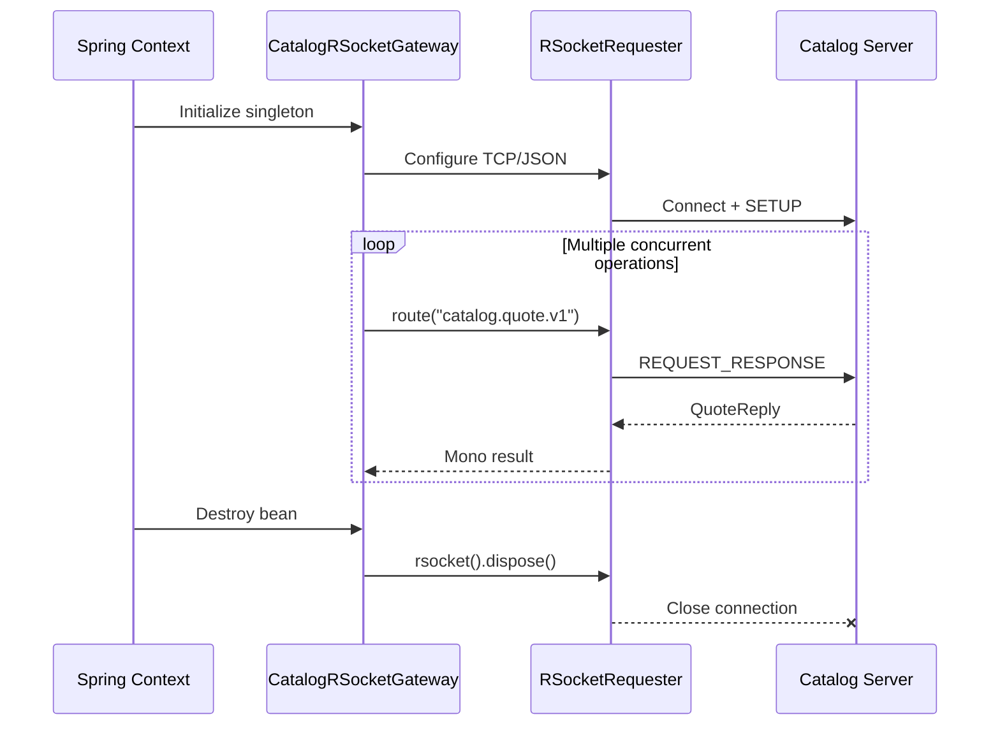
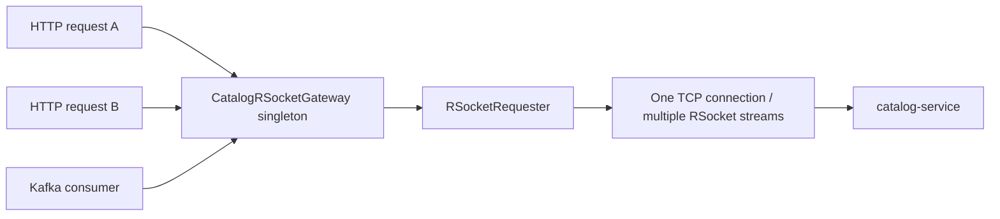
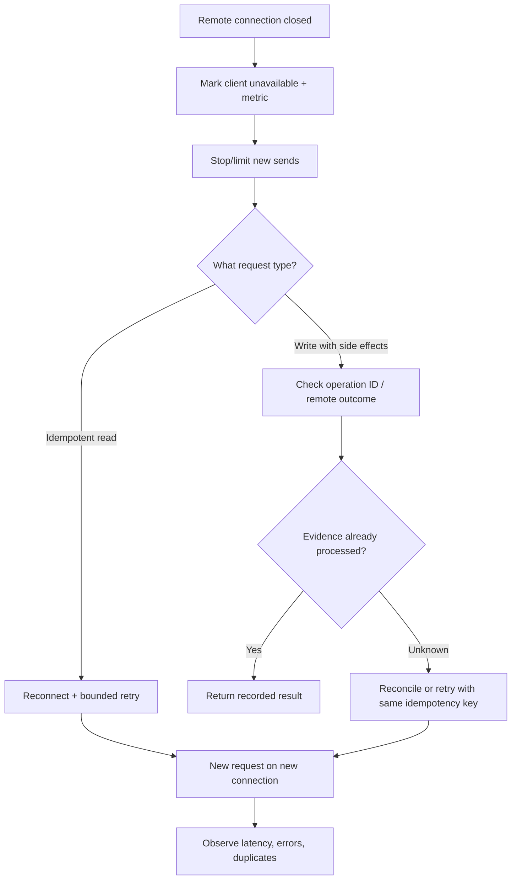

# Creating clients, reusing connections, and closing resources

> **Chapter:** RSocket  
> **Scope:** Within the **SPRING_BOOT_INTEGRATION** module, Spring Boot organizes integrations via HTTP clients, databases, caches, message brokers, and Spring Integration adapters. This lesson focuses on **creating RSocket clients with `RSocketRequester`, reusing connections, managing lifecycles, and closing resources**. These decisions directly affect connection errors, response latency, duplicate handling, testing, and observability of integration flows.

## 1. Problem: an application calls RSocket thousands of times

Suppose **order-service** needs to query **catalog-service** for product pricing upon receiving an order. Each request may call RSocket route `catalog.quote.v1`. Two seemingly similar implementations behave very differently in production:

```text
Option A - creating a client per operation:

HTTP request 1 -> RSocketRequester.Builder -> connect TCP -> request -> dispose
HTTP request 2 -> RSocketRequester.Builder -> connect TCP -> request -> dispose
HTTP request 3 -> RSocketRequester.Builder -> connect TCP -> request -> dispose

Option B - using a shared client with an explicit lifecycle:

Spring Boot startup -> create one CatalogRSocketGateway
                          |
                          v
                    RSocketRequester
                          |
                 TCP / WebSocket connection
                          |
           +--------------+---------------+
           |              |               |
        request 1       request 2       request 3
           |              |               |
           +--------------+---------------+
                          |
                 Spring shutdown -> dispose
```

**Option B is usually preferable** when many requests target the same remote RSocket server with the same configuration and security scope. One RSocket connection can **multiplex multiple streams/requests** over the same transport, avoiding a new TCP connection per message.

However, “using a shared connection” does not mean holding onto a connection regardless of state. Connections can drop, TLS credentials can expire, remotes can restart, and in-flight requests can end in unknown states. A production client requires strategies for **initialization, ownership, observability, reconnection, and resource disposal on shutdown**.

### Lesson objectives

After completing this lesson, you will be able to:

1. Distinguish `RSocketRequester.Builder`, `RSocketRequester`, the underlying `RSocket`, and the transport connection.
2. Create TCP/WebSocket requesters compatible with Spring Boot configuration.
3. Reuse one requester for multiple request–responses, fire-and-forgets, and streams within valid scopes.
4. Define who **owns** the connection and **when** `dispose()` should be called.
5. Distinguish timeouts, cancellation, connection closure, and reconnect/resume.
6. Handle unknown remote outcomes after errors without creating duplicate side effects.
7. Test against a real RSocket server rather than mocking a Java method alone.

## 2. Objects to distinguish on the client side

| Component | Role | Lifecycle |
| --- | --- | --- |
| **`RSocketRequester.Builder`** | Configures data/metadata MIME, codecs, setup payload, connector, transport | Used to **build a requester**; not a message client to invoke per request |
| **`RSocketRequester`** | Spring Messaging API for `route(...)`, `data(...)`, `retrieveMono(...)`, `retrieveFlux(...)`, `send()` | Typically stored in a reusable adapter/gateway bean |
| **Underlying `RSocket`** | Logical connection carrying RSocket interactions; detects close and supports dispose | A resource requiring proper ownership and closure |
| **Transport** | TCP or WebSocket connection to the remote endpoint | Has its own socket, TLS, and network lifecycle |
| **`RSocketStrategies`** | Encoders/decoders, route/metadata extraction, and Spring Messaging utilities | Typically shared across compatible requesters |
| **`Mono`/`Flux`** | Publisher representing an invocation/stream | Subscription initiates or consumes the request; cancellation has distinct semantics |
| **Application gateway/adapter** | Wraps the requester behind a domain API such as `quote(sku)` | Appropriate place to manage retries, timeouts, auth scope, metrics, and shutdown |

A common mistake is treating `RSocketRequester.Builder` like a **per-request connection factory**, calling `tcp(...)` inside a service method. That adds overhead and makes connection cleanup hard on timeouts/exceptions. Instead, build the client once at the **composition root** (Spring configuration) and use the requester inside an adapter.

### 2.1. RSocket is not an HTTP connection pool

In HTTP/1.1, applications often use connection pooling to reuse sockets across concurrent requests. RSocket differs because **a single connection can simultaneously carry multiple logical streams**, so the key questions are not just “how many sockets to pool,” but also:

- How many in-flight requests/streams are active on one connection?
- How does the remote bound concurrency, payloads, buffers, and throughput?
- Are multiple connections needed to separate authentication/tenants or avoid a bottleneck?
- When a connection drops, how are active requests/streams handled?
- Are client-side load balancing, reconnection, or RSocket resume specifically required?

**Do not build a pool of hundreds of `RSocketRequester` instances** just because traffic is high. Benchmark against real demand and client/server resources. Extra connections increase TLS/socket/keepalive overhead and do not automatically improve throughput.

## 3. Baseline configuration in Spring Boot

Examples use **Spring Boot 3.x, Java 17+, and compatible Spring Framework/RSocket Java**. API signatures or auto-configuration conditions may change across Boot versions; verify against your project's BOM and version documentation before production use.

### 3.1. Maven dependencies

```xml
<dependencies>
    <dependency>
        <groupId>org.springframework.boot</groupId>
        <artifactId>spring-boot-starter-rsocket</artifactId>
    </dependency>
    <dependency>
        <groupId>org.springframework.boot</groupId>
        <artifactId>spring-boot-starter-test</artifactId>
        <scope>test</scope>
    </dependency>
    <dependency>
        <groupId>io.projectreactor</groupId>
        <artifactId>reactor-test</artifactId>
        <scope>test</scope>
    </dependency>
</dependencies>
```

The starter provides components to build RSocket clients/servers in Spring Boot. If the application only makes RSocket calls, **opening an RSocket server is not required**. If it also serves HTTP endpoints, add the web or webflux starter matching your architecture; do not assume `spring-boot-starter-rsocket` exposes HTTP APIs.

### 3.2. TCP server used in the examples

In `catalog-service`:

```yaml
spring:
  rsocket:
    server:
      transport: tcp
      port: 7000
```

In `order-service`:

```yaml
integration:
  catalog:
    host: ${CATALOG_RSOCKET_HOST:localhost}
    port: ${CATALOG_RSOCKET_PORT:7000}
    timeout: 3s
```

These are **application-defined properties** for the client, not default Spring Boot properties that auto-create a catalog requester. A bean factory/adapter must bind them. Port `7000` and `localhost` are for local/testing use only.

RSocket TCP and WebSocket use **different transports**:

| Server transport | Client connect | What must match |
| --- | --- | --- |
| `tcp` | `RSocketRequester.Builder.tcp(host, port)` | Host, port, TLS, SETUP metadata/data MIME, and auth |
| `websocket` | `RSocketRequester.Builder.websocket(URI)` | `ws://` or `wss://` URI, mapping path, reverse proxy, TLS, and WebSocket upgrade |

Do not pass a `ws://...` URI to `tcp(...)` expecting automatic protocol switching. Behind a load balancer/gateway, verify infrastructure supports WebSocket upgrade or TCP passthrough matching the chosen transport.

## 4. Spring Boot server example: a route for clients to call

First, build a simple RSocket service. It intentionally avoids a real database so we can focus on client lifecycle.

### 4.1. DTOs and handler

```java
package com.example.catalog.rsocket;

public record QuoteRequest(String tenantId, String sku) {}
```

```java
package com.example.catalog.rsocket;

public record QuoteReply(String sku, long amountMinor, String currency) {}
```

```java
package com.example.catalog.rsocket;

import org.springframework.messaging.handler.annotation.MessageMapping;
import org.springframework.messaging.handler.annotation.Payload;
import org.springframework.stereotype.Controller;
import reactor.core.publisher.Mono;

@Controller
public class QuoteRSocketController {

    @MessageMapping("catalog.quote.v1")
    public Mono<QuoteReply> quote(@Payload QuoteRequest request) {
        return Mono.defer(() -> {
            if (request == null
                    || request.sku() == null
                    || request.sku().isBlank()) {
                return Mono.error(new IllegalArgumentException(
                        "sku is required"));
            }
            return Mono.just(new QuoteReply(
                    request.sku(), 125000L, "VND"));
        });
    }
}
```

`Mono.defer(...)` ensures logic evaluates at subscription time without sharing state across callers. This example illustrates *route + DTO* only and **does not implement tenant authentication/authorization**. In production, client-supplied `tenantId` must be validated against an authenticated identity; never treat a DTO field as authorization proof.

### 4.2. Both ends must have compatible MIME types

Client and server must understand the same encoding for **data** (e.g., JSON) and **metadata** (routing metadata/composite metadata). With Spring RSocket, `@MessageMapping` is matched using routing metadata sent when the requester calls `route(...)`.

If the server expects JSON while the client registers only a binary codec or sends incompatible metadata MIME, requests fail during SETUP, route matching, or deserialization. This is a contract/wiring bug and **must not be masked with unbounded retries**.

## 5. Configuring a shared RSocketRequester

### 5.1. Client initialization step

In `order-service`, create the requester **once** from the Spring Boot-provided builder:

```java
package com.example.orders.rsocket;

import org.springframework.beans.factory.annotation.Value;
import org.springframework.context.annotation.Bean;
import org.springframework.context.annotation.Configuration;
import org.springframework.messaging.rsocket.RSocketRequester;
import org.springframework.util.MimeTypeUtils;

@Configuration(proxyBeanMethods = false)
public class CatalogRSocketConfiguration {

    @Bean(destroyMethod = "close")
    CatalogRSocketGateway catalogRSocketGateway(
            RSocketRequester.Builder builder,
            @Value("${integration.catalog.host}") String host,
            @Value("${integration.catalog.port}") int port) {

        RSocketRequester requester = builder
                .dataMimeType(MimeTypeUtils.APPLICATION_JSON)
                .metadataMimeType(MimeTypeUtils.parseMimeType(
                        "message/x.rsocket.composite-metadata.v0"))
                .tcp(host, port);

        return new CatalogRSocketGateway(requester);
    }
}
```

This code **assigns ownership of the requester** to the `CatalogRSocketGateway` bean. Spring calls the gateway's `close()` method when destroying the bean during application context shutdown. If using another client version/API or managing reconnect/load-balancing via `RSocketClient`, adapt disposal and lifecycle handling to the abstraction you own.

**Do not construct a requester inside the constructor of a request-scoped object** and do not close the requester after a single `quote()` call while other requests share the connection.

### 5.2. Business adapter and closing resources

```java
package com.example.orders.rsocket;

import java.time.Duration;
import org.springframework.messaging.rsocket.RSocketRequester;
import reactor.core.publisher.Mono;

public final class CatalogRSocketGateway implements AutoCloseable {
    private final RSocketRequester requester;

    public CatalogRSocketGateway(RSocketRequester requester) {
        this.requester = requester;
    }

    public Mono<QuoteReply> quote(String tenantId, String sku) {
        return requester.route("catalog.quote.v1")
                .data(new QuoteRequest(tenantId, sku))
                .retrieveMono(QuoteReply.class)
                .timeout(Duration.ofSeconds(3));
    }

    @Override
    public void close() {
        requester.rsocket().dispose();
    }
}
```

```java
package com.example.orders.rsocket;

public record QuoteRequest(String tenantId, String sku) {}
```

```java
package com.example.orders.rsocket;

public record QuoteReply(String sku, long amountMinor, String currency) {}
```

Here `requester.rsocket().dispose()` is **how you close the underlying RSocket in Spring RSocket's single-connection requester model**. When using a client/provider with a different lifecycle, or an API version that does not expose the underlying RSocket this way, dispose through the owning client per its documentation. The invariant is that **only the owner** of the connection closes it, never individual callers borrowing the requester.

**Startup note:** depending on the API/transport/version and when connections open, requester initialization may require the remote peer to be ready or fail on connect. If the remote is an optional dependency and the app must start even when it is down, design lazy/reconnect/client-factory behavior explicitly rather than assuming the constructor always succeeds offline.

### 5.3. Spring Boot and dependency lifecycle

With a singleton bean in the Spring context:

1. Spring resolves configuration and injects `RSocketRequester.Builder`.
2. The factory method creates one `CatalogRSocketGateway` owning a dedicated catalog requester.
3. All other services inject the **same gateway bean** via constructor.
4. The gateway serves multiple controlled subscriptions.
5. On context shutdown, the bean is destroyed and calls `close()` to dispose owned resources.

Do not call `close()` inside a `finally` block per HTTP request or broker listener. Doing so shuts down the connection mid-flight for other concurrent callers and causes intermittent load failures.



The diagram shows the logical lifecycle. The exact moment the socket connects can vary with the client API; the rule to preserve is **a single clear owner and no disposal while valid callers remain**.

## 6. Reusing one connection for multiple requests

### 6.1. RSocket multiplexing

A single RSocket connection carries multiple **stream identifiers** and concurrent interactions. For example, two HTTP requests arriving at `order-service`:



Callers **share the connection**, yet **do not share per-publisher business state**. Each `quote(...)` call creates its own publisher/request; results and errors are delivered to their respective invocation.

This differs from opening a fresh TCP socket per request. However, multiplexing does not mean one connection has infinite throughput. A single transport still faces limits in network bandwidth, event loops, serialization, buffers, concurrent streams, and server capacity.

### 6.2. Reusing does not mean sharing an in-flight Mono

Example:

```java
Mono<QuoteReply> first = gateway.quote("tenant-a", "SKU-42");
Mono<QuoteReply> second = gateway.quote("tenant-a", "SKU-42");
```

These are **two separate publishers** and normally trigger **two remote requests** upon subscription. They share the requester/connection without automatically caching results. To cache quotes with an appropriate TTL, design a cache keyed by tenant, SKU, currency, version, and freshness; avoid unconditional `Mono.cache()` for volatile data.

**A publisher can be subscribed to multiple times.** For a cold publisher, each subscription triggers a new invocation; this matters greatly for `retryWhen(...)` or when a pipeline is inadvertently subscribed twice.

### 6.3. Avoid manual subscribe inside services

```java
// Anti-pattern: uncontrolled subscribe makes error propagation and cancellation hard.
public void sendAndForget(String tenantId, String sku) {
    gateway.quote(tenantId, sku)
            .subscribe(result -> log.info("{}", result));
}
```

This snippet illustrates an anti-pattern. An internal `subscribe()` strips the caller of publisher lifecycle/error/cancellation ownership. When called from a WebFlux controller, return `Mono<QuoteReply>` so the framework manages it:

```java
@GetMapping("/quotes/{sku}")
public Mono<QuoteReply> getQuote(
        @PathVariable String sku,
        Authentication authentication) {
    String tenantId = trustedTenant(authentication);
    return gateway.quote(tenantId, sku);
}
```

This is a **controller snippet with Spring Security configured**; `trustedTenant(...)` is a business helper you implement. Never accept a tenant solely from a caller's query/header as an authenticated identity.

For background workers actively sending messages, subscriptions must be **managed at the worker/scheduler boundary**, including error handling, cancellation, and shutdown. Never leave “fire-and-forget” untracked subscriptions for mandatory persistent side effects.

## 7. Concurrency limits: share connections without sending unbounded traffic

Example batch fetching quotes for 2,000 SKUs:

```java
import reactor.core.publisher.Flux;

Flux<QuoteReply> quotes = Flux.fromIterable(skus)
        .flatMap(
                sku -> gateway.quote("tenant-a", sku),
                12  // at most 12 concurrent quote calls in this pipeline
        );
```

`skus` is a validated input list; the snippet shows a pipeline, not a complete Java method. The `flatMap` concurrency argument caps active inner calls within this pipeline. If 100 HTTP requests run this pipeline simultaneously, total concurrent calls **can far exceed 12**.

In production, combine:

- **Bulkhead/semaphore** at the service or instance level when bounding total in-flight calls.
- **Rate limits** per partner and tenant so one tenant cannot exhaust remote capacity.
- **Timeouts** per invocation and deadlines for the entire batch.
- **Bounded buffers/queues**; never collect an unbounded `Flux` with `collectList()`.
- **Backpressure** in request-stream/request-channel plus rate control at the data source.

Do not simply add more RSocket connections to mask unbounded concurrency. The true bottleneck may be the catalog database, JSON encoding CPU, or a slow stream holding resources.

### 7.1. Response ordering

`flatMap` can emit results in completion order, **different from input order**. If the contract requires SKU ordering, consider `concatMap` or `flatMapSequential` and accept the throughput/latency trade-off. Never match results by implicit list index when using unordered parallel processing.

## 8. Separating clients by endpoint and security scope

An application may call two different RSocket servers: catalog and pricing. Both use `RSocketRequester`, yet have:

- Distinct host/port/transport settings.
- Distinct data MIME/codec/metadata contracts.
- Distinct service credentials, scopes, and policies.
- Distinct retry, timeout, and circuit-breaker rules.

Do not inject an unqualified `RSocketRequester` assuming Spring knows which backend it targets. Create **typed adapters** or explicitly named beans:

```text
CatalogRSocketGateway -> catalog requester -> catalog-service
PricingRSocketGateway -> pricing requester -> pricing-service
```

When exposing multiple requesters directly:

```java
@Bean("catalogRequester")
RSocketRequester catalogRequester(RSocketRequester.Builder builder) {
    return builder
            .dataMimeType(MimeTypeUtils.APPLICATION_JSON)
            .tcp("catalog.internal", 7000);
}

@Bean("pricingRequester")
RSocketRequester pricingRequester(RSocketRequester.Builder builder) {
    return builder
            .dataMimeType(MimeTypeUtils.APPLICATION_JSON)
            .tcp("pricing.internal", 7001);
}
```

This is an **illustrative snippet**; ensure **each client builder is configured independently** according to your Spring Boot version (e.g., receiving a fresh builder or cloning if supported), and each connection has a single clear owner for disposal. Never share one mutable builder across threads while mutating host/auth/setup metadata.

**Why are typed adapters better than injecting raw requesters?** Domain services only call `catalog.quote(...)`; they cannot accidentally swap routes, use pricing credentials, or close the catalog connection used by other services.

### 8.1. Connection-bound setup authentication

RSocket can transmit authentication metadata during **SETUP** and/or per request depending on Spring Security RSocket, client/server setup, and contract. If authentication is **bound to the connection**, a requester created with user A's token **must never be shared with user B**.

Common patterns:

1. **Service-to-service identity:** a singleton requester representing a scoped service account; each request still enforces tenant/resource authorization on the server.
2. **Per-request authentication metadata:** only when server/client support this model and auth is validated on every request; prevent credential leaks in logs/headers.
3. **Per-principal connections:** if setup-time user identity is strictly needed, maintain a bounded client pool/cache keyed by principal with TTL and expiration disposal; never create unbounded connections for every user.

Never copy a caller's raw HTTP `Authorization` header into long-lived RSocket setup metadata without proper audience, expiry, rotation, and authorization policies.

## 9. Closing resources: what to dispose, and when?

**Lifecycle bugs rarely show up in single-request tests**. They surface during shutdown, remote restarts, suites running hundreds of tests, or applications with many concurrent subscribers.

| Situation | Correct action |
| --- | --- |
| A `quote()` request finishes | Do not close the shared requester; just complete that request's publisher |
| Caller cancels a `Mono`/`Flux` | Cancel that subscription; do not dispose the shared connection |
| A long-lived stream ends | Release stream-scoped subscriptions/buffers/handler resources |
| Spring context shutdown | The bean **owning** the requester disposes the underlying connection |
| Application rotates remote config/credentials | Create a new requester per policy, shift traffic, dispose the old one after draining |
| Connection closed by remote | Record metrics/errors, stop using the broken session, apply reconnect policy |
| Test creates a requester outside Spring context | The test is responsible for `dispose()` in `finally`/teardown |
| Multiple beans reference one requester | Only one owner closes it; other beans must not call dispose |

### 9.1. Do not dispose inside per-request doFinally

```java
// Incorrect when the requester is shared:
public Mono<QuoteReply> quote(String sku) {
    return requester.route("catalog.quote.v1")
            .data(new QuoteRequest("tenant-a", sku))
            .retrieveMono(QuoteReply.class)
            .doFinally(signal -> requester.rsocket().dispose());
}
```

The first completed or canceled request disposes the underlying RSocket. Unrelated in-flight or subsequent requests fail. `doFinally` is a **subscription** hook, not an **application context lifecycle** hook.

### 9.2. Closing a short-lived requester created by a method

For tests or one-off administrative commands, the creator owns the connection:

```java
RSocketRequester testRequester = builder
        .dataMimeType(MimeTypeUtils.APPLICATION_JSON)
        .tcp("localhost", testPort);

try {
    StepVerifier.create(
            testRequester.route("catalog.quote.v1")
                    .data(new QuoteRequest("tenant-a", "SKU-42"))
                    .retrieveMono(QuoteReply.class))
            .expectNextMatches(reply -> reply.amountMinor() == 125000L)
            .verifyComplete();
} finally {
    testRequester.rsocket().dispose();
}
```

This snippet assumes the test started a server, has `builder` and `testPort`, and includes proper dependencies/imports. Do not bring per-call create/dispose into normal business paths just because it was convenient in a test.

### 9.3. `onClose()` aids observability, not replace disposal

The underlying RSocket exposes `onClose()` to observe connection closure, for example:

```java
requester.rsocket().onClose()
        .doFinally(signal ->
                metrics.connectionClosed("catalog", signal))
        .subscribe();
```

`metrics` is an application-defined component. This is an **observability idea**; if subscribing manually to a lifecycle signal, manage it under the same lifecycle and avoid dropped logs/errors. `onClose()` signals that the connection ended; it **does not reconnect automatically**. Never call `onClose().block()` on the event loop or during shutdown without a deadline.

When using an RSocket client abstraction with different reconnect/close APIs, attach instrumentation to actual **connection generations** rather than assuming one Java requester maps to one unchanging socket forever.

## 10. Connection loss, reconnect, and resumption

**A shared RSocket requester does not mean the connection lives forever**. Catalog servers restart, network proxies reap idle connections, or TLS sessions expire.

### 10.1. Four easily confused concepts

| Concept | Meaning | Must not be inferred |
| --- | --- | --- |
| **Keepalive** | Detects unresponsive peer/connection per protocol settings | Does not confirm a business request committed |
| **Reconnect** | Establishes a new connection after the old one dies | Does not automatically restore old publishers or prevent duplicates |
| **Retry** | Re-subscribes/resends an operation after failure | Unsafe for operations with side effects without idempotency |
| **Resumption (RSocket resume)** | Protocol feature to resume a connection/stream under supported conditions, config, and buffers | Not enabled by default; does not replace DB/broker durability |

Do not call an infinite `retryWhen(...)` loop “connection resilience.” If a requester is bound to a disposed connection without reconnect logic, re-subscribing to the same publisher can keep failing. Define **who creates new connections, when requesters are swapped, and whether prior requests may be replayed**.

### 10.2. Handling flow when a connection drops



For high-availability applications, build a **client manager/reconnection policy** in the infrastructure layer rather than having every service rebuild requesters on exceptions. A manager can handle backoff/jitter, connection attempt caps, health status, and shutdown; a plain `@Bean` singleton does not provide this automatically.

### 10.3. Retry only when outcomes are understood

A read-only price lookup route like `catalog.quote.v1` can generally be retried on transient connection failures if the deadline permits. Conversely, `payments.charge.v1` may have already charged before the response was lost. Retrying without a business key and status lookup easily creates duplicates.

**Safer pattern for write operations:**

- Caller generates a stable `operationId` and request fingerprint.
- Server records the operation with a unique key alongside the business side effect in the appropriate source transaction.
- If the client times out, look up the operation result by `operationId` or retry with the same key per contract.
- If the server calls external HTTP/brokers, use outbox/inbox or reconciliation across external boundaries.

The RSocket transport only moves messages; it does not guarantee exactly-once across SQL, HTTP, caches, and brokers.

## 11. Timeouts, cancellation, and closing connections mean three different things

| Action | Primary effect | What must not be assumed |
| --- | --- | --- |
| `Mono.timeout(Duration)` | Stops waiting for subscription result after deadline and emits timeout error | That remote definitely did not process the request |
| `Subscription.cancel()` | Stops subscriber demand and signals cancellation where protocol supports | That external SQL/HTTP side effects rolled back |
| `requester.rsocket().dispose()` | Closes the shared **underlying connection** and affects every stream on it | Equivalent to canceling a single request |
| Network disconnect | Causes connection/streams to error or terminate | Automatic seamless resumption as if nothing happened |

Request–response with deadline example:

```java
public Mono<QuoteReply> quoteWithDeadline(
        String tenantId, String sku) {
    return gateway.quote(tenantId, sku)
            .timeout(Duration.ofSeconds(3))
            .onErrorMap(
                    java.util.concurrent.TimeoutException.class,
                    ex -> new CatalogUnavailableException(
                            "Catalog quote timed out", ex));
}
```

`CatalogUnavailableException` is an application-defined exception. If `gateway.quote(...)` already applies a 3-second timeout, an outer 3-second timeout does not extend the deadline; in practice, establish **one clear timeout owner** instead of nesting duplicate operators.

### 11.1. End-to-end journey deadline

Suppose an HTTP caller waits at most 5 seconds, while `order-service`:

1. Waits 2 seconds for an SQL connection.
2. Calls catalog RSocket for 3 seconds.
3. Retries twice with 1-second backoff.
4. Writes to DB and publishes an event.

Total elapsed time can exceed the HTTP deadline. Design an **overall time budget**, cap retries/concurrency, and return a trackable **PENDING/UNKNOWN** status if business work cannot finish in time. Never dispose the shared requester just because one request hits its deadline.

### 11.2. Canceling long-lived streams

For request-stream or request-channel, subscriber cancellation should propagate to the producer when appropriate. The server can stop emitting and free buffers/cursors, yet **does not undo previously committed database transactions**. If a stream reads SQL via a cursor with a very slow downstream client, bound row counts and monitor how long DB connections stay held.

## 12. Fire-and-forget and request-stream: subtler lifecycles

### 12.1. Fire-and-forget

```java
Mono<Void> dispatched = requester
        .route("audit.capture.v1")
        .data(new AuditEvent("evt-101", "ORDER_CONFIRMED"))
        .send();
```

`AuditEvent` is an application-defined business DTO. With `send()`, the client receives no **business reply** from the handler. Publisher completion on the client does not prove the event was persisted in the target database. If auditing is mandatory, use a durable outbox/broker or a business acknowledgment per contract; do not dispose the connection immediately just to “wait until send completes.”

### 12.2. Request-stream

```java
Flux<OrderChange> changes = requester
        .route("orders.changes.v1")
        .data(new OrderChangesQuery("tenant-a"))
        .retrieveFlux(OrderChange.class)
        .take(100)
        .timeout(Duration.ofSeconds(30));
```

`OrderChange` and `OrderChangesQuery` are sample DTOs. `take(100)` cancels upstream after 100 items; it **does not close the shared requester**. `timeout(Duration.ofSeconds(30))` on a `Flux` enforces an inter-signal timeout in Reactor and is not always a “30-second total stream deadline”; when an overall stream deadline is required, design explicit deadline/cancellation logic.

### 12.3. Request-channel

RSocket request-channel allows two data streams within one interaction. When either side cancels or completes, understand upstream/downstream semantics, buffers, cleanup, and side-effect status. Do not treat it as a durable message queue. If the client disconnects, the server may lose in-progress streams; store checkpoints/sequences separately if business logic needs resume/replay.

## 13. Security and isolation of shared connections

A long-lived connection is a **trust boundary**:

| Risk | Control |
| --- | --- |
| Sending plaintext over TCP | Use TLS via client transport and matching endpoint; verify certificates/hostnames |
| Setup metadata token expiration | Implement refresh/renew/reconnect or per-request auth per contract; never keep expired tokens indefinitely |
| Using one service identity across tenants | Server must still authenticate and authorize tenant/resource per operation |
| Sharing user A's requester with user B | Separate identity scopes; never share connection-bound credentials out of scope |
| Logging raw auth metadata | Log only routes, error types, and sanitized trace IDs; never log credentials |
| Caller-controlled routes or payloads | Allowlist routes, validate inputs, limit payload/metadata/stream counts |
| Reconnecting to untrusted hosts | Source host/port from deployment config/allowlists; block SSRF and unintended redirects/proxies |
| Shutdown with in-flight requests | Drain with bounded grace or cancel intentionally; never treat close as business rollback |

A singleton requester **fits service-to-service auth with a clear scope best**. For per-user credentials, design isolation and lifecycles carefully; never create an unbounded `ConcurrentHashMap<user, RSocketRequester>` without eviction/cleanup.

## 14. Observing connection lifecycles and requests

Logging only `catalog.quote.v1 succeeded` is insufficient to judge integration health. Distinguish:

| Signal | Question to answer |
| --- | --- |
| Active connections per remote/service | Are too many requesters being created or sockets leaked? |
| Connection establish errors and latency | DNS, TLS, server unavailable, or overload? |
| Connection close reasons and reconnect counts | Remote restart, idle proxy reap, policy, or network drop? |
| In-flight requests/streams | Is multiplexing exceeding remote capacity? |
| Route latency P50/P95/P99 | Slow handler or slow network? |
| Timeout/cancellation rate | Caller deadline too tight, slow server, or stalled stream consumer? |
| Codec/SETUP/metadata failures | Data/metadata MIME, schema, or authentication mismatch |
| Retry attempts and exhausted counts | Are retries masking persistent failures or causing load storms? |
| Business idempotency conflicts/replays | Are write operations being duplicated after disconnects? |
| Downstream SQL/cache/broker latency | Slowness in RSocket transport or internal dependencies? |

Spring Boot Actuator/Micrometer and RSocket/Reactor instrumentation can cover part of this, though **not every metric in the table is guaranteed by default**. Add custom metrics in adapters, connection managers, and services as needed, keeping tags low-cardinality such as remote name, route template, and outcome/error class.

**Never use `tenantId`, `sku`, `operationId`, raw dynamic routes, or tokens as metric tags**. Correlation IDs belong in secured traces/logs, and do not replace idempotency keys.

### 14.1. Health checks: connection state vs. business readiness

An open TCP connection does not prove a business route can serve requests or that the server's SQL database is healthy. Conversely, a transient RSocket error does not necessarily prevent `order-service` from serving local SQL reads.

Separate:

- **Liveness:** process is alive; avoid restarting loops merely because a downstream peer blips.
- **Readiness:** true readiness of mandatory capabilities; architecture may permit degraded mode.
- **Dependency health:** reachability, authentication, SETUP/route probes, and recent error rates.

Never let a health probe invoke write commands with side effects or open unbounded new connections on every load-balancer poll.

## 15. Testing reuse and resource cleanup

### 15.1. What unit tests cannot prove

Mocking `RSocketRequester` verifies that code calls the expected route, yet **does not prove**:

- TCP/WebSocket connect and SETUP succeed.
- JSON/metadata encode/decode cleanly between two real processes.
- Multiple requests reuse one connection.
- Server connection closure emits errors cleanly to publishers.
- App shutdown disposes sockets and releases streams.
- Timeouts do not trigger duplicate business retries.

Therefore, write integration tests against a **real RSocket server** (in a Spring Boot test context or test process/container) and assert both client and server resource lifecycles when required.

### 15.2. Testing request–response over real TCP

```java
// Test skeleton: test setup started an RSocket server on testPort
// and injected a compatible RSocketRequester.Builder.

RSocketRequester requester = builder
        .dataMimeType(MimeTypeUtils.APPLICATION_JSON)
        .tcp("localhost", testPort);
try {
    StepVerifier.create(
            requester.route("catalog.quote.v1")
                    .data(new QuoteRequest("tenant-a", "SKU-42"))
                    .retrieveMono(QuoteReply.class))
            .assertNext(reply -> {
                assertThat(reply.sku()).isEqualTo("SKU-42");
                assertThat(reply.amountMinor()).isEqualTo(125000L);
            })
            .verifyComplete();
} finally {
    requester.rsocket().dispose();
}
```

In this skeleton, `StepVerifier` is from `reactor-test`, `assertThat` is from AssertJ, and test setup must start the server with matching routes/codecs. On Spring Boot versions supporting random RSocket test ports, inject the actual bound port; avoid hardcoding 7000 if CI runs tests in parallel.

### 15.3. Testing connection reuse

A **purpose-built test** should prove multiple invocations do not open new connections:

1. Start a test RSocket server instrumented to count **connections accepted/closed**.
2. Create a single gateway/requester under test.
3. Send multiple `quote(...)` calls, including concurrent ones.
4. Assert all return valid results and **the connection count does not grow with request count** while the connection remains healthy.
5. Call `gateway.close()` and verify the connection closes within a bounded deadline.

Observing that the Java field `requester` is the same object reference **is insufficient** to prove socket reuse if an underlying abstraction opens new connections; when strict guarantees matter, verify server-side metrics/connection events too.

### 15.4. Testing cancellation and shutdown

Example test table:

| Test case | Expectation |
| --- | --- |
| Request–response succeeds | Caller receives DTO; requester remains usable for subsequent requests |
| Multiple concurrent requests | No state leaks/cross-talk; one connection multiplexes cleanly |
| One request times out | That request errors; shared requester is **not disposed** |
| Caller cancels one stream | Stream stops; connection continues serving other streams |
| Server restarts | Connection errors classified; reconnect/backoff runs per policy if configured |
| Client shuts down | Underlying connection disposes; no leftover sockets/threads |
| Stop with in-flight requests | Operations finish/cancel per drain policy; unknown outcomes flagged for reconciliation |
| Invalid MIME/codec | Clear failure, not retried thousands of times |
| Invalid setup authentication | Requests blocked; no credential leaks |
| Retry write after lost response | Same operation ID creates no duplicate side effects |
| Thousands of requests with bounded concurrency | No unbounded buffer growth; in-flight request metrics recorded |

### 15.5. Do not rely solely on tests running through the Spring proxy

When testing `@Bean(destroyMethod="close")`, the surest way to observe cleanup is to create an isolated test context, initialize and **close the context** (or close a test-owned resource), and assert server-side connection-closed signals. Never manually close a suite-wide singleton requester that subsequent tests still depend on.

When using Testcontainers, if a container stops between test classes while Spring TestContext caches a bean holding a connection, later requests will hit a dead endpoint. Manage container lifecycles and application context caching properly.

## 16. Anti-patterns to recognize

1. **“Every message must call `builder.tcp(...)`.”** False: a connection multiplexes multiple requests; repeated creation causes overhead/leaks.
2. **“Using a singleton means the connection will never drop.”** False: remote peers and networks have independent lifecycles.
3. **“`Mono.timeout` closes the requester.”** False: subscription timeout/cancel is distinct from connection disposal.
4. **“Dispose the shared requester inside each request's `doFinally`.”** False: breaks all other callers sharing that connection.
5. **“Reconnect automatically replays requests exactly once.”** False: requires outcome tracking and idempotency/reconciliation.
6. **“RSocket resume is always on and durable like Kafka.”** False: depends on config/protocol and never replaces a durable log.
7. **“Creating more requesters always boosts throughput.”** False: bandwidth, remote capacity, and buffers still constrain load.
8. **“A requester with user A's SETUP token can serve user B.”** False: violates identity isolation for connection-bound auth.
9. **“Calling `subscribe()` inside an adapter suffices for mandatory messages.”** False: lacks durable delivery, lifecycle, and error handling.
10. **“Fire-and-forget `send()` completion proves remote SQL committed.”** False: lacks business acknowledgment.
11. **“A long-lived `Flux` holds no resources.”** False: streams can hold buffers, subscriptions, and database cursors.
12. **“`@Bean` automatically closes every transport even with custom clients.”** False: verify the true owner and destroy method.
13. **“Successful ping/keepalive means routes and downstream SQL are healthy.”** False: health requires multi-layer verification.
14. **“Asserting two identical DTO replies proves connection reuse.”** False: test connection events/instrumentation directly.

## 17. Production checklist for RSocket clients

1. **Identify remote:** hostname, port, TCP/WebSocket, and deployment-appropriate TLS.
2. **Lock contract:** route, interaction model, data/metadata MIME, schema version, and validation.
3. **Assign owner:** a typed adapter/gateway holds the requester; Spring closes it via explicit lifecycle.
4. **Reuse:** never create clients per request; never share a requester across incompatible tenants/principals/credentials.
5. **Timeouts:** finite deadlines per request, stream, and workflow; do not confuse with connection close.
6. **Concurrency:** bound in-flight requests, stream counts, buffers, and downstream capacity.
7. **Reconnect:** classify network drops, backoff/jitter, attempt limits, and verify what the client API truly supports for reconnect/resume.
8. **Idempotency:** side-effecting commands use stable operation IDs and reconciliation/unique constraints.
9. **Cleanup:** Spring destroy/dispose via proper ownership; never dispose in per-request `doFinally`.
10. **Security:** TLS, properly scoped setup/request auth, per-route authorization, and safe metadata handling.
11. **Observability:** connection lifecycles, request/stream latencies, retries, timeouts, cancellations, and downstream errors.
12. **Testing:** real RSocket server, reuse, remote restarts, shutdown, codecs, auth, and unknown outcomes.

### Self-check questions

1. How do the responsibilities of `RSocketRequester.Builder`, `RSocketRequester`, and the underlying `RSocket` differ?
2. Why can one RSocket connection serve multiple concurrent requests without opening a new socket per message?
3. When should a requester be created once in the Spring context rather than inside each service method?
4. Where should `requester.rsocket().dispose()` be called if the requester is a shared singleton resource?
5. Why does `doFinally(signal -> dispose())` on each `Mono` cause failures under load?
6. How does canceling one stream differ from closing the entire connection?
7. When the server restarts, is `retryWhen(...)` on a dead requester guaranteed to establish a new connection?
8. What distinct problems do keepalive, reconnect, retry, and RSocket resume solve?
9. Why does a timeout on `payments.charge.v1` not prove the remote did not charge?
10. With an RSocket SETUP token tied to user A, why must that requester not be used for user B?
11. When `Flux.flatMap(..., 12)` runs concurrently across 100 HTTP requests, is the system truly limited to 12 remote calls?
12. Which tests prove that a requester reuses its transport and leaves no connection leaks on shutdown?

## 18. References

- [Spring Framework — RSocket](https://docs.spring.io/spring-framework/reference/rsocket.html): client requester, server message mapping, transports, metadata, and requester lifecycle.
- [Spring Boot — RSocket](https://docs.spring.io/spring-boot/reference/messaging/rsocket.html): auto-configuration, builder, and RSocket server properties.
- [RSocket Protocol](https://rsocket.io/): interaction models, framing, keepalive, backpressure, and resume.
- [Project Reactor — Reference Guide](https://projectreactor.io/docs/core/release/reference/): publishers, subscriptions, cancellation, retries, backpressure, and schedulers.

**Key takeaway:** **Create `RSocketRequester` at the infrastructure boundary, reuse it across requests sharing the same endpoint and security scope, and dispose the underlying connection only when its owner reaches end-of-life**. A shared requester does not guarantee the remote stays up forever; timeouts, cancellation, disposal, reconnect, and resumption are distinct operations. In Spring Boot integration flows involving SQL, caches, HTTP, or brokers, losing an RSocket reply does not prove side effects did not happen. Clients therefore require **clear data contracts, resource limits, idempotency, connection lifecycle observability, and testing against a real server**.
