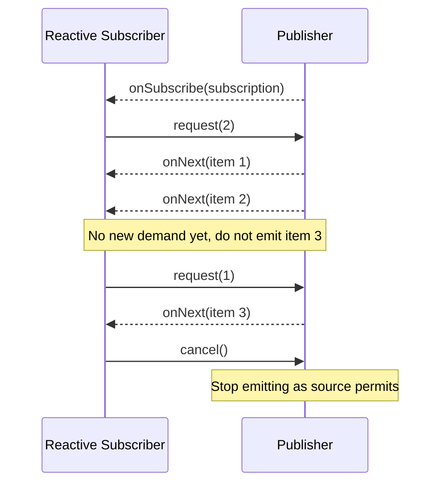
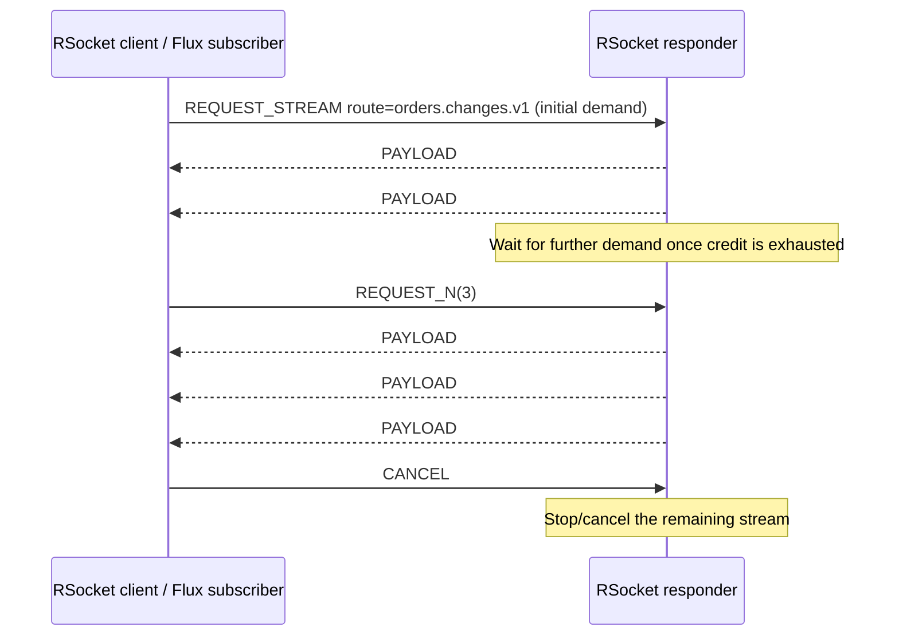
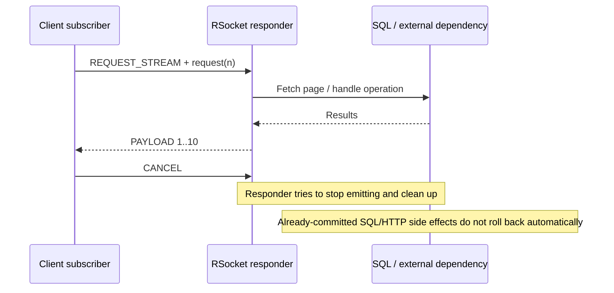
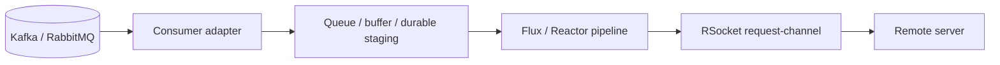
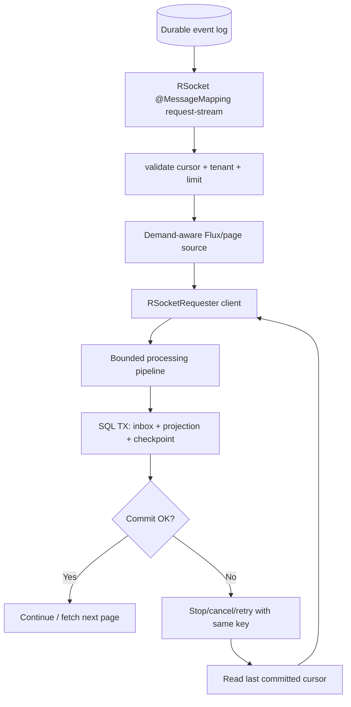

# Backpressure, stream cancellation, and data flow control

> **Chapter:** RSocket  
> **Scope:** Within the **SPRING_BOOT_INTEGRATION** module, Spring Boot integrates systems via HTTP clients, databases, caches, message brokers, and Spring Integration adapters. This lesson explains **backpressure**, **stream cancellation** signals, and mechanisms for **bounding how much data is requested, transmitted, buffered, and processed** with RSocket and Project Reactor. The operational focus is preventing overload, preserving data contracts, controlling transactions/ACKs, handling duplicates, and testing slow clients, disconnects, and restarts.

## 1. Problem: the server produces data faster than the client processes it

Suppose the `order-feed` service emits order events over RSocket route `orders.changes.v1`. Another client consumes those events and persists them into PostgreSQL:

```text
order-feed:
  produces 50,000 changes/sec
             |
             | RSocket request-stream
             v
integration-worker:
  writes SQL at 2,000 changes/sec
```

If the producer keeps emitting while the receiver processes only a fraction, data buffered in RAM or on the wire grows. Consequences include:

- JVM heap/GC climbs, eventually throwing `OutOfMemoryError`.
- Queue/decoder/transport buffers grow, increasing latency and timeouts.
- Data arrives slower than business state evolves; records become **stale** before being written.
- The client closes the connection before the stream finishes.
- If the app retries write operations, data can be processed **multiple times**.

**Backpressure** lets the **consumer signal its consumption demand**, allowing the publisher to avoid emitting more items than requested. RSocket supports flow control via element-demand signals; Project Reactor implements the **Reactive Streams** contract connecting publishers and subscribers in Java code.

However, backpressure does **not** solve everything: it does not make an infinite unpersisted source lossless, does not bound the byte size of an individual message, does not add durability, and does not prove remote side effects committed.

### Lesson objectives

After completing this lesson, you will be able to:

1. Explain `Subscription.request(n)`, `REQUEST_N`, and `CANCEL` conceptually.
2. Contrast flow control in RSocket **request-stream/request-channel** with request–response and fire-and-forget.
3. Write a Spring Boot RSocket server/client returning `Flux`, receiving demand, and sending cancellation signals.
4. Choose `take`, `limitRate`, `concatMap`, `flatMap(concurrency)`, bounded buffering, and timeouts appropriately.
5. Recognize when backpressure **does not propagate across** a JDBC call, broker, or buffering adapter.
6. Distinguish **canceling a subscription**, **closing an RSocket connection**, and **rolling back a transaction**.
7. Design cursors/checkpoints, idempotency, and retries when streams break mid-way.
8. Test incremental demand with `StepVerifier` and verify real behavior over an RSocket transport.

## 2. The four RSocket interaction models

RSocket is a message-oriented communication protocol supporting multiple concurrent interactions over one connection. The four core models:

| Interaction | Caller sends | Caller receives | Backpressure to understand |
| --- | --- | --- | --- |
| **Request–response** | One request | At most one response | Has subscription/cancellation lifecycle, but no long response stream requesting item-by-item demand |
| **Fire-and-forget** | One request | No business response | No response stream for `request(n)`; `send()` completion does not prove destination side effects |
| **Request-stream** | One request | Many responses | **Responder may only emit up to demand** signaled by the requester for response items |
| **Request-channel** | Stream of request payloads | Stream of response payloads | Both directions have flow control/cancellation per protocol stream semantics |

Spring Messaging exposes standard APIs through `RSocketRequester`:

```java
// Request–response: one response DTO.
Mono<QuoteReply> quote = requester
        .route("catalog.quote.v1")
        .data(new QuoteRequest("SKU-42"))
        .retrieveMono(QuoteReply.class);

// Fire-and-forget: no business response.
Mono<Void> dispatched = requester
        .route("audit.capture.v1")
        .data(new AuditEvent("evt-101"))
        .send();

// Request-stream: multiple items.
Flux<OrderChange> changes = requester
        .route("orders.changes.v1")
        .data(new ChangeQuery("tenant-a", 0L, 100))
        .retrieveFlux(OrderChange.class);
```

These are **conceptual snippets**; `QuoteReply`, `QuoteRequest`, `AuditEvent`, `OrderChange`, and `ChangeQuery` are application DTOs you define. The requester must be configured with matching transport, codecs, authentication, and server routes.

**Key point:** “Reactive” in Java does not mean every operation automatically requests unbounded demand or that every remote service honors backpressure. Examine the **actual unit of demand crossing the protocol**.

## 3. Reactive Streams: request(n) and cancel()

At the Reactive Streams level, a `Publisher<T>` supplies items to a `Subscriber<T>`. After `onSubscribe(Subscription)`, the subscriber:

- Calls `request(n)` with `n > 0` to signal demand for up to `n` additional items.
- May call `request(n)` multiple times; demand accumulates per the specification.
- Calls `cancel()` when it no longer wants further signals.
- Receives `onNext(item)`, `onError(error)`, or `onComplete()` per contract.



A **backpressure-compliant** source never emits `onNext` beyond remaining demand. When demand reaches 0, it stops pushing items to that subscriber. Not every library or callback-to-`Flux` bridge can halt upstream production: if a bridge buffers unboundedly, memory still grows even when the downstream subscriber requests very few items.

### 3.1. Demand counts **items**, not bytes

`request(5)` requests up to **5 messages/items**, not 5 KB, 5 SQL rows necessarily, or 5 seconds of data.

```text
request(5)
  item A = 1 KB
  item B = 2 KB
  item C = 12 MB
  item D = 800 B
  item E = 4 KB

Total bytes can far exceed intuition from the number 5.
```

Always **bound payload sizes**, batch sizes, codec allocations, buffer sizes, and byte rates where needed. Receiving 100 JSON objects each containing a huge array can still exhaust the heap even when demand is only 100 items.

### 3.2. Demand is a flow-control signal, not a durable queue

`request(n)` regulates emission over a subscription. It does not persist unsent items to PostgreSQL, Kafka, or disk. If the server reads from an unpersisted source and the client disconnects mid-stream, unconsumed data **may be unrecoverable**.

When business rules forbid data loss, building a **durable event log, cursor, or replay API** is the application's responsibility.

## 4. From Reactor request(n) to RSocket REQUEST_N

In RSocket request-stream, the requester sends a stream request with initial demand, then sends **REQUEST_N** signals as downstream requests subsequent responses. The responder observes demand and throttles items sent over the stream.



This diagram illustrates **conceptual signals**, not a byte-level frame trace of a specific RSocket library. Client libraries may batch demand or apply **prefetch** to improve throughput; do not expect one application-level `request(1)` to always map 1:1 to a single `REQUEST_N(1)` wire frame.

### 4.1. Two prerequisites for effective backpressure

1. The client uses a demand-respecting pipeline and does not subscribe with unbounded demand when processing must be paced.
2. The server does not push from a *hot source* or blocking loop into an unbounded buffer **upstream** of where RSocket regulates demand.

If the server loads 2 million SQL rows into a `List` before calling `Flux.fromIterable(list)`, RSocket can drip-feed the items, **yet all two million objects are already allocated in RAM**. Transport backpressure cannot undo eager loading at the source.

### 4.2. Request-channel has two directions to design

```text
Client                      Server
  |---- request payload #1 -->|
  |---- request payload #2 -->|
  |<--- acknowledgment #1 ---|
  |<--- acknowledgment #2 ---|
  |---- request payload #3 -->|
  |<--- acknowledgment #3 ---|
```

In request-channel, the inbound request stream and outbound response stream have **independent demand, completion, and cancellation semantics per the API/protocol**. Never assume the client can send unboundedly while the server buffers everything, nor assume an acknowledgment response represents an SQL commit unless explicitly defined by the contract.

## 5. Setting up the Spring Boot RSocket application

Examples use **Spring Boot 3.x, Spring Framework 6.x, Java 17+** with BOM-compatible RSocket/Project Reactor APIs. When using Boot 4.x or newer RSocket releases, verify imports, startup, transports, and codecs against the corresponding documentation.

### 5.1. Maven

```xml
<dependencies>
    <dependency>
        <groupId>org.springframework.boot</groupId>
        <artifactId>spring-boot-starter-rsocket</artifactId>
    </dependency>
    <dependency>
        <groupId>org.springframework.boot</groupId>
        <artifactId>spring-boot-starter-test</artifactId>
        <scope>test</scope>
    </dependency>
    <dependency>
        <groupId>io.projectreactor</groupId>
        <artifactId>reactor-test</artifactId>
        <scope>test</scope>
    </dependency>
</dependencies>
```

If the source is R2DBC, add the appropriate R2DBC driver/repository. If executing blocking JDBC, add the JDBC starter/driver and **offload blocking work off the event loop** in reactive servers/clients. Do not add dependencies expecting to “make Flux faster” while ignoring the nature of the data source.

### 5.2. TCP server and client endpoint

Server application:

```yaml
spring:
  rsocket:
    server:
      transport: tcp
      port: 7000
```

Client application:

```yaml
integration:
  order-feed:
    host: ${ORDER_FEED_HOST:localhost}
    port: ${ORDER_FEED_PORT:7000}
    max-items-per-call: 500
    request-timeout: 5s
```

`integration.order-feed.*` are **application-defined properties**; writing YAML alone does not make Spring Boot auto-create a requester. The example uses local TCP; for WebSocket, align URIs/transport/routes and reverse proxies, and never pass `ws://` into `tcp(host, port)`.

## 6. A demand-aware request-stream route

### 6.1. Bounded contract

We build a route streaming changes with monotonically increasing sequences:

```java
package com.example.rsocket.feed;

public record ChangeQuery(
        String tenantId,
        long afterSequence,
        int limit) {}
```

```java
package com.example.rsocket.feed;

public record OrderChange(
        String tenantId,
        long sequence,
        String orderId,
        String state) {}
```

Field meanings:

| Field | Meaning | Why it is needed |
| --- | --- | --- |
| `tenantId` | Data scope | Prevents cross-tenant mixing; must be authorized via trusted identity |
| `afterSequence` | Cursor of the last **durably processed** item | Enables resuming after disconnect/cancel |
| `limit` | Maximum items in one call | Bounds RAM, duration, and data volume |
| `sequence` | Order of items from the source | Detects gaps, duplicates, or out-of-order delivery |
| `orderId` | Business reference | Supports deduplication, auditing, and reconciliation |

**The `afterSequence` contract only works if the source provides stable ordering and replayable data**. Never take an arbitrary offset from a non-retaining hot source and promise clients they can replay an hour later.

### 6.2. Server with a demand-respecting Publisher

```java
package com.example.rsocket.feed;

import org.springframework.messaging.handler.annotation.MessageMapping;
import org.springframework.stereotype.Controller;
import reactor.core.publisher.Flux;
import reactor.core.publisher.Mono;

@Controller
public class OrderChangeController {

    @MessageMapping("orders.changes.v1")
    public Flux<OrderChange> changes(ChangeQuery query) {
        return Mono.justOrEmpty(query)
                .flatMapMany(request -> {
                    if (request.tenantId() == null
                            || request.tenantId().isBlank()
                            || request.afterSequence() < 0
                            || request.limit() < 1
                            || request.limit() > 500) {
                        return Flux.error(new IllegalArgumentException(
                                "Invalid change query"));
                    }

                    // Simulated data for this exercise only.
                    return Flux.range(1, request.limit())
                            .map(index -> new OrderChange(
                                    request.tenantId(),
                                    request.afterSequence() + index,
                                    "ORD-" + (request.afterSequence() + index),
                                    "CONFIRMED"))
                            .doOnRequest(n ->
                                    observeDemand("orders.changes.v1", n))
                            .doOnCancel(() ->
                                    observeCancellation("orders.changes.v1"));
                });
    }

    private void observeDemand(String route, long n) {
        // In practice: record aggregated demand metrics; do not log every item.
    }

    private void observeCancellation(String route) {
        // In practice: increment a counter by route/outcome.
    }
}
```

`Flux.range` is a **cold** source that generates integers on demand; `map` constructs DTOs without I/O. This is a clean starting point to **measure demand**, not a production server backed by a persistent event log.

**Production requirements:**

- The server must authenticate the client and **verify tenant authorization** before emitting data; never trust caller-supplied `tenantId`.
- Guard against overflow of `afterSequence + index` if sequences approach `Long.MAX_VALUE`.
- Limit payload sizes, item counts, per-tenant/identity rates, and concurrent streams.
- If the source reads SQL, query via pages/cursors rather than `SELECT *` into memory.

### 6.3. Why not call collectList() before returning a Flux?

```java
// Unsuitable for unbounded datasets:
return repository.findAllChanges(tenantId)
        .collectList()
        .flatMapMany(Flux::fromIterable);
```

This illustrates an anti-pattern: `collectList()` buffers the entire dataset into a list before emitting, so downstream RSocket `REQUEST_N` cannot prevent the prior memory allocation. With 10 million records, this risks OOM.

**Rule:** propagate demand as close as possible to the **originating source** capable of throttling; paginate/limit at the database; never place an eager collection step upstream of the flow-control boundary.

## 7. RSocketRequester client for multi-item streams

### 7.1. Shared client configuration

```java
package com.example.rsocket.client;

import org.springframework.beans.factory.annotation.Value;
import org.springframework.context.annotation.Bean;
import org.springframework.context.annotation.Configuration;
import org.springframework.messaging.rsocket.RSocketRequester;
import org.springframework.util.MimeTypeUtils;

@Configuration(proxyBeanMethods = false)
public class OrderFeedClientConfiguration {

    @Bean(destroyMethod = "close")
    OrderFeedClient orderFeedClient(
            RSocketRequester.Builder builder,
            @Value("${integration.order-feed.host}") String host,
            @Value("${integration.order-feed.port}") int port) {
        RSocketRequester requester = builder
                .dataMimeType(MimeTypeUtils.APPLICATION_JSON)
                .tcp(host, port);
        return new OrderFeedClient(requester);
    }
}
```

```java
package com.example.rsocket.client;

import com.example.rsocket.feed.ChangeQuery;
import com.example.rsocket.feed.OrderChange;
import org.springframework.messaging.rsocket.RSocketRequester;
import reactor.core.publisher.Flux;

public final class OrderFeedClient implements AutoCloseable {
    private final RSocketRequester requester;

    public OrderFeedClient(RSocketRequester requester) {
        this.requester = requester;
    }

    public Flux<OrderChange> changes(ChangeQuery query) {
        return requester.route("orders.changes.v1")
                .data(query)
                .retrieveFlux(OrderChange.class);
    }

    @Override
    public void close() {
        requester.rsocket().dispose();
    }
}
```

This is a shared requester inside a Spring bean, suitable for **a single endpoint and identity scope**. Each `changes(...)` call returns a distinct publisher; multiple subscriptions multiplex over the RSocket connection. **Never call `requester.rsocket().dispose()` just because a single subscription canceled**, as that closes the shared connection for all other operations.

**Lifecycle note:** Requester/client APIs and behavior can vary across versions. When using custom reconnect/load-balancing clients, dispose resources through that abstraction's **owner** rather than assuming every implementation holds a single fixed TCP socket for the bean's lifetime.

### 7.2. Limiting total items in a single read

```java
Flux<OrderChange> firstPage = client
        .changes(new ChangeQuery("tenant-a", 0L, 500))
        .take(100);
```

Here the server may have 500 items while the client only wants 100. `take(100)` **caps total items observed downstream and cancels upstream once satisfied**, rather than merely shrinking individual request batches.

If the client never intends to consume more than 100 items, it is better to **pass `limit=100` in the server contract** upfront instead of asking for 500 and discarding 400. `take` remains valuable as a caller guardrail when a server emits more than contracted or a user stops early.

## 8. Controlling demand with BaseSubscriber

To observe individual demand calls, you can write a custom Reactor `BaseSubscriber`:

```java
import org.reactivestreams.Subscription;
import reactor.core.publisher.BaseSubscriber;
import reactor.core.publisher.Flux;

Flux<Integer> source = Flux.range(1, 5)
        .doOnRequest(n ->
                System.out.println("requested=" + n));

source.subscribe(new BaseSubscriber<>() {
    @Override
    protected void hookOnSubscribe(Subscription subscription) {
        request(1);
    }

    @Override
    protected void hookOnNext(Integer value) {
        System.out.println("received=" + value);
        // Only request more once the consumer finishes processing the current item.
        request(1);
    }

    @Override
    protected void hookOnComplete() {
        System.out.println("done");
    }

    @Override
    protected void hookOnError(Throwable throwable) {
        System.err.println(throwable.getMessage());
    }
});
```

This snippet is a **local Reactive Streams experiment**, not a production consumer architecture. In `hookOnNext`, the sample work completes synchronously right away; if processing involves async SQL/HTTP, calling `request(1)` here **does not prove processing committed**.

**Common pitfall:** simple `subscribe(onNext -> ...)` overloads typically request unbounded demand (`Long.MAX_VALUE`). Never write a manual subscriber assuming it processes one item at a time merely because callbacks fire sequentially.

### 8.1. Do not perform blocking calls in hookOnNext on the event loop

```java
// Anti-pattern:
@Override
protected void hookOnNext(OrderChange change) {
    jdbcTemplate.update("UPDATE ...", ...); // Blocking JDBC
    request(1);
}
```

If callbacks execute on a Reactor Netty event loop, blocking JDBC ties up threads handling other network I/O and defeats the reactive pipeline. Use an appropriate worker scheduler or a pipeline separating blocking I/O from the event loop (section 12).

## 9. How limitRate differs from take, timeout, and delayElements

Reactor operators address **different dimensions**:

| Operator | Purpose | **Does not** guarantee |
| --- | --- | --- |
| `take(n)` | Takes at most `n` items then completes/cancels upstream | That the server did not prefetch more than `n` items |
| `limitRate(n)` | Splits upstream demand into smaller batches | Does not cap the **total** item count of the stream |
| `flatMap(fn, concurrency)` | Bounds active inner publishers in this pipeline | Not a global semaphore across all requests |
| `concatMap(fn)` | Runs inner publishers sequentially in order, coordinating demand | Does not make SQL/broker transactions atomic |
| `buffer(n)` | Groups items into lists of up to size `n` | Does not bound total memory if downstream retains many lists |
| `onBackpressureBuffer(n)` | Buffers up to `n` items at one pipeline point | Does not create a durable queue or fix an unbounded upstream |
| `onBackpressureDrop` | Drops items when downstream cannot keep up | Unsuitable for business events that must not be lost |
| `onBackpressureLatest` | Keeps only the newest value when downstream lags | Does not retain historical state transitions |
| `delayElements(duration)` | Adds delay when emitting items | Not a precise SLA rate limiter or byte limiter |
| `timeout(duration)` | Errors if no signal arrives within the operator's window | Not necessarily an **overall stream** deadline |

### 9.1. limitRate example

```java
Flux<OrderChange> flow = client
        .changes(new ChangeQuery("tenant-a", 0L, 500))
        .limitRate(32);
```

`limitRate(32)` shapes upstream demand into batches; Reactor may **replenish** before all 32 items of the prior batch finish processing, according to the operator's threshold. Never claim it “always sends exact `REQUEST_N(32)` frames” or “caps in-flight items across the whole pipeline at 32.”

To bound **total results**, pair with `take(100)` or `limit=100`. To bound **concurrent tasks**, use a concurrency/bulkhead operator. To bound **bytes/sec**, add byte-accounting policies and appropriate scheduling.

### 9.2. Do not use delayElements to mask overload

```java
// Not a systemic solution to protect a database:
client.changes(query)
        .delayElements(Duration.ofMillis(10));
```

`delayElements` slows down downstream consumption and indirectly paces demand, but does not replace source rate limiting, burst caps, dead-letter policies, or capacity planning. With a hot upstream feeding an unbounded buffer, slowing downstream still leaves upstream unsafe.

## 10. onBackpressureBuffer, drop, and latest: use conditionally

### 10.1. Bounded buffer

```java
Flux<OrderChange> bounded = hotSource
        .onBackpressureBuffer(128);
```

This assumes `hotSource` is a `Flux<OrderChange>` from another origin. `onBackpressureBuffer(128)` creates a **count-bounded buffer at that operator**, not a JVM heap limit. On overflow, behavior/errors depend on overload and the chosen strategy; do not assume source and downstream remain healthy.

**Consequence of overflow:** if data loss is forbidden, switch to a **durable queue or stored offsets** so producers slow down and consumers retry. Never silently drop business messages and report the flow as succeeded.

### 10.2. When might onBackpressureDrop/Latest be valid?

A stream emitting CPU temperature every 100 ms for a live dashboard may only need the **latest state**:

```java
Flux<TemperatureSnapshot> display = telemetrySource
        .onBackpressureLatest();
```

This is a **conceptual snippet**: `TemperatureSnapshot` and `telemetrySource` are application-defined, not built-in APIs. If the dashboard lags behind updates, dropping older snapshots can be contractually valid.

Do not apply the same approach to:

- Payment transactions.
- Order confirmation/cancellation events.
- Mandatory audit logs.
- Kafka offsets where every message must be processed.
- Invoices/batch data requiring reconciliation.

In those flows, dropping items loses intermediate state transitions, corrupting final state or breaking replay.

### 10.3. Buffered items still consume RAM

A buffer of 128 items at 2 MB each holds roughly 256 MB **in raw payloads alone**, excluding object graphs/codecs, network buffers, and other stages. Thus **bounding item count does not replace bounding individual payload sizes**.

## 11. Controlling concurrency when each item causes side effects

Suppose each change must check status with an HTTP service:

```java
Flux<EnrichedChange> enriched = client
        .changes(new ChangeQuery("tenant-a", 0L, 500))
        .flatMap(
                change -> partnerClient.enrich(change),
                8
        );
```

`partnerClient.enrich(...)` returns a `Mono<EnrichedChange>` with proper retries/timeouts. The parameter `8` caps **active inner publishers in one pipeline**, not across the entire instance or cluster.

If 100 clients run this pipeline concurrently, the app can issue **hundreds of** parallel remote calls. To protect the partner, add:

- Instance-level **bulkhead/semaphore** at the remote adapter/service.
- Rate limiters per endpoint/tenant.
- Timeouts/deadlines and retry budgets.
- Connection caps and total in-flight limits.
- Backpressure to the **source** if genuinely supported; otherwise durable staging.

### 11.1. flatMap can reorder items

`flatMap` emits items in inner-publisher completion order, which may **differ** from input sequence order. If `OrderChange(seq=10)` and `seq=11` update the same aggregate, parallel execution can write `seq=11` before `seq=10`.

When order must be preserved:

```java
Flux<PersistResult> written = client.changes(query)
        .concatMap(change -> persistence.persistOnce(change));
```

`persistence.persistOnce(...)` returns `Mono<PersistResult>` with appropriate unique keys and SQL transactions. `concatMap` waits for each inner publisher to complete before starting the next, preserving output/side-effect order within **this pipeline**.

**However:** multiple independent clients/pods can still update the same aggregate concurrently. Enforce **version checks/unique constraints/partition keys** in the database; local `concatMap` does not create a distributed lock.

### 11.2. flatMapSequential and trade-offs

`flatMapSequential` preserves output order while running inner publishers concurrently, yet **buffers results from inner publishers that finish early** behind earlier pending items. With large payloads or uneven handler latency, memory and tail latency can climb. Use only when the trade-off fits, never as “free concurrency.”

## 12. Offloading blocking JDBC off the event loop

RSocket with Reactor uses non-blocking I/O for networking. Yet `JdbcTemplate` is a **blocking JDBC API**. Invoking JDBC directly inside `map`/`doOnNext` on the event loop stalls network processing threads.

### 12.1. Wrapping a unit of blocking I/O

```java
package com.example.rsocket.client;

import org.springframework.jdbc.core.JdbcTemplate;
import org.springframework.stereotype.Service;
import reactor.core.publisher.Mono;
import reactor.core.scheduler.Schedulers;

@Service
public class OrderChangePersistence {
    private final JdbcTemplate jdbc;

    public OrderChangePersistence(JdbcTemplate jdbc) {
        this.jdbc = jdbc;
    }

    public Mono<Long> persistOnce(OrderChange change) {
        return Mono.fromCallable(() -> {
                    // Business SQL/unique constraint must be idempotent.
                    jdbc.update("""
                        INSERT INTO order_change_inbox
                            (tenant_id, sequence_no, order_id, state)
                        VALUES (?, ?, ?, ?)
                        ON CONFLICT (tenant_id, sequence_no) DO NOTHING
                        """, change.tenantId(), change.sequence(),
                        change.orderId(), change.state());
                    return change.sequence();
                })
                .subscribeOn(Schedulers.boundedElastic());
    }
}
```

This is a **simplified pattern**: `OrderChange` must be imported from the contract package, the `order_change_inbox` table must exist, and `ON CONFLICT` targets PostgreSQL. For a complete implementation:

- Combine **inbox insert + business update + checkpoint** in the same SQL transaction.
- Verify a payload fingerprint if the same key arrives with different data; `DO NOTHING` alone is insufficient.
- On SQL rollback, never advance the cursor or treat the message as processed.
- Size thread/connection pools and concurrency limits so `boundedElastic` does not accumulate thousands of queued tasks.

`Schedulers.boundedElastic()` is a bounded scheduler for blocking tasks, **not a JDBC pool**, and does not combine multiple SQL statements into a transaction. Spring JDBC transactions are typically thread-bound; place `@Transactional` on the **service method executing on the JDBC worker thread** and invoke it via Spring proxy.

### 12.2. Sequential processing with a blocking source

```java
Flux<Long> committedSequences = client
        .changes(new ChangeQuery("tenant-a", lastCommittedSeq, 500))
        .concatMap(persistence::persistOnce);
```

`concatMap` prevents launching out-of-order side effects inside **this pipeline**. Yet a sequence can still be retried after a crash, so SQL must remain idempotent by business key and persisted checkpoint.

If the source is a genuinely non-blocking R2DBC `Flux<OrderChange>`, do not blindly shift the **entire** pipeline onto `boundedElastic` out of habit. Choose schedulers based on the APIs actually used.

## 13. Protecting SQL from a fast RSocket source

**Demand propagation does not directly tell PostgreSQL “stop sending rows”** if reads are blocking or the driver fetches everything eagerly.

| Server source | How it coordinates with backpressure | Risk |
| --- | --- | --- |
| `Flux.range`/`Flux.generate` | Generates items on demand per semantics | Per-item mapping work can still be heavy |
| R2DBC `Flux` | Driver/publisher can stream non-blockingly depending on implementation | Long-held connections, driver buffers, query plans |
| JDBC cursor / paging | Explicitly fetches by page, controlling fetch size and lifecycle | Blocking JDBC; must close cursor/connection on cancel |
| `List` of 1 million rows | Throttles emission only after the `List` is already populated | Eager memory allocation |
| Kafka broker adapter | Poll/commit/pause via consumer config and backpressure bridge | Broker retention, poll batches, offset/ACK do not auto-sync with Reactor demand |
| RabbitMQ adapter | Prefetch/ACK via consumer config and flow bridge | Unacked deliveries/queue backlog still need policies |
| File input stream | Reads incrementally and closes on cancel | Parser buffers, file handles, checksum/truncated-file contracts |

**Rule:** Backpressure is only as effective as **the earliest point able to stop producing/loading data**. A reactive-looking RSocket pipeline can still overwhelm a database if inner code loads all rows into RAM.

### 13.1. Pagination with stable cursors

For batch workloads, split reads into bounded calls:

```text
GET RSocket route orders.changes.v1
request:
  tenantId = tenant-a
  afterSequence = 5000
  limit = 500

response:
  sequence = 5001 ... 5500

Client saves checkpoint=5500 ONLY
AFTER all corresponding side effects commit.
Next call:
  afterSequence = 5500, limit = 500
```

**Never checkpoint based merely on network receipt.** If seq=5500 is received and canceled before SQL commits, advancing checkpoint=5500 drops data on resume. Cursors must reflect **durable processing**, not “deserialized.”

## 14. Stream cancellation: CANCEL is not business rollback

When a client no longer wants a stream, Reactive Streams emits `cancel()` and RSocket can propagate **CANCEL** to the responder for applicable interactions.



**CANCEL signals no further demand for results**, not a distributed “undo operation” protocol. There may still be:

- Frames already in flight on the wire when cancel arrives.
- Async operations dispatched but not yet finished.
- Already-committed SQL transactions.
- HTTP POSTs already processed by a partner before the response arrived.
- Driver/file stream buffers releasing asynchronously.

Distinguish **result stream canceled**, **business operation cancellation requested**, and **whether the operation already completed**.

### 14.1. take(n) triggers cancellation once satisfied

```java
Flux<OrderChange> sample = client
        .changes(new ChangeQuery("tenant-a", 0L, 500))
        .take(25)
        .doFinally(signal -> recordClientTermination(signal));
```

Once 25 items arrive, `take(25)` completes downstream and cancels upstream if the stream is still running. `doFinally` observes completion/error/cancellation relative to **where the operator sits**. Do not assume every `doFinally` sees `CANCEL`: downstream of `take`, the terminal signal can be **ON_COMPLETE**, whereas upstream canceled by `take` sees **CANCEL**.

**Common debugging trap:** a client sees `verifyComplete()` and concludes the server finished naturally. In reality, the client **stopped early** via `take`; the server should clean up gracefully rather than logging an error if early stop is valid per contract.

### 14.2. Closing a connection vs. canceling one stream

```java
// Cancel one subscription - subscription-scoped:
Disposable subscription = client.changes(query)
        .subscribe(this::onChange, this::onError);
subscription.dispose();

// Close underlying requester managed by the owning bean:
requester.rsocket().dispose();
```

This snippet is a **conceptual comparison**. With a shared singleton requester, **never dispose the underlying RSocket when a single stream cancels**, as other active streams on the connection will break. Nor is manual `subscribe(...)` a production pattern for critical messages: unmanaged fire-and-forget subscriptions easily omit ACKs, checkpoints, and shutdown handling.

## 15. Resource cleanup when subscribers cancel

A stream may hold:

- JDBC/R2DBC connections or cursors.
- File input streams/parsers.
- Buffers, frame decoders, references to large DTOs.
- Scheduled tasks or interval timers.
- Upstream subscriptions.

On cancel/timeout:

1. **Stop the data source** if supported.
2. **Close/clean up resources** via hooks or `using` patterns.
3. **Do not commit checkpoints** for unprocessed items.
4. **Never block the Netty event loop** during cleanup if closing involves blocking I/O.
5. Record metrics for **cancellation reasons** (user cancel, timeout, shutdown, load shedding).

### 15.1. Using Flux.using for subscription-scoped resources

```java
import java.io.BufferedReader;
import java.io.IOException;
import java.io.UncheckedIOException;
import java.nio.file.Files;
import java.nio.file.Path;
import reactor.core.publisher.Flux;
import reactor.core.scheduler.Schedulers;

Flux<String> readLines(Path path) {
    return Flux.using(
            () -> Files.newBufferedReader(path),
            reader -> Flux.fromStream(reader.lines()),
            reader -> {
                try {
                    reader.close();
                } catch (IOException ex) {
                    throw new UncheckedIOException(ex);
                }
            })
            .subscribeOn(Schedulers.boundedElastic());
}
```

This example demonstrates **per-subscription resources** and cleanup on termination/cancellation. Because `BufferedReader` reads block, `subscribeOn(boundedElastic)` moves source subscription/pulls onto an appropriate scheduler; in production, verify where stream pulls actually run and bound concurrency, line lengths, and file sizes.

**Warning:** `Flux.using`'s resource supplier accepts a `Callable` that can throw checked `IOException` when opening the file; the cleanup callback is a `Consumer` and **cannot throw checked exceptions**, so the example wraps close errors in `UncheckedIOException`. In production, classify/log/monitor cleanup errors per library semantics. `Flux.usingWhen` provides asynchronous cleanup for reactive resources; never run blocking close unconditionally on the event loop.

### 15.2. Cleanup is not “undo”

Closing a file reader on cancel does not roll back output files already written. Closing a JDBC connection does not prove a transaction rolled back if earlier code already committed. Closing an RSocket subscription does not revert an already-committed Kafka offset.

**Cleanup frees resources; consistency requires business contracts and durable state.**

## 16. Timeouts: inter-item timeouts vs. overall deadlines

`Flux.timeout(Duration.ofSeconds(5))` on a stream normally **errors if the wait for the next signal exceeds the limit**, rather than capping total stream duration at 5 seconds from start.

```java
Flux<OrderChange> guarded = client.changes(query)
        .timeout(Duration.ofSeconds(5))
        .doOnError(error -> recordStreamError(error));
```

If the server emits steadily once per second for 30 minutes, the operator **may never time out**, even if the user workflow's overall deadline is 20 seconds. Design an explicit **overall time budget** or separate cancellation deadline.

### 16.1. Overall time-limit example

```java
Flux<OrderChange> limited = client.changes(query)
        .take(Duration.ofSeconds(20))
        .take(500);
```

`take(Duration)` completes/cancels after the allotted duration, so it **does not emit a timeout error**. If business logic needs to distinguish “got all data” from “cut short by deadline,” persist state and check completion conditions/cursors; never treat a `Flux` completed by `take(Duration)` as a complete batch.

### 16.2. Timeouts do not prove the remote did nothing

On a write route like `payments.charge.v1`, a client may time out after 3 seconds while the server already committed the payment. On retry, use a **fixed operation ID/idempotency key**, stored fingerprint, and status lookup/reconciliation rather than creating a new payment.

RSocket is a message channel; no `timeout(...)` operator merges a remote database and local SQL into a distributed transaction.

## 17. Error handling, retries, and resubscription

### 17.1. Retrying a Flux can replay the stream

```java
Flux<OrderChange> retried = client.changes(query)
        .retryWhen(
                reactor.util.retry.Retry.backoff(
                        3, Duration.ofMillis(200)));
```

This is an illustrative snippet. `retryWhen` **re-subscribes** on errors per policy, and on a request-stream can restart from **the original `query` cursor**, re-sending items delivered prior to the failure.

Thus if downstream committed `seq=1..10` and hit a network error at `seq=11`, retrying with `afterSequence=0` re-delivers `seq=1..10`. This is only safe when:

- The consumer uses a durable inbox/unique key/version check; or
- A coordinator reads the **last committed cursor** and issues a **new request** from that position.
- Never place side effects in `doOnNext` assuming retries are magically transparent.

### 17.2. Classify errors before retrying

| Error | Auto-retry? | Action |
| --- | --- | --- |
| Transient network drop, connection reset before reads | Bounded, if replayable | Reconnect + resume from committed cursor |
| Invalid route, codec/MIME mismatch | **Never** blindly retry | Fix contract/client/server |
| Expired authentication | Refresh credentials then reconnect per policy | Do not replay side-effecting commands blindly |
| Business rejection | Do not retry infinitely | Report error/quarantine per contract |
| Overload/rate limit from remote | Retry with backoff/jitter if allowed | Cap concurrency and deadlines |
| Timeout after write operation | Outcome unknown | Status lookup + idempotency/reconcile |
| Client buffer overflow | Do not just grow RAM | Backpressure boundary, bounded queues/limits, slow source |
| Source lost old snapshot | Retries fail if replay no longer exists | Reconcile or perform full resync |

**Stop retrying during graceful application shutdown** if insufficient deadline remains to finish/reconcile. Never leave an infinite retry loop blocking process exit.

### 17.3. Reconnect vs. retry and RSocket resume

- **Reconnect**: establishing a new connection after the old one becomes unusable.
- **Retry**: re-executing an operation/publisher, which can cause duplicates.
- **Resume**: an RSocket protocol capability when supported/configured on both ends to recover transport/sessions under specific constraints.

**Do not assume RSocket resume is enabled by default** or replaces Kafka retention, SQL outbox/inbox, or application cursors. If the server loses buffered frames or the client lands on another instance, data-layer replay strategies are still required.

## 18. Checkpoints and idempotency for side-effecting streams

A consumer writing `OrderChange` events into an SQL projection needs a **durable checkpoint** reflecting **committed** items, not merely received ones:

```sql
CREATE TABLE order_change_checkpoint (
    consumer_name VARCHAR(80) NOT NULL,
    tenant_id VARCHAR(80) NOT NULL,
    last_sequence BIGINT NOT NULL,
    updated_at TIMESTAMPTZ NOT NULL DEFAULT CURRENT_TIMESTAMP,
    PRIMARY KEY (consumer_name, tenant_id)
);

CREATE TABLE order_change_inbox (
    tenant_id VARCHAR(80) NOT NULL,
    sequence_no BIGINT NOT NULL,
    order_id VARCHAR(120) NOT NULL,
    state VARCHAR(32) NOT NULL,
    payload_sha256 VARCHAR(64),
    PRIMARY KEY (tenant_id, sequence_no)
);
```

### 18.1. Per-item transaction

Inside the **same SQL transaction**:

1. Check whether the sequence was already processed.
2. If duplicated with a matching fingerprint, treat as a valid replay; if payload differs, report conflict.
3. Verify the new sequence obeys ordering rules (e.g., `lastSequence + 1` for gapless streams).
4. Write business projection and inbox record.
5. Update checkpoint to the newly committed sequence.
6. Commit the transaction.

Only then let the pipeline advance to the next item if strict business ordering is required.

```mermaid
sequenceDiagram
    participant R as RSocket Stream
    participant C as Consumer
    participant DB as PostgreSQL
    R-->>C: change seq=11
    C->>DB: BEGIN; validate inbox/sequence
    C->>DB: Update projection + inbox + checkpoint=11
    DB-->>C: COMMIT
    Note over C: Only now is seq=11 durable
    C-->>R: Next demand / proceed
    Note over C,R: Cancel/crash before COMMIT => replay from old checkpoint
```

**Note:** Reactive Streams demand may **prefetch**, so never claim wire-level `REQUEST_N` fires strictly after each item commits. This pattern describes **durably committed business units** and consumer pipelines, not strict per-frame synchronous locking.

### 18.2. When sequences legitimately have gaps

A stream filtered by tenant/partition may produce `11, 14, 18` legitimately if the source assigns global sequences. In that case, do not enforce strict `last + 1`; instead use:

- Cursors tied to **log/partition position** and filter semantics.
- Source-defined continuation tokens or watermarks.
- Contract-defined gap detection (if required).
- Idempotency keyed by `eventId` and source partition.

Never blindly store `max(sequence)` when events can arrive out of order; advancing the checkpoint too far could skip lower unprocessed events.

### 18.3. Receiving all items does not mean downstream finished

If a consumer merely drops changes into an in-memory `QueueChannel` and requests more RSocket items, the input stream can finish before work is durable. If the JVM restarts and loses the queue, data is lost.

To acknowledge durability properly, use **SQL staging/outbox, brokers with appropriate confirmations, or persistent channels**, per contract. Never equate `Flux.onComplete` with business completion when async workers remain.

## 19. Request-channel: sending and receiving with bidirectional flow control

A client can stream a batch of commands over request-channel and receive partial results.

### 19.1. Sample contract

```java
package com.example.rsocket.channel;

public record ImportCommand(
        String tenantId,
        String operationId,
        long sequence,
        String payload) {}
```

```java
package com.example.rsocket.channel;

public record ImportAck(
        String operationId,
        boolean accepted,
        String state) {}
```

**`ImportAck.accepted=true` must have an unambiguous contract**: decoded? durably staged? business result committed? Never leave a boolean field ambiguous and assume it means “fully processed.”

### 19.2. Server @MessageMapping receiving Flux

```java
package com.example.rsocket.channel;

import org.springframework.messaging.handler.annotation.MessageMapping;
import org.springframework.stereotype.Controller;
import reactor.core.publisher.Flux;

@Controller
public class ImportChannelController {
    private final ImportService service;

    public ImportChannelController(ImportService service) {
        this.service = service;
    }

    @MessageMapping("imports.commands.v1")
    public Flux<ImportAck> importCommands(
            Flux<ImportCommand> commands) {
        return commands.concatMap(service::persistAccepted);
    }
}
```

`ImportService.persistAccepted(...)` returns `Mono<ImportAck>` and completes only once the command is **durably persisted with a business idempotency key**. `concatMap` illustrates in-order processing; independent commands can use bounded concurrency, provided ack order and deduplication are specified.

### 19.3. Client sending a Publisher

```java
Flux<ImportCommand> requests = Flux.fromIterable(commands);

Flux<ImportAck> replies = requester
        .route("imports.commands.v1")
        .data(requests, ImportCommand.class)
        .retrieveFlux(ImportAck.class);
```

`commands` is an application-supplied finite iterable; for large sources, avoid loading whole files into a `List` before building the `Flux`. In request-channel, **cancellation or connection drops** can occur after the server accepted some commands. The client must track ledgers/acks by `operationId` and safely replay commands lacking confirmed outcomes.

### 19.4. Do not treat response count as committed command count

If the server runs an async pipeline, an acknowledgment may mean “queued” rather than “committed”; if the consumer cancels the response stream, the server may have already ingested further commands. Contracts must clarify:

- Whether acks are emitted **after staging commit or final processing**.
- Which ID to query for outcome if a response is lost.
- How conflicts are handled if the same operation ID arrives with a different payload.
- Limits on requests/channels, payload bytes, and stream lifetimes.

## 20. Flow control and message brokers are not the same

An integration flow may connect:



RSocket backpressure regulates **between its respective publisher and subscriber**, and does not automatically translate into Kafka/Rabbit/JMS ACK/prefetch/pause policies unless the adapter explicitly bridges those signals.

| Source | Native flow control | What must be wired into policy |
| --- | --- | --- |
| **Kafka** | Poll, `max.poll.records`, pause/resume, offset commit, partitions | Pause when downstream overloads; commit offsets **after durable state** |
| **RabbitMQ** | Prefetch/QoS, ACK/NACK, consumer concurrency | Keep unacked count bounded; ACK only after business commit |
| **JMS** | Session/consumer receive, ack/transacted sessions | Never equate subscriber demand with JMS commit |
| **Spring Integration QueueChannel** | Capacity, poller `maxMessagesPerPoll`, executor | Persistent store if accepted messages must survive crashes |
| **SQL outbox** | Batch claim, lease, worker concurrency | Avoid claiming excessive work while remote RSocket is slow |
| **RSocket request-stream** | Demand/`REQUEST_N`/`CANCEL` per subscriber | Bounded source, checkpoint/replay on cancel |

**Never wrap a Kafka consumer in a `Flux` and assume offsets commit only as `Flux` requests `n`.** Bridges must explicitly manage subscriptions, broker polling, acks, duplicates, shutdown, and error recovery.

## 21. Observability signals for backpressure and cancellation

| Metric / trace | Question |
| --- | --- |
| Active RSocket connections | Are too many requesters/sockets being created? |
| Active streams per route | Are streams lingering or leaking resources? |
| Demand request counts / batches | How fast or slow is downstream consuming? |
| Received/sent items per stream | Are total items bounded per contract? |
| Request/response payload byte sizes | Can a single huge item blow the memory budget? |
| Buffer current/max/overflow counts | Are internal buffers growing excessively? |
| Cancellation counts/reasons | User cancel, timeout, graceful shutdown, or upstream error? |
| Error rates per route | Codecs, auth, overload, remote unavailable, or business rejections? |
| Event-loop pending tasks/CPU | Is blocking I/O running on Netty threads? |
| JDBC pool wait and transaction duration | Is SQL bottlenecked even while RSocket has demand? |
| Cursor lag and oldest unprocessed age | Is the consumer falling behind the source? |
| Replay/duplicate/checkpoint conflict counts | Are cancels/retries causing duplicates or missed items? |

Not all metrics in this table appear automatically in Spring Boot Actuator. Instrument adapters, Reactor operators, RSocket server/client, SQL transactions, brokers, or stream managers as needed.

**Avoid high-cardinality metric labels:** never tag metrics with `orderId`, `operationId`, arbitrary `tenantId`, raw payloads, or dynamic routes. Use route templates and outcome/error classes. Restricted traces/logs carry business correlation without exposing tokens/PII.

### 21.1. Avoid logging every request(n)

`doOnRequest(n -> log.info(...))` can emit hundreds of thousands of log lines under load. It helps illustrate mechanics in small demos; in production, sample, aggregate counters/histograms, or instrument at an appropriate low-overhead layer.

### 21.2. Identifying where the bottleneck sits

```text
Scenario A:
  RSocket demand is very low; server cannot send much
  -> Client or downstream is slow / rate-limited

Scenario B:
  RSocket demand is high; server emits slowly; SQL query takes 30s
  -> Slow DB/driver source, not lack of REQUEST_N

Scenario C:
  RSocket emits fast; heap climbs continuously
  -> Eager list / buffering / hot producer upstream of demand point

Scenario D:
  Cancellations spike after deployment
  -> Check graceful shutdown, connection lifetimes, and deadlines
```

**Multi-layer observability:** RSocket metrics alone do not prove SQL/brokers and business state committed properly.

## 22. Testing demand with StepVerifier

`reactor-test` provides `StepVerifier`, letting tests **start with initial request 0** and request batches step-by-step:

```java
import static org.assertj.core.api.Assertions.assertThat;

import org.junit.jupiter.api.Test;
import reactor.core.publisher.Flux;
import reactor.test.StepVerifier;

class DemandContractTest {
    @Test
    void requestsItemsInBatches() {
        Flux<Integer> source = Flux.range(1, 5);

        StepVerifier.create(source, 0)
                .thenRequest(2)
                .expectNext(1, 2)
                .thenRequest(1)
                .expectNext(3)
                .thenRequest(2)
                .expectNext(4, 5)
                .verifyComplete();
    }
}
```

This verifies a **local Reactor publisher** honors demand. It **does not prove `REQUEST_N` frames cross RSocket TCP** or that the server cleans up on cancel. To verify end-to-end, run a real RSocket server and test over the requester network connection.

### 22.1. Testing item caps and cancellation

```java
import java.util.concurrent.atomic.AtomicBoolean;
import reactor.core.publisher.Flux;
import reactor.test.StepVerifier;

AtomicBoolean cancelled = new AtomicBoolean(false);
Flux<Integer> source = Flux.range(1, 100)
        .doOnCancel(() -> cancelled.set(true));

StepVerifier.create(source.take(3))
        .expectNext(1, 2, 3)
        .verifyComplete();

assertThat(cancelled).isTrue();
```

This is a **test-method snippet** with AssertJ imports; `take(3)` on a 100-item source shows downstream completes and upstream is canceled. Never infer that a remote SQL write rolled back solely from `cancelled=true`.

### 22.2. Testing a real request-stream with Spring Boot

Concept:

```java
// Test setup started an RSocket server with route orders.changes.v1
// and created an OrderFeedClient connected to the server's real port.

StepVerifier.create(
        client.changes(new ChangeQuery("tenant-a", 0L, 100))
                .take(3), 0)
        .thenRequest(1)
        .expectNextMatches(c -> c.sequence() == 1)
        .thenRequest(2)
        .expectNextMatches(c -> c.sequence() == 2)
        .expectNextMatches(c -> c.sequence() == 3)
        .verifyComplete();
```

This is a **test skeleton**; start the server, configure codecs/transports, build the requester, and dispose it after the test. Expose server instrumentation for `doOnRequest`/`doOnCancel`; **never assert exact wire frame counts**, because transport/prefetch/libraries can coalesce demand.

### 22.3. Testing that cancellation releases resources

When the server reads files or DB cursors, test:

1. Start a very long stream.
2. Client calls `take(5)` or cancels early.
3. Assert the client receives exactly 5 items and no more.
4. Observe server resource cleanup within a bounded deadline.
5. Send another request-stream on the same requester to prove **the connection was not disposed** by canceling one stream.

Do not rely only on mock `dispose()` verification if you need proof that real sockets/file handles were freed.

## 23. Testing slow downstream, timeouts, and crashes

| Test case | Behavior to prove |
| --- | --- |
| Client initial demand=0 | Server does not push past stream demand |
| Client requests 1 then 5 | Exact item counts delivered, none skipped |
| Client `take(10)` on 500-item stream | Only 10 received; upstream observes cancellation |
| Source uses `Flux.range` | Producer does not materialize unnecessary data ahead of demand |
| Source uses `collectList` on 1M items | Test/profiling exposes eager memory allocation before demand |
| Single item with large payload | Byte limits and decoder guards trigger |
| Buffer full | Error/drop matches contract without OOM |
| Slow remote call inside `flatMap` | Concurrency/circuit breaker stays bounded |
| Single item blocking JDBC | Event loop stays unblocked; `boundedElastic`/DB pool monitored |
| Cancel before SQL transaction commits | Checkpoint does not advance past transaction |
| Cancel after SQL commit | Resume does not duplicate side effects |
| TCP drop between seq 10 and 11 | Reconnects from committed cursor |
| Client retries same `afterSequence` | Inbox recognizes duplicate |
| Server route returns validation error | Does not retry infinitely |
| RSocket request-channel loses response | Looks up status via operation ID |
| Two tenants with identical sequences | No cross-tenant key/cursor collision |
| Graceful shutdown mid-stream | Stops new streams, cancels/drains, and recovers cleanly |

### 23.1. Testing failure at the commit boundary

Design a test:

```text
T1: client receives seq=41
T2: SQL transaction begins
T3: cut network or cancel subscription
T4: SQL transaction has not committed
T5: restart consumer
T6: reads old checkpoint=40
T7: receives seq=41 again and writes once successfully
```

If checkpoint=41 was saved before transaction commit and the source skips to 42, the test must **catch the data loss**. A test counting only client-received payloads will miss this bug.

### 23.2. Forced kill vs. graceful cancellation

`doFinally(CANCEL)` runs only when the process can receive and process cancellation. On `SIGKILL`/OOM/host crash, cleanup hooks **may never execute**. Durable checkpoints, inboxes, and replayable sources therefore matter far more than relying on `doFinally` to persist state.

## 24. Security and resource limits for RSocket streams

Backpressure is flow control, not authorization or complete protection against malicious clients.

| Risk | Defense |
| --- | --- |
| Client requests `limit=1_000_000_000` | Server caps maximum items/query/page and rejects early |
| Client opens 100,000 streams without canceling | Bound active streams/connections per identity, memory, and time budget |
| Multi-MB or deeply nested JSON payloads | Codec/max payload bytes, validation, and memory allocation limits |
| Cursor targeting another tenant | Per-route/request authorization against trusted principal |
| Leaked SETUP metadata/tokens | TLS, secure metadata, never log credentials |
| Long-running streams holding SQL cursors | Deadlines, time-bounded cursors, paging, cancellation cleanup |
| Retry storms when remote is slow | Backoff/jitter, circuit breakers, rate limits, fail-fast |
| Diagnostic logging causing stalls | Sample/aggregate logs; never log every item |
| Hot telemetry dropping business events | Use drop/latest only for noncritical snapshots; durable queues for ledgers |
| User cancellation causing data loss | Durable checkpoints and replay; never treat CANCEL as SQL rollback |

### 24.1. Tenant isolation on long-lived streams

Authenticating at connection setup is not always sufficient for **current authorization** on a stream lasting hours. You may need:

- Short stream TTLs or periodic reconnect/re-auth.
- Authorization checks when opening routes and fetching new pages.
- Revocation/disconnect mechanisms when permissions change.
- Cursors and store state partitioned by tenant.

Never rely solely on a DTO `tenantId` as proof that the client is allowed to read that tenant's data.

## 25. Lab exercise: syncing order changes over RSocket

### Requirements

A system must synchronize order events into an SQL projection:

- The server maintains a durable event log with per-tenant increasing sequences.
- Clients fetch at most 500 items per call.
- Run at most 8 independent tasks concurrently, while preserving strict version ordering per order.
- SQL writes are idempotent by `(tenantId, sequence)`.
- Killing or canceling the client at any moment loses no events.
- Metrics exist for lag, retries, cancellations, and duplicates.

### Proposed flow



### Implementation steps

1. Create `ChangeQuery` and `OrderChange` DTOs, bounding `limit` and validating tenant.
2. Build an RSocket server with a `Flux` backed by a replayable source; never `collectList()` the entire log.
3. Configure a shared `RSocketRequester`; dispose it when the owning Spring bean shuts down.
4. Implement the consumer using `concatMap` where per-stream/aggregate order is required; add a global bulkhead across multiple streams.
5. Persist `inbox + projection + checkpoint` inside **one SQL transaction**.
6. If the source has multiple partitions, key cursors and idempotency **per partition**.
7. Bound payload bytes, active streams, and backlog; separate overload errors from business errors.
8. Test `take(n)`, inter-item timeouts, reconnects, and cancellations.
9. Inject a crash after receipt but before SQL commit; restart from the prior checkpoint.
10. Inject a crash after SQL commit but before client completion; verify replay creates no duplicates.

### Acceptance criteria

| Criterion | Evidence |
| --- | --- |
| Proper backpressure | `StepVerifier` with incremental demand and RSocket test server |
| No eager loading | Heap/SQL pagination test on large datasets |
| Bounded resources | Stream counts, byte sizes, concurrency/queue depth capped |
| Cancel affects only the stream | Requester still serves other streams after `take(5)` |
| Safe cursors | Checkpoint reflects SQL commit, not network receipt |
| Duplicate-safe retries | Inbox unique key/fingerprint and replay integration test |
| Error classification | Validation failures do not retry; transient errors bounded |
| Multi-tenant | No cross-tenant keys/cursors; server enforces authorization |
| Observability | Demand/cancel/errors/lag/backlog have appropriate metrics |
| Hard-kill recovery | Process-kill test resumes cleanly from durable checkpoint |

## 26. Misconceptions to avoid

1. **“Reactive Streams means upstream always stops instantaneously when the client is busy.”** False: depends on sources, adapters, prefetch, and intermediate buffers.
2. **“`request(10)` means at most 10 KB.”** False: the unit is items, not bytes.
3. **“`limitRate(32)` caps the stream at 32 items total.”** False: it shapes demand batches, not total stream length.
4. **“`take(10)` proves the server never produced more than 10 items.”** False: upstream may prefetch, buffer, or load eagerly beforehand.
5. **“`onBackpressureBuffer(128)` survives restarts.”** False: it is an in-memory RAM buffer, not a durable queue.
6. **“`onBackpressureDrop` works for any message stream.”** False: it drops critical business events.
7. **“`Flux.interval` automatically adapts to any slow subscriber.”** False: timer/hot sources have distinct overflow semantics and must be tested.
8. **“`flatMap(..., 8)` limits the entire cluster to 8 requests.”** False: it applies per pipeline; concurrent pipelines add up.
9. **“`flatMapSequential` keeps order so it needs no buffering.”** False: it buffers early-finishing inner results.
10. **“Calling JDBC inside `doOnNext` is non-blocking because the method returns `Flux`.”** False: JDBC remains blocking.
11. **“CANCEL rolls back all SQL/HTTP side effects.”** False: cancellation is subscription flow control, not a transaction.
12. **“`doFinally` after `take` always receives CANCEL.”** Not everywhere: downstream may see complete while upstream sees cancel.
13. **“`Flux.timeout(5s)` always terminates the whole stream after 5 seconds.”** False: it typically measures silence between consecutive signals.
14. **“Retrying a `Flux` is safe because the client only fetches newer items.”** False: re-subscribing can replay items from the original cursor.
15. **“RSocket resume is always enabled and replaces a Kafka event log.”** False: requires support/configuration and does not replace durable replay.
16. **“Receiving up to `seq=500` means `checkpoint=500`.”** False if side effects have not committed yet.
17. **“A request-channel ACK means business work finished.”** True only if the contract defines it and implementation guarantees it.
18. **“Broker adapters understand `REQUEST_N` so they commit offsets properly automatically.”** False: ack/offset semantics must be wired explicitly to durable outcomes.
19. **“Canceling one stream should dispose the singleton `RSocketRequester`.”** False: that breaks remaining streams.
20. **“Local `StepVerifier` tests suffice to prove RSocket wire frames.”** False: real transport integration tests are needed.

## 27. Production checklist

1. **Choose the right interaction:** request-response, fire-and-forget, request-stream, or request-channel.
2. **Bound the contract:** tenant, cursor, limit, payload bytes, deadline, and auth.
3. **Design replay:** source has retention/snapshots/sequences and stable cursors.
4. **Keep pipelines lazy:** avoid `collectList`/eager SQL loads ahead of backpressure boundaries.
5. **Shape demand:** understand `request(n)`, `limitRate`, prefetch, and RSocket `REQUEST_N`.
6. **Bound resources:** active streams, buffer sizes, concurrency, worker/DB pools, and rates.
7. **Pick operators by semantics:** `take` caps, `limitRate` shapes demand, `flatMap` sets concurrency, `timeout` bounds waits.
8. **Never drop business data:** use durable queues/inboxes where needed; never apply latest/drop blindly.
9. **Clean up properly:** cancel subscriptions, close files/cursors, never dispose shared requesters.
10. **Never block Netty:** offload blocking JDBC/file work to suitable schedulers or use reactive drivers.
11. **Commit atomically:** business side effect + inbox/checkpoint in the appropriate transaction.
12. **Retry meaningfully:** distinguish transient/permanent/unknown, preserve idempotency keys, and reconcile.
13. **Enforce security:** tenant authorization, TLS, data-size limits, no logged tokens/PII.
14. **Observe:** demand/cancels, source rates, backlogs, byte sizes, SQL latencies, and replay counts.
15. **Test:** `StepVerifier`, real RSocket servers, slow consumers, cancellation, hard kills, and resume.

### Self-check questions

1. What does backpressure mean and why is it needed when a server produces faster than a client consumes?
2. Does Reactive Streams `request(n)` count bytes or items?
3. How does RSocket `REQUEST_N` relate to `Flux` demand?
4. How do request–response and request-stream differ at the flow-control level?
5. Why does `limitRate(32)` not cap the total number of items returned?
6. Does `take(100)` prove SQL did not read more than 100 rows beforehand?
7. When is `onBackpressureLatest()` valid and why should it not be used for payment events?
8. How does `flatMap(change -> enrich(change), 8)` differ from a cluster-wide rate limiter?
9. Why can `concatMap` be required when updating the same aggregate?
10. Why can `JdbcTemplate` inside a method returning `Mono` still block the event loop?
11. When a client runs `take(5)` and the server receives cancellation, do earlier SQL commits roll back?
12. How does canceling one subscription differ from closing the underlying RSocket connection?
13. Does `Flux.timeout(Duration.ofSeconds(5))` always cap total stream duration at 5 seconds?
14. Why can `retryWhen` replay items already received before an error?
15. In a stream with sequences 1..100, should checkpoints update upon receipt or after SQL commit?
16. If a global sequence is filtered per tenant, should you enforce strict increments of 1?
17. How must an `ImportAck(accepted=true)` response be defined so clients can recover reliably?
18. Why does backpressure from RSocket not automatically commit Kafka offsets or RabbitMQ ACKs?
19. Which resources must be cleaned up after `CANCEL`?
20. Which test types prove both demand regulation and zero data loss after crashes?

## 28. References

- [Spring Framework — RSocket](https://docs.spring.io/spring-framework/reference/rsocket.html): `RSocketRequester`, route mapping, interaction models, and reactive handling.
- [Spring Boot — RSocket](https://docs.spring.io/spring-boot/reference/messaging/rsocket.html): RSocket configuration and auto-configuration in Spring Boot.
- [Project Reactor — Reference Guide](https://projectreactor.io/docs/core/release/reference/): backpressure, demand, cancellation, `Flux`/`Mono`, and operators.
- [Project Reactor — Testing](https://projectreactor.io/docs/test/release/reference/): `StepVerifier`, virtual time, and testing publishers.
- [Reactive Streams JVM Specification](https://www.reactive-streams.org/): `Publisher`, `Subscriber`, and `Subscription` contracts.
- [RSocket Protocol](https://rsocket.io/): interaction models, frame types, flow control, and resumption.
- [Spring Integration Reference](https://docs.spring.io/spring-integration/reference/): adapters, channels, message stores, and boundaries with brokers/SQL.

**Key takeaway:** RSocket/Reactor **backpressure** lets downstream signal data demand and avoids emitting beyond that demand, yet works only when **the source and intermediate adapters genuinely honor flow control**. `limitRate` does not replace `take`, bounded buffers are not durable storage, and `CANCEL` **does not roll back committed side effects**. In Spring Boot integrations spanning SQL, brokers, HTTP, or files, combine **item/byte/concurrency limits, per-subscription cleanup, post-commit cursors/checkpoints, idempotency, retries/reconciliation, and integration tests with a real RSocket server** so large streams remain safe under slowness, disconnects, or restarts.
