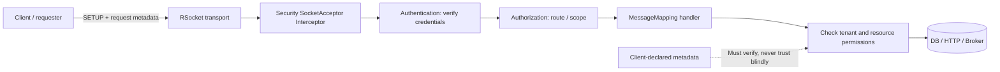
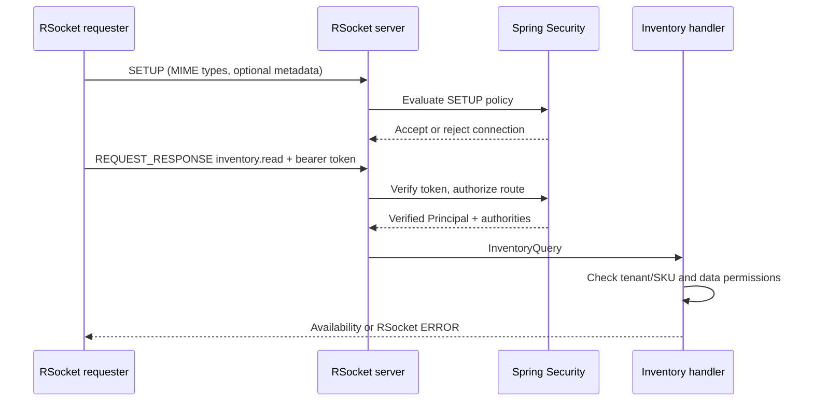
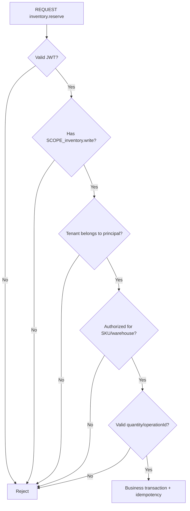
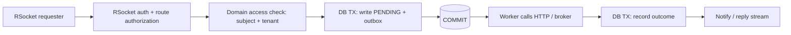

# Integrating authentication and metadata trust boundaries in RSocket

## 1. Where do security issues arise?

In **SPRING_BOOT_INTEGRATION**, Spring Boot can communicate with inventory, payment, customer data services, or other adapters using HTTP clients, databases, caches, message brokers, and **RSocket**. With RSocket, a connection can be long-lived, multiplex concurrent requests, and support bidirectional exchange. Security design therefore goes beyond verifying that a connection opened successfully.

For example, an inventory service exposes two routes:

- `inventory.read`: reads stock counts by SKU, restricted to callers permitted to read data for a valid tenant.
- `inventory.reserve`: reserves stock, an operation with side effects; requires write privileges plus tenant, quantity, and idempotency-key validation.

An RSocket request contains **data** and **metadata**. Metadata can carry routes, bearer tokens, correlation IDs, tenant IDs, locales, and other routing fields. Clients can construct or forge many of these values. If a server treats raw metadata as verified authentication, callers can spoof identities or escalate privileges.

**Core principle:** metadata sent by the peer is **untrusted input**. Only after authentication validates credentials and authorization checks permissions against the specific operation/resource may the application use the verified identity and authorities. Self-declared route names, MIME types, and tenant names do not prove access rights.



This lesson focuses on integrating **Spring Security RSocket** with Spring Boot and defining trust boundaries for metadata, including asynchronous requests, multi-item streams, and real integration adapters.

## 2. How does RSocket differ from HTTP regarding authentication?

RSocket is a binary protocol supporting four core interaction models:

| Model | Characteristics | Security notes |
| --- | --- | --- |
| **Request-Response** | One request receives one response | Authenticate request, authorize route and data before querying |
| **Request-Stream** | One request receives many items | Authenticate stream start, keep permission checks valid across stream lifetime; bound item count/duration |
| **Request-Channel** | Both sides stream within one interaction | Authorize the initiating request **and** every subsequent item; backpressure is not authorization |
| **Fire-and-Forget** | One-way send without business response | Successful send does not prove the handler committed DB or called downstream |

Initially, the requester sends a `SETUP` frame to negotiate connection settings, MIME types, and optional metadata. Thereafter, each request can carry route, authentication metadata, and other metadata. A TCP or WebSocket connection can be reused long-term across many requests.



Unlike HTTP, an RSocket request is not an HTTP request carrying a standard `Authorization` header. When RSocket runs over WebSocket, HTTP participates only in the handshake/upgrade phase; subsequent RSocket requests still require security policies **at the RSocket layer**. On rejection, clients receive RSocket error signals rather than necessarily HTTP `401`/`403`.

**RSocket is bidirectional:** once connected, the side previously acting as “server” can also send requests to the peer. Therefore every responder—including a responder on the client—requires proper authentication, authorization, and resource limits rather than trusting everything on an established connection.

## 3. Metadata structure and trust levels

Typically, Spring `RSocketRequester` uses **composite metadata** by default: multiple independent metadata entries, each with its own MIME type and value. Common entries include:

- Route under MIME type `message/x.rsocket.routing.v0`.
- Authentication metadata per the RSocket Authentication Extension, carrying simple authentication or bearer tokens.
- Correlation/trace IDs, locale, tenant hints, or custom application metadata.
- Connection-level information inside the `SETUP` frame.

```text
RSocket SETUP:
  dataMimeType      = application/json (example)
  metadataMimeType  = message/x.rsocket.composite-metadata.v0
  optional metadata = setup route / authentication / application capabilities

RSocket REQUEST_RESPONSE:
  metadata:
    - route: inventory.reserve
    - auth: bearer token (per authentication MIME type)
    - tenant hint: tenant-A
    - correlation ID: trace-123
  data:
    { "sku": "SKU-101", "quantity": 2, "operationId": "op-123" }
```

Even when metadata travels over TLS, **TLS only secures the transport channel and configured endpoint identity**; it does not turn client-supplied fields into authoritative application claims.

### Trust classification table

| Value | Who controls its content? | Trust directly? | Proper usage |
| --- | --- | --- | --- |
| Route `inventory.reserve` | Requester | **No** | Dispatch target while enforcing route and operation authorization |
| Raw bearer token string | Requester sending credential | **Not before verification** | Verify signature, issuer, audience, expiration, authorities; build authentication |
| Claims inside a verified JWT | Trusted identity provider | Trust **within validation/policy scope** | Use subject, scopes, and tenant claims appropriately; still check resource permissions |
| Client-supplied `tenantId` | Requester | **No** | Cross-check against verified tenant and data access rules; never grant roles |
| Correlation ID / trace ID | Requester or proxy | **Not for security** | Validate length/charset, generate internal ID if invalid; use for observability |
| IP/`forwarded-for` in metadata | Easily spoofed by requester | **No** | Trust only sanitized values from ingress/proxies inside an explicit trust boundary |
| Data MIME type | Negotiated by requester | **No** | Allowlist permitted decoders, limit sizes, and validate schemas |
| `SETUP` metadata | Initial requester | **No** | Apply connection auth policies where needed; enforce resource limits before/after SETUP |
| `METADATA_PUSH` | Connected peer | **No** | Process only permitted message types; never assume it alters privileges |

A bearer token sent in metadata remains only a **credential for authentication**. A valid signature alone is insufficient: the server must also check issuer/audience/expiry, scopes or roles, tenant membership, and permissions on the specific business object.

### Composite metadata is not an authorization record

`metadataMimeType` only describes encoding format. Seeing an entry with MIME type `message/x.rsocket.authentication.v0` does not mean the token inside is valid. Likewise, an entry of type `application/vnd.example.tenant+json` must never replace a verified `Authentication`.

Never place secrets such as bearer tokens in header logs, trace attributes, audit events, or client-facing error messages. For diagnostics, log request IDs, normalized routes, issuers, or minimal error categories; avoid dumping full metadata buffers that may hold credentials.

## 4. SETUP authentication vs. per-request authentication

Spring Security supports authentication at **SETUP**, at **each request**, or both. This is a critical design choice.

| Approach | Meaning | When appropriate | Risks to address |
| --- | --- | --- | --- |
| **SETUP authentication** | Verifies credentials on connection open | Dedicated connection for a single stable service/device/user | Long-lived connections outliving token expiry; permission changes or revocations do not auto-update all state |
| **Per-request authentication** | Every request carries its own credential | Connection pool shared across many users/tenants | Must validate **every request's** token and never leak principals across concurrent requests |
| **Both** | SETUP authenticates calling app; request authenticates end user | API gateway/BFF connecting to internal services on behalf of users | Clearly separate service vs. user identities; never let user tokens escalate connection privileges |
| **SETUP `permitAll` + restricted routes** | Allows initial connection; blocks unauthenticated/unauthorized requests | Demos or per-request auth behind secured ingress | Anonymous connections still consume resources; enforce quotas, timeouts, and anomaly controls |

### 4.1. Authenticating once at SETUP does not fit shared connections

Suppose a frontend gateway opens a shared RSocket connection and calls backends on behalf of multiple users. If `SETUP` used **user A's** credentials, reusing that connection for user B risks identity confusion or data leaks. Specifically avoid binding a `SecurityContext` to a thread or storing a mutable `currentUser` on a shared requester.

For shared connections, pass the **current request's** token in authentication metadata so the server authenticates and authorizes each request. Service credentials identifying the connecting app can be verified separately at SETUP.

### 4.2. Understanding token expiration on long-lived connections

For JWTs:

- `exp` and `nbf` are evaluated when the token is verified; expired tokens on subsequent requests must be rejected by active validation.
- If a token is verified **only once at SETUP**, do not assume later requests are re-validated in real time. Design policies to close/reconnect upon credential expiration, or use per-request authentication.
- User/permission revocation also needs a consistent strategy: short token TTLs, introspection/revocation checks where appropriate, disconnecting sessions, or reauthorization per business needs. A cryptographically valid JWT may still need rejection if resource permissions changed.

**Never let metadata from a later request mutate the connection's principal** without an explicit authentication flow. `METADATA_PUSH` is a protocol interaction; it is not an automatic token-refresh or privilege-escalation channel.

## 5. Dependencies and enabling Spring Security RSocket

Examples below use common **Spring Boot 3.x / Spring Framework 6.x / Spring Security 6.x** APIs and Java 17+. Newer major versions may alter packages, DSLs, or dependencies; align with your application's BOM and version documentation.

Example Maven dependencies:

```xml
<dependencies>
    <dependency>
        <groupId>org.springframework.boot</groupId>
        <artifactId>spring-boot-starter-rsocket</artifactId>
    </dependency>
    <dependency>
        <groupId>org.springframework.boot</groupId>
        <artifactId>spring-boot-starter-security</artifactId>
    </dependency>
    <dependency>
        <groupId>org.springframework.security</groupId>
        <artifactId>spring-security-rsocket</artifactId>
    </dependency>
    <dependency>
        <groupId>org.springframework.boot</groupId>
        <artifactId>spring-boot-starter-oauth2-resource-server</artifactId>
    </dependency>
</dependencies>
```

`spring-security-rsocket` provides RSocket authentication/authorization; OAuth2 resource server/Jose provides JWT validation support. Configure a `ReactiveJwtDecoder` and rules matching tokens issued by your identity provider.

Illustrative TCP server config:

```yaml
spring:
  rsocket:
    server:
      transport: tcp
      port: 7000
```

**This is a functional example**, not hardened enough for public Internet exposure. RSocket TCP needs transport security (TLS on the transport or a strictly controlled end-to-end network boundary). When exposing via WebSocket, use `wss://` with proper HTTP handshake and Origin policies; HTTP handshake policies **do not replace** RSocket authorization.

Spring Boot auto-configures RSocket server components when dependencies and properties are present. When configuring RSocket Java directly outside Boot auto-configuration, register the security `SocketAcceptor` interceptor on the **actual listening server**. Declaring a security bean without wiring its interceptor into the active server leaves real requests unprotected.

## 6. Example: per-request JWT authentication and route authorization

Suppose clients send bearer tokens on **every request**. We permit `SETUP` without a token, while allowing only listed routes with matching authorities.

```java
import org.springframework.context.annotation.Bean;
import org.springframework.context.annotation.Configuration;
import org.springframework.security.config.Customizer;
import org.springframework.security.config.annotation.rsocket.EnableRSocketSecurity;
import org.springframework.security.config.annotation.rsocket.RSocketSecurity;
import org.springframework.security.oauth2.jwt.ReactiveJwtDecoder;
import org.springframework.security.oauth2.jwt.ReactiveJwtDecoders;
import org.springframework.security.rsocket.core.PayloadSocketAcceptorInterceptor;

@Configuration(proxyBeanMethods = false)
@EnableRSocketSecurity
public class InventoryRSocketSecurityConfiguration {

    @Bean
    PayloadSocketAcceptorInterceptor rsocketInterceptor(
            RSocketSecurity rsocket) {

        rsocket.authorizePayload(authorize -> authorize
                    .setup().permitAll()
                    .route("inventory.read")
                        .hasAuthority("SCOPE_inventory.read")
                    .route("inventory.reserve")
                        .hasAuthority("SCOPE_inventory.write")
                    .anyRequest().denyAll()
                    .anyExchange().permitAll())
               .jwt(Customizer.withDefaults());

        return rsocket.build();
    }

    @Bean
    ReactiveJwtDecoder jwtDecoder() {
        return ReactiveJwtDecoders.fromIssuerLocation(
                "https://identity.example.test/realms/shop");
    }
}
```

This is an **illustrative configuration**; the issuer URL must come from trusted deployment configuration. Never take an issuer or JWK endpoint from request metadata, or clients could pick an attacker-controlled signing server.

Rule breakdown:

1. `setup().permitAll()` permits unauthenticated connections for **per-request authentication**. It does not allow arbitrary requests.
2. `route("inventory.read").hasAuthority("SCOPE_inventory.read")` grants read access only when `Authentication` holds that authority.
3. `route("inventory.reserve").hasAuthority("SCOPE_inventory.write")` protects side-effecting calls; service-level resource checks are still needed.
4. `anyRequest().denyAll()` rejects all other unlisted routes/initiating requests.
5. `anyExchange().permitAll()` handles subsequent payload exchanges without initial request metadata, notably continuation frames in `REQUEST_CHANNEL`. This **does not skip data validation** inside streams; handlers must still enforce per-item content, permission, and quota checks.

**Rule order matters:** the first matching rule wins. Never place `anyRequest().authenticated()` ahead of scope-specific rules, or any signed-in user could access privileged routes.

The example assumes valid JWTs yield `SCOPE_inventory.read` and `SCOPE_inventory.write` authorities via converter/claim mapping. If your identity provider uses a different role claim structure, configure matching authority converters. Do not assume every JWT exposes `SCOPE_*` authorities automatically.

### SETUP authentication: an alternative configuration

If a connection represents a single service and must authenticate immediately upon opening, swap in the appropriate policy:

```java
rsocket.authorizePayload(authorize -> authorize
            .setup().hasAuthority("SCOPE_rsocket.connect")
            .route("inventory.read")
                .hasAuthority("SCOPE_inventory.read")
            .route("inventory.reserve")
                .hasAuthority("SCOPE_inventory.write")
            .anyRequest().denyAll()
            .anyExchange().permitAll())
       .jwt(Customizer.withDefaults());
```

This alternative works only when the client sends authentication metadata in `SETUP` with the expected connect scope. If per-request tokens are also present, explicitly define how **setup service identity** and **request user identity** compose, and test that a user token cannot masquerade as a setup token or vice versa.

### JWT validation must match the issuer and audience

Proper JWT validation normally checks signature against trusted keys, `iss`, `exp`, `nbf`, and **audience** when audiences separate APIs. Do not rely merely on “the token parses”:

- Accept only configured issuers; fetch JWKs from controlled endpoints.
- Validate the audience targeting your RSocket API; reject tokens minted for unrelated services.
- Enforce signing algorithm policies, clock skew bounds, and key rotation; never accept unsigned or unverified tokens.
- Map scopes/roles per identity-provider contract; never elevate privileges from arbitrary unverified claims.
- When near-real-time revocation is needed, add introspection, short-lived tokens, or session status checks.

`ReactiveJwtDecoders.fromIssuerLocation(...)` shows basic issuer-based decoder setup. For custom audience checks, attach an `OAuth2TokenValidator<Jwt>`/decoder matching policy rather than assuming the sample checks every custom claim automatically.

## 7. Client sending bearer authentication metadata properly

Spring Security RSocket uses the **Bearer Token Authentication Metadata Extension**. Spring Framework supports composite metadata so one request carries both route and authentication metadata. With Spring Security, use `BearerTokenMetadata` and the standard authentication MIME type:

```java
import io.rsocket.metadata.WellKnownMimeType;

import org.springframework.messaging.rsocket.RSocketRequester;
import org.springframework.security.rsocket.metadata.BearerTokenMetadata;
import org.springframework.util.MimeType;
import org.springframework.util.MimeTypeUtils;

import reactor.core.publisher.Mono;

public final class InventoryRSocketClient {

    private static final MimeType AUTH_MIME_TYPE =
            MimeTypeUtils.parseMimeType(
                WellKnownMimeType.MESSAGE_RSOCKET_AUTHENTICATION.getString());

    private final RSocketRequester requester;

    public InventoryRSocketClient(
            RSocketRequester.Builder requesterBuilder,
            String host, int port) {
        this.requester = requesterBuilder.tcp(host, port);
    }

    public Mono<Availability> getAvailability(
            String sku, String verifiedClientToken) {
        return requester.route("inventory.read")
                .metadata(
                    new BearerTokenMetadata(verifiedClientToken),
                    AUTH_MIME_TYPE)
                .data(new InventoryQuery(sku))
                .retrieveMono(Availability.class);
    }

    public record InventoryQuery(String sku) {}
    public record Availability(String sku, int available) {}
}
```

In this example, `verifiedClientToken` represents a token obtained **on the client through a trusted authentication flow**; the server still verifies the JWT independently. Never hardcode static tokens in source code or log them.

Lifecycle points to understand:

- Spring Boot's `RSocketRequester.Builder` carries application codecs/strategies; inject it to stay consistent on serialization and security metadata.
- The per-request model attaches `BearerTokenMetadata` to **every request**. Never bake a single user's token into a requester shared across many users.
- If a requester holds long-lived connections, account for reconnects, token expiration, and request queue limits when the server is unreachable.
- For bearer metadata, do not invent a custom metadata string `"Authorization: Bearer ..."` under an arbitrary MIME type expecting RSocket interceptors to treat it like an HTTP header.
- Clients must use composite metadata to carry route and authentication under distinct MIME types; switching `metadataMimeType` to routing-only breaks attaching custom-MIME metadata entries.
- Over WebSocket, `webSocket(URI)` must match TLS/ingress paths; credentials in RSocket metadata still require verification on the RSocket server.

To send a token at `SETUP` instead of per request, configure `setupMetadata(new BearerTokenMetadata(token), AUTH_MIME_TYPE)` on the builder **before connecting**. That is a distinct model unsuitable for sharing one user's connection across other users.

## 8. Routing by metadata does not imply authorization

The route is a value sent by the requester to pick a `@MessageMapping` or handler. Suppose an attacker sends:

```text
route = inventory.reserve
metadata.tenantId = "vip-tenant"
metadata.role = "ADMIN"
data = { "sku": "SKU-100", "quantity": 1000 }
```

If the server simply trusts `role=ADMIN` from metadata, the attacker escalates privileges. Correct enforcement:

1. Security interceptor verifies the actual credential.
2. RSocket authorization checks the principal holds permission to invoke `inventory.reserve`.
3. Handler/service verifies `tenantId` in the request belongs to tenants the principal is permitted to access.
4. Service checks permissions on the specific SKU/warehouse, quotas, and business rules before applying side effects.
5. DB transactions or adapters execute conditionally and record audits using the **verified principal**, never a self-declared username from metadata.



### Example handler reading identity from SecurityContext

In a reactive handler, read the Spring Security-authenticated principal via `ReactiveSecurityContextHolder`. Never rely on a client-supplied `userId` field as the primary identity source.

```java
import org.springframework.messaging.handler.annotation.MessageMapping;
import org.springframework.security.access.AccessDeniedException;
import org.springframework.security.core.context.ReactiveSecurityContextHolder;
import org.springframework.stereotype.Controller;
import reactor.core.publisher.Mono;

@Controller
public class InventoryRSocketController {

    private final InventoryService inventoryService;

    public InventoryRSocketController(InventoryService inventoryService) {
        this.inventoryService = inventoryService;
    }

    @MessageMapping("inventory.reserve")
    public Mono<ReservationResult> reserve(ReserveCommand command) {
        return ReactiveSecurityContextHolder.getContext()
                .switchIfEmpty(Mono.error(
                        new AccessDeniedException("Unauthenticated")))
                .flatMap(context -> inventoryService.reserveForPrincipal(
                        context.getAuthentication(), command));
    }
}
```

`ReserveCommand`, `ReservationResult`, and `InventoryService` are domain types. `reserveForPrincipal(...)` must enforce tenant/resource permissions and idempotency **server-side**. `@AuthenticationPrincipal` can also be used when properly integrated with Spring Security, without skipping per-resource authorization checks.

**Avoid a common bug:** never trust `command.tenantId()` merely because the JWT is valid; an attacker with a valid token for tenant A can put tenant B into the payload/metadata. Read verified tenant claims **and/or** look up user–tenant memberships in an authorization store, then match against the target tenant.

### Never substitute service privileges for user privileges

In a BFF or internal service, a gateway token proves “backend A connected,” not “user U is permitted to reserve stock for tenant T.” When acting on behalf of users:

- Choose an explicit delegation model (audience-scoped user tokens, token exchange, or policy-backed service-to-service authorization).
- Bind user identity to the request and check tenant/resource ownership.
- Never allow a service to present its own credential while sending `userId=admin` metadata to seize privileges.
- Audit **verified subject**, actor service, and business operation ID when policy requires distinguishing actor from impersonated subject.

## 9. MetadataExtractor and the difference between decoding and authentication

Spring Framework provides `MetadataExtractor` to decode composite metadata entries into message headers readable by handlers, e.g., via `@Header`. For instance, a correlation ID may be registered under an application-defined MIME type.

Example metadata extraction configuration:

```java
import org.springframework.messaging.rsocket.RSocketStrategies;
import org.springframework.util.MimeType;

RSocketStrategies strategies = RSocketStrategies.builder()
        .metadataExtractorRegistry(registry -> {
            registry.metadataToExtract(
                    MimeType.valueOf("text/plain"),
                    String.class,
                    "clientCorrelationId");
        })
        .build();
```

This shows **registration** only; to apply it to a real Spring Boot RSocket server, customize the application's `RSocketStrategies` alongside Boot-configured codecs/decoders. Do not blindly replace the auto-configured bean and lose JSON codecs or authentication metadata support. When using multiple metadata types, register sufficiently specific MIME types to prevent collisions.

When the handler consumes it:

```java
@MessageMapping("inventory.read")
public Mono<Availability> read(
        InventoryQuery query,
        @Header(name = "clientCorrelationId", required = false)
        String clientCorrelationId) {
    // clientCorrelationId is only for logging after validation.
    // Never use this value as proof of identity or authority.
    return inventoryService.load(query);
}
```

**Readable header ≠ trusted header.** `MetadataExtractor` and `RSocketStrategies` handle only decoding/header mapping. Authentication belongs to the security layer; business authorization belongs to the service layer. Never extract a bearer token via `@Header`, parse the JWT string manually, and trust its claims before verification.

When clients send unknown, duplicate, or undecodable metadata, enforce clear policies: cap metadata size, register only required MIME types, handle parse errors safely, and define precedence if multiple sources supply the same field. Never let a second metadata entry overwrite a verified identity.

## 10. Trust boundaries by metadata type

### 10.1. Tenant ID

In multi-tenant apps, clients sometimes pass `tenantId` to select data scope. Treat this solely as a **request hint targeting that tenant**. The backend must compare it against the verified principal and tenant access policy. When tenant memberships change frequently, design when to query auth DBs/caches, TTLs, and invalidation.

Use `@PreAuthorize` or a custom `ReactiveAuthorizationManager` where helpful, remembering that a route rule like `hasAuthority("SCOPE_inventory.read")` still does not constrain **which tenant owns which SKU**. Never key caches solely by SKU in multi-tenant systems, or valid cached responses can leak across tenants.

### 10.2. Trace IDs, correlation IDs, and baggage

Clients may supply IDs containing control characters, excessive lengths, or colliding values. When using them in logs/metrics:

- Enforce size limits and valid charsets; normalize or generate a fresh internal ID if invalid.
- Never embed raw values into high-cardinality metric labels; use bounded attributes on spans where appropriate.
- Never place bearer tokens or sensitive data in baggage/traces.
- Distinguish client-declared `clientCorrelationId` from server-controlled internal IDs.

### 10.3. Routing metadata and MIME types

Routes locate handlers and are not scopes/roles. Never let clients specify class names, bean names, expressions, or downstream URLs for dynamic execution. When proxying across backends, use static route allowlists or controlled mappings; block SSRF and never forward service tokens to client-chosen destinations.

MIME types describe format, not authorization. Restrict permitted codecs, schemas, item counts, JSON depth, payload sizes, and metadata sizes to mitigate resource-exhaustion or type-confusion attacks.

### 10.4. Authentication metadata and duplicate fields

Never accept a “bearer token” in a custom metadata field assuming Spring Security processed it. Use the standard RSocket Authentication Extension and matching interceptors. For duplicate credentials, malformed metadata, or invalid tokens, **fail closed** per policy; never fall back to self-declared `userId`/`role` fields.

Verified tokens should produce an `Authentication`/principal inside the reactive security context. Logs should record only verified subjects/tenants per privacy policy, never raw tokens.

## 11. Protecting request-stream and request-channel

RSocket supports backpressure, yet it **is not an authorization mechanism** and does not automatically cap total data volume. An authenticated client can still send excessive requests, oversized payloads, or keep streams open indefinitely.

Example handler processing multiple requests in a `REQUEST_CHANNEL`:

```java
@MessageMapping("inventory.batch.reserve")
public Flux<ReservationResult> reserveBatch(
        Flux<ReserveCommand> requests) {

    return ReactiveSecurityContextHolder.getContext()
            .switchIfEmpty(Mono.error(
                    new AccessDeniedException("Unauthenticated")))
            .flatMapMany(context -> requests
                    .take(100)
                    .concatMap(command ->
                            inventoryService.reserveForPrincipal(
                                    context.getAuthentication(), command)));
}
```

This illustrative handler requires an explicit `inventory.batch.reserve` policy rule in security config; with `anyRequest().denyAll()` and no rule, the request is **rejected as designed**. When enforcing a 100-item limit, choose intentional semantics: `take(100)` completes after the 100th item without **treating extra items as a protocol violation or attack**. If the contract must reject excess items, count/validate and emit an explicit error rather than truncating silently.

In production systems:

- Authorize the **initiating request** by route and credentials; enforce tenant/operation checks on **every item**.
- Limit item counts, bytes, rates, durations, concurrent streams, and total requests per user/service/tenant.
- Apply backpressure, timeouts, budgets, and explicit cancellation; never buffer unboundedly when downstream slows down.
- Re-check authorization if principal/tenant state can change during long-lived streams requiring reauthorization.
- Never assume `anyExchange().permitAll()` makes every frame safe. That rule only allows continuation frames lacking initial request metadata; stream safety still depends on route policies and per-item validation.

With `Fire-and-Forget`, `RSocketRequester.send()` completing only means the protocol send ran; it **does not prove** the DB committed or downstream adapters created side effects. For critical actions like “deduct inventory,” use business ACKs, idempotency keys, and durable state.

## 12. TLS, ingress, and boundaries between network and application identity

Do not assume Spring Security for HTTP endpoints automatically secures RSocket. Verify the actual entry path:

| Connection path | What transport layer protects | What is still needed in RSocket |
| --- | --- | --- |
| Direct TCP `tcp://` | RSocket TCP TLS, network ACLs, mTLS if applicable | SETUP/request authentication, route authorization, quotas |
| WebSocket over `wss://` | HTTPS/WSS, handshake protection, Origin/CORS policy, reverse proxy | Per-request RSocket authentication/authorization |
| BFF/gateway pooling to backend | mTLS or service credentials at setup | Per-user tokens/authorization and tenant isolation if shared |
| Internal service-to-service in private network | Network segmentation, service certificates/identities | Never skip app auth; enforce least privilege and auditing |

For browser WebSockets, enforce `Origin`, cookie/session policies, and upgrade checks to prevent cross-site WebSocket hijacking. Putting tokens in URL query strings exposes them in proxy logs, browser history, and telemetry; prefer safer credential mechanisms aligned with HTTPS/WSS design.

**mTLS authenticates endpoints at the transport layer**, forming an important part of service identity; however, if service A acts for many users, mTLS for A never replaces checking whether user B can access tenant T's data.

Never allow bearer metadata over plaintext channels in untrusted environments where tokens can be sniffed. Manage certificate/token lifecycles, timeouts, keepalives, and connection caps realistically.

## 13. How are authentication and authorization errors represented?

In HTTP, clients look for `401 Unauthorized` or `403 Forbidden`. In RSocket, authentication/connection/request rejections travel as **protocol error signals/frames**.

Example policy:

| Scenario | Expectation |
| --- | --- |
| Missing token calling `inventory.read` with per-request JWT | Request rejected; handler never invoked |
| Tampered signature or expired token | No valid principal created; request rejected |
| Token with read scope calls `inventory.reserve` | Authorization denies before side effects |
| Token with write scope targets another tenant | Handler/service rejects per tenant/resource rules |
| Route missing from allowlist | `anyRequest().denyAll()` rejects |
| Invalid SETUP credential under SETUP auth policy | Connection rejected per policy |
| Malformed correlation ID | Replaced with generated ID or rejected as invalid input; never alters principal |
| Disconnect mid-stream | Client handles interruption, cancellation, and unknown business states |

Never return stack traces, tokens, sensitive JWT claims, system permission lists, or tenant existence details in client error messages. Server logs should categorize `authentication_failed`, `authorization_denied`, `invalid_metadata`, `payload_rejected`, and `downstream_unavailable` for operations without printing raw credentials.

## 14. Integration testing authentication and metadata

Tests must prove that **policies are wired onto the real RSocket server**, not merely that security beans exist. With Spring Boot, start the RSocket server on a dynamic port in an integration test, inject the bound port, connect an `RSocketRequester`, and assert behavior with `StepVerifier`.

### Key test matrix

| Test case | What the request sends | What to verify |
| --- | --- | --- |
| Per-request connection without SETUP token | SETUP without credentials | Connection permitted under `setup().permitAll()`; protected routes still blocked |
| Missing bearer on read route | `inventory.read` without auth metadata | Request fails; repository/gateway not called |
| Tampered token signature | Invalid bearer | Rejected; no `Authentication` created |
| Expired / wrong-issuer token | Unvalidated credential | Rejected; claims never grant access |
| Wrong-audience token | Token issued for another API | Rejected **if audience validation is properly configured** |
| Read-only user | Calls `inventory.read` then `inventory.reserve` | Read allowed for permitted tenant; write denied |
| Metadata self-declaring ADMIN role | Read-only token + metadata `role=ADMIN` | No privilege escalation |
| Spoofed tenant metadata | Tenant A token requesting Tenant B | Blocked by service or tenant policy |
| Unknown/bogus route | `inventory.admin.export` | Rejected by `anyRequest().denyAll()` |
| Invalid/duplicate metadata MIME | Malformed entry or multiple copies | Never bypasses auth or selects client-declared identity |
| Long request-stream | Many items, long-lived connection | Quotas, backpressure, cancellation, and reauthorization enforced |
| Two users sharing connection | Requests carry distinct tokens | Permissions and data never leak across principals |
| Reconnect when token expires | Old/reconnected sessions | Configured expiration and reconnect policy enforced |
| Side effects on denied request | `inventory.reserve` with insufficient token | Zero reservation rows or downstream messages |

### StepVerifier example for rejected requests

Assume the test connects `RSocketRequester` to a **real test server** loaded with section 6's security config:

```java
import java.time.Duration;

import org.junit.jupiter.api.Test;
import reactor.test.StepVerifier;

@Test
void readRouteWithoutBearerIsRejected() {
    StepVerifier.create(
                requester.route("inventory.read")
                        .data(new InventoryQuery("SKU-100"))
                        .retrieveMono(Availability.class))
            .expectError()
            .verify(Duration.ofSeconds(3));

    // Also verify the service/repository was never invoked.
}
```

In this snippet, `requester` is connected to the integration-test server's dynamic port, not a Mockito mock. `InventoryQuery`/`Availability` are DTOs from this lesson. Tests must also assert zero service side effects and inspect request counts, because `expectError()` alone could pass due to an unrelated connection or decoder failure. Check the version-specific RSocket error type and also run a valid-token test on the same route to confirm connectivity and codecs work.

Example sending a fake bearer token to exercise the JWT step:

```java
MimeType authMimeType = MimeTypeUtils.parseMimeType(
        WellKnownMimeType.MESSAGE_RSOCKET_AUTHENTICATION.getString());

StepVerifier.create(
        requester.route("inventory.read")
                .metadata(
                        new BearerTokenMetadata("invalid.jwt.token"),
                        authMimeType)
                .data(new InventoryQuery("SKU-100"))
                .retrieveMono(Availability.class))
        .expectError()
        .verify(Duration.ofSeconds(3));
```

This is a supplementary snippet; add the imports shown in `InventoryRSocketClient`. For scope/tenant tests, sign test JWT fixtures with test keys or a mock issuer paired with matching validators rather than relying on a production identity provider. If mocking a decoder, also test real issuer/audience validators elsewhere so misconfigurations do not slip through.

### Testing connection setup vs. per-request

Include two separate test suites when implementing both SETUP and per-request authentication:

- **Setup tests:** invalid credentials fail connection establishment per policy; valid credentials connect; setup tokens do not substitute for user tokens when separation is required.
- **Request tests:** on a valid connection, each user request authenticates and authorizes independently; two users on the same connection never share authorization.
- **Reauthorization tests:** token expiration/revocation and tenant permission changes mid-connection follow defined policies.

Test on the actual transport used in production—TCP or WebSocket—and when production uses TLS, add certificate/truststore and handshake tests. Unit-testing `InventoryService` directly will never prove the Spring Security RSocket interceptor is wired properly.

## 15. Connecting to real integration flows

In systems combining HTTP clients, databases, caches, brokers, and Spring Integration, RSocket authentication is only the **entry gate** of a longer workflow:



Never hold DB transactions open while waiting on RSocket streams or downstream HTTP calls. When a client calls `inventory.reserve`, persist a durable operation ID/idempotency key; timeouts or disconnects can happen after DB commit, so never assume “not executed” merely because the client missed the response.

Partition cache keys by verified tenant rather than unvalidated tenant metadata. When publishing Kafka/RabbitMQ messages, attach actor/tenant from the **verified security context and service policy** alongside the operation ID; consumers must still authenticate/authorize the sender when messages cross trust boundaries. Never treat trace metadata as an authorization ticket for messages or DBs.

When using Spring Integration's RSocket inbound/outbound gateways, confirm they pass through the **security interceptor of the actual RSocket connection/server**. Spring Integration flows, Spring Security RSocket, and downstream broker/HTTP security are separate layers with distinct boundaries; one working layer does not automatically secure the others.

## 16. Common design mistakes

| Mistake | Consequence | Fix |
| --- | --- | --- |
| Trusting `userId`/`role` in metadata | Attacker self-assigns privileges | Read principal/authorities from verified authentication |
| Securing only HTTP when using RSocket over WebSocket | RSocket routes behind upgrade lack authorization | Configure and test `RSocketSecurity` separately |
| Reusing user A's setup token on a shared multi-user connection | Identity confusion or data leak | Per-request tokens, authenticated independently |
| Putting `anyRequest().authenticated()` before write-scope rules | Any signed-in user invokes privileged routes | Place specific rules first; verify rule order |
| Treating `anyExchange().permitAll()` as authorizing whole streams | Skips payload validation after initial frame | Secure initiating routes and every business item |
| Verifying only JWT signature without issuer/audience | Tokens from unrelated APIs accepted | Configure issuer and audience validators |
| Trusting client-supplied `tenantId=other` directly | Cross-tenant read/write | Match tenant against verified principal and resource permissions |
| Logging full metadata buffers | Leaks bearer tokens and PII | Redact, allowlist fields, and bound logs |
| Letting routes specify arbitrary downstream URLs | SSRF or token leakage when proxying | Static route/endpoint allowlists; never forward tokens blindly |
| Treating backpressure as rate limiting/authorization | Valid clients can exhaust resources | Quotas, timeouts, concurrent-stream and payload-size limits |
| Treating `METADATA_PUSH` as privilege change | Unvalidated identity mutation | Allow only policy-approved protocol/app metadata |
| Treating fire-and-forget send success as DB commit | Wrong status, missing recovery | Business ACKs/durable state and idempotency |
| Testing only services without a real RSocket server | Security interceptor may remain unwired | Integration tests with real connectors + JWT fixtures |
| Passing SecurityContext via ThreadLocal in Reactor | Wrong principal in reactive chains | Use reactive security context and pass DTOs explicitly |

## 17. Checklist before deploying secure RSocket

1. Identify **actors**: service at SETUP, user per request, or both, and each actor's permissions.
2. Secure the transport (TLS/WSS), verifying ingress, certificates, Origin/handshakes, and connection quotas.
3. Enable Spring Security RSocket and verify `PayloadSocketAcceptorInterceptor` is attached to the active server.
4. Configure JWT or simple authentication properly; never trust identity metadata before verification.
5. Configure issuer, audience, keys/algorithms, expiry, claim-to-authority mapping, rotation, and revocation as needed.
6. Write `authorizePayload` rules from specific routes to general; deny routes outside the allowlist by default.
7. For request-channel/stream, validate permissions and payloads **per item**, capping rates, bytes, durations, and concurrency.
8. Use the verified principal to determine tenant/resources; treat client-supplied tenant IDs/roles/trace IDs as untrusted inputs to validate.
9. Never log raw credentials; cap metadata/codec/schema/JSON sizes and supported metadata types.
10. When flows touch DB/cache/broker or HTTP side effects, design short transactions, outbox, idempotency, retries, and unknown-outcome handling.
11. Test SETUP, per-request, invalid tokens, wrong scopes, spoofed tenants, unknown routes, oversized payloads, and multi-user shared connections separately.
12. Monitor rejected requests, failed connections, expired tokens, rate-limit hits, and metadata errors while keeping sensitive data out of logs.

**Takeaway:** in RSocket, **metadata travels alongside requests without carrying inherent trust**. Authentication turns verified credentials into a principal; authorization decides whether that principal may invoke a route and access resources; and business validation governs tenants, payloads, and side effects. Keeping these three stages separate—and treating long-lived connections and bidirectional streams as security boundaries with their own lifecycles—makes Spring Boot integration flows both secure and testable.

### References

- [Spring Security Reference — RSocket Security](https://docs.spring.io/spring-security/reference/reactive/integrations/rsocket.html): `AuthenticationPayloadInterceptor`, JWT, simple authentication, SETUP/request authorization.
- [Spring Framework Reference — RSocket](https://docs.spring.io/spring-framework/reference/rsocket.html): SETUP, composite metadata, routing, requester, responder, and `MetadataExtractor`.
- [Spring Boot Reference — RSocket](https://docs.spring.io/spring-boot/reference/messaging/rsocket.html): auto-configuration, `RSocketRequester.Builder`, TCP/WebSocket server, and `RSocketStrategies`.
- [Spring Security API — BearerTokenMetadata](https://docs.spring.io/spring-security/reference/api/java/org/springframework/security/rsocket/metadata/BearerTokenMetadata.html): metadata carrying a bearer token.
- [RSocket Protocol — Authentication Extension](https://github.com/rsocket/rsocket/blob/master/Extensions/Authentication.md): authentication metadata format.
