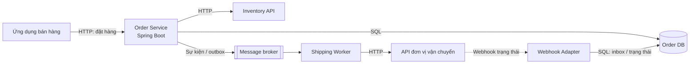
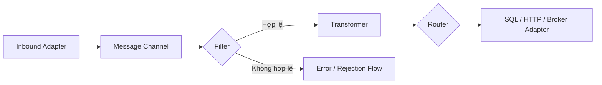
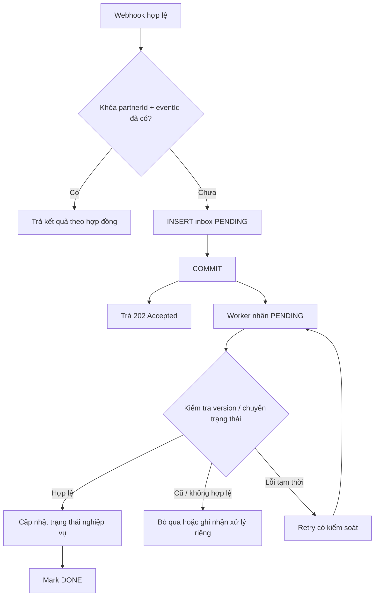

# Tích hợp hệ thống là gì và những vấn đề cần giải quyết trong ứng dụng Spring Boot

Một ứng dụng Spring Boot hiếm khi hoạt động hoàn toàn độc lập. Hệ thống bán hàng cần kiểm tra tồn kho; dịch vụ vận chuyển cần nhận đơn và gửi trạng thái; cổng thanh toán gửi thông báo giao dịch; ứng dụng phải đọc/ghi SQL, dùng cache, xuất bản sự kiện hoặc tiêu thụ thông điệp. **Tích hợp hệ thống** là quá trình làm cho những thành phần có ranh giới riêng có thể trao đổi dữ liệu và phối hợp hành vi theo một hợp đồng rõ ràng.

Trong module **SPRING_BOOT_INTEGRATION**, việc tích hợp được tiếp cận như một bài toán kỹ thuật và vận hành trọn vẹn: tổ chức tích hợp qua HTTP client, cơ sở dữ liệu, cache, broker thông điệp và các adapter của Spring Integration; đồng thời xử lý cấu hình, hợp đồng dữ liệu, giao dịch, lỗi, trùng lặp, kiểm thử và quan sát luồng thực tế. Bài này xây dựng bức tranh tổng quan để bạn chọn công cụ đúng và nhận diện rủi ro trước khi đi sâu vào từng kỹ thuật.

## 1. Mục tiêu học tập

Sau bài này, bạn có thể:

1. Giải thích hệ thống nào đang tích hợp với hệ thống nào, qua ranh giới và hợp đồng nào.
2. So sánh lời gọi đồng bộ, xử lý bất đồng bộ, trao đổi dữ liệu theo lô và đồng bộ dữ liệu theo sự kiện.
3. Nhận diện các vấn đề phổ biến: timeout, mạng chập chờn, thay đổi schema, phân tán giao dịch, retry, trùng lặp, sai thứ tự và tồn đọng.
4. Phân biệt vai trò của HTTP client, JDBC, cache, message broker và Spring Integration trong Spring Boot.
5. Phác thảo một luồng tích hợp có kiểm soát lỗi, idempotency, bảo mật, kiểm thử và khả năng quan sát.

## 2. Tích hợp hệ thống là gì?

### 2.1. Từ gọi hàm nội bộ đến vượt qua ranh giới

Trong một ứng dụng đơn, lời gọi `orderService.createOrder()` thường diễn ra trong cùng tiến trình, dùng cùng phiên bản mã nguồn và có thể dùng chung transaction cục bộ. Khi ứng dụng gọi API của đối tác hoặc đưa sự kiện lên broker, các giả định đó không còn mặc nhiên đúng:

- Bên nhận có lịch triển khai, khả năng sẵn sàng và quyền sở hữu dữ liệu riêng.
- Thời gian phản hồi chịu ảnh hưởng của mạng, pool kết nối, queue và tải hệ thống.
- Một phía có thể đã xử lý thành công dù phía còn lại không nhận được kết quả.
- Dữ liệu phải được **serialize**, trao đổi theo schema/hợp đồng và diễn giải nhất quán.
- Không thể chỉ dựa vào một transaction SQL cục bộ để kiểm soát thay đổi ở hệ thống xa.

Vì thế, một tích hợp cần trả lời được các câu hỏi: **Ai** gửi? **Gửi gì**? **Qua kênh nào**? **Khi nào được xem là thành công**? **Nếu lỗi hoặc gửi lại thì sao**? **Làm thế nào truy vết được từng bước**?

### 2.2. Ví dụ: xử lý đơn hàng qua nhiều dịch vụ

Một kênh bán hàng nhận đơn, ghi nhận vào cơ sở dữ liệu, yêu cầu giữ hàng tại dịch vụ kho và gửi yêu cầu tạo vận đơn cho đơn vị vận chuyển. Khách hàng sau đó nhận được trạng thái giao hàng qua sự kiện hoặc webhook.



Đây là **một luồng nghiệp vụ** nhưng gồm nhiều lần trao đổi qua ranh giới khác nhau. Mỗi mũi tên có hợp đồng dữ liệu, quy tắc xác thực, timeout, xử lý lỗi và trách nhiệm quan sát riêng.

### 2.3. Tích hợp không đồng nghĩa với đồng bộ dữ liệu liên tục

Không phải mọi tích hợp đều cố sao chép cùng một bộ dữ liệu. Có ít nhất bốn mục đích:

| Mục đích | Ví dụ | Điều cần đảm bảo |
| --- | --- | --- |
| **Yêu cầu một hành động** | Gửi lệnh tạo vận đơn | Bên nhận hiểu yêu cầu và kết quả có thể xác minh |
| **Tra cứu thông tin** | Kiểm tra tồn kho | Độ trễ/độ mới đáp ứng nhu cầu quyết định |
| **Phát tán sự kiện** | `OrderCreated` | Các bên quan tâm nhận và xử lý theo giao kèo |
| **Đồng bộ bản sao dữ liệu** | Cập nhật danh mục sản phẩm sang hệ thống tìm kiếm | Khắc phục sai lệch, xử lý cập nhật trễ và khôi phục |

Sự lựa chọn phụ thuộc nhu cầu nghiệp vụ: thời gian phản hồi, độ mới dữ liệu, chấp nhận xử lý trễ và mức độ gắn kết giữa các bên.

## 3. Các kiểu giao tiếp và cách lựa chọn

### 3.1. Đồng bộ qua HTTP

Một dịch vụ gọi API và đợi kết quả, chẳng hạn `GET /inventory/{sku}` trước khi xác nhận đơn.

**Ưu điểm:** dễ theo dõi luồng request/response, kết quả được trả ngay và phù hợp thao tác người dùng cần quyết định tức thời.

**Giới hạn:** dịch vụ gọi phải chờ; một thành phần chậm có thể kéo chậm toàn luồng; timeout hoặc mất phản hồi có thể khiến trạng thái kết quả **không xác định**. Khi một request đi qua quá nhiều dịch vụ nối tiếp, độ trễ và xác suất thất bại tích lũy.

Trong Spring Boot, có thể sử dụng `RestClient` cho HTTP client đồng bộ hoặc `WebClient` cho các luồng cần API reactive/non-blocking. Chọn theo mô hình thực thi và nhu cầu ứng dụng; không nhất thiết áp dụng reactive cho mọi tích hợp.

### 3.2. Bất đồng bộ qua message broker

Ứng dụng xuất bản một thông điệp; consumer xử lý sau mà phía gửi không phải giữ HTTP request đang mở.

**Ưu điểm:** giảm phụ thuộc thời gian sẵn sàng tức thời của consumer, có thể đệm tải và mở rộng phía xử lý theo nhu cầu.

**Giới hạn:** cần quản lý hàng đợi, số lần gửi lại, thông điệp lỗi, độ trễ cuối cùng, khóa định danh và thứ tự. Việc broker xác nhận **đã nhận** message không nhất thiết nghĩa là nghiệp vụ phía consumer **đã hoàn tất**.

Kafka, RabbitMQ hay các broker khác có mô hình lưu trữ, ordering, delivery và acknowledgment khác nhau. Không suy ra mọi message broker đều cung cấp cùng một mức bảo đảm.

### 3.3. Xử lý theo lịch hoặc theo lô

Ví dụ: mỗi đêm xuất file CSV dữ liệu đối soát; job lấy dữ liệu từ hệ thống ERP theo từng trang.

**Ưu điểm:** phù hợp khối lượng lớn, nguồn chỉ có giao tiếp định kỳ hoặc yêu cầu đối soát.

**Giới hạn:** dữ liệu có độ trễ, cần dấu mốc tiến độ (checkpoint), kiểm soát chạy trùng lịch, phát hiện dữ liệu bị thiếu và khả năng chạy lại từng lô.

### 3.4. Đồng bộ theo thay đổi dữ liệu

Change Data Capture (CDC) hoặc outbox có thể giúp đưa thay đổi ở database sang luồng sự kiện. CDC lấy các thay đổi từ cơ chế theo dõi transaction/log của database tùy sản phẩm; outbox ghi một sự kiện dự kiến phát đi ngay trong transaction cùng dữ liệu nghiệp vụ rồi có tiến trình xuất bản sau.

Giải pháp này hỗ trợ giảm khoảng trống giữa **commit dữ liệu** và **phát thông điệp**, nhưng consumer vẫn phải sẵn sàng xử lý trùng khi có retry hoặc sự cố tại thời điểm xác nhận.

### 3.5. Bảng so sánh nhanh

| Tiêu chí | HTTP đồng bộ | Message broker | Batch / polling |
| --- | --- | --- | --- |
| Kết quả cho người gọi | Thường có ngay hoặc timeout | Thường đến sau | Theo chu kỳ |
| Mức gắn kết thời gian | Cao hơn | Thấp hơn nếu broker hoạt động | Thấp, phụ thuộc lịch |
| Xử lý lỗi | Timeout, retry, circuit breaker | Retry, redelivery, dead-letter | Checkpoint, chạy bù, đối soát |
| Độ mới dữ liệu | Tại thời điểm trả lời | Theo độ trễ consumer | Theo nhịp chạy |
| Phù hợp | Tra cứu/ra quyết định tức thời | Phát sự kiện và công việc nền | Đồng bộ định kỳ, bulk import |

Hệ thống thực tế thường **kết hợp** nhiều kiểu: HTTP nhận lệnh, SQL lưu trạng thái, outbox phát sự kiện và consumer gọi API bên thứ ba.

## 4. Tám vấn đề cốt lõi của một luồng tích hợp

### 4.1. Hợp đồng dữ liệu và tính tương thích

Mỗi biên tích hợp phải xác định rõ:

- Tên trường, kiểu dữ liệu, bắt buộc/tùy chọn, đơn vị, múi giờ và mã hóa.
- Ý nghĩa nghiệp vụ của từng trạng thái, mã lỗi, trường định danh và mối quan hệ.
- Cách phiên bản hóa, thêm trường mới, ngừng hỗ trợ trường cũ và xử lý dữ liệu không nhận biết.
- Cách xác thực dữ liệu đầu vào, giới hạn kích thước, tránh đưa object nội bộ ra ngoài biên.

Ví dụ, `amount: 100` chưa đủ rõ nếu không có `currency` và quy ước đơn vị. `createdAt` phải quy định offset/time zone; nên sử dụng thời điểm có timezone rõ ràng theo ISO 8601. Trường `status` của đơn hàng phải có định nghĩa chuyển trạng thái nhất quán giữa hai phía.

**DTO/API contract khác database entity.** Không nên xuất trực tiếp entity nội bộ rồi buộc đối tác phải hiểu cấu trúc bảng hoặc vòng đời persistence.

### 4.2. Cấu hình và môi trường triển khai

Một ứng dụng có thể tích hợp với nhiều endpoint hoặc hệ thống. Cấu hình tối thiểu thường gồm:

- Base URL/broker address/SQL URL của từng môi trường.
- Credential, chứng chỉ, chính sách TLS.
- Timeout, pool size, giới hạn đồng thời và chiến lược retry.
- Topic/queue name, consumer group, tên schema, phiên bản API.
- Cờ bật/tắt tích hợp hoặc ngưỡng xử lý do vận hành kiểm soát.

Nên tách cấu hình khỏi mã ứng dụng bằng `application.yml`, environment variables và secret manager. Không hardcode password/token trong source, ví dụ công khai hoặc log.

### 4.3. Lỗi và tình trạng kết quả không xác định

Giả sử client gọi `POST /shipments`. Đối tác đã tạo vận đơn và chuẩn bị trả `201 Created`, nhưng mạng ngắt trước khi response đến. Client chỉ biết lời gọi **timeout**; nếu gửi lại không có khóa idempotency, có thể tạo hai vận đơn.

Các nhóm lỗi cần phân biệt:

| Trạng thái | Ví dụ | Quyết định xử lý |
| --- | --- | --- |
| Dữ liệu không hợp lệ | `400 Bad Request` do sai trường | Sửa dữ liệu/hợp đồng; thường không retry nguyên trạng |
| Không có quyền | `401`/`403` | Sửa cấu hình xác thực/phân quyền |
| Xung đột nghiệp vụ | `409 Conflict` | Kiểm tra quy tắc nghiệp vụ và trạng thái hiện có |
| Giới hạn tốc độ | `429 Too Many Requests` | Tôn trọng `Retry-After` khi có; giới hạn tải |
| Lỗi phía đích | `5xx` | Có thể retry với backoff và kiểm soát số lần |
| Timeout hoặc mất kết nối | Không rõ phía đích đã commit chưa | Tra cứu theo khóa thao tác/idempotency trước hoặc khi retry |

Không retry vô hạn; cần dự trù **retry budget**, backoff có jitter, deadline chung, và phân loại lỗi không thể phục hồi. **Circuit breaker** có thể tạm ngừng gọi khi phụ thuộc ngoài đang lỗi; **bulkhead** giới hạn phần tài nguyên một phụ thuộc có thể chiếm; **backpressure** giúp giảm tốc độ đẩy việc khi phía sau chậm.

### 4.4. Giao dịch phân tán và tính nhất quán

Giao dịch `@Transactional` thông thường bảo vệ các thao tác trên tài nguyên transaction cục bộ, ví dụ một database qua `DataSource`. Nó **không làm cho** commit SQL và gọi HTTP hay publish broker trở thành một thao tác nguyên tử.

Ví dụ gây mất sự kiện:

```text
1. INSERT order vào SQL.
2. COMMIT order thành công.
3. Ứng dụng bị dừng đột ngột.
4. Chưa kịp publish OrderCreated lên broker.
```

Mẫu **transactional outbox** giải quyết phần rủi ro này bằng cách ghi `order` và `outbox_event` trong cùng transaction SQL, sau đó tiến trình riêng gửi outbox đến broker. Việc gửi lại có thể tạo duplicate, vì vậy cần tiếp tục thiết kế idempotency ở consumer.

Với nhiều dịch vụ cùng tham gia một nghiệp vụ dài, có thể xem xét **Saga**, trong đó từng bước commit cục bộ và có hành động bù trừ (compensation) khi cần. Không nên đánh đồng compensation với rollback SQL: hành động bù có thể thất bại và phải được giám sát.

### 4.5. Trùng lặp và tính idempotent

**Idempotency** nghĩa là thực hiện lặp lại cùng một yêu cầu với cùng khóa thao tác không làm phát sinh side effect ngoài mong muốn.

Ví dụ: webhook của đơn vị vận chuyển gửi lại `Delivered` vì chưa nhận acknowledgment. Nếu hệ thống cứ cộng thưởng cho khách mỗi lần nhận, kết quả sẽ sai dù mỗi request đều hợp lệ.

Giải pháp thường gồm:

1. Xác định nguồn và khóa ổn định như `(partnerId, eventId)`.
2. Ghi nhận khóa đã xử lý vào database với **unique constraint**.
3. Quyết định hành vi khi nhận lại: trả kết quả cũ, bỏ qua, hoặc kiểm tra trạng thái xử lý trước khi làm tiếp.
4. Bảo đảm các side effect phát sinh cũng có cách chống trùng phù hợp.

Chỉ dùng khóa trong bộ nhớ hoặc thực hiện `SELECT` rồi `INSERT` mà không có ràng buộc database có thể hỏng khi nhiều instance chạy đồng thời.

### 4.6. Thứ tự và tính mới của dữ liệu

Các sự kiện `OrderPacked` và `OrderShipped` có thể đến ngược thứ tự vì nhiều consumer, nhiều partition, retry hoặc các đường mạng khác nhau. Không được suy luận thứ tự nghiệp vụ chỉ từ thời điểm nhận message.

Có thể bổ sung `aggregateId`, `version` hoặc `sequenceNumber`; chọn partition key phù hợp khi broker hỗ trợ; dùng luật chuyển trạng thái và phát hiện version cũ. Điều kiện ordering thực tế phụ thuộc công nghệ và cách cấu hình consumer.

### 4.7. Hiệu năng, nghẽn và giới hạn tài nguyên

Tốc độ nhận request có thể vượt tốc độ database, broker hoặc API đối tác. Các điểm nghẽn gồm HTTP connection pool, thread pool, JDBC pool, consumer concurrency, rate limit và disk backlog.

Thiết kế cần **giới hạn hàng đợi**, cấu hình timeout, lượng việc song song và chính sách overload. Tăng số worker chưa chắc tăng throughput nếu cùng chia sẻ một SQL database hoặc cùng bị đối tác giới hạn tốc độ.

Cache có thể giảm truy vấn lặp, nhưng đặt ra rủi ro **stale data**. Hãy xác định TTL, điều kiện invalidation, khóa cache, khả năng miss và dữ liệu nào không được phép quyết định trên bản sao quá cũ (ví dụ một số quyết định tài chính).

### 4.8. Bảo mật và khả năng quan sát

Mỗi tích hợp phải xác thực phía gọi, ủy quyền truy cập phù hợp và bảo vệ dữ liệu truyền qua mạng. Ví dụ: HTTPS/TLS, OAuth2 client credentials, API key được quản lý an toàn, hoặc chữ ký webhook kèm kiểm tra timestamp/nonce để hạn chế replay.

Song song đó, cần biết **request/event nào** đã đi qua bước nào, lỗi ở đâu, độ trễ bao nhiêu, có thể khôi phục ra sao. Log không nên chứa secret, token hoặc dữ liệu cá nhân vượt nhu cầu vận hành.

## 5. Các công cụ tích hợp trong hệ sinh thái Spring Boot

Spring Boot hỗ trợ cấu hình thành phần bằng dependency, property và các bean Spring. **Chọn dependency theo nhu cầu**, tránh đưa mọi thư viện vào ứng dụng khi chưa sử dụng.

| Nhu cầu | Thành phần Spring thường dùng | Trách nhiệm |
| --- | --- | --- |
| Cung cấp HTTP API/webhook | Spring MVC (`spring-boot-starter-web`) hoặc WebFlux | Nhận request, xác thực đầu vào, trả HTTP response |
| Gọi REST API ngoài | `RestClient`, `WebClient` | HTTP method, header, body, xử lý response/status |
| Kết nối SQL | `spring-boot-starter-jdbc`, `JdbcTemplate`, `DataSource` | Query, ghi dữ liệu, transaction SQL |
| Truy cập SQL theo mô hình repository | Spring Data JDBC/JPA | Mapping và repository phù hợp mô hình dữ liệu |
| Cache dữ liệu | Spring Cache abstraction + cache provider | Cache key, TTL/invalidation theo provider |
| Nhắn tin với Kafka | Spring for Apache Kafka | Producer, listener, offset, error handling |
| Nhắn tin với RabbitMQ | Spring AMQP | Exchange/queue, listener, acknowledgment |
| Tổ chức luồng theo message | Spring Integration | Channel, gateway, transformer, router, filter, adapter |
| Health/metrics/traces | Spring Boot Actuator, Micrometer, tracing SDK/bridge | Quan sát và chẩn đoán luồng |

### 5.1. Adapter và ranh giới phụ thuộc

Một thiết kế thường tách:

- **Inbound adapter**: nhận HTTP, message, lịch chạy hoặc file; biến dữ liệu giao tiếp thành yêu cầu hợp lệ cho ứng dụng.
- **Application service**: quyết định nghiệp vụ, giao dịch và quy tắc idempotency.
- **Outbound port/adapter**: gọi API đối tác, lưu SQL, publish message hoặc dùng cache.
- **Contract**: DTO/sự kiện được phiên bản hóa tại biên giao tiếp.

Cách tổ chức này giúp kiểm thử nghiệp vụ mà không cần khởi động toàn bộ hạ tầng, đồng thời có thể thay adapter khi công nghệ thay đổi.

### 5.2. Spring Integration dùng khi nào?

**Spring Integration** triển khai các mẫu enterprise integration như `Message`, `MessageChannel`, `IntegrationFlow`, gateway, splitter, aggregator, transformer, router, filter và các adapter cho giao thức/hệ thống ngoài.

Ví dụ khái niệm:



Spring Integration hữu ích khi có nhiều bước định tuyến, chuyển đổi, tương quan thông điệp hoặc tích hợp nhiều giao thức và muốn mô hình hóa chúng thành pipeline. Với một HTTP endpoint đơn giản gọi một service rồi ghi database, sử dụng trực tiếp Spring MVC và JDBC có thể dễ hiểu hơn. Chọn framework theo **độ phức tạp thực tế** của luồng.

## 6. Ví dụ đầu cuối: tiếp nhận webhook giao hàng rồi xử lý bất đồng bộ

Giả sử đơn vị vận chuyển gọi webhook `POST /api/v1/shipping-events` để thông báo sự kiện trạng thái. Hệ thống cần xác thực nguồn gửi, lưu bền vững, không xử lý trùng và xử lý cập nhật trạng thái ở tiến trình nền.

Đây là ví dụ khái niệm về **inbox**: đầu nhận ghi sự kiện trước, worker xử lý sau. Ví dụ dùng Java record, Spring MVC, Jakarta Validation và SQL PostgreSQL; phần cấu hình bảo mật, worker hoàn chỉnh và migration được mô tả riêng chứ chưa hiện thực toàn bộ trong các đoạn code.

### 6.1. Xác định hợp đồng vào

Ví dụ một request JSON:

```json
{
  "eventId": "evt_1059",
  "shipmentId": "ship_204",
  "status": "DELIVERED",
  "occurredAt": "2026-11-21T03:00:00Z",
  "version": 3
}
```

Hợp đồng cần quy định:

- `eventId` định danh duy nhất một thông báo **trong phạm vi đối tác**.
- `shipmentId` là khóa nghiệp vụ; phải ánh xạ sang đơn hàng của hệ thống.
- `status` chỉ chấp nhận giá trị trong tập đã thỏa thuận.
- `occurredAt` là thời điểm xảy ra ở nguồn, không nhất thiết bằng thời điểm hệ thống nhận.
- `version` tăng theo cùng `shipmentId` nếu bên gửi hỗ trợ; dùng để phát hiện sự kiện cũ.

Không chỉ kiểm tra JSON có parse được: cần xác thực chữ ký webhook hoặc cơ chế xác thực thỏa thuận, quyền đối tác, giới hạn kích thước body và các ràng buộc miền nghiệp vụ.

### 6.2. Lưu sự kiện nhận vào database

Một bảng tối thiểu, với mã đối tác tách riêng để tránh đụng khóa giữa nhiều đối tác:

```sql
CREATE TABLE shipping_inbox (
    id BIGINT GENERATED ALWAYS AS IDENTITY PRIMARY KEY,
    partner_id VARCHAR(64) NOT NULL,
    event_id VARCHAR(128) NOT NULL,
    shipment_id VARCHAR(128) NOT NULL,
    status VARCHAR(32) NOT NULL,
    occurred_at TIMESTAMPTZ NOT NULL,
    event_version BIGINT NOT NULL,
    process_state VARCHAR(16) NOT NULL DEFAULT 'PENDING',
    received_at TIMESTAMPTZ NOT NULL DEFAULT CURRENT_TIMESTAMP,
    UNIQUE (partner_id, event_id)
);
```

Ràng buộc `UNIQUE` do database thực thi giúp chống ghi trùng trong trường hợp xử lý đồng thời trên nhiều instance. Khi nhận payload cho một `eventId` đã tồn tại nhưng dữ liệu khác, hệ thống nên phát hiện và xử lý theo hợp đồng thay vì mặc nhiên coi là bản gửi lại hợp lệ.

### 6.3. Inbound DTO và controller minh họa

Các dependency cốt lõi cho ví dụ gồm `spring-boot-starter-web`, `spring-boot-starter-validation`, `spring-boot-starter-jdbc` và JDBC driver PostgreSQL. Trong một ứng dụng Spring Boot được cấu hình bình thường, `NamedParameterJdbcTemplate` có thể được inject khi datasource/JDBC auto-configuration thỏa điều kiện.

```java
package com.example.integration;

import jakarta.validation.Valid;
import jakarta.validation.constraints.NotBlank;
import jakarta.validation.constraints.NotNull;
import jakarta.validation.constraints.Positive;

import java.time.OffsetDateTime;

import org.springframework.http.ResponseEntity;
import org.springframework.web.bind.annotation.PostMapping;
import org.springframework.web.bind.annotation.RequestBody;
import org.springframework.web.bind.annotation.RequestHeader;
import org.springframework.web.bind.annotation.RequestMapping;
import org.springframework.web.bind.annotation.RestController;

record ShippingEvent(
        @NotBlank String eventId,
        @NotBlank String shipmentId,
        @NotBlank String status,
        @NotNull OffsetDateTime occurredAt,
        @NotNull @Positive Long version
) {}

@RestController
@RequestMapping("/api/v1/shipping-events")
class ShippingWebhookController {
    private final ShippingInboxService inboxService;

    ShippingWebhookController(ShippingInboxService inboxService) {
        this.inboxService = inboxService;
    }

    @PostMapping
    ResponseEntity<Void> receive(
            @RequestHeader("X-Partner-Id") String partnerId,
            @Valid @RequestBody ShippingEvent event) {
        // Trong hệ thống thật: xác thực chữ ký và xác định
        // partnerId từ danh tính đã xác thực trước khi ghi.
        boolean created = inboxService.accept(partnerId, event);
        return created
                ? ResponseEntity.accepted().build()
                : ResponseEntity.ok().build();
    }
}
```

Trong ví dụ, **`202 Accepted`** nghĩa là hệ thống đã nhận và lưu được sự kiện để xử lý sau, **chưa** đảm bảo xử lý cập nhật trạng thái hoàn tất. `200 OK` cho sự kiện trùng là một lựa chọn hợp đồng, không phải quy tắc áp dụng cho mọi đối tác. Trên production, `X-Partner-Id` không được tự coi là danh tính đáng tin cậy: phải liên kết header hoặc path với cơ chế xác thực thực tế.

### 6.4. Service và repository ghi inbox theo một transaction

```java
package com.example.integration;

import java.util.Map;

import org.springframework.jdbc.core.namedparam.NamedParameterJdbcTemplate;
import org.springframework.stereotype.Repository;
import org.springframework.stereotype.Service;
import org.springframework.transaction.annotation.Transactional;

@Repository
class ShippingInboxRepository {
    private final NamedParameterJdbcTemplate jdbc;

    ShippingInboxRepository(NamedParameterJdbcTemplate jdbc) {
        this.jdbc = jdbc;
    }

    boolean insertIfAbsent(String partnerId, ShippingEvent event) {
        int updated = jdbc.update("""
                INSERT INTO shipping_inbox (
                    partner_id, event_id, shipment_id,
                    status, occurred_at, event_version
                )
                VALUES (
                    :partnerId, :eventId, :shipmentId,
                    :status, :occurredAt, :version
                )
                ON CONFLICT (partner_id, event_id) DO NOTHING
                """, Map.of(
                "partnerId", partnerId,
                "eventId", event.eventId(),
                "shipmentId", event.shipmentId(),
                "status", event.status(),
                "occurredAt", event.occurredAt(),
                "version", event.version()
        ));
        return updated == 1;
    }
}

@Service
class ShippingInboxService {
    private final ShippingInboxRepository repository;

    ShippingInboxService(ShippingInboxRepository repository) {
        this.repository = repository;
    }

    @Transactional
    public boolean accept(String partnerId, ShippingEvent event) {
        return repository.insertIfAbsent(partnerId, event);
    }
}
```

Ở đây:

1. Repository dùng named parameters, tránh ghép trực tiếp dữ liệu ngoài vào SQL.
2. PostgreSQL `ON CONFLICT ... DO NOTHING` xử lý tình huống trùng khóa ngay tại database.
3. `@Transactional` tạo ranh giới giao dịch SQL cho thao tác ghi; chỉ sau khi hoàn tất transaction mới nên trả `202`. Phương thức ví dụ được gọi từ controller qua bean Spring nên transaction advice có cơ hội hoạt động đúng.
4. Worker khác đọc các dòng `PENDING`, áp dụng luật chuyển trạng thái rồi đánh dấu `DONE` hoặc `FAILED`; cách claim job, lock, retry và xử lý worker chết giữa chừng phải được triển khai riêng.

Code trên **chưa phải endpoint production hoàn chỉnh**: cần xác thực webhook, kiểm tra tập giá trị `status`, kiểm tra payload khi trùng khóa, kiểm soát lỗi cơ sở dữ liệu, giới hạn body và xử lý trạng thái theo version. Những yêu cầu này là phần của hợp đồng tích hợp, không phải chi tiết phụ.

### 6.5. Worker xử lý sau và trường hợp lỗi

Luồng trạng thái khái niệm:



Nếu worker chết sau khi cập nhật trạng thái nhưng trước khi cập nhật inbox `DONE`, sự kiện có thể được xử lý lại. Vì vậy, nên đặt cập nhật nghiệp vụ và trạng thái inbox trong **cùng giao dịch database** khi dùng cùng nguồn dữ liệu, đồng thời áp dụng quy tắc idempotency. Nếu worker gọi API bên ngoài, transaction SQL cục bộ không bao trùm side effect đó: cần khóa thao tác bên ngoài, trạng thái bền vững và cơ chế bù/đối soát.

Đây là ví dụ của **eventual consistency**: hệ thống xác nhận đã nhận sự kiện, sau đó mới cập nhật trạng thái nghiệp vụ. Độ trễ chấp nhận được phải được thỏa thuận và đo đạc.

## 7. Một luồng tích hợp tốt nên được thiết kế từ những quyết định nào?

Trước khi viết code, lập "hợp đồng vận hành" cho từng mũi tên trao đổi:

| Quyết định | Câu hỏi cần trả lời | Ví dụ |
| --- | --- | --- |
| Nguồn và đích | Ai sở hữu dữ liệu, ai được cập nhật? | Partner sở hữu trạng thái giao hàng gốc |
| Kênh | Có cần phản hồi ngay không? | Webhook nhận nhanh, worker xử lý sau |
| Data contract | Trường bắt buộc, kiểu, version và lỗi? | `eventId`, `status`, `occurredAt` |
| Xác thực | Làm sao chứng minh nguồn gửi? | Chữ ký HMAC và kiểm tra timestamp |
| Thành công | Thành công khi nhận, lưu, hay xử lý xong? | HTTP 202 sau commit inbox |
| Retry | Lỗi nào retry, bao nhiêu lần? | `5xx`/timeout với backoff, có retry budget |
| Idempotency | Khóa chống trùng và phạm vi? | `(partnerId, eventId)` |
| Ordering | Có thể nhận sự kiện cũ muộn không? | Dùng version theo shipment |
| Giao dịch | Những cập nhật nào cần nguyên tử? | Inbox + trạng thái nghiệp vụ cùng DB |
| Observability | Xác định sự kiện nằm ở đâu bằng gì? | `eventId`, correlation ID, trace |
| Recovery | Ai xử lý message lỗi không phục hồi? | Quarantine/DLQ và công cụ replay có kiểm soát |

Bảng này có thể dùng làm mẫu review thiết kế cho tích hợp qua HTTP, SQL, cache hoặc broker. Những trường không áp dụng phải được giải thích theo mục đích sử dụng.

## 8. Kiểm thử tích hợp phải kiểm tra những gì?

Unit test xác nhận quyết định nghiệp vụ, nhưng không chứng minh driver SQL, hợp đồng HTTP, broker acknowledgment và transaction hoạt động như môi trường thật.

### 8.1. Các lớp kiểm thử

| Cấp độ | Mục tiêu | Kỹ thuật thường dùng |
| --- | --- | --- |
| Unit test | Luật mapping, validate, retry policy, idempotency decision | Mock/stub các port |
| Contract test | Hai bên thống nhất request/response/event và khả năng tương thích | Consumer/provider contract test, schema validation |
| Integration test | JDBC, SQL dialect, HTTP adapter, consumer với hạ tầng thực | Testcontainers, mock HTTP server/WireMock, broker test |
| End-to-end | Luồng xuyên các dịch vụ theo môi trường mô phỏng | Sandbox hoặc môi trường kiểm thử liên hệ |
| Failure test | Timeout, 429, broker tạm ngắt, duplicate, out-of-order | Fault injection có kiểm soát |

Ví dụ với PostgreSQL `ON CONFLICT`, dùng PostgreSQL trong integration test sẽ có giá trị hơn việc chỉ chạy trên H2. Với HTTP, cần xác nhận mapping trạng thái `4xx`/`5xx` và hành vi khi mất phản hồi, không chỉ đường đi thành công.

### 8.2. Kịch bản kiểm thử bắt buộc cho webhook mẫu

1. Sự kiện hợp lệ lần đầu: ghi một dòng `PENDING`, trả 202.
2. Cùng `(partnerId, eventId)` gửi lại: không tạo dòng thứ hai, trả response theo hợp đồng.
3. Hai request trùng gửi đồng thời: unique constraint vẫn giữ một dòng.
4. Payload trùng khóa nhưng khác nội dung: phát hiện và xử lý mâu thuẫn theo chính sách.
5. Database không sẵn sàng: không xác nhận tiếp nhận thành công khi chưa commit.
6. Worker nhận version cũ: không lùi trạng thái đã cập nhật.
7. Worker thất bại sau một bước: chạy lại an toàn và trạng thái có thể quan sát.
8. Dữ liệu sai chữ ký/không có quyền: từ chối trước khi tạo side effect.

Đặc biệt, phải thử **điểm lỗi giữa các bước**: lỗi trước ghi, sau ghi trước commit, sau commit trước response, và trong worker. Đây là nơi nhiều bug tích hợp xuất hiện.

## 9. Theo dõi, vận hành và khôi phục

Spring Boot Actuator và Micrometer hỗ trợ xuất các tín hiệu health/metrics; tracing có thể nối các bước HTTP và message khi được cấu hình và truyền context đúng cách.

Các tín hiệu thường cần có:

- **Tỷ lệ thành công/thất bại** theo adapter, đối tác, API endpoint, topic/consumer, loại lỗi.
- **Latency** đầu-cuối và từng bước; số request timeout, 429 hoặc 5xx.
- **Backlog**: message chờ xử lý, inbox/outbox `PENDING` lâu, dead-letter, số lần retry.
- **Tài nguyên**: HTTP connection pool, JDBC active/idle/pending, consumer lag, thread saturation.
- **Chất lượng dữ liệu**: số sự kiện trùng, bị từ chối, lỗi mapping, version cũ, thiếu trường.
- **Truy vết**: trace/correlation ID gắn được request bên vào với message, job và thao tác bên ra.

Một số mục tiêu vận hành có thể xác định trước: 99% webhook hợp lệ được ghi vào inbox dưới một ngưỡng độ trễ; số sự kiện `PENDING` quá 5 phút không vượt ngưỡng chấp nhận; lỗi đối tác tăng đột biến phải có cảnh báo. **Ngưỡng cụ thể** cần dựa trên SLO và tải thực tế, không nên sao chép từ ví dụ.

### 9.1. Khi đối tác đang gặp sự cố

Cách ứng xử thực tế:

1. Phát hiện qua timeout/error rate, log và trace kèm correlation ID.
2. Giới hạn số request đang bay, backoff, tạm ngắt qua circuit breaker nếu phù hợp.
3. Giữ các thao tác cần thực hiện ở trạng thái bền vững để có thể chạy lại; không mất yêu cầu trong RAM.
4. Hiển thị backlog và thời gian chờ, cảnh báo khi vượt giới hạn.
5. Khi đối tác phục hồi, xả hàng đợi **có giới hạn**, tiếp tục kiểm tra idempotency và đối soát dữ liệu.

Nếu có DLQ/quarantine, cần có quy trình xem nguyên nhân, sửa dữ liệu và replay có kiểm soát. Một hàng đợi lỗi không được giám sát chỉ là nơi cất lỗi.

### 9.2. Các sai lầm thường gặp

- Gọi chuỗi nhiều API đồng bộ mà không có timeout tổng hoặc giới hạn tài nguyên.
- Retry thao tác ghi nhưng không có khóa idempotency.
- Coi transaction SQL là transaction bao gồm luôn broker/HTTP.
- Dùng cache làm nguồn sự thật cho dữ liệu cần tính nhất quán cao.
- Acknowledge message trước khi dữ liệu cần lưu đã được ghi bền vững, trong khi không có cơ chế phục hồi tương ứng.
- Chia sẻ database schema giữa các dịch vụ mà không làm rõ ownership, khiến thay đổi bảng của một phía làm hỏng phía khác.
- Dùng một schema event "nội bộ" cho mọi đối tác mà không quản lý phiên bản.
- Chỉ log exception tổng quát, thiếu correlation/event ID và không đo queue lag.
- Cho rằng "exactly-once" được đảm bảo toàn bộ qua broker, database và HTTP mà không kiểm tra phạm vi bảo đảm cụ thể của từng thành phần.

## 10. Lộ trình tiếp cận trong Spring Boot

Từ một nhu cầu tích hợp thực tế, có thể triển khai theo thứ tự:

1. **Xác định ranh giới**: hệ thống nào sở hữu dữ liệu và trạng thái; điều kiện thành công/thất bại là gì.
2. **Viết contract**: schema, status code, version, auth, idempotency key, error model.
3. **Chọn cơ chế giao tiếp**: HTTP đồng bộ, event/broker, polling/batch hay kết hợp.
4. **Thiết kế nhất quán**: transaction cục bộ, inbox/outbox, version/order và reconciliation.
5. **Thiết lập cấu hình vận hành**: timeout, pool, rate limits, retry budget, secrets.
6. **Cài adapter Spring Boot**: controller/client, repository JDBC, cache, listener hoặc IntegrationFlow; giữ nghiệp vụ tách khỏi giao thức.
7. **Kiểm thử có lỗi**: timeout, duplicate, request không hợp lệ, process crash, out-of-order.
8. **Theo dõi và phục hồi**: metrics, logs, traces, backlog, alert và replay có kiểm soát.

Không phải dự án nào cũng cần tất cả thành phần. Mục tiêu là triển khai **các cơ chế vừa đủ để bảo vệ tính đúng đắn theo rủi ro thật của nghiệp vụ**, rồi tăng độ phức tạp khi có căn cứ.

## 11. Câu hỏi tự kiểm tra

1. Vì sao tích hợp hai service qua HTTP khó hơn một lời gọi phương thức Java thông thường?
2. Khi nào nên dùng HTTP đồng bộ, và khi nào nên chấp nhận xử lý bất đồng bộ qua broker?
3. Nếu một `POST` timeout, có thể khẳng định đối tác chưa ghi dữ liệu hay không? Vì sao?
4. `@Transactional` trong Spring Boot đảm bảo được đến đâu khi vừa ghi SQL vừa gửi message?
5. Ràng buộc `UNIQUE (partner_id, event_id)` giải quyết vấn đề nào; vì sao chỉ kiểm tra trùng trong bộ nhớ chưa đủ?
6. Trường `occurredAt` và `version` giúp xử lý tình huống sự kiện đến sai thứ tự như thế nào?
7. `202 Accepted` trong ví dụ webhook có nghĩa nghiệp vụ đã xử lý xong hay chưa?
8. Khi backlog tăng liên tục và HTTP timeout, bạn sẽ cần những metric nào để phân biệt vấn đề tại database, broker hay đối tác?
9. Sự khác nhau giữa unit test, contract test và integration test đối với adapter là gì?
10. Spring Integration mang lại giá trị gì cho một luồng có filter, router, transformer và nhiều outbound adapter?

## 12. Ghi nhớ

**Tích hợp hệ thống là thiết kế một mối quan hệ có thể vận hành giữa các hệ thống độc lập.** HTTP, SQL, cache, message broker và Spring Integration giải quyết những nhu cầu kỹ thuật khác nhau; công cụ không thay thế cho việc xác định hợp đồng dữ liệu và trách nhiệm sở hữu trạng thái.

Một luồng tích hợp tin cậy cần trả lời được bốn câu hỏi: **Dữ liệu có đúng không? Kết quả có nhất quán khi xảy ra lỗi không? Xử lý lại có an toàn không? Có nhìn thấy và khôi phục được vấn đề khi vận hành không?** Những câu hỏi này sẽ theo suốt các bài chuyên sâu tiếp theo của module SPRING_BOOT_INTEGRATION.
