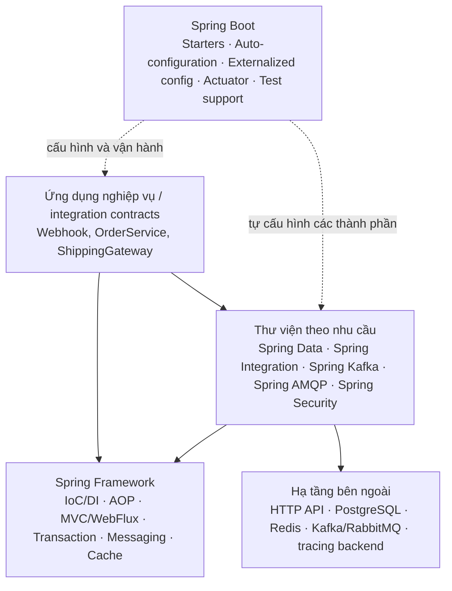
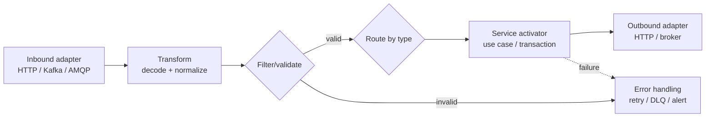
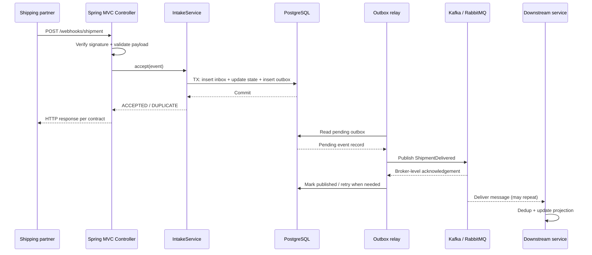

# Vai trò của Spring Boot, Spring Framework và các thư viện tích hợp

> **Chương:** Tổng quan tích hợp  
> **Module:** `SPRING_BOOT_INTEGRATION` — tổ chức tích hợp hệ thống trong Spring Boot qua HTTP client, cơ sở dữ liệu, cache, broker thông điệp và các adapter của Spring Integration, với trọng tâm ở cấu hình, hợp đồng dữ liệu, giao dịch, lỗi, xử lý trùng lặp, kiểm thử và quan sát luồng thực tế.

## 1. Vì sao phải phân biệt các lớp công nghệ?

Hãy hình dung một dịch vụ nhận webhook từ đối tác vận chuyển. Dịch vụ phải xác thực request, kiểm tra dữ liệu, ghi nhận một sự kiện vào database, cập nhật trạng thái đơn hàng, phát thông báo qua message broker và có thể làm mới cache. Một luồng như vậy có nhiều vấn đề khác nhau:

- **Tổ chức ứng dụng:** tạo object, đưa dependency vào service, quản lý cấu hình và vòng đời.
- **Giao tiếp:** nhận/gửi HTTP, chuyển đổi JSON, publish/consume message, kết nối các endpoint.
- **Dữ liệu và nhất quán:** transaction, unique constraint, inbox/outbox, cache invalidation.
- **Độ tin cậy:** timeout, retry, xử lý trùng, backpressure, dead-letter và phục hồi sau lỗi.
- **Vận hành:** health check, metric, trace, log, kiểm thử hợp đồng và kiểm thử tích hợp.

Trong hệ sinh thái Spring, các trách nhiệm đó được chia giữa **Spring Framework**, **Spring Boot** và những **thư viện tích hợp chuyên biệt**. Nếu nhầm lẫn vai trò, ta dễ kỳ vọng sai: nghĩ rằng thêm starter sẽ tự giải quyết retry, cho rằng `@Transactional` bao trùm broker, hoặc tưởng rằng dùng Spring Integration thì mọi message mặc nhiên bền vững.

### Mục tiêu học tập

Sau bài này, bạn có thể:

1. Giải thích Spring Framework cung cấp những abstraction nền tảng gì và Spring Boot bổ sung điều gì.
2. Chọn thư viện phù hợp cho HTTP, database, cache, broker và luồng Spring Integration.
3. Phân biệt **cơ chế framework cung cấp** với **quy tắc nghiệp vụ phải tự thiết kế**.
4. Vẽ ranh giới trách nhiệm trong một kiến trúc adapter–service–database–message broker.
5. Cấu hình dependency, cấu hình môi trường, transaction, timeout và observability ở đúng lớp.
6. Xây chiến lược kiểm thử cho một luồng tích hợp xuyên hệ thống.

## 2. Mô hình ba lớp: Framework, Boot và thư viện tích hợp



Sơ đồ là cách nhìn về trách nhiệm, không phải cấu trúc phụ thuộc Maven chính xác: Spring Boot **được xây trên Spring Framework**, còn các thư viện Spring có thể được sử dụng cùng Boot hoặc độc lập. Boot thường giảm cấu hình thủ công, không thay thế API nền tảng của Framework.

| Thành phần | Trách nhiệm chủ đạo | Ví dụ trong luồng webhook |
|---|---|---|
| **Spring Framework** | Container bean, dependency injection, lifecycle, AOP, web stack, abstraction transaction/message/cache | Inject `ShippingGateway`; xử lý `@Transactional`; tiếp nhận HTTP bằng MVC |
| **Spring Boot** | Khởi tạo ứng dụng, quản lý starter/dependency, auto-configuration, config theo môi trường, health/metrics, hỗ trợ test | Tạo `RestClient.Builder` hoặc datasource phù hợp khi đủ điều kiện; đọc cấu hình từ env; đưa Actuator vào ứng dụng |
| **Thư viện tích hợp** | API/adapter cho một cơ chế giao tiếp, persistence hoặc pattern cụ thể | Spring Data ghi DB; Spring Kafka publish event; Spring Integration điều phối message giữa các kênh |
| **Mã nghiệp vụ của dự án** | Hợp đồng, owner, quy tắc chuyển trạng thái, khóa chống trùng, semantics thành công/thất bại | Chỉ chấp nhận event mới; quyết định khi nào phát `ShipmentUpdated` |
| **Hạ tầng** | Database, broker, cache và dịch vụ ngoài thực thi các bảo đảm vật lý của chính chúng | PostgreSQL unique constraint; Kafka retention/partition; Redis TTL |

**Lưu ý quan trọng:** Spring Framework không đồng nghĩa với Spring Boot, và Spring Integration cũng không đồng nghĩa với “mọi tích hợp trong Spring Boot”. Một REST API chỉ dùng `RestClient` + Spring Data đã là luồng tích hợp; Spring Integration trở nên hữu ích khi cần channel, routing, filter, transformer, gateway và endpoint adapter có cấu trúc.

## 3. Vai trò của Spring Framework: các viên gạch nền tảng

Spring Framework mang đến **mô hình lập trình và abstraction** để các module làm việc cùng nhau.

### 3.1. IoC container và dependency injection

Spring quản lý các object gọi là **bean** trong `ApplicationContext`. Bean có thể được phát hiện qua `@Component`/`@Service`/`@Repository`, hoặc khai báo bằng `@Bean` trong `@Configuration`. Constructor injection giúp dễ thay adapter, test bằng mock và giữ service độc lập với cơ chế tạo client.

```java
import org.springframework.stereotype.Service;

@Service
public class ShipmentSyncService {
    private final ShippingGateway shippingGateway;

    public ShipmentSyncService(ShippingGateway shippingGateway) {
        this.shippingGateway = shippingGateway;
    }

    public void sync(ShipmentCommand command) {
        shippingGateway.send(command);
    }
}
```

`ShippingGateway` và `ShipmentCommand` ở đây là **hợp đồng do dự án định nghĩa**; ví dụ chỉ minh họa service phụ thuộc vào một cổng (port) chứ không tự khởi tạo HTTP client. Có thể thay `ShippingGateway` bằng adapter HTTP thật trong production hoặc fake khi test.

Lợi ích: controller không cần biết HTTP client tạo bằng gì, service nghiệp vụ không phải quan tâm cấu hình broker, và các adapter có thể thay đổi mà không lan toàn bộ chi tiết xuống miền nghiệp vụ.

### 3.2. AOP và annotation xuyên cắt

Spring sử dụng các cơ chế như AOP/proxy để áp dụng hành vi xuyên cắt: `@Transactional`, `@Async`, kiểm tra bảo mật hoặc các interceptor tùy chỉnh. Do phụ thuộc proxy, **self-invocation** (method cùng bean gọi nhau qua `this`) trong chế độ proxy thường bỏ qua advice.

Ví dụ, method `@Transactional` được gọi trực tiếp từ method khác trong cùng bean có thể không bắt đầu giao dịch mới theo ý định. Thiết kế ranh giới service rõ ràng và kiểm thử đường gọi qua Spring context giúp tránh ngộ nhận.

### 3.3. Web MVC, WebFlux và HTTP client

Spring Framework cung cấp:

- **Spring MVC:** lập trình web dựa trên servlet; controller thường trả kết quả đồng bộ hoặc kiểu async được MVC hỗ trợ.
- **Spring WebFlux:** mô hình reactive với `Mono`/`Flux`; thích hợp khi toàn bộ đường I/O có API không chặn.
- **RestClient:** HTTP client có API fluent, đồng bộ; phù hợp dịch vụ Spring MVC gọi REST.
- **WebClient:** HTTP client reactive, hỗ trợ giao tiếp non-blocking khi connector và toàn luồng được cấu hình đúng.
- **RestTemplate:** API HTTP đồng bộ lâu đời còn gặp trong hệ thống cũ; với mã mới cần cân nhắc hướng dẫn và phiên bản Framework đang dùng.

Chọn `WebClient` không tự biến JDBC hoặc thư viện khác thành non-blocking. Ngược lại, dùng `RestClient` trên worker của `@Async` vẫn tiêu tốn thread trong thời gian chờ I/O.

### 3.4. Transaction abstraction

Spring Framework cung cấp các abstraction như `PlatformTransactionManager` cho transaction đồng bộ và `ReactiveTransactionManager` cho transaction reactive. `@Transactional` chỉ có ý nghĩa khi có transaction manager phù hợp với công nghệ đang dùng và lời gọi đi qua cơ chế intercept.

Transaction database thường **không bao trùm** HTTP API, Redis và broker. Khi cập nhật database rồi publish event, cần cơ chế riêng (như outbox) nếu muốn tránh mất event sau khi commit.

### 3.5. Messaging và cache abstraction

`org.springframework.messaging.Message<T>` mô hình hóa **payload + headers**. Nó không phải một Kafka record hoặc RabbitMQ delivery mặc định; adapter sẽ ánh xạ sang định dạng của broker. Spring cũng cung cấp abstraction `CacheManager` và annotation như `@Cacheable`, `@CacheEvict`, nhưng implementation (in-memory, Redis…) và chính sách nhất quán do cấu hình, provider và ứng dụng quyết định.

## 4. Vai trò của Spring Boot: lắp ghép, cấu hình và vận hành

Spring Boot được dùng để xây dựng ứng dụng Spring **dễ khởi chạy và dễ vận hành** với cách cấu hình theo quy ước. Nó không thay thế service nghiệp vụ, không tự đặt kiến trúc và không đảm bảo mọi tích hợp có retry hoặc exactly-once.

### 4.1. Starter và quản lý phiên bản dependency

Một **starter** tập hợp những dependency phổ biến cho một nhóm khả năng, ví dụ web, data, messaging, actuator. BOM/dependency management do phiên bản Spring Boot tương ứng quản lý giúp chọn các phiên bản thư viện tương thích. Trong dự án thật, phải kiểm tra BOM, Java baseline và tài liệu của phiên bản đang dùng trước khi thêm adapter.

Ví dụ Gradle Groovy DSL, lựa chọn các phụ thuộc cho một ứng dụng nhận HTTP, ghi database và gửi message:

```gradle
dependencies {
    implementation("org.springframework.boot:spring-boot-starter-web")
    implementation("org.springframework.boot:spring-boot-starter-validation")
    implementation("org.springframework.boot:spring-boot-starter-data-jpa")
    implementation("org.springframework.kafka:spring-kafka")
    implementation("org.springframework.boot:spring-boot-starter-actuator")

    runtimeOnly("org.postgresql:postgresql")

    testImplementation("org.springframework.boot:spring-boot-starter-test")
    testImplementation("org.springframework.kafka:spring-kafka-test")
}
```

Ví dụ **cố ý không khóa phiên bản** vì giả định build đã áp dụng Spring Boot dependency management. Thêm `spring-kafka` cho adapter Kafka, thay bằng AMQP/RabbitMQ hoặc JMS nếu dự án chọn broker khác. Không cần cài tất cả starter của toàn hệ sinh thái cho mọi dịch vụ.

### 4.2. Auto-configuration có điều kiện

Spring Boot tạo/configure các bean phổ biến dựa trên dependency, bean đã có và các property. Ví dụ, khi có JDBC/JPA starter và cấu hình datasource hợp lệ, Boot có thể cung cấp datasource, transaction manager và các thành phần JPA cần thiết. Khi có Kafka starter/module tương ứng và property kết nối phù hợp, Boot có thể cấu hình `KafkaTemplate` hoặc listener infrastructure theo điều kiện.

**Auto-configuration không phải magic:** nếu khai báo bean tùy chỉnh, có thể làm cấu hình mặc định thay đổi; nếu thiếu driver, URL hoặc cấu hình xác thực, bean có thể không tạo được hoặc ứng dụng khởi động lỗi. Hãy đọc lỗi startup, auto-configuration report khi cần và kiểm tra bean trong application context.

### 4.3. Externalized configuration và profile

Địa chỉ đối tác, credential, database và broker phải nằm trong cấu hình theo môi trường, tránh hard-code vào service:

```yaml
integration:
  shipping:
    base-url: ${SHIPPING_BASE_URL}
    timeout: 5s

spring:
  datasource:
    url: ${DB_JDBC_URL}
    username: ${DB_USERNAME}
    password: ${DB_PASSWORD}
  kafka:
    bootstrap-servers: ${KAFKA_BOOTSTRAP_SERVERS}

management:
  endpoints:
    web:
      exposure:
        include: health,info,prometheus
```

Đây là cấu hình **minh họa**, không đủ tự tạo mọi bean/protocol. Property `integration.shipping.timeout` do ứng dụng tự đọc và **phải áp dụng lên HTTP client**; đặt nó trong YAML chưa tự tạo timeout ở tầng mạng. Endpoint Prometheus cần registry/điều kiện exposure phù hợp, và endpoint quản trị phải được bảo vệ bằng chính sách triển khai.

Spring Boot hỗ trợ `@ConfigurationProperties` để bind cấu hình có kiểu, validate và gom một nhóm property. `@Profile` và các file profile có thể hỗ trợ khác biệt môi trường, nhưng không nên dùng profile làm nơi chứa bí mật trực tiếp trong mã nguồn. Credential nên lấy từ secret manager, env hoặc cơ chế bí mật đã được tổ chức chuẩn hóa.

### 4.4. Actuator, metrics và trạng thái vận hành

Spring Boot Actuator cung cấp health/info và tích hợp với Micrometer để xuất các metric tùy cấu hình. Từ đó ứng dụng có thể theo dõi pool HTTP/DB, consumer lag, độ trễ tích hợp, hàng đợi retry và trạng thái outbox. Không mặc nhiên có đầy đủ các metric nghiệp vụ: cần chủ động instrument các sự kiện như `webhook.accepted`, `outbox.pending` hoặc `partner.sync.failed`.

Health check chỉ nên phản ánh tiêu chí “service đủ khỏe để phục vụ” đã được thiết kế; không nên biến một lỗi đối tác ngoài thành liveness failure vô điều kiện khiến hệ thống liên tục restart.

## 5. Chọn thư viện đúng theo loại tích hợp

Spring Framework cung cấp nền tảng, nhưng mỗi kiểu giao tiếp thường cần thư viện adapter hoặc starter chuyên biệt:

| Nhu cầu | Thư viện/API thường chọn | Lưu ý phạm vi |
|---|---|---|
| Nhận REST/webhook | Spring MVC hoặc WebFlux | Controller nhận request; vẫn cần auth, validate, idempotency và mapping response |
| Gọi HTTP đồng bộ | `RestClient` | Cấu hình timeout, auth, retry có chọn lọc và correlation ID |
| Gọi HTTP reactive | `WebClient` | Giữ chuỗi reactive; tránh blocking event-loop |
| SQL đồng bộ/JPA | Spring Data JPA, Spring Data JDBC hoặc `JdbcTemplate` | JDBC/transaction đồng bộ; migration/connection pool riêng |
| SQL reactive | Spring Data R2DBC/`DatabaseClient` | `ConnectionFactory`, reactive transaction manager; không phải JPA reactive |
| Cache | Spring Cache, Spring Data Redis | Cache không là nguồn sự thật mặc định; cần TTL, key và invalidation |
| Kafka | Spring for Apache Kafka (`spring-kafka`) | `KafkaTemplate`, `@KafkaListener`, serializer, group, retry/DLT |
| RabbitMQ/AMQP | Spring AMQP | `RabbitTemplate`, listener, exchange/queue/binding/ack |
| JMS | Spring JMS | Phù hợp broker cung cấp JMS; không đồng nghĩa Kafka/AMQP |
| Luồng message nhiều bước | Spring Integration | Channel, gateway, router, filter, transformer, service activator, inbound/outbound adapter |
| Stream abstraction đa binder | Spring Cloud Stream | Abstraction cao hơn; chỉ chọn khi phù hợp với mô hình binding và khả năng broker |
| Bảo mật endpoint/client | Spring Security, OAuth2 client/resource server | Authentication/authorization và token; không thay TLS/secret management |
| Retry/circuit breaker | Spring Retry, Resilience4j hoặc cơ chế của client/broker | Là thư viện bổ sung; cần chính sách retry và idempotency |
| Quan sát | Micrometer, OpenTelemetry instrumentation và Actuator | Truy vết cần propagation, exporter/backend và cấu hình riêng |

Các module trên **không nhất thiết được cài cùng lúc**. Đầu tiên xác định giao thức, độ tin cậy, semantics của công việc và quy mô vận hành; sau đó thêm đúng thư viện cho từng adapter.

### 5.1. Spring Data và sự khác nhau giữa JPA, JDBC, R2DBC

- **Spring Data JPA** cung cấp repository và mapping ORM qua JPA provider như Hibernate. Phù hợp khi cần entity relationship, persistence context và mô hình transaction đồng bộ.
- **Spring Data JDBC** tập trung vào aggregate và SQL qua JDBC, với mô hình mapping khác JPA.
- **Spring Data R2DBC** hỗ trợ truy vấn quan hệ reactive qua R2DBC driver và `ConnectionFactory`; không cung cấp đầy đủ semantics của JPA.
- **JdbcTemplate** và **DatabaseClient** cho phép kiểm soát SQL cụ thể khi nghiệp vụ tích hợp cần upsert, unique constraint hoặc thao tác đặc thù database.

Chỉ vì ứng dụng dùng WebFlux không có nghĩa mọi truy cập dữ liệu phải đổi ngay sang R2DBC. Việc kết hợp blocking và reactive phải có ranh giới rõ, không gọi JDBC trực tiếp trên event-loop.

### 5.2. Spring Cache và Redis

`@Cacheable` có thể giúp giảm số lần gọi database hoặc hệ thống đối tác cho những dữ liệu đọc lặp, còn `@CacheEvict` hỗ trợ invalidation khi dữ liệu đổi. Nhưng **cache là bản sao có thể cũ**: khi nhận event `ProductPriceChanged`, consumer làm mới cache có thể thất bại hoặc nhận event trễ. Cần TTL phù hợp, idempotency, quy tắc version/sequence nếu dữ liệu nhạy với thứ tự, và fallback sang nguồn sự thật.

### 5.3. Broker không thay nghiệp vụ điều phối

Kafka/RabbitMQ chuyên về vận chuyển message theo mô hình và bảo đảm riêng. Producer và consumer vẫn phải định nghĩa **command** (yêu cầu hành động), **event** (sự thật đã xảy ra), **message** (đơn vị trao đổi), schema, idempotency key, retry, dead-letter và quyền sở hữu.

Không suy diễn Spring Kafka hoặc Spring AMQP bảo đảm mọi side effect trên database/HTTP là *exactly-once*. Giới hạn transaction của từng broker phải được đọc theo phạm vi cụ thể.

## 6. Spring Integration: tổ chức luồng message bằng các mẫu tích hợp

Spring Integration triển khai nhiều **Enterprise Integration Patterns** để mô tả cách message đi qua các endpoint bên trong và ra ngoài ứng dụng. Nó đặc biệt hữu ích khi một luồng gồm nhiều bước chuẩn hóa, phân loại, routing và kết nối các transport.

Các khái niệm cốt lõi:

| Khái niệm | Vai trò | Ví dụ |
|---|---|---|
| `Message<?>` | Payload và headers | Dữ liệu đơn hàng + correlation ID |
| `MessageChannel` | Kết nối producer với consumer trong ứng dụng | Chuyển message tới bước xử lý tiếp theo |
| `Transformer` | Chuyển định dạng/kiểu dữ liệu | Map webhook JSON thành DTO nội bộ |
| `Filter` | Loại hoặc chuyển những message không đạt điều kiện | Từ chối payload thiếu mã đối tác |
| `Router` | Chọn nhánh xử lý | Gửi theo loại event hoặc hệ thống đích |
| `ServiceActivator` | Kết nối message tới phương thức nghiệp vụ | Gọi `OrderIntakeService` |
| `Gateway` | Che giấu giao tiếp message phía sau interface | Service gọi một interface thay vì thao tác channel trực tiếp |
| `Inbound/Outbound Adapter` | Kết nối ngoại hệ thống vào/ra flow | HTTP, JMS, AMQP, Kafka, file, SFTP… tùy adapter |
| `ErrorChannel` | Kênh xử lý lỗi trong flow theo cấu hình | Thu lỗi, phân loại và chuyển sang nhánh xử lý thích hợp |

### 6.1. Luồng message có cấu trúc



Đây là sơ đồ kiến trúc: phạm vi transaction, thread, ACK và retry **không tự xuất hiện** chỉ vì các bước nối bằng channel. `DirectChannel` thường gọi subscriber trên thread sender; `ExecutorChannel` có thể chuyển sang executor; queue channel, pub/sub và các adapter có hành vi khác. Cần chọn theo tính đồng bộ, durability và kết quả mong đợi.

### 6.2. Ví dụ nhỏ với channel và service activator

```java
import org.springframework.context.annotation.Bean;
import org.springframework.context.annotation.Configuration;
import org.springframework.integration.annotation.ServiceActivator;
import org.springframework.integration.channel.DirectChannel;
import org.springframework.messaging.MessageChannel;
import org.springframework.stereotype.Component;

@Configuration
class IntegrationChannels {

    @Bean
    MessageChannel inboundOrders() {
        return new DirectChannel();
    }
}

@Component
class OrderMessageHandler {

    private final OrderIntakeService orderIntakeService;

    OrderMessageHandler(OrderIntakeService orderIntakeService) {
        this.orderIntakeService = orderIntakeService;
    }

    @ServiceActivator(inputChannel = "inboundOrders")
    public void handle(OrderNotice notice) {
        orderIntakeService.accept(notice);
    }
}
```

Đoạn này minh họa **kênh nội bộ + adapter gọi service**; `OrderIntakeService` và `OrderNotice` là type ứng dụng cần tự định nghĩa. Cần có Spring Integration infrastructure thích hợp từ dependency/cấu hình. `DirectChannel` chuyển công việc đồng bộ trong cùng tiến trình, **không phải queue bền vững**, và việc gửi vào channel không tự publish Kafka message. Để nói chuyện với broker hoặc HTTP thật phải thêm adapter tương ứng, converter, authentication và error handling.

Spring Integration nên dùng khi cần phối hợp **nhiều bước tích hợp** và muốn flow rõ ràng. Với một endpoint HTTP gọi một service rồi lưu database, controller/service thông thường có thể đơn giản và dễ duy trì hơn.

## 7. Minh họa xuyên suốt: webhook → database → broker → hệ thống khác

Một bài toán điển hình trong `SPRING_BOOT_INTEGRATION`: đối tác gửi webhook `ShipmentDelivered`; dịch vụ của chúng ta phải ghi nhận một lần và báo cho các service khác.



Bảng trách nhiệm:

| Công đoạn | Spring Framework | Spring Boot | Thư viện chuyên biệt | Logic ứng dụng phải định nghĩa |
|---|---|---|---|---|
| Nhận HTTP | Spring MVC/WebFlux | Starter/auto-configuration web | Security nếu cần | Chữ ký webhook, validation, version schema |
| Lưu inbox và trạng thái | `@Transactional`/transaction manager | DataSource và config theo điều kiện | Spring Data/JDBC/JPA/R2DBC | Unique key, chuyển trạng thái, xử lý duplicate |
| Lưu outbox | Transaction database | Config DB | JDBC/JPA/R2DBC | Bản ghi event, key, trạng thái publish |
| Đẩy broker | Spring Messaging abstraction | Auto-config template/listener có điều kiện | Spring Kafka/AMQP/JMS/Integration adapter | Routing, partition key, retry, monitoring |
| Nhận event | Container, bean lifecycle | Dependency/config | Kafka/AMQP listener | Idempotent consumer, ordering, dead-letter |
| Quan sát | Infrastructure abstraction | Actuator | Micrometer/tracing | Correlation ID, metric nghiệp vụ, cảnh báo |

### 7.1. Hợp đồng dữ liệu ở ranh giới hệ thống

Payload webhook có thể khác mô hình nghiệp vụ nội bộ. Một cấu trúc message minh họa:

```json
{
  "messageId": "msg-2026-001",
  "eventId": "ship-evt-88",
  "type": "shipment.delivered.v1",
  "occurredAt": "2026-11-21T02:00:00Z",
  "correlationId": "order-flow-42",
  "producer": "shipping-partner",
  "payload": {
    "orderId": "ord-42",
    "shipmentId": "shp-9",
    "deliveredAt": "2026-11-21T01:59:00Z"
  }
}
```

Đây là **schema tự định nghĩa** để minh họa, không phải format bắt buộc của Spring, Kafka hay RabbitMQ. `eventId` cần ổn định giữa các lần giao lại cùng sự kiện; `messageId` có thể đại diện cho envelope/giao nhận tùy hợp đồng; `correlationId` nối các bước cùng luồng, không dùng làm khóa dedup cho mọi event.

Các hợp đồng nên quy định type/version, field bắt buộc, cách phân loại lỗi, thời điểm sự kiện thực sự xảy ra, timezone, kích thước payload và chính sách dữ liệu nhạy cảm. Đừng đưa trực tiếp entity JPA hoặc DTO nội bộ không có version ra ngoài.

### 7.2. Ví dụ adapter HTTP được cấu hình bởi Boot

Ví dụ dùng `RestClient` do Spring Framework cung cấp, cấu hình bean với `RestClient.Builder` mà Spring Boot có thể cung cấp khi đáp ứng điều kiện auto-configuration:

```java
import org.springframework.beans.factory.annotation.Value;
import org.springframework.context.annotation.Bean;
import org.springframework.context.annotation.Configuration;
import org.springframework.web.client.RestClient;

@Configuration
public class ShippingClientConfiguration {

    @Bean
    RestClient shippingRestClient(
            RestClient.Builder builder,
            @Value("${integration.shipping.base-url}") String baseUrl) {
        return builder.baseUrl(baseUrl).build();
    }
}
```

```java
import org.springframework.stereotype.Component;
import org.springframework.web.client.RestClient;

@Component
public class HttpShippingGateway implements ShippingGateway {

    private final RestClient shippingRestClient;

    public HttpShippingGateway(RestClient shippingRestClient) {
        this.shippingRestClient = shippingRestClient;
    }

    @Override
    public void send(ShipmentCommand command) {
        shippingRestClient.post()
            .uri("/shipments")
            .header("Idempotency-Key", command.commandId())
            .body(command)
            .retrieve()
            .toBodilessEntity();
    }
}
```

`ShippingGateway` và `ShipmentCommand` là interface/record do ứng dụng định nghĩa; `commandId()` là khóa idempotency ổn định cho cùng yêu cầu. Phía đối tác cũng phải **hỗ trợ và tôn trọng** key thì header mới phát huy tác dụng. Đây là ví dụ cách chia trách nhiệm, chưa bao gồm cấu hình timeout/request factory, auth, retry hoặc mapping HTTP error; các phần đó phải được bổ sung trước production. Nếu ứng dụng có nhiều bean `RestClient`, cần dùng qualifier rõ ràng.

### 7.3. Ví dụ ghi inbox/outbox trong cùng transaction

Ý tưởng chính ở mức service (các repository dưới đây là **API do dự án tự cài đặt**, không phải class có sẵn của Spring):

```java
@Service
public class ShipmentIntakeService {

    private final InboxRepository inboxRepository;
    private final OutboxRepository outboxRepository;

    public ShipmentIntakeService(InboxRepository inboxRepository,
                                 OutboxRepository outboxRepository) {
        this.inboxRepository = inboxRepository;
        this.outboxRepository = outboxRepository;
    }

    @Transactional
    public IntakeResult accept(ShipmentDelivered incoming) {
        boolean inserted = inboxRepository.insertIfAbsent(
            incoming.partner(), incoming.eventId(), incoming
        );

        if (!inserted) {
            return IntakeResult.DUPLICATE;
        }

        // Có thể cập nhật trạng thái nghiệp vụ trong cùng transaction.
        outboxRepository.insertEvent("shipment.delivered.v1", incoming);
        return IntakeResult.ACCEPTED;
    }
}
```

Để đoạn này đúng về tính nguyên tử, hai thao tác phải tham gia **cùng transaction của cùng database** với transaction manager phù hợp. `insertIfAbsent` nên dùng unique constraint trên khóa ổn định (`partner`, `eventId`) và xử lý xung đột theo SQL/database cụ thể; kiểm tra `SELECT` rồi `INSERT` không có unique constraint có thể race khi nhận song song.

Nên dùng migration được quản lý phiên bản để tạo schema inbox/outbox và chuẩn hóa unique index. Khi relay publish thất bại sau commit, outbox giữ sự kiện để gửi lại. Relay có thể gửi cùng event nhiều lần nếu response từ broker bị mất, vì vậy consumer cũng cần dedup.

### 7.4. Vì sao không chỉ gọi KafkaTemplate trong @Transactional?

Hãy xem quy trình đơn giản:

```text
BEGIN DB TRANSACTION
UPDATE shipment SET status = 'DELIVERED'
COMMIT
kafkaTemplate.send("shipment.events", event)
```

Nếu ứng dụng crash ngay sau `COMMIT` và trước bước gửi broker, event có thể mất. Đảo thứ tự gửi broker trước commit lại có thể làm consumer quan sát một sự kiện về trạng thái bị rollback.

**Transactional outbox** ghi thay đổi nghiệp vụ và outbox row vào cùng một transaction database. Relay publish sau, chịu trách nhiệm retry và có thể phát lặp; consumer phải idempotent. Đây là mẫu kiến trúc do ứng dụng tổ chức bằng khả năng của DB, Spring Data và broker; **Boot không tự triển khai toàn bộ mẫu này khi thêm starter**.

## 8. Ranh giới transaction và mô hình lỗi

### 8.1. Phân loại ranh giới nhất quán

| Ranh giới | Điều có thể quản lý | Điều không tự được bảo đảm |
|---|---|---|
| Một transaction JDBC/JPA trong một DB | Commit/rollback nhiều thao tác cùng nguồn dữ liệu và transaction manager | HTTP call và broker ngoài phạm vi DB |
| Một transaction R2DBC phù hợp | Giao dịch reactive qua `ConnectionFactory` và Reactor context | Giao dịch với JDBC/JPA hoặc remote API theo mặc định |
| Kafka producer transaction khi được cấu hình | Các hành vi gửi/đọc trong phạm vi cơ chế Kafka hỗ trợ | Exactly-once cho database hoặc dịch vụ HTTP ngoài Kafka |
| Cache transaction/invalidation | Hành vi theo provider/cache manager | Cache và database cùng commit nguyên tử |
| Saga/workflow nhiều bước | Theo dõi trạng thái, bù trừ và tiến độ theo nghiệp vụ | Atomic rollback xuyên tất cả service như một DB transaction |

Khi gọi HTTP trong transaction database, thời gian chờ đối tác có thể giữ khóa và connection lâu; đồng thời remote side effect không được rollback theo DB. Thường nên tách transaction ghi trạng thái/đặt việc vào outbox khỏi bước gửi mạng thực tế.

### 8.2. Retry có phân loại và giới hạn

- **Lỗi tạm thời:** HTTP 503, network reset, broker unavailable, database timeout; có thể retry với backoff, jitter và giới hạn.
- **Lỗi hợp đồng/nghiệp vụ:** dữ liệu sai, 400 do validation, thiếu quyền hoặc hành động bị từ chối; không retry mù quáng.
- **Lỗi kết quả không rõ:** timeout sau khi phía đối tác có thể đã commit; cần truy vấn trạng thái hoặc idempotency key trước khi gửi lại.
- **Lỗi serialization/schema:** message không thể decode; cần dead-letter/quarantine và sửa hợp đồng thay vì vô hạn retry.

ACK từ broker cho biết tình trạng nhận/xử lý theo **quy tắc transport**; nó không đồng nghĩa người dùng đã được giao hàng hay đối tác đã hoàn tất thanh toán.

### 8.3. Idempotency

Một webhook có thể giao hai lần, hoặc consumer nhận lại message khi process chết sau DB commit nhưng trước ACK. Ứng dụng cần dựa vào khóa nghiệp vụ ổn định (`partner + eventId`, `commandId` hoặc khóa chỉ định theo hợp đồng) và unique constraint/kiểm tra trạng thái.

Không nên sử dụng `correlationId` để dedup mọi event của một workflow: nhiều event hợp lệ có thể cùng correlation ID.

## 9. Cấu hình và bảo mật xuyên hệ thống

### 9.1. Quản lý cấu hình

Mỗi adapter thường có các nhóm cấu hình riêng:

- HTTP: base URL, authentication, connect/read timeout, connection pool, rate limit.
- Database: URL, credential, pool size, migration và transaction timeout.
- Cache: TTL, key naming, serializer, eviction và cách làm mới khi bị trễ.
- Broker: bootstrap/host, serializer, security (TLS/SASL nếu cần), topic/queue, group, ack/retry/dead-letter.
- Spring Integration: channel capacity, poller, scheduler, executor và error channel tùy flow.

Với nhiều instance, tổng kết nối database, HTTP và broker có thể tăng theo số instance. Cần hoạch định giới hạn **toàn cụm**, không chỉ số thread/pool của một tiến trình.

### 9.2. Bảo mật ở ranh giới

Webhook từ đối tác cần xác minh chữ ký/chứng thực và giới hạn replay theo hợp đồng; endpoint nội bộ cần authentication và authorization. HTTP client cần dùng secret đúng môi trường. Broker và database cần ACL tối thiểu. Log và tracing nên ghi ID, status, latency; tránh in token, payload chứa PII hoặc dữ liệu thẻ.

Spring Security hỗ trợ nhiều cơ chế xác thực/phân quyền, nhưng **không tự xác minh mọi loại chữ ký webhook độc quyền**. Đội phát triển phải triển khai contract của đối tác và kiểm thử các trường hợp sai chữ ký, timestamp quá hạn, nonce/event trùng.

## 10. Kiểm thử đúng tầng và đúng ranh giới

Mỗi lớp mang lại kiểu kiểm thử khác nhau:

| Mục tiêu | Loại kiểm thử | Công cụ/cách làm thường gặp |
|---|---|---|
| Logic nghiệp vụ thuần | Unit test | JUnit, fake port/adapter, assertions trên trạng thái |
| Wiring bean và cấu hình | Spring context test | `@SpringBootTest`, kiểm tra bean/property/auto-config |
| REST controller và validation | Web layer test | MockMvc/WebTestClient, tình huống 2xx/4xx/5xx |
| HTTP client với đối tác | Adapter/contract test | HTTP mock server, timeout/error/status mapping |
| Query, unique constraint, transaction | Database integration test | Database cùng loại production, Testcontainers khi phù hợp |
| Producer/consumer, retry, DLQ | Broker integration test | Kafka/RabbitMQ test environment, Testcontainers |
| Flow Spring Integration | Flow test | Gửi message vào channel, xác nhận routing/transform/filter và lỗi |
| Độ tin cậy khi sự cố | Failure-injection test | Crash sau DB commit, broker unavailable, duplicate/replay, out-of-order |
| Tải và vận hành | Performance/observability test | Đo pool, queue depth, p95/p99, consumer lag, metrics/traces |

Đặc biệt, cần kiểm thử những khoảng hở giữa các tầng: database commit thành công nhưng publish thất bại, consumer chết sau commit nhưng trước ACK, response HTTP mất sau khi đối tác đã thực thi, event đến đảo thứ tự, cache chưa được invalidated.

**Test giả lập không đủ** cho mọi ràng buộc transaction/unique constraint hoặc hành vi broker. Với logic quan trọng, ưu tiên kiểm thử tích hợp trên sản phẩm database/broker tương ứng, có kiểm soát trạng thái và cleanup.

## 11. Quan sát toàn bộ luồng tích hợp

Trong vận hành, một request “thành công” ở HTTP có thể chỉ có nghĩa đã tiếp nhận, chưa chắc đã hoàn tất tác vụ nền. Cần mô hình trạng thái và metric thể hiện từng giai đoạn:

```text
RECEIVED -> VALIDATED -> PERSISTED -> PUBLISHED -> CONSUMED -> APPLIED
                           \-> RETRYING / DEAD_LETTER / MANUAL_REVIEW
```

Các trạng thái là ví dụ, không phải enum do Spring cung cấp. Tùy luồng, một số bước không tồn tại hoặc diễn ra theo thứ tự khác; cần chuẩn hóa contract cho trạng thái nghiệp vụ.

Nên có:

1. **Correlation ID** xuyên HTTP → database/outbox → broker → consumer; **event ID** riêng để dedup.
2. **Metric latency** theo từng adapter: HTTP client, query, publish, consumer, end-to-end khi có thể.
3. **Counter lỗi theo nguyên nhân:** validation, timeout, authentication, schema, retryable/non-retryable.
4. **Backlog:** bản ghi outbox chưa gửi, consumer lag, số job retry, dead-letter.
5. **Pool và concurrency:** active connection, queue size, thread saturation, timeout/rejection.
6. **Trace/span propagation:** truyền context qua message headers theo instrumentation đã triển khai, không giả định tự có cho mọi adapter.
7. **Log có cấu trúc:** timestamp, service, operation, business ID, event ID, trạng thái và lỗi; không log secret.

Spring Boot Actuator, Micrometer và công cụ tracing có thể cung cấp nền tảng; metric nghiệp vụ và alert threshold cần được ứng dụng và đội vận hành định nghĩa.

## 12. Khi nào cần Spring Integration, khi nào nên dùng thư viện trực tiếp?

**Dùng thư viện trực tiếp** khi một endpoint gọi một service với một adapter rõ ràng, ví dụ Spring MVC nhận request, service lưu bằng Spring Data và publisher gửi Kafka. Code trực tiếp có thể dễ đọc hơn nếu flow đơn giản.

**Cân nhắc Spring Integration** khi một hoặc nhiều tình huống xuất hiện:

- Có nhiều transport: HTTP, file, SFTP, JMS, AMQP, Kafka, email… và cần nối chúng theo pipeline rõ ràng.
- Cần routing theo header/type, filter, transform, splitter/aggregator, resequencer hoặc gateway.
- Nhiều nhánh lỗi và retry cần được tổ chức thành flow riêng.
- Muốn tách adapter vào/ra khỏi service nghiệp vụ và kiểm thử luồng theo message.

**Cân nhắc Spring Cloud Stream** nếu dự án muốn binding abstraction với binder và chấp nhận cách tổ chức message theo mô hình đó. Nó không phải yêu cầu bắt buộc khi đã dùng Spring Kafka hoặc Spring Integration.

Một ứng dụng có thể kết hợp: WebFlux cho inbound API, Spring Data R2DBC cho persistence, Spring Integration cho routing, Spring Kafka cho broker. Nhưng việc phối hợp phải xác định rõ thread model, transaction manager, backpressure và runtime metrics; nhiều abstraction không đương nhiên làm kiến trúc tin cậy hơn.

## 13. Sai lầm phổ biến khi phối hợp các thư viện

| Sai lầm | Vì sao nguy hiểm? | Hướng xử lý |
|---|---|---|
| “Thêm starter là đã có độ tin cậy.” | Starter chỉ cung cấp dependency/auto-config; thiếu contract/retry/idempotency | Thiết kế failure mode, unique key, outbox, test |
| “`@Transactional` bao cả HTTP và Kafka.” | DB transaction thường không bao trùm side effect ngoài DB | Outbox, saga hoặc cơ chế phối hợp có phạm vi rõ |
| “Spring Integration channel luôn async và bền vững.” | `DirectChannel` đồng bộ, queue in-memory không durable | Chọn channel/adapter phù hợp và ghi bền vững khi cần |
| “Message gửi thành công = nghiệp vụ hoàn tất.” | Broker ACK khác kết quả bên xử lý | Theo dõi trạng thái command/event và phản hồi nghiệp vụ |
| “Spring Boot tự cấu hình mọi HTTP timeout.” | Property tùy chỉnh không áp vào client nếu không bind/apply | Cấu hình request factory, test timeout thực tế |
| “Dùng WebFlux làm mọi phần non-blocking.” | JDBC, blocking client hoặc xử lý CPU nặng vẫn có thể block | Dùng driver đúng, cô lập blocking và đo tải |
| “Cache luôn đúng sau khi publish event.” | Consumer có thể trễ/lỗi hoặc nhận message đảo thứ tự | TTL, version/sequence, idempotent invalidation |
| “Một consumer xử lý message đúng một lần.” | Retry, crash và rebalance có thể giao lặp | Dedup trên khóa nghiệp vụ và transaction |
| “Truy vết sẽ có nếu thêm Actuator.” | Propagation/metric tùy instrumentation và adapter | Kiểm tra trace end-to-end, thêm correlation ID |
| “Sửa DTO nội bộ không ảnh hưởng consumer.” | Integration contract có vòng đời riêng | Versioning, contract test, tương thích ngược |

## 14. Quy trình chọn công nghệ cho một tích hợp mới

Trước khi chọn starter hoặc adapter, hãy đặt các câu hỏi theo thứ tự:

1. **Nguồn và đích là gì?** HTTP, database, cache, Kafka, RabbitMQ, JMS, file hay hệ thống khác?
2. **Hợp đồng nghiệp vụ là gì?** Command yêu cầu hành động, event báo sự thật, query/reply hay đồng bộ dữ liệu?
3. **Ai sở hữu trạng thái?** Cập nhật ở service nào, khóa chống trùng nào, khi nào được phép công bố event?
4. **Cần đồng bộ hay bất đồng bộ?** Client chờ kết quả hay chỉ nhận job ID và tra cứu trạng thái sau?
5. **Độ tin cậy yêu cầu tới đâu?** Có thể mất việc khi crash không; cần outbox/job/broker và retry thế nào?
6. **Ranh giới transaction?** JDBC/JPA hay R2DBC; những side effect nào không thuộc cùng transaction?
7. **Cần routing/transform nhiều bước không?** Nếu có, Spring Integration có thể giúp flow dễ quản lý; nếu không, service/adapter trực tiếp đủ.
8. **Ràng buộc vận hành?** Throughput, timeout, pool, giới hạn đối tác, bảo mật, metric, trace, DLQ?
9. **Kiểm thử bằng gì?** Unit test logic, contract test, DB/broker integration test và failure injection?

### Ví dụ chọn stack

| Bài toán | Stack gợi ý | Giải thích |
|---|---|---|
| API Spring MVC gọi đối tác, ghi kết quả vào PostgreSQL | Spring Boot + MVC + RestClient + Spring Data JDBC/JPA | Giao tiếp đồng bộ tương đối đơn giản; tập trung timeout và transaction |
| WebFlux có nhiều I/O đồng thời, database hỗ trợ R2DBC | Boot + WebFlux + WebClient + Spring Data R2DBC | Duy trì non-blocking end-to-end; kiểm soát pool/backpressure |
| Đồng bộ webhook, bảo đảm không mất event cho downstream | Boot + MVC/WebFlux + DB + inbox/outbox + Spring Kafka/AMQP | Chống trùng, commit trước publish và retry an toàn |
| Nhiều input/output, routing theo message type và nhiều bước transform | Boot + Spring Integration + adapter phù hợp | Flow/endpoint rõ ràng; vẫn cần thiết kế durability |
| Nhận event cập nhật cache phân tán | Boot + Spring Kafka/AMQP + Spring Cache/Redis | Consumer idempotent, TTL và xử lý event trễ |

## 15. Tự kiểm tra kiến thức

**Câu 1:** Một ứng dụng chỉ dùng `spring-boot-starter-web`, `RestClient` và `JdbcTemplate` có phải ứng dụng tích hợp không?  
**Trả lời:** Có. Tích hợp là việc hệ thống giao tiếp và phối hợp dữ liệu, không phụ thuộc vào việc có dùng Spring Integration hay không.

**Câu 2:** Thêm `spring-integration-core` có bảo đảm mọi message chạy ngoài thread gọi và được lưu bền vững không?  
**Trả lời:** Không. Hành vi phụ thuộc channel, endpoint, executor, adapter và transport. `DirectChannel` thường đồng bộ; durability phải được thiết kế riêng.

**Câu 3:** Spring Boot và Spring Framework cùng cung cấp `@Transactional`?  
**Trả lời:** `@Transactional` là abstraction thuộc Spring Framework; Boot giúp cấu hình transaction manager dựa trên dependency và property khi đủ điều kiện.

**Câu 4:** Vì sao database commit rồi publish Kafka trực tiếp vẫn có rủi ro?  
**Trả lời:** Có khoảng thời gian giữa hai thao tác, nơi tiến trình có thể chết; transactional outbox giảm khoảng hở này nhưng consumer vẫn phải xử lý publish/giao lại.

**Câu 5:** Nếu HTTP webhook gửi trùng hai lần, framework có tự biết đây là một event không?  
**Trả lời:** Không. Ứng dụng phải định nghĩa khóa event ổn định, unique constraint và quy tắc xử lý duplicate theo hợp đồng.

**Câu 6:** Actuator có cung cấp ngay metric end-to-end “đơn hàng cập nhật ở đối tác thành công” không?  
**Trả lời:** Không mặc nhiên. Đây là metric nghiệp vụ; ứng dụng cần instrument và kết nối các trạng thái bằng ID/trace.

---

Trong chương **Tổng quan tích hợp** của `SPRING_BOOT_INTEGRATION`, hãy nhớ ba tầng trách nhiệm: **Spring Framework** cung cấp mô hình lập trình nền tảng, **Spring Boot** lắp ghép và vận hành ứng dụng theo quy ước, còn **các thư viện tích hợp** cung cấp API và adapter cho từng loại giao tiếp. Việc định nghĩa hợp đồng, ranh giới dữ liệu, độ tin cậy, xử lý lỗi/trùng lặp và khả năng quan sát vẫn thuộc trách nhiệm thiết kế của ứng dụng.
