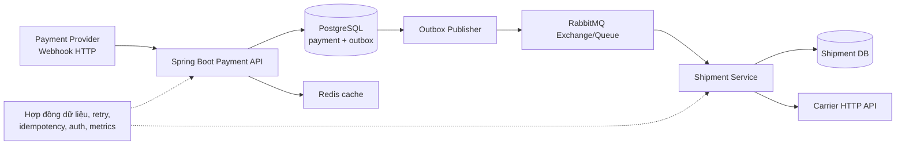
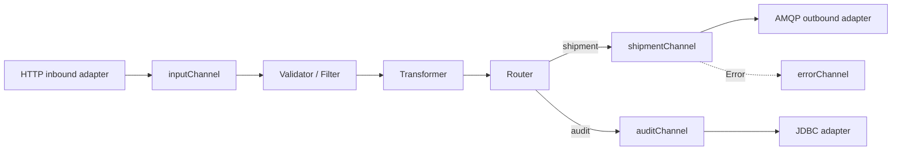
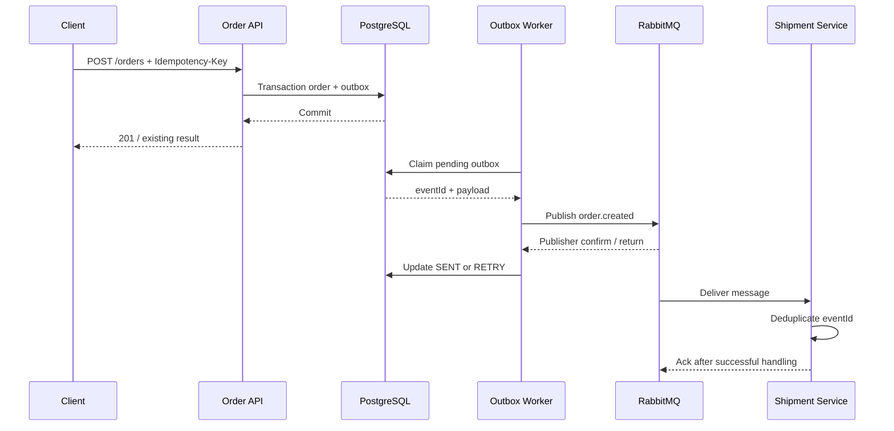
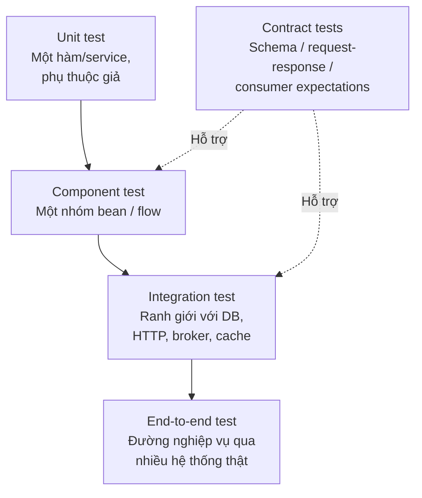
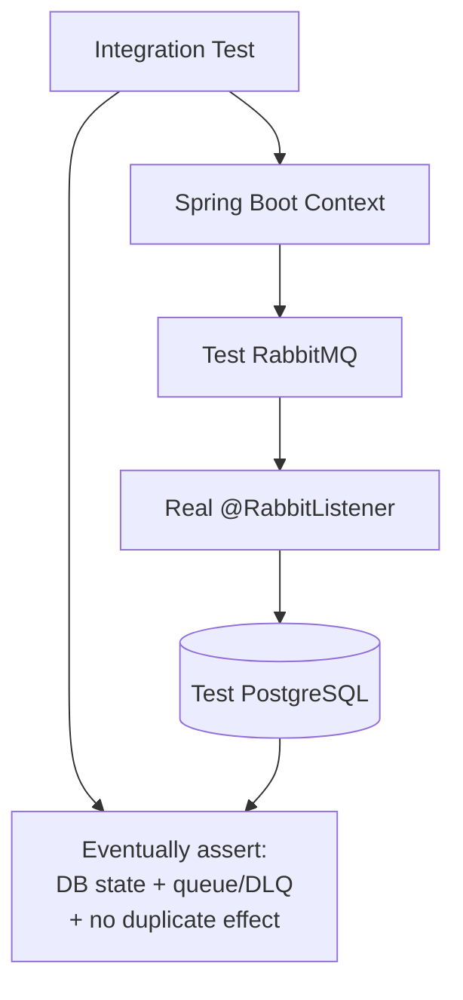

# Phân biệt tích hợp hệ thống với riêng framework Spring Integration và kiểm thử tích hợp

## 1. Ba cách dùng từ “integration” rất dễ bị nhầm

Trong công việc phát triển phần mềm, “integration” có thể chỉ **mục tiêu kiến trúc**, **một framework cụ thể** hoặc **một cấp độ kiểm thử**. Ba khái niệm này liên quan nhưng không đồng nghĩa:

1. **Tích hợp hệ thống (system integration)**: thiết kế, xây dựng và vận hành sự tương tác giữa những hệ thống, ứng dụng, dịch vụ hoặc nguồn dữ liệu có ranh giới riêng.
2. **Spring Integration**: framework của hệ sinh thái Spring hiện thực các **Enterprise Integration Patterns (EIP)** như message channel, router, transformer, filter, gateway và các protocol adapter.
3. **Kiểm thử tích hợp (integration testing)**: hoạt động xác minh **nhiều thành phần phối hợp** có hành vi đúng tại ranh giới của chúng; có thể kiểm thử HTTP, database, broker, Spring Integration flow hoặc các adapter khác.

Ví dụ, một dịch vụ Spring Boot nhận webhook từ đối tác thanh toán, ghi đơn hàng vào PostgreSQL rồi xuất bản sự kiện sang RabbitMQ là **một bài toán tích hợp hệ thống**. Dịch vụ đó **có thể không sử dụng Spring Integration framework** mà vẫn là hệ thống tích hợp. Một bài test khởi động ứng dụng với PostgreSQL và RabbitMQ thật để xác minh toàn bộ luồng là **kiểm thử tích hợp**, bất kể trong source code có dùng Spring Integration hay không.

Trong module **SPRING_BOOT_INTEGRATION**, mục tiêu học là tổ chức các kết nối qua HTTP client, cơ sở dữ liệu, cache, broker thông điệp và adapter của Spring Integration; trọng tâm xuyên suốt là cấu hình, hợp đồng dữ liệu, transaction, lỗi, xử lý trùng lặp, kiểm thử và observability. Việc phân biệt ba lớp khái niệm giúp chọn đúng công cụ, thiết kế ranh giới rõ ràng và không tạo cảm giác an toàn giả khi một bài test nhỏ chạy thành công.

### Mục tiêu học tập

Sau bài này, bạn có thể:

- Giải thích **system integration** mà không gắn chặt định nghĩa với bất kỳ framework nào.
- Đọc một sơ đồ Spring Integration flow và nhận diện `Message`, `MessageChannel`, endpoint, gateway, adapter và handler.
- Quyết định khi nào dùng API Spring Boot thông thường, khi nào dùng Spring Integration DSL và khi nào kết hợp hai cách.
- Phân biệt unit test, component test, integration test, contract test và end-to-end test theo **ranh giới được kiểm chứng**.
- Lập kế hoạch kiểm thử cho một luồng HTTP → database → broker/HTTP downstream với dữ liệu thật, sự cố mạng, retry, idempotency và quan sát kết quả.

## 2. Bảng phân biệt nhanh

| Câu hỏi | Tích hợp hệ thống | Spring Integration | Kiểm thử tích hợp |
| --- | --- | --- | --- |
| **Bản chất** | Lĩnh vực/hoạt động kiến trúc và kỹ thuật | Framework triển khai luồng message theo EIP | Phương pháp/cấp độ kiểm thử |
| **Mục tiêu** | Các hệ thống hợp tác an toàn, đúng hợp đồng và đáng tin cậy | Tổ chức flow, channel, routing, transformation, adapter | Phát hiện lỗi tại ranh giới thực giữa các thành phần |
| **Phạm vi** | HTTP, DB, cache, broker, file, email, lịch tác vụ... | Những message flow và adapter được khai báo bằng Spring Integration | Bất kỳ nhóm thành phần được tích hợp nào |
| **Có bắt buộc dùng Spring Integration?** | Không | Bản thân là framework đó | Không |
| **Có tự bảo đảm transaction, exactly-once?** | Không; phải thiết kế | Không; phải cấu hình và phối hợp với tài nguyên | Không; chỉ xác minh các thuộc tính đã được thiết kế |
| **Ví dụ** | Gửi đơn hàng từ API sang dịch vụ vận chuyển | `IntegrationFlow` chuyển HTTP inbound message qua transformer rồi ra AMQP | Test với database và broker để chắc chắn message đến đúng queue |

**Quy tắc nhớ:** *System integration là vấn đề cần giải quyết; Spring Integration là một trong các công cụ; integration testing là cách tạo bằng chứng rằng giải pháp hoạt động.*

## 3. Tích hợp hệ thống là một bài toán vượt qua ranh giới

Một hệ thống có thể có nhiều lớp và module nội bộ. Tích hợp hệ thống bắt đầu khi những thành phần có **hợp đồng và vòng đời tương đối độc lập** cần trao đổi dữ liệu hoặc đồng bộ tác động nghiệp vụ.

Ranh giới thường bao gồm:

- **Ranh giới mạng:** hai dịch vụ giao tiếp qua HTTP, gRPC, RSocket, SMTP hoặc AMQP.
- **Ranh giới dữ liệu:** service A và service B sở hữu database, schema hay bộ nhớ cache riêng.
- **Ranh giới thời gian:** producer có thể gửi trước khi consumer sẵn sàng; kết quả đến chậm hoặc không đến.
- **Ranh giới độ tin cậy:** một dịch vụ có thể crash hoặc timeout trong lúc dịch vụ kia đã commit.
- **Ranh giới hợp đồng:** schema, semantic, mã lỗi, phiên bản API và quy tắc tương thích do nhiều nhóm quản lý.
- **Ranh giới bảo mật:** token, service identity, virtual host, quyền database và phân loại dữ liệu.

Ví dụ minh họa:



Luồng này phải trả lời các câu hỏi kiến trúc trước khi chọn code:

1. Đối tác gửi webhook lần thứ hai với cùng `eventId` thì có tạo hai giao dịch không?
2. PostgreSQL đã commit nhưng app chết trước khi publish thì sự kiện có bị mất không?
3. RabbitMQ đã nhận sự kiện nhưng producer mất kết nối trước confirm thì gửi lại thế nào?
4. Consumer gọi carrier API thành công nhưng chết trước khi ack thì có gửi vận đơn hai lần không?
5. Nếu phiên bản payload đổi trong lúc còn message cũ ở queue thì consumer có đọc được không?
6. Độ trễ từ lúc thanh toán thành công tới lúc đơn hàng được gửi đi được đo ở đâu?

Không câu hỏi nào được giải quyết chỉ bằng việc thêm dependency Spring Integration vào project.

## 4. Các kiểu tích hợp điển hình trong Spring Boot

| Ranh giới | Công nghệ/API thường dùng | Kiểu tương tác | Vấn đề thiết kế đáng chú ý |
| --- | --- | --- | --- |
| HTTP outbound | `RestClient`, `WebClient` hoặc HTTP client phù hợp | Request/response đồng bộ hoặc reactive | Timeout, authentication, HTTP status, retry, circuit breaker |
| HTTP inbound | Spring MVC/WebFlux controller | Nhận request/webhook | Signature validation, schema, idempotency, response semantics |
| Database | JDBC, JPA, R2DBC | Đọc/ghi trạng thái trong transaction cục bộ | Ownership, migration, transaction, optimistic locking |
| Cache | Spring Cache/Redis | Truy cập dữ liệu tạm | TTL, key schema, invalidation, cache stampede |
| Broker thông điệp | Spring AMQP, Spring Kafka | Publish/consume bất đồng bộ | Confirm/ack, ordering, redelivery, DLQ, schema evolution |
| File, SFTP, email | Thư viện protocol hoặc Spring Integration adapter | Nhận/gửi dữ liệu qua hệ thống ngoài | Polling, duplicate files, credentials, retry, partial transfer |
| Lập lịch | `@Scheduled`, Quartz | Khởi phát theo thời gian | Leader coordination, misfire, checkpoint, overlap |
| Message orchestration | Spring Integration | Ghép kênh, lọc, chuyển đổi, định tuyến và gọi adapter | Message headers, error channel, lifecycle, backpressure/queue |

**Không phải mọi kết nối tới database đều là một “tích hợp hệ thống” theo nghĩa liên hệ giữa những hệ thống độc lập.** Trong một application, database access cũng có thể là persistence nội bộ. Tuy nhiên, khi kiểm thử ứng dụng với database thật, đó vẫn thường được gọi là **integration test** vì code và tầng persistence phối hợp với nhau.

Phân biệt này quan trọng để không suy từ tên công nghệ ra loại kiến trúc hoặc loại kiểm thử.

## 5. Tích hợp không chỉ là “kết nối được”

Một kết nối TCP thành công hoặc HTTP 200 không đủ để nói luồng tích hợp đã đúng. Chất lượng tích hợp thường cần đánh giá ít nhất bảy mặt:

| Khía cạnh | Câu hỏi kỹ thuật |
| --- | --- |
| **Hợp đồng** | Payload, headers, mã lỗi, phiên bản và ý nghĩa nghiệp vụ có thống nhất không? |
| **Bảo mật** | Đúng identity, phạm vi quyền, TLS, secret rotation và kiểm soát dữ liệu không? |
| **Độ tin cậy** | Message/request có được giữ để retry khi lỗi tạm thời không? |
| **Nhất quán dữ liệu** | Transaction và tác động giữa các hệ thống được phối hợp như thế nào? |
| **Xử lý trùng lặp** | Replay, timeout, redelivery hoặc callback lặp có tạo side effect hai lần không? |
| **Hiệu năng** | Timeout, concurrency, backlog, backpressure và downstream capacity có phù hợp không? |
| **Khả năng quan sát** | Có trace/correlation ID, metric, log, cảnh báo và cách tra cứu trạng thái không? |

Trong hệ thống phân tán, rất nhiều điểm lỗi tạo trạng thái **không chắc chắn**:

- Request timeout không đồng nghĩa server chưa xử lý.
- Publisher chưa nhận confirm không đồng nghĩa broker chưa nhận message.
- Email SMTP relay chấp nhận không đồng nghĩa người nhận đã đọc.
- Consumer ack không chứng minh tất cả tác động ngoài database đã được commit nguyên tử.
- Một test pass với mock không chứng minh cùng đoạn mã vận hành đúng trên network/TLS thật.

Do đó, chọn framework chỉ giải quyết **một phần** vấn đề; phần còn lại nằm ở contract, data model, điều phối lỗi, transaction và kiểm thử.

## 6. Spring Integration là framework gì?

**Spring Integration** là framework xây dựng ứng dụng hướng thông điệp dựa trên các mẫu Enterprise Integration Patterns (EIP). Nó giúp ghép một chuỗi xử lý thành những bước có cấu trúc thay vì đặt toàn bộ logic đọc, biến đổi, định tuyến và gửi vào một service method rất lớn.

Một số building block:

| Khái niệm Spring Integration | Ý nghĩa | Cần phân biệt với |
| --- | --- | --- |
| `Message<T>` | Payload và tập headers của một message | Không đồng nghĩa một message đã nằm trên broker |
| `MessageChannel` | Đường truyền logic giữa producer/consumer của một flow | Không mặc nhiên là RabbitMQ/Kafka topic |
| `DirectChannel` | Channel kiểu point-to-point, gọi subscriber thường theo cách đồng bộ cùng luồng | Không phải durable queue |
| `QueueChannel` | Channel có queue nội bộ để gửi/nhận qua polling | Mặc định không phải hàng đợi broker bền vững |
| `PublishSubscribeChannel` | Phát một message tới nhiều subscriber trong flow | Không tự đồng nghĩa topic có replay |
| `MessageHandler` | Thành phần xử lý message | Có thể gọi business service hay adapter |
| **Transformer** | Chuyển payload/headers giữa các dạng hợp đồng | Không phải ORM mapping |
| **Filter** | Chấp nhận/loại message theo predicate | Cần thiết kế discard/error behavior |
| **Router** | Chọn đường đi dựa trên nội dung/headers | Không thay thế broker exchange routing |
| **Gateway** | Cổng biến lời gọi ứng dụng thành message exchange | Khác API gateway/proxy HTTP |
| **Inbound/Outbound Adapter** | Kết nối hệ thống ngoài với flow | Cần dependency protocol phù hợp |
| **Service Activator** | Gọi logic xử lý nghiệp vụ từ message | Không tự có transaction toàn flow |
| `IntegrationFlow` | DSL khai báo chuỗi endpoint và các bước xử lý | Không phải test case |

Ví dụ:



Spring Integration hữu ích ở phần **điều phối message flow và protocol adapters**. Nhưng nó không tự quyết định rằng một webhook phải chống trùng theo `eventId`, rằng một transaction đã commit, hoặc rằng một adapter gửi mail phải retry bao nhiêu lần. Các chính sách này vẫn phải do kiến trúc ứng dụng định nghĩa.

## 7. Spring Boot khác gì với Spring Integration?

**Spring Boot** hỗ trợ phát triển và vận hành ứng dụng Spring bằng dependency management, auto-configuration, externalized configuration, Actuator và hạ tầng khởi động. Nó có thể dùng với Spring MVC, WebFlux, Data JDBC/JPA, AMQP, Kafka, Cache, Quartz và **Spring Integration**.

**Spring Integration** là một framework trong hệ sinh thái Spring, không phải tên gọi của toàn bộ việc tích hợp các hệ thống Spring Boot.

Ví dụ một ứng dụng Spring Boot dùng:

```text
@SpringBootApplication
  ├─ @RestController nhận webhook
  ├─ @Transactional + Spring Data JPA lưu sự kiện
  ├─ RabbitTemplate gửi qua RabbitMQ
  ├─ @RabbitListener nhận sự kiện
  └─ WebClient gọi API đối tác
```

Đây vẫn là một **ứng dụng tích hợp hệ thống**, dù không có bean `IntegrationFlow`, `MessageChannel` hay module `spring-integration-*.`

### Dependency phản ánh chức năng được chọn

Maven, khi chỉ cần Spring MVC và RabbitMQ:

```xml
<dependencies>
    <dependency>
        <groupId>org.springframework.boot</groupId>
        <artifactId>spring-boot-starter-web</artifactId>
    </dependency>
    <dependency>
        <groupId>org.springframework.boot</groupId>
        <artifactId>spring-boot-starter-amqp</artifactId>
    </dependency>
</dependencies>
```

Nếu muốn khai báo flow theo Spring Integration DSL:

```xml
<dependency>
    <groupId>org.springframework.boot</groupId>
    <artifactId>spring-boot-starter-integration</artifactId>
</dependency>
```

Khi dùng adapter chuyên biệt, có thể cần module bổ sung như `spring-integration-amqp`, `spring-integration-http`, `spring-integration-jdbc` hoặc module protocol phù hợp với phiên bản Spring Integration đang chạy. **Starter integration không tự cài hoặc cấu hình mọi adapter**, và cũng không tự biến các `@RabbitListener` hiện hữu thành IntegrationFlow.

Tránh thêm mọi starter “cho chắc”: dependency mới có thể kéo auto-configuration, bean và behavior bạn không chủ ý. Chọn từ hợp đồng giao tiếp và kiểu flow cụ thể trước, rồi mới chọn thư viện.

## 8. Khi nào nên và không nên dùng Spring Integration?

| Tình huống | Lựa chọn thường hợp lý | Vì sao |
| --- | --- | --- |
| Một service gọi một REST endpoint với timeout và mapping lỗi rõ | `RestClient`/`WebClient` trực tiếp | Ít thành phần, dễ đọc và test |
| Nhận webhook, ghi DB, publish một event | Spring MVC + JDBC/JPA + outbox + AMQP/Kafka | Luồng có thể đơn giản, không bắt buộc DSL |
| Nhận file từ SFTP, lọc, chuyển đổi, tách bản ghi, route tới nhiều đích | Spring Integration SFTP + flow DSL | EIP và protocol adapter giúp biểu diễn pipeline |
| Cần retry, error channel và routing phức tạp giữa nhiều channel | Spring Integration kết hợp service/adapter | Flow có cấu trúc, có điểm quan sát và kiểm soát |
| Đồng bộ hai database qua một query thẳng | Service/repository hoặc batch job | Framework flow có thể là chi phí không cần thiết |
| Phát hiện và xử lý file trùng qua polling | Spring Integration file adapter với persistent accept-once filter khi phù hợp | Có mẫu polling và filter, nhưng phải cấu hình persistent metadata store |
| Streaming liên tục cần demand/backpressure qua network | RSocket/WebFlux hoặc adapter thích hợp | Chọn theo protocol và mô hình dữ liệu, không theo tên framework |

**Tiêu chí lựa chọn** không phải “dự án có làm integration hay không”, mà là số lượng endpoint, kiểu định tuyến, transform, asynchronous boundaries, khả năng bảo trì và operational complexity.

Không dùng một flow DSL để che giấu một business service rất phức tạp: validation, transaction, quy tắc giá và idempotency vẫn nên là business logic rõ ràng, có thể unit test.

## 9. Ví dụ tích hợp hệ thống không cần Spring Integration

Giả sử dịch vụ đơn hàng có nghiệp vụ:

1. Nhận HTTP POST tạo đơn hàng.
2. Kiểm tra `requestId` chống gửi trùng.
3. Trong một transaction PostgreSQL, tạo đơn hàng và record outbox.
4. Một publisher worker gửi sự kiện `order.created` tới RabbitMQ.
5. Dịch vụ giao hàng nhận sự kiện và gọi API của đối tác.

Sơ đồ:



Các thành phần như `@RestController`, `@Transactional`, `RabbitTemplate` và `@RabbitListener` đủ để hiện thực cấu trúc cơ bản, miễn là đội phát triển bổ sung đầy đủ transaction, retry, mapping lỗi, observability và idempotency. Không một chỗ nào bắt buộc phải có `IntegrationFlow`.

### Hợp đồng message mẫu

```json
{
  "eventId": "evt-1001",
  "eventType": "order.created",
  "schemaVersion": 1,
  "orderId": "ORD-501",
  "occurredAt": "2026-11-21T03:00:00Z"
}
```

Dù dùng framework nào, producer và consumer cần thống nhất:

- Ý nghĩa của `eventId` và điều kiện xác định bản trùng.
- Những trường bắt buộc và giá trị được phép.
- Chính sách tương thích khi tăng `schemaVersion`.
- Kết quả xử lý khi thiếu dữ liệu, sai định dạng hoặc lỗi tạm thời.
- Cơ chế khôi phục khi producer/consumer bị restart.

Đó là **hợp đồng tích hợp**, độc lập với tên lớp Java được dùng để thực hiện.

## 10. Cùng một nhu cầu dưới dạng Spring Integration flow

Khi cần đưa sự kiện vào một pipeline có bước kiểm tra, định tuyến và handoff đến nhiều adapter, bạn có thể dùng Spring Integration. Ví dụ sau là **flow nội bộ ứng dụng**: một channel nhận `OrderCreatedEvent`, rồi `MessageHandler` chuyển payload cho service xử lý.

**Định nghĩa dữ liệu và abstraction nghiệp vụ:**

```java
public record OrderCreatedEvent(String eventId, String orderId) {}

public interface OrderEventHandler {
    void handle(OrderCreatedEvent event);
}
```

**Định nghĩa channel và IntegrationFlow:**

```java
import org.springframework.beans.factory.annotation.Qualifier;
import org.springframework.context.annotation.Bean;
import org.springframework.context.annotation.Configuration;
import org.springframework.integration.channel.DirectChannel;
import org.springframework.integration.dsl.IntegrationFlow;
import org.springframework.messaging.MessageChannel;
import org.springframework.messaging.MessageHandler;

@Configuration(proxyBeanMethods = false)
public class OrderIntegrationConfiguration {

    @Bean("orderInput")
    MessageChannel orderInput() {
        return new DirectChannel();
    }

    @Bean
    IntegrationFlow orderEventFlow(
            @Qualifier("orderInput") MessageChannel input,
            OrderEventHandler handler) {

        return IntegrationFlow.from(input)
            .handle((MessageHandler) message ->
                handler.handle(
                    (OrderCreatedEvent) message.getPayload()
                )
            )
            .get();
    }
}
```

**Một service phát message vào channel:**

```java
import org.springframework.beans.factory.annotation.Qualifier;
import org.springframework.messaging.MessageChannel;
import org.springframework.messaging.support.MessageBuilder;
import org.springframework.stereotype.Service;

@Service
public class InternalOrderEventGateway {

    private final MessageChannel input;

    public InternalOrderEventGateway(
            @Qualifier("orderInput") MessageChannel input) {
        this.input = input;
    }

    public void publish(OrderCreatedEvent event) {
        boolean accepted = input.send(
            MessageBuilder.withPayload(event)
                .setHeader("correlationId", event.eventId())
                .build()
        );
        if (!accepted) {
            throw new IllegalStateException(
                "Integration channel rejected event"
            );
        }
    }
}
```

Đây là ví dụ **sơ cấp về message flow**, không phải lời giải cho độ tin cậy xuyên tiến trình:

- `DirectChannel` thông thường gọi handler **đồng bộ** trong thread người gửi; message không tự được lưu trên RabbitMQ.
- `send()` được trả về từ channel không phải publisher confirm của broker.
- `OrderEventHandler` phải có implementation được Spring đăng ký; nó có thể gọi `RabbitTemplate` hoặc service khác nếu nghiệp vụ yêu cầu.
- Nếu business handler ném exception, flow đồng bộ có thể lan lỗi về người gọi; behavior phụ thuộc cấu hình endpoint và error handling.
- Với asynchronous channel, transaction propagation, lỗi và vòng đời message khác; không tự coi tất cả channel là queue bền vững.
- Nếu cần external adapter cụ thể, phải thêm module adapter và cấu hình endpoint/binding rõ ràng.

**Điểm bài học:** framework giúp biểu diễn pipeline rõ ràng, nhưng không thay thế dữ liệu và thiết kế giao nhận. Khi `OrderEventHandler` chỉ gọi một service đơn giản, có thể việc dùng `IntegrationFlow` không mang nhiều lợi ích hơn lời gọi method thông thường.

## 11. MessageChannel có đồng nghĩa message broker không?

Không. Đây là nhầm lẫn thiết kế khá phổ biến.

| Thuộc tính | `DirectChannel` | `QueueChannel` mặc định | RabbitMQ queue |
| --- | --- | --- | --- |
| Vị trí chứa dữ liệu | Trong đường gọi handler | Queue trong tiến trình/JVM | RabbitMQ broker ngoài ứng dụng |
| Đồng bộ/asynchronous | Thường đồng bộ | Polling để lấy message | Consumer qua AMQP |
| Còn sau restart ứng dụng? | Không lưu message | Không, trừ khi cấu hình MessageStore bền vững phù hợp | Tùy queue type, durable/persistent và broker |
| Hỗ trợ tách producer/consumer ở hai máy? | Không trực tiếp | Không trực tiếp | Có |
| Ai quản lý ack/retry? | Flow/handler | Poller/transaction/error flow | Broker + AMQP listener/ack policy |
| Đảm bảo exactly-once nghiệp vụ? | Không | Không | Không |

Spring Integration có thể **gắn adapter với RabbitMQ**. Khi đó một inbound AMQP adapter chuyển dữ liệu từ broker thành Spring `Message` rồi đưa vào `MessageChannel`; outbound adapter làm chiều ngược lại. Hai thành phần thuộc **hai lớp**: broker lưu/định tuyến ngoài tiến trình, còn channel giúp nối các endpoint trong flow ứng dụng.

Đừng “sửa” lỗi yêu cầu giao nhận bền vững bằng cách đơn thuần đổi `DirectChannel` sang `QueueChannel`. Nếu cần phục hồi sau restart, phải cấu hình message store phù hợp hoặc dùng broker/outbox có độ bền phù hợp với mục tiêu.

## 12. Kiểm thử tích hợp là gì?

**Kiểm thử tích hợp** xác minh các thành phần có thể **hợp tác với nhau qua interface/contract** trong một môi trường có đủ những phụ thuộc cần kiểm tra. Đây không phải tên một thư viện, annotation hoặc định dạng test duy nhất.

Trong Spring Boot, một integration test có thể kiểm tra:

- Controller → validation → service → repository → PostgreSQL thật.
- `RabbitTemplate` → RabbitMQ exchange/binding/queue → listener.
- HTTP client → một HTTP mock server hoạt động qua socket → serialization/error mapping.
- Spring Integration `MessageChannel` → transformer → router → handler.
- Outbox dispatcher → database → broker với xác nhận publish và trạng thái retry.
- Cache service → Redis thực để kiểm tra TTL/serialization.

Một test `@SpringBootTest` **không tự động là bài kiểm thử tích hợp có ý nghĩa**: nếu nó chỉ kiểm tra một bean được inject, có thể không xác minh ranh giới nghiệp vụ nào. Ngược lại, một test khởi tạo vài bean bằng `@SpringJUnitConfig` và kiểm tra chúng phối hợp có thể là integration test ở phạm vi hẹp mà không cần full application context.

### Phân biệt điều gì được kiểm chứng



Đây là một cách phân chia **theo phạm vi và mức độ thực của dependency**, không phải hệ phân cấp tuyệt đối. Contract test có thể được chạy ở nhiều mức. Một integration test có thể chỉ nối hai module trong cùng tiến trình hoặc có thể đi qua network; quan trọng là ghi rõ ranh giới được giữ thật, ranh giới bị thay bằng fake và kết luận mà test đủ sức chứng minh.

## 13. Phân biệt unit, component, integration, contract và E2E test

| Loại kiểm thử | Đối tượng cần chứng minh | Ví dụ | Giới hạn |
| --- | --- | --- | --- |
| **Unit test** | Quy tắc đơn lẻ, phụ thuộc được cô lập | Tính trạng thái đơn hàng khi nhận sự kiện | Không chứng minh SQL, JSON hay broker thật |
| **Component test** | Nhóm bean/module hợp tác | `IntegrationFlow` từ input channel đến handler fake | Không chứng minh adapter network |
| **Integration test** | Một hoặc vài ranh giới thật | Spring Boot + PostgreSQL container; RabbitMQ broker test | Không nhất thiết bao phủ toàn bộ sản phẩm |
| **Contract test** | Producer/consumer hiểu cùng schema/semantic | JSON Schema, API contract, consumer-driven contract | Không chứng minh tất cả dependency luôn sẵn sàng |
| **End-to-end test** | Hành trình nghiệp vụ qua nhiều hệ thống | Thanh toán → giao hàng qua các service môi trường kiểm thử | Chậm, khó cô lập nguyên nhân, dữ liệu test phức tạp |
| **Resilience/chaos test** | Hệ thống chịu lỗi và phục hồi | Cắt kết nối broker sau publish, restart consumer | Cần môi trường và khả năng quan sát phù hợp |

Một bài test có thể thuộc nhiều góc nhìn. Ví dụ test HTTP API dùng PostgreSQL container và WireMock HTTP server là **integration test** cho persistence và HTTP client behavior, nhưng không chứng minh đối tác HTTP thật sẽ luôn đáp ứng contract ở production.

## 14. Kiểm thử Spring Integration flow khác với kiểm thử tích hợp hệ thống

Khi code dùng Spring Integration, bạn có thể kiểm thử hai tầng riêng:

**Tầng flow nội bộ:**

- Message vào channel nào?
- Filter chấp nhận hay từ chối thông điệp?
- Transformer đổi payload/headers đúng không?
- Router chuyển message tới nhánh nào?
- Handler có nhận đúng message và propagation lỗi đúng không?

**Tầng adapter/hệ thống ngoài:**

- HTTP inbound adapter nhận headers, xác thực, decode và trả response như thế nào?
- AMQP outbound adapter publish tới đúng exchange/routing key?
- Poller lấy file/JDBC record một lần hay nhiều lần dưới restart?
- Transaction, retry, DLQ, deduplication và monitoring hoạt động ra sao?

**Test flow nội bộ pass không chứng minh adapter external hoạt động đúng.** Ngược lại, một smoke test external endpoint hoạt động không đảm bảo mọi nhánh router/filter được kiểm tra.

Đối với một hệ thống sử dụng IntegrationFlow phức tạp, nên có cả **component test cho business routing** lẫn **integration test với tài nguyên bên ngoài**.

## 15. Ví dụ component test cho Spring Integration flow

Ta kiểm tra flow ở mục 10 bằng Spring Test, không cần RabbitMQ hay PostgreSQL. Để test bắt đúng handler được gọi, tạo một implementation ghi lại sự kiện. Ví dụ sử dụng các class đã giới thiệu ở mục 10:

```java
import static org.assertj.core.api.Assertions.assertThat;

import java.util.List;
import java.util.concurrent.CopyOnWriteArrayList;

import org.junit.jupiter.api.Test;
import org.springframework.beans.factory.annotation.Autowired;
import org.springframework.beans.factory.annotation.Qualifier;
import org.springframework.context.annotation.Bean;
import org.springframework.context.annotation.Configuration;
import org.springframework.integration.config.EnableIntegration;
import org.springframework.messaging.MessageChannel;
import org.springframework.messaging.support.MessageBuilder;
import org.springframework.test.context.junit.jupiter.SpringJUnitConfig;

@SpringJUnitConfig(classes = {
    OrderIntegrationConfiguration.class,
    OrderIntegrationFlowTest.TestBeans.class
})
class OrderIntegrationFlowTest {

    @Autowired
    @Qualifier("orderInput")
    MessageChannel input;

    @Autowired
    RecordingHandler handler;

    @Test
    void forwardsPayloadToHandler() {
        OrderCreatedEvent event =
            new OrderCreatedEvent("evt-101", "ORD-501");

        boolean accepted = input.send(
            MessageBuilder.withPayload(event).build()
        );

        assertThat(accepted).isTrue();
        assertThat(handler.received)
            .containsExactly(event);
    }

    @Configuration(proxyBeanMethods = false)
    @EnableIntegration
    static class TestBeans {

        @Bean
        RecordingHandler recordingHandler() {
            return new RecordingHandler();
        }
    }

    static class RecordingHandler implements OrderEventHandler {
        final List<OrderCreatedEvent> received =
            new CopyOnWriteArrayList<>();

        @Override
        public void handle(OrderCreatedEvent event) {
            received.add(event);
        }
    }
}
```

Ví dụ dùng JUnit Jupiter, AssertJ và Spring Test (thông thường qua `spring-boot-starter-test`) cùng Spring Integration core. Nó chứng minh rằng **channel và handler trong application context phối hợp được**; đây chưa phải test RabbitMQ, HTTP hoặc database.

Cần viết thêm test cho validation/filter/router nếu flow thực có những bước đó, và kiểm tra exception khi handler thất bại. Nếu dùng asynchronous channels, cần chờ kết quả theo điều kiện có thời hạn (ví dụ Awaitility) thay vì assert ngay sau khi `send()`.

## 16. Kiểm thử tích hợp với database thật

Nếu luồng tích hợp ghi inbox/outbox, deduplication hoặc checkpoint trong PostgreSQL, dùng database thật hoặc container tương ứng giúp kiểm chứng:

- Câu SQL, dialect, index, unique constraint và transaction.
- Migration schema, dữ liệu seed và version tương thích.
- Behavior của `SELECT ... FOR UPDATE SKIP LOCKED` nếu ứng dụng sử dụng.
- Lock contention, duplicate insert và rollback khi lỗi.
- Các repository/mapper thực sự làm việc với datasource nào trong ứng dụng nhiều datasource.

Với Spring Boot, có thể dùng `@SpringBootTest`, `@DataJpaTest` hoặc một test configuration có phạm vi hẹp. Chọn annotation dựa trên những bean cần khởi tạo, không dựa vào tên test.

Ví dụ **kịch bản test** cho inbox table:

```sql
CREATE TABLE processed_event (
    partner_code VARCHAR(60) NOT NULL,
    event_id     VARCHAR(120) NOT NULL,
    processed_at TIMESTAMPTZ NOT NULL DEFAULT CURRENT_TIMESTAMP,
    PRIMARY KEY (partner_code, event_id)
);
```

Test mong đợi:

1. Gọi handler với `(partnerA, evt-001)`, transaction commit; business state tăng đúng một lần.
2. Gọi lại **cùng event ID**, handler phát hiện đã xử lý và không áp dụng side effect lần hai.
3. Gọi `(partnerB, evt-001)` nếu contract cho phép namespace khác, hệ thống không nhầm là cùng event.
4. Ném lỗi giữa việc ghi business data và dấu dedup; kiểm tra transaction rollback để lần retry vẫn xử lý được.
5. Chạy hai handler đồng thời với cùng event, xác minh unique constraint/locking chặn cập nhật trùng.

Một mock repository không thể chứng minh unique constraint hay transaction của PostgreSQL. Đây là lý do **integration test phải chọn đúng ranh giới thực sự cần kiểm chứng**.

### Testcontainers có vai trò gì?

Testcontainers giúp chạy database, broker, cache hoặc các dependency container thật trong test. Nó không phải Spring Integration framework. Cần quản lý Docker/container runtime, version dependency, startup timeout, dữ liệu test và cleanup theo môi trường CI.

Đối với môi trường có PostgreSQL production, test với PostgreSQL (thay vì chỉ H2) thường giúp phát hiện khác biệt SQL syntax, transaction và locking. Testcontainers vẫn không chứng minh các quyền, mạng và policy của production giống môi trường test; cần bổ sung staging verification.

## 17. Kiểm thử HTTP client: mock method không đủ để bắt lỗi wire format

Một unit test có thể mock `PartnerClient` để trả về một DTO. Nhưng nếu mục tiêu là phát hiện lỗi HTTP thực, nên chạy test server qua socket (chẳng hạn WireMock hoặc MockWebServer) và cho `RestClient`/`WebClient` thật gửi request.

Cần kiểm chứng:

| Trường hợp | Điều cần assert |
| --- | --- |
| Response 200 + JSON hợp lệ | URL, method, headers, auth, body và mapping DTO |
| 400/422 | Mapping validation/business error; không retry vô hạn |
| 401/403 | Authorization error; không lộ token hoặc retry vô tội vạ |
| 429/503 | Retry hạn chế, backoff, giới hạn request và trạng thái cuối |
| Read timeout | Client hủy/chuyển trạng thái đúng, nhận biết kết quả có thể đã xảy ra |
| Payload trả về thiếu trường | Schema validation và cách xử lý compatibility |
| Request ID trùng | Client tái sử dụng idempotency key cho cùng thao tác |
| Trả lỗi không chuẩn JSON | Error mapper không gây mất thông tin hoặc log dữ liệu nhạy cảm |

Một **test mock method** không bắt được lỗi header `Content-Type`, sai path, thiếu auth, không encode query parameter hoặc sai charset. Một **test server HTTP qua socket** bắt được các lỗi protocol/serialization đó dù không gọi đối tác production thật.

Nếu dùng Spring MVC, `MockMvc` có thể kiểm tra ranh giới controller/HTTP stack **trong tiến trình**; nếu muốn đi qua cổng mạng thật, chọn `@SpringBootTest(webEnvironment = RANDOM_PORT)` và client HTTP test phù hợp. Hai loại test có bằng chứng khác nhau, không nên đánh đồng.

## 18. Kiểm thử broker: RabbitMQ/Kafka và xử lý bất đồng bộ

Để chứng minh broker integration, một integration test có thể dùng RabbitMQ/Kafka chạy thực trong Testcontainers hoặc một broker test cô lập.

**Các bước kiểm thử RabbitMQ điển hình:**

1. Tạo exchange, queue và binding riêng cho test; không đụng queue production.
2. Khởi động application context với connection factory trỏ đúng broker test.
3. Publish một message có `eventId` và routing key đã định.
4. Kiểm tra message được định tuyến đúng, consumer xử lý và ghi business state.
5. Mô phỏng lỗi consumer: retry, requeue/dead-letter và DLQ vận hành đúng.
6. Gửi lại cùng `eventId` để kiểm chứng idempotency.
7. Kiểm tra publisher confirm/return nếu hợp đồng đòi xác nhận publish.



Với luồng asynchronous, tránh:

```java
publisher.publish(event);
assertThat(repository.findByEventId(event.id())).isPresent();
```

Nếu consumer chạy ở thread/tiến trình khác, assert **ngay lập tức** thường tạo test flaky. Thay bằng chờ theo điều kiện có timeout và thông báo lỗi rõ:

```java
await().atMost(Duration.ofSeconds(10))
    .untilAsserted(() ->
        assertThat(repository.existsByEventId(event.id()))
            .isTrue()
    );
```

Đoạn sau minh họa Awaitility (`org.awaitility.Awaitility.await`) và AssertJ; cần thêm test dependency tương ứng nếu chưa có. Không dùng `Thread.sleep(5000)` với giả định worker luôn xử lý xong đúng sau 5 giây.

Khi cần kiểm thử **publisher confirm**, phải đợi tín hiệu confirm thực, không chỉ kiểm tra `RabbitTemplate.convertAndSend` không ném exception. Khi cần test Kafka, kiểm tra key/partition, consumer group, offset commit, serialization và ordering theo hợp đồng; không áp dụng máy móc các khái niệm AMQP queue vào Kafka topic.

## 19. Contract testing: bên gửi và bên nhận có đang nói cùng một ngôn ngữ?

Đối với system integration, nhiều lỗi phát sinh do **hai phía hiểu payload khác nhau**, dù unit test của từng phía đều xanh.

Ví dụ producer gửi:

```json
{
  "eventId": "evt-1001",
  "orderId": "ORD-501",
  "status": "CONFIRMED",
  "schemaVersion": 2
}
```

Nhưng consumer đời cũ chỉ chấp nhận `status` là `PAID` hoặc `CANCELLED`. Đây là lỗi **hợp đồng ngữ nghĩa**, không phải lỗi kết nối.

Contract testing có thể kiểm chứng:

- Cấu trúc JSON/Avro/Protobuf hoặc OpenAPI/AsyncAPI có nhất quán không?
- Trường nào bắt buộc, có thể null, có default, có thể bổ sung?
- Enum/mã lỗi mới có phá consumer cũ?
- Tên header/route/topic/routing key có đúng?
- Producer có tuân thủ những kỳ vọng mà consumer công bố?
- Schema version và chính sách backward/forward compatibility có hợp lý?

Có thể dùng schema validation, OpenAPI/AsyncAPI tooling, Pact hoặc consumer-driven contract tùy tổ chức. Một contract test pass không thay thế integration test chạy với broker/server thật, bởi contract thường không kiểm tra network, TLS, ACL, database transaction và backlog.

## 20. Transaction, retry và idempotency: không để test che lỗi thật

### Không có transaction ACID chung cho mọi hệ thống

Ví dụ:

```java
@Transactional
public void confirmOrder(String orderId) {
    orderRepository.markConfirmed(orderId);
    rabbitTemplate.convertAndSend(
        "integration.orders.events",
        "order.confirmed",
        orderId
    );
}
```

`@Transactional` ở đây thường quản lý **transaction database**. Nó **không** tự làm RabbitMQ publish atomically commit cùng database. Nếu broker đã nhận nhưng SQL rollback, consumer có thể nhận event cho thay đổi chưa được commit; nếu DB commit nhưng publish chưa thực sự được xác nhận, event có thể cần gửi lại.

Một giải pháp thực tế là **transactional outbox**: ghi business data và outbox event trong cùng transaction, sau đó worker publish với correlation ID và cập nhật trạng thái gửi. Điều này tạo khả năng retry có bằng chứng nhưng vẫn có trường hợp publish trùng sau crash; consumer cần idempotency.

### Phân loại lỗi

| Loại lỗi | Ví dụ | Kiểm thử cần có |
| --- | --- | --- |
| Lỗi validation cố định | Payload thiếu `orderId` | Reject/quarantine, không retry vô hạn |
| Lỗi mạng tạm thời | HTTP 503, broker reconnect | Retry giới hạn, backoff, không mất event |
| Kết quả không chắc chắn | Timeout sau remote commit | Gửi lại với idempotency key ổn định |
| Lỗi định tuyến | Routing key không có binding | Publisher return hoặc cơ chế phát hiện tương đương |
| Lỗi dữ liệu cũ | Consumer nhận schema version chưa hỗ trợ | Compatibility policy, DLQ/alert và migration |
| Lỗi race condition | Hai worker xử lý cùng event | Unique constraint/lease/atomic state transition |
| Lỗi bảo mật | Token hết hạn, sai vhost permission | Fail closed và log không lộ secret |

**Không để unit test “giả sử mọi external call thành công” thay thế cho integration test của lỗi tạm thời.** Những điểm khó nhất thường xảy ra **giữa hai lệnh**: database commit xong nhưng broker chưa xác nhận, consumer gửi HTTP xong nhưng chưa ack, lease hết hạn trong lúc worker còn chạy.

## 21. Mock, fake, stub, emulator và tài nguyên thật: chọn thế nào?

| Loại dependency trong test | Phù hợp để kiểm chứng | Điều không nên khẳng định |
| --- | --- | --- |
| Mock theo interface (`Mockito`) | Business branching, verify method call | Protocol thực, TLS, serialization, broker routing |
| Fake in-memory repository | Quy tắc domain nhanh, mô phỏng một số trạng thái | Locking/SQL semantics, migration, unique constraints của PostgreSQL |
| HTTP stub server qua socket | Request/response bytes, headers, HTTP error mapping | Hành vi nội bộ của đối tác production |
| Broker container thật | Exchange/queue/topic semantics, ack, consumer integration | Độ ổn định của broker cluster production |
| PostgreSQL/Redis container | Query, transaction, cache serialization/TTL | Cấu hình IAM/network/HA production |
| Full staging environment | Luồng nhiều service, auth, deployment topology | Mọi failure mode của production; còn khác biệt dữ liệu/tải |

Đặt **ranh giới thật ở nơi test cần chứng minh hành vi thật**. Ví dụ bài test xử lý sự kiện trùng cần PostgreSQL unique constraint thật; bài test render email có thể chỉ cần mock `JavaMailSender`; bài test SMTP transport cần fake SMTP server qua socket.

### Không nhầm “mock external system” với “không còn là integration test”

Nếu một test khởi động Spring context, repository và database thật nhưng thay payment provider bằng HTTP stub, đó vẫn là **integration test có phạm vi xác định**. Nó tích hợp các phần thật được chọn, còn provider bên ngoài là một contract double. Khi viết mô tả test, cần nói rõ **đã kiểm chứng và chưa kiểm chứng** phần nào.

## 22. Chiến lược test cho pipeline Spring Boot Integration

Ví dụ dự án có kiến trúc:

```text
HTTP Webhook
    |
    v
Validation -> Inbox/Idempotency (PostgreSQL)
    |
    v
Domain service -> Outbox (same DB transaction)
    |
    v
Outbox worker -> RabbitMQ -> Delivery consumer
    |
    v
HTTP carrier adapter / Redis cache
```

Một bộ test có hiệu quả nên phân tầng:

| Tầng | Test chính | Tài nguyên |
| --- | --- | --- |
| Unit | Validation, mapping, retry decision, dedup rules | Mockito/fakes, không cần server |
| Component | Outbox dispatcher, transformer/router/flow nội bộ | Một số bean thật, fake adapter có kiểm soát |
| Contract | Webhook JSON, `order.created`, carrier API response | JSON Schema/OpenAPI, mock server |
| Integration DB | Commit order + inbox/outbox, unique constraint, claim/lease | PostgreSQL container |
| Integration broker | Routing, consumer, confirm/return, DLQ | RabbitMQ container |
| Integration HTTP | Timeout, headers, auth, 4xx/429/503, mapping | HTTP stub server |
| End-to-end | HTTP webhook → shipment outcome cuối | Các service thực trong môi trường cô lập |
| Resilience | Crash/restart tại các thời điểm khó, duplicate replay | Test harness/containers và quan sát trạng thái |

Không nhất thiết chạy tất cả ở mỗi lần sửa một dòng tài liệu. Trong CI có thể chạy unit/component/contract nhanh ở pull request, integration tests quan trọng trong pipeline và full E2E/resilience theo lịch hoặc trước release. Tuy nhiên, không được dùng tốc độ làm lý do bỏ qua những kiểm thử thiết yếu của luồng thanh toán hoặc giao nhận.

### Bộ acceptance criteria mẫu

- Webhook có `eventId` mới tạo đúng một giao dịch và outbox record.
- Cùng `eventId` gửi hai lần chỉ làm nghiệp vụ thay đổi một lần.
- Khi DB unavailable, API không báo success giả.
- Khi broker unavailable sau DB commit, outbox vẫn `PENDING` hoặc `RETRY`.
- Khi publisher chưa biết confirm, retry có thể xảy ra nhưng consumer xử lý trùng an toàn.
- Payload sai schema được cách ly, có mã lỗi và tương quan.
- Retry/timeout không vượt giới hạn tải downstream.
- Các id/trace cần thiết xuất hiện xuyên HTTP, DB, broker và consumer.

## 23. Tính độc lập và khả năng lặp lại của integration test

Một test tốt cần cô lập dữ liệu và không phụ thuộc vào trạng thái của lần chạy trước.

- **Tên tài nguyên:** queue, topic, schema hoặc database test nên có namespace riêng; tránh tranh chấp khi CI chạy song song.
- **Migration:** chạy Flyway/Liquibase đúng như ứng dụng khi tạo database test; không tạo bảng bằng script thủ công khác production rồi bỏ qua migration.
- **Dữ liệu:** dùng fixtures tối thiểu, ổn định, không chứa dữ liệu thật hoặc secrets.
- **Clock:** cố định clock khi test các quy tắc TTL/retry, nhưng khi test hệ thống bất đồng bộ vẫn cần deadline thực tế và eventual assertion.
- **Concurrency:** test race condition riêng bằng nhiều worker/transaction thật; test tuần tự không chứng minh chống trùng.
- **Cleanup:** xóa tài nguyên test được tạo; tránh làm mất dữ liệu shared hoặc xóa nhầm queue của ứng dụng khác.
- **Isolation:** không dùng cùng broker/vhost cho production và CI; phân quyền test chỉ trong tài nguyên cô lập.
- **Failure diagnostics:** khi timeout, in trạng thái queue ready/unacked, DB rows, error code và correlation IDs đã được ẩn thông tin nhạy cảm.

Một bài test chạy pass ba lần trên máy cá nhân nhưng thất bại ngẫu nhiên trên CI thường có lỗi phụ thuộc thời gian, chia sẻ dữ liệu, thiếu isolation hoặc chưa chờ hệ thống asynchronous đúng cách. Đừng sửa flaky test bằng `sleep` dài hơn mà không tìm lý do.

## 24. Quan sát là một phần của thiết kế và kiểm thử tích hợp

Hệ thống có thể hoạt động đúng dưới tải thấp nhưng thất bại khi backlog tăng, downstream chậm hoặc broker bị restart. Vì thế, tính đúng đắn phải có tín hiệu quan sát.

| Điểm trong luồng | Log/metric có ích |
| --- | --- |
| HTTP ingress | Request ID, event ID, auth outcome, status code, latency |
| Inbox/outbox | Số `PENDING`/`RETRY`/`FAILED`, tuổi event lâu nhất |
| Broker publisher | Confirm ACK/NACK/timeout, return/unroutable, publish latency |
| Broker consumer | Ready/unacked, redelivery, retry, DLQ depth |
| HTTP downstream | Response status, retry count, timeout, circuit breaker state |
| Spring Integration flow | Channel/endpoint ID, route, message headers an toàn, error channel |
| Nghiệp vụ cuối | Đơn hàng/phiếu giao đã hoàn tất, số duplicate bị loại, SLA end-to-end |

Dùng correlation ID hoặc trace context đi qua các protocol khi hợp đồng cho phép. Tránh ghi nguyên payload thanh toán, token, thông tin người dùng hoặc credential vào log. Thông tin nhạy cảm trong message headers cũng cần được bảo vệ.

Một integration test nên xác minh **business effect**, không chỉ số lần gọi method. Ví dụ, gửi hai message trùng rồi kiểm tra có **một** shipment record, thay vì chỉ kiểm tra listener được gọi đúng hai lần.

## 25. Những hiểu nhầm phổ biến

| Nhận định sai | Cách hiểu đúng |
| --- | --- |
| “Dùng Spring Boot để gọi REST tức là đã dùng Spring Integration.” | Có tích hợp hệ thống, nhưng chưa chắc dùng framework Spring Integration. |
| “Có `spring-boot-starter-integration` nghĩa là mọi adapter được tạo tự động.” | Phải có module protocol và cấu hình flow/endpoint rõ ràng. |
| “Có `MessageChannel` nghĩa là có message broker.” | Channel có thể là cơ chế nội bộ JVM, không bền vững. |
| “Integration test chỉ test Spring Integration.” | Integration test áp dụng cho mọi tổ hợp thành phần, kể cả DB hoặc HTTP. |
| “`@SpringBootTest` bảo đảm đã test toàn bộ hệ thống.” | Annotation chỉ khởi tạo context theo cấu hình; cần assert ranh giới và hành vi thực. |
| “Unit test mock repository pass thì transaction DB chắc đúng.” | Cần kiểm thử với database/transaction thật. |
| “Publisher gửi không exception tức consumer đã xử lý.” | Cần phân biệt publish confirm, consumer ack và business success. |
| “Broker có retry nên không cần idempotency.” | Retry/redelivery chính là một nguồn tạo sự kiện trùng. |
| “Spring Integration tự bảo đảm exactly-once.” | Framework không thể tự cung cấp exactly-once effect xuyên hệ thống ngoài/transaction. |
| “End-to-end test là đủ, không cần unit/contract/integration test.” | E2E chậm và khó chẩn đoán; cần các tầng test nhỏ hơn để phủ nhánh và contract. |

## 26. Bài tập tình huống

Một nhóm xây dựng dịch vụ đặt hàng bằng Spring Boot. Dịch vụ nhận HTTP request, ghi PostgreSQL, dùng Redis để tra cứu trạng thái gần nhất, publish RabbitMQ cho dịch vụ vận chuyển và gọi HTTP API của đối tác. Một thành viên đề xuất:

> “Muốn làm integration thì phải đưa tất cả vào Spring Integration. Chỉ cần viết một `@SpringBootTest` kiểm tra context start được là đủ, vì đó là integration test.”

Hãy đánh giá đề xuất này:

1. **Phạm vi kiến trúc:** Đây đã là bài toán tích hợp hệ thống vì có ranh giới HTTP, database, Redis, RabbitMQ và downstream API, không phụ thuộc việc dùng Spring Integration.
2. **Lựa chọn framework:** Nếu các luồng chỉ gồm một số adapter thẳng, service/controller + Spring AMQP/JDBC/HTTP client có thể đơn giản hơn. Nếu nhiều biến đổi, routing, polling và error channels, dùng IntegrationFlow có thể giúp tổ chức rõ hơn.
3. **Kiểm thử bean:** Context start được chỉ chứng minh một phần cấu hình/DI; nó không chứng minh payload route đúng, transaction atomically bảo vệ outbox hay consumer idempotent.
4. **Kiểm thử ranh giới:** Cần PostgreSQL test cho unique constraint/transaction, RabbitMQ test cho routing và listener, HTTP stub server cho timeout/status mapping, Redis test cho TTL/serialization nếu đây là yêu cầu quan trọng.
5. **Contract:** Producer và consumer phải thống nhất `eventId`, `schemaVersion`, enum trạng thái và cách diễn giải lỗi.
6. **Failure modes:** Cần test broker mất kết nối sau DB commit, consumer crash trước ack, HTTP downstream timeout sau khi đã tạo shipment, và replay cùng event.
7. **Kết luận:** Có thể dùng Spring Integration như **một công cụ** để tổ chức pipeline; vẫn cần thiết kế reliability và kiểm thử có phạm vi rõ ràng. Không thể chỉ nhìn tên dependency hoặc tên annotation để đánh giá chất lượng tích hợp.

### Câu hỏi tự kiểm tra

- Một ứng dụng chỉ dùng `RestClient` và `JdbcTemplate` có thể là ứng dụng tích hợp hệ thống không? **Có**, nếu nó phối hợp các hệ thống hoặc nguồn dữ liệu qua ranh giới.
- Một test kiểm tra `MessageChannel` chuyển event vào handler fake có phải kiểm thử RabbitMQ không? **Không**, nó kiểm tra flow nội bộ.
- Một test dùng `@SpringBootTest` và PostgreSQL container có thể là integration test nếu dự án không dùng Spring Integration không? **Có**.
- Có thể bảo đảm dữ liệu không xử lý hai lần bằng cách chỉ bật retry không? **Không**, cần idempotency/transaction và hợp đồng định danh ổn định.
- Contract test pass có chứng minh broker có đủ quyền, TLS và queue binding production không? **Không**, phải kiểm chứng vận hành và adapter thực.

## 27. Checklist triển khai và kiểm thử

Trước khi phát hành một luồng **Spring Boot Integration**:

- [ ] Nêu rõ hệ thống nào sở hữu dữ liệu, hệ thống nào nhận và điều kiện thành công cuối cùng.
- [ ] Định nghĩa request/message contract, `eventId`, version, headers và error semantics.
- [ ] Chọn sync/async theo yêu cầu: HTTP, broker, database, cache hoặc adapter; không chọn framework chỉ theo tên.
- [ ] Nếu dùng Spring Integration, phân biệt channel nội bộ với broker, cấu hình endpoint/adapter/error channel và transaction boundary.
- [ ] Xác định idempotency, retry, timeout, backoff, DLQ/quarantine, outbox/inbox và khả năng replay.
- [ ] Có unit/component test cho logic và routing, contract tests cho hợp đồng dữ liệu.
- [ ] Có integration tests với các dependency thật hoặc test doubles có phạm vi được ghi rõ.
- [ ] Kiểm tra transaction, migration, concurrency, publisher confirm/consumer ack và lỗi bất đồng bộ.
- [ ] Có ít nhất một end-to-end hoặc staging verification cho business flow quan trọng.
- [ ] CI isolation, dữ liệu test, secrets, cổng, queue và cleanup được kiểm soát.
- [ ] Observability cho thấy correlation ID, business completion, retry, backlog, error và latency.
- [ ] Khi một bài test pass, mô tả chính xác **điều gì được chứng minh**, **điều gì chưa được kiểm chứng**.

**Ghi nhớ:** **Tích hợp hệ thống** là mục tiêu làm nhiều thành phần phối hợp theo hợp đồng đáng tin cậy. **Spring Integration** là một framework để xây dựng một số luồng tích hợp hướng message theo EIP. **Kiểm thử tích hợp** là hoạt động kiểm chứng các ranh giới giữa các thành phần, không cần và không mặc nhiên sử dụng Spring Integration. Chất lượng của hệ thống được quyết định bởi hợp đồng, transaction, khả năng phục hồi, idempotency, bảo mật, kiểm thử và observability từ đầu đến cuối.

## Tài liệu tham khảo

- [Spring Integration Reference](https://docs.spring.io/spring-integration/reference/): Enterprise Integration Patterns, message channels, endpoints, adapters, testing và flow DSL.
- [Spring Boot Reference – Testing](https://docs.spring.io/spring-boot/reference/testing/): các khả năng kiểm thử ứng dụng và auto-configuration trong Spring Boot.
- [Spring Framework Reference – Integration Testing](https://docs.spring.io/spring-framework/reference/testing/integration.html): Spring TestContext Framework và cơ chế tích hợp với JUnit.
- [Testcontainers](https://testcontainers.com/): kiểm thử với database, broker và các dịch vụ container hóa.
- [Enterprise Integration Patterns](https://www.enterpriseintegrationpatterns.com/): các mẫu kiến trúc trao đổi message và điều phối hệ thống.

Với ví dụ framework và API, hãy đối chiếu tài liệu tương ứng với phiên bản Spring Boot/Spring Integration đang được dự án sử dụng trước khi áp dụng vào môi trường triển khai.
