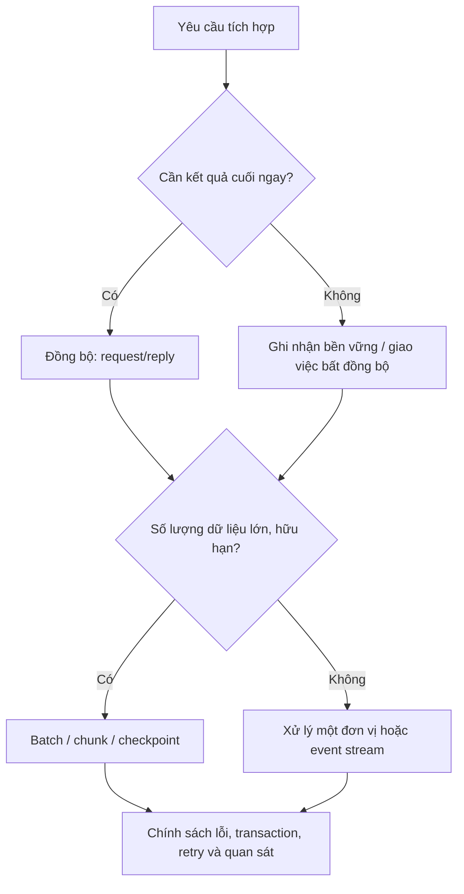
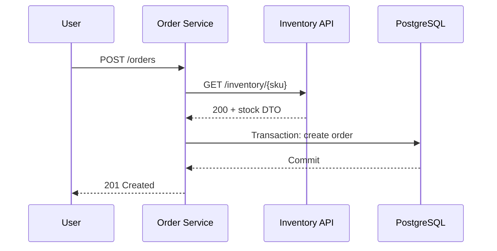
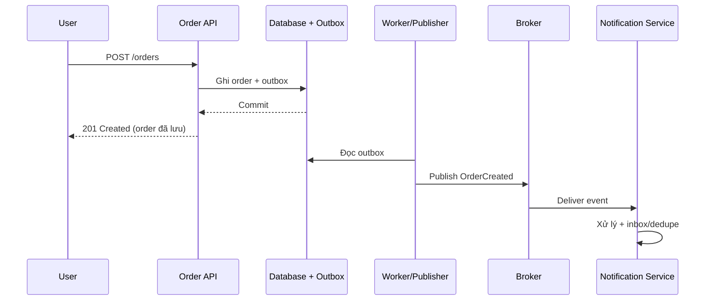
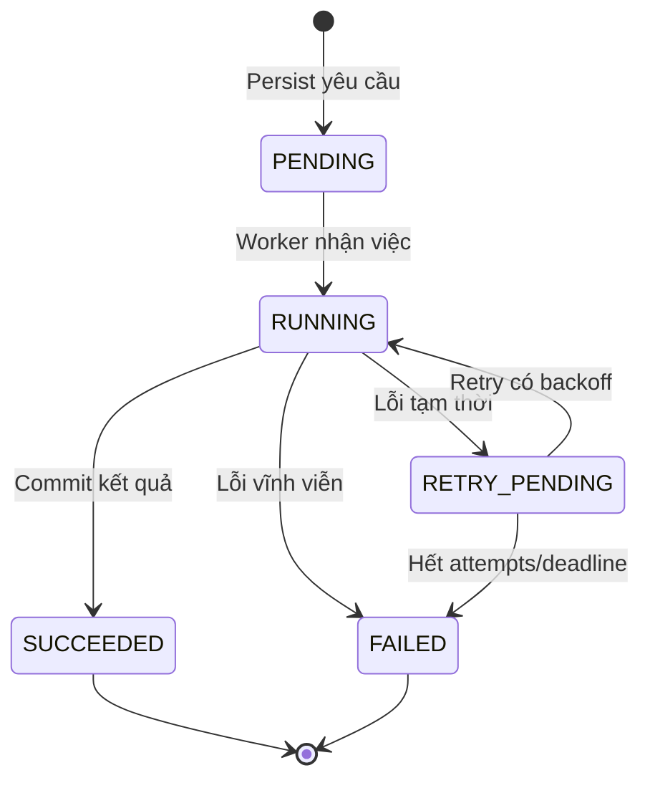
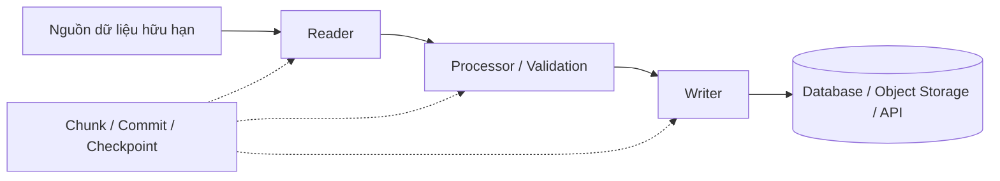
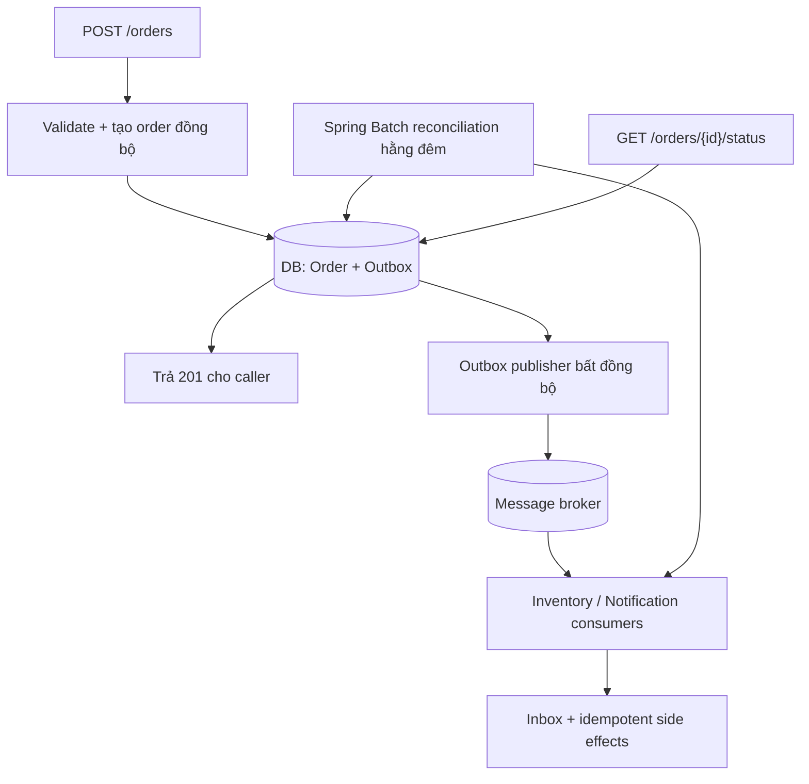
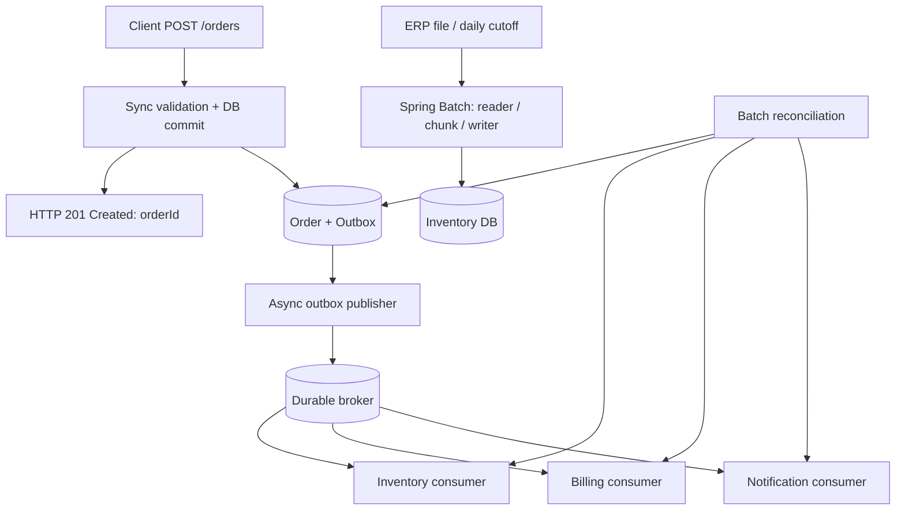

# Mô hình đồng bộ, bất đồng bộ và xử lý theo lô

## 1. Ba mô hình là ba cách tổ chức thời gian và kết quả tích hợp

Trong **SPRING_BOOT_INTEGRATION**, một ứng dụng Spring Boot có thể đồng thời:

- Gọi HTTP API để xác thực người dùng, lấy giá hoặc kiểm tra tồn kho.
- Ghi dữ liệu vào PostgreSQL qua JDBC/JPA và đọc Redis cache.
- Đẩy `OrderCreated` tới RabbitMQ/Kafka để những hệ thống khác xử lý.
- Chạy công việc đối soát đơn hàng, tái đồng bộ dữ liệu hoặc nhập tập tin theo lịch.
- Kết nối các thành phần bằng gateway, channel và adapter của Spring Integration.

Các tác vụ trên đều là **tích hợp hệ thống**, nhưng không có cùng yêu cầu về thời điểm nhận kết quả. Có nghiệp vụ bắt buộc phải trả lời ngay cho người gọi; có nghiệp vụ chỉ cần ghi nhận yêu cầu rồi hoàn tất sau; và có nghiệp vụ nên gom hàng nghìn bản ghi để xử lý theo từng phần.

Ba mô hình phổ biến:

1. **Đồng bộ (synchronous)**: bên gọi chờ một kết quả hoặc lỗi trong cùng tương tác, ví dụ request–response HTTP.
2. **Bất đồng bộ (asynchronous)**: bên gửi có thể tiếp tục công việc trước khi bên nhận xử lý xong; kết quả có thể đến sau qua event, callback, job status hoặc reply message.
3. **Xử lý theo lô (batch)**: xử lý một tập nhiều phần tử có ranh giới, thường theo chunk hoặc đợt; có thể chạy theo lịch, theo yêu cầu hoặc trong một worker bất đồng bộ.

**Điểm quan trọng:** “đồng bộ/bất đồng bộ” nói về **quan hệ thời gian và cách nhận kết quả**; “theo lô” nói về **đơn vị, nhịp và cách xử lý dữ liệu**. Chúng không hoàn toàn loại trừ nhau. Một HTTP endpoint đồng bộ có thể xử lý một batch nhỏ; một batch job lớn thường được kích hoạt bất đồng bộ; một consumer broker có thể gom message thành batch để tối ưu I/O.



Bài này tập trung vào **cách lựa chọn, kết hợp và vận hành ba mô hình trong Spring Boot**, cùng các hậu quả về latency, giao dịch, hợp đồng dữ liệu, xử lý lỗi, xử lý trùng lặp, kiểm thử và observability.

Các ví dụ dùng **Spring Boot 3.x**, **Spring Framework 6.x**, **Spring Batch 5.x** và các thư viện tương thích. `RestClient` cần Spring Framework 6.1+/Spring Boot 3.2+; với phiên bản cũ hãy chọn `RestTemplate` hoặc `WebClient` tương ứng.

## 2. Các trục thiết kế phải được phân biệt

Trước khi chọn framework, hãy trả lời bốn câu hỏi độc lập.

| Trục | Lựa chọn | Câu hỏi |
| --- | --- | --- |
| **Interaction** | Request–response / fire-and-forget / asynchronous request–reply / event notification | Bên gửi biết kết quả cuối qua đâu? |
| **Execution** | Cùng thread / executor / broker consumer / job runner | Công việc được chạy ở đâu, khi nào? |
| **Data granularity** | Một item / stream / batch hữu hạn / chunk | Bao nhiêu phần tử thuộc một đơn vị xử lý? |
| **Durability** | In-memory / database job store / durable broker / outbox | Nếu process chết, công việc đã nhận có còn không? |

Ví dụ:

- `WebClient` trả `Mono<Stock>` là API reactive, nhưng controller vẫn có thể **đợi** Mono rồi mới trả HTTP response. Đối với người gọi HTTP, tương tác đó vẫn là request–response đồng bộ về **hợp đồng giao tiếp**.
- `ExecutorChannel` làm handler chạy ở thread khác; nhưng nếu gateway request–reply vẫn chờ kết quả, caller chưa chắc đã thoát khỏi thao tác chờ.
- `QueueChannel` nội bộ tạo khoảng cách thời gian nhưng **không tự cung cấp độ bền như broker** khi JVM tắt.
- `POST /products/bulk` gửi 100 sản phẩm rồi chờ HTTP 200 là **batch đồng bộ**.
- `POST /imports` trả 202 và `jobId`, sau đó Spring Batch xử lý 1 triệu bản ghi là **batch bất đồng bộ**.

### 2.1. Phân biệt “nhận việc” và “hoàn thành”

```text
Request accepted ≠ Worker started ≠ DB committed
                 ≠ Broker delivered ≠ Business succeeded
```

Một lời gọi `MessageChannel.send(message)` thành công hoặc một HTTP `202 Accepted` không tự chứng minh nghiệp vụ đã hoàn tất. Nếu công việc quan trọng, phải định nghĩa rõ ý nghĩa của “accepted”: đã ghi durable job/outbox, đã publish có confirm, hay chỉ mới đặt task vào bộ nhớ.

## 3. Bảng so sánh nhanh ba mô hình

| Tiêu chí | Đồng bộ | Bất đồng bộ | Theo lô |
| --- | --- | --- | --- |
| Cách nhận kết quả | Thường cùng request/call | Reply/event/callback/status sau | Kết quả từng chunk hoặc toàn job |
| Độ trễ bên gọi | Chờ xử lý/timeout | Có thể trả sớm sau khi nhận việc | Tùy chạy sync hay async |
| Liên kết thời gian | Cao: downstream phải phản hồi trong deadline | Thấp hơn nếu có queue/store bền vững | Có thể tách khỏi giờ cao điểm |
| Đơn vị xử lý | Thường một yêu cầu | Message/command/event/job | Nhiều bản ghi; chia chunk |
| Backpressure | Thread/connection/pool/rate limit | Queue depth, consumer concurrency, flow control | Chunk size, commit interval, reader/writer throughput |
| Lỗi chính | Timeout, HTTP status, exception | Retry/redelivery, DLQ, job FAILED | Skip/retry/rollback, checkpoint, restart |
| Trạng thái tiến độ | Thường không cần job store | Cần nếu caller muốn theo dõi | Thường cần job/step execution state |
| Thứ tự | Theo chuỗi lệnh caller, không bảo đảm giữa request song song | Phụ thuộc partition/consumer/ordering | Phụ thuộc reader, partition và writer |
| Chi phí vận hành | Đơn giản ban đầu | Cần broker/worker/store và công cụ đối soát | Cần scheduling, batch metadata và kiểm soát dữ liệu lớn |
| Ví dụ | Lấy báo giá, xác thực token | Gửi thông báo, cập nhật read model | Đối soát, nhập CSV, đồng bộ đêm |

Đừng kết luận “async luôn nhanh hơn” hay “batch luôn tiết kiệm hơn”. Async thường **giảm latency quan sát ở caller** nhưng thêm queueing delay và vận hành; batch tối ưu throughput nếu dữ liệu hữu hạn nhưng có thể làm tăng độ trễ nhìn thấy dữ liệu mới. Đồng bộ đơn giản hơn khi cần tính tức thời và chuỗi thao tác ngắn.

## 4. Đồng bộ: request–response và điểm chờ kết quả

### 4.1. Mô hình

Trong mô hình đồng bộ, caller gửi yêu cầu và chờ nhận **kết quả hoặc lỗi** trước khi quyết định bước tiếp.



Ưu điểm: hợp đồng và điều khiển lỗi dễ hiểu; caller biết việc tạo order đã commit khi response thành công theo API contract. Hạn chế: Order Service phải giữ tài nguyên trong lúc đợi Inventory và database. Nếu Inventory chậm, request HTTP bị chậm hoặc timeout; lỗi lan truyền trực tiếp qua call stack/publisher tới controller.

**Đồng bộ không đồng nghĩa mọi thao tác ở cùng transaction.** PostgreSQL transaction trong Order Service không bao gồm transaction nội bộ của Inventory API chỉ vì hai lời gọi diễn ra cùng một HTTP request.

### 4.2. Ví dụ RestClient trong Spring Boot

Dependency thường dùng cho ứng dụng MVC:

```xml
<dependency>
    <groupId>org.springframework.boot</groupId>
    <artifactId>spring-boot-starter-web</artifactId>
</dependency>
```

Cấu hình URL theo môi trường:

```yaml
inventory:
  base-url: ${INVENTORY_URL:http://localhost:8081}
```

Tạo client từ **builder được Boot quản lý**:

```java
import org.springframework.beans.factory.annotation.Value;
import org.springframework.context.annotation.Bean;
import org.springframework.context.annotation.Configuration;
import org.springframework.web.client.RestClient;

@Configuration
class InventoryHttpConfig {

    @Bean
    RestClient inventoryRestClient(
            RestClient.Builder builder,
            @Value("${inventory.base-url}") String baseUrl) {
        return builder.baseUrl(baseUrl).build();
    }
}
```

DTO và adapter:

```java
import org.springframework.stereotype.Component;
import org.springframework.web.client.RestClient;

public record StockResponse(String sku, Integer available) {}

@Component
public class InventoryHttpClient {

    private final RestClient client;

    public InventoryHttpClient(RestClient inventoryRestClient) {
        this.client = inventoryRestClient;
    }

    public StockResponse getStock(String sku) {
        StockResponse response = client.get()
            .uri("/api/v1/stocks/{sku}", sku)
            .retrieve()
            .body(StockResponse.class);

        if (response == null || response.available() == null) {
            throw new IllegalStateException(
                "Inventory returned incomplete stock data"
            );
        }
        return response;
    }
}
```

`retrieve()` mặc định coi HTTP 4xx/5xx là lỗi; các lỗi DNS, TLS, kết nối và giải mã dữ liệu có thể phát sinh riêng. Đối với một chuỗi đồng bộ, cần quyết định HTTP response nào được ánh xạ thành lỗi nghiệp vụ, lỗi tạm thời hay kết quả “không tìm thấy”.

### 4.3. Chọn khi nào?

Nên ưu tiên đồng bộ khi:

- Người gọi **cần kết quả ngay** để ra quyết định.
- Công việc ngắn, deadline có thể đo được, tần suất yêu cầu trong khả năng hệ thống.
- Response chứa một giá trị cần dùng để hoàn tất transaction hoặc trả cho UI.
- Downstream có SLA và cơ chế chịu tải đủ tốt.

Không nên đưa email, xuất báo cáo hàng giờ hoặc xử lý file triệu dòng vào critical path HTTP chỉ vì thực hiện đồng bộ dễ viết code hơn.

## 5. Đồng bộ bằng WebClient vẫn là request–response nếu caller chờ

`WebClient` sử dụng Project Reactor, thường trả `Mono<T>` hoặc `Flux<T>`:

```java
import org.springframework.web.reactive.function.client.WebClient;
import reactor.core.publisher.Mono;

public Mono<StockResponse> getStock(WebClient client, String sku) {
    return client.get()
        .uri("/api/v1/stocks/{sku}", sku)
        .retrieve()
        .bodyToMono(StockResponse.class);
}
```

Nếu một WebFlux controller trả `Mono<StockResponse>` để framework gửi response **sau khi HTTP upstream hoàn tất**, bên gọi vẫn chờ một request–response. Điểm khác biệt là tài nguyên thread được sử dụng theo mô hình reactive non-blocking, không phải việc nghiệp vụ được tự động đưa ra sau response.

Phân biệt ba tình huống:

| Cách sử dụng | Trải nghiệm caller | Đặc điểm |
| --- | --- | --- |
| MVC + `RestClient.get()` | Chờ kết quả | Blocking call |
| WebFlux controller trả `Mono<Stock>` từ WebClient | Chờ kết quả | Có thể non-blocking từ đầu đến cuối nếu các bước đều non-blocking |
| Controller trả `202 + jobId` sau durable enqueue, worker gọi WebClient | Trả sớm | Async business workflow |

Không tự gọi `subscribe()` trong service rồi trả HTTP 200 như thể request đã thành công. Khi subscription lỗi sau khi controller trả response, caller không còn kênh báo lỗi phù hợp trừ khi ứng dụng thiết kế job status/callback/event.

### 5.1. Timeout, retry và circuit breaker

Một đồng bộ call cần đặt rõ:

- Connect timeout/response timeout và **deadline tổng**.
- Retry chỉ cho lỗi có thể phục hồi và thao tác có thể thử lại an toàn.
- Circuit breaker/rate limiting/bulkhead nếu downstream dễ quá tải.
- Fallback khi hợp đồng cho phép; dữ liệu tồn kho/giá quan trọng không nên thay bằng số 0 khi API lỗi.
- Correlation ID/trace context xuyên HTTP, không phát tán token nhạy cảm.

Timeout client **không chứng minh server chưa commit** thao tác `POST`. Nếu caller retry, phải có idempotency key/operation ID ổn định và cơ chế deduplication ở hệ thống đích.

## 6. Bất đồng bộ: tách thời điểm nhận yêu cầu và thời điểm xử lý

### 6.1. Mô hình message-based

Một producer gửi command/event tới broker hoặc job store. Consumer/worker xử lý sau:



Đây là mô hình **bất đồng bộ đối với bước notification**, không phải toàn bộ request bắt buộc đều bất đồng bộ. Đơn hàng có thể được tạo đồng bộ; các tác vụ phụ chạy sau.

**Khi không cần kết quả tức thì**, mô hình này cho phép thay đổi tốc độ xử lý và mở rộng consumer độc lập. Nhưng hệ thống phải quan sát queue depth, retry backlog và lỗi consumer, nếu không công việc có thể thất bại âm thầm.

### 6.2. Command khác event

| Loại thông điệp | Ý nghĩa | Ví dụ |
| --- | --- | --- |
| **Command** | Yêu cầu một đối tượng/hệ thống thực hiện hành động | `SendReceipt`, `ReserveInventory` |
| **Event** | Thông báo một sự kiện đã xảy ra | `OrderCreated`, `PaymentCaptured` |
| **Reply** | Kết quả của command/request bất đồng bộ | `ReservationAccepted`, `ReservationRejected` |

Một event có thể có nhiều subscriber; không giả định việc publish event đồng nghĩa mọi subscriber đã xử lý thành công. Command thường có owner xử lý rõ ràng, nhưng cũng cần timeout, retry và deduplication. Đừng để consumer diễn giải event như một lệnh bắt buộc nếu hợp đồng không định nghĩa như vậy.

### 6.3. Nên dùng bất đồng bộ khi nào?

- Tác vụ mất thời gian nhưng người dùng không cần kết quả cuối trong response đầu tiên.
- Nhiều consumer độc lập cần phản ứng với một business event.
- Tải tăng đột biến cần được hấp thụ bằng queue/broker có giới hạn.
- Worker có thể retry riêng, hoặc tạm dừng khi downstream bảo trì.
- Cần bảo đảm công việc sẽ được xử lý lại sau crash thông qua durable store/ack.

**Chỉ chuyển sang thread khác không tự đạt các bảo đảm trên.** Cần xét broker durability, persistence, consumer acknowledgment và vòng đời job.

## 7. Bất đồng bộ trong cùng JVM và bất đồng bộ qua broker không giống nhau

Spring Integration cung cấp nhiều loại channel; vị trí thread boundary và độ bền message khác nhau.

| Cơ chế | Handler ở đâu? | Độ bền khi JVM crash | Đường lỗi |
| --- | --- | --- | --- |
| `DirectChannel` | Thread caller, thường đồng bộ | Không tự persist | Exception thường ngược về caller |
| `ExecutorChannel` | Thread executor | Task trong queue JVM có thể mất | Worker error/error channel; submit rejection có thể đồng bộ |
| `QueueChannel` in-memory | Poller/receiver lấy sau | Không có durability mặc định | Theo poller/error flow |
| Broker adapter (RabbitMQ/Kafka/JMS) | Worker ở process khác hoặc cùng app | Có thể bền vững nếu broker và cấu hình phù hợp | Ack/nack/redelivery, DLQ và error handling |
| Durable job/outbox table | Worker đọc database | Theo transaction/durability của DB | Job state, retry scheduler, reconciliation |

### 7.1. Ví dụ ExecutorChannel

```java
import org.springframework.context.annotation.Bean;
import org.springframework.context.annotation.Configuration;
import org.springframework.integration.channel.ExecutorChannel;
import org.springframework.messaging.MessageChannel;
import org.springframework.scheduling.concurrent.ThreadPoolTaskExecutor;

@Configuration
public class LocalAsyncFlowConfig {

    @Bean
    ThreadPoolTaskExecutor integrationExecutor() {
        ThreadPoolTaskExecutor executor = new ThreadPoolTaskExecutor();
        executor.setCorePoolSize(2);
        executor.setMaxPoolSize(4);
        executor.setQueueCapacity(100);
        executor.setThreadNamePrefix("integration-");
        return executor;
    }

    @Bean("asyncWork")
    MessageChannel asyncWork(ThreadPoolTaskExecutor integrationExecutor) {
        return new ExecutorChannel(integrationExecutor);
    }
}
```

Handler:

```java
import org.springframework.integration.annotation.ServiceActivator;
import org.springframework.stereotype.Component;

@Component
public class LocalWorkHandler {

    @ServiceActivator(inputChannel = "asyncWork")
    public void handle(WorkCommand command) {
        // Chạy trên worker thread khi dispatch qua ExecutorChannel.
        // Gọi business service; xử lý error channel có chủ đích.
    }
}
```

`WorkCommand` do ứng dụng định nghĩa. Nếu queue trong executor đầy, task có thể bị từ chối **ngay khi send()**. Nếu task đã nhận nhưng handler lỗi, exception không tự truyền về caller đã kết thúc. Với `@Transactional` ở caller, transaction không tự đi theo sang worker thread.

**Không dùng `ExecutorChannel` làm durable job queue cho thanh toán, chuyển tiền hoặc những thao tác bắt buộc không mất khi ứng dụng restart**. Nó phù hợp tác vụ nội bộ nhẹ/best-effort hoặc những flow mà độ bền đã được đảm bảo ở lớp khác.

## 8. Ví dụ broker bất đồng bộ trong Spring Boot

### 8.1. Dependency AMQP và contract message

Ví dụ dùng RabbitMQ:

```xml
<dependency>
    <groupId>org.springframework.boot</groupId>
    <artifactId>spring-boot-starter-amqp</artifactId>
</dependency>
```

DTO sự kiện:

```java
import java.time.Instant;

public record OrderCreatedEvent(
        String eventId,
        String orderId,
        Instant occurredAt,
        int schemaVersion) {
}
```

Nếu dùng `RabbitTemplate.convertAndSend(...)` với object Java, cần **message converter được cấu hình tương thích** (ví dụ JSON/Jackson với version Spring AMQP phù hợp) và thống nhất schema ở cả producer/consumer. Không giả định default converter luôn encode DTO thành JSON có thể đọc bởi service khác.

Ví dụ cấu hình JSON converter (API tương ứng Spring AMQP 3.x):

```java
import com.fasterxml.jackson.databind.ObjectMapper;
import org.springframework.amqp.support.converter.Jackson2JsonMessageConverter;
import org.springframework.amqp.support.converter.MessageConverter;
import org.springframework.context.annotation.Bean;
import org.springframework.context.annotation.Configuration;

@Configuration
public class AmqpJsonConfiguration {
    @Bean
    MessageConverter amqpMessageConverter(ObjectMapper mapper) {
        return new Jackson2JsonMessageConverter(mapper);
    }
}
```

Spring Boot có thể dùng converter bean phù hợp để cấu hình `RabbitTemplate` và listener container theo auto-configuration. Trong dự án lớn, xác minh converter thực tế ở cả hai phía, thay vì chỉ dựa vào việc bean tồn tại.

### 8.2. Producer và consumer

```java
import org.springframework.amqp.rabbit.core.RabbitTemplate;
import org.springframework.stereotype.Component;

@Component
public class OrderEventPublisher {
    private final RabbitTemplate rabbit;

    public OrderEventPublisher(RabbitTemplate rabbit) {
        this.rabbit = rabbit;
    }

    public void publish(OrderCreatedEvent event) {
        rabbit.convertAndSend(
            "orders.events",
            "order.created",
            event
        );
    }
}
```

```java
import org.springframework.amqp.rabbit.annotation.RabbitListener;
import org.springframework.stereotype.Component;

@Component
public class NotificationConsumer {

    @RabbitListener(queues = "notification.order-created")
    public void consume(OrderCreatedEvent event) {
        // Kiểm tra inbox/deduplication theo eventId.
        // Chỉ gây side effect khi event chưa xử lý.
    }
}
```

Ví dụ **giả định** exchange `orders.events`, routing key `order.created`, queue `notification.order-created` và binding đã được khai báo/provision. `convertAndSend(...)` chỉ thể hiện lời gọi publish; nó **không tự bảo đảm** broker đã lưu message, đã route tới queue hoặc consumer đã xử lý. Khi cần độ tin cậy, cấu hình publisher confirms/returns, durable topology, message persistence và outbox thích hợp.

Với listener ở acknowledgment mode mặc định thông dụng, container có thể ack khi handler hoàn tất thành công và áp chính sách lỗi/redelivery nếu handler ném exception. Cần kiểm tra cấu hình listener container, concurrency và error handler; không khái quát rằng mọi trường hợp throw sẽ được retry vô hạn.

### 8.3. Không gọi broker ngay trong DB transaction rồi xem là atomic

```text
@Transactional
  save(order)
  rabbitTemplate.convertAndSend(event)
COMMIT DB
```

Đây **không** mặc nhiên là một transaction nguyên tử giữa PostgreSQL và RabbitMQ. Có thể xảy ra broker đã nhận event nhưng DB rollback, hoặc DB commit nhưng publish thất bại. Mô hình **transactional outbox** giải quyết khoảng hở này bằng cách ghi business record và outbox record trong **cùng một DB transaction**, sau đó publisher riêng gửi đi.

## 9. HTTP 202 và trạng thái công việc bất đồng bộ

Khi API chỉ nhận một công việc để xử lý sau, có thể thiết kế:

```http
POST /api/v1/reports
Content-Type: application/json

{"from":"2026-11-01","to":"2026-11-20"}
```

Response:

```http
HTTP/1.1 202 Accepted
Location: /api/v1/jobs/job-4821
Content-Type: application/json

{"jobId":"job-4821","status":"PENDING"}
```

Client sau đó gọi `GET /api/v1/jobs/job-4821`, nhận `PENDING`, `RUNNING`, `SUCCEEDED` hoặc `FAILED`. Nếu muốn callback/event notification, phải định nghĩa thêm contract và xác thực riêng.



**Trả 202 chỉ sau khi đã ghi nhận công việc theo cam kết durability được công bố.** Nếu API trả 202 ngay sau khi submit vào executor queue in-memory, một JVM crash có thể làm mất job; đây không phù hợp với lời hứa “chắc chắn xử lý sau” nếu không có store/broker bền vững.

Một job tối thiểu cần `jobId`, trạng thái, thời gian, attempt count, lỗi đã phân loại và cơ chế xác định chủ sở hữu worker. Với nhiều worker, phải có claim/lease/locking để tránh hai worker xử lý cùng job nếu không có idempotency.

## 10. Xử lý theo lô: bản ghi nhiều, đơn vị công việc hữu hạn

**Batch processing** tổ chức công việc trên một tập dữ liệu nhiều phần tử, chẳng hạn:

- Đồng bộ 500.000 sản phẩm từ hệ thống ERP sang catalog.
- Đối soát giao dịch ngân hàng với các bút toán đã ghi.
- Nhập file CSV hoặc JSONL và chuẩn hóa trước khi ghi database.
- Tái xử lý các outbox event chưa publish sau lỗi kéo dài.
- Xây dựng read model từ lịch sử sự kiện.

Điểm khác với một luồng event liên tục là batch thường có **ranh giới dữ liệu hoặc ranh giới chạy job**: theo file, theo business date, theo khoảng ID hoặc snapshot đã chốt.



### 10.1. Batch khác “gửi một mảng trong HTTP” thế nào?

`POST /bulk-update` với JSON array 100 phần tử có thể được xem là **batch request** ở giao thức API; nhưng không đồng nghĩa ứng dụng có hạ tầng **batch job restartability**. Nếu request chết giữa chừng, client cần biết từng item nào đã commit, đâu là partial success và có được retry cả mảng hay không.

Ngược lại, Spring Batch giúp quản lý `Job`/`Step`/`JobExecution`, checkpoint và trạng thái chạy, nhưng vẫn cần thiết kế source reader và side effects an toàn.

### 10.2. Chunk processing

Giả sử có 10.000 bản ghi, chunk size 100:

```text
Chunk 1: items 1–100     -> process + write + commit
Chunk 2: items 101–200   -> process + write + commit
...
Chunk 100: items 9901–10000 -> commit
```

Nếu chunk 36 thất bại và transaction của chunk được rollback, các chunk đã commit trước đó thường vẫn giữ kết quả. Khi restart, framework có thể dùng checkpoint/trạng thái reader và job metadata để tiếp tục phù hợp với cấu hình, **không cam kết mọi reader/writer đều restart-safe nếu bạn không triển khai đúng**.

Đừng chạy một transaction chứa hàng triệu dòng chỉ để rollback toàn bộ khi lỗi một record. Chọn chunk size theo database lock, memory, row size, business atomicity và throughput. Chunk size lớn giảm overhead commit nhưng tăng chi phí rollback và lượng item được giữ trong memory.

## 11. Spring Batch: Job, Step và JobRepository

### 11.1. Thành phần cơ bản

| Khái niệm | Nhiệm vụ |
| --- | --- |
| `Job` | Một lần xử lý business batch, ví dụ đối soát theo ngày |
| `JobInstance` | Định danh job theo tên và identifying job parameters |
| `JobExecution` | Lần chạy cụ thể của job instance |
| `Step` | Đơn vị công việc nhỏ trong job |
| `StepExecution` | Trạng thái lần chạy của step |
| `ItemReader<T>` | Đọc từng item theo nguồn và state |
| `ItemProcessor<I,O>` | Biến đổi/validate/đánh dấu bỏ qua item |
| `ItemWriter<O>` | Ghi cả chunk theo contract |
| `JobRepository` | Lưu metadata phục vụ restart/tracking của job |
| `JobLauncher` | Bắt đầu một job execution |

Để dùng Spring Batch với Spring Boot (phiên bản và starter phù hợp):

```xml
<dependency>
    <groupId>org.springframework.boot</groupId>
    <artifactId>spring-boot-starter-batch</artifactId>
</dependency>
```

Một Batch job cần nguồn dữ liệu và cấu hình metadata `JobRepository` đúng. Khi dùng database repository, cần provision schema metadata đúng phiên bản (qua script hoặc migration theo môi trường). **Không bật `@EnableBatchProcessing` một cách máy móc** khi muốn Boot auto-configuration quản lý Batch; annotation này có thể làm thay đổi điều kiện auto-configuration trong các phiên bản Spring Boot.

### 11.2. Ví dụ Java configuration cho chunk-based Step

```java
import org.springframework.batch.core.Job;
import org.springframework.batch.core.Step;
import org.springframework.batch.core.job.builder.JobBuilder;
import org.springframework.batch.core.repository.JobRepository;
import org.springframework.batch.core.step.builder.StepBuilder;
import org.springframework.batch.item.ItemProcessor;
import org.springframework.batch.item.ItemReader;
import org.springframework.batch.item.ItemWriter;
import org.springframework.beans.factory.annotation.Qualifier;
import org.springframework.context.annotation.Bean;
import org.springframework.context.annotation.Configuration;
import org.springframework.transaction.PlatformTransactionManager;

@Configuration
public class ReconciliationBatchConfiguration {

    @Bean
    Step reconcileStep(
            JobRepository jobRepository,
            PlatformTransactionManager transactionManager,
            ItemReader<LedgerRow> ledgerReader,
            ItemProcessor<LedgerRow, ReconciliationResult> processor,
            ItemWriter<ReconciliationResult> resultWriter) {

        return new StepBuilder("reconcileStep", jobRepository)
            .<LedgerRow, ReconciliationResult>chunk(
                100, transactionManager
            )
            .reader(ledgerReader)
            .processor(processor)
            .writer(resultWriter)
            .build();
    }

    @Bean
    Job reconcileJob(
            JobRepository jobRepository,
            @Qualifier("reconcileStep") Step step) {

        return new JobBuilder("reconcileJob", jobRepository)
            .start(step)
            .build();
    }
}
```

`LedgerRow` và `ReconciliationResult` là các DTO do ứng dụng định nghĩa; các bean reader, processor, writer phải được cung cấp riêng. Code thể hiện **cấu trúc** một job Spring Batch 5.x, không phải ví dụ chạy được độc lập khi chưa cấu hình nguồn dữ liệu.

**Quan trọng về transaction:** chunk transaction chỉ bảo vệ những tài nguyên tham gia transaction tương ứng. Nếu `ItemProcessor` gọi một Payment API hoặc `ItemWriter` gửi email, rollback database **không đảo ngược** side effect HTTP/email đã thực hiện. Với nguồn/đích ngoài DB, cần idempotency và trạng thái item riêng.

## 12. Lên lịch batch, restart và chạy nhiều instance

Spring Batch cung cấp job execution và restart semantics; `@Scheduled` là một cách **kích hoạt** job, không phải bản thân bộ xử lý batch.

Ví dụ scheduler gọi job hàng ngày:

```java
import java.time.LocalDate;
import java.time.ZoneOffset;
import org.springframework.batch.core.Job;
import org.springframework.batch.core.JobParameters;
import org.springframework.batch.core.JobParametersBuilder;
import org.springframework.batch.core.launch.JobLauncher;
import org.springframework.beans.factory.annotation.Qualifier;
import org.springframework.scheduling.annotation.Scheduled;
import org.springframework.stereotype.Component;

@Component
public class DailyReconciliationScheduler {

    private final JobLauncher launcher;
    private final Job job;

    public DailyReconciliationScheduler(
            JobLauncher launcher,
            @Qualifier("reconcileJob") Job job) {
        this.launcher = launcher;
        this.job = job;
    }

    @Scheduled(cron = "0 0 2 * * *", zone = "UTC")
    public void run() throws Exception {
        String businessDate = LocalDate.now(ZoneOffset.UTC)
            .minusDays(1)
            .toString();

        JobParameters params = new JobParametersBuilder()
            .addString("businessDate", businessDate)
            .toJobParameters();

        launcher.run(job, params);
    }
}
```

Ví dụ này cần `@EnableScheduling` trong application configuration, `JobLauncher`/`JobRepository` phù hợp và database metadata. Với tham số `businessDate` giữ nguyên, Spring Batch có thể từ chối chạy lại một job instance đã `COMPLETED` theo semantics của framework; **restart** một job thất bại khác với **chạy một lần nghiệp vụ mới**.

**Tránh job chạy ngoài lịch:** Spring Boot có thể tự khởi chạy các `Job` được phát hiện lúc application startup. Nếu chỉ muốn scheduler hoặc API chủ động gọi `JobLauncher`, đặt `spring.batch.job.enabled=false` cho môi trường đó. Thuộc tính này tắt **tự chạy khi khởi động**, không ngăn code chủ động launch job. Đừng dùng một parameter ngẫu nhiên mỗi lần chạy chỉ để vượt qua trạng thái `COMPLETED`, vì như vậy có thể vô tình đối soát trùng cùng business date.

### 12.1. Bẫy scheduler trên nhiều replica

Nếu có ba pod Order Service cùng chạy `@Scheduled` lúc 02:00, **cả ba đều có thể kích hoạt cùng job** nếu không có điều phối. Spring Batch metadata có các ràng buộc và trạng thái job, nhưng không thể thay thế mọi cơ chế bảo vệ concurrency ở logic ngoài DB.

Lựa chọn:

- Một scheduler/worker owner riêng.
- Scheduler tập trung như Kubernetes CronJob hoặc orchestration platform.
- Distributed lock/lease phù hợp nếu dùng scheduler trong nhiều replica.
- Partitioning job có phân công rõ khi cần xử lý song song.

Chạy parallel batch có thể tăng throughput nhưng làm tăng tranh chấp lock, DB connection và giới hạn API downstream. Mỗi partition/chunk cần key idempotent và khả năng restart.

### 12.2. Không đánh đồng “skip” và “retry”

Spring Batch có cơ chế retry/skip khi cấu hình fault tolerance. **Retry** thử xử lý cùng item lại sau lỗi có khả năng phục hồi; **skip** bỏ item lỗi theo policy và tiếp tục. Cần đặt giới hạn `retryLimit`/`skipLimit` và xuất báo cáo các item bị skip—đối soát mà âm thầm bỏ bản ghi có thể tạo sai lệch nghiệp vụ nghiêm trọng.

Poison record/schema sai thường nên được ghi vào file/quarantine table kèm error code để sửa, không retry vô hạn.

## 13. So sánh batch với streaming và xử lý từng event

Ba cách có thể cùng xử lý một luồng dữ liệu nhưng có trade-off:

| Đặc điểm | Event-by-event | Streaming | Batch hữu hạn |
| --- | --- | --- | --- |
| Độ trễ cập nhật | Thấp khi consumer kịp | Thấp, có thể liên tục | Phụ thuộc lịch/đợt |
| Throughput | Phụ thuộc handler/concurrency | Tốt khi streaming pipeline tối ưu | Tốt khi ghi/đọc theo chunk |
| Điều khiển tải | Consumer concurrency, broker prefetch | Backpressure/buffering/window | Chunk, partition, schedule |
| Khôi phục | Offset/ack/redelivery | Checkpoint/offset/reconnect | Job/step metadata, checkpoint |
| Lỗi một phần tử | Retry/DLQ | Chính sách xử lý lỗi trong stream | Skip/retry/rollback chunk |
| Phù hợp | Notification, đơn hàng mới | CDC, sự kiện liên tục | Import, reconciliation, lịch sử lớn |

**Streaming không tự đồng nghĩa bất đồng bộ bền vững**: một HTTP SSE stream có thể mất dữ liệu trong lúc reconnect nếu server không hỗ trợ replay. **Batch không tự đồng nghĩa mạnh về transaction**: mỗi chunk commit riêng và external side effects có thể không rollback.

### 13.1. Micro-batching

Một consumer có thể gom, ví dụ tối đa 100 event hoặc tối đa 500 ms rồi ghi DB một lần. Đây là **micro-batching**: kết hợp mức phản hồi gần real-time với hiệu quả I/O theo lô. Phải xử lý:

- Giới hạn buffer tối đa và thời gian chờ.
- Ordering, duplicate và partial failure.
- Acknowledgment chỉ sau khi batch/chunk đủ bền vững theo contract.
- Khả năng chia batch khi có một poison event.
- Backpressure khi writer chậm hơn tốc độ consumer.

Trong Reactor có thể dùng `bufferTimeout(...)`; trong broker có batch listener APIs tùy connector. Không gom vô hạn chỉ để tăng throughput vì tăng memory và latency.

## 14. Mô hình kết hợp: đồng bộ để ghi nhận, bất đồng bộ để xử lý, batch để đối soát

Một kiến trúc thực tế hiếm khi chỉ chọn một mô hình.



- **Đồng bộ:** kiểm tra đầu vào, xác nhận thao tác tạo đơn trong database và trả order ID.
- **Bất đồng bộ:** phát event đến những hệ thống khác, không giữ HTTP request chờ email hoặc analytics.
- **Theo lô:** đối soát những order không có event xử lý tương ứng, sửa dữ liệu lệch và báo cáo.
- **Read model/cache:** có thể được cập nhật bất đồng bộ; UI cần biết dữ liệu nào eventual consistent.

Mô hình kết hợp giúp tránh hai cực đoan: chờ tất cả downstream trong một HTTP request (latency cao, lỗi lan truyền) hoặc đưa mọi thứ lên broker rồi khiến người dùng không biết kết quả tạo đơn đã được ghi hay chưa.

### 14.1. Ranh giới trạng thái phải công bố

Một response `201 Created` sau DB commit có thể khẳng định order resource tồn tại, **không** khẳng định email đã gửi hoặc tồn kho ở hệ thống khác đã hoàn tất. Nếu muốn API chỉ nhận job, dùng `202 Accepted` sau durable acceptance và trả job ID. Đừng dùng chung một trạng thái `SUCCESS` cho cả việc nhận yêu cầu và hoàn thành mọi bước hậu kỳ.

## 15. Giao dịch, outbox, inbox và tính nhất quán

### 15.1. Không có transaction “miễn phí” xuyên HTTP, DB và broker

`@Transactional` thông thường chỉ quản lý một transaction manager và các tài nguyên tham gia; nó không tự biến lời gọi WebClient, Redis và RabbitMQ thành một distributed atomic transaction.

Ví dụ các điểm hỏng:

```text
DB COMMIT thành công
Process chết trước lúc publish event
→ Order tồn tại nhưng downstream không biết.

Broker nhận event
Consumer commit DB thành công
Consumer chết trước ack
→ Event bị gửi lại, side effect có nguy cơ lặp.

HTTP POST downstream thành công
Response bị thất lạc
→ Retry có nguy cơ thực hiện lặp.
```

Đó là lý do người thiết kế cần hai mục tiêu riêng:

- **At-least-once delivery + idempotent processing**: chấp nhận message có thể lặp nhưng side effect được kiểm soát.
- **Reconciliation**: có cơ chế phát hiện và sửa trạng thái chưa chắc chắn, message thất lạc hoặc chậm quá SLA.

### 15.2. Ghi order và outbox trong cùng transaction

Code minh họa (repository/entity do ứng dụng định nghĩa):

```java
import org.springframework.stereotype.Service;
import org.springframework.transaction.annotation.Transactional;

@Service
public class OrderCreationService {

    private final OrderRepository orders;
    private final OutboxRepository outbox;

    public OrderCreationService(
            OrderRepository orders,
            OutboxRepository outbox) {
        this.orders = orders;
        this.outbox = outbox;
    }

    @Transactional
    public String create(CreateOrderRequest request) {
        OrderEntity order = orders.save(
            OrderEntity.from(request)
        );

        outbox.save(
            OutboxRecord.orderCreated(order)
        );

        return order.getId();
    }
}
```

`OrderRepository`, `OutboxRepository`, `OrderEntity`, `CreateOrderRequest` và `OutboxRecord` ở đây là các thành phần ứng dụng giả định. Lời gọi `@Transactional` chỉ an toàn khi **hai repository tham gia cùng transaction database** và được gọi qua Spring proxy đúng cách.

Publisher riêng đọc outbox đã commit, gửi broker, ghi nhận confirm rồi cập nhật trạng thái; một vòng retry có thể publish lại. Consumer dùng unique key theo `(consumerName,eventId)` và transaction khi ghi inbox + business side effects trong cùng DB để chống trùng.

### 15.3. Cần idempotency cả ở batch

Một batch import được restart sau khi xử lý 70% không nên tạo lại 70% dữ liệu trước đó dưới ID mới. Có thể dùng natural/business key và `UPSERT` hoặc unique constraint, nhưng phải kiểm tra hợp đồng khi nguồn thay đổi. Với API downstream không hỗ trợ idempotency, cần checkpoint ở mức item và đối soát trạng thái chứ không thể chỉ retry toàn batch.

## 16. Xử lý lỗi và retry theo từng mô hình

| Mô hình | Lỗi caller nhìn thấy | Chính sách recovery |
| --- | --- | --- |
| HTTP đồng bộ | 4xx/5xx, timeout, transport error | Mapping lỗi, deadline, retry bounded, circuit breaker |
| In-memory executor | Dispatch rejection có thể ngay; lỗi worker thường sau đó | Error channel, trạng thái riêng; không giả vờ durable |
| Broker consumer | Caller cũ thường không còn chờ | Ack/nack, backoff, redelivery, DLQ, inbox |
| Spring Batch | Job/Step FAILED, số item read/write/skip | Checkpoint/restart, rollback chunk, skip/retry có giới hạn |
| Hybrid | Lỗi mỗi giai đoạn xuất hiện ở nơi khác nhau | Correlation ID, job status, outbox/inbox, reconciliation |

### 16.1. Không retry lỗi vĩnh viễn

- HTTP 400/422 do payload sai schema: cần sửa dữ liệu/contract.
- Redis ACL/credential sai: cần sửa hạ tầng, không tăng retry.
- Broker poison message: cách ly vào DLQ, tránh làm tắc consumer.
- Batch record sai chuẩn: quarantine/skip có báo cáo hoặc fail job tùy tính trọng yếu.

Lỗi tạm thời như 503, timeout, DB deadlock có thể retry **khi thao tác an toàn và còn budget**. Dùng exponential backoff có jitter và trần, tính cả deadline và tải hệ thống. Với bước gây side effect, retry phải dựa trên idempotency key/correlation stable.

### 16.2. Không dùng “async” để che lỗi

Nếu HTTP API trả về ngay nhưng worker thất bại, phải có cách để con người hoặc hệ thống khác biết:

1. Ghi `FAILED`/`RETRY_PENDING` vào durable job store, nếu API có job ID.
2. Phát status event hoặc callback có hợp đồng riêng.
3. Đưa message hết retry vào DLQ và có quy trình xử lý/quarantine.
4. Cảnh báo theo backlog age/error budget thay vì chỉ log stack trace.

Một error channel in-memory hoặc một dòng log **không thay thế** trạng thái bền vững và trách nhiệm reprocess nếu SLA yêu cầu.

### 16.3. Poison batch và partial success

Khi một bản ghi lỗi giữa chunk, transaction có thể rollback chunk; xử lý lại cần tách item lỗi, quyết định skip hay fail toàn job. Nếu batch gọi nhiều HTTP endpoint, một response lỗi không được mặc định coi các item trước đó đã rollback. Đặt contract **per-item success/failure** hoặc idempotent group operation khi có partial success.

## 17. Tải hệ thống: latency, throughput, queue và backpressure

Đánh giá mô hình bằng **ngân sách tài nguyên**, không chỉ theo response time của controller.

### 17.1. Đồng bộ: tài nguyên chờ kết quả

Với request synchronous blocking:

- Mỗi request có thể giữ thread, connection pool slot và memory trong lúc chờ.
- Downstream p99 tăng có thể làm queue của inbound server tăng.
- Retry không giới hạn có thể biến 1 request thành nhiều outbound calls.
- Connection pool, thread pool và rate limiter phải phù hợp downstream capacity.

Reactive non-blocking giảm nhu cầu giữ thread chờ I/O, nhưng vẫn có giới hạn connections, memory và downstream throughput. Nếu dùng blocking JDBC trong event-loop, lợi thế non-blocking có thể mất.

### 17.2. Bất đồng bộ: queue chỉ dời backlog sang nơi khác

Queue bền vững hấp thụ burst nhưng không làm throughput consumer tăng vô hạn. Nếu producer gửi 1.000 messages/giây còn consumer xử lý 600, backlog tăng khoảng 400/giây. Cuối cùng queue storage, tuổi message hoặc SLA sẽ vượt giới hạn.

Cần đo:

- Producer rate và consumer completion rate.
- Queue depth, oldest message age, consumer lag.
- In-flight messages, concurrency, prefetch và số message redelivery.
- Retry queue/DLQ tăng.
- Thời gian **từ accepted đến completed**, không chỉ thời gian xử lý handler.

### 17.3. Batch: tối ưu commit và I/O, tránh batch quá lớn

Chunk size, page size và concurrency cần điều chỉnh theo:

- Tốc độ reader, DB fetch size, độ lớn item và memory.
- Giới hạn DB connection/lock và cost rollback.
- API quota và file/object storage throughput.
- Thời gian chạy hoàn tất trước business deadline.
- Khả năng restart/chia partition và đảm bảo ordering.

**Một batch 100.000 item không nhất thiết nhanh hơn 1.000 batch 100 item**, nhất là khi gọi API có rate limit hoặc toàn batch bị rollback bởi một item lỗi. Hãy benchmark ở điều kiện giống production.

## 18. Hợp đồng dữ liệu, bảo mật và quan sát xuyên mô hình

### 18.1. Contract không biến mất khi chuyển sang broker/batch

| Trường hợp | Hợp đồng cần xác định |
| --- | --- |
| HTTP synchronous | Method/path, status, headers, JSON schema, timeouts, error body |
| Broker async | Topic/exchange/queue, routing key, schema version, event ID, ack/redelivery |
| Job API | Job ID, trạng thái, status endpoint, retention, cancellation/retry |
| Batch import | Input schema, format, encoding, deduplication key, partial failure report |
| Outbox/inbox | Event ID ổn định, unique constraint, version và lifecycle |

Thay đổi từ request–response sang event-driven **không có nghĩa bỏ qua contract testing**. Provider và consumer cần xác minh schema tương thích; event cũ có thể tồn tại trong broker lâu hơn thời gian deploy. Với batch import, file do bên ngoài cung cấp phải được validate trước khi ghi dữ liệu và phát sự kiện.

### 18.2. Security context không tự vượt thread hoặc process

Một thread worker không tự có mọi ThreadLocal/MDC của HTTP caller; message trên broker không nên mang raw access token hoặc Java security context để service khác tái sử dụng. Thay vào đó:

- Truyền correlation ID/trace context theo chuẩn và allowlist metadata.
- Xác thực message producer/consumer qua credential riêng của service.
- Ghi tenant/user ID **chỉ khi cần thiết** và được phép theo data contract.
- Redact PII, bearer token, password và payment details trong logs/DLQ.
- Áp TTL/retention cho job payload, event và batch file.

### 18.3. Trace một logical operation qua nhiều giai đoạn

```text
HTTP POST /orders (trace/correlation)
  -> DB commit + outbox(eventId)
  -> publisher attempt #1/#2
  -> broker record / offset
  -> consumer inbox + side effect
  -> reconciliation job nếu trạng thái chưa khớp
```

Một business operation có thể tạo nhiều spans, jobs và message IDs. `eventId`/`jobId` phải đủ ổn định để đối soát; trace IDs phục vụ quan sát và không nên thay thế business key chống trùng.

## 19. Chiến lược kiểm thử ba mô hình

### 19.1. Kiểm thử đồng bộ

Mục tiêu:

- Client gửi đúng HTTP method, path, headers và payload.
- Status 200/201/204/404/409/429/503 được xử lý đúng.
- Timeout, retry bounded và idempotency key chính xác.
- Transaction local commit/rollback đúng ở ranh giới.
- DTO validation phát hiện null/schema drift.

Dùng `MockRestServiceServer`, WireMock/MockWebServer hoặc server test; contract verification cần phía provider, không chỉ consumer fixture.

Ví dụ kiểm tra mock HTTP với `RestClient`:

```java
import static org.assertj.core.api.Assertions.assertThat;
import static org.springframework.test.web.client.match.MockRestRequestMatchers.requestTo;
import static org.springframework.test.web.client.response.MockRestResponseCreators.withSuccess;

import org.junit.jupiter.api.Test;
import org.springframework.http.MediaType;
import org.springframework.test.web.client.MockRestServiceServer;
import org.springframework.web.client.RestClient;

class InventoryContractTest {

    @Test
    void readsStock() {
        RestClient.Builder builder = RestClient.builder()
            .baseUrl("https://inventory.test");

        MockRestServiceServer server =
            MockRestServiceServer.bindTo(builder).build();

        server.expect(requestTo(
                "https://inventory.test/api/v1/stocks/sku-1"
            ))
            .andRespond(withSuccess(
                "{\"sku\":\"sku-1\",\"available\":7}",
                MediaType.APPLICATION_JSON
            ));

        StockResponse response = builder.build()
            .get()
            .uri("/api/v1/stocks/{sku}", "sku-1")
            .retrieve()
            .body(StockResponse.class);

        assertThat(response.available()).isEqualTo(7);
        server.verify();
    }
}
```

Test dùng builder thuần để cô lập HTTP contract; ứng dụng thật cũng nên có test context xác minh builder do Boot quản lý nhận đúng filters, observation, SSL và base URL. Cấu hình serializer của project phải nhận biết DTO `StockResponse` như code ở mục 4.

### 19.2. Kiểm thử bất đồng bộ

Mục tiêu:

1. Producer tạo event ID và schema version đúng.
2. Publisher failure không làm mất outbox.
3. Consumer xử lý event lặp mà không lặp side effect.
4. Poison message đi DLQ sau số attempts có giới hạn.
5. Event bị trì hoãn không khiến HTTP caller nhận nhầm “đã hoàn tất”.
6. Khi broker down/up, worker recovery và backlog giảm.
7. Executor rejection và lỗi worker đi đúng đường error/status.

Dùng broker thật trong integration test thông qua Testcontainers hoặc test environment tương ứng; một mock `RabbitTemplate` chỉ kiểm tra method call, **không kiểm tra route, serialization, confirms hay redelivery**.

### 19.3. Kiểm thử batch

Mục tiêu:

- `JobParameters` phân biệt đúng business date/nguồn file.
- Đọc đủ dữ liệu; writer không làm mất/trùng item.
- Chunk rollback khi lỗi, checkpoint/restart tiếp tục theo policy.
- Một item sai schema được xử lý theo skip/quarantine contract.
- Retry lỗi transient có giới hạn; không thử lại lỗi permanent.
- Chạy đồng thời/multiple replicas không xử lý một business batch ngoài ý định.
- External side effects có idempotency khi job restart.

Spring Batch Test (`spring-batch-test`) hỗ trợ những tiện ích kiểm thử job/step; có thể chạy test với database container để kiểm tra metadata và transaction thực. Không chỉ assert `COMPLETED`: phải kiểm tra số item read, written, filtered, skipped và trạng thái business cuối.

## 20. Quan sát và SLA theo mô hình

Một dashboard tốt cần phản ánh **trạng thái nghiệp vụ cuối**, không chỉ lỗi kỹ thuật của một hop.

| Mô hình | Metric nên có | Mốc cần cảnh báo |
| --- | --- | --- |
| Đồng bộ HTTP | Request latency p50/p95/p99, 4xx/5xx, timeout, outbound pool saturation | Error budget hoặc deadline vượt SLA |
| Bất đồng bộ broker | Publish/consume rate, queue depth, oldest event age, redelivery, DLQ | Backlog age hoặc completion delay tăng |
| Executor nội bộ | Active threads, queue capacity, rejections, handler error | Saturation, task loss risk |
| Job API | PENDING/RUNNING/SUCCEEDED/FAILED, job age, retry attempts | Job kẹt hoặc failure rate tăng |
| Spring Batch | Job/Step duration, read/write/skip/retry counts, last success | Chưa kết thúc trước giờ cut-off |
| Hybrid | End-to-end accepted-to-completed, reconciliation mismatch | Độ trễ hoặc inconsistency vượt ngưỡng |

Nếu chỉ xem HTTP 202 rate, có thể thấy 100% request “thành công” trong khi tất cả worker đều FAILED. Nếu chỉ xem job `COMPLETED`, có thể bỏ sót 20% records bị skip. Nếu chỉ xem queue depth, có thể bỏ qua consumer đã ack nhưng không thực hiện nghiệp vụ đúng.

**Thiết kế metric theo business SLO** như “99% đơn được phát hóa đơn trong 5 phút” hoặc “job đối soát ngày D hoàn thành trước 06:00 ngày D+1”, rồi mới phân bổ metric kỹ thuật tới HTTP, broker, database và batch step.

## 21. Tình huống tổng hợp: nhập đơn hàng, xử lý hậu kỳ và đối soát

Giả sử một nền tảng bán hàng cần:

- Nhận yêu cầu tạo đơn từ khách hàng qua REST.
- Kiểm tra điều kiện đặt hàng và ghi đơn vào database.
- Thông báo tới Inventory, Billing và Notification.
- Nhập file điều chỉnh tồn kho từ ERP mỗi đêm.
- Đối soát những đơn đã lưu nhưng chưa có notification/billing hoàn tất.

### 21.1. Chia mô hình theo trách nhiệm



**Đường đồng bộ:** chỉ thực hiện những bước cần xác nhận ngay. Nếu Inventory reservation là điều kiện không thể thiếu để đơn hợp lệ, có thể gọi endpoint giữ hàng đồng bộ **với idempotency**, hoặc thiết kế order ở trạng thái `PENDING` rồi xác nhận bất đồng bộ; lựa chọn phụ thuộc hợp đồng với người dùng.

**Đường bất đồng bộ:** sau DB commit, publisher phát event cùng `eventId`. Từng consumer thực hiện nghiệp vụ riêng, ghi inbox và công bố trạng thái. Trả `201` không hứa email đã được gửi.

**Đường batch:** job nhập dữ liệu ERP theo chunk và checkpoint; job đối soát tìm đơn thiếu kết quả hậu kỳ để enqueue lại event hoặc mở ticket xử lý. Job cần business date/ID để không chạy nhầm tập dữ liệu.

### 21.2. Bốn failure scenario bắt buộc kiểm tra

| Kịch bản | Rủi ro | Biện pháp |
| --- | --- | --- |
| HTTP client timeout sau Reserve API commit | Reservation bị tạo hai lần | Stable idempotency key và query trạng thái |
| DB commit nhưng service crash trước publish | Downstream không biết đơn đã tạo | Transactional outbox |
| Consumer commit rồi chết trước ack | Event được gửi lại, side effect lặp | Inbox/unique constraint và idempotent handler |
| Batch import lỗi giữa file | Bản ghi đã commit trước đó, chạy lại có thể trùng | Checkpoint + upsert/business key + báo cáo partial failure |

### 21.3. Quy trình lựa chọn cho một use case mới

1. **Xác định kết quả cuối mà caller cần.** Nếu cần ngay, chọn request–response và deadline thực tế; nếu không, cung cấp job ID/event contract.
2. **Xác định độ bền.** In-memory executor chỉ dành cho tác vụ có thể mất hoặc được tái tạo; nghiệp vụ quan trọng cần durable store/broker.
3. **Xác định kích thước và tốc độ dữ liệu.** Một record, continuous stream hay tập lớn hữu hạn; với tập lớn xem chunk, partition, checkpoint.
4. **Vẽ transaction boundary và failure windows.** Mỗi database, HTTP API, broker là một ranh giới độc lập.
5. **Thiết kế idempotency trước retry.** Dựa trên business key/event ID ổn định, không dựa vào message UUID ngẫu nhiên.
6. **Định nghĩa trạng thái/recovery.** Những việc accepted nhưng chưa completed sẽ được quan sát và sửa qua đâu?
7. **Giới hạn tải và thời gian.** Rate, pool, queue depth, concurrency, chunk size, deadline, backoff và retry budget.
8. **Kiểm thử đúng lớp.** HTTP contract, broker redelivery/serialization, batch restart/partial failure và end-to-end reconciliation.

### 21.4. Checklist trước khi triển khai

- [ ] Đã phân biệt tương tác đồng bộ/bất đồng bộ với việc xử lý theo lô?
- [ ] HTTP response có phản ánh chính xác việc đã commit, đã nhận job hay đã xử lý xong?
- [ ] Channel/queue/job store có độ bền phù hợp khi process crash?
- [ ] Event schema, headers, correlation ID, event ID và phiên bản hợp đồng rõ ràng?
- [ ] Không giả định `@Transactional` bao trùm HTTP/broker/Redis ngoài DB?
- [ ] Có outbox/inbox/idempotency cho publish, redelivery và retry của side effects?
- [ ] Có deadline, retry budget, backoff/jitter, DLQ/quarantine hoặc FAILED state?
- [ ] Batch có checkpoint, restart, giới hạn chunk/partition và báo cáo partial failure?
- [ ] Có test concurrency, timeout sau commit, broker outage, duplicate event và batch restart?
- [ ] Có dashboard theo **business completion** thay vì chỉ kỹ thuật nhận request/message?

**Kết luận:** đồng bộ, bất đồng bộ và xử lý theo lô là các công cụ **bổ sung cho nhau** để tổ chức luồng tích hợp trong Spring Boot. Đồng bộ phù hợp khi caller cần kết quả trong cùng tương tác; bất đồng bộ tách thời điểm tiếp nhận khỏi xử lý nhưng đòi hỏi cơ chế trạng thái và phục hồi; batch tối ưu công việc nhiều bản ghi thông qua chunk, checkpoint và restart. Một hệ thống đáng tin cậy phải chọn mô hình dựa trên **hợp đồng nghiệp vụ, latency, độ bền, giao dịch, idempotency, giới hạn tải, kiểm thử và khả năng quan sát**, chứ không chỉ dựa vào việc framework có hỗ trợ `Mono`, queue hay `@Scheduled`.
