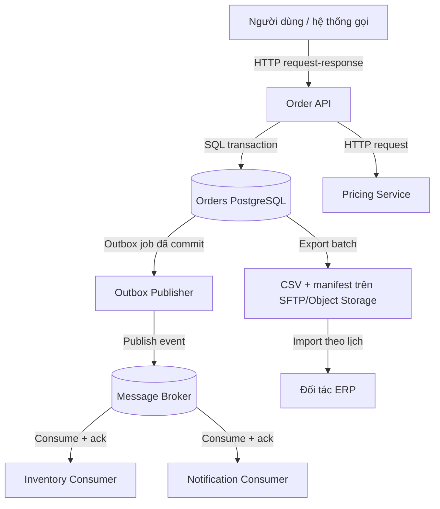
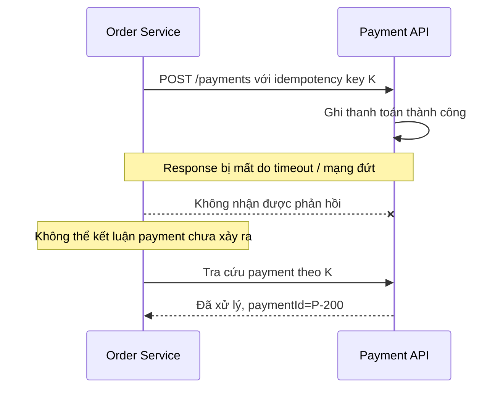
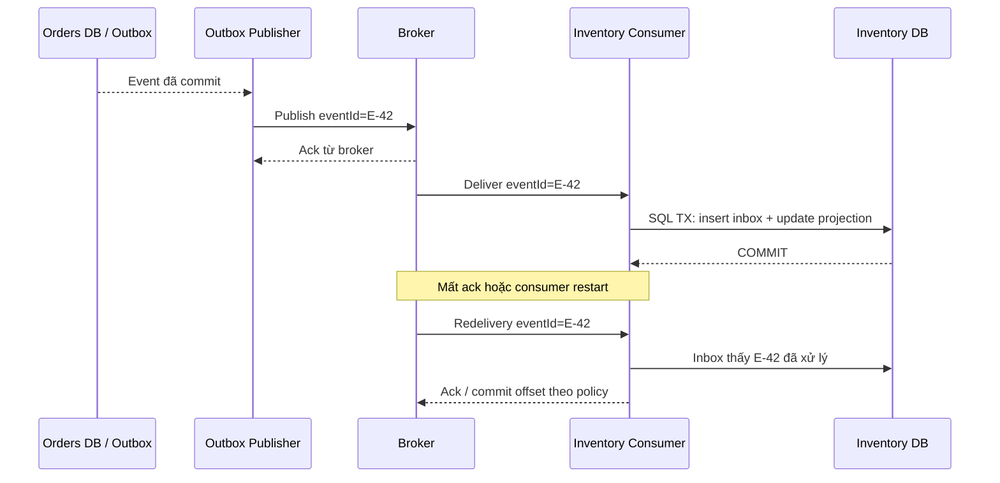
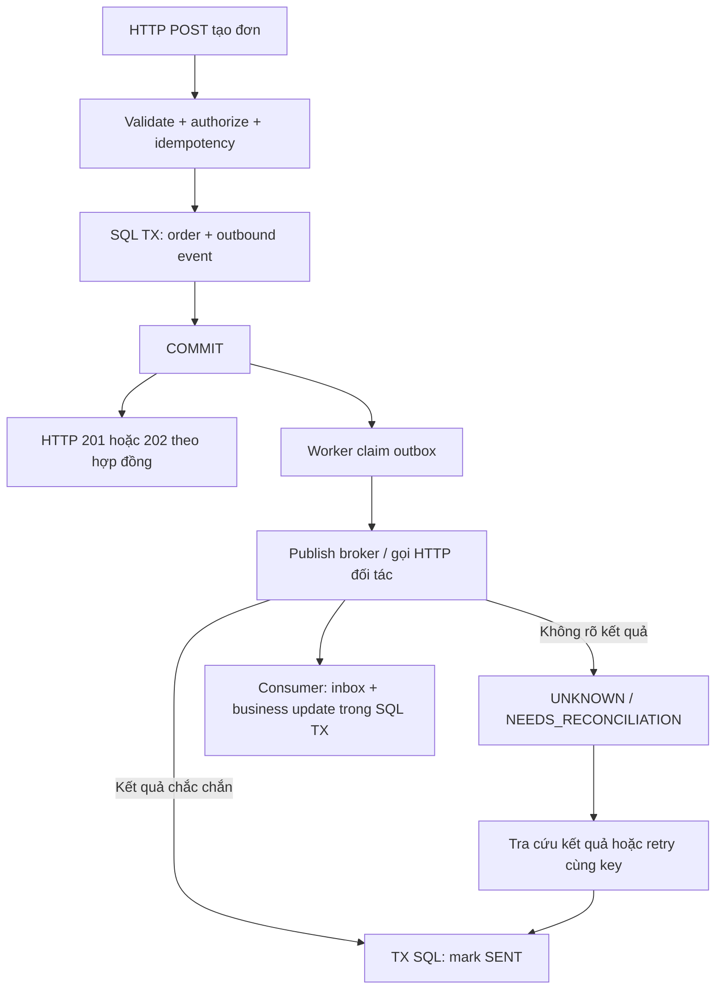
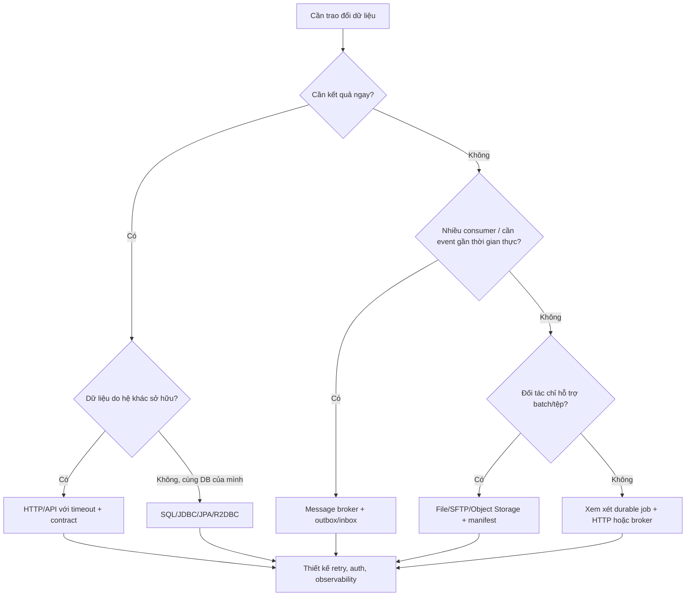
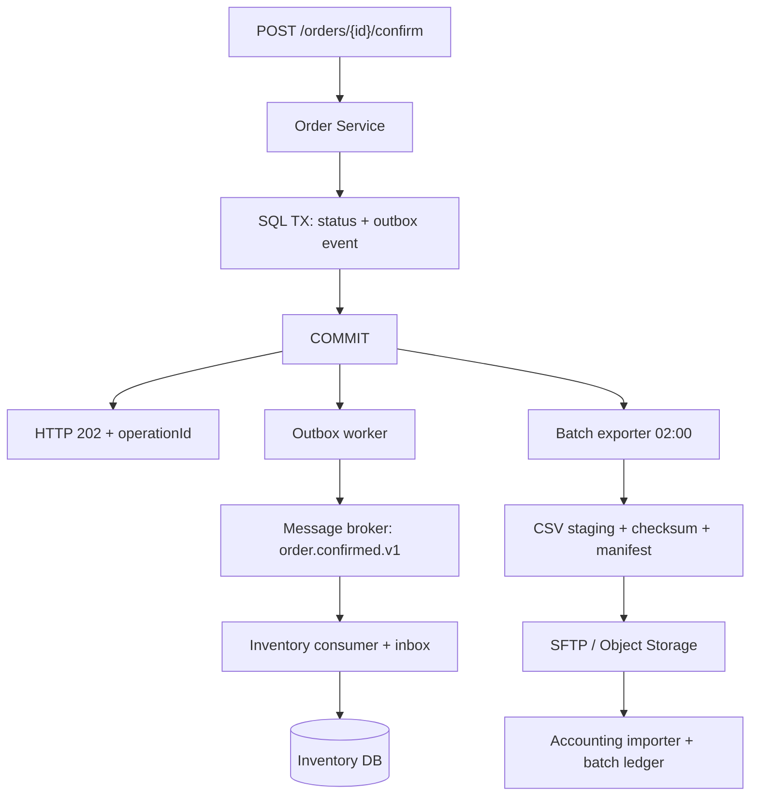

# Phân biệt giao tiếp qua HTTP, cơ sở dữ liệu, thông điệp và tệp

> **Chương:** Tổng quan tích hợp  
> **Phạm vi:** Trong module **SPRING_BOOT_INTEGRATION**, Spring Boot kết nối các hệ thống bằng HTTP client, cơ sở dữ liệu, cache, message broker và adapter của Spring Integration. Bài học này so sánh **HTTP**, **cơ sở dữ liệu**, **thông điệp** và **tệp**: cách chúng truyền dữ liệu, mức độ phụ thuộc giữa các bên, khả năng phục hồi, hợp đồng dữ liệu, giao dịch, lỗi, trùng lặp, kiểm thử và quan sát. Nội dung giúp chọn đúng cơ chế cho từng bước của một luồng tích hợp thay vì mặc định một công nghệ phù hợp mọi bài toán.

## 1. Tích hợp hệ thống là gì?

**Tích hợp hệ thống** là quá trình để các ứng dụng độc lập trao đổi thông tin hoặc phối hợp hoàn thành một nghiệp vụ. Ví dụ, một đơn hàng được tạo ở ứng dụng bán hàng nhưng cần:

1. Ghi trạng thái vào PostgreSQL.
2. Gọi dịch vụ tính phí vận chuyển.
3. Phát sự kiện cho hệ thống kho và kế toán.
4. Xuất tệp đối soát cho một đối tác chỉ nhận dữ liệu mỗi đêm.

Cả bốn bước đều có thể trao đổi dữ liệu, nhưng **không có cùng hợp đồng thời gian, khả năng thất bại và ranh giới giao dịch**. Vì thế, câu hỏi đầu tiên không phải “dùng Spring class nào?”, mà là:

- Bên gọi **có cần kết quả ngay** để trả lời người dùng không?
- Bên nhận có phải **đang online cùng thời điểm** với bên gửi không?
- Dữ liệu cần được **lưu bền vững** ở đâu, trong bao lâu?
- Ai sở hữu **nguồn sự thật** của dữ liệu?
- Khi mạng đứt hoặc process chết, ai **retry** và làm sao tránh xử lý hai lần?
- Khi hai bên cùng thay đổi trạng thái, có cần **nhất quán tức thời** hay chấp nhận **eventual consistency**?
- Đơn vị trao đổi là **một request**, **một transaction dữ liệu**, **một event** hay **một batch tệp**?

**Lưu ý quan trọng:** “Đồng bộ” và “bất đồng bộ” mô tả cách một thao tác chờ kết quả; còn HTTP, SQL, broker và tệp là các **cơ chế tích hợp**. HTTP thường dùng request–response đồng bộ, nhưng có thể trả `202 Accepted` để xử lý bất đồng bộ. Broker thường dùng để tách thời điểm gửi/nhận, nhưng producer vẫn có thể chờ xác nhận publish. Truy vấn SQL có thể dùng API blocking hoặc reactive; tệp có thể được truyền theo kết nối trực tiếp nhưng xử lý theo batch sau đó.

## 2. Bức tranh tổng thể: bốn cách trao đổi dữ liệu

| Tiêu chí | HTTP/API | Cơ sở dữ liệu | Thông điệp qua broker | Tệp / file exchange |
| --- | --- | --- | --- | --- |
| **Đơn vị trao đổi** | Request và response | Row, statement, query, transaction | Message/event/command | File hoặc batch dữ liệu |
| **Mô hình thường gặp** | Request–response | Đọc/ghi trạng thái lưu trữ | Queue hoặc publish–subscribe | Producer tạo file, consumer nhập file |
| **Độ trễ kỳ vọng** | Thường thấp, gần thời gian thực | Thường thấp, phụ thuộc query/lock | Gần thời gian thực hoặc xử lý sau | Theo lịch/batch, có thể lớn |
| **Phụ thuộc thời điểm** | Server thường cần sẵn sàng lúc gọi | Database cần sẵn sàng lúc thao tác | Broker cần sẵn sàng để nhận; consumer có thể offline nếu lưu bền vững | Consumer có thể nhận sau khi file hoàn tất và được lưu bền vững |
| **Kiểu kết nối** | HTTP/TLS, TCP | JDBC/R2DBC tới DB | Client protocol tới Kafka/RabbitMQ/JMS broker | Local filesystem, SFTP, object storage hoặc shared storage |
| **Nguồn sự thật** | Thường do API chủ sở hữu kiểm soát | Database của domain sở hữu dữ liệu | Thường là hệ thống phát/consumer; broker lưu message/log theo chính sách | Được định nghĩa trong hợp đồng: file nguồn, manifest hoặc hệ đích |
| **Khả năng lưu tạm** | Không tự có durable queue cho business job | Có lưu trữ bền vững và transaction trong DB | Phụ thuộc broker, ack, persistence, retention | Phụ thuộc filesystem/storage, cách publish, retention |
| **Giao dịch** | Không tham gia JDBC transaction theo mặc định | ACID trong phạm vi transaction manager/database thích hợp | Broker transaction/ack riêng; không tự chung transaction với SQL | Không có transaction ACID chung giữa file và DB |
| **Lỗi điển hình** | 4xx/5xx, timeout, TLS, response mất | Constraint, lock, deadlock, timeout, mất kết nối | Nack/redelivery, poison message, consumer lag | File thiếu, ghi dở, schema lỗi, upload lặp, mất file |
| **Điểm khó nhất** | Không rõ kết quả remote sau timeout | Coupling schema, lock, transaction scope | At-least-once, thứ tự, idempotency, DLQ | Xác định file hoàn chỉnh, chống nạp trùng, kiểm tra toàn vẹn |
| **Trường hợp phù hợp** | Tra cứu giá, xác minh tồn kho, request cần trả ngay | Lưu và truy vấn dữ liệu nghiệp vụ thuộc phạm vi sở hữu | Sự kiện đơn hàng, xử lý nền, fan-out | Báo cáo hàng ngày, đối soát, import/export khối lượng lớn |

Không có một lựa chọn tuyệt đối “nhanh nhất” hoặc “an toàn nhất”. Một cơ sở dữ liệu được cấu hình sai có thể làm toàn hệ thống chờ khóa; broker cấu hình thiếu persistence có thể mất message; tệp ghi dở có thể làm batch xử lý sai; HTTP timeout có thể đến **sau khi server đã commit**.

### 2.1. Sơ đồ bốn ranh giới trong một hệ thống



Một đơn hàng có thể đi qua **nhiều cơ chế**. Điều quan trọng là chỉ rõ *bước nào là nguồn sự thật*, *bước nào chỉ truyền thông tin*, và *sự cố ở một bước ảnh hưởng tới bước nào*.

## 3. HTTP: hỏi–đáp và gọi một dịch vụ sở hữu nghiệp vụ

**HTTP** thường phù hợp khi bên gọi cần yêu cầu **một thao tác cụ thể** hoặc hỏi thông tin mà bên nhận đang quản lý. Spring Boot có nhiều lựa chọn:

| Client | Đặc điểm | Nên dùng khi |
| --- | --- | --- |
| `RestClient` | HTTP client đồng bộ có fluent API (Spring Framework 6.1+, Boot 3.2+) | Ứng dụng MVC, worker imperative, tích hợp request–response thông thường |
| `WebClient` | HTTP client reactive dựa trên `Mono`/`Flux` | Pipeline non-blocking/reactive, request fan-out có kiểm soát |
| `@HttpExchange` + proxy | Interface mô tả HTTP contract; cần adapter/proxy factory gắn vào client | Muốn tách interface contract với mã gọi và dễ stub/test |
| Spring Integration HTTP outbound gateway | Nhận Spring Message, gửi HTTP, trả reply Message | HTTP là một bước trong IntegrationFlow với router, transformer, error channel |

### 3.1. Hợp đồng HTTP không chỉ là URL

Ví dụ API tra cứu tồn kho:

```http
GET /api/v1/inventory/SKU-42 HTTP/1.1
Accept: application/json
X-Correlation-Id: corr-501
```

```json
{
  "sku": "SKU-42",
  "available": 17,
  "warehouseId": "WH-A",
  "asOf": "2026-11-21T03:00:00Z"
}
```

Hợp đồng cần định nghĩa **path, method, authentication, request/response schema, status code, freshness, timeout và retry**. Trường `asOf` giúp caller biết kết quả được tính vào thời điểm nào; nhưng `available=17` không có nghĩa 17 sản phẩm sẽ còn tồn khi đơn hàng thực sự được ghi.

**HTTP status không đồng nghĩa trạng thái nghiệp vụ:**

- `200 OK`: request HTTP đã được xử lý thành công theo contract endpoint.
- `201 Created`: resource được tạo theo semantics của API.
- `202 Accepted`: đã chấp nhận yêu cầu để xử lý tiếp; **chưa xác nhận hoàn tất**.
- `404`: có thể không tồn tại resource, nhưng cũng có thể do route/path hoặc policy che giấu thông tin.
- `409`: có conflict; cần hợp đồng phân biệt duplicate hợp lệ, version conflict hay mismatch.
- `429` và `5xx`: không nên retry vô hạn; phải có backoff, giới hạn và quan sát.

### 3.2. Ví dụ RestClient trong Spring Boot

```java
package com.example.integration.http;

import java.time.Duration;
import org.springframework.beans.factory.annotation.Value;
import org.springframework.context.annotation.Bean;
import org.springframework.context.annotation.Configuration;
import org.springframework.http.client.SimpleClientHttpRequestFactory;
import org.springframework.web.client.RestClient;

@Configuration
class InventoryHttpConfiguration {
    @Bean("inventoryRestClient")
    RestClient inventoryRestClient(
            RestClient.Builder builder,
            @Value("${inventory.base-url}") String baseUrl) {

        var factory = new SimpleClientHttpRequestFactory();
        factory.setConnectTimeout(Duration.ofSeconds(2));
        factory.setReadTimeout(Duration.ofSeconds(4));

        return builder.clone()
                .baseUrl(baseUrl)
                .requestFactory(factory)
                .build();
    }
}
```

```java
package com.example.integration.http;

import org.springframework.beans.factory.annotation.Qualifier;
import org.springframework.stereotype.Component;
import org.springframework.web.client.RestClient;

record InventoryView(String sku, int available, String warehouseId) {}

@Component
class InventoryClient {
    private final RestClient client;

    InventoryClient(
            @Qualifier("inventoryRestClient") RestClient client) {
        this.client = client;
    }

    InventoryView getInventory(String sku) {
        return client.get()
                .uri("/api/v1/inventory/{sku}", sku)
                .retrieve()
                .body(InventoryView.class);
    }
}
```

Đây là ví dụ **đọc dữ liệu**. Cần bổ sung authentication/authorization, validate `sku`, xử lý 4xx/5xx, null/empty response, metric và retry theo hợp đồng. Các timeout minh họa có ý nghĩa cho client/request factory cụ thể; môi trường production nên đánh giá connection pooling/TLS/proxy và giới hạn request tổng thể.

### 3.3. Timeout và sự mơ hồ của kết quả



**Lưu ý:** Một HTTP timeout cho biết **caller không nhận được response đúng hạn**, không chứng minh server chưa thực thi side effect. Với lệnh ghi quan trọng, cần key cố định theo business operation, lưu fingerprint/payload và hỗ trợ tra cứu trạng thái. Không sinh key mới trên mỗi retry.

## 4. Cơ sở dữ liệu: chia sẻ trạng thái hay tạo ràng buộc trực tiếp?

**Tích hợp qua cơ sở dữ liệu** thường có hai hình thức rất khác nhau:

1. **Ứng dụng sở hữu database của chính mình** dùng JDBC/JPA/R2DBC để lưu trạng thái bền vững, các hệ khác tương tác qua API/event của ứng dụng.
2. **Hai hệ thống trực tiếp đọc/ghi cùng một database hoặc cùng schema** để trao đổi dữ liệu.

Hình thức thứ hai có thể tiện cho legacy integration, BI hoặc data migration, nhưng tạo **coupling mạnh** ở schema, quyền SQL, transaction/lock, lịch nâng cấp và quyền sở hữu dữ liệu. Một dịch vụ sửa trực tiếp bảng của dịch vụ khác có thể bỏ qua business validation, audit và invariant do ứng dụng chủ sở hữu bảo đảm.

### 4.1. Công nghệ truy cập SQL trong Spring Boot

| Công cụ | Mục đích | Ranh giới cần nắm |
| --- | --- | --- |
| `JdbcTemplate` / `NamedParameterJdbcTemplate` | SQL thủ công, tối ưu query và batch | Blocking JDBC, transaction SQL cục bộ |
| Spring Data JPA / Hibernate | Mapping entity, persistence context, repository | Blocking, flush/lazy loading, transaction theo EntityManager |
| jOOQ | SQL type-safe với DSL theo dialect | Gắn vào DataSource/transaction manager đúng |
| Spring Data R2DBC / `DatabaseClient` | Truy cập relational DB với Reactor | Reactive transaction theo Reactor context, không tự là JDBC/JPA |
| Flyway / Liquibase | Quản lý schema migration | Phải chạy trên đúng database/schema và quyền được cấp |

**Database transaction** có thể làm atomic nhiều thay đổi **trong phạm vi database/transaction manager thích hợp**. Nó không biến một HTTP POST, thao tác Redis, lệnh gửi Kafka hay file upload thành cùng một transaction ACID.

### 4.2. Ví dụ SQL transaction chứa cả trạng thái và ý định phát sự kiện

```sql
CREATE TABLE orders (
    id UUID PRIMARY KEY,
    status VARCHAR(24) NOT NULL
);

CREATE TABLE outbound_events (
    event_id UUID PRIMARY KEY,
    order_id UUID NOT NULL REFERENCES orders(id),
    event_type VARCHAR(80) NOT NULL,
    payload_json JSONB NOT NULL,
    status VARCHAR(24) NOT NULL DEFAULT 'PENDING',
    created_at TIMESTAMPTZ NOT NULL DEFAULT CURRENT_TIMESTAMP
);
```

Một service Spring JDBC thực hiện **hai câu SQL trong một transaction**:

```java
package com.example.integration.orders;

import java.util.UUID;
import org.springframework.jdbc.core.JdbcTemplate;
import org.springframework.stereotype.Service;
import org.springframework.transaction.annotation.Transactional;

@Service
class ConfirmOrderService {
    private final JdbcTemplate jdbc;

    ConfirmOrderService(JdbcTemplate jdbc) {
        this.jdbc = jdbc;
    }

    @Transactional
    public void confirm(UUID orderId) {
        int changed = jdbc.update("""
            UPDATE orders SET status = 'CONFIRMED'
             WHERE id = ? AND status = 'NEW'
            """, orderId);
        if (changed != 1) {
            throw new IllegalStateException("Order is not NEW");
        }

        UUID eventId = UUID.randomUUID();
        jdbc.update("""
            INSERT INTO outbound_events
                (event_id, order_id, event_type, payload_json)
            VALUES (?, ?, 'order.confirmed',
                    jsonb_build_object('orderId', ?::text))
            """, eventId, orderId, orderId);
    }
}
```

Nếu insert vào `outbound_events` thất bại và exception thoát ra, transaction rollback cả lệnh update `orders`. Sau commit, một **outbox worker độc lập** đọc các event `PENDING` và gửi tới broker/HTTP; không gọi remote ngay trong `@Transactional` này.

**Mẫu code có giả định:** một `DataSource`/transaction manager phù hợp, method được gọi qua Spring proxy, row `orders` đã tồn tại và trạng thái là `NEW`. Khi dùng nhiều DataSource, phải chọn đúng `JdbcTemplate` và `@Transactional(transactionManager = "...")`.

### 4.3. Điều gì khiến truy cập database trực tiếp là một integration risk?

- **Schema coupling:** đổi tên cột, constraint hay chuẩn hóa bảng có thể làm hệ khác hỏng.
- **Ownership coupling:** hệ thứ hai có thể ghi trạng thái sai mà không chạy domain validation.
- **Lock coupling:** report query hoặc transaction dài gây lock wait, ảnh hưởng request chính.
- **Deployment coupling:** schema migration đòi hỏi tất cả bên đọc/ghi phải tương thích.
- **Security coupling:** quyền SQL quá rộng làm tăng phạm vi rò rỉ dữ liệu.
- **Availability coupling:** hai hệ cùng phụ thuộc vào một DB và giới hạn connection.

Nếu yêu cầu chỉ là phục vụ báo cáo gần thời gian thực, cân nhắc **read model/read replica, CDC, event streaming hoặc data export** với ownership rõ. Không mặc định mở toàn quyền DB của service A cho service B là phương án tích hợp tốt nhất.

## 5. Thông điệp: giao tiếp qua broker và xử lý tách thời gian

**Message broker** giúp producer và consumer không phải cùng thực thi nghiệp vụ trong một lời gọi đồng bộ. Producer publish một message; broker chuyển/lưu nó theo chính sách; consumer nhận, xử lý rồi xác nhận.

Hai kiểu phổ biến:

- **Queue/work distribution:** nhiều worker cạnh tranh xử lý các công việc trong queue theo semantics broker.
- **Publish–subscribe/event:** một sự kiện có thể được các consumer group/subscription khác nhau quan sát và xử lý độc lập.

Spring Boot thường tích hợp **Kafka**, **RabbitMQ/AMQP**, **JMS** (ActiveMQ Classic/Artemis) hoặc Spring Integration adapters. Dù công nghệ khác nhau, các câu hỏi cần trả lời tương tự: publish acknowledgment, retention, retry, consumer ack/offset, thứ tự, DLQ và idempotency.

### 5.1. Command khác event

| Loại message | Ví dụ | Ý nghĩa | Người nhận chịu trách nhiệm gì? |
| --- | --- | --- | --- |
| **Command** | `ReserveStock(orderId)` | Yêu cầu một handler thực hiện hành động | Kiểm tra và trả/ghi kết quả của lệnh; xác định retry/idempotency |
| **Event** | `OrderConfirmed(eventId, orderId)` | Một sự thật nghiệp vụ đã xảy ra | Nhiều consumer có thể cập nhật read model, gửi email, tính số liệu |

Tên message nên phản ánh sự thật hoặc ý định. `OrderConfirmed` không nên được phát trước khi database thực sự commit xác nhận đơn (trừ khi hợp đồng nói rõ trạng thái tạm). Consumer không được giả định một event phản ánh toàn bộ state hiện tại nếu các event mới hơn có thể đã được xử lý.



### 5.2. At-least-once không phải exactly-once xuyên hệ thống

Broker có thể **giao lại** cùng một message khi consumer xử lý xong nhưng ack/offset chưa được ghi nhận. Kafka có các cơ chế transaction và exactly-once processing trong những phạm vi cụ thể của Kafka, nhưng **không tự làm một transaction SQL và HTTP ngoại vi thành exactly-once**. RabbitMQ/JMS cũng có cơ chế acknowledgment/transaction riêng, không tự commit chung với database.

Consumer phải được thiết kế **idempotent**:

```sql
CREATE TABLE integration_inbox (
    consumer_name VARCHAR(80) NOT NULL,
    event_id VARCHAR(160) NOT NULL,
    processed_at TIMESTAMPTZ NOT NULL DEFAULT CURRENT_TIMESTAMP,
    PRIMARY KEY (consumer_name, event_id)
);
```

```java
package com.example.integration.messaging;

import org.springframework.jdbc.core.JdbcTemplate;
import org.springframework.stereotype.Service;
import org.springframework.transaction.annotation.Transactional;

record OrderConfirmed(String eventId, String orderId) {}

@Service
class InventoryProjectionService {
    private final JdbcTemplate jdbc;

    InventoryProjectionService(JdbcTemplate jdbc) {
        this.jdbc = jdbc;
    }

    @Transactional
    public void applyOnce(OrderConfirmed event) {
        int claimed = jdbc.update("""
            INSERT INTO integration_inbox (consumer_name, event_id)
            VALUES ('inventory-projection', ?)
            ON CONFLICT DO NOTHING
            """, event.eventId());

        if (claimed == 0) {
            return; // Đã commit event này trong lần nhận trước.
        }

        jdbc.update("""
            UPDATE inventory_orders
               SET confirmed = TRUE
             WHERE order_id = ?
            """, event.orderId());
    }
}
```

Ví dụ giả định bảng `inventory_orders(order_id, confirmed)` đã được tạo và message được validate trước khi gọi. Inbox và business update dùng **cùng transaction SQL**. Nếu update lỗi, inbox cũng rollback để event có thể được xử lý lại. Nếu bảng không có order ID, ứng dụng phải chọn chính sách chờ/retry/reconcile thay vì âm thầm coi là thành công. Cần thêm unique business key nếu producer có thể phát **hai event ID khác nhau cho cùng một ý định**.

### 5.3. Listener minh họa với Kafka

```java
package com.example.integration.messaging;

import org.springframework.kafka.annotation.KafkaListener;
import org.springframework.stereotype.Component;

@Component
class OrderConfirmedListener {
    private final InventoryProjectionService service;

    OrderConfirmedListener(InventoryProjectionService service) {
        this.service = service;
    }

    @KafkaListener(
        topics = "orders.confirmed.v1",
        groupId = "inventory-projection")
    void onEvent(OrderConfirmed event) {
        service.applyOnce(event);
    }
}
```

Để ví dụ này hoạt động, cần thêm Spring Kafka dependency, cấu hình broker, topic, JSON deserializer và **trusted type/schema policy**. `@KafkaListener` không tự giải mã mọi JSON thành record Java đúng ý khi chưa có converter/deserializer. Khi service ném exception, cấu hình consumer error handler/retry/DLQ cần bảo đảm offset không bị commit như thể xử lý thành công.

**Độ bền message phụ thuộc cấu hình broker**, acknowledgments, replication, retention, thời gian consumer offline và storage. Không coi `send()` return hoặc producer nhận ack là bằng chứng tất cả consumer đã xử lý xong.

## 6. Tệp: giao tiếp theo batch, có ranh giới “hoàn tất”

**File-based integration** phù hợp khi đối tác chỉ nhận **CSV, XML, JSON Lines, Excel hoặc file nhị phân** trên thư mục/SFTP/object storage, hoặc khi cần xử lý khối lượng lớn theo lịch.

Không nên đánh đồng “file đã nhìn thấy trên thư mục” với “file đã được ghi xong”. Consumer có thể mở tệp ngay khi producer vẫn đang ghi và xử lý **một phần nội dung**.

### 6.1. Thiết kế một file contract

Ví dụ đối tác nhận file `orders_2026-11-21_batch-018.csv`:

```csv
order_id,amount_minor,currency,confirmed_at
ORD-42,125000,VND,2026-11-21T03:00:00Z
ORD-43,79000,VND,2026-11-21T03:01:00Z
```

Hợp đồng tệp phải nêu:

| Nội dung | Ví dụ cần thỏa thuận |
| --- | --- |
| **Tên file** | `orders_<date>_<batchId>.csv`, không tái sử dụng tên nếu đã publish |
| **Encoding** | UTF-8, BOM hoặc không BOM, newline CRLF/LF |
| **Schema** | Cột bắt buộc, thứ tự, kiểu dữ liệu, version, delimiter, quote/escape |
| **Khối lượng** | Dung lượng tối đa, số row, cách chia batch |
| **Trạng thái hoàn tất** | Ghi file tạm rồi rename atomic, hoặc publish manifest/done marker |
| **Toàn vẹn** | Checksum SHA-256, row count, manifest, size |
| **Định danh batch** | ID ổn định để chống import trùng |
| **Acknowledgment** | File ack/result/quarantine hoặc API trạng thái nhập |
| **Lưu trữ** | Retention, archive, quyền xóa, quyền replay |
| **Bảo mật** | SFTP/SSH hoặc TLS, encryption-at-rest, ACL, hạn chế PII |

### 6.2. Ghi tệp tạm rồi publish

Trên filesystem có hỗ trợ atomic move **trong cùng phạm vi filesystem phù hợp**, producer có thể ghi file `.tmp` rồi rename sau khi hoàn tất:

```java
package com.example.integration.files;

import java.io.IOException;
import java.nio.charset.StandardCharsets;
import java.nio.file.Files;
import java.nio.file.Path;
import java.nio.file.StandardCopyOption;
import java.nio.file.StandardOpenOption;

class BatchFilePublisher {
    void publish(Path directory, String batchId, String csv)
            throws IOException {
        // batchId phải được validate theo allowlist; không nhận path tùy ý.
        if (!batchId.matches("[A-Za-z0-9_-]{1,80}")) {
            throw new IllegalArgumentException("Invalid batchId");
        }

        Path temporary = directory.resolve("orders_" + batchId + ".tmp");
        Path published = directory.resolve("orders_" + batchId + ".csv");

        Files.writeString(temporary, csv, StandardCharsets.UTF_8,
                StandardOpenOption.CREATE_NEW,
                StandardOpenOption.WRITE);

        Files.move(temporary, published, StandardCopyOption.ATOMIC_MOVE);
    }
}
```

Đây là mẫu minh họa cho **local filesystem**. `ATOMIC_MOVE` có thể không được hỗ trợ hoặc có semantics khác khi move qua filesystem, volume, network share hay object storage. Khi không được hỗ trợ, code nên **báo lỗi để chọn giao thức publish khác**, không tự động đổi thành move thường rồi coi upload đã atomic.

Nếu cần độ bền qua mất điện, còn phải cân nhắc flush/fsync file và directory metadata theo filesystem/OS. Trên SFTP hoặc object storage, dùng cơ chế staging + rename/manifest/commit marker tương ứng với khả năng dịch vụ; không suy ra `Files.move(ATOMIC_MOVE)` áp dụng cho mọi storage.

### 6.3. Inbound file adapter trong Spring Integration

Spring Integration có file inbound adapter để poll thư mục, chuyển file thành message và đưa tới handler:

```java
package com.example.integration.files;

import java.io.File;
import java.time.Duration;
import org.springframework.context.annotation.Bean;
import org.springframework.context.annotation.Configuration;
import org.springframework.integration.dsl.IntegrationFlow;
import org.springframework.integration.dsl.Pollers;
import org.springframework.integration.file.dsl.Files;

@Configuration
class FileImportFlowConfiguration {
    @Bean
    IntegrationFlow importOrders(FileImportService importer) {
        return IntegrationFlow
                .from(
                    Files.inboundAdapter(new File("/data/incoming"))
                         .patternFilter("*.csv"),
                    endpoint -> endpoint.poller(
                        Pollers.fixedDelay(Duration.ofSeconds(5))))
                .handle(File.class, (file, headers) -> {
                    importer.importOnce(file);
                    return null; // One-way handler, không có reply nghiệp vụ.
                })
                .get();
    }
}
```

`FileImportService` là thành phần do ứng dụng triển khai: validate schema, checksum, batch ID, nạp SQL trong transaction, ghi kết quả và archive/quarantine. Adapter này **không tự bảo đảm file đã được upload xong, không tự commit file+SQL và không tự chống import trùng xuyên restart**. Cần kết hợp quy ước publish hoàn tất, **persistent accept-once filter hoặc bảng import ledger có unique key**, cùng quy trình xử lý lỗi và retry.

### 6.4. Ví dụ thiết kế import ledger

```sql
CREATE TABLE file_imports (
    source_system VARCHAR(80) NOT NULL,
    batch_id VARCHAR(120) NOT NULL,
    checksum_sha256 VARCHAR(64) NOT NULL,
    status VARCHAR(24) NOT NULL,
    imported_at TIMESTAMPTZ,
    PRIMARY KEY (source_system, batch_id)
);
```

Nếu nhận lại **cùng batch ID nhưng checksum khác**, không được im lặng bỏ qua hoặc overwrite: đó là **conflict** cần điều tra. Nếu nạp file một phần rồi lỗi, phải xác định rõ transaction theo batch/chunk, bảng staging và cách resume. Một bảng ledger với unique constraint giúp kiểm soát, nhưng **phải được cập nhật cùng transaction với các row được import** khi muốn bảo đảm idempotency cho một đơn vị công việc.

**CSV cũng có rủi ro bảo mật:** kích thước lớn, ký tự escape/phân tách bất thường, dữ liệu nhập vào spreadsheet có công thức bắt đầu bằng `=`/`+`/`-`/`@`. Khi xuất CSV để người dùng mở bằng spreadsheet, cần chính sách tránh CSV formula injection; khi import, cần kiểm tra định dạng, đường dẫn và giới hạn tài nguyên.

## 7. Bốn phương thức tương tác với transaction khác nhau ra sao?

Đây là khác biệt nền tảng khiến nhiều luồng tích hợp tưởng đúng nhưng sai khi hệ thống crash.

### 7.1. Biên của transaction

| Hoạt động | Có thể nằm trong **một** JDBC transaction đơn lẻ? | Ghi chú |
| --- | --- | --- |
| Update hai bảng cùng PostgreSQL qua một DataSource/manager | **Có** | Tùy isolation, constraint, error và cách gọi qua transaction proxy |
| Ghi PostgreSQL rồi gửi HTTP POST | **Không, theo mặc định** | HTTP có thể đã xử lý dù SQL rollback |
| Ghi PostgreSQL rồi publish Kafka | **Không, theo mặc định** | Cần outbox hoặc cơ chế phối hợp chuyên biệt |
| Ghi PostgreSQL rồi ghi file SFTP | **Không** | Remote file upload không tự tham gia JDBC transaction |
| Ghi hai database độc lập | **Không bằng một local transaction manager** | Cần chiến lược phân tán/đối chiếu nếu cần atomicity |
| Một consumer nhận broker message rồi ghi SQL | **Hai biên riêng** | SQL commit có thể thành công trước broker ack, gây redelivery |
| R2DBC SQL và JDBC SQL | **Không tự chung transaction** | Khác API/manager/context, cần thiết kế tường minh |

### 7.2. Mẫu giải quyết chung: transactional outbox + inbox

Một luồng bền vững đi từ HTTP vào SQL rồi ra broker hoặc HTTP:



Trong cùng transaction SQL, lưu **state nguồn và bản ghi ý định gửi**. Sau commit, worker chuyển thông tin qua kênh phù hợp. Nếu worker chết sau khi hệ ngoài đã nhận nhưng trước khi đánh dấu `SENT`, retry có thể gửi lại. Vì thế side effect cần được nhận diện bằng **business operation ID/event ID/idempotency key ổn định** và consumer phải có cơ chế dedup.

**Outbox không tự tạo exactly-once end-to-end.** Nó đảm bảo ý định gửi không bị mất do crash sau SQL commit, với điều kiện transaction và quá trình quét/publish được triển khai đúng; còn trùng lặp ở điểm giao nhận vẫn phải xử lý.

## 8. So sánh mức độ phụ thuộc giữa các hệ thống

Coupling có nhiều chiều, không chỉ là “dịch vụ này biết URL dịch vụ kia”.

| Khía cạnh coupling | HTTP | Database chia sẻ | Broker | File |
| --- | --- | --- | --- | --- |
| **Thời gian** | Caller thường chờ server online | Ứng dụng chờ DB online | Producer và consumer có thể chạy khác thời điểm nếu broker lưu message | Producer/consumer thường tách lịch |
| **Địa chỉ** | Caller cần endpoint/service discovery | Cần DB endpoint và schema | Cần broker/topic/queue | Cần storage path/bucket/SFTP endpoint |
| **Schema** | API DTO, status code, version | Bảng/cột/constraint, thường coupling rất mạnh nếu shared DB | Event schema, topic, key và version | File format/manifest/filename |
| **Triển khai** | Hai phía cần contract tương thích | Migration phải tương thích mọi bên đọc/ghi | Producer/consumer có thể deploy độc lập nếu schema compatible | Producer/consumer có thể nâng cấp theo lịch batch |
| **Nội dung lỗi** | Trả lỗi trực tiếp, caller quyết định | SQL lỗi trực tiếp trong transaction | Error handling và retry ở consumer/broker | Quarantine, ack file và batch report |

**Broker giảm phụ thuộc thời gian**, nhưng tăng nhu cầu quản lý schema compatibility, consumer lag, replay và eventual consistency. **File giảm yêu cầu kết nối đồng thời**, nhưng tăng yêu cầu quản trị lô, tính toàn vẹn và vòng đời tệp. **Shared database đơn giản hóa dữ liệu có sẵn**, nhưng dễ làm mất ranh giới sở hữu giữa các dịch vụ.

## 9. Một bảng quyết định theo yêu cầu nghiệp vụ

| Nhu cầu | Lựa chọn thường phù hợp | Vì sao? |
| --- | --- | --- |
| Caller phải biết phí vận chuyển trước khi xác nhận màn hình | **HTTP request–response** | Cần kết quả ngay, hạn chế timeout và fallback rõ |
| Cập nhật order, payment status và outbox atomically trong cùng DB | **SQL transaction** | Cần ràng buộc và nhất quán dữ liệu nguồn |
| Phát `OrderConfirmed` tới nhiều consumer độc lập | **Message broker/event** | Fan-out, tách thời điểm, mỗi consumer có thể xử lý theo năng lực |
| Nhập 2 triệu dòng từ đối tác mỗi đêm | **Tệp + manifest/staging** | Xử lý batch, streaming file, retry theo lô |
| Tra cứu danh mục ít đổi với latency thấp | **HTTP/SQL + cache** | Cache hỗ trợ hiệu năng, không thay source of truth |
| Phát sự kiện sau commit SQL mà không mất message khi app crash | **SQL outbox → broker/HTTP** | Gắn nguồn dữ liệu với ý định phát trong cùng transaction |
| Đối tác chỉ cấp SFTP, không có API | **File integration** | Tôn trọng khả năng hệ đích, có checksum và import acknowledgment |
| Hai ứng dụng muốn ghi trực tiếp cùng bảng nghiệp vụ | **Ưu tiên API/event được sở hữu** | Tránh bypass invariant, lock và schema coupling mạnh |

### 9.1. Luồng quyết định đơn giản



Sơ đồ là **heuristic lựa chọn ban đầu**. Trong thực tế một nghiệp vụ có thể cần phối hợp nhiều kênh. Hãy kiểm tra tải, mức phục hồi mong muốn, ngân sách vận hành, compliance và các ràng buộc của đối tác trước khi chốt kiến trúc.

## 10. Xử lý lỗi khác nhau ở từng phương thức

| Sự cố | Cách nhận biết | Hành vi cần thiết |
| --- | --- | --- |
| HTTP 400/422 | Response validation/business rejection | Sửa request, không retry mù |
| HTTP timeout sau POST | Không nhận response | Kiểm tra idempotency key/status lookup; **không khẳng định remote chưa làm** |
| SQL duplicate key | Unique constraint | Đối chiếu bản ghi đã tồn tại và business fingerprint; không bypass constraint |
| SQL deadlock/serialization failure | SQL exception theo dialect | Retry transaction nhỏ và hữu hạn khi nghiệp vụ cho phép |
| Broker gửi lại message | Cùng event ID hoặc delivery metadata | Inbox/dedup + ack sau side effect bền vững |
| Broker poison message | Lặp lỗi parse/schema | DLQ/quarantine, alert, kiểm soát replay |
| Tệp chỉ mới upload một phần | Size/checksum chưa khớp hoặc chưa có marker publish | Không import, chờ file hoàn tất |
| Tệp được gửi lại cùng batch ID | Ledger unique key/checksum | Trả kết quả cũ hoặc báo conflict nếu checksum khác |
| Backend không sẵn sàng hàng giờ | Queue lag, connection timeout, import backlog | Giới hạn retry/concurrency, cảnh báo và quy trình phục hồi |

### 10.1. Một retry policy cho một ý định nghiệp vụ

Nếu HTTP caller retry ba lần, gateway retry ba lần và worker còn retry ba lần, một ý định có thể được gửi rất nhiều lần. Đặt **owner của retry** rõ ràng, giới hạn số lượt/thời gian, backoff và jitter. Giữ **cùng business operation ID** qua các lần thử.

Tách lỗi:

- **Permanent:** schema không hợp lệ, thiếu quyền, business rejection cuối cùng → không retry vô hạn.
- **Transient:** tạm mất kết nối, rate limiting, deadlock có thể thử lại → retry có giới hạn và giám sát.
- **Unknown outcome:** remote side effect có thể đã xảy ra → ưu tiên đối chiếu/truy vấn trạng thái trước khi retry nguy hiểm.

## 11. Tính nhất quán, thứ tự và freshness

**HTTP** đọc một snapshot ở thời điểm API trả lời; kết quả có thể đã cũ ngay sau đó. **SQL** có mức isolation cụ thể, nhưng query của hai transaction khác nhau không mặc nhiên có cùng snapshot. **Broker** có thể bảo đảm thứ tự theo partition/queue trong những phạm vi nhất định, nhưng nhiều consumer và retry có thể làm thay đổi thứ tự quan sát. **File** chứa snapshot theo batch; dữ liệu có thể cũ trước khi import.

Vì thế hợp đồng dữ liệu nên có:

| Thành phần | Tác dụng |
| --- | --- |
| `eventId` / `operationId` / `batchId` | Chống trùng cho đơn vị nghiệp vụ đúng phạm vi |
| `occurredAt` / `asOf` | Thể hiện thời điểm sự kiện hoặc snapshot |
| `schemaVersion` | Cho phép consumer nhận biết hợp đồng phiên bản |
| `aggregateVersion` / `sequence` | Phát hiện event cũ/out-of-order hoặc update bị ghi đè |
| `sourceSystem` / `tenantId` | Phân biệt nguồn và phạm vi định danh |
| Checksum/fingerprint | Nhận diện payload bị thay đổi dưới cùng key |
| Correlation/trace ID | Liên kết log giữa nhiều bước (không thay idempotency key) |

**Không dùng timestamp làm khóa chống trùng duy nhất.** Đồng hồ giữa máy có thể lệch; hai event hợp lệ có thể cùng timestamp. Không dùng correlation ID chung cho một workflow làm business ID nếu workflow có nhiều lệnh khác nhau.

### 11.1. Gắn version vào contract

Ví dụ DTO/event:

```json
{
  "eventId": "evt-20261121-481",
  "sourceSystem": "orders",
  "schemaVersion": 1,
  "orderId": "ORD-42",
  "aggregateVersion": 7,
  "occurredAt": "2026-11-21T03:00:00Z",
  "status": "CONFIRMED"
}
```

Nếu producer thêm trường mới, không thể mặc định consumer cũ bỏ qua nó; cần kiểm thử **backward/forward compatibility** cho HTTP DTO, message schema và file schema. Thay đổi phá vỡ nghĩa trường có thể cần route/topic/file format version mới và giai đoạn chạy song song.

## 12. Bảo mật: mỗi kênh có trust boundary riêng

| Kênh | Bảo mật kết nối | Phân quyền | Rủi ro đặc biệt |
| --- | --- | --- | --- |
| **HTTP** | TLS/mTLS, xác minh certificate, token/service credentials | OAuth2 scopes, API authorization theo tenant/resource | SSRF khi URL động, chuyển tiếp token nhầm đối tác, lộ response lỗi |
| **Database** | TLS theo driver/server, account và secret rotation | Role/schema/table, principle of least privilege | SQL injection, shared schema quyền rộng, query làm nghẽn DB |
| **Broker** | TLS/SASL/credentials theo công nghệ | Quyền topic/queue/exchange, ACL consumer/producer | Payload injection, DLQ chứa PII, message schema không tin cậy |
| **File/SFTP** | SSH host-key verification hoặc TLS/encryption | Folder/bucket ACL, quyền đọc/ghi/xóa | Path traversal, file ghi dở, zip bomb, CSV formula injection |

Nguyên tắc chung:

1. Xác thực **nguồn gọi** trước khi cho phép đọc/ghi.
2. Không tin `tenantId` hoặc `role` do caller tự gửi nếu chưa gắn với identity đã xác thực.
3. Giới hạn kích thước body/message/file, số bản ghi, độ sâu parse, concurrency và deadline.
4. Không ghi nguyên payload nhạy cảm, mật khẩu hoặc token vào log/DLQ.
5. Mã hóa và quản lý retention/quyền truy cập cho dữ liệu lưu trong SQL, broker, Redis và storage.
6. Quy định riêng khi chuyển dữ liệu qua biên tổ chức hoặc chứa PII.

## 13. Quan sát một luồng tích hợp từ đầu đến cuối

Một request tạo đơn có thể thành công ở SQL nhưng lỗi ở broker; hoặc HTTP outbound timeout dù đối tác đã xử lý. Chỉ nhìn một log “200 OK” là chưa đủ.

| Chỉ số/trace | Phát hiện |
| --- | --- |
| HTTP request rate, P95/P99 latency, status, timeout | API đang chậm hoặc trả lỗi |
| DB connection pool, lock wait, transaction duration | SQL nghẽn, transaction quá dài |
| Outbox pending count và oldest age | Sau commit có lệnh phát event còn tồn |
| Broker publish failure, consumer lag, redelivery, DLQ depth | Message bị tồn, nhận trùng hoặc poison |
| File upload duration, checksum mismatch, import batch status | Tệp thiếu/hỏng hoặc import chậm |
| Inbox duplicate count và idempotency conflict | Retry/redelivery bất thường hoặc key bị dùng lại sai |
| Reconciliation pending count | Những side effect chưa xác định kết quả cần xử lý |

Các metric ở đây là **nhóm chỉ số đề xuất**, không phải tất cả có sẵn theo mặc định từ Spring Boot. Spring Boot Actuator, Micrometer, OpenTelemetry/tracing và metric broker/storage có thể được kết hợp tùy hệ thống. Tag chỉ nên là những nhãn **cardinality thấp** như operation, endpoint template, consumer group, destination và error class; không dùng order ID, event ID, file name duy nhất hoặc token làm metric tag.

### 13.1. Correlation không thay idempotency

Ví dụ hành trình:

```text
traceId=corr-824  step=http-inbound  order=ORD-42  status=accepted
traceId=corr-824  step=sql-commit    order=ORD-42  eventId=evt-481
traceId=corr-824  step=outbox-send   eventId=evt-481 status=published
traceId=corr-824  step=consumer      eventId=evt-481 status=processed
traceId=corr-824  step=file-export   batchId=batch-018 status=published
```

`traceId` kết nối log và span; `eventId` chống xử lý trùng một event; `batchId` chống nạp lại batch; chúng có thể liên quan nhưng **không hoán đổi ý nghĩa**. Dùng cách redact/log access thích hợp nếu ID có thể nhận diện người dùng hoặc dữ liệu nhạy cảm.

## 14. Kiểm thử: phải xác minh đúng ranh giới chứ không chỉ mock method

| Loại tích hợp | Test unit giúp gì? | Integration test cần chứng minh gì? |
| --- | --- | --- |
| **HTTP** | Mapping DTO, logic retry/status | MockWebServer/WireMock nhận đúng request bytes, headers; timeout và 4xx/5xx được phân loại |
| **SQL** | Business rules, SQL mapping có thể test đơn vị | PostgreSQL thật/Testcontainers xác nhận transaction, unique key, rollback, lock và migration |
| **Broker** | Handler mapping và validation | Broker thật trong test: publish/consume, offset/ack, redelivery, DLQ, concurrency |
| **File** | Parser CSV/JSONL, checksum và validation | Temporary directory/SFTP/object storage test: partial file, rename/marker, duplicate batch, archive/quarantine |

### 14.1. Bốn tình huống lỗi bắt buộc

**Tình huống A — HTTP:** mock đối tác ghi nhận POST nhưng ngắt response. Xác nhận caller **không** kết luận remote chưa thực thi; retry cùng idempotency key không tạo side effect thứ hai.

**Tình huống B — SQL:** insert outbox thất bại sau khi update order. Xác nhận cả hai rollback trong một transaction SQL, không có bản ghi order “đã xác nhận nhưng mất sự kiện”.

**Tình huống C — broker:** consumer commit SQL rồi mất ack/offset. Broker redeliver; inbox phát hiện trùng và không chạy side effect hai lần.

**Tình huống D — file:** consumer thấy `.tmp` hoặc một file chưa có manifest/marker, phải từ chối xử lý; khi hoàn tất, import chỉ một lần theo batch ID/checksum dù file được upload lại.

Với các test này, chỉ dùng mock repository hoặc fake broker không chứng minh toàn bộ transaction/ack semantics. Tạo fixture nhỏ, deadline hữu hạn, dọn resource an toàn và assert trạng thái **sau khi transaction/ack đã kết thúc**.

### 14.2. Các câu hỏi khi test một luồng hoàn chỉnh

- Khi process chết **trước commit**, có dữ liệu hoặc message nào bị phát ra ngoài không?
- Khi process chết **sau commit trước publish**, outbox có còn và worker có phục hồi được không?
- Khi process chết **sau remote side effect trước local status update**, có khả năng chống trùng/tra cứu không?
- Khi consumer nhận **cùng event hai lần**, có ràng buộc bền vững ngăn side effect lặp không?
- Khi import nhận **cùng batch ID khác checksum**, hệ thống báo conflict hay ghi đè âm thầm?
- Khi đổi schema/version, phiên bản producer và consumer cũ còn giao tiếp an toàn không?

## 15. Bài tập thực hành tổng hợp

### Đề bài: đơn hàng, kho, kế toán và đối soát

Một hệ thống bán hàng có các yêu cầu:

1. Người dùng bấm “Xác nhận đơn”, API phải phản hồi nhanh và có mã theo dõi.
2. Đơn hàng và ý định cập nhật kho phải được lưu lại ngay cả khi broker đang lỗi.
3. Kho có thể đang offline trong lúc bán hàng nhưng phải nhận event khi hoạt động lại.
4. Kế toán chỉ chấp nhận file CSV lúc 02:00 hàng ngày.
5. Một số HTTP request hoặc message bị retry sau timeout.

**Đề xuất thiết kế:**



Một cách triển khai đúng phải quy định **khi nào trả 202**, **khóa trùng của event/batch**, **cách worker retry** và **SLA dữ liệu cũ**. Nếu HTTP POST cần xác nhận kho đã giữ hàng trước khi trả 201, yêu cầu đó khác biệt đáng kể với mô hình trả 202 và eventual consistency ở trên.

### Bài mở rộng

1. Thêm API `GET /operations/{operationId}` để caller tra cứu trạng thái sau khi nhận 202.
2. Thiết kế bảng `outbound_events` và `integration_inbox` với unique constraint, retry count và reconciliation state.
3. Thêm event `OrderCancelled`, xác định cách bảo vệ thứ tự khi `OrderConfirmed`/`OrderCancelled` có thể đến không theo thứ tự.
4. Đưa manifest JSON kèm `batchId`, row count, SHA-256, schema version vào file exchange.
5. Mô phỏng broker down 10 phút; kiểm tra order vẫn commit, backlog tăng rồi hồi phục.
6. Mô phỏng file bị upload lại dưới cùng batch ID nhưng có payload khác; xác định quy trình quarantine.

## 16. Những nhầm lẫn thường gặp

1. **“HTTP luôn đồng bộ, messaging luôn bất đồng bộ.”** Sai: HTTP có 202/asynchronous job; producer broker cũng có thể chờ publish ack.
2. **“Một SQL transaction bao cả HTTP, broker và file.”** Sai: không có distributed transaction mặc định.
3. **“Chia sẻ cùng một database giúp hai microservice độc lập hơn.”** Thường sai: schema, quyền và migration coupling tăng mạnh.
4. **“Publish thành công nghĩa là consumer đã xử lý.”** Sai: producer/broker ack và consumer business completion là hai mốc khác nhau.
5. **“Broker bảo đảm message chỉ được xử lý một lần trên SQL.”** Sai: cần idempotent consumer và transaction/inbox phù hợp.
6. **“Tệp xuất hiện trong directory nghĩa là có thể import.”** Sai: phải có quy ước hoàn tất, checksum hoặc manifest.
7. **“HTTP timeout nghĩa là chưa có side effect.”** Sai: remote có thể đã commit.
8. **“Một file checksum giống nhau là đủ chống trùng.”** Chưa chắc: cần scope nguồn/batch và hợp đồng xử lý nhiều lần hợp lệ.
9. **“Có Redis cache là có durable idempotency ledger.”** Sai: cache eviction/TTL không phải guarantee lưu vĩnh viễn.
10. **“Không có exception là dữ liệu đã nhất quán ở mọi hệ thống.”** Sai: phải xác định ranh giới commit, publish/ack và đối chiếu kết quả.
11. **“Một Java DTO dùng chung cho HTTP, event và file thì dễ quản lý nhất.”** Dễ gây coupling version; hợp đồng từng kênh có thể cần model/schema riêng.
12. **“Tăng concurrency là cách chữa mọi backlog.”** Sai: SQL, broker, file storage và đối tác đều có giới hạn tài nguyên.

## 17. Checklist lựa chọn một phương thức tích hợp

1. **Xác định chủ sở hữu dữ liệu:** hệ nào được phép quyết định trạng thái cuối cùng?
2. **Xác định yêu cầu thời gian:** caller cần kết quả ngay hay chỉ cần mã theo dõi?
3. **Xác định đơn vị trao đổi:** request, transaction, event hay batch?
4. **Chọn kênh phù hợp:** HTTP, SQL, broker, file hoặc phối hợp nhiều kênh.
5. **Định nghĩa contract:** schema/version, ID, thời gian, status/error, nullable fields và ngữ nghĩa.
6. **Chốt transaction boundary:** đoạn SQL nào atomic; phần ngoài transaction cần outbox/reconciliation không?
7. **Thiết kế retry/idempotency:** key ổn định, scope, fingerprint, retention, backoff và giới hạn số lần.
8. **Quản lý lưu trữ:** broker retention, file archive, DB constraint, DLQ/quarantine và TTL cache.
9. **Bảo mật:** service authentication, TLS, least privilege, PII, giới hạn input và quyền truy cập.
10. **Kiểm thử/quan sát:** integration test với backend thật, crash points, duplicate, timeout, metrics và tracing.

### Câu hỏi tự kiểm tra

1. Vì sao cơ chế truyền dữ liệu không đồng nghĩa mô hình đồng bộ/bất đồng bộ?
2. Khi cần tra cứu phí giao hàng ngay trong một request, HTTP mang lại ưu điểm gì so với file hoặc broker?
3. Khi nào việc đọc trực tiếp database của service khác trở thành một rủi ro kiến trúc?
4. Tại sao lưu order và outbox cùng transaction SQL có lợi hơn việc ghi SQL rồi gọi HTTP ngay?
5. Broker publish ack khác consumer xử lý xong ở điểm nào?
6. Vì sao consumer cần inbox/unique constraint ngay cả khi producer chỉ định publish một lần?
7. Vì sao không nên import file ngay khi thấy tên `orders.csv` trong thư mục?
8. Khi file được gửi lại cùng batch ID nhưng checksum khác, nên coi là tình huống gì?
9. Một HTTP POST timeout có thể đã tạo side effect ở phía đối tác không?
10. Khi nào chọn 202 Accepted + status API thay vì giữ HTTP request chờ toàn bộ workflow?
11. Làm sao phát hiện event cũ hoặc out-of-order khi nhiều consumer xử lý song song?
12. Những phép thử nào chứng minh một luồng SQL → broker → file có thể phục hồi sau crash?

## 18. Tài liệu tham khảo

- [Spring Boot — Integration](https://docs.spring.io/spring-boot/reference/messaging.html): các nhóm tích hợp messaging theo phiên bản.
- [Spring Framework — REST Clients](https://docs.spring.io/spring-framework/reference/integration/rest-clients.html): `RestClient`, `WebClient` và HTTP interface.
- [Spring Framework — Transaction Management](https://docs.spring.io/spring-framework/reference/data-access/transaction.html): transaction boundary và resource management.
- [Spring Integration Reference](https://docs.spring.io/spring-integration/reference/): message channels, gateways, adapters và flow.
- [Spring Integration — File Support](https://docs.spring.io/spring-integration/reference/file.html): inbound/outbound file adapter, filter và polling.
- [Spring for Apache Kafka](https://docs.spring.io/spring-kafka/reference/): listener, offset, retry, DLT và transaction trong phạm vi Kafka.

**Ghi nhớ:** **HTTP** phù hợp request–response và contract cần phản hồi rõ; **SQL** phù hợp lưu trạng thái nguồn với transaction cục bộ; **broker** hỗ trợ tách thời điểm và fan-out message nhưng cần ack/redelivery/idempotency; **tệp** phù hợp batch và đối tác hạn chế API nhưng cần cơ chế publish hoàn tất, checksum và import ledger. Không kênh nào tự bảo đảm atomicity xuyên các hệ khác. Một luồng tích hợp Spring Boot đáng tin cậy thường kết hợp nhiều kênh, đồng thời quản lý **hợp đồng dữ liệu, ranh giới giao dịch, retry/chống trùng, bảo mật, quan sát và khả năng phục hồi** ở từng bước.
