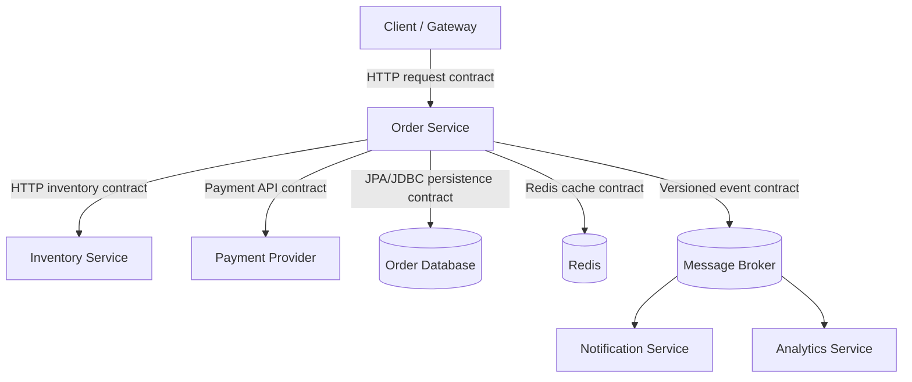
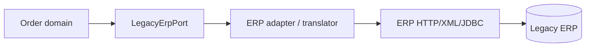
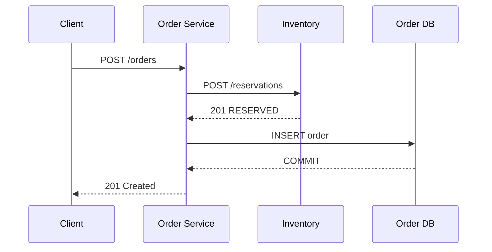
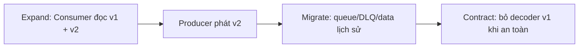
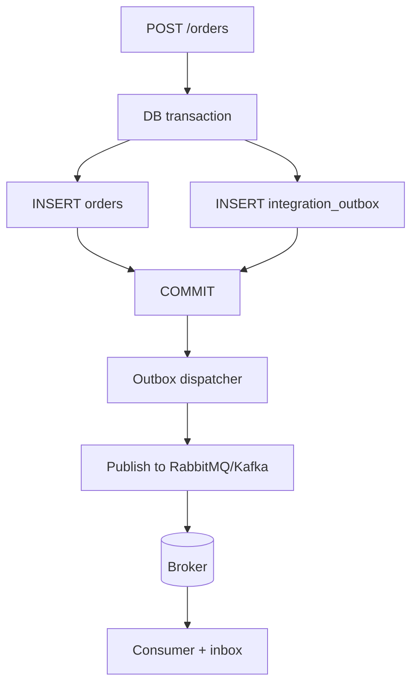
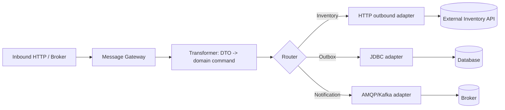
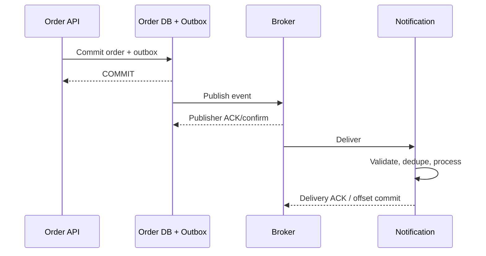
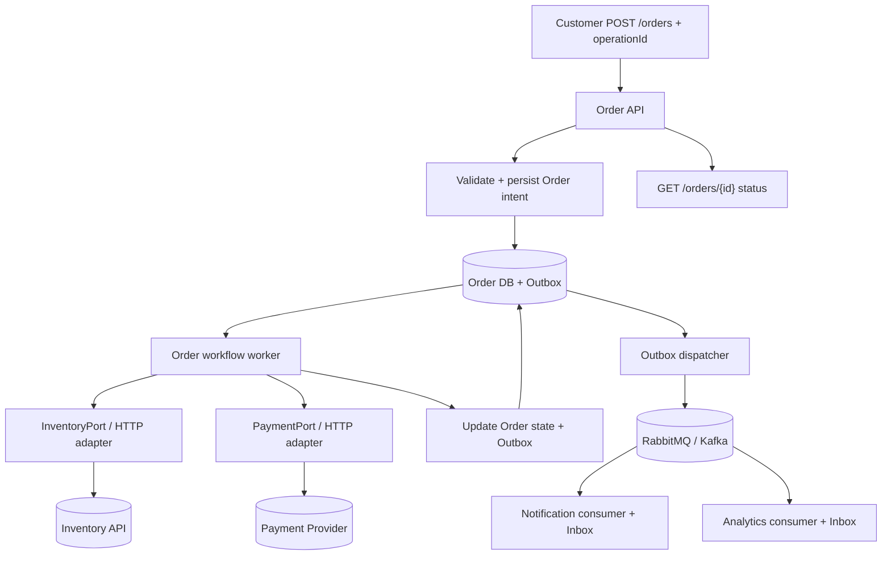

# Ranh giới ứng dụng, hệ thống bên ngoài và hợp đồng trao đổi dữ liệu

## 1. Một hệ thống tích hợp bắt đầu từ các ranh giới, không phải từ thư viện

Trong mô-đun **SPRING_BOOT_INTEGRATION**, Spring Boot được dùng để tổ chức tích hợp qua **HTTP client, cơ sở dữ liệu, cache, broker thông điệp** và các **adapter Spring Integration**. Những công cụ này giúp truyền dữ liệu, nhưng chúng không tự trả lời câu hỏi kiến trúc: *ai sở hữu dữ liệu, hệ thống nào đáng tin, dữ liệu nào được phép đi qua, và điều gì được xem là thành công khi hai hệ thống không thể cùng commit?*

Hãy xét một yêu cầu tạo đơn hàng:

```text
Client ──HTTP──> Order Service
                   │
                   ├──HTTP──> Inventory Service
                   ├──HTTP──> Payment Provider
                   ├──JDBC/JPA──> Order Database
                   ├──Redis──> Order Read Cache
                   └──AMQP/Kafka──> Notification / Analytics
```

Lỗi không chỉ nằm ở việc `RestClient` báo timeout, hay RabbitMQ trả NACK. Hệ thống có thể đang gặp một trong những vấn đề sâu hơn:

- Order Service coi dữ liệu tồn kho của Inventory là bảng mình được phép ghi trực tiếp.
- Client gửi JSON v2 nhưng consumer cũ chỉ hiểu v1.
- Payment đã được thu tiền, nhưng Order Service mất HTTP response rồi gửi lại POST.
- Database đã commit nhưng message chưa được publish; Notification không biết đơn hàng mới.
- Redis giữ snapshot cũ; API lại coi cache là nguồn dữ liệu chính.
- Kafka consumer đã commit offset nhưng transaction ghi kết quả thất bại.
- Một header chứa token hoặc thông tin khách hàng bị forward sang đối tác không có quyền xem.

Muốn thiết kế luồng tích hợp đúng, ta cần định nghĩa **ranh giới ứng dụng**, **ranh giới sở hữu dữ liệu**, **ranh giới tin cậy**, **ranh giới transaction** và **hợp đồng trao đổi dữ liệu**.



**Mục tiêu bài học:** nhận diện đúng những ranh giới đó, tạo hợp đồng có thể kiểm thử và tiến hóa, chọn cơ chế đồng bộ/bất đồng bộ phù hợp, kiểm soát lỗi/trùng lặp và chứng minh kết quả nghiệp vụ mà không phụ thuộc vào việc mọi hệ thống luôn sẵn sàng.

Ví dụ trong bài theo **Java 17+, Spring Boot 3.x**. Những API như `RestClient` được dùng từ Spring Framework 6.1/Spring Boot 3.2; với stack khác cần chọn adapter tương ứng. Bài mô tả các pattern kiến trúc, không giả định ứng dụng cụ thể đã có cluster, broker hoặc hạ tầng production.

## 2. Phân biệt ranh giới ứng dụng, process, domain, dữ liệu và tin cậy

Các ranh giới thường không trùng nhau.

| Ranh giới | Câu hỏi phải trả lời | Ví dụ |
| --- | --- | --- |
| **Process/deployment** | Thành phần nào chạy và deploy độc lập? | Order và Inventory là hai services |
| **Domain/bounded context** | Ai quyết định ý nghĩa một dữ liệu hoặc hành động? | Inventory quyết định “available stock” |
| **Data ownership** | Hệ thống nào được ghi và công bố nguồn sự thật? | Order ghi đơn hàng, không ghi trực tiếp kho |
| **API/protocol** | Hai bên liên lạc bằng gì và theo định dạng nào? | JSON/HTTP, AMQP, Kafka, JDBC |
| **Trust/security** | Caller nào được đọc/ghi dữ liệu nào? | Token từ gateway không mặc nhiên dùng được ở Payment |
| **Transaction** | Những thay đổi nào commit/rollback cùng nhau? | Order DB transaction khác Payment HTTP request |
| **Failure** | Lỗi bên nào ảnh hưởng trực tiếp đến bên nào? | Inventory timeout, broker unavailable |
| **Team/ownership** | Ai bảo trì contract và quyết định thay đổi? | Inventory team sở hữu API stock |

**Process boundary không đồng nghĩa domain boundary:** một ứng dụng monolith có thể chứa nhiều bounded contexts nhưng chia chung process; ngược lại, một domain có thể có nhiều deployments. Việc nhận diện bounded context là một lựa chọn mô hình nghiệp vụ, không phải do Kubernetes hay annotation Spring quyết định.

**Database boundary không phải chỉ là network endpoint:** hai services cùng đọc một schema SQL có thể đang phụ thuộc ngầm vào cấu trúc bảng, transaction và deployment cycle của nhau. Một “microservice” có database riêng nhưng vẫn cho service khác chạy `UPDATE orders` trực tiếp chưa có ranh giới sở hữu dữ liệu rõ.

### 2.1. Quy tắc không vượt qua data ownership tùy tiện

Giả sử Inventory Service sở hữu tồn kho. Order Service không nên viết:

```sql
-- KHÔNG PHẢI mẫu tích hợp tốt:
UPDATE inventory.stock
SET available_quantity = available_quantity - 2
WHERE sku = 'sku-123';
```

Điều này bỏ qua invariants, authorization, locking và version của Inventory. Đúng hơn, Order Service gửi **yêu cầu giữ hàng** qua hợp đồng Inventory API hoặc command/event được thiết kế cho trường hợp đó.

Ở những hệ thống legacy, tích hợp đọc trực tiếp database đôi khi là ràng buộc hiện thực. Khi đó phải công bố nó là **read-only integration contract** với views/CDC/schema version/permissions và kế hoạch tách coupling; không coi bảng nội bộ là public API không phiên bản.

### 2.2. Bốn câu hỏi trước khi thêm một client mới

1. Bên nào sở hữu **business invariant**? Ví dụ chỉ Inventory có quyền quyết định còn hàng.
2. Bên nào chịu trách nhiệm khi tác vụ lỗi sau timeout? Ví dụ Payment cần idempotency và reconciliation.
3. Dữ liệu có cần **nhất quán ngay tại thời điểm response** hay chấp nhận eventual consistency?
4. Có thể kiểm thử/quan sát kết quả qua một contract công khai, không truy cập private table của đối tác không?

Nếu không trả lời được, việc chọn `WebClient` thay `RestClient` chưa giải quyết vấn đề thiết kế.

## 3. Hệ thống bên ngoài là bất kỳ dependency nào vượt phạm vi kiểm soát trực tiếp

“External system” không nhất thiết là đối tác ngoài công ty. Đối với một Spring Boot service, nó có thể là:

- Một service khác do đội nội bộ quản lý, có deployment/DB riêng.
- Cổng thanh toán hoặc vận chuyển của bên thứ ba.
- PostgreSQL/MySQL/MongoDB nằm ngoài JVM.
- Redis hoặc một distributed cache.
- Kafka/RabbitMQ/ActiveMQ, dù broker chạy trong cùng cluster.
- LDAP/Active Directory, SOAP endpoint, SFTP hoặc batch import.
- Một Spring Integration channel dẫn tới adapter kết nối hạ tầng.
- Object storage, email gateway hoặc scheduler persistence store.

Điểm chung: **không thể giả định thao tác ở dependency và business DB được commit nguyên tử**; latency, availability, schema, security và operational ownership cũng có thể khác.

| Dependency | Hợp đồng ở ranh giới | Failure mode thường gặp |
| --- | --- | --- |
| HTTP/REST | Method, URI, status, headers, JSON schema | Timeout, 429, 5xx, partial side effect |
| SOAP/XML | WSDL, XSD, operation, fault | Schema validation, namespace/version mismatch |
| SQL | Schema/view/query, isolation, constraints | Lock, deadlock, migration conflict |
| MongoDB | Collection/BSON schema, ID type, index | Mapping drift, duplicate key |
| Redis | Key namespace, value serializer, TTL, invalidation | Stale data, cache stampede |
| RabbitMQ/AMQP | Exchange, routing key, queue, JSON/message properties | Unroutable publish, redelivery |
| Kafka | Topic, key/partition, schema, offsets | Lag, replay, consumer group rebalance |
| LDAP | Base DN, scope, attributes, filter, pagination | Partial search, ACL, referrals |
| SFTP/files | Filename, encoding, checksum, atomic handoff | Partial file, duplicate import |

### 3.1. Trường hợp hệ thống nội bộ nhưng vẫn không đáng tin tuyệt đối

“Không đáng tin” trong kỹ thuật tích hợp không nhất thiết có nghĩa thành phần độc hại. Nó có nghĩa **không được giả định** rằng bên kia luôn:

- Gửi dữ liệu hợp lệ, đúng loại và đúng phiên bản.
- Trả response đúng hạn.
- Giữ nguyên thứ tự events khi có retry hoặc partition.
- Trả một lần duy nhất.
- Duy trì kết nối giữa chừng.
- Cấp quyền truy cập mọi attribute trong một directory.
- Chạy cùng phiên bản contract trong rolling deployment.

Vì vậy mọi boundary cần validation, timeout, error classification, protection và quan sát thích hợp.

## 4. Hợp đồng trao đổi dữ liệu là gì?

**Hợp đồng trao đổi dữ liệu (data exchange contract)** là tập quy tắc mà producer/provider và consumer/caller cùng dựa vào để hiểu một thông điệp hoặc thao tác. Nó rộng hơn một Java interface hoặc một JSON example.

Một contract thực tế nên mô tả:

1. **Danh tính và mục đích:** operation/event tên gì, do ai sở hữu, caller nào được phép dùng?
2. **Transport:** HTTP, AMQP, Kafka, SQL view, SFTP, SOAP, v.v.
3. **Địa chỉ/định tuyến:** URL path, method, topic, exchange/routing key, queue hoặc tên dataset.
4. **Payload schema:** field names, types, nullable/missing, constraints, enum values.
5. **Ý nghĩa nghiệp vụ:** khi nào một trạng thái được coi là RESERVED/PAID/COMPLETED?
6. **Identity/correlation:** resource ID, operation ID, event ID, correlation ID; uniqueness và lifecycle.
7. **Thời gian:** UTC timestamp hay business date, timezone, precision, expiration.
8. **Version và compatibility:** v1/v2; consumer cũ có đọc dữ liệu mới được không?
9. **Outcome/errors:** status/fault codes, retryability, duplicate behavior, partial success.
10. **Delivery guarantees:** timeout, ACK, at-least-once, ordering, replay, retention.
11. **Security/privacy:** authentication, authorization, data classification, redaction.
12. **SLO/ownership:** latency, availability, escalation, deprecation window, contract tests.

Một hợp đồng không yêu cầu tất cả mục được viết trong cùng một file. Nó có thể kết hợp **OpenAPI**, **AsyncAPI**, JSON Schema/Avro/Protobuf schema, database migration, interface code, ADR và runbook. Điều quan trọng là mô tả **có thể kiểm chứng**.

### 4.1. Technical contract khác business contract

```json
{
  "orderId": "ord-1024",
  "status": "PAID"
}
```

Đúng cú pháp JSON không bảo đảm `PAID` có nghĩa giống nhau ở các bên:

- Payment Provider: charge đã được capture hay mới authorized?
- Order Service: đã ghi nhận payment thành công hay đang chờ callback?
- Analytics: tính doanh thu khi authorized hay captured?

Một field `status` cần **semantic contract**, không chỉ enum String. Nếu hai team diễn giải khác, integration vẫn sai dù serialization và HTTP 200 hoàn hảo.

### 4.2. Field bắt buộc và optional

| Đặc điểm | Quy tắc cần công bố |
| --- | --- |
| Required | Thiếu field phải bị từ chối hay có default? |
| Nullable | `null` khác missing hay tương đương? |
| Number | Integer 32/64 bit, decimal precision và scale? |
| String | Encoding, max length, allowed pattern? |
| Enum | Consumer xử lý giá trị chưa biết ra sao? |
| Collections | Empty vs missing; ordering và uniqueness? |
| Timestamp | ISO-8601/epoch, UTC, millisecond precision? |
| Identifier | Opaque String, UUID, ObjectId hay long; có thể đổi không? |
| Currency | Amount và ISO currency, rounding policy? |
| Repeated delivery | Event ID giữ nguyên hay sinh mới qua retry? |

**Không suy từ DTO Java rằng remote consumer sẽ hiểu chính xác.** Ví dụ Java `BigDecimal` sang JSON number có thể bị JavaScript client làm tròn trong một số miền giá trị; BSON `ObjectId` cũng không tự là một chuỗi UUID.

## 5. Vẽ sơ đồ quyền sở hữu trước khi vẽ sơ đồ lời gọi

Một hệ thống bán hàng ví dụ:

| Dữ liệu/hành động | Owner/source of truth | Ai được tham chiếu? | Kênh hợp đồng |
| --- | --- | --- | --- |
| Order state | Order Service + Order DB | Customer API, Analytics | HTTP query + order events |
| Available stock | Inventory Service | Order, Catalog | HTTP availability/reservation API |
| Payment authorization/capture | Payment Provider / Payment Service | Order | Payment API, webhook/callback |
| Customer profile | Customer Service | Order, Notification | HTTP projection + events |
| Notification delivery | Notification Service | Order, Support | Internal status API/events |
| Cache of order view | Order Service | API read handlers | Redis key/value contract |
| Directory identities | LDAP/IdP | Internal account sync | LDAP attribute/query contract |

**Source of truth không đồng nghĩa bản sao duy nhất:** nhiều consumer có thể giữ local read model để giảm coupling nhưng phải công bố staleness, retry, TTL, conflict policy và cách sửa lệch.

### 5.1. Chỉ định owner của một field

Một trường `customerEmail` trong OrderDocument có thể là **snapshot tại thời điểm checkout** do Order Service sở hữu, không phải “địa chỉ hiện tại” do Customer Service sở hữu. Nếu event OrderCreated mang email snapshot, consumer phải hiểu timestamp và ý nghĩa snapshot thay vì tự giả định luôn cập nhật.

Nếu không định nghĩa rõ provenance, một cuộc tranh luận “dữ liệu này ở DB nào mới đúng?” thường là dấu hiệu ranh giới và hợp đồng chưa rõ.

### 5.2. Anti-corruption layer cho hệ thống legacy

Một Legacy ERP có thể gọi trạng thái `S`, `W`, `C`; domain Order sử dụng `PENDING`, `CONFIRMED`, `CANCELLED`. Đừng đưa mã trạng thái legacy xuyên toàn codebase. Tạo **adapter/translator** tại ranh giới, chuyển sang semantic model nội bộ và giữ mapping được kiểm thử.



Adapter xử lý protocol/format; application service xử lý invariants và transaction; domain không cần biết `RestClient` hay `SOAPFault`.

## 6. Phân lớp code: Ports, adapters, DTO và domain

Một cấu trúc Spring Boot dễ bảo trì:

```text
example.orders
├── api/
│   ├── OrderController.java
│   ├── CreateOrderRequest.java
│   └── OrderResponse.java
├── application/
│   ├── PlaceOrderService.java
│   └── port/
│       ├── InventoryPort.java
│       └── PaymentPort.java
├── domain/
│   ├── Order.java
│   └── Money.java
├── persistence/
│   ├── OrderEntity.java
│   ├── OrderRepository.java
│   └── OutboxEntity.java
└── integration/
    ├── inventory/
    │   ├── InventoryHttpClient.java
    │   ├── InventoryAdapter.java
    │   └── InventoryContracts.java
    ├── payment/
    └── messaging/
        └── OrderEventPublisher.java
```

Đây là tổ chức minh họa, không phải một cấu trúc package bắt buộc. Ý nghĩa:

- **API DTO:** hợp đồng inbound HTTP hoặc partner.
- **Domain:** quy tắc nghiệp vụ không phụ thuộc wire protocol.
- **Port:** nhu cầu nghiệp vụ được mô tả bằng ngôn ngữ của service.
- **Adapter:** chuyển port sang RestClient/JPA/RabbitTemplate/RedisTemplate.
- **Persistence model:** schema nội bộ của database.
- **Event DTO:** hợp đồng độc lập của consumer, có thể tiến hóa cùng event type.

### 6.1. Port dùng ngôn ngữ nghiệp vụ thay vì HTTP details

```java
package example.orders.application.port;

public interface InventoryPort {
    ReservationOutcome reserve(
        String orderId,
        String sku,
        int quantity
    );
}

public record ReservationOutcome(
    String reservationId,
    boolean reserved
) {}
```

Application service sử dụng `InventoryPort`; một adapter HTTP hiện thực nó. Nếu sau này Inventory API đổi từ REST sang messaging, nội dung policy của application service không phải đổi theo `@PostExchange`.

### 6.2. Không truyền thẳng JPA entity qua adapter

Sai:

```java
// Sai: persistence entity bị dùng như HTTP contract.
restClient.post()
    .uri("/orders")
    .body(orderEntity)
    .retrieve();
```

JPA entity có lazy fields, internal IDs, circular references, optimistic version hoặc dữ liệu private. Nó có thể serialize ra JSON không chủ định. Tương tự, MongoDB `@Document` không phải DTO cho mọi consumer.

**Đúng hơn:** mapper chuyển domain/aggregate sang DTO cụ thể của partner và kiểm tra schema. Mapper này là một phần quan trọng của contract test.

## 7. Ví dụ HTTP boundary rõ ràng bằng Spring HTTP interface

Xét Inventory API chấp nhận giữ hàng:

```http
POST /v1/reservations HTTP/1.1
Host: inventory.internal.example
Content-Type: application/json
Accept: application/json
Idempotency-Key: reserve:ord-1024:sku-123
X-Request-Id: req-8021

{
  "orderId": "ord-1024",
  "sku": "sku-123",
  "quantity": 2
}
```

Response được định nghĩa:

```http
HTTP/1.1 201 Created
Content-Type: application/json

{
  "reservationId": "rsv-6701",
  "state": "RESERVED"
}
```

Java client DTO:

```java
package example.orders.integration.inventory;

public record ReserveStockRequest(
    String orderId,
    String sku,
    int quantity
) {}

public record ReserveStockResponse(
    String reservationId,
    String state
) {}
```

Declarative HTTP interface (Spring Framework 6.1+):

```java
package example.orders.integration.inventory;

import org.springframework.web.bind.annotation.RequestBody;
import org.springframework.web.bind.annotation.RequestHeader;
import org.springframework.web.service.annotation.HttpExchange;
import org.springframework.web.service.annotation.PostExchange;

@HttpExchange(
    url = "/v1",
    accept = "application/json",
    contentType = "application/json"
)
public interface InventoryHttpClient {

    @PostExchange("/reservations")
    ReserveStockResponse reserve(
        @RequestHeader("Idempotency-Key") String operationKey,
        @RequestHeader("X-Request-Id") String requestId,
        @RequestBody ReserveStockRequest body
    );
}
```

Cấu hình proxy từ Boot-managed `RestClient.Builder`:

```java
package example.orders.integration.inventory;

import org.springframework.beans.factory.annotation.Value;
import org.springframework.context.annotation.Bean;
import org.springframework.context.annotation.Configuration;
import org.springframework.web.client.RestClient;
import org.springframework.web.client.support.RestClientAdapter;
import org.springframework.web.service.invoker.HttpServiceProxyFactory;

@Configuration
class InventoryClientConfiguration {

    @Bean
    InventoryHttpClient inventoryHttpClient(
            RestClient.Builder builder,
            @Value("${inventory.api.base-url}") String baseUrl) {

        RestClient restClient = builder
            .baseUrl(baseUrl)
            .build();

        HttpServiceProxyFactory factory =
            HttpServiceProxyFactory
                .builderFor(RestClientAdapter.create(restClient))
                .build();

        return factory.createClient(
            InventoryHttpClient.class
        );
    }
}
```

Runtime config:

```yaml
inventory:
  api:
    base-url: ${INVENTORY_API_BASE_URL:https://inventory.example.test}
```

**Cảnh báo về ví dụ:** đây là cấu trúc client contract, chưa có timeout, TLS, authentication hay status-to-domain-error mapping. Những yếu tố đó phải được thêm vào adapter và kiểm thử trước production. `@HttpExchange` không tự đảm bảo provider chấp nhận idempotency key hay không tạo duplicate reservation.

### 7.1. Adapter cách ly HTTP semantics

```java
package example.orders.integration.inventory;

import example.orders.application.port.InventoryPort;
import example.orders.application.port.ReservationOutcome;
import org.springframework.stereotype.Component;

@Component
public class InventoryAdapter implements InventoryPort {

    private final InventoryHttpClient client;

    public InventoryAdapter(InventoryHttpClient client) {
        this.client = client;
    }

    @Override
    public ReservationOutcome reserve(
            String orderId, String sku, int quantity) {

        ReserveStockResponse result = client.reserve(
            "reserve:" + orderId + ":" + sku,
            "order-flow-" + orderId,
            new ReserveStockRequest(orderId, sku, quantity)
        );

        if (result == null || result.reservationId() == null) {
            throw new IllegalStateException(
                "Inventory response missing reservation ID"
            );
        }

        return new ReservationOutcome(
            result.reservationId(),
            "RESERVED".equals(result.state())
        );
    }
}
```

Adapter phải có error policy thực tế: nếu HTTP 409 nghĩa là đã được giữ hàng với key cũ thì có thể đối soát; 422 là input invalid; timeout sau khi server commit là **kết quả chưa chắc chắn**. Không coi tất cả exception thành `reserved=false`.

### 7.2. Tránh gắn protocol lỗi vào domain

`RestClientResponseException` hay raw HTTP status là chi tiết adapter. Application có thể dùng typed outcome như `RESERVED`, `OUT_OF_STOCK`, `UNKNOWN_RETRYABLE`, `PERMANENTLY_REJECTED` tùy contract; adapter chịu trách nhiệm map status/body/transport exception, **không tự đoán** lỗi 500 nghĩa là reservation chưa được tạo.

## 8. Bốn loại hợp đồng trong một lời gọi HTTP

| Loại contract | Phần quyết định | Lỗi phổ biến |
| --- | --- | --- |
| **Transport** | HTTPS, method, URI, headers, timeout | Sai host/route, mất TLS, connection refused |
| **Data** | JSON field names, types, nullability, encoding | Jackson DTO mismatch |
| **Business** | Hành động có ý nghĩa gì, idempotency | Nhầm authorized với captured |
| **Failure** | Status codes, retry, partial/unknown outcome | Retry tạo duplicate side effect |

### 8.1. Request headers không chỉ là metadata trang trí

Một API có thể dùng:

- `Authorization`: xác thực caller tới **đúng audience**.
- `Idempotency-Key`: ràng buộc request với logical operation, nếu provider hỗ trợ.
- `If-Match`/ETag: chống lost update.
- `X-Correlation-Id`: hỗ trợ chẩn đoán.
- `Traceparent`: trace context theo instrumentation.
- `Accept` và `Content-Type`: negotiation và serialization.

**Không forward toàn bộ inbound HTTP headers sang service khác.** Trong đó có thể có cookies, user tokens, tenant fields không đáng tin và headers hop-by-hop. Adapter cần allowlist/transform dựa trên security policy.

### 8.2. HTTP status và business status khác nhau

`HTTP 200 OK` có thể mang:

```json
{
  "paymentStatus": "PENDING_REVIEW"
}
```

Nếu application chỉ dựa vào 2xx để đánh dấu `PAID`, contract bị dùng sai. Ngược lại HTTP 202 thường diễn đạt request được chấp nhận xử lý bất đồng bộ chứ không phải kết quả nghiệp vụ cuối cùng. Phải đọc đúng cả **HTTP outcome và response business state**.

### 8.3. URI encoding là phần của contract

URI `/orders/{orderId}` cần encode path variable theo URI rules. `orderId` chứa `/` hoặc `%` có thể tạo nhầm path sau proxy decode. Không nối chuỗi URL bằng input người dùng; sử dụng URI template/builder và test các trường hợp reserved characters. Base URL phải từ trusted config để phòng SSRF, không do caller tùy ý cung cấp.

## 9. Đồng bộ và bất đồng bộ: chọn theo thời điểm cần biết kết quả

Một service có nhiều lựa chọn:

| Cơ chế | Caller biết được gì ngay? | Phù hợp | Cần xử lý |
| --- | --- | --- | --- |
| HTTP synchronous | Response/status trước khi trả caller | Query, quyết định cần ngay | Deadline, connection, retry, fallbacks |
| HTTP 202 + job status | Yêu cầu đã được nhận theo contract | Tác vụ dài | Durable job state, polling/callback |
| Broker command | Producer publish/ack, xử lý sau | Workflow async cần một owner | Correlation, retry, DLQ, dedupe |
| Broker event | Một sự kiện đã xảy ra được công bố | Fan-out, eventual consistency | Version, consumer ordering, replay |
| DB view/CDC | Dữ liệu đổi trong source | Legacy/read projection | Snapshot, DDL, ordering, change capture |
| Scheduled batch/file | Dữ liệu trao đổi định kỳ | Legacy, bulk integration | Checksum, atomic handoff, reconciliation |

### 9.1. Đồng bộ không phải nguyên tử xuyên dịch vụ



Điều gì xảy ra nếu Inventory reserve thành công nhưng Order DB insert thất bại? Phải có release/compensation, reconciliation hoặc một workflow state `RESERVATION_PENDING/CONFIRMED`; không có một `@Transactional` ở Order Service nào tự rollback HTTP operation đã được Inventory commit.

### 9.2. Event khác command

- **Command:** yêu cầu một owner thực hiện hành động, ví dụ `ReserveStock`. Nó có thể bị từ chối; cần response/status policy và thường có intended consumer.
- **Event:** thông báo một sự kiện đã xảy ra, ví dụ `OrderCreated`. Có thể nhiều consumers độc lập xử lý.

Không đặt tên event `DoSendEmail` rồi kỳ vọng nó đồng thời là business fact và request một action. Hợp đồng cần xác định producer/consumer trách nhiệm, routing và semantics rõ.

### 9.3. Eventual consistency cần được công bố

Khi một đơn hàng được tạo và outbox publish sau 500 ms, Notification hoặc Analytics có thể nhận trạng thái chậm hơn. API không nên hứa “mọi hệ thống đã cập nhật” nếu business contract chỉ đảm bảo Order DB commit. Dùng workflow status, completion callback hoặc API theo dõi nếu người dùng cần biết đến khi nào side effects thực sự hoàn tất.

---

## 10. Event contract: JSON body, envelope và metadata vận chuyển

Một event `OrderCreated` thường được gửi qua RabbitMQ/Kafka, nhưng contract phải độc lập ở mức hợp lý với Java class và tên package.

Ví dụ một **business event envelope**:

```json
{
  "eventId": "evt-6e0f",
  "eventType": "OrderCreated",
  "schemaVersion": 1,
  "occurredAt": "2026-11-21T04:00:00Z",
  "producer": "order-service",
  "aggregateId": "ord-1024",
  "data": {
    "orderId": "ord-1024",
    "tenantId": "tenant-17",
    "total": {
      "amount": "49.90",
      "currency": "USD"
    }
  }
}
```

`eventId` là ID cho **logical event**, không phải lần publish thứ N. `occurredAt` là thời điểm business event xảy ra, không nhất thiết bằng timestamp message tới broker. `schemaVersion` diễn đạt version của cấu trúc/semantics event, không tự tăng khi retry.

Một event đã được commit và cần phát lại nên giữ **cùng eventId và payload/version** nếu đó vẫn là cùng sự kiện. Nếu business state thực sự thay đổi, tạo event mới với event ID mới.

### 10.1. Phân biệt business metadata và transport metadata

| Metadata | Nơi đặt có thể chọn | Lưu ý |
| --- | --- | --- |
| `eventId` | Body envelope, đôi khi mirror header | Source of truth phải rõ |
| `eventType` | Body và routing key/topic convention | Không để hai giá trị mâu thuẫn |
| `schemaVersion` | Body hoặc schema registry ID | Consumer cần đọc version cũ |
| `correlationId` | Header/trace metadata | Phục vụ observability, không dedupe |
| `traceparent` | Transport header nếu hỗ trợ | Không phải business ID |
| `contentType` | AMQP properties/HTTP header | JSON converter phải thực sự encode JSON |
| `partitionKey` | Kafka record key | Ảnh hưởng ordering/partition, không là eventId bắt buộc |
| `routingKey` | RabbitMQ publish metadata | Quyết định binding, không tự quyết định payload schema |

**Không xem Spring AMQP `__TypeId__` chứa Java class name là hợp đồng event lâu dài giữa nhiều ngôn ngữ.** Có thể dùng type inference từ listener, logical type mappings hoặc envelope, đồng thời phải giới hạn trusted classes. Khi serialize DTO, kiểm tra body bytes và `contentType=application/json`, không suy ra từ tên method `convertAndSend(...)`.

### 10.2. Ordering thuộc về từng phạm vi

- Kafka cung cấp thứ tự records trong **một partition** theo semantics của topic/producer, không phải thứ tự toàn bộ topic nhiều partitions.
- RabbitMQ queue có thứ tự trong những điều kiện phân phối nhất định, nhưng multiple consumers, redelivery và requeue có thể làm khác thứ tự **business processing completion**.
- HTTP calls đồng thời không có ordering do server tự biết trừ khi API thiết kế version/sequence.

Nếu consumer cần thứ tự cập nhật của một order, xác định `aggregateId` làm partition key khi phù hợp, kèm `aggregateVersion`/sequence và kiểm tra stale events. **Ordering vật lý không tự loại trùng hoặc bảo đảm transactional exactly-once đối với side effect ngoài broker.**

## 11. Thiết kế schema evolution và khả năng tương thích

Một contract sống lâu hơn một bản deploy. Producer và consumer có thể không nâng cấp đồng thời; queue/DLQ còn dữ liệu cũ khi code mới được rollout.

### 11.1. Các kiểu thay đổi

| Thay đổi | Đánh giá thường gặp | Cách làm an toàn hơn |
| --- | --- | --- |
| Thêm optional field có default rõ | Có thể compatible | Consumer cũ chấp nhận unknown fields |
| Thêm required field không có default | Dễ breaking | Version mới hoặc giai đoạn chuyển tiếp |
| Đổi tên `orderId` thành `id` | Breaking với nhiều consumers | Dual-read/dual-write hoặc map version |
| Đổi `amount` từ String sang Number | Breaking về type/precision | Version rõ, contract test |
| Thêm enum value | Có thể breaking khi switch exhaustive | Define unknown-value policy |
| Đổi đơn vị `weight` từ kg sang g | Breaking semantics dù JSON vẫn hợp lệ | Field/unit/version mới |
| Xóa field ít dùng | Breaking nếu consumer cũ cần | Inventory consumers + deprecation |
| Đổi nghĩa `COMPLETED` | Breaking nghiêm trọng | Contract mới và migration plan |
| Đổi HTTP path | Breaking client contract | Route version/compatibility window |
| Đổi tên Kafka topic | Breaking routing/deployment | Dual publish/consume transition nếu cần |

**Backward/forward compatibility phụ thuộc mô hình serialization và consumer behavior cụ thể**, không thể kết luận chỉ bằng việc JSON parser vẫn đọc được.

### 11.2. Unknown fields không nên gây chết mọi consumer

Ví dụ consumer v1 chỉ cần `orderId` và `total`, producer v2 thêm `salesChannel`. Khi v1 nhận field mới, decoder có thể ignore unknown field **nếu policy đã công bố**. Nhưng một consumer dùng strict JSON Schema hoặc Jackson `FAIL_ON_UNKNOWN_PROPERTIES` vẫn có thể lỗi. Phải test trên ứng dụng thực.

Ngược lại, cho phép unknown fields quá rộng có thể che typo của field quan trọng. Hợp đồng nên định nghĩa vùng mở rộng và những field cốt lõi phải validate nghiêm ngặt.

### 11.3. Expand–migrate–contract qua rolling deploy



Thứ tự deploy cần theo **producer/consumer dependency graph**:

1. Xác định mọi consumer hiện hành, kể cả batch, analytics, DLQ replayer và partner.
2. Triển khai consumer hiểu dữ liệu mới nhưng vẫn đọc được cũ.
3. Chuyển producer/writer sang schema mới.
4. Theo dõi lỗi conversion, lag, rejected messages và contract conformance.
5. Backfill/migrate dữ liệu cũ nếu cần.
6. Chỉ bỏ đường cũ sau khi retention/replay/deprecation window kết thúc.

Đối với database, đổi column/field cũng theo nguyên tắc này. Việc cập nhật JPA entity/`@Field` **không tự cập nhật** dữ liệu lịch sử của Postgres/Mongo.

### 11.4. Contract version không bằng application version

Ứng dụng có thể deploy `order-service:2.8.7` nhưng vẫn phát `OrderCreated schemaVersion=1`. Version schema chỉ thay khi hợp đồng cần thay; không đổi cho mọi release code. Tương tự, một event v1 có thể được replay từ outbox sau khi binary ứng dụng đổi sang v3.

## 12. Định danh, correlation, time và money xuyên boundary

Các identifier nên có ý nghĩa riêng:

| ID | Tạo bởi | Dùng để làm gì? | Có đổi khi retry? |
| --- | --- | --- | --- |
| `orderId` | Order owner | Định danh aggregate/order | Không |
| `operationId` / idempotency key | Caller/owner theo contract | Chống lặp một business command | Không |
| `reservationId` | Inventory owner | Định danh kết quả giữ hàng | Không khi truy xuất cùng reservation |
| `eventId` | Event owner/outbox | Dedupe/replay event | Không |
| `correlationId` | Gateway/workflow | Liên hệ logs qua nhiều bước | Thường giữ qua logical workflow |
| `traceId` | Tracing instrumentation | Liên kết spans | Có thể khác sau async retry/replay |
| Kafka offset | Broker partition | Vị trí record trong log | Mỗi publish tạo offset riêng |

### 12.1. Không dùng một ID cho mọi trách nhiệm

`traceId` không phải khóa duy nhất cho business event. Một request có thể tạo nhiều sự kiện; cùng event có thể được replay ở trace mới. Kafka offset cũng không ổn định khi event được republish sang topic/partition khác. Inbox nên dedupe theo `consumerName + eventId` hoặc một **business idempotency key** tương ứng.

### 12.2. Hợp đồng thời gian phải có timezone và precision

Nên dùng ISO-8601 với offset/UTC cho event timestamps:

```json
{
  "occurredAt": "2026-11-21T04:00:00Z",
  "businessDate": "2026-11-21",
  "businessTimeZone": "Asia/Ho_Chi_Minh"
}
```

`occurredAt` là một instant; `businessDate` là ngày theo calendar/timezone. Không thay thế chúng bừa bãi. Khi persist MongoDB BSON Date, độ phân giải thông dụng là milliseconds; khi persist SQL `timestamp with time zone`, semantics phụ thuộc database/driver. Test round-trip precision và timezone.

### 12.3. Money không phải double

Ví dụ:

```java
public record Money(
    java.math.BigDecimal amount,
    java.util.Currency currency
) {
    public Money {
        if (amount == null || currency == null) {
            throw new IllegalArgumentException("Money incomplete");
        }
    }
}
```

Hợp đồng wire có thể chọn `amount` dạng decimal String và `currency` dạng ISO code, sau đó validate scale/range/rounding. Không dùng Java `double` cho tiền hoặc so sánh amount không quan tâm currency.

### 12.4. Cách chọn ID cho đa hệ thống

Nếu MongoDB lưu `ObjectId` nhưng REST API và Kafka events phải tương thích Java/Python/Go, hãy chuẩn hóa ID ở boundary, thường là một **opaque String** theo domain. Không để consumer phải hiểu raw BSON wrappers như `{"$oid":"..."}` trừ khi đó là hợp đồng đã công bố.

## 13. Ranh giới giao dịch: một commit không bao phủ hệ thống khác

Đây là nguyên tắc nền tảng của tích hợp:

**`@Transactional` của Spring không mặc nhiên tạo một transaction duy nhất xuyên PostgreSQL, Redis, RabbitMQ/Kafka và HTTP.**

Giả sử:

```java
@Transactional
public void placeOrder(CreateOrderCommand command) {
    orderRepository.save(order);
    rabbitTemplate.convertAndSend(
        "orders.events",
        "order.created",
        event
    );
}
```

Có thể xuất hiện hai failure windows:

1. Broker đã nhận event nhưng database rollback → consumer biết một đơn không tồn tại.
2. Database commit nhưng publish thất bại/process chết → consumer không nhận event.

Việc gọi method publish nằm bên trong Java method có `@Transactional` không giải quyết atomicity khác resource managers.

### 13.1. Transactional outbox

Giải pháp phổ biến là ghi business state và **outbox record cùng transaction của source database**.



SQL schema minh họa:

```sql
CREATE TABLE integration_outbox (
    event_id VARCHAR(64) PRIMARY KEY,
    aggregate_id VARCHAR(64) NOT NULL,
    event_type VARCHAR(80) NOT NULL,
    schema_version INTEGER NOT NULL,
    payload_json TEXT NOT NULL,
    status VARCHAR(24) NOT NULL,
    attempts INTEGER NOT NULL DEFAULT 0,
    created_at TIMESTAMP WITH TIME ZONE NOT NULL,
    next_attempt_at TIMESTAMP WITH TIME ZONE
);
```

Publisher worker:

1. Claim event PENDING bằng lease/locking phù hợp nhiều workers.
2. Đọc **payload đã lưu**, không tạo lại event ID/timestamp ở mỗi retry.
3. Publish tới broker với correlation/publisher confirm theo transport.
4. Chỉ đánh dấu SENT theo định nghĩa broker confirmation/return đã được công bố.
5. Retry khi kết quả chưa chắc chắn, cùng event ID.
6. Đưa event vào FAILED/parking state khi vượt retry budget, có alert/reprocess.

Đối với Kafka, producer acknowledgement semantics phụ thuộc `acks`/idempotence/transaction config; RabbitMQ confirm ACK cũng chưa bảo đảm consumer xử lý. **Outbox giảm cửa sổ mất event giữa source DB và publish, không tạo exactly-once side effects toàn hệ thống.**

### 13.2. Consumer inbox

Khi consumer commit business DB rồi chết trước broker ACK, event có thể được giao lại. Một inbox table:

```sql
CREATE TABLE integration_inbox (
    consumer_name VARCHAR(80) NOT NULL,
    event_id VARCHAR(64) NOT NULL,
    processed_at TIMESTAMP WITH TIME ZONE NOT NULL,
    PRIMARY KEY (consumer_name, event_id)
);
```

Pseudo-flow:

```text
On event(evt-6e0f):
  BEGIN business database transaction
    INSERT inbox(consumer_name, event_id) if absent
    IF duplicate:
      do not repeat business effect
    ELSE:
      perform durable business update
  COMMIT
  ACK message / commit offset under listener policy
```

Cần xử lý unique constraint race và rollback đúng: **inbox marker và business DB change phải commit cùng nhau** nếu cả hai ở một database transaction. Với email/payment bên ngoài DB, vẫn cần provider idempotency, durable job state hoặc reconciliation.

### 13.3. Saga/compensation và trạng thái chưa biết

Order Service không thể atomically “thu tiền + giữ hàng + ghi đơn” chỉ bằng một transaction local. Một workflow có thể dùng state machine và compensation:

```text
NEW
  -> RESERVATION_PENDING
  -> RESERVED
  -> PAYMENT_PENDING
  -> CONFIRMED
  -> FULFILLMENT_PENDING

On failure:
  RESERVED + payment rejected -> RELEASE_RESERVATION_PENDING
  payment timeout -> PAYMENT_UNKNOWN (reconcile)
```

Compensation **không phải rollback thời gian**. Release reservation có thể thất bại; refund có business implications; phải theo dõi trạng thái và có operator runbook cho các trường hợp không tự hồi phục.

## 14. Delivery semantics và những giới hạn của lời hứa exactly-once

| Cơ chế | Điều nó có thể bảo đảm | Điều nó không tự bảo đảm |
| --- | --- | --- |
| RabbitMQ publisher confirm | Broker xác nhận publish theo cấu hình | Consumer đã xử lý, message không trùng |
| RabbitMQ consumer ACK | Broker biết delivery được consumer acknowledge | Side effect ngoại vi đúng một lần |
| Kafka producer idempotence | Giảm trùng do retry ở tầng producer/session phù hợp | Business command/consumer side effect exactly-once |
| Kafka committed offset | Consumer group đánh dấu vị trí đã tiêu thụ | DB/HTTP transaction đã hoàn tất |
| JDBC unique constraint | Không có hai rows cùng key theo scope | External payment đã được idempotent |
| Redis SETNX/lease | Hỗ trợ claim/coordination có điều kiện | Permanent exactly-once, distributed transaction |
| Transactional outbox | Business state và intent publish commit chung | Broker consumer sẽ xử lý ngay/lần duy nhất |
| Consumer inbox | Bảo vệ durable business side effect lặp | Email provider bên ngoài tự idempotent |

**“At-least-once” nghĩa là duplicate delivery phải được dự phòng.** Nếu producer không biết broker đã nhận publish hay chưa, retry có thể nhân đôi transport messages. Mặt khác, tuyên bố “exactly-once” chỉ hợp lệ khi xác định rõ phạm vi resource, offset/transaction semantics và side effect. Không dùng nó như mô tả toàn bộ HTTP–DB–broker workflow.

### 14.1. Retry có thể làm tăng tải

Giả sử Order Service có 3 attempts, HTTP gateway cũng retry 3 lần, client SDK retry 3 lần: một logical command có thể gây đến **27** lời gọi downstream trong một số cấu hình. Giải pháp là đặt **một tầng sở hữu retry**, tổng deadline, exponential backoff/jitter và định nghĩa lỗi không retry.

### 14.2. Retry cho operations có side effect

Với POST tạo payment, HTTP timeout có thể xảy ra **sau khi provider đã commit**. Không mặc định retry mù. Nếu provider hỗ trợ idempotency key, dùng key ổn định; nếu không, thực hiện query/reconciliation bằng business reference và có manual recovery khi không xác định được kết quả.

## 15. Hợp đồng lỗi: phân loại thay vì nuốt exception

Một boundary nên trả **lỗi có thể hành động**, không chỉ một Throwable chung.

| Loại lỗi | Ví dụ | Policy thường phù hợp |
| --- | --- | --- |
| Input/contract invalid | JSON thiếu required field, enum không hỗ trợ | Từ chối, không retry |
| Authentication/authorization | HTTP 401/403, LDAP ACL | Không retry nóng; sửa quyền/credential |
| Resource not found | 404, missing remote ID | Theo business contract, có thể permanent |
| Conflict | 409/412 optimistic version | Reload/resolve, không blind overwrite |
| Throttle | 429 / Retry-After | Bounded retry, rate limit |
| Transient dependency | 503, connection reset | Retry có backoff/deadline nếu an toàn |
| Timeout/unknown outcome | POST đã gửi nhưng response mất | Idempotency/reconcile |
| Poison message | JSON conversion fail trước listener | Quarantine/DLQ, contract alert |
| Resource contention | DB deadlock/lock timeout | Bounded retry và transaction policy |
| Broker unroutable | Routing key không có binding | Sửa topology, publish returns |
| Partial batch | LDAP size limit / SFTP partial file | Không báo completed; reconciliation |

### 15.1. Một response lỗi thống nhất ở HTTP boundary

Ví dụ theo hướng Problem Details (RFC 9457), minh họa:

```json
{
  "type": "https://errors.example.test/inventory-unavailable",
  "title": "Inventory service unavailable",
  "status": 503,
  "detail": "Please retry using the same operationId",
  "instance": "/api/orders/requests/req-8021",
  "code": "INVENTORY_TEMPORARILY_UNAVAILABLE",
  "correlationId": "req-8021"
}
```

Không đưa token, full stack trace, raw SQL, raw Kafka/RabbitMQ headers hay dữ liệu thanh toán vào `detail`. `code`/`type` cần là vocabulary ổn định để caller quyết định retry theo policy công bố; HTTP status một mình chưa nói hết business outcome.

### 15.2. Dead-letter queue không tự giải quyết dữ liệu xấu

Một DLQ giúp giữ message cần điều tra nếu broker/consumer được cấu hình đúng. Nó không tự cung cấp:

- Schema migration cho old event.
- Cơ chế phân quyền reprocess.
- Bảo vệ không gây side effect lặp.
- Alert và retention.
- Đường phân biệt lỗi transient/vĩnh viễn.

Cần playbook: phân loại, sửa contract/code, reprocess với cùng event ID (khi là cùng event) và theo dõi completion.

### 15.3. Không biến dependency outage thành “không có dữ liệu”

Sai:

```java
try {
    return inventoryPort.findStock(sku);
} catch (Exception ex) {
    return Optional.empty();
}
```

Nếu LDAP, Inventory hoặc Redis báo timeout, trả empty như một dữ liệu hợp lệ có thể gây quyết định sai. Tách `NOT_FOUND` khỏi `UNAVAILABLE`, `UNKNOWN` và `PARTIAL`. Fallback chỉ hợp lệ khi business đã chấp thuận staleness và hệ thống thể hiện rõ mức độ tin cậy.

## 16. Hợp đồng bảo mật và ranh giới tin cậy

Một integration boundary cần đánh giá **ai gọi**, **gọi đến đâu**, **dùng danh tính nào** và **dữ liệu có được phép đi qua không**.

### 16.1. Những kiểm soát tối thiểu

1. **TLS/mTLS:** bảo vệ kênh, xác minh certificate/hostname, quản lý CA và secret rotation.
2. **Authentication:** outbound client dùng service identity hoặc token có audience/scope phù hợp.
3. **Authorization:** service sở hữu domain kiểm tra quyền hành động/resource/tenant.
4. **Least privilege:** SQL user, Mongo roles, Redis ACL, RabbitMQ vhost/topic permissions và LDAP bind account đúng nhu cầu.
5. **Data classification:** xác định PII, payment data, credentials và retention theo từng event/DTO.
6. **Input validation:** schema, size limits, escaping, allowlists và trusted host URLs.
7. **Auditing:** ghi business action/result với ID được phép, tránh raw payload nhạy cảm.
8. **Secret hygiene:** không commit credentials, không log headers `Authorization`/cookies.

### 16.2. Không tin tenantId chỉ vì nó nằm trong header

`X-Tenant-Id: tenant-17` có thể là một tham số routing nhưng chưa phải bằng chứng user có quyền trên tenant đó. Service nhận phải kiểm tra token/identity/authorization. Nếu Order Service forward tenant header sang Inventory, service Inventory vẫn phải xác minh mối liên hệ giữa caller và tenant theo trust contract.

### 16.3. Các loại injection ở ranh giới

- SQL: dùng parameterized queries, không nối input vào SQL.
- LDAP: dùng query builder/escaped filter values (RFC 4515) và DN builder, không nối filter/DN.
- HTTP: dùng URI templates/builders, không cho input điều khiển host tùy ý (SSRF).
- Mongo: không chấp nhận arbitrary query operator/field maps.
- Messaging: không tin type headers để deserialize mọi Java class.
- File/SFTP: kiểm tra path traversal, tên file, checksum và atomic handoff.

Đừng nghĩ “nội bộ” nghĩa là bỏ validate. Sai contract, cấu hình hoặc compromised service vẫn có thể gây hậu quả tương tự input ngoài.

## 17. Redis cache và read model là hợp đồng dữ liệu, không phải nguồn sự thật mặc định

Cache giúp giảm HTTP/DB latency nhưng đưa vào **một bản sao trạng thái**. Cần công bố:

| Mục | Ví dụ |
| --- | --- |
| Key namespace | `orders:view:v2:tenant-17:ord-1024` |
| Value schema | DTO JSON với version |
| TTL | 60 seconds theo yêu cầu freshness |
| Invalidation | Sau order commit hoặc khi nhận event |
| Owner | Order Service |
| Fallback | DB khi cache miss/unavailable |
| Security scope | Key tách tenant, không lộ PII |
| Serialization | Jackson/Redis serializer đã chốt |

Một số lỗi phổ biến:

- Cache write thành công nhưng DB transaction rollback → cache chứa trạng thái chưa từng commit.
- DB commit rồi invalidation thất bại → cache stale.
- JSON cache schema đổi nhưng keys cũ chưa hết TTL → deserialization error.
- Hai tenants dùng chung key `orderId` mà thiếu tenant namespace → nguy cơ lộ dữ liệu.
- Redis outage bị coi thành không có order thay vì cache miss/fallback đúng.

**Thiết kế source-of-truth rõ:** với Order, DB owner thường là nguồn sự thật; Redis là bản sao có TTL/invalidation. Với bài toán cache-as-source-of-truth, cần tuyên bố rõ durability/consistency policy khác thay vì mặc định Redis chỉ là cache.

### 17.1. Cache invalidation và event ordering

Nếu consumer nhận `OrderUpdated(version=8)` trước `OrderUpdated(version=7)` rồi áp snapshot cũ, cache có thể bị lùi state. Dùng `aggregateVersion` hoặc timestamp/sequence có semantics đáng tin, và chỉ áp update khi phiên bản tiến lên.

Redis không tự biết version business; phải thiết kế compare-and-set/Lua/transaction/DB projection theo yêu cầu và kiểm thử race.

## 18. Spring Integration channel và adapter không xóa ranh giới ngoài

Spring Integration mô hình hóa message flow bằng channels, transformers, filters, routers, service activators, gateways và các inbound/outbound adapters.



Một Spring Integration `Message<?>` có payload và headers. Nó **không giống** `org.springframework.amqp.core.Message` hoặc Kafka `ConsumerRecord`; một adapter chịu trách nhiệm chuyển giữa abstractions.

### 18.1. Sync/async channels làm thay đổi nơi lỗi xuất hiện

| Channel/flow | Execution | Hệ quả lỗi |
| --- | --- | --- |
| `DirectChannel` | Handler chạy đồng bộ trên caller thread | Exception có thể trở về caller |
| `ExecutorChannel` | Dispatch sang executor | `send()` thành công không nghĩa handler hoàn tất |
| `QueueChannel` | Pollable, thường in-memory nếu không có store | Queue state không tự bền qua restart |
| `PublishSubscribeChannel` | Fan-out tới subscribers | Nhiều handlers/side effects cho cùng message |
| AMQP/Kafka adapter | Qua broker/client | Delivery/ack/retry theo transport semantics |

**Error channel và transaction boundary** phải được thiết kế cho mode thực thi. Một exception trong worker thread không thể tự nhảy trở lại HTTP request đã trả 202. Nếu cần báo trạng thái, dùng job DB/status API/callback. Các adapter không tự đưa outbox/inbox hay idempotency vào business flow.

### 18.2. Headers phải được map theo allowlist

Không tự chuyển mọi `MessageHeaders` nội bộ sang AMQP/HTTP headers. Một số headers chứa channel objects, security contexts hoặc transport-specific metadata, không serializable hoặc không phù hợp để gửi ngoài process. Hãy công bố các headers được phép: `eventType`, `schemaVersion`, `correlationId`/trace context và những business attributes đã kiểm soát.

---
## 19. Tài liệu hóa contract: OpenAPI, AsyncAPI, schema và quyết định vận hành

Một Java interface hữu ích khi triển khai, nhưng không nên là **nguồn mô tả duy nhất** nếu consumer sử dụng ngôn ngữ khác hoặc deploy độc lập.

| Contract artifact | Nên chứa gì | Tác dụng |
| --- | --- | --- |
| OpenAPI | HTTP paths, methods, parameters, schemas, status codes, auth | Provider/client HTTP conformance |
| AsyncAPI / event catalog | Channel/topic, message names, payload, headers, delivery semantics | Consumer integration |
| JSON Schema/Avro/Protobuf schema | Field types, required, version, compatibility rules | Validate serialized data |
| WSDL/XSD | SOAP operation/XML contract | Legacy contract validation |
| DB view/schema migration | Cấu trúc dữ liệu được phép đọc, indexes, retention | Giảm coupling của legacy read integration |
| ADR | Quyết định sync/async, ID, error, ownership, consistency | Giữ ngữ cảnh quyết định |
| Runbook/SLO | Threshold, incident response, retry/DLQ/reconcile | Vận hành và ownership |

### 19.1. Ví dụ một mảnh OpenAPI có định nghĩa rõ request và response

```yaml
openapi: 3.0.3
info:
  title: Inventory Reservation API
  version: 1.0.0
paths:
  /v1/reservations:
    post:
      operationId: reserveStock
      parameters:
        - in: header
          name: Idempotency-Key
          required: true
          schema:
            type: string
            maxLength: 128
      requestBody:
        required: true
        content:
          application/json:
            schema:
              $ref: "#/components/schemas/ReserveStockRequest"
      responses:
        "201":
          description: Stock reserved
          content:
            application/json:
              schema:
                $ref: "#/components/schemas/ReserveStockResponse"
        "409":
          description: Reservation conflict
        "422":
          description: Invalid reservation request
        "503":
          description: Service temporarily unavailable
components:
  schemas:
    ReserveStockRequest:
      type: object
      required: [orderId, sku, quantity]
      additionalProperties: false
      properties:
        orderId:
          type: string
          minLength: 1
        sku:
          type: string
          minLength: 1
        quantity:
          type: integer
          minimum: 1
    ReserveStockResponse:
      type: object
      required: [reservationId, state]
      properties:
        reservationId:
          type: string
        state:
          type: string
          enum: [RESERVED, REJECTED]
```

Đây là mảnh hợp đồng minh họa cho một API, chưa có security scheme hay `servers` và chưa mô tả đầy đủ semantics của replay một idempotency key. Trong hệ thống thật, cần định nghĩa cả: body thay đổi nhưng key giữ nguyên thì trả gì, key retention bao lâu, stale state/expiry và điều kiện giải phóng reservation.

**Contract lint/generation không thay đổi ownership:** file OpenAPI hợp lệ cú pháp vẫn có thể mô tả sai hành vi server. Kiểm thử provider trong CI và kiểm thử consumer trên wire là cần thiết.

### 19.2. Event contract example phải định nghĩa semantics

Một AsyncAPI/event catalog cho `OrderCreated` nên nói:

- Producer: Order Service, được phát sau khi order transaction commit.
- Channel: `orders.events` (Kafka topic hoặc RabbitMQ exchange/routing theo deployment).
- Body: eventId, aggregateId, occurredAt, schemaVersion, data.
- Phân phối: consumer có thể nhận trùng, có thể replay, chính sách ordering theo order key.
- Retention/DLQ: quy tắc riêng theo broker.
- Consumer behavior: chỉ áp event nếu chưa xử lý eventId; field mới optional được hỗ trợ theo compatibility policy.
- Privacy: không đưa payment card data hoặc token trong event.

Nếu không mô tả **khi nào event được coi là đã xảy ra**, consumer có thể làm sai ngay cả khi hiểu đúng JSON.

## 20. Chiến lược kiểm thử tại các ranh giới

Một unit test service mock `InventoryPort` là cần thiết nhưng **không chứng minh HTTP request thật đúng**. Một test HTTP mock server lại không chứng minh production broker, database transaction hoặc consumer duplicate handling. Vì vậy chọn các lớp test phù hợp từng ranh giới:

| Lớp test | Mục tiêu | Ví dụ |
| --- | --- | --- |
| Unit/domain | Invariants và state transitions | Không tạo order khi quantity âm |
| Mapper/serializer | Java ↔ JSON/BSON/XML conversion | Money precision, required fields |
| HTTP client contract | Method/path/headers/body/error mapping | MockRestServiceServer/WireMock |
| Provider contract | Endpoint behavior tuân schema | OpenAPI validation, schema fixtures |
| Broker integration | Publish, routing, consume, ACK/offset | Testcontainers RabbitMQ/Kafka |
| DB integration | Constraints, transaction, migrations | Testcontainers PostgreSQL/Mongo |
| Outbox/inbox failure | Crash windows/retry/dedupe | Kill worker sau commit trước ACK |
| End-to-end workflow | Business outcome qua nhiều components | Order → reservation → notification |
| Compatibility | v1/v2 trong rolling deployments | Old consumer đọc optional field mới |
| Security | Auth, tenant isolation, PII redaction | Wrong audience, forged tenant header |
| Resilience | Timeout, 429, 503, network partition | Bounded retry/backoff/reconcile |
| Observability | Traces, metric tags, alert signals | Event ID đúng trong logs, không trong tags |

### 20.1. Test lời gọi HTTP interface ở mức request thật

Ví dụ JUnit 5, Spring Test và AssertJ, dùng `InventoryHttpClient` từ mục 7:

```java
package example.orders.integration.inventory;

import static org.assertj.core.api.Assertions.assertThat;
import static org.springframework.test.web.client.match.MockRestRequestMatchers.*;
import static org.springframework.test.web.client.response.MockRestResponseCreators.withSuccess;

import org.junit.jupiter.api.Test;
import org.springframework.http.HttpMethod;
import org.springframework.http.MediaType;
import org.springframework.test.web.client.MockRestServiceServer;
import org.springframework.web.client.RestClient;
import org.springframework.web.client.support.RestClientAdapter;
import org.springframework.web.service.invoker.HttpServiceProxyFactory;

class InventoryHttpClientContractTest {

    @Test
    void sendsCorrectMethodHeadersAndJsonBody() {
        RestClient.Builder builder = RestClient.builder()
            .baseUrl("https://inventory.example.test");

        MockRestServiceServer server =
            MockRestServiceServer.bindTo(builder).build();

        InventoryHttpClient client = HttpServiceProxyFactory
            .builderFor(
                RestClientAdapter.create(builder.build())
            )
            .build()
            .createClient(InventoryHttpClient.class);

        server.expect(requestTo(
                "https://inventory.example.test/v1/reservations"
            ))
            .andExpect(method(HttpMethod.POST))
            .andExpect(header(
                "Idempotency-Key", "reserve:ord-1024:sku-123"
            ))
            .andExpect(content().contentTypeCompatibleWith(
                MediaType.APPLICATION_JSON
            ))
            .andExpect(jsonPath("$.orderId").value("ord-1024"))
            .andExpect(jsonPath("$.quantity").value(2))
            .andRespond(withSuccess(
                """
                {"reservationId":"rsv-6701","state":"RESERVED"}
                """,
                MediaType.APPLICATION_JSON
            ));

        ReserveStockResponse response = client.reserve(
            "reserve:ord-1024:sku-123",
            "req-8021",
            new ReserveStockRequest("ord-1024", "sku-123", 2)
        );

        assertThat(response.state()).isEqualTo("RESERVED");
        server.verify();
    }
}
```

Test xác minh method, URL, header, JSON structure và response decoding. Nó không xác minh TLS, real Inventory behavior, timeout sau commit hoặc callback bên thứ ba. Đối với nhiều order lines có cùng SKU, operation key phải dựa trên **business command/line identity** đủ duy nhất; chuỗi minh họa `orderId:sku` có thể không đủ trong mọi domain.

### 20.2. Test thời điểm commit và lỗi sau commit

Một số ca **phải mô phỏng chủ động** chứ không chỉ chạy happy path:

```text
Case A: Order DB commit, broker unavailable
  expected: outbox PENDING, dispatcher retry, không mất logical event

Case B: Broker nhận publish, publisher mất confirm
  expected: retry cùng eventId, downstream dedupe

Case C: Consumer DB commit, broker ACK thất lạc
  expected: redelivery, inbox chặn lặp business side effect

Case D: Inventory reserve thành công, HTTP response timeout
  expected: query/reconcile hoặc retry cùng idempotency key

Case E: Consumer v1 nhận event v2 thêm optional field
  expected: contract compatibility theo chính sách

Case F: Event JSON malformed
  expected: classify non-retryable, DLQ/quarantine, không ghi sai business DB

Case G: Redis cache stale sau DB update
  expected: TTL/invalidation/fallback đúng contract
```

Test bằng broker thật và DB thật giúp xác minh những semantics không xuất hiện trong unit test của mapper, đặc biệt ack/rebalance/unique constraints.

### 20.3. Không tạo fixture chỉ từ code producer hiện tại

Nếu contract tests luôn serialize DTO **phiên bản mới** rồi consumer cũng đọc DTO đó, một breaking change có thể đi qua CI vì cả hai cùng thay. Giữ **golden fixtures** cho payload v1/v2 và những consumer versions còn được hỗ trợ. Khi dùng schema registry hoặc provider-driven contract tests, cấu hình compatibility mode phải khớp thật với topology/deployment.

## 21. Observability: đo business outcome thay vì chỉ số lời gọi thành công

Một request có thể qua nhiều services, nhiều retries, nhiều queues và trạng thái. Muốn truy vết, nên có ba tầng:

- **Metrics:** throughput, latency, error rate, backlog, age, retry/duplicate, business completion.
- **Traces:** tương quan các spans qua HTTP/messaging/async thread.
- **Logs/audit:** sự kiện quan trọng có correlation ID, event ID và trạng thái, với masking/retention.

### 21.1. Các mốc cần đo



Đo độc lập:

| SLI/metric | Ý nghĩa | Không chứng minh |
| --- | --- | --- |
| HTTP client duration | Thời gian một call downstream | Toàn workflow hoàn tất |
| Outbox oldest pending age | Event chờ publish từ DB lâu nhất | Consumer đã nhận |
| Publisher confirms/returns | Broker ACK/NACK và unroutable | Business side effect |
| Kafka consumer-group lag | Khoảng cách offsets theo exporter | Domain completeness |
| RabbitMQ ready/unacked | Chờ giao vs đã giao chưa ACK | Consumer commit |
| Consumer handler duration | Thời gian method xử lý | Thời gian nằm chờ trong queue |
| Inbox duplicate count | Số deliveries trùng đã phát hiện | Số new logical events |
| Business completion latency | Từ accepted/created đến done | Nếu chỉ đo completed, có thể bỏ sót stuck jobs |

**Kafka lag = 0 không có nghĩa toàn bộ nghiệp vụ thành công.** Nếu producer/outbox đang bị kẹt, topic có thể không nhận event nào; offset vẫn “bắt kịp”. **RabbitMQ ready = 0 cũng chưa an toàn** nếu unacked cao và handler stuck.

### 21.2. Không biến IDs thành metric labels

Sai:

```text
integration.request.duration{orderId="ord-1024"}
integration.request.duration{orderId="ord-1025"}
...
```

Cardinality sẽ tăng liên tục. Dùng bounded tags như `operation=create_order`, `dependency=inventory`, `outcome=timeout`; giữ `orderId`/`eventId` trong logs/traces có phân quyền.

### 21.3. SLO phải gắn với lời hứa khách hàng

Ví dụ:

- 99% đơn được chấp nhận và có trạng thái cuối rõ trong 2 phút.
- Không có outbox event `PENDING` lâu quá 5 phút nếu hệ thống đang hoạt động bình thường.
- 99,9% yêu cầu `GET /orders/{id}` đáp ứng trong 300 ms, với nguồn dữ liệu nhất quán theo policy.
- Không có confirmed payments chưa được đối soát với order sau deadline.

Threshold thực tế phải dựa trên sản phẩm/workload. **Không dùng chỉ HTTP 200 rate làm SLO của một workflow bất đồng bộ.**

## 22. Vận hành contract qua triển khai, ownership và thay đổi hạ tầng

Một hợp đồng có thể “được thiết kế đúng” nhưng vẫn bị phá khi team deploy riêng hoặc thay infrastructure.

### 22.1. Contract change protocol

Trước khi đổi schema:

1. Liệt kê producer/provider, consumers, runtime versions và owners.
2. Kiểm tra những client không cùng repo (mobile app, partner, batch exports).
3. Dựng fixture v1/v2 và đo tác động compatibility.
4. Cập nhật OpenAPI/AsyncAPI/schema registry và error policy.
5. Bật consumer dual-read/compatibility trước writer mới khi cần.
6. Triển khai producer theo canary/feature flag, quan sát conversion errors.
7. Theo dõi queue/DLQ/outbox hoặc database legacy rows.
8. Deprecate sau thời gian đã cam kết, có rollback strategy.

### 22.2. Operation ownership không chỉ là “ai viết code”

| Vấn đề | Owner chính cần xác định |
| --- | --- |
| Inventory API 503 | Inventory provider + Order caller runbook |
| Outbox pending tăng | Order publisher/dispatcher |
| RabbitMQ unroutable | Producer routing contract + broker topology owner |
| Consumer poison JSON | Producer schema owner và consumer handler owner |
| DB migration làm break reader | Data owner + các consumer contract |
| Cache stale kéo dài | Cache owner/read model policy |
| Partner token expired | Credential integration owner |
| PII trong logs | Service/security/privacy owners |

Nếu có SLA từ partner, ghi nhận contact/escalation, maintenance window, rate limits, change notification, security review và test sandbox. Không giả định một team sở hữu được cả external dependency.

### 22.3. Hợp đồng có thể bị phá mà không có schema change

Ví dụ provider giữ nguyên JSON nhưng:

- Tăng p99 latency từ 200 ms lên 6 s.
- Giới hạn rate còn 20 requests/s.
- Đổi token audience hoặc TLS CA.
- Thay đổi thứ tự events hoặc retention của topic.
- Chuyển consistency từ immediate sang eventual.
- Giảm LDAP size limit hoặc đổi indexed attributes.

Đó là **non-functional contract changes**. Tài liệu và SLO cần theo dõi reliability, rate/quota, timeouts, ordering, retention và security ngoài data types.

## 23. Case study hoàn chỉnh: Create Order qua Inventory, Payment và Broker

Một quy trình thực tế kết hợp nhiều ranh giới:



### 23.1. Hợp đồng inbound

`POST /orders` mang business command ID ổn định, customer identity/tenant và danh sách lines. Order Service validate quantity, product references và authorization. Response có thể:

```http
HTTP/1.1 202 Accepted
Content-Type: application/json
Location: /api/order-requests/req-8021

{
  "requestId": "req-8021",
  "orderId": "ord-1024",
  "status": "PENDING"
}
```

`202` có nghĩa **đã nhận yêu cầu theo contract và có durable intent**, không phải đã thanh toán hoặc fulfillment xong. Nếu API chỉ tạo task trong memory rồi trả 202, nó có nguy cơ mất việc khi JVM crash; lời hứa durability cần tương ứng với storage thực.

### 23.2. Hợp đồng Inventory

- Owner: Inventory.
- Operation: reserve stock for an order line/command.
- Request: orderId, SKU, quantity; idempotency key gắn với logical command.
- Response: reservation ID, state, expiration/version.
- Error: out-of-stock là business rejection, timeout sau commit là unknown.
- Recovery: query reservation theo idempotency/business reference, hoặc release qua compensation.

### 23.3. Hợp đồng Payment

- Owner: Payment Provider.
- Operation: authorize/capture/refund theo flow đã chọn.
- Amount và currency: scale/rounding rõ, không dùng floating point.
- Idempotency key: cùng logical charge operation qua retries.
- Webhook/callback: validate signature/replay protection/ordering, không tin chỉ status do caller tự gửi.
- Reconciliation: truy vấn payment transaction khi response/callback thất lạc.

**Không đánh dấu Order `PAID` chỉ vì `POST /payments` trả HTTP 200** nếu response business state là `AUTHORIZED` hay `PENDING`.

### 23.4. Hợp đồng persistence và outbox

Order DB giữ state machine và outbox trong cùng local transaction. Khi workflow hoàn tất một bước, ghi state transition + event intent. Không publish event từ một transaction chưa commit. Khi DB commit nhưng broker down, dispatcher có thể retry sau.

Một bảng trạng thái minh họa:

| Current state | Event/command result | Next state |
| --- | --- | --- |
| PENDING | Reservation accepted | RESERVED |
| PENDING | Out of stock | REJECTED |
| RESERVED | Payment captured | CONFIRMED |
| RESERVED | Payment rejected | RELEASE_PENDING |
| RESERVED | Payment unknown | PAYMENT_RECONCILING |
| CONFIRMED | Notification event published | Vẫn CONFIRMED, notification trạng thái riêng |
| RELEASE_PENDING | Inventory release confirmed | CANCELLED |

Một state machine cần kiểm soát **invalid transitions** bằng optimistic locking hoặc transactional compare-and-set. Không để hai worker cùng xử lý một state bằng read-modify-save không có version.

### 23.5. Broker event và consumers

Order Service phát một `OrderConfirmed` event có `eventId`/`schemaVersion`/`occurredAt`, orderId, tenantId và những field tối thiểu.

- Notification có queue/subscription riêng, dedupe `consumerName + eventId`.
- Analytics có subscription riêng, tự quản lý schema mapping và replay.
- Một consumer bị lỗi không được buộc Order Service rollback xác nhận đơn đã commit.
- DLQ giữ event lỗi cùng context được phép, có reprocess sau khi sửa consumer.
- Metrics đo business completion và outbox/backlog, không chỉ số publish method calls.

### 23.6. Cửa sổ lỗi và phép đối soát

| Thời điểm lỗi | Trạng thái có thể có | Cách khôi phục |
| --- | --- | --- |
| Sau ghi Order intent, trước reserve | PENDING | Worker retry/claim idempotently |
| Sau Inventory reserve, trước lưu state | Inventory giữ hàng, Order chưa biết | Reconcile bằng operation key |
| Sau Payment capture, trước Order update | Payment đã thu, Order vẫn RESERVED | Query payment status, cập nhật hoặc refund theo policy |
| Sau Order commit, trước outbox publish | CONFIRMED, outbox PENDING | Dispatcher publish lại |
| Sau publish ACK, trước outbox SENT | Event đã tới broker, outbox còn PENDING | Republish cùng eventId, consumer dedupe |
| Sau consumer DB commit, trước ACK | Business change đã có, broker redeliver | Inbox duplicate detection |
| Cache invalidation fail | DB đúng, Redis stale | TTL/version-aware refresh |

Mục tiêu thiết kế không phải **“không bao giờ có trạng thái trung gian”** mà là **“mọi trạng thái trung gian đều phát hiện và phục hồi được, không mất dữ liệu hoặc nhân đôi side effect”**.

## 24. Các anti-pattern cần tránh

| Anti-pattern | Vì sao nguy hiểm | Phương án thay thế |
| --- | --- | --- |
| Service A ghi thẳng bảng nội bộ service B | Bỏ qua ownership và invariants | API, CDC, read-only projection |
| Dùng entity JPA/Mongo trực tiếp làm event | Schema coupling, lazy proxy, lộ field | Versioned event DTO |
| Cho phép caller truyền raw host URL | SSRF và trust boundary | Trusted endpoint allowlist |
| Bật retry mọi exception | Duplicate side effect, retry storm | Error classification, idempotency và budget |
| Tin HTTP 200 = business success | Có thể PENDING/partial result | Parse business outcome |
| Tin publisher confirm = consumer done | Hai giai đoạn khác nhau | Consumer outcome/job status |
| Tin Kafka lag 0 = workflow complete | Outbox/side effects có thể stuck | End-to-end business SLO |
| Dùng cache làm nguồn sự thật không chủ định | Stale/missing data | Ownership và freshness policy |
| Đồng bộ mọi thứ bằng một DB transaction | Không có atomicity xuyên REST/broker | Outbox/saga/reconcile |
| Consumer luôn xử lý đúng một lần | Redelivery/replay thực tế | Inbox/idempotent side effect |
| Đổi field mà không giữ decoder cũ | Rolling deploy và DLQ vỡ | Expand–migrate–contract |
| Log raw headers/payloads | Lộ PII/token/secrets | Allowlist/redaction |
| Dùng `eventId` làm metric tag | Cardinality tăng không giới hạn | Logs/traces và bounded tags |
| Chỉ mock clients, không test wire | Sai JSON/status/routing không được phát hiện | Contract + integration tests |
| Catch Exception rồi trả dữ liệu rỗng | Mất phân biệt outage vs empty | Typed error/outcome |
| Không có owner/deprecation policy | Consumer bị phá âm thầm | Contract catalog + version governance |

### 24.1. Checklist review một integration mới

- [ ] Đã xác định provider/consumer và **data owner/source of truth**?
- [ ] Ranh giới process, trust và transaction được vẽ rõ?
- [ ] Hợp đồng transport/data/business/error có tài liệu và owners?
- [ ] DTO API/event tách khỏi persistence entity, có schema version?
- [ ] Field identifiers, timestamps, nullability, money/enum/units được quy định?
- [ ] HTTP URI/status/headers/body, AMQP/Kafka routing hoặc DB view được test trên wire?
- [ ] Có constraints/unique keys để xử lý retry và duplicate operations?
- [ ] Timeout/deadline/retry budget và unknown-outcome policy được định nghĩa?
- [ ] Không giả định `@Transactional` commit cả HTTP, cache và broker?
- [ ] Outbox/inbox/saga hoặc cơ chế recovery được chọn đúng failure windows?
- [ ] Có backward compatibility/rolling deployment/deprecation plan?
- [ ] Authentication, authorization, tenant isolation và PII/secrets được kiểm tra ở boundary?
- [ ] Redis cache có TTL/invalidation/freshness và source-of-truth rule?
- [ ] Consumer có bounded retry, DLQ/quarantine, reprocess playbook?
- [ ] Có metrics/traces/logs, correlation, reconciliation và **business completion SLO**?
- [ ] Test fault injection/cancellation/timeout sau commit, không chỉ happy path?
- [ ] Ai chịu trách nhiệm sự cố, schema change và dữ liệu tồn đọng đã được chỉ định?

## 25. Kết luận: thiết kế hợp đồng trước, chọn adapter sau

**Ranh giới ứng dụng** xác định ai sở hữu hành động và dữ liệu; **ranh giới hệ thống bên ngoài** xác định nơi phát sinh network latency, failure, trust và transaction không đồng nhất; **hợp đồng trao đổi dữ liệu** xác định cách hai bên hiểu request, response, event và những cam kết về kết quả.

Trong Spring Boot Integration, `RestClient`/`WebClient`, JDBC/JPA, MongoDB, Redis, Kafka/RabbitMQ và Spring Integration adapters chỉ là cách hiện thực ranh giới đã được thiết kế. Chúng không tự giải quyết **business semantics, schema compatibility, authorization, idempotency hoặc atomicity xuyên nhiều hệ thống**.

Một luồng tích hợp đáng tin cậy có đặc điểm: owner và source of truth rõ; DTO/schema có phiên bản; identifier và time semantics ổn định; lỗi được phân loại; timeout và retry có giới hạn; outbox/inbox hoặc reconciliation bảo vệ crash windows; cache có freshness contract; và kết quả nghiệp vụ có thể được kiểm thử, truy vết, vận hành độc lập với số lần lời gọi HTTP hay broker ACK.

**Nguyên tắc thực hành:** *Đừng hỏi trước “dùng thư viện nào để gửi dữ liệu?”, hãy hỏi “qua ranh giới này, ai hứa điều gì, dựa trên dữ liệu và dấu hiệu thành công nào, và hai bên làm gì khi lời hứa chưa thể hoàn tất?”* Khi câu trả lời rõ, việc chọn HTTP client, database adapter, cache và message broker mới trở thành quyết định kỹ thuật có thể kiểm chứng.

