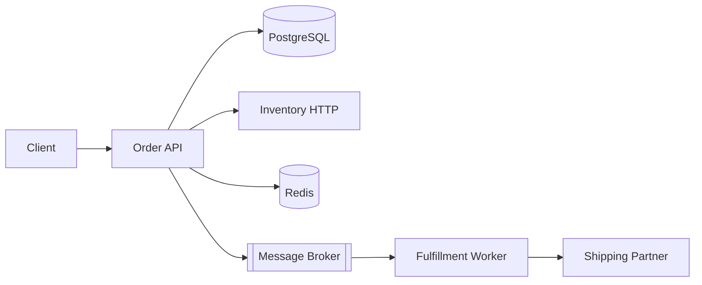
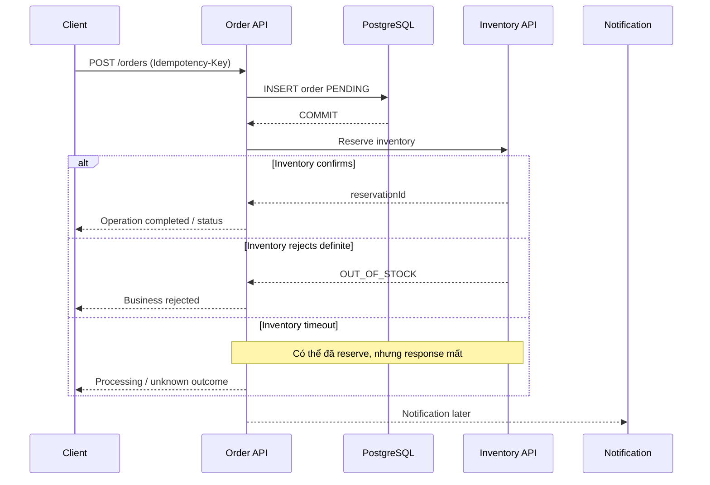
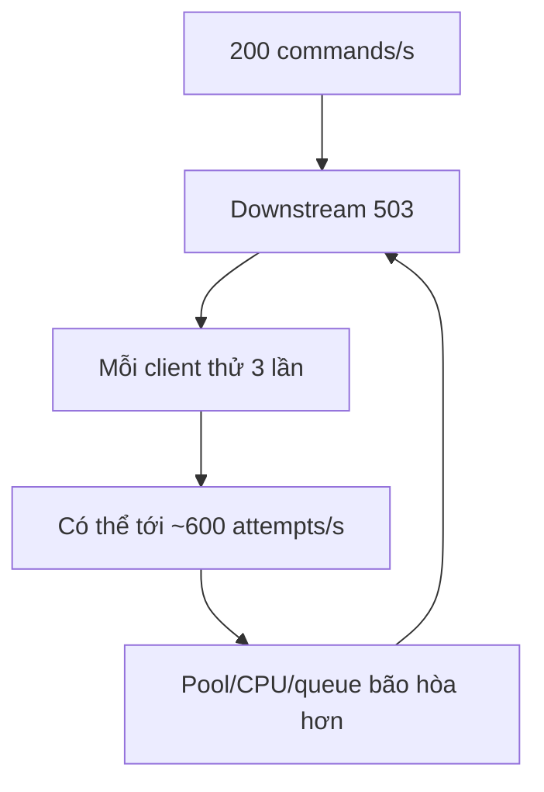
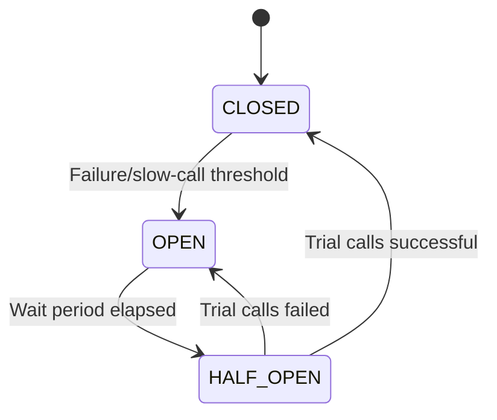
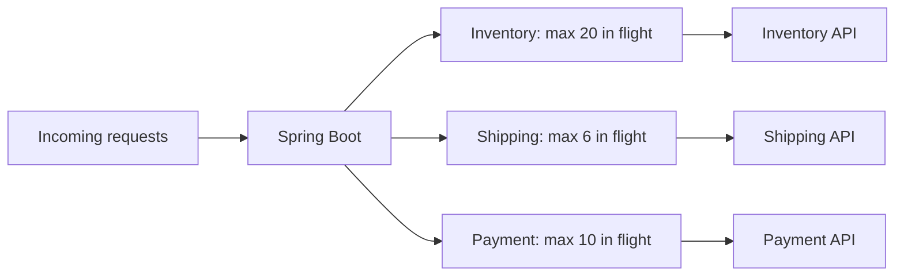
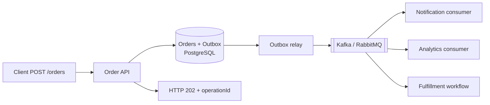
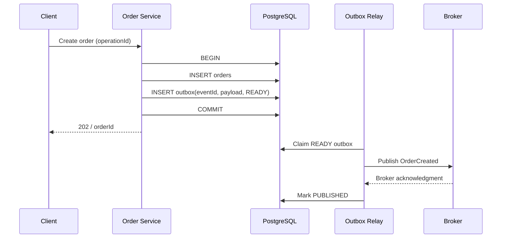
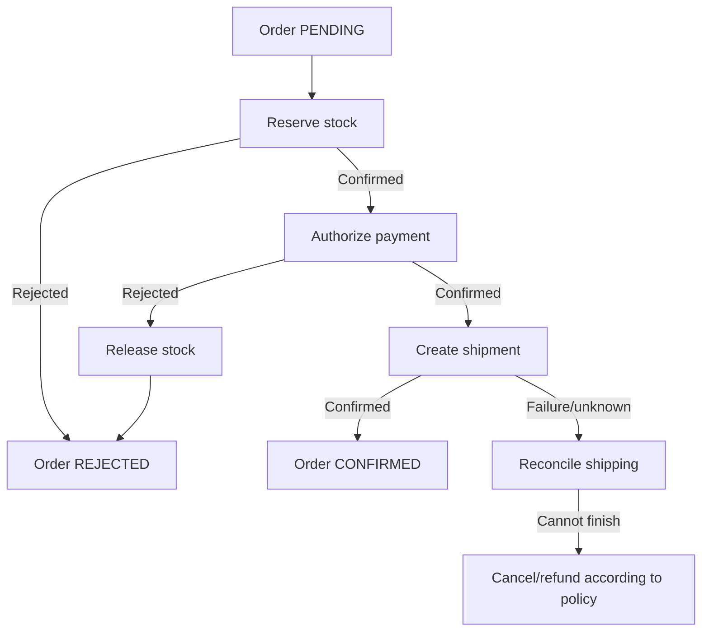
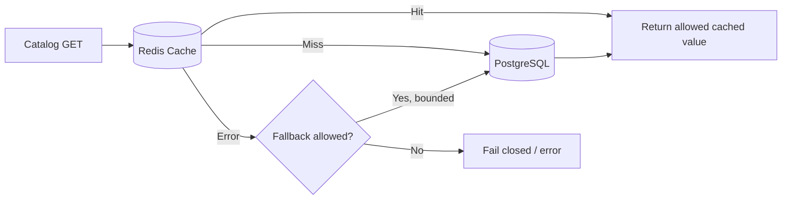
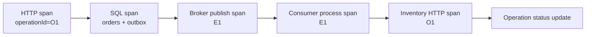

# Lỗi từng phần, độ trễ và tính độc lập giữa các hệ thống

Một ứng dụng Spring Boot tạo đơn hàng có thể phải gọi dịch vụ tồn kho qua HTTP, đọc cấu hình từ Redis, ghi PostgreSQL và phát sự kiện lên Kafka. Khi mọi hệ thống khỏe mạnh, luồng có vẻ đơn giản: nhận yêu cầu, xử lý, trả kết quả. Nhưng hệ thống phân tán không chỉ có hai trạng thái *tất cả thành công* hoặc *tất cả thất bại*: **PostgreSQL có thể đã commit trong khi phản hồi HTTP bị mất; Kafka đã nhận message nhưng producer timeout; một replica Redis còn sống nhưng trả dữ liệu cũ; dịch vụ tồn kho mất 12 giây mới trả 200**.

Đó là **lỗi từng phần** (*partial failure*). Một thành phần không sẵn sàng, chậm hoặc chỉ hoàn thành một phần mà các thành phần khác vẫn hoạt động. Nếu mọi request buộc phải đợi tất cả dependencies, lỗi nhỏ có thể lan thành **cạn thread, connection pool, hàng đợi tăng vô hạn, timeout và retry storm**. Nếu tách quá mạnh nhưng không có hợp đồng dữ liệu và cơ chế khôi phục, hệ thống lại gặp **mất sự kiện, xử lý trùng, trạng thái tạm thời không đồng nhất và kết quả không rõ ràng**.

Bài thuộc chương **Tổng quan tích hợp** của module **SPRING_BOOT_INTEGRATION**. Phạm vi module là tổ chức tích hợp hệ thống trong Spring Boot qua **HTTP client, cơ sở dữ liệu, cache, message broker và các adapter Spring Integration**, chú trọng **cấu hình, hợp đồng dữ liệu, giao dịch, lỗi, xử lý trùng lặp, kiểm thử và quan sát**. Bài này cung cấp mô hình tư duy để chọn **ranh giới đồng bộ/bất đồng bộ**, phân bổ **latency budget**, cô lập lỗi và duy trì **tính đúng đắn nghiệp vụ** khi một mắt xích gặp sự cố.

> **Phiên bản ví dụ:** Java 17+, Spring Boot 3.x (ví dụ 3.5) và Spring Framework 6.x; các snippets có tính minh họa, dùng PostgreSQL, Redis, Kafka/RabbitMQ như những thành phần phổ biến. Một số API Spring Boot 4.x/Spring Framework 7.x có thể khác; cần kiểm tra dependency BOM và tài liệu của phiên bản triển khai. Không coi các ngưỡng thời gian hay retry counts trong bài là cấu hình production mặc định.

## 1. Mục tiêu học tập

Sau khi học, bạn có thể:

1. Giải thích **partial failure** khác complete failure, business rejection và data contract failure như thế nào.
2. Nhận diện các dạng coupling: thời gian, trạng thái, tài nguyên, hợp đồng dữ liệu và triển khai.
3. Phân tích **latency**, **timeout**, **deadline**, **tail latency** và rủi ro khi fan-out tới nhiều dependencies.
4. Xây dựng latency budget theo tầng thay vì để mỗi HTTP client timeout độc lập.
5. Biết khi nào **retry** có ích và khi nào nó gây duplicate hoặc overload.
6. Phân biệt **circuit breaker**, **bulkhead**, **rate limiter**, **backpressure** và **load shedding**.
7. Chọn synchronous request/response hay asynchronous messaging theo hợp đồng nghiệp vụ.
8. Xử lý cửa sổ lỗi SQL commit → HTTP/broker send bằng **outbox**, và at-least-once delivery bằng **inbox/idempotency**.
9. Phân biệt eventual consistency, saga, compensation với distributed atomic transaction.
10. Định nghĩa trạng thái API phản ánh việc **đã nhận yêu cầu**, **đang xử lý** và **đã hoàn tất**.
11. Quan sát lỗi bằng tracing, metrics, structured logs và kiểm thử fault injection.
12. Đề xuất một thiết kế Spring Boot không để lỗi của một dependency làm sập toàn hệ thống.

## 2. Lỗi từng phần là gì?

Trong một tiến trình đơn giản, exception thường làm method dừng và transaction cục bộ có thể rollback. Trong hệ thống phân tán, một request đi qua nhiều tiến trình, đường truyền và tài nguyên; **mỗi ranh giới có thể thất bại độc lập**.



Các kết quả hoàn toàn có thể xảy ra:

| Tình huống | Điều đã chắc chắn | Điều chưa chắc chắn |
| --- | --- | --- |
| DB `INSERT` trả success nhưng chưa commit | Database đã thực thi statement | Transaction có commit hay rollback |
| DB commit success, ứng dụng chết trước response | Order đã lưu bền vững | Client biết order thành công hay chưa |
| HTTP POST tới đối tác timeout | Caller không nhận response kịp | Đối tác có tạo reservation không |
| Broker producer timeout | Client chưa nhận ack trong deadline | Broker có nhận record không |
| Consumer xử lý SQL xong nhưng crash trước ack | SQL side effect có thể đã commit | Broker có giao lại record không (thường có thể) |
| Redis cache miss | Không tìm được cache entry | PostgreSQL có dữ liệu hay không |
| Redis GET lỗi mạng | Cache provider không phản hồi | Entry tồn tại hay đã hết TTL |
| Một node đối tác trả 500 | Node/request này lỗi | Toàn bộ cluster đối tác có outage hay không |

Một mô hình trạng thái hữu ích gồm **success**, **definite failure**, **unknown outcome**. `Unknown` quan trọng với các thao tác có side effect: không được mặc định xem timeout là “chưa thực hiện”.

### 2.1. Partial failure khác business rejection

`HTTP 409` vì đơn đã tồn tại hoặc `422` vì dữ liệu sai không nhất thiết là “hạ tầng đang hỏng”. Đó có thể là **kết quả nghiệp vụ có dự kiến**. Retry nguyên request thường không giúp được.

Ngược lại, `HTTP 503`/`429`, TCP connection reset hoặc SQL deadlock có thể là lỗi tạm thời. Tuy nhiên, khả năng retry vẫn phụ thuộc vào **idempotency, deadline và tải hiện tại**.

### 2.2. Failure không chỉ là exception

Một service trả HTTP 200 nhưng body thiếu `operationId`, dữ liệu bị stale, currency sai hoặc mapping SKU sang tenant khác vẫn là **integration failure**. Transport success không tự bảo đảm **hợp đồng dữ liệu và ngữ nghĩa nghiệp vụ** đúng.

Lỗi có thể ở:

- **Availability:** không thể kết nối, service unavailable.
- **Latency:** service còn sống nhưng phản hồi quá chậm.
- **Correctness:** dữ liệu/side effect sai, response không khớp contract.
- **Durability:** tác vụ “đã nhận” nhưng biến mất khi process crash.
- **Consistency:** các hệ thống nhìn thấy những trạng thái khác nhau.
- **Security:** authentication/authorization sai hoặc thông tin lộ qua cache/event.
- **Capacity:** hàng đợi, thread pool, database pool hoặc broker lag vượt giới hạn.

## 3. Độ độc lập giữa các hệ thống có nhiều chiều

Tách service thành hai deployment không mặc nhiên làm chúng độc lập. Chúng vẫn có thể bị gắn chặt theo thời gian, tài nguyên hoặc schema.

| Kiểu coupling | Ví dụ | Hệ quả |
| --- | --- | --- |
| **Temporal coupling** | Order API chỉ trả sau khi Inventory API và Shipping API đều trả 200 | Một dependency chậm kéo chậm tất cả |
| **Availability coupling** | Không có cache fallback khi Redis down | Redis outage làm catalog API outage |
| **Resource coupling** | Mọi integration dùng chung thread pool 16 threads | Shipping chậm chiếm hết workers của payment |
| **Data/schema coupling** | Consumer yêu cầu field mới ngay khi producer deploy | Rolling deployment gây lỗi contract |
| **Transactional coupling** | SQL transaction giữ lock lúc đợi external HTTP | Lock contention, deadlock, latency tăng |
| **Operational coupling** | Cùng secrets, Redis namespace, release window | Đổi một service ảnh hưởng nhiều service |
| **Failure coupling** | Retry vô hạn gây quá tải bên nhận | Outage nhỏ biến thành outage hệ thống |
| **Identity/security coupling** | Cache key bỏ tenant hoặc dùng token của request trong background job | Cross-tenant leak, job lỗi sau token expiry |

Tăng tính độc lập không có nghĩa “mọi thứ phải asynchronous”. Nó nghĩa là **mỗi ranh giới có hợp đồng rõ về dữ liệu, deadline, lỗi, acknowledgment và trách nhiệm phục hồi**.

### 3.1. Coupling cần thiết và coupling có thể loại bỏ

Checkout cần biết **giá hiển thị cho khách hàng** và **thanh toán được xác nhận** trước khi thông báo “đặt hàng hoàn tất”; đó có thể là coupling nghiệp vụ chính đáng.

Ngược lại, gửi email chào mừng hoặc cập nhật dashboard phân tích thường không cần giữ HTTP checkout request. Đưa chúng vào một durable event flow giúp giảm temporal coupling, nếu người dùng chấp nhận eventual consistency.

**Câu hỏi thiết kế:** Nếu dependency này không phản hồi trong 2 giây, ta có thể thực hiện hành động an toàn nào *ngay bây giờ* mà không vi phạm bất biến nghiệp vụ?

## 4. Ví dụ Order API: ba loại đầu ra phải phân biệt

Giả sử `POST /orders` tạo đơn trong SQL, yêu cầu đặt giữ hàng, rồi gửi notification.



Ba nhóm trạng thái:

1. **Chắc chắn thành công:** Giao dịch cần thiết đã hoàn tất theo hợp đồng và có xác nhận phù hợp.
2. **Chắc chắn bị từ chối:** Có kết quả nghiệp vụ rõ (hết hàng, dữ liệu sai), không cần retry mù.
3. **Đang xử lý/không rõ:** Chưa thể kết luận, phải giữ `operationId` và có status/reconciliation workflow.

Nếu đối tác timeout, trả `200 OK` với trạng thái “đã giữ hàng” là sai. Nhưng trả `500` rồi để client retry bằng **một ID mới** cũng có thể tạo đặt giữ hàng đôi.

### 4.1. Một cách đặt operation states

```text
RECEIVED
   |
   v
PENDING_RESERVATION
   |             |
   |             +-- timeout --> UNKNOWN --> RECONCILING
   |
   +-- confirmed --> RESERVED --> COMPLETED
   |
   +-- rejected  --> REJECTED

PENDING/UNKNOWN có thể đi đến RETRY_SCHEDULED/FAILED_REVIEW
sau khi áp dụng business rules và kiểm tra external state.
```

Đây là **business state machine**, không phải các trạng thái mặc định của Spring Boot. Cần lưu bền vững trong PostgreSQL hoặc workflow engine phù hợp khi công việc có nghĩa vụ phải hoàn tất.

## 5. Latency: không chỉ nhìn trung bình

Latency là thời gian từ khi bắt đầu một thao tác tới khi nhận kết quả. Các thước đo thường dùng:

- **p50 (median):** 50% thao tác có latency không vượt mức này.
- **p95:** 95% thao tác có latency không vượt mức này.
- **p99:** 99% thao tác có latency không vượt mức này.
- **Maximum/timeout count:** đuôi dài hoặc request bị bỏ chờ.
- **Queue wait:** thời gian task nằm trong hàng đợi trước khi bắt đầu chạy.
- **End-to-end latency:** thời gian người dùng thực sự cảm nhận, khác latency một downstream call.

Ví dụ hai phiên bản inventory service đều có **average 80 ms**:

| Dịch vụ | p50 | p95 | p99 | Tình huống |
| --- | ---: | ---: | ---: | --- |
| A | 60 ms | 130 ms | 250 ms | Đuôi latency ổn định |
| B | 30 ms | 120 ms | 2.500 ms | Phần lớn nhanh nhưng 1% quá chậm |

A/B có thể có average gần nhau nhưng ảnh hưởng tới checkout rất khác. Vì vậy SLO quan trọng nên đo **tail latency** và tỷ lệ timeout.

### 5.1. Latency nối tiếp cộng dồn

Nếu một request đợi lần lượt:

```text
SQL lookup         50 ms
Inventory HTTP    350 ms
Promotion HTTP    250 ms
Shipping HTTP     200 ms
Serialization      30 ms
-------------------------
Tổng khoảng       880 ms
```

Trong đường đi nối tiếp, tổng elapsed time xấp xỉ tổng thời gian các bước cộng overhead. Nếu một service timeout 3 giây, nó có thể một mình vượt toàn bộ SLA 1 giây.

### 5.2. Parallel fan-out có tail amplification

Nếu gọi Inventory, Promotion và Shipping **song song**, critical path có thể gần `max(latency_i)` thay vì tổng, **khi các dependencies độc lập và đủ capacity**. Nhưng toàn request vẫn chờ **nhánh chậm nhất** nếu business cần cả ba kết quả.

Giả sử mỗi dependency có 99% xác suất đáp ứng deadline, độc lập về xác suất. Với 5 dependencies bắt buộc đều phải thành công đúng hạn:

\[
P(\text{tất cả đúng hạn}) = 0{,}99^5 \approx 95{,}1\%.
\]

Đây là **mô hình minh họa giả định độc lập**, không phải một quy luật đúng cho mọi system: các dependencies thường có lỗi tương quan do cùng cloud region, DNS, shared database hoặc network. Fan-out giảm thời gian chờ khi khỏe mạnh nhưng có thể **tăng xác suất có ít nhất một nhánh chậm/lỗi**.

### 5.3. Độ trễ xếp hàng và hiệu ứng lan truyền

Khi request arrival rate tiệm cận năng lực service, queue wait có thể tăng rất nhanh. Theo Little's Law ở trạng thái ổn định:

\[
L = \lambda W
\]

trong đó `L` là số requests đang ở hệ thống, `λ` là throughput trung bình và `W` là thời gian trung bình ở hệ thống. Nếu latency tăng mà throughput không đổi, số requests đồng thời cần tài nguyên cũng tăng.

Ví dụ API nhận 200 requests/giây, thời gian xử lý tăng từ 0,2 s lên 2 s:

```text
200 req/s * 0.2s = khoảng 40 requests in flight
200 req/s * 2.0s = khoảng 400 requests in flight
```

Nếu tất cả request đang giữ Java worker và database connection, lỗi latency nhỏ ở downstream có thể làm cạn pool của nhiều endpoint khác. Cần phân biệt **client-facing concurrency** và **downstream concurrency**; không phải mọi HTTP async request đều giữ thread trong toàn bộ thời gian.

## 6. Latency budget và deadline xuyên tầng

Một service có SLO trả checkout trong **1.500 ms**. Không nên cấu hình mỗi external dependency `readTimeout=10s` rồi kỳ vọng vẫn đạt SLO.

Ví dụ budget cho một synchronous path:

| Thành phần | Budget minh họa |
| --- | ---: |
| Ingress/auth/validation | 100 ms |
| SQL transaction | 250 ms |
| Inventory call | 450 ms |
| Promotion call | 300 ms |
| Serialization/network overhead | 100 ms |
| Dự phòng/retry tối đa | 300 ms |
| **Tổng** | **1.500 ms** |

Đây là cách phân bổ tổng thể, không phải đảm bảo mỗi call chính xác chiếm đúng phần của mình. Khi chạy song song, budget cần được xét theo **critical path** và tài nguyên; vẫn phải giữ hard deadline cuối.

### 6.1. Timeout khác deadline

- **Connect timeout:** giới hạn thời gian thiết lập kết nối.
- **Connection acquisition timeout:** giới hạn chờ lấy connection từ pool.
- **Read/response timeout:** giới hạn thời gian chờ dữ liệu từ đối tác theo client.
- **Request/operation deadline:** thời điểm cuối cùng mà toàn operation còn hữu ích.
- **Retry budget:** tổng thời gian mọi attempts + backoff.
- **Queue wait timeout:** tối đa thời gian một task nằm trong worker queue.
- **Business TTL:** sau thời điểm này, reservation hoặc job không còn giá trị.

Nếu caller có deadline còn 400 ms, việc bắt đầu downstream call với read timeout 2 giây có thể phí tài nguyên sau khi người dùng đã từ bỏ request.

### 6.2. Truyền deadline còn lại thay vì mỗi tầng reset timeout

```text
Client deadline: T+1500 ms

API nhận yêu cầu ở T+100 ms
  remaining = 1400 ms

Service A dùng 300 ms
  remaining = 1100 ms

Service B chỉ được dùng phần còn lại,
không tự tạo thêm deadline 1500 ms mới.
```

Có thể dùng trace baggage/header timeout hoặc một metadata hợp đồng internal, nhưng phải tránh cho client tùy ý nâng hạn mức server; thực thi server-side maximum budgets.

### 6.3. Timeout không dừng side effect đã bắt đầu

Một `CompletableFuture.orTimeout(500, MILLISECONDS)` có thể làm future báo `TimeoutException`, nhưng không mặc định hủy HTTP POST đang chạy. Với `RestClient`, driver HTTP timeout cần được cấu hình ở tầng request factory/client. Với Kafka/RabbitMQ, producer timeout không chứng minh message chưa được ghi.

**Kết luận vận hành:** Sau timeout của một *command có side effect*, trạng thái thường phải là **UNKNOWN**, sau đó query theo `operationId` hoặc reconcile, thay vì gắn nhãn `FAILED_NOT_EXECUTED`.

## 7. Ma trận lỗi: nhận diện trước khi chọn biện pháp

| Failure | Có retry tự động? | Fallback có an toàn? | Ghi chú |
| --- | --- | --- | --- |
| HTTP 400/422 do payload sai | Thường không | Không được biến thành success | Sửa contract/request |
| HTTP 401/403 | Không retry liên tục | Thường fail-closed | Auth/config cần được sửa |
| HTTP 404 lookup read-only | Tùy contract | Có thể negative cache ngắn | Không nhầm absence với outage |
| HTTP 409 duplicate operation | Theo idempotency contract | Query trạng thái operation | Không tạo ID mới |
| HTTP 429 | Có điều kiện | Có thể degrade | Tôn trọng Retry-After/quota |
| HTTP 503 | Có điều kiện | Phụ thuộc nghiệp vụ | Backoff/jitter, bounded |
| HTTP read timeout sau POST | Không retry mù | Unknown outcome | Dùng stable idempotency key |
| PostgreSQL deadlock | Có thể retry transaction | Không nếu transaction đã có non-SQL side effect | Retry toàn local transaction |
| PostgreSQL unique violation | Phân loại nghiệp vụ | Verify duplicate/conflict | Không coi mọi duplicate là thành công |
| Redis cache GET timeout | Có thể fail-open trên read | Chỉ nếu fallback SQL an toàn | Cần DB capacity protection |
| Redis cache EVICT fail sau commit | Durable retry/reconcile | Không chỉ log rồi bỏ | Có thể stale |
| Kafka producer ack timeout | Có thể resend với cùng eventId | Không suy message mất | Inbox downstream |
| Consumer xử lý rồi crash trước ack | Broker có thể redeliver | Idempotent handler | Inbox/SQL uniqueness |
| Poison JSON event | Không retry cùng payload vô hạn | Quarantine/DLT | Contract version/triage |
| Worker thread pool đầy | Backpressure/load shed | Không nhận việc giả | 429/503 hoặc durable queue |

Mỗi failure cần **owner, policy và tín hiệu quan sát**. Không để mọi exception bị một `catch (Exception) { retry(); }` chung xử lý.

## 8. Synchronous HTTP: khi nào nên dùng?

HTTP request/response phù hợp khi caller **cần kết quả ngay** để quyết định bước tiếp theo và kết quả có thể trả trong SLA:

- Kiểm tra điều kiện giá/khuyến mãi phải xác nhận trước khi thanh toán.
- Lấy thông tin read-only có timeout ngắn.
- Truy vấn trạng thái một operation đang xử lý.
- Yêu cầu nghiệp vụ cần phản hồi xác nhận từ hệ thống khác trước khi commit bước tiếp.

Ưu điểm: giao thức trực tiếp, dễ trả lỗi cho caller, dễ reasoning về request path. Đánh đổi:

- **Temporal coupling**: caller cần bên nhận khỏe ngay lúc gọi.
- **Latency propagation**: caller phải chờ đến deadline.
- **Capacity coupling**: thread/connection pools có thể bị giữ khi downstream chậm.
- **Retry complexity**: timeout sau side effect có thể trùng lặp.
- **Cascading failure**: nhiều callers cùng retry khi downstream bão hòa.

### 8.1. HTTP GET khác HTTP POST theo semantics

`GET` thường được thiết kế read-only và safe để retry theo HTTP contract, nhưng backend thực tế vẫn có thể sai hoặc gây quota/rate-limit. `POST` là command tạo effect; retry chỉ an toàn với **stable idempotency key** và bên nhận thực thi contract đó hoặc với cơ chế check-result/reconciliation.

`PUT` có thể là idempotent về **trạng thái cuối** theo contract HTTP khi áp dụng cùng representation, nhưng một triển khai downstream có thể tạo side effects như event/email mỗi lần; không được suy toàn hệ thống exactly-once từ HTTP verb.

## 9. Ví dụ Spring Boot RestClient: timeout có chủ đích

Với Spring Framework 6.1+/Spring Boot 3.2+, `RestClient` là HTTP client **đồng bộ**. Nó thuận tiện nhưng **không tự là non-blocking**.

Một cấu hình minh họa dùng JDK HTTP client:

```java
package com.example.integration.partner;

import java.net.http.HttpClient;
import java.time.Duration;

import org.springframework.beans.factory.annotation.Value;
import org.springframework.context.annotation.Bean;
import org.springframework.context.annotation.Configuration;
import org.springframework.http.client.JdkClientHttpRequestFactory;
import org.springframework.web.client.RestClient;

@Configuration(proxyBeanMethods = false)
public class PartnerHttpConfiguration {

    @Bean
    RestClient inventoryRestClient(
            RestClient.Builder builder,
            @Value("${integration.inventory.base-url}")
            String baseUrl) {

        HttpClient httpClient = HttpClient.newBuilder()
                .connectTimeout(Duration.ofMillis(400))
                .build();

        JdkClientHttpRequestFactory requestFactory =
                new JdkClientHttpRequestFactory(httpClient);
        requestFactory.setReadTimeout(Duration.ofSeconds(2));

        return builder.baseUrl(baseUrl)
                .requestFactory(requestFactory)
                .build();
    }
}
```

Tương ứng:

```yaml
integration:
  inventory:
    base-url: ${INVENTORY_URL:http://localhost:8082}
```

Đây là timeout **ví dụ** cho lab. Production phải chọn deadline theo toàn request, TLS/auth, connection pool behavior và observability. Nếu dùng Apache HttpComponents 5 hoặc Reactor Netty, timeout properties và connection pool setup **khác**. Spring Boot auto-configured `RestClient.Builder` được inject nếu web/client infrastructure phù hợp.

**Cảnh báo:** JDK client connect timeout và read timeout không tự thể hiện một **overall operation deadline gồm mọi retries**. Nếu controller đợi ba attempts tuần tự, elapsed time có thể vượt nhiều lần timeout mỗi attempt.

### 9.1. Chuyển status lỗi thành phân loại nghiệp vụ

Một service wrapper minh họa:

```java
package com.example.integration.partner;

import org.springframework.web.client.RestClient;
import org.springframework.web.client.RestClientResponseException;
import org.springframework.web.client.ResourceAccessException;
import org.springframework.stereotype.Service;

@Service
public class InventoryGateway {

    private final RestClient inventoryRestClient;

    public InventoryGateway(RestClient inventoryRestClient) {
        this.inventoryRestClient = inventoryRestClient;
    }

    public InventoryReply reserve(ReserveCommand command) {
        try {
            InventoryReply reply = inventoryRestClient.post()
                    .uri("/reservations")
                    .header("Idempotency-Key", command.operationId())
                    .body(command)
                    .retrieve()
                    .body(InventoryReply.class);

            if (reply == null || reply.reservationId() == null) {
                throw new InvalidPartnerResponseException(
                        "Missing reservationId");
            }
            return reply;

        } catch (RestClientResponseException ex) {
            if (ex.getStatusCode().value() == 409) {
                throw new ReservationConflictException(ex);
            }
            if (ex.getStatusCode().is5xxServerError()
                    || ex.getStatusCode().value() == 429) {
                throw new TransientPartnerException(ex);
            }
            throw new PermanentPartnerException(ex);

        } catch (ResourceAccessException ex) {
            // Có thể là connect/read timeout hoặc network I/O.
            // Với POST, outcome không chắc chắn.
            throw new UnknownPartnerOutcomeException(ex);
        }
    }
}
```

`InventoryReply`, `ReserveCommand` và các exception types là **domain contracts do ứng dụng định nghĩa**, không phải classes của Spring; ví dụ tập trung vào phân loại lỗi. Trong production, phải parse body/status và semantics theo **tài liệu đối tác**, không gán 409 luôn là conflict trong mọi API.

### 9.2. Hợp đồng DTO minh họa

```java
public record ReserveCommand(
        String operationId,
        String orderId,
        String sku,
        int quantity
) {}

public record InventoryReply(
        String reservationId,
        String status
) {}
```

`operationId` phải ổn định từ lúc nhận command cho tới mọi retries, bao gồm retry ở HTTP gateway, job queue và recovery sau restart. Không phát `UUID.randomUUID()` mới mỗi lần transport retry nếu đó vẫn là **cùng business operation**.

## 10. Retry: thuốc đúng liều hay nguyên nhân cascading failure?

Khi một request nhận `503`, thử lại một lần có thể giúp phục hồi. Nhưng khi mọi caller thử ba lần, traffic tới downstream có thể tăng xấp xỉ ba lần trong thời điểm nó đang yếu nhất.



Số `600` là minh họa cận trên khi mỗi command thực hiện đủ ba attempts; thực tế phụ thuộc early successes, cancellations, rate limiter và backoff. Retry có thể tạo **retry storm**.

### 10.1. Retry cần đủ sáu điều kiện

1. **Lỗi có thể phục hồi:** 429, 503 hoặc lock contention có tín hiệu transient.
2. **Tác vụ retry an toàn:** read-only hoặc có idempotency/reconciliation.
3. **Số lần giới hạn:** không loop vô hạn.
4. **Elapsed time giới hạn:** nằm trong deadline budget.
5. **Backoff + jitter:** các clients không đồng loạt retry tại một thời điểm.
6. **Tải được kiểm soát:** rate limiting, circuit breaker, bulkhead và overload response.

Ví dụ chính sách:

```text
max attempts: 3 (1 initial + 2 retries)
backoff:      150ms, sau đó ~300ms + jitter
deadline:     1200ms end-to-end
retry on:     HTTP 503/429 theo contract
no retry:     HTTP 400/401/403/validation
unknown POST: status lookup hoặc stable idempotency key
```

**Không** coi cấu hình này là mặc định cho mọi đối tác. Nếu mỗi HTTP attempt có read timeout 2 giây, ba attempts có thể không thể hoàn thành trong deadline 1,2 giây; timeout phải được **co theo remaining budget**.

### 10.2. Exponential backoff và jitter

Một biểu thức tham khảo:

\[
d_n = \min(d_{\max}, d_0 \times 2^{n-1}) + J_n
\]

trong đó `J_n` là jitter ngẫu nhiên bị giới hạn theo policy. Các biến thể **full jitter**, **equal jitter** hoặc decorrelated jitter có phân phối khác nhau; mục tiêu là tránh các clients retry đồng bộ.

Khi đối tác trả `Retry-After`, tôn trọng nó nếu nằm trong tổng deadline/quota policy. Nếu không thể đợi theo Retry-After mà request cần kết quả ngay, hãy trả trạng thái processing/rate limited thay vì giữ thread vô hạn.

### 10.3. Retry ở tầng nào?

| Tầng | Có thể retry gì? | Bẫy |
| --- | --- | --- |
| HTTP client | Kết nối/chờ response theo policy | Unknown POST effect |
| API gateway | Một request tới backend | Có thể nhân retries với application |
| Spring service | Business operation | Có thể retry cả SQL + external side effect |
| JDBC transaction | Deadlock/serialization error | Phải retry **toàn transaction**, không vài statements bị rollback-only |
| Kafka/Rabbit producer | Send/ack | Broker có thể đã nhận |
| Broker consumer | Message processing | Redelivery duplicate |
| Outbox relay | Publish durable intent | Lặp send cùng eventId |
| DLT/replay | Recovery sau điều tra | Vòng lặp poison message |

Cần **một owner policy** cho mỗi loại retry hoặc một ngân sách chung; không tự gắn thêm `@Retryable` ở mọi tầng và tin rằng mỗi layer độc lập.

## 11. Circuit breaker: ngăn khuếch đại lỗi

Circuit breaker ghi nhận tỷ lệ lỗi/slow calls của một dependency và tạm thời từ chối gọi khi dấu hiệu vượt ngưỡng:



- **CLOSED:** các lời gọi đi qua và được đo.
- **OPEN:** phần lớn lời gọi được fail-fast, tránh giữ connection/threads để chờ dependency đang outage.
- **HALF_OPEN:** cho một số lời gọi thử để đánh giá hồi phục.

**Không hiểu nhầm:** Circuit breaker **không thực hiện thao tác nghiệp vụ còn thiếu** và không biến outcome không rõ thành chắc chắn thất bại. Khi breaker open với command cần durable processing, hệ thống có thể ghi `PENDING` vào job/outbox để xử lý sau thay vì trả “đã hoàn thành”.

### 11.1. Fallback phải giữ đúng ngữ nghĩa

Ví dụ:

- Product description: có thể trả cached stale (trong cửa sổ stale được phê duyệt).
- Recommendation list: có thể trả danh sách rỗng/default.
- Shipping ETA: có thể hiện “chưa có ước tính” thay vì giá trị bịa.
- Payment charge: **không được** trả success giả vì circuit breaker open.
- Authorization: thường phải fail-closed hoặc truy vấn nguồn sự thật.

Một fallback sai nghiệp vụ có thể nguy hiểm hơn HTTP 503 rõ ràng.

### 11.2. Resilience4j và Spring Boot

Resilience4j là thư viện phổ biến cho circuit breaker, retry, bulkhead và time limiter; đây **không phải cơ chế tự xuất hiện** chỉ vì đã dùng `RestClient`. Nếu dự án chọn Resilience4j, cần dependency/starter **tương thích chính xác** với Spring Boot version, cấu hình qua properties và tests đảm bảo aspect/proxy được áp dụng.

Đặc biệt `TimeLimiter` trên async stage có thể giới hạn thời gian chờ result mà **không tự hủy side effect đã gửi**. Không áp số liệu breaker threshold/backoff lấy từ một ứng dụng vào mọi downstream service.

## 12. Bulkhead: cô lập tài nguyên giữa các integrations

Trong tàu thủy, bulkhead là vách ngăn để một khoang ngập nước không làm chìm cả tàu. Trong dịch vụ Spring Boot, ta tách **connection pool, executor, semaphore và concurrency budget** theo workload:



Nếu Shipping mất 20 giây, chỉ budget Shipping bị chiếm; Payment vẫn có tài nguyên xử lý.

### 12.1. Semaphore bulkhead minh họa

Một wrapper synchronous có capacity giới hạn:

```java
package com.example.integration.partner;

import java.util.concurrent.Semaphore;
import java.util.concurrent.TimeUnit;

public final class ShippingBulkhead {

    private final Semaphore permits =
            new Semaphore(6);

    public <T> T execute(CheckedSupplier<T> work)
            throws Exception {

        if (!permits.tryAcquire(
                50, TimeUnit.MILLISECONDS)) {
            throw new ShippingOverloadedException();
        }

        try {
            return work.get();
        } finally {
            permits.release();
        }
    }

    @FunctionalInterface
    public interface CheckedSupplier<T> {
        T get() throws Exception;
    }
}
```

`ShippingOverloadedException` là domain exception của hệ thống. Ví dụ giới hạn 6 requests đồng thời **trong mỗi JVM**; nếu chạy 10 replicas, tổng số có thể gần 60. Muốn giới hạn quota toàn cụm phải dùng central rate limiting/semaphore/distributed capacity accounting hoặc chia budget cho replicas.

Trong controller/web service, cần mapping overload thành HTTP 429/503 hoặc durable accepted status theo hợp đồng, **không** silently drop requests.

### 12.2. Thread pool riêng không thay cho queue limit

Một `ThreadPoolTaskExecutor` có queue quá lớn có thể giữ hàng nghìn tasks chờ, làm latency tăng mãi. Một pool nhỏ cho mỗi integration + **bounded queue + rejection policy** giúp overload hiển thị sớm.

Nguyên tắc:

- Chọn concurrency theo downstream quota/connection pool.
- Giới hạn queue depth và queue wait time.
- Khi queue đầy, reject rõ ràng/ghi durable job thay vì nhận việc giả.
- Theo dõi active workers, queue length, rejected tasks.
- Không dùng `CallerRunsPolicy` nếu nó làm một HTTP request giữ thread ngoài ý muốn hoặc thay đổi broker ack timing.

## 13. Rate limiting, backpressure và load shedding

Ba cơ chế liên quan nhưng khác mục tiêu:

- **Rate limiting:** Giới hạn số request theo khoảng thời gian, ví dụ 100 requests/giây tới một partner.
- **Backpressure:** Điều chỉnh tốc độ upstream tạo/gửi dữ liệu theo khả năng downstream tiêu thụ.
- **Load shedding:** Từ chối/hạ ưu tiên một phần workload khi quá tải để bảo vệ những request quan trọng.

```text
Producer faster than consumer:
  incoming 1000 events/s
  processing  300 events/s
  backlog grows 700 events/s

Without control:
  memory/queue/lag increase until failure.

With control:
  bounded queue + broker retention/quota
  pause/scale consumers or reduce producer rate
  reject low-priority workload when necessary.
```

Một broker thường **lưu backlog bền vững theo cấu hình**, không làm consumer xử lý nhanh hơn. Nếu backlog tăng lâu hơn retention/SLA, bạn vẫn có rủi ro mất cơ hội xử lý và phải scale hoặc giảm tốc nguồn.

### 13.1. Lựa chọn HTTP response khi quá tải

- `429 Too Many Requests`: bên nhận rate-limit caller; có thể kèm Retry-After.
- `503 Service Unavailable`: server tạm quá tải/đang bảo trì.
- `202 Accepted`: chỉ khi server **đã nhận trách nhiệm xử lý theo hợp đồng**, ví dụ intent đã được lưu durable.
- `200/201`: chỉ khi kết quả/đối tượng đã được tạo thành công theo HTTP/API semantics.

**Không trả 202 chỉ vì gọi `@Async` rồi quên future**: task trong JVM có thể bị reject hoặc mất khi process crash.

## 14. Khi nào nên tách bằng message broker?

Không phải mọi bước phải hoàn thành trong đường HTTP synchronous. Đối với **notification, analytics, search indexing, downstream projection, fulfillment có thể chờ** hoặc một số workflows kéo dài, producer có thể ghi ý định xử lý vào **durable queue/topic** và trả kết quả nhận việc.



Ưu điểm:

- Producer không cần Notification service đang chạy ngay.
- Broker có thể giữ backlog theo retention/queue durability đã cấu hình.
- Consumer có thể scale độc lập trong giới hạn partitions/queues.
- Lỗi downstream có thể được retry/DLT mà không giữ HTTP request.
- Các consumer có thể triển khai/cập nhật độc lập hơn nếu schema contract tương thích.

Đánh đổi:

- **Eventual consistency**: một service thấy order mới trước khi service khác thấy.
- **Message duplication** có thể xuất hiện, đặc biệt sau crash/retry.
- **Ordering** cần cấu hình theo key/partition/queue, không toàn cục.
- **Schema evolution** giữa nhiều consumer trở nên quan trọng.
- **Backlog, retention, DLQ và replay** cần vận hành.
- **Không có transaction nguyên tử** giữa SQL và broker nếu chưa thiết kế thêm.

### 14.1. Asynchronous khác durable

Một method:

```java
@Async("integrationExecutor")
public void notifyCustomer(OrderCreated event) {
    emailClient.send(event);
}
```

chạy trong executor của JVM, nhưng không tự có persistence/checkpoint khi process chết. Nếu request trả 202 trước khi task được ghi bền vững, nó có thể bị mất mà không có nơi replay.

Ngược lại, gửi Kafka/RabbitMQ thành công theo producer confirm/acks contract giúp broker chịu trách nhiệm lưu record theo durability policy, **nhưng** vẫn còn cửa sổ SQL commit → broker publish. Vì vậy cần xem chuỗi end-to-end, không chọn công nghệ theo từ khóa “async”.

### 14.2. Phân tách command và event

- **Command:** yêu cầu một thành phần thực hiện tác vụ, ví dụ `ReserveStock`; người gửi cần biết tác vụ được chấp nhận, từ chối hay đang chờ.
- **Event:** phát biểu một sự kiện đã xảy ra, ví dụ `OrderCreated`; nhiều subscribers có thể xử lý.
- **Query:** lấy thông tin không nhằm thay đổi trạng thái nghiệp vụ.

Không tự đổi từ command “hãy đặt giữ hàng” thành event “đã đặt giữ hàng” trước khi Inventory thực sự xác nhận. Sai tên/semantics của message tạo **phantom business state**.

## 15. HTTP request và broker xử lý khác thời điểm

| Khía cạnh | HTTP synchronous | Broker asynchronous |
| --- | --- | --- |
| Cần bên nhận trực tuyến ngay? | Thường có | Không nhất thiết, trong giới hạn broker backlog/retention |
| Thời gian đáp ứng client | Bao gồm downstream latency | Có thể chỉ bao gồm durable acceptance |
| Lỗi đối tác xuất hiện ở đâu? | HTTP error/timeout tới caller | Retry/DLT/operation status ở consumer |
| Trùng lặp | Client/gateway retry request | Producer retry + redelivery + replay |
| Hợp đồng | HTTP method/status/body | Event schema/key/topic/headers |
| Thứ tự | Trong một request chain | Theo partition/queue/consumer configuration |
| Bảo đảm hoàn tất business | Không mặc định | Không mặc định |
| Quan sát | Request tracing | Correlation spans + consumer lag + DLT |
| Backpressure | 429/503/connection pool | Broker quota, lag, pause/scale consumer, DLT |

Một kiến trúc tốt thường kết hợp cả hai: **HTTP cho nhận command và query status**, broker cho những bước có thể xử lý về sau.

### 15.1. Không biến mọi thứ thành event-driven

Nếu kết quả phải xác nhận trước khi người dùng thấy “đặt hàng thành công”, chuyển sang event-driven mà không có operation state chỉ **giấu latency**, không giải quyết bài toán nghiệp vụ. Một giao diện tốt có thể hiển thị `PENDING_PAYMENT`/`WAITING_FOR_STOCK` thay vì giả lập `COMPLETED`.

### 15.2. Tránh request chain quá dài

```text
API Gateway → Order → Inventory → Pricing → Promotion → Shipping → Fraud
```

Mỗi hop tạo thêm availability/latency coupling. Hãy cân nhắc:

- Hợp nhất các reads có thể tính ở cùng service boundary.
- Parallelize các queries độc lập (nhưng quản lý fan-out và partial outcomes).
- Dùng materialized view/projection cho thông tin phù hợp eventual consistency.
- Cache hợp đồng read-only với TTL và invalidation.
- Tách notifications/reporting khỏi critical path.
- Không thêm broker chỉ để che thiếu contract latency.

## 16. At-least-once delivery: message có thể đến nhiều lần

Một luồng Kafka/RabbitMQ đơn giản:

```mermaid
sequenceDiagram
    participant B as Broker
    participant C as Consumer
    participant DB as SQL
    B-->>C: Deliver E1
    C->>DB: BEGIN; UPDATE; COMMIT
    DB-->>C: COMMIT OK
    Note over C: Process crash trước ack/offset commit
    B-->>C: Redeliver E1
    C->>DB: Execute E1 again?
```

Nếu consumer cứ chạy `UPDATE balance = balance + amount` không kiểm tra event identity, duplicate delivery nhân đôi business effect.

**Chính sách hợp lý:** Treat transport là **at-least-once** trong những cửa sổ lỗi có thể dẫn đến replay; thiết kế **business idempotency** ở từng consumer.

### 16.1. Ordering không tự bảo đảm toàn cục

Với Kafka, cùng key (chẳng hạn `orderId`) được producer route nhất quán đến một partition trong cấu hình phù hợp; thứ tự log được giữ **trong partition**, nhưng retry topics, concurrent processing, thay partition count hoặc producer ordering settings có thể thay đổi thứ tự quan sát ở ứng dụng.

Với RabbitMQ, queue lưu thứ tự enqueue nhưng multiple consumers, requeue, priorities hoặc retries có thể làm **thứ tự xử lý business** khác thứ tự phát. Không chỉ dựa vào “broker giữ thứ tự” nếu nghiệp vụ cần monotonic state transitions; dùng `aggregateVersion`/optimistic locking hoặc per-aggregate sequencing.

### 16.2. Exactly-once có giới hạn phạm vi

Kafka có những cơ chế idempotent producer/transactions và read-process-write exactly-once semantics **trong phạm vi Kafka được cấu hình đúng**. Chúng không mặc nhiên làm PostgreSQL, Redis, email hay HTTP POST cùng tham gia một transaction.

**Đích thực tế:** Thiết kế *effectively-once business effect* bằng stable event ID + consumer inbox/unique constraint + atomic local update, chấp nhận delivery có thể lặp nhưng không nhân đôi side effect.

## 17. Cửa sổ SQL commit → broker publish: dual-write problem

Giả sử Order Service:

```java
@Transactional
public void create(OrderCommand command) {
    orderRepository.insert(command);
    kafkaTemplate.send("orders.events", toEvent(command));
}
```

Đây là **dual write** giữa SQL và Kafka. `@Transactional` cho JDBC không tự đảm bảo Kafka publish nằm trong cùng local SQL transaction.

Hai thứ tự đều có rủi ro:

| Thứ tự | Failure window | Hậu quả |
| --- | --- | --- |
| SQL commit rồi publish | Process crash/broker down giữa hai bước | Order tồn tại nhưng event không được gửi |
| Publish rồi SQL commit | SQL rollback sau broker ack | Consumer nhận event về order chưa tồn tại |
| SQL write trong transaction rồi send trước commit | Consumer chạy trước SQL commit | Consumer có thể không đọc được order |
| Broker ack rồi status update fail | Relay gửi lại | Duplicate event |

Đừng gọi `@TransactionalEventListener(AFTER_COMMIT)` là giải pháp durability hoàn chỉnh: nó tránh gửi trước commit, nhưng **process vẫn có thể chết giữa commit và callback/publish**.

## 18. Transactional Outbox: ghi ý định gửi trong cùng SQL transaction

Cách phổ biến để loại bỏ **khoảng trống mất intent** giữa SQL và broker là ghi một outbox row **trong cùng transaction** với business update.



Nếu SQL rollback, **order và outbox cùng rollback**. Nếu commit, ý định gửi được giữ trong SQL dù process ứng dụng crash. Relay có thể khôi phục và gửi sau.

### 18.1. Schema SQL

```sql
CREATE TABLE orders (
    order_id UUID PRIMARY KEY,
    operation_id UUID NOT NULL UNIQUE,
    tenant_id VARCHAR(64) NOT NULL,
    state VARCHAR(40) NOT NULL,
    created_at TIMESTAMPTZ NOT NULL DEFAULT now()
);

CREATE TABLE order_outbox (
    event_id UUID PRIMARY KEY,
    aggregate_id UUID NOT NULL,
    event_type VARCHAR(80) NOT NULL,
    payload_json JSONB NOT NULL,
    status VARCHAR(24) NOT NULL DEFAULT 'READY',
    attempt_count INTEGER NOT NULL DEFAULT 0,
    next_attempt_at TIMESTAMPTZ,
    created_at TIMESTAMPTZ NOT NULL DEFAULT now(),
    published_at TIMESTAMPTZ
);

CREATE INDEX idx_order_outbox_ready
    ON order_outbox (status, next_attempt_at, created_at);
```

Đây là schema **minh họa PostgreSQL**; production cần retention, lease/lock owner, optimistic update, poison event handling và migrations do team quản lý.

### 18.2. Spring Boot transactional service

```java
package com.example.integration.order;

import java.util.UUID;

import org.springframework.jdbc.core.JdbcTemplate;
import org.springframework.stereotype.Service;
import org.springframework.transaction.annotation.Transactional;

@Service
public class OrderCommandService {

    private final JdbcTemplate jdbc;
    private final EventJsonEncoder encoder;

    public OrderCommandService(
            JdbcTemplate jdbc, EventJsonEncoder encoder) {
        this.jdbc = jdbc;
        this.encoder = encoder;
    }

    @Transactional
    public UUID accept(CreateOrder command) {
        UUID orderId = command.orderId();
        UUID eventId = command.eventId();

        jdbc.update("""
                INSERT INTO orders (
                    order_id, operation_id, tenant_id, state
                )
                VALUES (?, ?, ?, 'PENDING')
                """,
                orderId, command.operationId(),
                command.tenantId());

        String json = encoder.toJson(
                new OrderCreated(
                    eventId, orderId, command.tenantId()));

        jdbc.update("""
                INSERT INTO order_outbox (
                    event_id, aggregate_id, event_type,
                    payload_json, status
                )
                VALUES (?, ?, 'OrderCreated',
                        CAST(? AS jsonb), 'READY')
                """,
                eventId, orderId, json);

        return orderId;
    }
}
```

`CreateOrder`, `OrderCreated` và `EventJsonEncoder` là application-defined DTO/port. `operationId` phải được client/application xác định ổn định và deduplicated ở SQL; ví dụ sẽ ném unique violation nếu cùng operation lặp, còn production nên **tra cứu kết quả cũ** và chỉ nhận lại nếu payload khớp contract. Việc sinh eventId mới mỗi retry client làm mất hiệu quả của outbox/inbox.

**Lưu ý:** Đặt `@Transactional` trên Spring-managed service và gọi qua proxy. Không gọi `accept` bằng `this.accept(...)` rồi mặc định proxy kích hoạt. Dùng một `DataSource` và transaction manager phù hợp cho hai bảng để bảo đảm local atomicity.

### 18.3. Relay cần claim và retry đúng cách

Một worker đọc `READY` rows, claim bằng lease hoặc `SELECT ... FOR UPDATE SKIP LOCKED` theo SQL transaction phù hợp, publish broker rồi mark `PUBLISHED` khi có ack. Không giữ **SQL row locks xuyên HTTP/broker calls dài** nếu có thể tránh; dùng claim/lease và state transitions.

Các tình huống:

- Relay chết trước publish: row còn READY hoặc lease hết hạn → thử lại.
- Publish fail: tăng attempt count và đặt next_attempt_at.
- Publish thành công nhưng relay chết trước mark PUBLISHED: **sẽ gửi lại** cùng eventId.
- Dữ liệu event sai schema: quarantine/manual remediation; không retry vô hạn.
- Relay backlog tăng: cảnh báo bằng oldest READY age, không chỉ count.

Outbox giải quyết “không mất **ý định phát** sau SQL commit”, **không tự tạo exactly-once broker delivery**.

## 19. Consumer Inbox: tránh side effect nhân đôi

Một consumer nhận `OrderCreated` cần xác định **event đã được áp dụng chưa** trước khi thay đổi bảng business.

```sql
CREATE TABLE consumer_inbox (
    consumer_name VARCHAR(100) NOT NULL,
    event_id UUID NOT NULL,
    payload_sha256 CHAR(64) NOT NULL,
    processed_at TIMESTAMPTZ NOT NULL DEFAULT now(),
    PRIMARY KEY (consumer_name, event_id)
);

CREATE TABLE order_projection (
    order_id UUID PRIMARY KEY,
    tenant_id VARCHAR(64) NOT NULL,
    state VARCHAR(40) NOT NULL
);
```

Trong **một local SQL transaction**:

```text
BEGIN
  INSERT consumer_inbox(consumerName, eventId, payloadHash)
    ON CONFLICT DO NOTHING

  if inserted:
      INSERT/UPDATE order_projection according to contract
  else:
      verify hash/semantic identity
      no-op if same event
      error/quarantine if same eventId but different data
COMMIT

only after commit:
  ack broker / let container commit offset
```

Vì inbox insert và business effect nằm trong cùng transaction, nếu business update fail, inbox insert phải rollback. Nếu SQL commit xong mà consumer crash trước ack, record được giao lại sẽ trở thành no-op.

### 19.1. Mẫu SQL atomic

```sql
INSERT INTO consumer_inbox (
    consumer_name, event_id, payload_sha256
)
VALUES ('order-projection', :event_id, :payload_hash)
ON CONFLICT (consumer_name, event_id)
DO NOTHING;
```

Đọc update count; nếu bằng 1 mới thực hiện SQL projection. Nếu bằng 0, đọc hash tồn tại để phân biệt duplicate nguyên trạng với **same ID, different payload**. Đừng dùng `SELECT EXISTS` ngoài transaction rồi `INSERT` mà không có unique constraint; hai consumers có thể race.

### 19.2. Ack timing trong Spring Kafka/Rabbit/JMS

- **Kafka record listener**: Với `enable-auto-commit=false` và container ack-mode phù hợp, để exception propagate cho error handler; commit offset theo chính sách chỉ sau xử lý/handoff thành công.
- **RabbitMQ**: ACK delivery khi đã hoàn thành điểm bàn giao bền vững; NACK/requeue/dead-letter theo bounded policy.
- **JMS**: Session transaction/ack semantics khác; cần đối chiếu configuration và transaction manager.
- **Spring Integration**: Khi chuyển sang `ExecutorChannel` hoặc một adapter async, trách nhiệm error flow và acknowledgment có thể đổi; không mặc định message đã được xử lý chỉ vì handler đã submit `CompletableFuture`.

Nếu listener chỉ gọi `@Async void` rồi return, broker container có thể coi message đã xử lý và commit/ack **trước khi công việc async hoàn tất**.

## 20. Idempotency không đồng nghĩa “gọi một lần”

Một command `POST /reservations` có thể được gửi hai lần bởi client, retry policy, gateway hoặc relay. Không thể kiểm soát mọi đường truyền để chắc chắn **chỉ gửi một HTTP request** trong mọi failure window.

Idempotency nghĩa là **cùng một business operation được áp dụng tối đa một lần về tác dụng phụ cần bảo vệ**, dù có nhiều attempts. Các cơ chế:

- Stable `operationId`/`eventId`.
- SQL unique constraint và payload hash/version check.
- Partner API hỗ trợ `Idempotency-Key` thật, có retention và scope rõ.
- State machine tránh chuyển sai trạng thái khi event đến muộn.
- Query/reconciliation khi timeout không rõ kết quả.
- Consumer inbox để dedup broker redelivery.

### 20.1. Idempotency key cần có phạm vi

```text
tenantId + operationType + operationId
```

Có thể cần key gồm tenant và loại operation để tránh ID collision xuyên khách hàng/nghiệp vụ. Thời gian giữ ledger/key phải dài đủ cho cửa sổ replay/retry; nếu idempotency key của đối tác hết hạn sau 24h mà local job retry sau 7 ngày, **có thể tạo side effect mới**.

### 20.2. Không chỉ dùng Redis cache làm idempotency ledger

Redis có TTL, eviction, failover và key loss; phù hợp optimization hoặc khóa tạm có policy, nhưng với giao dịch quan trọng cần durable SQL/state có unique constraints hoặc một storage cam kết tương ứng.

Một `SETNX` với TTL 30 giây không chứng minh command không được áp dụng lần hai sau 1 giờ; còn lock lease hết hạn giữa long-running operation có thể cho concurrent execution. Với critical writes, cần fencing/version hoặc DB constraints.

### 20.3. Phân biệt at-most-once, at-least-once và effectively-once

| Mục tiêu | Mô tả | Đánh đổi |
| --- | --- | --- |
| At-most-once delivery | Có thể mất, cố tránh gửi lặp | Không phù hợp task bắt buộc không được mất |
| At-least-once delivery | Có thể giao lại cho tới khi hoàn tất theo policy | Consumer phải idempotent |
| Exactly-once transport | Chỉ trong phạm vi hẹp mà platform hỗ trợ | Không bao trùm mọi external side effect |
| Effectively-once business effect | Có thể delivery lặp nhưng SQL/business update không nhân đôi | Cần unique keys, state guard và reconciliation |

Không tự tuyên bố “exactly once” toàn hệ thống chỉ vì dùng Kafka transactions hay Spring `@Transactional`.

## 21. Eventual consistency và business invariants

Khi Order Service commit `PENDING` rồi phát `OrderCreated` để Inventory xử lý, trong vài giây có thể có:

```text
Order DB:       PENDING_RESERVATION
Inventory DB:   chưa thấy reservation
Search index:   chưa có order mới
Notification:   chưa gửi email
Client GET:     PENDING_RESERVATION
```

Đó là **eventual consistency** theo hợp đồng, không nhất thiết là lỗi. Nó trở thành lỗi nếu API/UI khẳng định “đã giữ hàng” khi Inventory chưa xác nhận hoặc nếu hệ thống không bao giờ hội tụ sau outage.

### 21.1. Phân biệt tính nhất quán và mức độ sẵn sàng

Một số dữ liệu có thể stale:

- Search index.
- Analytics dashboard.
- Recommendation list.
- Email notification state.

Một số bất biến cần xác minh từ owner/source-of-truth:

- Không charge payment hai lần.
- Không cấp quyền sử dụng khi chưa authorization.
- Không tạo hai reservation cho cùng operation.
- Không hoàn tất order khi payment chưa xác nhận.
- Không giảm tồn kho dưới ngưỡng được phép.

**Phân loại theo hậu quả sai nghiệp vụ**, không chọn eventual consistency làm một công tắc chung cho mọi service.

### 21.2. Read-your-writes

Nếu client vừa POST order rồi GET qua read model bị trễ, UI có thể thấy 404 hoặc state cũ. Các giải pháp:

- GET operation state ở **source-of-truth service** trong giai đoạn đang xử lý.
- Trả `operationId` và status riêng, không hứa projection đã cập nhật.
- Dùng version token/offset hoặc `minimumVersion` để biết projection đã bắt kịp.
- Hiển thị `PROCESSING`/`SYNCING` có ý nghĩa nghiệp vụ.
- Không cache một 404 quá lâu nếu record sẽ xuất hiện sau vài giây.

## 22. Saga và compensation: khi không có một transaction chung

Một checkout có thể gồm:

```text
Create Order → Reserve Inventory → Authorize Payment → Arrange Shipping
```

Các bước chạy trên databases/APIs khác nhau. Không thể giả định một `@Transactional` ở Order Service rollback được tất cả.

Một *saga* là chuỗi bước nghiệp vụ có **trạng thái bền vững**, lỗi được xử lý bằng các **compensating actions** phù hợp.



### 22.1. Compensation không phải rollback kỹ thuật

Nếu payment đã được charge, compensation có thể là **refund**. Refund là một business operation mới, có thể thất bại, có phí và cần audit. Không phải khôi phục bit-for-bit như SQL rollback.

Nếu shipping partner không hỗ trợ cancel sau khi hàng đã giao, saga không thể “undo” như transaction. Cần quy trình ngoại lệ/manual review.

### 22.2. Orchestration và choreography

- **Orchestration:** một workflow owner giữ state, ra command tiếp theo, xử lý timeout/retries/compensation. Dễ theo dõi luồng tập trung.
- **Choreography:** services phát events và tự phản ứng. Giảm coupling vào coordinator nhưng dễ khó quan sát nếu nhiều luồng gián tiếp.

Chọn dựa trên độ phức tạp, business deadline và khả năng audit. Dù cách nào cũng cần stable IDs, event schemas và dead-letter/reconciliation workflows.

### 22.3. Không tự động retry compensation vô hạn

Một compensation thất bại cần retry budget, idempotency và state `COMPENSATION_PENDING`/`MANUAL_REVIEW`. Không bao giờ mặc định log exception rồi tuyên bố saga đã rollback.

## 23. Cache là lớp tối ưu hóa, không tự là nguồn sự thật

Redis giảm độ trễ đọc dữ liệu có thể cache, nhưng cũng tạo thêm failure modes. Trong Spring Boot, `@Cacheable` và `RedisCacheManager` giúp chia sẻ kết quả đọc giữa các replica; `@CacheEvict` hỗ trợ invalidation theo key, nhưng các annotation này **không tự bảo đảm cache nhất quán với transaction SQL hoặc broker event**.

Những failure modes cần phân biệt:

- **Cache miss:** entry không tồn tại/hết TTL.
- **Cache GET timeout:** provider không phản hồi.
- **Stale value:** entry tồn tại nhưng SQL/source đã thay đổi.
- **Serialization mismatch:** replica mới không đọc được payload của replica cũ.
- **Eviction:** Redis mất key sớm hơn TTL do memory policy.
- **Cache stampede:** nhiều requests miss cùng lúc làm SQL quá tải.



### 23.1. Fail-open chỉ khi an toàn

Product description có thể fallback SQL. Nhưng authorization cache hoặc payment state cần read source-of-truth/fail-closed. Nếu Redis outage, mọi request chuyển sang SQL có thể gây **thundering herd**; cần rate limit/bulkhead/connection budget ngay cả khi cache là optional.

### 23.2. Invalidation cũng có cửa sổ lỗi

Giả sử SQL commit giá mới rồi Redis `EVICT` thất bại. Nếu application trả “đã cập nhật” mà không có durable retry, stale cache có thể còn đến TTL. Với giá nhạy cảm, cần:

- Invalidate after commit.
- SQL outbox/durable invalidation intent nếu không được phép mất.
- Versioned cache key hoặc version guard chống stale refill.
- TTL giới hạn stale window.
- Metrics oldest pending invalidation và consistency test.

`RedisCacheManager.transactionAware()` có thể hoãn một số cache operations sau commit, nhưng **không làm Redis và SQL thành một distributed transaction**.

## 24. Contract giữa các hệ thống phải tiến hóa độc lập

Muốn các services deploy độc lập, producer và consumer phải có **hợp đồng dữ liệu tương thích** khi tồn tại nhiều versions đồng thời.

Ví dụ `OrderCreated`:

```json
{
  "eventId": "632e4c27-792e-4594-8857-e14d0c5e2295",
  "orderId": "a6507402-e214-49b2-9f7e-5603d392a610",
  "tenantId": "tenant-a",
  "eventVersion": 1,
  "amountMinor": 125500,
  "currency": "VND",
  "occurredAt": "2026-11-21T02:00:00Z"
}
```

- `eventId`: identity phục vụ dedup.
- `orderId`: aggregate identity, thường là Kafka key.
- `tenantId`: cần authorization/source validation.
- `eventVersion`: contract version, **không phải aggregateVersion**.
- `amountMinor` và `currency`: không được đổi đơn vị ngầm.
- `occurredAt`: event time từ source, không tự giống processing time.

### 24.1. Schema evolution

| Thay đổi | Khả năng tương thích |
| --- | --- |
| Thêm field tùy chọn có default | Thường dễ hơn, nhưng cần test consumer cũ |
| Đổi tên `amountMinor` thành `price` | Có thể breaking |
| Đổi type number → string | Có thể breaking |
| Đổi tiền từ minor units → major units mà không đổi field | **Breaking về ngữ nghĩa dù JSON vẫn parse** |
| Xóa field bắt buộc | Breaking với consumer phụ thuộc |
| Thêm enum value | Consumer cũ có thể không hỗ trợ |
| Đổi timezone/time precision | Có thể sai nghiệp vụ dù deserialization success |

Với Kafka/Pulsar, Avro/Protobuf/JSON Schema Registry giúp kiểm soát một phần compatibility, nhưng **schema compatibility không tự chứng minh semantic compatibility**. HTTP DTO cũng cần contract tests khi client/server deploy lệch version.

### 24.2. Expand-and-contract

Một rollout an toàn có thể:

1. Consumer mới chấp nhận cả field cũ và mới.
2. Producer bắt đầu phát field mới nhưng giữ field cũ theo compatibility window.
3. Quan sát consumer versions và backlog chưa xử lý.
4. Cập nhật toàn bộ consumers.
5. Chỉ sau đó mới loại field cũ theo contract release policy.

Không ép tất cả services deploy cùng phút chỉ vì thay một field JSON. Đó là **operational coupling** mà contract versioning cần giảm bớt.

## 25. API contract phản ánh partial completion

Nếu hệ thống nhận command và xử lý bất đồng bộ, API nên cung cấp cách **theo dõi operation**.

Ví dụ:

```http
POST /orders
Idempotency-Key: op-3197
Content-Type: application/json

{"sku":"SKU-1","quantity":2}
```

Khi intent đã được lưu bền vững và còn processing:

```http
HTTP/1.1 202 Accepted
Location: /operations/op-3197
Retry-After: 2
Content-Type: application/json

{
  "operationId": "op-3197",
  "status": "PENDING_RESERVATION"
}
```

Client tiếp tục:

```http
GET /operations/op-3197
```

Kết quả:

```json
{
  "operationId": "op-3197",
  "status": "COMPLETED",
  "orderId": "a6507402-e214-49b2-9f7e-5603d392a610",
  "updatedAt": "2026-11-21T02:01:00Z"
}
```

Hoặc:

```json
{
  "operationId": "op-3197",
  "status": "UNKNOWN",
  "reason": "INVENTORY_TIMEOUT",
  "retryableByServer": true,
  "updatedAt": "2026-11-21T02:01:00Z"
}
```

**Điều kiện để trả 202:** operation đã có trách nhiệm xử lý theo contract, lý tưởng đã được ghi durable. Một `CompletableFuture` trong memory hoặc log “queued” chưa đủ cho tác vụ không được phép mất.

### 25.1. Polling, webhook và event notification

Client có thể chọn:

- Polling `GET /operations/{id}` với backoff/Retry-After.
- Webhook có chữ ký xác thực, idempotency và retry ở client.
- Server-Sent Events/WebSocket cho thông báo trạng thái có kết nối.
- Broker event cho các hệ thống backend.

Dù chọn cơ chế nào, **source of truth của operation status** cần persist; thông báo có thể trễ hoặc mất và client vẫn phải query được.

### 25.2. Không để client retry tạo duplicate order

Cùng `Idempotency-Key` và cùng payload phải trả kết quả của operation cũ theo retention policy. Cùng key nhưng payload khác phải báo conflict; không lặng lẽ chấp nhận “lần đầu thắng” nếu không kiểm tra dữ liệu.

Hệ thống cần định nghĩa scope: tenant, endpoint, payload fingerprint và thời hạn giữ idempotency record.

## 26. Isolation không chỉ ở runtime: dữ liệu, quyền và vận hành

Một service độc lập còn cần các ranh giới:

- **Database ownership:** Không cho các services khác cập nhật business tables trực tiếp nếu contract yêu cầu event/API.
- **Secrets/credentials:** Mỗi adapter có secret và quyền riêng; rotation không buộc deploy toàn hệ thống.
- **Broker ACL:** Producer chỉ write topic được phép, consumer chỉ read group/topic liên quan.
- **Cache namespace:** Không dùng chung key prefix giữa dev/prod hoặc giữa nhiều tenants.
- **Deployment:** Cho phép một service rollback mà dữ liệu được viết bởi version mới vẫn có compatibility strategy.
- **Observability:** Mỗi integration có owner, runbook và alert; không dùng một dashboard global chỉ đo HTTP 200.
- **Capacity:** Tách thread pools/DB connection budgets theo các service quan trọng.
- **Failure domain:** Nếu có thể, tránh đặt mọi thành phần ở cùng một failure domain mà lại gọi là “có HA”.

Tăng isolation có chi phí: thêm storage, networking, cấu hình, eventual consistency và các tài nguyên cần vận hành. Chọn mức độ độc lập tương xứng với **hậu quả của lỗi** và yêu cầu business, không cực đoan hóa microservices.

## 27. SLO, error budget và ranh giới trách nhiệm

Một mục tiêu vận hành có thể là:

> **99,9%** các yêu cầu đọc catalog có response hợp lệ trong **500 ms** trên cửa sổ 30 ngày.

Đó là một **Service Level Objective (SLO)**. Các khái niệm:

- **SLI:** tín hiệu được đo, ví dụ tỷ lệ request success và latency p99.
- **SLO:** ngưỡng mục tiêu cho SLI trong cửa sổ thời gian.
- **SLA:** cam kết có thể có điều khoản hợp đồng/đền bù, khác SLO nội bộ.
- **Error budget:** phần thời gian/requests được phép không đạt SLO theo kỳ đo.

Ví dụ mục tiêu availability 99,9% trên 1.000.000 requests tương ứng ngân sách khoảng 1.000 requests không thành công theo định nghĩa SLI, **không phải** ngân sách có thể tiêu tự do mà không cần phản ứng. Với latency SLO, cần định nghĩa success/error, đường request và population rõ.

### 27.1. End-to-end SLO khác SLO của dependency

Order API có thể có SLO 99,9%, Inventory API 99,5%, Payment 99,9%. Nếu Order API **bắt buộc** đợi Inventory/Payment cho mọi request, availability end-to-end có thể thấp hơn từng thành phần. Không thể chỉ lấy **min(SLO dependencies)** để suy chính xác availability: tương quan failures, fallback, caches và circuit breakers đều ảnh hưởng.

### 27.2. Đo business success, không chỉ HTTP 2xx

Một hệ thống luôn trả 202 trong 50 ms có thể trông “siêu nhanh” ở HTTP metrics nhưng jobs backlog đến 3 ngày. Cần đo:

- Tỷ lệ operations đi từ PENDING → COMPLETED trong business deadline.
- Tỷ lệ bị REJECTED theo nghiệp vụ.
- Tuổi của operation còn UNKNOWN.
- Outbox oldest READY age và broker consumer lag.
- Tỷ lệ DLT/quarantine chưa được giải quyết.
- Số duplicate business attempts, idempotency conflicts.
- Sai lệch giữa data owner và read projections.

**Độ độc lập tốt phải đo cả latency nhận việc và latency hoàn tất**, không thay một latency bằng latency khác rồi tuyên bố cải thiện.

## 28. Distributed tracing và correlation xuyên HTTP/broker

Khi một request đi qua Order API, Kafka, Worker và Inventory API, HTTP trace trong tiến trình đầu có thể kết thúc **trước** khi worker bắt đầu xử lý. Cần thiết kế cách liên kết các spans/operations.



### 28.1. Các ID khác nhau có mục đích riêng

| ID | Trách nhiệm |
| --- | --- |
| `traceId` | Liên kết technical spans của một execution/correlation chain |
| `requestId` | Một HTTP request attempt |
| `operationId` | Một business command xuyên retries và request attempts |
| `eventId` | Một business event identity xuyên broker redelivery/replay |
| `aggregateId` | Order/invoice/product identity |
| `jobExecutionId` | Một attempt của Spring Batch Job |
| `broker offset/deliveryTag` | Vị trí/ack token của transport, không phải business identity |

**Không lấy `traceId` làm idempotency key**: Một business operation có thể có nhiều traces do retry qua thời gian. Ngược lại, eventId không nên là metric label vì high cardinality; dùng logs/traces có retention phù hợp.

### 28.2. Propagation và bảo mật

Micrometer Observation/Tracing và OpenTelemetry có thể hỗ trợ propagation theo W3C trace context cho HTTP, messaging và các thư viện phù hợp. Không mặc định mọi custom broker adapter hoặc `CompletableFuture.thenApplyAsync` đều truyền đúng context.

Khi truyền trace/correlation IDs trong headers:

- Xác thực/validate nguồn có đáng tin không.
- Không sao chép authorization token tùy ý vào broker headers.
- Không phát tán PII qua baggage.
- Không coi traceId là bằng chứng một event đã được xử lý.
- Với async workflows dài, có thể cần **span links** hoặc business operation ID thay vì giữ một parent span sống vô hạn.

### 28.3. Structured logging

```text
service=order-api
operation=reserve-stock
operationId=op-3197
eventId=evt-7084
dependency=inventory-api
phase=HTTP_POST
attempt=2
outcome=UNKNOWN
errorCategory=RESPONSE_TIMEOUT
latencyMs=1800
remainingDeadlineMs=250
traceId=8b3c...
```

Các fields như `operationId`, `eventId` trong logs/traces phải được kiểm soát quyền; **không** dùng làm metric dimensions độ phân giải cao. Tránh log raw bearer token, payment instrument hoặc toàn bộ response body nhạy cảm.

## 29. Metrics cần để nhìn cascading failure

| Metric | Phát hiện |
| --- | --- |
| HTTP inbound RPS, error rate và latency p95/p99 | API có đáp ứng SLO không? |
| Downstream latency per dependency/operation | Dependency nào gây critical path? |
| Downstream timeout, 429, 503, connection errors | Lỗi thực hay quota? |
| Connection pool active/pending/timeouts | Chờ connection có tăng không? |
| Worker queue depth/oldest waiting age | Tasks có đang backlog? |
| Executor rejection count | Pool đã từ chối nhận việc? |
| Circuit breaker state/open count | Dependency outage kéo dài? |
| Retry attempts/operation và retry success | Retry có cứu được hay chỉ tăng tải? |
| Rate limiter denied count | Policy shedding đang tác động ai? |
| Redis hit/miss và fallback SQL QPS | Cache outage có kéo DB xuống? |
| DB transaction duration/deadlocks | Lock contention và transaction dài |
| Broker producer errors/acks/latency | Event có được broker nhận? |
| Consumer lag, retry/DLT age | Downstream có hội tụ không? |
| Outbox oldest pending event age | SQL commit nhưng publish đang kẹt |
| Inbox duplicate/semantic conflict count | Redelivery hoặc contract violation |
| UNKNOWN operation age/count | External side effect chưa đối soát |
| Compensation failed/pending age | Saga có cần can thiệp? |

Spring Boot Actuator và Micrometer có thể cung cấp một phần metrics khi các beans được instrument đúng; không mặc định **mọi custom HTTP client/worker/queue** được đo chỉ vì thêm Actuator starter.

### 29.1. Metric labels phải giới hạn cardinality

Tốt:

```text
dependency=inventory
operation=reserve
outcome=timeout
region=ap-southeast-1
```

Không tốt:

```text
eventId=70a5...
orderId=1c89...
tenantEmail=alice@example.com
rawUrl=/orders/1c89...
```

High-cardinality dimensions gây memory/cost vấn đề trong metrics backend. Business IDs để logs/traces, aggregate labels để metrics.

### 29.2. Alert theo backlog age

Chỉ đo “có 3 messages ở DLT” có thể bỏ qua một record không được xử lý suốt ba ngày. Cần alert **oldest unresolved age** và tỷ lệ operations hoàn tất trong deadline; đây là dấu hiệu trực tiếp của độ độc lập không đạt business SLA.

## 30. Health checks: liveness khác readiness

Trong Kubernetes/Spring Boot Actuator, cần phân biệt:

- **Liveness:** Process còn khả năng tiếp tục làm việc hay cần restart?
- **Readiness:** Instance có sẵn sàng nhận traffic mới không?
- **Dependency health:** Redis, SQL, broker, HTTP partner cụ thể đang khỏe hay không?

**Không tùy tiện gắn mọi dependency vào liveness**. Nếu Inventory API outage, restart liên tục Order API thường không giúp inventory phục hồi và có thể làm mất connection caches/đổ thêm tải khi restart. Có thể dùng readiness để giảm traffic tới một instance không thể thực hiện chức năng cốt lõi, nhưng cũng cần xem liệu các endpoints **khác** vẫn phục vụ được không.

### 30.1. Degraded mode có chủ đích

Một số ứng dụng có thể tiếp tục:

- GET catalog từ SQL khi Redis outage (có rate limit).
- Nhận order intent durable khi Inventory API outage, trả `PENDING`.
- Cho phép GET operation status khi broker tạm down.
- Từ chối payment capture mới khi không thể xác định trạng thái giao dịch.
- Dừng một consumer adapter đang tạo backlog/outage, nhưng giữ API query hoạt động.

**Health response xanh không chứng minh business flow hoàn tất.** Ngược lại, một dependency optional đỏ không nhất thiết làm toàn service không thể phục vụ mọi request.

## 31. Spring Boot integration adapter boundaries

Một thiết kế dễ kiểm thử là tách:

```text
Controller / KafkaListener / ScheduledJob
              |
              v
Application use case
              |
              v
Domain policy / state machine
              |
              v
Ports:
  InventoryPort
  OrderRepository
  OutboxPort
  CachePort
              |
              v
Adapters:
  RestClientInventoryAdapter
  JdbcOrderRepository
  JdbcOutboxAdapter
  RedisCacheAdapter
```

Ưu điểm:

- Domain policy không phụ thuộc HTTP status codes/raw Kafka headers.
- Mỗi adapter map lỗi transport sang domain error category.
- Có thể test deadline, retry/reconciliation tại boundary.
- Đổi HTTP client hoặc broker không buộc đổi business state machine.
- Có thể inject failure adapter để kiểm thử partial outcome.

### 31.1. Ví dụ port cho external command

```java
package com.example.integration.inventory;

public interface InventoryPort {
    ReservationResult reserve(ReservationCommand command);
}

public sealed interface ReservationResult
        permits Reserved, Rejected, OutcomeUnknown {}

public record Reserved(String reservationId)
        implements ReservationResult {}

public record Rejected(String reason)
        implements ReservationResult {}

public record OutcomeUnknown(String operationId)
        implements ReservationResult {}

public record ReservationCommand(
        String operationId,
        String orderId,
        String sku,
        int quantity
) {}
```

**Chú ý Java:** Khi đưa code vào project, mỗi `public` top-level type phải ở file riêng trùng tên, hoặc điều chỉnh visibility/nesting phù hợp. Đây là ví dụ hợp đồng, không phải một file Java có thể copy nguyên block vào cùng một source.

Business use case phải xử lý đầy đủ ba outcomes, không catch mọi `RuntimeException` rồi coi như reservation failed. Với Java 17, dùng pattern matching của `instanceof` (không cần preview):

### 31.2. Java 17 implementation không dùng preview

```java
ReservationResult result = inventoryPort.reserve(command);

if (result instanceof Reserved reserved) {
    markReserved(
            command.orderId(), reserved.reservationId());

} else if (result instanceof Rejected rejected) {
    markRejected(
            command.orderId(), rejected.reason());

} else if (result instanceof OutcomeUnknown unknown) {
    scheduleReconciliation(unknown.operationId());

} else {
    throw new IllegalStateException(
            "Unknown reservation result type");
}
```

`markReserved`, `markRejected`, `scheduleReconciliation` là application services/state transitions do dự án triển khai. Với Spring `@Transactional`, cần đảm bảo transitions được gọi qua bean phù hợp và kết quả được ghi bền vững trước khi ack command/event.

## 32. Unit test: phân loại lỗi và state transition

Không nhất thiết phải gọi một inventory service thật để kiểm tra business policy. Có thể stub `InventoryPort`:

```java
import static org.junit.jupiter.api.Assertions.*;

import org.junit.jupiter.api.Test;

class InventoryOutcomePolicyTest {

    @Test
    void unknownOutcomeIsNotReportedAsReserved() {
        InventoryPort port = command ->
                new OutcomeUnknown(command.operationId());

        ReservationCommand command =
                new ReservationCommand(
                    "op-3197", "order-1", "SKU-1", 2);

        ReservationResult result = port.reserve(command);

        assertInstanceOf(OutcomeUnknown.class, result);
        assertFalse(result instanceof Reserved);
    }
}
```

Test này chỉ chứng minh **type classification**, chưa chứng minh state machine commit/reconciliation thực. Khi xây ứng dụng, thêm tests xác nhận `UNKNOWN` được persist, có retry job, và API không trả `COMPLETED`.

### 32.1. Những rules nên test riêng

- 400/422 → permanent/rejected, không retry.
- 429/503 → transient theo contract, trong retry budget.
- Read timeout sau POST → UNKNOWN, không tự kết luận failed.
- Same operation ID + same payload → idempotent response.
- Same operation ID + different payload → conflict.
- Unknown timeout → status lookup trước khi gửi lại.
- Outbox persist fail → SQL order cùng transaction phải rollback.
- Retry budget hết → operation cần durable waiting/manual review.
- Circuit breaker OPEN → không gửi external request và không trả false success.
- Bulkhead full → overload status/handoff rõ.

## 33. Integration test: SQL outbox và Kafka redelivery

Một bộ test tin cậy nên chạy PostgreSQL và broker thật bằng Testcontainers ở CI:

```text
PostgreSQL Testcontainer
    ├─ orders
    ├─ order_outbox
    ├─ consumer_inbox
    └─ order_projection

Kafka Testcontainer
    ├─ orders.events
    └─ orders.events.DLT

Spring Boot context
    ├─ OrderCommandService
    ├─ OutboxRelay
    └─ OrderEventListener
```

### 33.1. Test local atomicity

1. Gửi `CreateOrder` với stable `operationId`.
2. Gây lỗi khi INSERT outbox.
3. Assert **không có order row** vì transaction rollback.
4. Chạy lại với cùng input khi lỗi đã phục hồi.
5. Assert có đúng một order và một outbox row.

### 33.2. Test crash after commit, before publish

1. Commit order + outbox.
2. Không khởi động relay hoặc mô phỏng process crash ngay sau commit.
3. Khởi động lại relay.
4. Assert event được publish và consumer xử lý theo eventId.

### 33.3. Test ack then crash before mark published

1. Relay publish Kafka thành công.
2. Inject crash trước khi update outbox status.
3. Khởi động lại relay.
4. Assert có thể có **hai Kafka records** cùng eventId.
5. Assert consumer inbox/projection chỉ có **một business effect**.

### 33.4. Test consumer SQL commit, then offset not committed

1. Consumer ghi SQL + inbox và commit.
2. Dừng consumer trước commit Kafka offset.
3. Restart consumer, record được giao lại.
4. Assert duplicate được nhận diện và không nhân đôi business state.

### 33.5. Test unknown HTTP outcome

Dùng mock HTTP server:

- Nhận POST với operationId.
- Ghi operation như thành công.
- Cố tình giữ/đóng response tới khi caller timeout.
- Caller nhận `UNKNOWN`.
- Workflow query status theo **cùng operationId**.
- Assert không tạo external reservation thứ hai.

**Không chỉ mock method throw `TimeoutException`** mà khẳng định mọi unknown-outcome path đã được test; phải có bài test mô phỏng đối tác **đã áp dụng side effect nhưng response mất**.

### 33.6. Test partial outage không kéo sập service khác

- Inventory adapter timeout 10 giây (fault injection có deadline).
- Shipping queue/worker vẫn hoạt động theo budget độc lập.
- Payment adapter vẫn phục vụ requests hợp lệ.
- Circuit breaker mở khi đủ failure threshold.
- Bulkhead từ chối/queue đúng giới hạn.
- API không giữ requests vượt SLA.
- Khi Inventory hồi phục, circuit breaker half-open rồi đóng theo policy.
- Business operations PENDING được reconcile an toàn.

Đây là test **cascading failure containment**, không chỉ test HTTP 503 mapping.

## 34. Fault injection: một bảng tình huống thực tế

| Điểm gây lỗi | Cách mô phỏng ở test/lab | Bất biến phải giữ |
| --- | --- | --- |
| DNS/connect failure | Mock resolver/unreachable endpoint | Có timeout; không treo vô hạn |
| HTTP partner slow response | Mock server delay | Deadline, cancellation semantics rõ |
| HTTP POST accepted nhưng response mất | Server lưu operation rồi close connection | Không nhân đôi side effect |
| HTTP 429/503 | Mock HTTP statuses | Bounded retry/backoff, không storm |
| SQL deadlock/lock timeout | PostgreSQL Testcontainers transaction locks | Retry đúng transaction, không duplicate |
| SQL commit rồi process crash | Fault injection sau commit | Outbox/intent không mất |
| Kafka ack rồi relay crash | Test hook trước mark published | Consumer inbox dedup |
| Consumer SQL commit rồi crash trước ack | Dừng container/consumer ở hook | Redelivery no-op |
| Redis down | Redis Testcontainer stop | Fallback đúng policy, DB không bị quá tải |
| Redis stale value | Update SQL không evict | Không sai nghiệp vụ quá SLA |
| Worker queue full | Bounded executor nhỏ, latches | Rejection/backpressure rõ |
| Schema change incompatible | Publish JSON/Avro không tương thích | Quarantine, không retry mãi |
| Broker unavailable | Dừng broker test container | Producer intent vẫn bền vững |
| DLT publish failure | Deny ACL/stop broker trong lab | Không ack nguồn như đã recover |
| Entire app restart | Stop/launch container | Durable jobs/outbox tiếp tục xử lý |
| One dependency in outage | Fault only inventory | Unrelated endpoints còn xử lý trong budget |

**Chỉ thực hiện fault injection trên môi trường kiểm thử cô lập**, không tùy tiện dừng database/broker production để “chứng minh resilience”.

### 34.1. Test có deadline thay vì sleep cố định

Thay vì:

```java
Thread.sleep(5000);
assertEquals("COMPLETED", getStatus());
```

hãy dùng Awaitility hoặc polling có deadline, kiểm tra trạng thái business bền vững:

```java
await().atMost(Duration.ofSeconds(20))
        .untilAsserted(() ->
                assertThat(operationRepository
                        .getStatus("op-3197"))
                        .isEqualTo("COMPLETED"));
```

Imports `org.awaitility.Awaitility.await`, `java.time.Duration` và AssertJ `assertThat`. `operationRepository` là test fixture/service do dự án triển khai; snippet minh họa cách chờ có điều kiện, không phải một class đầy đủ.

## 35. Runbook xử lý sự cố partial failure

### 35.1. Khi đối tác HTTP bị timeout hàng loạt

1. Xem latency p95/p99, timeout vs 429/503 và circuit breaker state.
2. Kiểm tra có retry storm hay fan-out nhân số attempts không.
3. Giảm retries, áp rate limit/bulkhead/load shedding nếu cần.
4. Không reset random operation IDs hoặc phát lại toàn bộ POST ngay.
5. Giữ incoming operations trong durable PENDING queue khi contract cho phép.
6. Khi đối tác phục hồi, reconcile UNKNOWN operations trước khi gửi lại.
7. Giám sát tồn backlog và oldest pending operation age.
8. Đối soát số side effects thực giữa hai hệ thống.

### 35.2. Khi broker hoặc outbox relay kẹt

1. Kiểm tra producer errors, ACL/TLS, topic availability và broker lag.
2. Xem oldest READY outbox row, lease owner và attempt_count.
3. Xem có poison event/serialization failure không.
4. Sửa contract/config; không xóa outbox rows cho “hết lỗi”.
5. Resume relay trong concurrency budget.
6. Dedup mọi replay bằng eventId và inbox.
7. Kiểm tra DLT/quarantine có owner và SLA resolution.
8. Đối soát business rows với số events đã publish và đã consume.

### 35.3. Khi Redis outage khiến SQL quá tải

1. Xác nhận cache GET timeout vs miss.
2. Theo dõi SQL QPS, active connections và latency.
3. Bật/điều chỉnh bounded fallback, rate limit, bulkhead.
4. Không cho mọi requests đọc DB vô hạn nếu DB gần chết.
5. Phục hồi Redis topology/credentials.
6. Làm ấm cache có kiểm soát, tránh tất cả keys đồng loạt miss.
7. Quan sát stale version/invalidation backlog.
8. Đánh giá data correctness với những paths không được phép dùng stale.

## 36. Những anti-pattern làm hệ thống mất độc lập

1. **Để timeout mỗi downstream = 30 giây** trong khi API deadline chỉ 1 giây.
2. **Chỉ đo average latency**, bỏ qua p99 và queue wait.
3. **Synchronous fan-out tới mọi service** cho cả email/analytics không cần immediate result.
4. **Dùng `@Async void` rồi trả 202** cho tác vụ không được phép mất.
5. **Retry mọi `Exception`** kể cả 400/401/schema lỗi.
6. **Retry POST timeout với operationId mới** gây duplicate.
7. **Không giới hạn concurrency/queue**, đến khi hết RAM.
8. **Dùng chung executor cho Payment và Shipping** rồi để Shipping treo hết threads.
9. **Circuit breaker open nhưng trả payment “SUCCESS” giả**.
10. **Fallback dữ liệu stale cho authorization/payment** không có source-of-truth check.
11. **Đặt Redis cache trước SQL nhưng không có invalidation contract**.
12. **Tin Redis shared cache là strongly consistent** với PostgreSQL.
13. **Dùng Kafka producer idempotence rồi tuyên bố SQL+Kafka exactly once**.
14. **Gửi broker ngay trong SQL transaction** và cho rằng rollback cũng xóa message.
15. **Chỉ dùng `@TransactionalEventListener(AFTER_COMMIT)` cho guaranteed publish**, bỏ qua crash window.
16. **Ack broker trước SQL commit** hoặc sau khi chỉ submit asynchronous work.
17. **Consumer không có inbox/unique constraint** khi broker có thể redeliver.
18. **Dùng broker offset làm business event ID**.
19. **Cùng eventId nhưng payload khác vẫn coi là duplicate hợp lệ**.
20. **Tự động replay DLT về main liên tục** mà chưa sửa poison event.
21. **Nâng consumer schema phá compatibility** trong rolling deployment.
22. **Gắn mọi dependency vào liveness**, tạo restart loops khi đối tác lỗi.
23. **Chỉ nhìn HTTP 200/202**, không đo operation completion age.
24. **Dùng traceId làm idempotency key**, nhầm technical attempt với business intent.
25. **Dùng PII/orderId làm metric labels**, gây cardinality lớn và lộ dữ liệu.
26. **Dùng `@Transactional(REQUIRES_NEW)` tùy tiện** để “giữ được một phần” mà không có business state machine.
27. **Cho nhiều services ghi trực tiếp chung business tables**, bỏ qua ownership.
28. **Giữ SQL transaction mở trong lúc chờ đối tác HTTP lâu**, tăng lock contention.
29. **Sử dụng một Redis/cache namespace cho mọi tenant** không authorization.
30. **Không test timeout sau side effect**, chỉ test “server luôn trả 500”.

## 37. Checklist thiết kế tích hợp chống cascading failure

- [ ] Chọn business owner/source-of-truth cho mỗi dữ liệu và command.
- [ ] Xác định thao tác nào cần synchronous confirmation, thao tác nào có thể PENDING.
- [ ] Định nghĩa deadline end-to-end và latency budget theo critical path.
- [ ] Cấu hình connect/read/pool acquisition timeouts có bounded values.
- [ ] Retry chỉ lỗi transient và khi có idempotency/reconciliation.
- [ ] Giới hạn total attempts, elapsed time và backoff có jitter.
- [ ] Có circuit breaker cho dependency có thể outage kéo dài.
- [ ] Có bulkhead/rate limiter theo downstream capacity, không queue vô hạn.
- [ ] Khi quá tải, 429/503 hoặc durable acceptance theo contract.
- [ ] Không giả success khi fallback cho command nhạy cảm.
- [ ] Dùng `operationId` và `eventId` ổn định xuyên retries/restarts.
- [ ] Trả trạng thái UNKNOWN khi không biết outcome external side effect.
- [ ] Có endpoint truy vấn operation status hoặc reconciliation workflow.
- [ ] Nếu SQL commit phải phát broker, dùng outbox/durable intent.
- [ ] Nếu broker có thể redeliver, consumer có inbox/unique constraint.
- [ ] Inbox và business update nằm trong cùng SQL transaction.
- [ ] Không ack broker trước durable processing/handoff.
- [ ] Có DLT/quarantine, owner triage, retention và replay policy.
- [ ] Cấu hình cache TTL/tenant namespace/invalidation theo hậu quả stale.
- [ ] Schema evolution có compatibility window/contract tests.
- [ ] Các deployments/credentials/resource pools có failure boundary phù hợp.
- [ ] Đo HTTP p95/p99, downstream latency và timeout counts.
- [ ] Đo queue age, consumer lag, outbox oldest age và UNKNOWN operation age.
- [ ] Logs/traces có traceId + business operationId nhưng không lộ secrets.
- [ ] Test partial failures, unknown POST outcome, crashes và double delivery.
- [ ] Có runbook rollback/reconciliation, không tự xóa metadata để “hết cảnh báo”.
- [ ] SLO bao gồm business completion, không chỉ HTTP acceptance.
- [ ] Có người chịu trách nhiệm xử lý operation kẹt quá deadline.

## 38. Câu hỏi tự kiểm tra

1. Partial failure khác một exception trong một JVM như thế nào?
2. Một HTTP POST timeout có chứng minh đối tác chưa thực hiện command không?
3. Vì sao một service trả 200 vẫn có thể gây integration failure?
4. Temporal coupling khác data/schema coupling ra sao?
5. Trong tình huống nào đồng bộ hóa là hợp đồng nghiệp vụ cần thiết?
6. Tại sao p99 quan trọng hơn average latency khi fan-out?
7. Với 5 dependencies, mỗi dependency 99% đúng hạn và độc lập, xác suất tất cả đúng hạn bằng bao nhiêu?
8. Little's Law liên hệ throughput, in-flight requests và latency như thế nào?
9. Connect timeout, read timeout và operation deadline khác nhau ở đâu?
10. Tại sao timeout của một `CompletableFuture` không nhất thiết hủy HTTP POST?
11. Retry 503 có thể tạo retry storm bằng cách nào?
12. Những điều kiện nào cần để retry POST an toàn?
13. Circuit breaker có tự hoàn tất các operations đang PENDING không?
14. Bulkhead khác rate limiter và backpressure như thế nào?
15. Tại sao queue JVM quá lớn không phải một thiết kế resilience?
16. Khi nào dùng synchronous RestClient, khi nào dùng broker?
17. `@Async` có đảm bảo task tồn tại sau process crash không?
18. Broker producer ack có giải quyết atomic SQL + broker publish không?
19. Transactional Outbox loại bỏ cửa sổ lỗi nào?
20. Vì sao outbox relay vẫn có thể publish duplicate events?
21. Consumer Inbox giúp ích gì khi crash sau SQL commit trước broker ack?
22. Vì sao eventId không được thay bằng Kafka offset?
23. Kafka transactions có tự làm PostgreSQL commit exactly once không?
24. Eventual consistency khi nào là chấp nhận được, khi nào làm sai nghiệp vụ?
25. Saga compensation khác SQL rollback như thế nào?
26. Nếu payment timeout nhưng đã charge, phải làm gì trước khi retry?
27. Cache fail-open có thể kéo sập SQL bằng cơ chế nào?
28. Redis transaction-aware cache có biến PostgreSQL và Redis thành một transaction không?
29. Vì sao schema registry compatibility không đủ chứng minh semantic compatibility?
30. API nên trả trạng thái gì khi operation đã lưu durable nhưng chưa hoàn tất?
31. Tại sao chỉ đo HTTP 202 latency không nói lên job backlog?
32. TraceId và operationId phục vụ hai mục đích nào?
33. Có nên đặt mọi dependency vào liveness probe không?
34. Fault injection nào chứng minh đã xử lý được unknown external outcome?
35. Nếu DLT tồn 1 record kẹt 2 ngày, nên xem những metric nào?
36. Khi nào một service mới thực sự độc lập về operational deployment?
37. Làm sao phát hiện một nghiệp vụ được xử lý hai lần dù transport chỉ log một request?
38. Khi nào nên dùng read model/projection thay cho fan-out query synchronous?
39. Vì sao không thể bảo đảm strict ordering giữa nhiều retry topics/consumers một cách mặc định?
40. Trong một ứng dụng vừa có HTTP, SQL, Redis, broker, thành phần nào là source-of-truth của business operation?

### Bài tập thực hành

**Bài A — Vẽ failure map:** Chọn luồng Create Order → Inventory → Payment → Notification. Vẽ mọi boundary, ghi expected timeout, error category, side effect, retry owner, idempotency key và rollback/compensation policy.

**Bài B — Đo latency:** Mô phỏng ba HTTP dependencies có p95 và p99 khác nhau; so sánh sequential, parallel và partial result policy. Đặt deadline 1,5 giây, không dùng 3 × 2 giây timeout nối tiếp.

**Bài C — Retry storm:** Dùng mock server trả 503 liên tục, đo QPS tới đối tác khi 100 clients cùng retry. Thêm bounded retries, jitter, rate limiter và circuit breaker; so sánh load.

**Bài D — Unknown outcome:** Mock server nhận POST, lưu reservation nhưng không trả response. Kiểm tra API giữ `UNKNOWN` rồi query status theo operationId. Cùng operation ID không được tạo reservation thứ hai.

**Bài E — SQL outbox:** Ghi order và outbox trong cùng transaction, gây lỗi sau order INSERT trước outbox INSERT. Xác nhận cả hai rollback. Thử commit rồi kill relay trước publish; khởi động lại thấy event không mất.

**Bài F — Inbox:** Khi relay gửi cùng eventId hai lần, consumer vẫn chỉ apply SQL projection một lần; khi cùng ID nhưng payload khác, phải báo conflict.

**Bài G — Resilience isolation:** Dùng hai executor/bulkheads Inventory và Payment. Làm Inventory chậm, xác nhận Payment traffic vẫn có concurrency budget và không bị giữ thread do Shipping.

**Bài H — Cache outage:** Tắt Redis Testcontainer, đo DB fallback QPS và API error policy. Với một endpoint authorization, xác nhận không fail-open trả quyền sai.

**Bài I — Schema evolution:** Triển khai producer v2 thêm field tùy chọn; kiểm thử consumer v1/v2 với backlog cũ và mới, test semantic rules của currency/amount.

**Bài J — Observability/runbook:** Dashboard gồm HTTP p99, downstream timeouts, retry counts, circuit breaker state, Kafka lag, oldest outbox/UNKNOWN age và DLT unresolved; viết runbook cho Inventory outage 30 phút và một loạt reservations có unknown outcome.

**Tiêu chí đạt:** Hệ thống không nhận việc không bền vững rồi báo 202, không lặp side effect khi retry, có thể trả PENDING/UNKNOWN đúng hợp đồng, các dependencies trọng yếu được cô lập về resources, có bounded latency/retry và có khả năng khôi phục sau crash.

## 39. Tài liệu tham khảo chính thức

1. [Spring Boot — Calling REST Services](https://docs.spring.io/spring-boot/reference/io/rest-client.html)
2. [Spring Framework — REST Clients](https://docs.spring.io/spring-framework/reference/integration/rest-clients.html)
3. [Spring Framework — Declarative Transaction Management](https://docs.spring.io/spring-framework/reference/data-access/transaction/declarative.html)
4. [Spring Framework — Task Execution and Scheduling](https://docs.spring.io/spring-framework/reference/integration/scheduling.html)
5. [Spring Boot — Application Properties](https://docs.spring.io/spring-boot/3.5/appendix/application-properties/index.html)
6. [Spring Boot — Actuator Observability](https://docs.spring.io/spring-boot/reference/actuator/observability.html)
7. [Spring Boot — Metrics](https://docs.spring.io/spring-boot/reference/actuator/metrics.html)
8. [Spring Boot — Tracing](https://docs.spring.io/spring-boot/reference/actuator/tracing.html)
9. [Spring Boot — Testcontainers](https://docs.spring.io/spring-boot/reference/testing/testcontainers.html)
10. [Spring for Apache Kafka — Reference](https://docs.spring.io/spring-kafka/reference/)
11. [Spring AMQP — Reference](https://docs.spring.io/spring-amqp/reference/)
12. [Spring Integration — Error Handling](https://docs.spring.io/spring-integration/reference/error-handling.html)
13. [Spring Data Redis — Redis Cache](https://docs.spring.io/spring-data/redis/reference/redis/redis-cache.html)
14. [Apache Kafka — Design and Delivery Semantics](https://kafka.apache.org/documentation/)
15. [OpenTelemetry — Concepts and Context Propagation](https://opentelemetry.io/docs/concepts/context-propagation/)
16. [Resilience4j — Documentation](https://resilience4j.readme.io/docs)
17. [IETF RFC 9110 — HTTP Semantics](https://www.rfc-editor.org/rfc/rfc9110.html)

Các tài liệu phiên bản **current** có thể phản ánh Spring Boot 4/Spring Framework 7 khi bạn mở; đối chiếu mục Spring Boot 3.5/Spring Framework 6.2 nếu đang thực hành đúng ví dụ trong bài. Tài liệu Kafka/RabbitMQ và Resilience4j cũng cần đối chiếu version được BOM/deployment chọn.

## 40. Ghi nhớ và kết luận

- **Partial failure là bình thường trong hệ thống phân tán**: một bên có thể commit còn bên khác timeout, crash hoặc chưa nhận sự kiện.
- **Latency và availability coupling** có thể khiến lỗi một dependency lan thành toàn bộ hệ thống; cần deadline tổng, tail-latency monitoring và resource isolation.
- **Retry phải bounded, có jitter, có idempotency và không vượt deadline**; retry sai có thể làm outage nặng hơn.
- **Circuit breaker, bulkhead, rate limiting, backpressure và load shedding** giải quyết những khía cạnh khác nhau của resilience, không thay thế cho business recovery.
- **HTTP synchronous** phù hợp khi cần kết quả tức thời; **broker asynchronous** giúp tách thời điểm xử lý khi nghiệp vụ cho phép, nhưng đem lại eventual consistency và duplicate delivery.
- **`@Async` và `CompletableFuture` không tự là durable queue**; trả 202 chỉ khi đã nhận responsibility theo hợp đồng.
- **SQL outbox** bảo vệ ý định phát event sau commit; **consumer inbox/idempotency** bảo vệ business effect khi broker redeliver.
- **Timeout của side-effecting command có thể là UNKNOWN**, cần operation ID, status lookup/reconciliation và không retry với ID mới một cách mù quáng.
- **Saga/compensation** xử lý các bước nghiệp vụ phân tán, không phải SQL rollback xuyên dịch vụ.
- **Redis cache, schema evolution, ACK, transaction và deployment boundaries** phải được thiết kế cùng business invariants.
- **Observability và fault injection** phải đo cả business completion và age/backlog, không chỉ HTTP 200 và average latency.

**Kết luận:** Tính độc lập giữa các hệ thống không có nghĩa là cắt bỏ mọi tương tác đồng bộ, mà là **quản lý mỗi ranh giới theo một hợp đồng rõ: dữ liệu nào đáng tin, ai sở hữu trạng thái, thời hạn chờ là bao nhiêu, điều gì xảy ra khi không biết kết quả, và cơ chế phục hồi nào còn hoạt động sau process crash**. Trong Spring Boot, các HTTP clients, PostgreSQL transactions, Redis caches, Kafka/RabbitMQ/Pulsar và Spring Integration adapters chỉ là công cụ. Một kiến trúc đáng tin phải kết hợp chúng với **latency budgets, failure isolation, idempotency, outbox/inbox, eventual consistency có chủ đích và đo lường end-to-end**, để một sự cố cục bộ không tự biến thành mất dữ liệu hoặc sự cố dây chuyền trên toàn bộ hệ thống.


