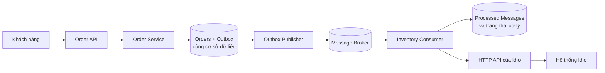

# Kiến thức đầu vào và trình tự học từ kết nối đến xử lý tin cậy

> **Chương:** Tổng quan tích hợp  
> **Phạm vi:** `SPRING_BOOT_INTEGRATION` — tích hợp hệ thống trong Spring Boot qua HTTP client, cơ sở dữ liệu, cache, broker thông điệp và các adapter của Spring Integration; chú trọng cấu hình, hợp đồng dữ liệu, giao dịch, lỗi, xử lý trùng lặp, kiểm thử và khả năng quan sát.

Một ứng dụng Spring Boot hiếm khi hoạt động độc lập. Nó thường phải gọi API của hệ thống khác, truy vấn cơ sở dữ liệu, dùng cache, nhận sự kiện hoặc gửi công việc vào hàng đợi. Việc **kết nối thành công** chỉ là điểm khởi đầu: hệ thống còn phải hoạt động đúng khi dịch vụ đích chậm, mạng bị ngắt, message đến hai lần, một bước hoàn tất còn bước khác thất bại, hoặc hợp đồng dữ liệu thay đổi.

Bài này xác định kiến thức cần có và đề xuất trình tự học từ kết nối cơ bản tới một luồng tích hợp có thể vận hành tin cậy. Sau khi học, bạn cần tự giải thích được vì sao chọn giao tiếp đồng bộ hay bất đồng bộ, đặt ranh giới giao dịch ở đâu, cơ chế nào ngăn xử lý lặp và cần kiểm thử những tình huống lỗi nào.

## 1. Trước khi học tích hợp cần biết gì?

Không cần thành thạo mọi công nghệ trước khi bắt đầu. Cần hiểu đủ những khái niệm nền tảng để phân biệt lỗi do ứng dụng, do dữ liệu và do hệ thống bên ngoài.

| Nhóm kiến thức | Mức đầu vào tối thiểu | Vì sao cần |
|---|---|---|
| Java | Class, interface, record/DTO, exception, collection, `Optional`, cơ bản về thread | Đọc mô hình dữ liệu, chuyển đổi payload, kiểm soát exception và hiểu tác vụ bất đồng bộ. |
| Spring Boot | Dependency injection, bean, `@Configuration`, `@Service`, `application.yml`, profile, REST controller | Tạo client, đưa cấu hình vào ứng dụng và tách trách nhiệm giữa các lớp. |
| HTTP và JSON | Method, URI, header, status 2xx/4xx/5xx, timeout, TLS, JSON serialization | Gọi dịch vụ ngoài và hiểu một lỗi HTTP có nên thử lại hay không. |
| Cơ sở dữ liệu | SQL cơ bản, khóa chính/duy nhất, transaction, commit/rollback, isolation | Giữ trạng thái nhất quán, chống ghi trùng, hiểu giới hạn của `@Transactional`. |
| Đồng thời và phân tán | Race condition, retry, thứ tự xử lý, trường hợp mất kết nối | Nhận ra một request hoặc message có thể được thực hiện nhiều lần. |
| Kiểm thử và vận hành | Unit/integration test, log, metric, trace, biến môi trường | Chứng minh luồng hoạt động đúng và tìm nguyên nhân khi gặp sự cố. |

Kiến thức bổ sung sẽ học dần khi gặp nhu cầu cụ thể: connection pool, cache eviction, consumer group, partition, dead-letter queue (DLQ), circuit breaker, Spring Integration channel và distributed tracing. Không nên học API chi tiết của tất cả framework ngay từ đầu.

### Những câu hỏi tự kiểm tra

1. Một lời gọi HTTP nhận `200 OK` có đồng nghĩa dữ liệu đã được ghi thành công ở hệ thống khác không? **Không nhất thiết**: cần hiểu ngữ nghĩa API và hợp đồng nghiệp vụ.
2. Khi client bị timeout, có chắc server chưa xử lý request không? **Không**: server có thể đã xử lý nhưng phản hồi bị thất lạc.
3. `@Transactional` có rollback một lời gọi HTTP hoặc message đã được broker xác nhận không? **Không**: transaction cơ sở dữ liệu thông thường không bao phủ các hệ thống bên ngoài.
4. Khi broker gửi lại cùng một message, consumer có được tạo thêm một giao dịch nghiệp vụ không? **Không nên**: cần thiết kế cơ chế xử lý trùng lặp theo định danh ổn định.

Nếu còn lúng túng, hãy học kỹ các khái niệm nền tương ứng trong quá trình thực hành thay vì bỏ qua chúng.

## 2. Bản đồ một hệ thống tích hợp

Hãy xét một ứng dụng đặt hàng: sau khi nhận yêu cầu, ứng dụng lưu đơn hàng và thông báo cho dịch vụ kho để giữ hàng. Việc gửi sự kiện qua broker cho phép dịch vụ kho xử lý độc lập với thời điểm trả phản hồi cho khách.



Luồng minh họa gồm nhiều **ranh giới** cần xem xét riêng:

- **API → ứng dụng:** xác thực, kiểm tra dữ liệu, phản hồi nhanh và hỗ trợ `Idempotency-Key` nếu client có thể gửi lại yêu cầu.
- **Ứng dụng → cơ sở dữ liệu:** dùng một transaction để ghi đơn hàng và bản ghi outbox, tránh trường hợp có đơn nhưng mất ý định phát sự kiện.
- **Outbox → broker:** publisher có thể bị lỗi giữa lúc broker nhận message và lúc đánh dấu đã gửi; do đó message có thể được phát lại.
- **Broker → consumer:** broker có thể giao lại message sau lỗi, timeout hoặc khi consumer chưa xác nhận.
- **Consumer → hệ thống kho:** HTTP có timeout, giới hạn tốc độ và lỗi tạm thời; lệnh giữ hàng cần định danh để tránh giữ hai lần.

Từ đây rút ra nguyên tắc: **mỗi ranh giới mạng đều có thể thất bại độc lập**. Một luồng tích hợp tin cậy phải định nghĩa dữ liệu, thời gian chờ, trạng thái sau lỗi, chính sách thử lại và cơ chế khôi phục ở từng ranh giới.

### Chọn cách giao tiếp theo mục đích

| Cách tích hợp | Phù hợp khi | Điểm cần kiểm soát |
|---|---|---|
| HTTP đồng bộ (`RestClient`, `WebClient`) | Cần phản hồi ngay, ví dụ kiểm tra tồn kho trước khi hiển thị kết quả | Timeout, HTTP status, giới hạn đồng thời, retry có điều kiện. |
| Truy cập database (`JDBC`, JPA, jOOQ) | Cần lưu hoặc đọc trạng thái có cấu trúc | Transaction, connection pool, schema migration, khóa và hiệu năng truy vấn. |
| Cache (`Redis`, cache abstraction) | Dữ liệu đọc nhiều, có thể chấp nhận độ trễ cập nhật xác định | TTL, invalidation, cache stampede, dữ liệu cũ. |
| Broker (RabbitMQ, Kafka, JMS, Pulsar) | Muốn tách thời gian xử lý, đệm tải hoặc phát sự kiện | Acknowledgment, thứ tự, giao lại message, DLQ, idempotency. |
| Spring Integration | Có nhiều bước nhận, lọc, biến đổi, định tuyến và kết nối adapter | Message channel, endpoint, error flow, trạng thái và khả năng quan sát. |

Không có lựa chọn đúng cho mọi trường hợp. HTTP đơn giản hơn khi thực sự cần câu trả lời tức thời; broker hữu ích khi công việc có thể xử lý sau và chấp nhận eventual consistency. Spring Integration hỗ trợ tổ chức các luồng có nhiều bước nhưng không bắt buộc cho một lời gọi HTTP đơn lẻ.

## 3. Trình tự học đề xuất: từ kết nối đến xử lý tin cậy

Học theo các chặng sau, giữ **một bài toán xuyên suốt** (ví dụ đặt hàng và đồng bộ kho) để nhìn thấy vì sao từng kỹ thuật mới xuất hiện.

| Chặng | Nội dung trọng tâm | Bài thực hành tối thiểu | Dấu hiệu đạt |
|---|---|---|---|
| **1. Kết nối và cấu hình** | Bean client, endpoint, profile, secret, timeout, TLS | Gọi API kho từ Spring Boot với URL lấy từ cấu hình | Đổi môi trường mà không sửa code; phân biệt lỗi kết nối và lỗi ứng dụng. |
| **2. Hợp đồng dữ liệu** | DTO, JSON, validation, version, HTTP status, lỗi chuẩn hóa | Định nghĩa request/response và ánh xạ mã lỗi API kho | Xử lý rõ dữ liệu thiếu/sai và thay đổi tương thích. |
| **3. Truy cập dữ liệu** | DataSource, pool, JDBC/JPA/jOOQ, migration | Lưu đơn hàng bằng khóa định danh ổn định | Khởi tạo schema lặp lại được, tránh trùng khóa và lộ connection. |
| **4. Ranh giới giao dịch** | ACID, propagation cơ bản, transaction cục bộ, outbox | Lưu đơn hàng và outbox trong cùng transaction | Rollback xảy ra đồng thời nếu một thao tác DB thất bại. |
| **5. Cache và dữ liệu phụ trợ** | Cache-aside, TTL, invalidation; NoSQL khi phù hợp | Cache danh mục sản phẩm; quan sát dữ liệu cũ | Giải thích được khi nào phải làm mới/loại bỏ cache. |
| **6. Messaging** | Producer, consumer, ack, redelivery, consumer group/partition, DLQ | Phát `OrderPlaced` và nhận ở worker | Chủ động mô phỏng message trùng và consumer restart. |
| **7. Điều phối luồng** | Channel, router, filter, transformer, gateway và adapter của Spring Integration | Định tuyến sự kiện theo loại và biến đổi payload | Vẽ được đường đi của message và nơi lỗi được xử lý. |
| **8. Khả năng phục hồi** | Timeout budget, retry/backoff, circuit breaker, bulkhead, idempotency, reconciliation | Làm cho API kho trả 503, timeout, sau đó hoạt động lại | Không thử lại vô hạn, không tạo tác dụng phụ trùng, có đường xử lý lỗi cuối. |
| **9. Kiểm thử và quan sát** | Contract/integration test, test với dịch vụ thật hoặc container, log, metric, trace | Chạy thử thành công, timeout, trùng message và lỗi giữa chừng | Truy vết được một đơn hàng qua các thành phần và biết cách khôi phục. |

**Thứ tự có chủ đích:** học cấu hình và hợp đồng trước vì mọi kết nối đều cần chúng; học transaction trước outbox; học broker trước redelivery và idempotency; cuối cùng áp dụng test, log, metric, trace cho *toàn bộ* luồng. Tuy vậy, thói quen viết test và log có cấu trúc nên bắt đầu ngay từ chặng 1, rồi tăng độ sâu ở chặng 9.

### Mốc thực hành 1 — HTTP client có giới hạn thời gian chờ

Ví dụ sau dùng `RestClient` trong Spring Boot có hỗ trợ Spring Framework 6.1 trở lên. Khai báo URL bằng cấu hình, đặt timeout cho kết nối và đọc phản hồi; đường dẫn API chỉ mang tính minh họa.

```yaml
# application.yml
app:
  warehouse:
    base-url: ${WAREHOUSE_BASE_URL}
```

```java
import java.time.Duration;
import org.springframework.beans.factory.annotation.Qualifier;
import org.springframework.beans.factory.annotation.Value;
import org.springframework.context.annotation.Bean;
import org.springframework.context.annotation.Configuration;
import org.springframework.http.client.SimpleClientHttpRequestFactory;
import org.springframework.stereotype.Service;
import org.springframework.web.client.RestClient;

@Configuration(proxyBeanMethods = false)
class WarehouseHttpConfig {
    @Bean
    RestClient warehouseRestClient(RestClient.Builder builder,
                                   @Value("${app.warehouse.base-url}") String baseUrl) {
        var factory = new SimpleClientHttpRequestFactory();
        factory.setConnectTimeout(Duration.ofSeconds(2));
        factory.setReadTimeout(Duration.ofSeconds(3));
        return builder.baseUrl(baseUrl)
                      .requestFactory(factory)
                      .build();
    }
}

@Service
class WarehouseClient {
    private final RestClient http;

    WarehouseClient(@Qualifier("warehouseRestClient") RestClient http) {
        this.http = http;
    }

    StockResponse getStock(String sku) {
        StockResponse result = http.get()
            .uri("/stocks/{sku}", sku)
            .retrieve()
            .body(StockResponse.class);

        if (result == null) {
            throw new IllegalStateException("Warehouse returned an empty body");
        }
        return result;
    }
}

record StockResponse(String sku, int available) {}
```

Đây là cấu hình client cơ bản, chưa phải một chính sách phục hồi hoàn chỉnh. Trong ứng dụng thực tế, cần thêm xác thực, giới hạn kích thước phản hồi, xử lý mã lỗi theo hợp đồng, cấu hình connection pool phù hợp với HTTP client đang dùng và giới hạn tổng thời gian của cả chuỗi thao tác. `retrieve()` mặc định phát sinh exception cho nhiều phản hồi lỗi 4xx/5xx; hãy chuyển những lỗi này sang lỗi miền nghiệp vụ có thể phân loại và log được. Không tự động retry mọi POST vì một lời gọi timeout vẫn có thể đã được server thực hiện.

### Mốc thực hành 2 — Đưa một sự kiện ra khỏi transaction an toàn

Giả sử đặt hàng cần lưu DB và phát sự kiện `OrderPlaced`. Đoạn SQL dưới đây biểu diễn **một transaction cục bộ**; `:order_id` và `:event_id` là các tham số của ứng dụng.

```sql
BEGIN;

INSERT INTO orders (id, customer_id, status)
VALUES (:order_id, :customer_id, 'PENDING');

INSERT INTO outbox_events (id, event_type, aggregate_id, payload, published_at)
VALUES (:event_id, 'OrderPlaced', :order_id, :event_json, NULL);

COMMIT;
```

Trong Java, hai lệnh ghi có thể nằm trong cùng một phương thức service được Spring quản lý và gắn `@Transactional`, với điều kiện các repository dùng **cùng transaction manager và tài nguyên DB thích hợp**. Bảng outbox có worker đọc bản ghi chưa phát, gửi broker rồi đánh dấu đã phát; worker phải có retry và cơ chế tránh nhiều instance giành cùng bản ghi. Nếu broker nhận message nhưng worker chết trước khi đánh dấu, bản ghi có thể được phát lại. Vì thế outbox giải quyết việc **không mất ý định phát sự kiện khi commit**, còn consumer vẫn cần xử lý trùng lặp.

Không gửi HTTP hoặc message rồi giả định một transaction DB có thể đảo ngược thao tác đã xảy ra bên ngoài. Khi quy trình kéo dài qua nhiều hệ thống, cần cơ chế trạng thái, bù trừ (compensation) hoặc đối soát (reconciliation) theo nghiệp vụ.

### Mốc thực hành 3 — Consumer an toàn khi nhận lại message

Giả sử broker giao `OrderPlaced` theo ngữ nghĩa **at-least-once**. Mỗi event phải có `eventId` ổn định qua các lần gửi lại. Tạo bảng lưu các event đã xử lý theo từng consumer:

```sql
CREATE TABLE processed_messages (
    consumer_name VARCHAR(80) NOT NULL,
    event_id UUID NOT NULL,
    processed_at TIMESTAMP NOT NULL DEFAULT CURRENT_TIMESTAMP,
    PRIMARY KEY (consumer_name, event_id)
);
```

Trong PostgreSQL, consumer có thể bắt đầu transaction bằng thao tác sau:

```sql
INSERT INTO processed_messages (consumer_name, event_id)
VALUES (:consumer_name, :event_id)
ON CONFLICT DO NOTHING;
```

Chỉ khi số dòng được thêm bằng **1** mới thực hiện cập nhật nghiệp vụ cục bộ; đặt thao tác chèn marker và cập nhật đó trong **cùng transaction DB**. Khi transaction rollback, marker cũng rollback để message có thể xử lý lại. Khi số dòng thêm bằng **0**, đã xử lý event đó trước đây, nên bỏ qua các thay đổi cục bộ và xác nhận message theo hợp đồng consumer. `ON CONFLICT` là cú pháp PostgreSQL; hệ DB khác cần chiến lược tương đương. Để tránh cạnh tranh khi xử lý song song, phải dựa vào unique constraint/transaction thực tế, không dùng lối “SELECT kiểm tra rồi INSERT” thiếu đồng bộ.

Marker này chỉ bảo vệ **trạng thái trong cùng DB**. Nếu consumer gọi dịch vụ kho bên ngoài, cần truyền một idempotency key ổn định được phía kho hỗ trợ, hoặc thiết kế các trạng thái yêu cầu/đã xác nhận để đối soát khi kết quả gọi không rõ ràng. Không thể hứa “exactly once” cho mọi tác dụng phụ chỉ nhờ broker hoặc một bảng marker.

## 4. Học xử lý lỗi trước khi tăng lưu lượng

Các loại lỗi cần cách xử lý khác nhau. Trước khi cấu hình retry, hãy trả lời: *Thao tác có an toàn khi thực hiện lại không? Có biết server đã commit chưa? Có giới hạn thời gian cho yêu cầu tổng thể không?*

| Tình huống | Phản ứng khởi đầu phù hợp | Điều cần tránh |
|---|---|---|
| Sai payload, không đạt validation | Trả lỗi rõ ràng, ghi nhận để sửa dữ liệu/hợp đồng | Retry cùng payload vô hạn. |
| HTTP `401`/`403` do quyền hoặc credential | Kiểm tra cấu hình xác thực/phân quyền và cảnh báo | Thử lại dồn dập như lỗi mạng thoáng qua. |
| HTTP `429`, `503` hoặc mất kết nối tạm thời | Retry hữu hạn với backoff + jitter khi thao tác idempotent; tôn trọng `Retry-After` nếu có | Tạo bão retry, vượt deadline của yêu cầu. |
| Timeout sau yêu cầu ghi dữ liệu | Kiểm tra idempotency key, truy vấn trạng thái hoặc đối soát | Mặc định cho rằng phía server chưa thực hiện gì. |
| Message hỏng, không thể deserialize | Ghi nhận và chuyển luồng xử lý lỗi/DLQ theo chính sách | Requeue vô hạn làm kẹt consumer. |
| Consumer chết sau cập nhật DB nhưng trước ack | Cho phép redelivery và deduplicate theo `eventId` | Dựa vào ack để chứng minh nghiệp vụ chỉ chạy một lần. |
| Cache trả dữ liệu quá cũ | Kiểm tra TTL, invalidation và yêu cầu nhất quán của thao tác | Coi cache là nguồn dữ liệu chuẩn cho giao dịch quan trọng. |

Quy tắc thực hành là **timeout để giới hạn thời gian chờ; retry để đối phó lỗi tạm thời; circuit breaker để hạn chế gọi một đích liên tục hỏng; bulkhead để cô lập tài nguyên; idempotency để giữ đúng kết quả khi thử lại; DLQ và đối soát để không đánh mất công việc chưa hoàn tất**. Những cơ chế này bổ sung cho nhau nhưng không thay thế nhau.

Ví dụ: một bước xử lý đơn hàng có deadline 5 giây sẽ không thể retry 5 lần, mỗi lần đọc timeout 3 giây mà vẫn giữ được deadline đó. Timeout và số lần retry phải được tính theo *tổng ngân sách thời gian*; cần giới hạn số thao tác đang chờ để tránh làm cạn thread hoặc connection pool.

## 5. Hợp đồng dữ liệu, giao dịch và tính nhất quán

Một luồng chạy qua HTTP, DB và broker phải có hợp đồng ổn định, độc lập với cách truyền dữ liệu:

- **Định danh:** `orderId` định danh thực thể nghiệp vụ; `eventId` định danh sự kiện; `correlationId` phục vụ truy vết; `idempotencyKey` định danh yêu cầu có thể được gửi lại. Không mặc nhiên xem chúng là một giá trị.
- **Cấu trúc:** quy định field bắt buộc, field có thể `null`, kiểu dữ liệu, đơn vị, múi giờ, quy tắc validation và hành vi khi xuất hiện field mới.
- **Tương thích:** thêm field tùy chọn thường dễ tương thích hơn xóa hoặc đổi nghĩa field; producer và consumer có thể nâng cấp ở thời điểm khác nhau.
- **Trạng thái:** xác định rõ `PENDING`, `PROCESSING`, `SUCCEEDED`, `FAILED` và quyền chuyển trạng thái. Event “đã tạo đơn” không mặc nhiên nghĩa là “đã giữ hàng”.
- **Xử lý trùng và thứ tự:** deduplicate theo consumer, kiểm soát cập nhật đến muộn hoặc sai thứ tự bằng version/sequence khi nghiệp vụ yêu cầu. Broker không bảo đảm một thứ tự toàn cục trong mọi cấu hình.

Với một DB, transaction hỗ trợ atomicity cho những thao tác thuộc transaction đó. Qua nhiều dịch vụ, cần chấp nhận các trạng thái trung gian và thiết kế **eventual consistency** cùng đường khôi phục. Nếu phải bù trừ, hành động bù trừ cũng có thể thất bại và cần được ghi nhận, thử lại hoặc xử lý thủ công có kiểm soát.

## 6. Kiểm thử theo ranh giới và theo kịch bản hỏng

Một bài thực hành chỉ chạy được “đường thành công” chưa chứng minh tích hợp đáng tin cậy. Dùng fake/stub cho kiểm thử nhỏ, test với dịch vụ thực hoặc Testcontainers khi cần xác nhận giao thức, schema, broker và transaction.

| Cấp độ | Cần chứng minh | Ví dụ ca kiểm thử |
|---|---|---|
| Unit test | Quy tắc mapping, validation, phân loại lỗi | `400` tạo lỗi dữ liệu; `503` là lỗi có thể thử lại tùy thao tác. |
| HTTP integration/contract | Serialize/deserialize, header, authentication, status và timeout | API thêm field mới; phản hồi rỗng; không bao giờ trả lời. |
| DB integration | Schema/migration, unique constraint, rollback | Lỗi insert outbox làm rollback cả đơn hàng. |
| Broker integration | Publish/consume, ack, redelivery, DLQ | Consumer chết trước ack; cùng `eventId` xuất hiện hai lần. |
| End-to-end | Kết quả nghiệp vụ sau lỗi cục bộ hoặc khởi động lại | Publisher gửi thành công nhưng chết trước khi đánh dấu outbox. |
| Observability | Có thể tìm nguyên nhân từ dấu vết thực tế | Tìm một `orderId` qua API, outbox, broker, consumer và API kho. |

Một cách thực hành hiệu quả là đưa lỗi vào có chủ đích: chậm phản hồi 4 giây khi timeout 3 giây, từ chối kết nối, trả `429`, tắt consumer rồi bật lại, gửi hai event trùng ID hoặc cho giao dịch DB lỗi giữa chừng. Mỗi kịch bản phải có **kết quả kỳ vọng** được mô tả trước khi chạy test.

## 7. Quan sát một luồng tích hợp đang vận hành

Khi đã có nhiều bước bất đồng bộ, log ở riêng HTTP controller là chưa đủ. Tối thiểu nên xác định:

| Tín hiệu | Câu hỏi trả lời |
|---|---|
| Structured log có `traceId`/`correlationId`, `orderId`, `eventId` | Đơn hàng này đang ở bước nào? Message nào gây lỗi? |
| Metric độ trễ, throughput, tỷ lệ timeout/5xx | Hệ thống bên ngoài có chậm hoặc hỏng bất thường không? |
| Metric queue lag, consumer retries, DLQ, outbox backlog | Công việc có đang tích tụ hoặc bị kẹt không? |
| Distributed tracing với HTTP và messaging instrumentation | Thời gian bị tiêu tốn qua những thành phần nào? |
| Alert dựa trên mục tiêu dịch vụ và hàng đợi tồn đọng | Khi nào phải can thiệp, phát lại hoặc đối soát? |

Không ghi token, mật khẩu, thông tin cá nhân hay payload nhạy cảm vào log. Trace/correlation ID phục vụ liên kết sự kiện; order/event ID phục vụ tra cứu nghiệp vụ. Với message bất đồng bộ, cần chủ động truyền hoặc trích xuất thông tin trace qua header theo cơ chế instrumentation đang sử dụng.

Đừng chỉ quan sát lỗi kỹ thuật: một message không thất bại nhưng nằm trong `PROCESSING` hàng giờ vẫn là sự cố nghiệp vụ. Cần dashboard hoặc truy vấn cho các trạng thái bị treo và quy trình đối soát.

## 8. Lộ trình luyện tập gợi ý

Có thể triển khai thành bốn bài lab nối tiếp, cùng dùng một tập dữ liệu đơn hàng:

1. **Lab A — Kết nối:** REST API nhận đơn, gọi HTTP kho với URL qua environment, timeout và error mapping. Kiểm tra trường hợp kho trả đúng dữ liệu, `404`, `503` và timeout.
2. **Lab B — Dữ liệu:** thêm DB, migration và transaction lưu đơn; thêm outbox cùng transaction. Kiểm tra rollback khi ghi outbox thất bại.
3. **Lab C — Bất đồng bộ:** publisher gửi `OrderPlaced` vào broker, consumer nhận và ghi trạng thái. Tắt/bật worker, ép giao lại message, xác minh deduplication.
4. **Lab D — Độ tin cậy:** thêm idempotency khi gọi kho, retry có giới hạn, DLQ/đối soát, metrics và trace. Đưa lỗi vào giữa các bước và kiểm tra phục hồi.

**Tiêu chí hoàn thành bài toán:**

- Một đơn hàng hợp lệ được tạo với ID rõ ràng và có bản ghi outbox trong cùng transaction.
- Hai request cùng idempotency key theo hợp đồng API không tạo hai đơn hàng; hai lần giao cùng `eventId` không thực hiện hai lần cập nhật nghiệp vụ cục bộ.
- Lỗi tạm thời có retry hữu hạn; lỗi vĩnh viễn đi vào trạng thái lỗi có thể điều tra, không lặp vô tận.
- Sau khi publisher hoặc consumer bị restart, các đơn hàng đang xử lý vẫn có thể tiếp tục hoặc được đối soát.
- Có thể trả lời “đơn hàng này đang ở đâu, đã thử bao nhiêu lần, vì sao thất bại” bằng log, metric, trace và dữ liệu trạng thái.

## 9. Các nhầm lẫn thường gặp khi học

**“Gọi được API là tích hợp xong.”** Gọi thành công chưa giải quyết hợp đồng dữ liệu, timeout, retry, bảo mật, giám sát và tình huống phản hồi thất lạc.

**“Thêm `@Transactional` sẽ bảo đảm toàn bộ quy trình.”** Annotation đó chỉ điều phối những tài nguyên/giao dịch được transaction manager quản lý. Đừng coi HTTP, cache và broker bên ngoài tự động chung một giao dịch.

**“Broker bảo đảm exactly-once cho cả nghiệp vụ.”** Một số nền tảng có khả năng exactly-once trong phạm vi xác định, nhưng điều này không tự mở rộng sang DB khác hay dịch vụ HTTP. Hãy thiết kế để có thể nhận và xử lý lại an toàn.

**“Có retry thì không cần thiết kế idempotency.”** Retry làm tăng khả năng lặp tác dụng phụ; idempotency là một trong những điều kiện quan trọng để retry thao tác ghi dữ liệu an toàn.

**“Cache lúc nào cũng giống DB.”** Cache có thể hết hạn, mất key hoặc trả dữ liệu cũ. Phải quy định nguồn dữ liệu chuẩn và mức độ nhất quán mà nghiệp vụ chấp nhận.

**“Spring Integration thay thế các thành phần khác.”** Spring Integration hỗ trợ xây dựng flow, routing và adapter nhưng các ràng buộc của HTTP, broker, DB, transaction và idempotency vẫn phải được thiết kế đúng.

Khi học tiếp từng nhóm công nghệ, hãy luôn quay lại ba câu hỏi: **Dữ liệu đúng được xác nhận ở đâu? Một bước thất bại thì hệ thống ở trạng thái nào? Bước đó chạy lại có an toàn không?** Trả lời được ba câu này bằng code, test và tín hiệu vận hành là nền tảng để đi từ kết nối đến xử lý tin cậy trong Spring Boot.
