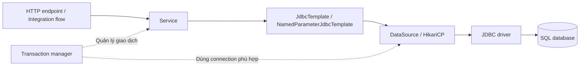

# DataSource, JDBC driver và spring-boot-starter-jdbc

Trong một ứng dụng Spring Boot, kết nối đến cơ sở dữ liệu SQL không chỉ là khai báo URL và mật khẩu. Ứng dụng còn phải biết **ai tạo kết nối**, **driver nào giao tiếp với hệ quản trị cơ sở dữ liệu**, **kết nối được tái sử dụng thế nào**, và **mã truy cập dữ liệu tham gia giao dịch ra sao**. Ba thành phần `DataSource`, JDBC driver và `spring-boot-starter-jdbc` là nền tảng để tổ chức lớp kết nối đó.

Bài học thuộc chương **Kết nối SQL** của module **SPRING_BOOT_INTEGRATION**. Trong phạm vi tích hợp hệ thống qua HTTP client, cơ sở dữ liệu, cache, broker thông điệp và Spring Integration, kết nối SQL thường phục vụ việc lưu trạng thái trao đổi dữ liệu, ghi nhận sự kiện đến, xử lý trùng lặp, quản lý giao dịch hoặc triển khai transactional outbox. Vì vậy, ngoài việc kết nối thành công, ta cần chú ý đến cấu hình, hợp đồng dữ liệu, lỗi, kiểm thử và khả năng quan sát.

## 1. Mục tiêu học tập

Sau bài này, bạn có thể:

- Phân biệt `DataSource`, JDBC driver, connection pool, `Connection` và `JdbcTemplate`.
- Giải thích vai trò của `spring-boot-starter-jdbc` và vì sao vẫn cần dependency JDBC driver của database cụ thể.
- Cấu hình một `DataSource` PostgreSQL và sử dụng `NamedParameterJdbcTemplate` để thực thi SQL an toàn.
- Hiểu phạm vi giao dịch, cách ngăn ghi trùng sự kiện, những lỗi kết nối phổ biến và cách kiểm thử kết nối thực tế.
- Biết các tín hiệu cần quan sát khi một luồng tích hợp dùng SQL chịu tải.

## 2. Bức tranh tổng thể: các thành phần phối hợp thế nào?

### 2.1. JDBC và JDBC driver

**JDBC (Java Database Connectivity)** là API chuẩn của Java để làm việc với cơ sở dữ liệu quan hệ. Các giao diện như `Connection`, `PreparedStatement` và `ResultSet` nằm trong API JDBC. JDBC định nghĩa cách gọi; **JDBC driver** triển khai cách trao đổi với một hệ quản trị cụ thể qua giao thức của nó.

Ví dụ:

| Database | JDBC URL điển hình | Dependency driver |
| --- | --- | --- |
| PostgreSQL | `jdbc:postgresql://db-host:5432/integration_db` | `org.postgresql:postgresql` |
| MySQL | `jdbc:mysql://db-host:3306/integration_db` | `com.mysql:mysql-connector-j` |
| MariaDB | `jdbc:mariadb://db-host:3306/integration_db` | `org.mariadb.jdbc:mariadb-java-client` |
| H2 | `jdbc:h2:mem:testdb` | `com.h2database:h2` |

JDBC driver phải có mặt trên **runtime classpath**. Chỉ thêm starter JDBC của Spring Boot không tự cung cấp driver PostgreSQL hoặc MySQL.

Các driver JDBC hiện đại có cơ chế tự đăng ký theo JDBC Service Provider, nên thông thường không cần gọi `Class.forName("org.postgresql.Driver")` thủ công. Spring Boot cũng có thể xác định driver từ JDBC URL chuẩn; khi driver hoặc URL đặc thù không suy ra được, có thể cấu hình `spring.datasource.driver-class-name`.

### 2.2. DataSource là gì?

`javax.sql.DataSource` là giao diện chuẩn biểu diễn **nguồn cung cấp kết nối**. Thay vì mỗi lần xử lý lại tự gọi `DriverManager.getConnection(...)`, ứng dụng lấy `Connection` từ `DataSource`.

Trong môi trường máy chủ, `DataSource` thường được triển khai bằng **connection pool**: một nhóm kết nối vật lý được tạo, tái sử dụng và giới hạn số lượng. Khi mã truy cập dữ liệu hoàn tất, thao tác đóng kết nối logic thông thường đưa kết nối về pool để yêu cầu tiếp theo sử dụng, thay vì nhất thiết đóng kết nối TCP.

Spring Boot với `spring-boot-starter-jdbc` thường sử dụng **HikariCP** làm pool mặc định khi có dependency này trên classpath và bạn không cung cấp cấu hình `DataSource` riêng.

### 2.3. Starter JDBC, Spring JDBC và JdbcTemplate

`spring-boot-starter-jdbc` là dependency thuận tiện để bổ sung các thư viện cần thiết cho việc truy cập database qua JDBC và kích hoạt cơ chế tự cấu hình của Spring Boot. Nó không phải JDBC driver.

Các lớp giữ những vai trò khác nhau:

| Thành phần | Vai trò | Bạn thường tương tác thế nào |
| --- | --- | --- |
| JDBC driver | Thực hiện giao tiếp với database cụ thể | Khai báo dependency runtime |
| `DataSource` | Cấp phát/quản lý `Connection` | Cấu hình `spring.datasource.*`, đôi khi inject trực tiếp |
| Connection pool (HikariCP) | Tái sử dụng và giới hạn kết nối | Tinh chỉnh `spring.datasource.hikari.*` |
| `JdbcTemplate` | Thực thi SQL, bind tham số, quản lý tài nguyên, dịch ngoại lệ | Gọi `query`, `queryForObject`, `update` |
| `NamedParameterJdbcTemplate` | Tương tự `JdbcTemplate` nhưng dùng tham số có tên | Viết `:partnerCode` thay vì phụ thuộc thứ tự nhiều dấu `?` |
| Transaction manager | Phối hợp kết nối JDBC trong giao dịch | Dùng `@Transactional` tại tầng service |

`spring-boot-starter-data-jdbc` phục vụ **Spring Data JDBC** và có thêm mô hình repository/aggregate. `spring-boot-starter-data-jpa` phục vụ **JPA/ORM**. Cả hai là các lựa chọn truy cập dữ liệu khác; bài này tập trung vào **SQL tường minh qua Spring JDBC**.

### 2.4. Sơ đồ luồng truy cập dữ liệu



Trình tự điển hình là: service gọi repository, `JdbcTemplate` mượn connection từ `DataSource`, driver thực thi câu lệnh trên database, Spring xử lý `ResultSet` và trả connection về pool đúng cách. Trong giao dịch `@Transactional`, Spring phối hợp để những câu lệnh tương ứng sử dụng connection được gắn với giao dịch hiện tại.

## 3. Khởi tạo dự án: cần dependency nào?

Ví dụ dùng PostgreSQL và Spring Boot đã quản lý phiên bản dependency bằng BOM/plugin tương ứng.

**Gradle (Groovy DSL):**

```groovy
dependencies {
    implementation 'org.springframework.boot:spring-boot-starter-jdbc'
    runtimeOnly 'org.postgresql:postgresql'

    testImplementation 'org.springframework.boot:spring-boot-starter-test'
}
```

**Maven:**

```xml
<dependencies>
    <dependency>
        <groupId>org.springframework.boot</groupId>
        <artifactId>spring-boot-starter-jdbc</artifactId>
    </dependency>
    <dependency>
        <groupId>org.postgresql</groupId>
        <artifactId>postgresql</artifactId>
        <scope>runtime</scope>
    </dependency>
</dependencies>
```

Phân biệt hai dependency:

1. Starter cung cấp các thành phần Spring JDBC, tích hợp quản lý giao dịch và connection pool thông dụng.
2. Driver `postgresql` giúp chương trình thật sự hiểu URL `jdbc:postgresql:...` và kết nối tới PostgreSQL.

Nếu thiếu driver tương ứng với URL, việc thêm starter một mình chưa đủ để ứng dụng kết nối.

## 4. Cấu hình DataSource trong Spring Boot

### 4.1. Cấu hình tối thiểu và pool

Trong `application.yml`:

```yaml
spring:
  datasource:
    url: ${DB_URL:jdbc:postgresql://localhost:5432/integration_db}
    username: ${DB_USER:integration_app}
    password: ${DB_PASSWORD}
    hikari:
      pool-name: integration-sql-pool
      maximum-pool-size: 10
      connection-timeout: 30000
```

Ý nghĩa:

- `spring.datasource.url`: địa chỉ JDBC và database đích. Giá trị mặc định ở ví dụ chỉ phù hợp môi trường phát triển.
- `username` và `password`: tài khoản database; truyền qua environment variables hoặc cơ chế quản lý bí mật của hệ thống triển khai.
- `maximum-pool-size`: giới hạn tổng số kết nối mà một pool có thể giữ, gồm cả đang hoạt động và nhàn rỗi.
- `connection-timeout`: thời gian tối đa (mili giây) chờ mượn được connection từ pool trước khi báo lỗi. **Đây không phải timeout thực thi truy vấn SQL.**

Ví dụ này **yêu cầu** biến môi trường `DB_PASSWORD`; không đặt mật khẩu cố định trong repository. Trong production, cấu hình URL, TLS, thông tin xác thực và kích thước pool theo tài nguyên và chính sách vận hành thực tế.

Nếu có một `DataSource` phù hợp và các điều kiện tự cấu hình được đáp ứng, Spring Boot tự tạo các bean hỗ trợ như `JdbcTemplate` và `NamedParameterJdbcTemplate`. Khi tự định nghĩa `DataSource` bean riêng, cần hiểu những phần tự cấu hình nào sẽ nhường quyền cho bean đó.

### 4.2. Điều gì xảy ra khi ứng dụng khởi động?

Với một database SQL thông thường:

1. Spring Boot nhận diện các class JDBC và dependency có trên classpath.
2. Spring Boot đọc cấu hình `spring.datasource.*` và tạo `DataSource` nếu chưa có bean do ứng dụng cung cấp.
3. Pool/driver chuẩn bị cách thiết lập kết nối; một số kết nối có thể được tạo ngay hoặc khi cần, tùy cấu hình.
4. Spring Boot đăng ký hỗ trợ JDBC và transaction khi đủ điều kiện.
5. Repository/service được inject các bean truy cập dữ liệu.

Khai báo `DataSource` **không có nghĩa** bảng đã được tạo. Quản lý schema và dữ liệu khởi tạo là mối quan tâm riêng.

### 4.3. Ai tạo bảng và thay đổi schema?

Cho môi trường sản phẩm, ưu tiên **migration có phiên bản** bằng Flyway hoặc Liquibase. Ví dụ minh họa ở phần sau có thể nằm trong một migration Flyway. Spring Boot cũng hỗ trợ `schema.sql`/`data.sql`, nhưng việc tự chạy các script này có điều kiện và mặc định thường hướng tới database nhúng; khi dùng database ngoài, hành vi phụ thuộc `spring.sql.init.mode` và các thiết lập liên quan.

Tránh bật khởi tạo schema không kiểm soát trên production: chạy lại lệnh tạo bảng, xóa hoặc thay đổi dữ liệu có thể gây hậu quả. Chọn **một** cơ chế migration chính cho môi trường triển khai.

### 4.4. Khi có nhiều database

Với một `DataSource`, cơ chế tự cấu hình khá đơn giản. Khi một ứng dụng tích hợp kết nối đồng thời database nội bộ và database đối tác, cần thiết kế rõ nhiều `DataSource`, qualifier, `JdbcTemplate` và transaction manager tương ứng. Không nên ngầm giả định một `@Transactional` có thể nguyên tử trên nhiều database hoặc trên database và broker thông điệp.

## 5. Ví dụ thực tế: lưu sự kiện tích hợp nhận từ đối tác

Giả sử một HTTP endpoint nhận sự kiện từ đối tác, mỗi sự kiện có bộ khóa `partnerCode` + `eventId`. Yêu cầu:

- Lưu một bản ghi sự kiện đến.
- Không lưu trùng khi đối tác gửi lại cùng một sự kiện.
- Ghi audit cho sự kiện mới trong **cùng giao dịch database**.
- Đọc lại trạng thái sự kiện bằng tham số SQL an toàn.

Ví dụ dùng cú pháp SQL của **PostgreSQL**; các database khác có cú pháp upsert và kiểu dữ liệu riêng.

### 5.1. Schema SQL

Một migration mẫu:

```sql
CREATE TABLE inbound_delivery (
    id BIGINT GENERATED ALWAYS AS IDENTITY PRIMARY KEY,
    partner_code VARCHAR(64) NOT NULL,
    event_id VARCHAR(128) NOT NULL,
    payload TEXT NOT NULL,
    state VARCHAR(24) NOT NULL DEFAULT 'RECEIVED',
    created_at TIMESTAMPTZ NOT NULL DEFAULT CURRENT_TIMESTAMP,
    CONSTRAINT uq_inbound_partner_event UNIQUE (partner_code, event_id)
);

CREATE TABLE delivery_audit (
    id BIGINT GENERATED ALWAYS AS IDENTITY PRIMARY KEY,
    partner_code VARCHAR(64) NOT NULL,
    event_id VARCHAR(128) NOT NULL,
    action VARCHAR(32) NOT NULL,
    created_at TIMESTAMPTZ NOT NULL DEFAULT CURRENT_TIMESTAMP
);
```

Ràng buộc `UNIQUE (partner_code, event_id)` là một **quy tắc do database thực thi**, bảo vệ cả khi hai yêu cầu đến đồng thời. Một câu lệnh "SELECT xem đã có chưa" rồi mới "INSERT" không đủ để tránh race condition.

### 5.2. Record biểu diễn dữ liệu đọc ra

File `DeliveryRecord.java`:

```java
package com.example.integration.sql;

public record DeliveryRecord(
        long id,
        String partnerCode,
        String eventId,
        String state
) {}
```

Đây là DTO/record phục vụ lớp truy cập dữ liệu; nó không tự biểu diễn toàn bộ giao thức HTTP. Với dữ liệu trao đổi giữa hệ thống, cần xác định rõ trường bắt buộc, định dạng, phiên bản và cách xác thực dữ liệu ở biên tích hợp.

### 5.3. Repository dùng NamedParameterJdbcTemplate

File `DeliveryRepository.java`:

```java
package com.example.integration.sql;

import java.util.List;
import java.util.Map;
import java.util.Optional;

import org.springframework.jdbc.core.namedparam.MapSqlParameterSource;
import org.springframework.jdbc.core.namedparam.NamedParameterJdbcTemplate;
import org.springframework.stereotype.Repository;

@Repository
public class DeliveryRepository {
    private final NamedParameterJdbcTemplate jdbc;

    public DeliveryRepository(NamedParameterJdbcTemplate jdbc) {
        this.jdbc = jdbc;
    }

    public int insertOnce(String partnerCode, String eventId, String payload) {
        var params = new MapSqlParameterSource()
                .addValue("partnerCode", partnerCode)
                .addValue("eventId", eventId)
                .addValue("payload", payload);

        return jdbc.update("""
                INSERT INTO inbound_delivery (partner_code, event_id, payload)
                VALUES (:partnerCode, :eventId, :payload)
                ON CONFLICT (partner_code, event_id) DO NOTHING
                """, params);
    }

    public void recordAudit(String partnerCode, String eventId) {
        jdbc.update("""
                INSERT INTO delivery_audit (partner_code, event_id, action)
                VALUES (:partnerCode, :eventId, 'ACCEPTED')
                """, Map.of(
                "partnerCode", partnerCode,
                "eventId", eventId
        ));
    }

    public Optional<DeliveryRecord> find(
            String partnerCode, String eventId) {
        List<DeliveryRecord> rows = jdbc.query("""
                SELECT id, partner_code, event_id, state
                FROM inbound_delivery
                WHERE partner_code = :partnerCode
                  AND event_id = :eventId
                """, Map.of(
                "partnerCode", partnerCode,
                "eventId", eventId
        ), (rs, rowNum) -> new DeliveryRecord(
                rs.getLong("id"),
                rs.getString("partner_code"),
                rs.getString("event_id"),
                rs.getString("state")
        ));

        return rows.stream().findFirst();
    }
}
```

Những chi tiết quan trọng:

- `:partnerCode`, `:eventId`, `:payload` được bind thành giá trị tham số. Tránh nối chuỗi dữ liệu người dùng vào SQL, vì việc đó có thể gây **SQL injection** hoặc lỗi escape.
- `insertOnce` trả về số dòng được chèn: PostgreSQL trả **1** nếu tạo mới và **0** khi trùng ràng buộc đã chỉ định với `DO NOTHING`.
- `ON CONFLICT` là cú pháp riêng của PostgreSQL; nếu chuyển sang MySQL, SQL Server hoặc database khác, phải điều chỉnh phù hợp.
- `query` nhận `RowMapper` để biến từng dòng `ResultSet` thành Java record.
- `NamedParameterJdbcTemplate` đảm nhiệm việc mở/đóng tài nguyên JDBC và dịch `SQLException` sang hệ ngoại lệ Spring `DataAccessException`.

Trong ứng dụng có truy vấn đơn giản, `JdbcTemplate` với placeholder `?` cũng hợp lệ. Khi một câu lệnh có nhiều tham số hoặc cùng tham số dùng nhiều lần, tên rõ nghĩa thường giúp đọc và sửa dễ hơn.

### 5.4. Service xác định ranh giới giao dịch

File `DeliveryService.java`:

```java
package com.example.integration.sql;

import org.springframework.stereotype.Service;
import org.springframework.transaction.annotation.Transactional;

@Service
public class DeliveryService {
    private final DeliveryRepository repository;

    public DeliveryService(DeliveryRepository repository) {
        this.repository = repository;
    }

    @Transactional
    public boolean receive(
            String partnerCode, String eventId, String payload) {
        if (partnerCode == null || partnerCode.isBlank()
                || eventId == null || eventId.isBlank()
                || payload == null || payload.isBlank()) {
            throw new IllegalArgumentException("Invalid delivery fields");
        }

        int inserted = repository.insertOnce(partnerCode, eventId, payload);
        if (inserted == 0) {
            return false; // Đã nhận sự kiện này trước đó.
        }

        repository.recordAudit(partnerCode, eventId);
        return true; // Sự kiện mới đã được ghi nhận.
    }
}
```

Với transaction manager JDBC được cấu hình đúng cho cùng `DataSource`, hai lệnh `INSERT` sẽ cùng tham gia giao dịch. Nếu ghi audit thất bại và ngoại lệ runtime được ném ra, Spring mặc định rollback giao dịch: bản ghi sự kiện mới cũng không được commit.

Lưu ý ba ranh giới:

1. `@Transactional` mặc định áp dụng khi lời gọi đi qua proxy Spring. Tự gọi phương thức được annotate từ một phương thức khác trong cùng object thường không kích hoạt transaction advice.
2. Giao dịch local JDBC **không tự rollback** một HTTP request đã gửi hoặc thông điệp đã publish vào broker. Nếu cần bảo đảm nhất quán giữa database và broker, cân nhắc **transactional outbox** và cơ chế xử lý gửi lại có idempotency.
3. Ví dụ chỉ ngăn **ghi trùng sự kiện đến** theo khóa đã xác định. Việc xử lý side effect ở bước sau cần thêm trạng thái, khóa nghiệp vụ và chiến lược retry tương ứng.

## 6. Giao dịch, quản lý connection và các giới hạn cần hiểu

### 6.1. Connection được sử dụng thế nào trong giao dịch?

Khi có `@Transactional` hợp lệ, Spring gắn connection phù hợp với giao dịch hiện tại trên luồng xử lý. Các lệnh `JdbcTemplate` trong giao dịch phối hợp với connection đó. Tới khi commit/rollback, Spring hoàn tất giao dịch và trả connection về pool.

Do đó, tránh tự gọi `dataSource.getConnection()` rồi tùy ý quản lý commit hoặc đóng connection bên trong service đang được Spring quản lý giao dịch. Nếu buộc thao tác JDBC cấp thấp, cần sử dụng cơ chế đồng bộ connection với transaction của Spring, chẳng hạn `DataSourceUtils`, hoặc ưu tiên `JdbcTemplate` để giảm sai sót.

### 6.2. Timeout kết nối khác timeout truy vấn

| Trường hợp | Điều cần giới hạn |
| --- | --- |
| Hết connection rảnh trong pool | Thời gian chờ mượn từ pool: `connection-timeout` |
| Mạng/database mất phản hồi lúc mở kết nối | Timeout thiết lập kết nối của driver và cấu hình mạng liên quan |
| Một câu `SELECT` chạy quá lâu | Query/statement timeout, timeout phía database hoặc thiết lập tương ứng |
| Transaction giữ khóa quá lâu | Transaction timeout, giới hạn truy vấn, thiết kế giao dịch ngắn |

`spring.datasource.hikari.connection-timeout` chỉ giải quyết tình huống **chờ connection từ pool**. Đừng coi thông số này là giới hạn thời gian của mọi câu SQL.

### 6.3. Chọn kích thước connection pool

Pool lớn không mặc nhiên làm hệ thống nhanh hơn. Tổng kết nối tối đa đến database xấp xỉ:

```text
Số instance ứng dụng × maximum-pool-size mỗi instance
+ các kết nối từ dịch vụ / công cụ khác
```

Tổng này phải phù hợp giới hạn và tài nguyên database. Theo dõi tải thực tế, độ trễ truy vấn, thời gian chờ connection và các transaction kéo dài trước khi tăng pool. Với luồng tích hợp, cần cân đối **số request xử lý đồng thời**, **kích thước pool** và **năng lực SQL backend**; nếu không, tăng concurrency chỉ đẩy hàng đợi sang pool/database.

Giữ transaction ngắn. Không gọi HTTP endpoint chậm hoặc chờ xác nhận broker trong khi đang giữ khóa SQL nếu không có lý do thiết kế cụ thể.

## 7. Xử lý lỗi và tính an toàn khi tích hợp

### 7.1. Phân biệt nhóm lỗi

Spring JDBC thường chuyển `SQLException` thành các kiểu `DataAccessException` để mã nghiệp vụ không cần phụ thuộc mã lỗi JDBC của từng driver.

| Nhóm lỗi | Ví dụ | Cách ứng xử điển hình |
| --- | --- | --- |
| Không mở được kết nối | Database chưa chạy, DNS sai, chặn cổng, hết slot kết nối | Kiểm tra hạ tầng, log nguyên nhân gốc, retry có giới hạn nếu lỗi tạm thời |
| Sai quyền/thông tin xác thực | Tài khoản sai, không có quyền bảng | Sửa cấu hình, phân quyền; không retry vô hạn |
| Vi phạm ràng buộc | Trùng khóa duy nhất, vi phạm khóa ngoại | Xem đây là tình huống nghiệp vụ hoặc lỗi dữ liệu; tránh retry mù |
| SQL sai/schema chưa đúng | Tên cột sai, migration thiếu, dùng cú pháp không phù hợp | Sửa SQL/migration; kiểm thử trên đúng loại database |
| Tắc nghẽn/timeout | Query chậm, lock wait, pool cạn | Giảm thời gian giữ connection, tối ưu truy vấn và kiểm soát concurrency |

Không phải `DataAccessException` nào cũng được retry. Với thao tác ghi, phải biết thao tác **có thể đã commit hay chưa** trước khi tự động thử lại. Dùng khóa idempotency hoặc ràng buộc unique khi đối tác có thể gửi trùng.

### 7.2. Cần tránh những mẫu code nào?

**Tạo connection mới cho từng request:**

```java
// Không nên dùng kiểu này làm cơ chế truy cập database chính trong web service.
Connection connection = DriverManager.getConnection(url, user, password);
```

Cách trên bỏ qua việc quản lý pool/transaction do Spring cung cấp, và còn dễ quên đóng tài nguyên. Chỉ cân nhắc dùng JDBC cấp thấp khi thật sự cần kiểm soát đặc biệt.

**Nối SQL từ đầu vào bên ngoài:**

```java
// Không an toàn:
String sql = "SELECT * FROM inbound_delivery WHERE event_id = '" + eventId + "'";
```

Thay bằng `PreparedStatement`/`JdbcTemplate` với placeholder, hoặc `NamedParameterJdbcTemplate` với named parameter. Bind giá trị **không** thay cho thiết kế whitelist khi cần chọn tên bảng/cột động, vì tên định danh SQL không thể xử lý như giá trị bind thông thường.

**Đưa bí mật vào log:** không ghi mật khẩu, connection string có credential, payload nhạy cảm hoặc toàn bộ tham số SQL vào log không được bảo vệ. Nên log correlation ID, tên thao tác, trạng thái và số liệu thời gian phù hợp.

### 7.3. TLS, quyền và cấu hình môi trường

- Dùng tài khoản database chỉ có các quyền mà luồng tích hợp cần; tách quyền migration nếu có thể.
- Bật bảo vệ kết nối theo chính sách database và môi trường. Ví dụ PostgreSQL có các lựa chọn `sslmode`; chế độ yêu cầu mã hóa và chế độ **xác minh chứng chỉ/tên máy chủ** không đồng nghĩa, nên chọn theo mức bảo mật cần thiết.
- Lấy secret qua môi trường hoặc secret manager, kiểm soát vòng đời và cơ chế xoay vòng credential.
- Xác định rõ cấu hình giữa local, test và production; tránh để URL local mặc định lọt vào môi trường triển khai.

## 8. Kiểm thử kết nối SQL: thử cả hành vi khi có cạnh tranh

Unit test có thể giả lập repository để kiểm tra quyết định nghiệp vụ, nhưng **không chứng minh** JDBC URL, dialect SQL, driver, transaction hoặc unique constraint hoạt động đúng.

Một chiến lược kiểm thử thực tế gồm:

| Cấp kiểm thử | Điều cần xác nhận |
| --- | --- |
| Unit test service | Khi `insertOnce` trả 0 thì bỏ qua audit; khi trả 1 thì ghi audit |
| Integration test repository | Driver, mapping cột, cú pháp `ON CONFLICT`, đọc/ghi dữ liệu thực |
| Transaction test | Ghi audit lỗi thì bản ghi mới được rollback |
| Concurrency test | Hai request có cùng `partnerCode + eventId` chỉ tạo một bản ghi |
| Failure test | Database không kết nối được, hết thời gian chờ hoặc query lỗi được phân loại và ghi log phù hợp |

`@JdbcTest` cung cấp test slice tập trung vào các bean JDBC, nhưng mặc định có thể thay `DataSource` bằng database nhúng. Vì ví dụ sử dụng `ON CONFLICT` của PostgreSQL, hãy kiểm thử repository trên **PostgreSQL thật cho mục đích test** (chẳng hạn Testcontainers) và cấu hình để test không thay datasource bằng H2.

Một kịch bản integration test tối thiểu:

```text
Given:
  Database test đã chạy migration.
  Bảng inbound_delivery và delivery_audit đang trống.

When:
  receive("partner-a", "evt-1001", "{...}") được gọi hai lần.

Then:
  Lần 1 trả true, lần 2 trả false.
  inbound_delivery có đúng 1 dòng tương ứng.
  delivery_audit có đúng 1 dòng ACCEPTED.

When:
  Cố tình làm recordAudit thất bại trong một transaction mới.

Then:
  Không còn bản ghi inbound_delivery mới của transaction lỗi đó.
```

Lưu ý: kiểm thử rollback cần bảo đảm test setup, transaction của test framework và cách gây lỗi không che lấp hành vi thật. Test concurrency nên dùng hai luồng/call độc lập và điều kiện đồng bộ rõ ràng, thay vì chỉ gọi tuần tự hai lần.

Nếu dùng Testcontainers, thêm dependency kiểm thử tương ứng với phiên bản Spring Boot/Testcontainers trong dự án và cấu hình URL/credential của container cho `DataSource`. Cách bind properties bằng `@DynamicPropertySource` hoặc `@ServiceConnection` tùy cơ chế được phiên bản Spring Boot hiện tại hỗ trợ.

## 9. Quan sát vận hành và xử lý sự cố

### 9.1. Nên đo gì?

Với Spring Boot Actuator và Micrometer được cấu hình phù hợp, có thể theo dõi health của database và số liệu connection pool (chẳng hạn số connection đang hoạt động, nhàn rỗi, đang chờ và giới hạn). Tên metric cụ thể phụ thuộc pool, bộ thư viện và backend metrics đang dùng.

Bộ tín hiệu thiết thực cho một luồng tích hợp SQL:

- **Độ trễ** của từng thao tác SQL quan trọng, số lần timeout và lỗi theo nhóm.
- **Pool saturation**: số connection hoạt động, hàng đợi chờ mượn, các lần timeout.
- **Số lần sự kiện mới/trùng** theo khóa nghiệp vụ; tăng đột biến có thể cho thấy đối tác retry liên tục.
- **Độ trễ luồng tích hợp từ đầu tới cuối**, retry, dead-letter/outbox backlog nếu có.
- **Correlation ID / event ID** xuyên suốt HTTP, service, SQL và hệ thống nhận tiếp theo; giới hạn việc log dữ liệu nhạy cảm.

Health check có thể cho biết database có phản hồi tại thời điểm kiểm tra, nhưng không thay thế việc đo khả năng phục vụ truy vấn thực dưới tải.

### 9.2. Bảng tra cứu sự cố phổ biến

| Triệu chứng | Nguyên nhân thường gặp | Bước chẩn đoán đầu tiên |
| --- | --- | --- |
| `Failed to configure a DataSource` | Thiếu URL hoặc driver/database nhúng phù hợp | Kiểm tra profile, biến môi trường và dependency |
| `No suitable driver` | Thiếu JDBC driver hoặc URL không tương thích | So khớp URL `jdbc:...` với dependency driver runtime |
| `Connection refused` | Sai host/port hoặc database chưa lắng nghe | Kiểm tra đường mạng từ chính nơi ứng dụng chạy |
| `password authentication failed` | Sai user/secret hoặc policy xác thực | Xác nhận secret và quyền của user trong môi trường đích |
| `relation ... does not exist` | Migration chưa chạy hoặc sai schema/search path | Xác nhận DB/schema đang kết nối và lịch sử migration |
| Timeout khi mượn connection | Pool cạn, truy vấn/transaction lâu, tải quá cao | Đo active/pending connection và các câu SQL chậm |
| Ghi trùng dù đã kiểm tra trước | Race condition giữa SELECT và INSERT | Thêm unique constraint, upsert hoặc thiết kế idempotency |

Không nên giải quyết sự cố pool cạn bằng cách tăng `maximum-pool-size` ngay: cần xác định gốc là query chậm, transaction dài, connection chưa trả về hay giới hạn backend.

## 10. Các câu hỏi tự kiểm tra

1. Vì sao có `spring-boot-starter-jdbc` mà ứng dụng vẫn có thể báo thiếu JDBC driver?
2. Khác biệt giữa `DataSource` và `Connection` là gì? Connection pool giúp gì khi nhiều HTTP request đến đồng thời?
3. `connection-timeout` của HikariCP có ngắt một câu SQL chạy chậm không? Nếu không, nên kiểm tra những giới hạn nào?
4. Vì sao kiểm tra sự kiện đã tồn tại trước rồi mới INSERT vẫn có thể ghi trùng khi chạy nhiều instance?
5. Trong ví dụ, nếu insert sự kiện thành công nhưng insert audit ném ngoại lệ runtime, trạng thái cuối cùng của database là gì? Điều kiện để rollback có hiệu lực?
6. Một `@Transactional` có đảm bảo cả commit PostgreSQL và publish Kafka trong cùng giao dịch nguyên tử không? Nếu không, bạn sẽ cân nhắc cơ chế nào?
7. Vì sao không nên dùng H2 để khẳng định một lệnh PostgreSQL `ON CONFLICT` hoạt động đúng trong production?

## 11. Ghi nhớ và bước tiếp theo

- **JDBC driver** triển khai giao tiếp với database; **`DataSource`** là nguồn cấp connection; **`spring-boot-starter-jdbc`** cung cấp hệ sinh thái Spring JDBC và hỗ trợ tự cấu hình.
- **HikariCP** giúp tái sử dụng connection nhưng cần điều chỉnh theo ngân sách connection toàn hệ thống; pool timeout khác query timeout.
- **`JdbcTemplate`/`NamedParameterJdbcTemplate`** giúp quản lý tài nguyên JDBC, bind tham số an toàn và chuyển ngoại lệ nhất quán.
- **`@Transactional`** cung cấp ranh giới giao dịch cho các bước SQL cùng nguồn dữ liệu; giao dịch database không tự mở rộng sang API hoặc message broker.
- **Ràng buộc unique, kiểm thử trên đúng database và quan sát pool/SQL** là những phần quan trọng để một luồng tích hợp ổn định khi có retry, tải lớn hoặc lỗi hạ tầng.

Khi nắm vững ba thành phần trọng tâm, bạn đã có cơ sở để học tiếp việc thiết kế repository JDBC, transaction/outbox, xử lý lỗi và phối hợp SQL với các adapter tích hợp khác của Spring Boot.
