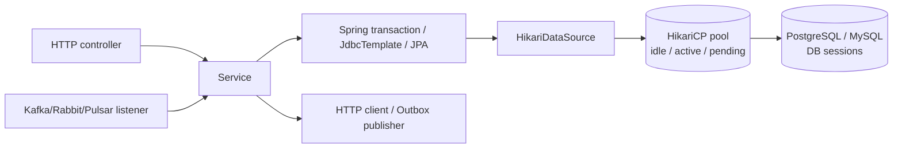
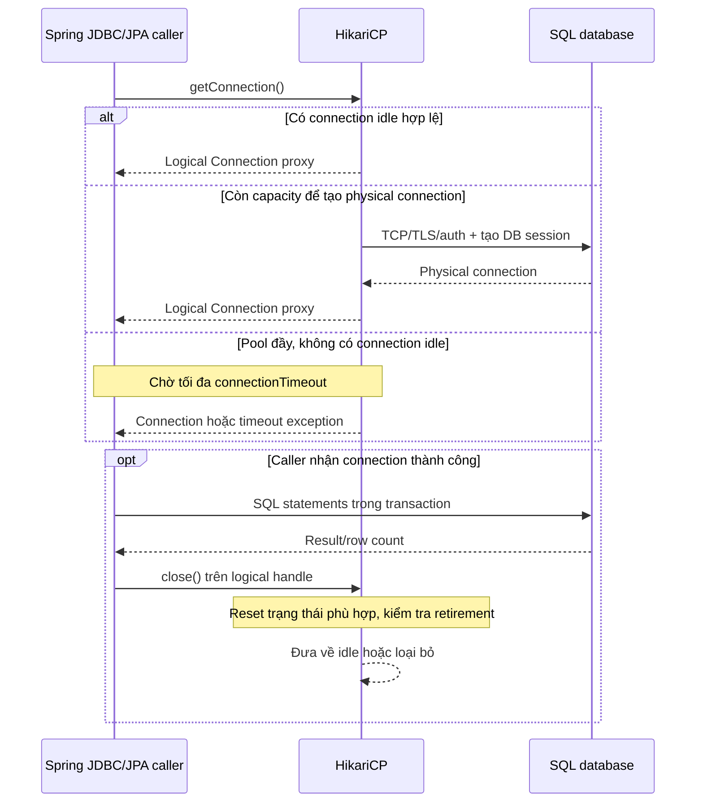
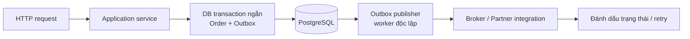
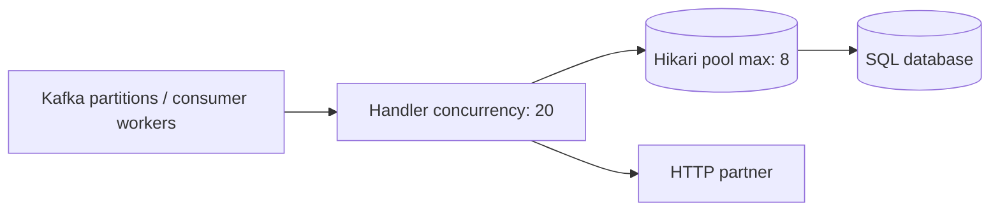

# HikariCP, kích thước pool và vòng đời kết nối

## 1. Vì sao quản lý kết nối SQL là bài toán tích hợp?

Trong một dịch vụ **SPRING_BOOT_INTEGRATION**, database thường nằm giữa nhiều luồng công việc: API HTTP nhận yêu cầu, adapter gọi đối tác, consumer nhận sự kiện từ Kafka/RabbitMQ/Pulsar, repository ghi dữ liệu, sau đó outbox publisher gửi thông điệp ra broker. Tất cả có thể dùng chung một **DataSource JDBC**.

Kết nối cơ sở dữ liệu không miễn phí. Mở một kết nối mới có thể gồm DNS, TCP, TLS, xác thực, thiết lập session; database cũng phải cấp tài nguyên cho connection. Nếu mỗi request tự tạo rồi đóng kết nối vật lý, chi phí tăng nhanh. Ngược lại, giữ quá nhiều kết nối nhàn rỗi hoặc xử lý transaction quá lâu cũng làm database cạn tài nguyên.

**HikariCP** là JDBC connection pool được Spring Boot thường tự cấu hình khi thư viện Hikari có trên classpath, chẳng hạn qua `spring-boot-starter-jdbc` hoặc `spring-boot-starter-data-jpa`. Pool tái sử dụng các kết nối vật lý nhưng trao cho code một đối tượng `Connection` có vòng đời mượn/trả:

```text
Một HTTP request cần SQL
    → DataSource.getConnection()
    → mượn connection từ HikariCP
    → chạy SQL / transaction
    → Connection.close()
    → TRẢ connection về pool, thường không đóng TCP ngay
```

Ở đây `close()` là hành vi **đóng logical handle**. HikariCP có thể giữ kết nối vật lý để request sau tái sử dụng. Khi kết nối đã chết, hết thời hạn, hoặc pool đóng, kết nối vật lý mới thực sự bị loại bỏ.

### Mục tiêu học tập

Sau bài này, bạn có thể:

1. Giải thích sự khác nhau giữa `DataSource`, Hikari pool, physical JDBC connection và logical connection handle.
2. Cấu hình `spring.datasource.hikari.*` trong Spring Boot, đặc biệt `maximum-pool-size`, `minimum-idle`, các timeout và vòng đời kết nối.
3. Tính pool size từ thời gian **giữ connection**, throughput, số replica và ngân sách connection của database.
4. Hiểu cách `@Transactional`, `JdbcTemplate` và JPA ảnh hưởng thời gian connection bị chiếm dụng.
5. Phân biệt pool exhaustion, leak, truy vấn chậm, lock contention, lỗi network và database từ chối connection.
6. Đo và kiểm thử pool trong tình huống HTTP, broker, retry, autoscaling và graceful shutdown.

> **Phiên bản minh họa:** Java 17+, Spring Boot 3.x và HikariCP được quản lý bởi Spring Boot BOM. Các giá trị mặc định HikariCP có thể phụ thuộc phiên bản và cách Spring Boot khởi tạo pool. Ví dụ tuning trong bài là **điểm khởi đầu để đo đạc**, không phải cấu hình áp dụng đồng loạt cho production.

## 2. Một pool kết nối nằm ở đâu?



Một `HikariDataSource` đại diện cho **một pool** phục vụ một nguồn dữ liệu. Khi request/consumer cần truy vấn:

- Nếu pool có connection nhàn rỗi hợp lệ, caller được cấp ngay.
- Nếu chưa đạt `maximumPoolSize`, pool có thể tạo thêm connection.
- Nếu pool đã chạm giới hạn và không còn connection rảnh, caller **chờ lấy connection** tối đa theo `connectionTimeout`.
- Nếu vẫn không có connection, caller nhận một ngoại lệ SQL/pool timeout; không có nghĩa câu SQL của caller đã chạy.
- Sau khi caller trả connection, Hikari có thể đưa connection trở lại danh sách idle hoặc loại bỏ nếu cần.

### 2.1. Phân biệt ba đại lượng

| Đại lượng | Ý nghĩa | Điều thường bị nhầm |
| --- | --- | --- |
| **Active connections** | Connection đã được mượn và chưa trả | Không phải tất cả đều đang thực thi SQL: có thể đang chờ HTTP, lock hoặc application code |
| **Idle connections** | Connection nằm trong pool và có thể cho mượn | Không phải session ở DB đã bị đóng; idle vẫn có thể chiếm DB slot |
| **Pending threads** | Số caller đang chờ lấy connection | Không phải số query đang chạy trên database |

Một `active=20, idle=0, pending=100` trên pool tối đa 20 cho thấy nhiều caller bị chặn ở **cửa vào pool**. Nhưng muốn tìm nguyên nhân, phải xem 20 connection active đang làm gì: query chậm, transaction giữ connection khi chờ API, lock hay code quên trả.

### 2.2. Mỗi instance có pool riêng

Giả sử triển khai sáu replica của `order-service`, mỗi replica có `maximum-pool-size=16`. Tổng số kết nối riêng **nhóm service này** có thể gần:

\[
6\times16=96
\]

Đó chưa tính các service khác, migration job, BI client, monitoring, replication, connection dành cho quản trị và connection do nhiều datasource tạo ra. Một pool size trông nhỏ trên một pod có thể trở thành **ngân sách kết nối rất lớn trên toàn cụm**.

## 3. Thêm dependency và cấu hình Spring Boot

Với JDBC thuần, sử dụng starter:

```xml
<!-- pom.xml, Spring Boot parent/BOM quản lý version -->
<dependency>
    <groupId>org.springframework.boot</groupId>
    <artifactId>spring-boot-starter-jdbc</artifactId>
</dependency>
<dependency>
    <groupId>org.postgresql</groupId>
    <artifactId>postgresql</artifactId>
    <scope>runtime</scope>
</dependency>
```

Với Gradle:

```groovy
dependencies {
    implementation 'org.springframework.boot:spring-boot-starter-jdbc'
    runtimeOnly 'org.postgresql:postgresql'
}
```

Trong Spring Boot thông thường, `spring-boot-starter-jdbc` mang HikariCP; nếu Hikari có mặt và không có `DataSource` do ứng dụng tự khai báo thay thế, Boot ưu tiên sử dụng `HikariDataSource`. `spring-boot-starter-data-jpa` cũng có thể dùng Hikari qua JDBC datasource.

Không cần tự `new HikariDataSource()` trong mọi service. Ưu tiên để Boot tạo, quản lý lifecycle và bind các thuộc tính `spring.datasource.*`/ `spring.datasource.hikari.*`.

### 3.1. Ví dụ `application.yml`

```yaml
spring:
  datasource:
    url: jdbc:postgresql://db.internal.example:5432/orders
    username: ${DB_USERNAME}
    password: ${DB_PASSWORD}
    driver-class-name: org.postgresql.Driver
    hikari:
      pool-name: orders-primary-pool
      maximum-pool-size: 16
      minimum-idle: 4
      connection-timeout: 2s
      validation-timeout: 1s
      idle-timeout: 10m
      max-lifetime: 25m
      keepalive-time: 2m
```

Đây là **ví dụ cho một môi trường giả định**; hãy thay `db.internal.example`, credentials và ngân sách pool theo hệ thống thật. Tài khoản database và secret phải đến từ nguồn bảo mật, không ghi password trong Git. Với production có TLS, cấu hình PostgreSQL JDBC `sslmode=verify-full`, CA và hostname phù hợp trong URL/driver properties; **HikariCP không tự xác minh TLS hộ driver**.

Các giá trị trên là ví dụ có chủ ý:

- `maximum-pool-size=16` là trần số physical connections do pool này quản lý.
- `minimum-idle=4` làm pool có thể co giãn giữa mức idle tối thiểu và tối đa; không phải luôn có đúng 4 connection tổng cộng.
- `connection-timeout=2s` giới hạn thời gian caller chờ mượn connection.
- `validation-timeout=1s` giới hạn thao tác kiểm tra connection còn dùng được; phải nhỏ hơn connection timeout.
- `idle-timeout=10m` chỉ hữu ích khi số connection idle có thể giảm xuống dưới maximum nhưng không giảm dưới minimum idle.
- `max-lifetime=25m` là giới hạn tuổi của physical connection trước khi được thay thế theo cơ chế pool.
- `keepalive-time=2m` cho pool kiểm tra định kỳ những connection **đang idle** trong điều kiện được hỗ trợ.

Mọi giới hạn phải phối hợp với timeout của proxy, database, driver, transaction và hệ điều hành. Không nên chép nguyên những số này vào mọi cluster mà không đo đạc.

### 3.2. Cấu hình theo môi trường

```yaml
# application-local.yml
spring:
  datasource:
    hikari:
      maximum-pool-size: 5
      minimum-idle: 1
```

```yaml
# application-prod.yml
spring:
  datasource:
    hikari:
      maximum-pool-size: ${DB_POOL_MAX_SIZE:12}
      minimum-idle: ${DB_POOL_MIN_IDLE:4}
      connection-timeout: 2s
```

Trong YAML trên, `DB_POOL_MAX_SIZE` và `DB_POOL_MIN_IDLE` là **giá trị cấu hình**, không phải lệnh cho database tự tăng `max_connections`. Người vận hành phải tính ngân sách theo số replica tối đa và các workload khác trước khi nâng pool.

## 4. Các thuộc tính HikariCP cần hiểu đúng

| Thuộc tính Spring Boot | Tác dụng | Điều không nên suy ra |
| --- | --- | --- |
| `spring.datasource.hikari.maximum-pool-size` | Số connection tối đa, gồm active và idle | Không phải số câu SQL/giây tối đa |
| `minimum-idle` | Số idle connection pool cố duy trì khi khả thi | Không phải cận dưới số active connection |
| `connection-timeout` | Thời gian caller chờ `getConnection()` khi pool bận/không cấp được | Không phải SQL query timeout |
| `validation-timeout` | Thời gian tối đa kiểm tra connection hợp lệ | Không thay server-side statement timeout |
| `idle-timeout` | Thời gian một idle connection có thể được nghỉ hưu khi pool có khả năng co giãn | Không loại bỏ active connection giữa transaction |
| `max-lifetime` | Tuổi tối đa dự kiến của physical connection | Không tự giết một connection còn đang được ứng dụng sử dụng |
| `keepalive-time` | Kiểm tra giữ sống idle connection theo chu kỳ phù hợp | Không bảo vệ active query khỏi timeout network |
| `leak-detection-threshold` | Cảnh báo khi một connection được giữ quá lâu | Không thu hồi hay tự sửa connection leak |
| `pool-name` | Nhận diện pool trong log/metric | Không phân biệt tenant/DB quyền truy cập |
| `register-mbeans` | Bật quản lý JMX nếu cần | Không phải yêu cầu để có Micrometer metrics |
| `auto-commit`, `transaction-isolation` | Mặc định trạng thái của connection khi được mượn, theo cơ chế driver/pool | Không thay thế quản lý transaction của Spring |
| `connection-init-sql` | SQL được chạy khi tạo connection vật lý | Không phải cách thay migration/schema.sql |
| `data-source-properties.*` | Truyền thuộc tính bổ sung đến JDBC driver | Tên và ý nghĩa phụ thuộc driver, không phải Hikari định nghĩa hết |

Với HikariCP hiện hành, mặc định thường gặp là `maximumPoolSize=10`, `connectionTimeout=30s`, `maxLifetime=30m`; nếu không đặt `minimumIdle`, pool có xu hướng vận hành ở kích thước cố định tương ứng `maximumPoolSize`. **Cần đọc version HikariCP thực sự được Spring Boot BOM resolve**, vì chi tiết mặc định/giới hạn có thể thay đổi giữa bản.

### 4.1. `minimum-idle` và pool cố định

HikariCP thường khuyến nghị **không cần đặt `minimumIdle`** khi muốn một pool có kích thước cố định, ít phải tạo kết nối mới trong giờ cao điểm. Khi `minimumIdle=maximumPoolSize`, `idleTimeout` không còn là cơ chế làm pool co lại; nhiều idle connection vẫn có thể chiếm slot trên database.

Khi có **rất nhiều replica** hoặc workload dao động mạnh, đặt `minimum-idle` nhỏ hơn `maximum-pool-size` có thể giảm số connection nền, nhưng đổi lại burst có thể mất thời gian tạo thêm connection. Cần test cả khởi động đồng loạt và burst, không kết luận một cách cấu hình luôn tối ưu hơn.

### 4.2. `max-lifetime` và tuổi connection

Hikari không chủ động thu hồi một physical connection **đang được mượn** giữa query/transaction chỉ vì `maxLifetime` đến hạn. Connection được đánh dấu để loại bỏ khi có thể và thay thế trong quá trình vận hành pool.

Nếu proxy/LB hoặc database đóng connection sau khoảng 30 phút, cấu hình `max-lifetime` thường nên **thấp hơn giới hạn của bên ngoài với khoảng an toàn**. Nếu external timeout ngắn hơn nhiều, pool có thể mượn lại connection đã chết và phải khôi phục. Phải đối chiếu giới hạn thực tế, không chọn `25m` chỉ vì đó là con số trong ví dụ.

### 4.3. `keepalive-time` không phải giải pháp cho mọi timeout

Keepalive của Hikari hoạt động trên connection **nhàn rỗi**, kiểm tra sống và đưa trở lại pool; nó không giải quyết một SQL statement bị lock 60 giây hoặc socket bị firewall cắt khi ứng dụng đang thực hiện query.

Keepalive phải được cấu hình hợp lệ với `maxLifetime` và các ngưỡng của version HikariCP. Không dùng keepalive quá dày đặc với hàng nghìn connection vì có thể làm tăng traffic và CPU database mà không cải thiện throughput.

### 4.4. `connection-test-query` thường không cần thiết

Với JDBC driver hiện đại hỗ trợ `Connection.isValid()`, HikariCP có thể dùng cơ chế JDBC4 để kiểm tra connection. Chỉ nên khai báo `connection-test-query` khi driver có giới hạn cụ thể hoặc nhà cung cấp hướng dẫn. Một câu `SELECT 1` custom không phải “thuốc chữa” connection leak hay database quá tải.

## 5. Vòng đời chi tiết: tạo, mượn, dùng, trả và nghỉ hưu



### 5.1. Tạo physical connection

Tạo connection gồm nhiều bước phụ thuộc driver/database:

1. Resolve endpoint, mở TCP socket, qua proxy/LB nếu có.
2. Thực hiện TLS handshake khi driver được cấu hình TLS.
3. Xác thực username/password hoặc credential thích hợp.
4. Khởi tạo session theo database driver.
5. Nếu cấu hình `connection-init-sql`, chạy lệnh khởi tạo session theo cơ chế pool.

**HikariCP không tạo schema/database thay ứng dụng.** `schema.sql`, Flyway/Liquibase hoặc DBA/migration job là các cơ chế riêng. Dùng `connection-init-sql` để tạo bảng trên mỗi connection sẽ gây sai kiến trúc và có thể xung đột khi nhiều instance start.

### 5.2. Mượn connection

Khi service gọi `JdbcTemplate` hoặc một repository JPA, Spring lấy connection theo cơ chế quản lý giao dịch và framework. Nếu một transaction đã gắn connection vào thread/ngữ cảnh hiện tại, các thao tác có thể dùng chung connection phù hợp transaction manager và driver.

Không được mặc định “mỗi `JdbcTemplate.query` chắc chắn tạo một TCP connection mới”; với pooling, việc tạo physical connection là việc của pool, còn mượn logical connection có thể nhanh.

### 5.3. Dùng connection

Một connection có thể:

- Đang thực thi SQL.
- Đang chờ database lock hoặc network response.
- Đang giữ transaction mở trong lúc code Java xử lý không liên quan SQL.
- Đang chờ một HTTP call khác nếu lập trình viên đặt HTTP bên trong `@Transactional`.

Trên bảng điều khiển Hikari, cả bốn trường hợp có thể vẫn hiện là **active**. Phân biệt bằng tracing, SQL/transaction metrics và trạng thái session phía database.

### 5.4. Trả connection

Khi code gọi `Connection.close()` trên logical handle được Hikari cấp, physical connection thông thường được trả về pool. Pool có thể khôi phục trạng thái như auto-commit, read-only, isolation theo những thay đổi nó phát hiện; code cần tuân thủ API để pool theo dõi trạng thái.

Nếu dùng Spring transaction manager, **không tự đóng connection thuộc transaction đang hoạt động** bằng lời gọi thủ công sai ngữ cảnh. Ưu tiên `JdbcTemplate`, Spring Data hoặc `DataSourceUtils` trong code cấp thấp để Spring quản lý acquisition/release đúng.

### 5.5. Nghỉ hưu và đóng connection

Hikari loại connection khi đạt giới hạn lifetime, phát hiện kết nối không hợp lệ, pool thu nhỏ theo `minimumIdle`/`idleTimeout` hoặc application shutdown. Khi trả connection, pool có thể thấy nó đã được đánh dấu hết tuổi và đóng vật lý thay vì đưa lại vào idle.

Khi service graceful shutdown, pool được đóng sau khi các thành phần sử dụng đã dừng phù hợp. Không dựa vào việc “pool tự đóng” để xử lý message chưa ack hoặc transaction chưa commit.

## 6. Công thức ước lượng kích thước pool

Một điểm xuất phát hữu ích là định luật Little cho hệ ổn định:

\[
L = \lambda W
\]

Ở đây, nếu chọn ranh giới **thời gian giữ JDBC connection**:

- \(\lambda\): số giao dịch/giây thực sự cần connection.
- \(W\): thời gian trung bình một giao dịch **giữ connection từ lúc mượn tới khi trả**.
- \(L\): số connection trung bình đồng thời đang được giữ.

Ví dụ, dịch vụ có 400 giao dịch database/giây và thời gian giữ connection trung bình là 20 ms:

\[
L = 400 \times 0{,}020 = 8
\]

Kết quả 8 là **nhu cầu đồng thời trung bình theo mô hình đơn giản**, không phải khuyến nghị cứng phải đặt pool đúng 8. Peak, biến thiên p99, lock, slow query, retry, batch, transaction dài và sức chứa thật của database đều có thể thay đổi nhu cầu và throughput.

### 6.1. Thời gian giữ connection khác HTTP end-to-end latency

Giả sử một HTTP request mất 300 ms tổng cộng:

```text
Parse/validate request:      10 ms
DB transaction:              20 ms
Partner HTTP call:          250 ms
Serialize response:          20 ms
Tổng:                       300 ms
```

Nếu DB connection chỉ bị giữ trong 20 ms transaction, dùng `W=0,020s` cho tính pool database. Nếu lại đặt partner HTTP call **bên trong cùng transaction**, connection có thể bị giữ gần 270 ms, khiến cùng 400 request/s cần trung bình khoảng:

\[
400 \times 0{,}270 = 108 \text{ active connections}
\]

Từ 8 lên 108 không phải vì query chậm hơn, mà vì **transaction boundary quá rộng**. Đó là lý do tối ưu transaction thường quan trọng hơn tăng pool.

### 6.2. Ước lượng ngân sách theo số replica

Giả sử PostgreSQL được cấu hình `max_connections=120`; vận hành dự phòng khoảng 20 connection cho quản trị, migration, monitoring và những service khác. Ngân sách còn lại giả định là 100.

Nếu có 5 replica của cùng một service, mỗi replica `maximum-pool-size=16`:

\[
5 \times 16 = 80
\]

Theo giả định này vẫn còn khoảng 20 connection dự phòng trong ngân sách 100. Nhưng khi autoscale lên 8 replica:

\[
8 \times 16 = 128
\]

Tổng nhu cầu lý thuyết vượt ngân sách, ngay cả khi mỗi instance tự hoạt động đúng với giới hạn của nó. Cần quyết định phối hợp **pool size tối đa, max replica, ngân sách toàn cụm, proxy/pooler và quota của các service khác**.

> **Lưu ý:** `max_connections` không đồng nghĩa toàn bộ số connection đều dành cho ứng dụng. PostgreSQL giữ các slot/nguồn tài nguyên cho những mục đích khác theo cấu hình và quyền; cần dùng ngân sách được DBA/SRE xác nhận, không trừ tùy tiện rồi coi đó là cam kết.

### 6.3. Không lấy số lõi CPU làm công thức duy nhất

Có những “công thức pool size” dựa trên số CPU core, spindle I/O hoặc các quy tắc kinh nghiệm. Chúng chỉ là điểm tham khảo trong bối cảnh hệ cụ thể. Với database hiện đại có SSD, lock contention, network latency và concurrency từ nhiều service, cần đo **throughput hoàn thành, độ trễ SQL, wait event và saturation** khi thay pool size.

Một pool lớn hơn có thể làm database chạy chậm hơn do nhiều query cạnh tranh lock/CPU/IO. Một pool quá nhỏ có thể khiến caller chờ vô ích khi database còn dư năng lực. Mục tiêu là tìm **điểm vận hành ổn định với headroom**, không tối đa hóa số connection.

## 7. Transaction boundary quyết định thời gian chiếm connection

### 7.1. Mẫu không nên dùng: gọi HTTP bên trong transaction

```java
@Transactional
public void acceptOrder(OrderCommand command) {
    orderRepository.insert(command);
    partnerClient.reserveStock(command); // Có thể chờ vài giây
    outboxRepository.insert(command);
}
```

Đoạn trên minh họa anti-pattern. Khi transaction đã lấy connection và giữ nó qua network call, timeout/latency của partner có thể gây **pool exhaustion**, giữ database locks và làm nhiều request khác chờ connection. Ngoài ra, `@Transactional` của JDBC **không thể rollback** tác động HTTP đã được đối tác commit.

### 7.2. Tách transaction và tác động bên ngoài

Một cách tiếp cận cho hệ cần gửi sự kiện:



Code mẫu cho transaction ngắn:

```java
package example.integration.order;

import org.springframework.stereotype.Service;
import org.springframework.transaction.annotation.Transactional;

@Service
public class OrderApplicationService {

    private final OrderRepository orders;
    private final OutboxRepository outbox;

    public OrderApplicationService(
            OrderRepository orders,
            OutboxRepository outbox) {
        this.orders = orders;
        this.outbox = outbox;
    }

    @Transactional(timeout = 5)
    public void accept(OrderCommand command) {
        orders.insert(command);
        outbox.enqueueOrderCreated(command.id());
    }
}
```

`OrderRepository`, `OutboxRepository` và `OrderCommand` là các kiểu nghiệp vụ ứng dụng cần cung cấp. Điểm chính là **ghi đơn hàng và bản ghi outbox trong cùng database transaction** rồi trả connection sớm. Một worker khác đọc outbox và gửi broker/HTTP với retry/idempotency phù hợp.

`@Transactional(timeout = 5)` thể hiện timeout transaction theo Spring transaction manager và mức hỗ trợ của công nghệ cụ thể. Nó **không thay** driver socket timeout, `connectionTimeout` của pool hoặc HTTP client timeout. Muốn ràng buộc thời gian SQL hiệu quả, cần kiểm tra cách manager/driver thực thi timeout.

### 7.3. JDBC `JdbcTemplate` giúp quản lý tài nguyên

```java
package example.integration.order;

import org.springframework.jdbc.core.JdbcTemplate;
import org.springframework.stereotype.Repository;

@Repository
public class OrderLookupRepository {

    private final JdbcTemplate jdbcTemplate;

    public OrderLookupRepository(JdbcTemplate jdbcTemplate) {
        this.jdbcTemplate = jdbcTemplate;
    }

    public boolean exists(String orderId) {
        Integer count = jdbcTemplate.queryForObject(
                "SELECT COUNT(*) FROM orders WHERE id = ?",
                Integer.class,
                orderId);
        return count != null && count > 0;
    }
}
```

`JdbcTemplate` quản lý mở/đóng statement, result set và acquisition/release connection theo Spring infrastructure. Khi không có transaction, mỗi thao tác có thể mượn/trả connection theo phạm vi phương thức. Khi có `@Transactional` hoạt động, Spring có thể gắn connection vào transaction và chỉ trả sau khi transaction kết thúc. Không nên lưu `Connection` hoặc `ResultSet` vào field của singleton bean.

### 7.4. Nếu cần dùng JDBC API trực tiếp

```java
public int countOrders(DataSource dataSource) throws SQLException {
    try (Connection connection = dataSource.getConnection();
         PreparedStatement statement = connection.prepareStatement(
                 "SELECT COUNT(*) FROM orders");
         ResultSet result = statement.executeQuery()) {

        result.next();
        return result.getInt(1);
    }
}
```

Ví dụ dùng các class `javax.sql.DataSource`, `java.sql.Connection`, `PreparedStatement`, `ResultSet`, `SQLException`. Với lời gọi JDBC độc lập không được quản lý bởi Spring transaction, **try-with-resources là bắt buộc** để trả logical connection dù SQL ném ngoại lệ.

Nếu code tham gia Spring-managed transaction, tránh tự `dataSource.getConnection()` theo cách phá ranh giới transaction; ưu tiên `JdbcTemplate` hoặc `DataSourceUtils` và cặp release tương ứng.

### 7.5. JPA/Hibernate không đồng nghĩa lấy connection ngay khi mở transaction

Hibernate có chiến lược acquisition/release connection phụ thuộc phiên bản, loại transaction và cấu hình. Một JPA transaction có thể lấy JDBC connection muộn hơn so với lúc method bắt đầu; cũng có thể giữ connection đến khi commit. Do đó hãy **đo thời gian connection active trên hệ thật**, không suy đoán từ `@Transactional` đơn lẻ.

Các yếu tố như lazy loading, flush, batch writes, `OpenEntityManagerInView` trong web app và vòng đời EntityManager cũng cần được xem xét riêng. Một HTTP controller serializing lazy entities sai cách có thể kéo theo SQL ngoài ranh giới dự kiến.

## 8. Sáu loại timeout cần phân biệt

| Timeout | Đo từ đâu đến đâu? | Cấu hình điển hình |
| --- | --- | --- |
| **Acquire timeout** | Caller chờ mượn connection từ pool | `spring.datasource.hikari.connection-timeout` |
| **Connect/login timeout** | Driver thiết lập socket/xác thực đến DB | Thuộc tính JDBC driver, ví dụ `connectTimeout` với PostgreSQL |
| **Statement/query timeout** | Thời gian thực thi một statement theo cơ chế JDBC/driver/server | `spring.jdbc.template.query-timeout`, `Statement.setQueryTimeout`, `statement_timeout` |
| **Socket/network read timeout** | Driver chờ dữ liệu từ connection | Driver option, ví dụ PostgreSQL `socketTimeout` |
| **Transaction timeout** | Tổng thời gian transaction theo Spring/manager khi được hỗ trợ | `@Transactional(timeout = ...)` và transaction policy |
| **HTTP client timeout** | Chờ kết nối/phản hồi của partner HTTP | `RestClient` request factory và HTTP client configuration |

Để dễ nhớ:

```text
Chờ lấy connection → kết nối DB → chạy statement → commit/rollback → trả connection
  connectionTimeout   connectTimeout    queryTimeout    transaction timeout
```

Những giới hạn có thể **chồng lấp** hoặc bắt đầu tại các thời điểm khác nhau theo driver/transaction manager. Không cộng cứng chúng rồi coi đó là timeout tối đa chắc chắn của request HTTP.

### 8.1. Ví dụ timeout cho `JdbcTemplate`

```yaml
spring:
  datasource:
    hikari:
      connection-timeout: 2s
  jdbc:
    template:
      query-timeout: 5s
```

`connection-timeout` là ngân sách **mượn connection**. `query-timeout` áp dụng cho JDBC statements do `JdbcTemplate` tạo theo mức hỗ trợ của driver, **không bảo đảm mọi SQL của JPA và mọi thư viện dùng cùng một giới hạn**.

Ví dụ PostgreSQL bổ sung cấu hình driver khi phù hợp:

```yaml
spring:
  datasource:
    url: "jdbc:postgresql://db.internal.example:5432/orders?connectTimeout=5&socketTimeout=15"
```

Các giá trị `connectTimeout`, `socketTimeout` trong PostgreSQL JDBC thường tính bằng **giây** theo driver; khác đơn vị với `Duration` trong Spring Boot YAML. Không copy những tham số này sang MySQL/SQL Server mà chưa xem tài liệu đúng driver.

Đối với production có TLS, còn phải xác minh certificate CA/hostname với SSL mode thích hợp, ví dụ PostgreSQL `verify-full`. **Pool size không giải quyết được lỗi TLS hay credential sai.**

### 8.2. Vì sao chỉ tăng `connection-timeout` có thể làm sự cố tệ hơn?

Khi pool đầy do transaction giữ connection lâu, tăng `connection-timeout` từ 2 lên 30 giây không làm database mạnh hơn. Nó khiến nhiều HTTP request hoặc broker listener thread chờ lâu hơn, giữ RAM/threads và có thể gây timeout dây chuyền ở upstream.

Hướng xử lý là đo **active/pending/usage time** và loại nguyên nhân giữ connection lâu; điều chỉnh timeout theo ngân sách độ trễ, không chỉ che triệu chứng.

## 9. Pool exhaustion không nhất thiết là connection leak

**Pool exhaustion** nghĩa là mọi connection có thể dùng đã được mượn, caller mới phải chờ. Điều này có thể hoàn toàn hợp lệ khi tải vượt năng lực, hoặc do lỗi ứng dụng.

### 9.1. Những nguyên nhân điển hình

| Dấu hiệu | Khả năng nguyên nhân |
| --- | --- |
| Active gần maximum, pending tăng, SQL latency tăng | Query chậm, lock wait hoặc database bão hòa |
| Active cao, DB CPU thấp, nhiều session `idle in transaction` | Transaction giữ connection khi code Java chờ I/O hoặc quên kết thúc |
| Active tăng mãi, không giảm khi ingress đã ngừng | Có thể có leak hoặc tác vụ bị kẹt lâu |
| Total connections thấp hơn maximum, pending cao | DB không cấp được physical connection mới, network/auth/proxy lỗi hoặc pool creation bị chậm |
| Active bình thường, nhưng app timeout ở HTTP đối tác | Bottleneck không nằm ở JDBC pool |
| Chỉ xảy ra khi tăng replica | Tổng DB connections vượt ngân sách server |

**Connection leak** là trường hợp code mượn connection nhưng không trả đúng, hoặc không bao giờ hoàn tất phạm vi sử dụng. Không phải mọi connection được giữ 10 giây đều là leak: một transaction hợp lệ có thể kéo dài 10 giây vì migration/locking/batch.

### 9.2. Bật leak detection có kiểm soát

```yaml
spring:
  datasource:
    hikari:
      leak-detection-threshold: 10s
```

Khi một connection được mượn vượt ngưỡng, Hikari có thể ghi warning kèm stack trace cho nơi nó được mượn. **Cơ chế này chỉ cảnh báo**, không tự đóng connection đang dùng. Nếu caller trả connection sau ngưỡng, có thể xuất hiện log cho biết connection trước đó đã được trả.

Ngưỡng phải dài hơn những thao tác bình thường dự kiến; quá thấp gây false positive và log lớn. Không bật leak detection với threshold cực ngắn trên production tải cao mà không kiểm soát chi phí và thông tin log.

### 9.3. Anti-pattern: connection field trong singleton

```java
// SAI: giữ Connection làm trạng thái của bean singleton
@Component
class BadRepository {
    private Connection connection; // Dễ leak và sai thread-safety
}
```

`Connection` là tài nguyên có vòng đời hữu hạn, không phải object dùng chung an toàn giữa các luồng. Thay bằng injection `JdbcTemplate`/`DataSource` rồi mượn/trả trong phạm vi request/transaction, không giữ handle qua các callback bất đồng bộ.

## 10. Đo bằng Actuator, Micrometer và Hikari metrics

Với Spring Boot Actuator/Micrometer và một `HikariDataSource` được cấu hình phù hợp, ứng dụng có thể có các metric HikariCP như:

| Metric thường gặp | Ý nghĩa |
| --- | --- |
| `hikaricp.connections.active` | Số connection đang mượn |
| `hikaricp.connections.idle` | Số connection idle |
| `hikaricp.connections.pending` | Số thread đang chờ lấy connection |
| `hikaricp.connections` | Tổng số connection đang quản lý |
| `hikaricp.connections.max` | Kích thước tối đa cấu hình |
| `hikaricp.connections.min` | Số idle tối thiểu cấu hình |
| `hikaricp.connections.acquire` | Thời gian caller lấy được connection, tùy meter implementation |
| `hikaricp.connections.usage` | Thời gian connection được giữ trước khi trả |
| `hikaricp.connections.timeout` | Lần caller không lấy được connection trước timeout |

Tên metric/xuất Prometheus có thể được chuyển đổi bởi registry, Micrometer và phiên bản đang dùng. Kiểm tra danh sách meter **thực sự** xuất hiện, không tự suy rằng mọi metric đã được bật.

### 10.1. Thêm Actuator

```xml
<dependency>
    <groupId>org.springframework.boot</groupId>
    <artifactId>spring-boot-starter-actuator</artifactId>
</dependency>
```

Ví dụ chỉ mở endpoint metrics ở môi trường được kiểm soát:

```yaml
management:
  endpoints:
    web:
      exposure:
        include: health,info,metrics
```

Nếu muốn export Prometheus, cần registry Prometheus tương ứng và cấu hình exposure/security riêng. **Không public endpoint management chứa chi tiết vận hành mà chưa xác thực/ủy quyền**.

### 10.2. Đọc metric để quyết định hành động

```text
active=16 / max=16
idle=0
pending=40
acquire p95=1,8s
usage p95=900ms
```

Giả sử bộ số liệu trên được đo trong 5 phút. Caller đang chờ lâu và connection được giữ gần một giây ở p95. Trước khi tăng `maximum-pool-size`, cần xem transaction/SQL nào làm `usage` tăng, có giữ connection khi gọi HTTP không, DB CPU/lock wait có cao không và tổng connection của mọi replica đã gần giới hạn chưa.

Ngược lại:

```text
active=3 / max=16
idle=13
pending=0
HTTP p99 latency=7s
```

Tăng JDBC pool không giải quyết nút thắt HTTP đối tác. Cần phân tích outbound HTTP connection pool, timeout, retry, rate limit và behavior của upstream.

### 10.3. Trạng thái phía database

Với PostgreSQL, có thể xem tổng quan session qua truy vấn (quyền xem chi tiết phụ thuộc role):

```sql
SELECT state, wait_event_type, COUNT(*) AS sessions
FROM pg_stat_activity
WHERE datname = current_database()
GROUP BY state, wait_event_type
ORDER BY sessions DESC;
```

Ví dụ nhận thấy nhiều session `idle in transaction` thì cần kiểm tra logic transaction và session cleanup. Nhiều session `active` chờ lock thì tối ưu pool size không khắc phục được lock contention gốc. Công cụ và tên view cho MySQL/SQL Server/Oracle khác nhau; tra đúng tài liệu database.

## 11. Broker listener và JDBC pool: cân bằng nhịp xử lý

Nếu Kafka listener có `concurrency=20` nhưng pool DB chỉ 8 connection, không nhất thiết sai; có thể nhiều handler không cần DB cùng lúc. Nhưng nếu **mọi message giữ connection suốt vòng xử lý**, ít nhất 12 handler có nguy cơ chờ pool ngay khi tải cao.



Các mối quan hệ cần quản lý:

- **Consumer concurrency:** giới hạn số handler có thể chạy cùng lúc, chịu ảnh hưởng broker/partitioning.
- **JDBC pool size:** giới hạn số physical connections đồng thời tại mỗi instance.
- **HTTP concurrency/rate limit:** giới hạn outbound partner; nếu HTTP nằm trong transaction, nó còn gián tiếp giới hạn thời gian trả connection.
- **Ack/offset:** không xác nhận message thành công chỉ vì đã đưa vào một hàng đợi nội bộ; cần điểm commit/persist theo hợp đồng.
- **Retry:** lỗi lấy connection có thể tạm thời; retry không kiểm soát khiến số handler chờ tăng thêm.

### 11.1. Khi pool tạm thời không còn connection

Nếu handler bị `SQLTransientConnectionException` hoặc exception do Hikari timeout:

1. Xác định database có thực sự còn sống và có capacity không.
2. Kiểm tra active/pending/usage; không kết luận tất cả lỗi đều do pool quá nhỏ.
3. Giữ công việc chưa hoàn thành bền vững ở broker hoặc inbox/outbox.
4. Dùng retry hữu hạn có backoff/jitter nếu là lỗi tạm thời; đưa lỗi lâu dài vào đường xử lý phù hợp.
5. Không ack sớm để “giải phóng lag”; cũng không requeue tức thì liên tục gây retry storm.

Trong Kafka, khi xử lý handler lâu, cần xem `max.poll.interval.ms`, batch size, ack policy và partition assignment. Với RabbitMQ/Pulsar, cần xem prefetch/receiver queue, redelivery và subscription type. Các khái niệm tương tự nhưng **không dùng chung một property**.

### 11.2. Transactional inbox và outbox

Pool được giữ hiệu quả nhất khi transaction DB **ngắn** và chỉ chứa các thao tác thuộc một đơn vị commit. Với inbox:

```text
Nhận Event E
    → BEGIN DB transaction
    → insert receipt với unique event_id + cập nhật nghiệp vụ
    → COMMIT
    → ACK broker
```

Nếu process crash sau commit DB nhưng trước ack, broker có thể giao lại E. Unique key và transaction giúp phát hiện trùng để tránh tạo side effect thêm. **Pool chỉ lo kết nối**; không tự bảo đảm exactly-once qua database/broker.

Với outbox, ghi business row + outbox row cùng transaction DB, rồi publisher gửi message sau. Worker phải giới hạn concurrency truy vấn/gửi; nếu outbox backlog tăng mãi, hệ có thể làm database đầy dù pool không bị exhaustion.

## 12. Autoscaling, serverless và giới hạn database

Trong Kubernetes hoặc cloud container orchestration, Hikari pool **thuộc từng process**, không chia sẻ giữa pods. Định nghĩa:

\[
C_{\mathrm{app,max}} = R_{\mathrm{max}} \times P_{\mathrm{max}}
\]

- \(R_{\mathrm{max}}\): số replica tối đa có thể chạy.
- \(P_{\mathrm{max}}\): maximum pool size của một replica.
- \(C_{\mathrm{app,max}}\): số connection lý thuyết lớn nhất do nhóm replica tạo.

Nếu service có hai datasource, hay còn migration worker/cron, phải tính riêng và cộng vào ngân sách tương ứng. Cùng một database instance còn có nhiều service khác.

### 12.1. Đừng quên startup storm

Khi nhiều replica cùng khởi động hoặc rollout:

- Mỗi instance có thể cố tạo connection ban đầu.
- Các pool cố giữ `minimumIdle` làm tăng số connection nền.
- Các health checks/migrations/schema validation có thể đồng loạt truy vấn.
- Retry đăng nhập/TLS sai có thể gây thêm load và log ở database.

Một giải pháp có thể là phân bổ lại `minimumIdle`, giới hạn tốc độ rollout, giữ migration tách riêng, và xác minh readiness chỉ khi ứng dụng đáp ứng điều kiện hoạt động phù hợp. Không đặt `minimumIdle=0` tùy tiện mà không kiểm tra latency tạo connection và cấu hình phiên bản Hikari/Boot.

### 12.2. Có cần PgBouncer, RDS Proxy hoặc proxy SQL không?

Một connection proxy/pooler có thể giúp nhiều ứng dụng chia sẻ hiệu quả server-side connection trong một số mô hình. Nhưng cần hiểu **pooling mode**, session state, prepared statements, transaction và các tính năng của driver:

- Session pooling và transaction pooling có semantics khác nhau.
- Prepared statement cache, temporary table, session variables và advisory locks có thể bị ảnh hưởng tùy proxy.
- SSL/TLS có thể terminate hoặc được thiết lập tại nhiều hop, cần xác minh mỗi hop.

Không tự đặt proxy rồi tăng `maximumPoolSize` vô hạn: số caller đợi SQL và năng lực server vẫn có giới hạn.

## 13. Nhiều datasource: mỗi pool có ngân sách và vòng đời riêng

Một ứng dụng tích hợp đôi khi cần:

```text
primaryOrdersDataSource → PostgreSQL Orders
reportingDataSource     → PostgreSQL Reporting
auditDataSource         → DB Audit
```

Mỗi datasource nếu sử dụng Hikari sẽ có pool riêng. Khi tự cấu hình nhiều `DataSource` bean, cần:

1. Chỉ định prefix `@ConfigurationProperties`/binding phù hợp cho từng `HikariDataSource`.
2. Chọn `@Primary` và `@Qualifier` rõ ràng để tránh injection nhầm.
3. Tạo `JdbcTemplate`, transaction manager và repository scope phù hợp từng datasource.
4. Cộng ngân sách pool của mỗi datasource vào **database instance mà nó kết nối**.
5. Không nhầm `@Transactional` của một manager là một transaction phân tán bao trùm mọi database.

Một ứng dụng có `spring.datasource.hikari.maximum-pool-size=16` không có nghĩa mọi datasource custom mặc nhiên nhận đúng giá trị đó. Phải xác minh bean binding và các pool thật trong ApplicationContext.

### 13.1. Chạy các thao tác nhiều DB

Nếu một service cập nhật Orders DB rồi Audit DB, một transaction JDBC local trên Orders không tự rollback thay đổi Audit DB. Cần cân nhắc outbox/saga hoặc cơ chế transaction phân tán có chủ đích. **Hikari chỉ pool connection**, không phải điều phối viên giao dịch giữa nhiều database.

## 14. Kiểm thử Hikari pool trong Spring Boot

### 14.1. Unit test không thay được integration test với database thật

Mock `JdbcTemplate` có thể kiểm tra logic service và cách phân loại exception, nhưng không chứng minh:

- Connection được trả đúng sau khi transaction commit/rollback.
- Connection timeout hoạt động khi pool bão hòa.
- Driver/TLS và session settings chính xác.
- DB/proxy có đóng idle connection hay không.
- Autoscaling nhiều instance không vượt ngân sách server.

Vì vậy cần ít nhất một nhóm integration test dùng **engine và phiên bản database phù hợp production**, ví dụ Testcontainers PostgreSQL.

### 14.2. Ví dụ test xác nhận HikariDataSource

```java
package example.integration.sql;

import com.zaxxer.hikari.HikariDataSource;
import org.junit.jupiter.api.Test;
import org.springframework.beans.factory.annotation.Autowired;
import org.springframework.boot.test.context.SpringBootTest;

import javax.sql.DataSource;

import static org.assertj.core.api.Assertions.assertThat;

@SpringBootTest
class HikariConfigurationTest {

    @Autowired
    DataSource dataSource;

    @Test
    void bootUsesConfiguredHikariPool() {
        assertThat(dataSource).isInstanceOf(HikariDataSource.class);
        HikariDataSource hikari = (HikariDataSource) dataSource;
        assertThat(hikari.getMaximumPoolSize()).isEqualTo(16);
        assertThat(hikari.getMinimumIdle()).isEqualTo(4);
    }
}
```

Ví dụ giả định test profile dùng cấu hình mục 3 và không có `DataSource` custom khác. Để chạy, phải có database test khả dụng, Spring Boot application configuration và dependency test tương ứng. Test này kiểm tra **configuration binding**, không chứng minh pool hoạt động tốt ở tải cao.

### 14.3. Kiểm thử exhaustion mà không tạo flaky test

Một kịch bản kiểm thử mô phỏng:

```text
Pool max = 2; connectionTimeout = 1s
Thread A mượn connection #1 và giữ trong latch
Thread B mượn connection #2 và giữ trong latch
Thread C gọi getConnection()
  → chờ gần connectionTimeout
  → nhận lỗi nếu A/B chưa trả
Release latch A/B
  → verify A/B trả connection
  → thread mới có thể mượn lại thành công
```

Kịch bản cần đồng bộ bằng latch/barrier, timeout hữu hạn, `finally` để release/close, và một **datasource test riêng** để tránh các test khác cùng dùng pool. Đừng dùng `Thread.sleep` ngẫu nhiên thay vì đồng bộ điều kiện rồi kết luận mọi kết quả đều ổn định.

### 14.4. Failure test cần có

| Tình huống | Điều cần xác nhận |
| --- | --- |
| DB restart ngắn | Pool phát hiện connection chết, tạo lại sau khi DB phục hồi |
| Credentials sai | Lỗi rõ, không tự fallback vào tài khoản rộng quyền |
| TLS hostname/CA sai | Driver từ chối, không bật insecure mode để “pass” |
| Query giữ lock | Pending/acquire/usage tăng, có cảnh báo rõ |
| Handler ném exception | Transaction rollback/commit theo policy, connection cuối cùng được trả |
| Worker bị hủy/timeout | Không giữ session vô thời hạn, xử lý interruption/rollback |
| Scale từ 2 lên 8 replicas | Tổng DB sessions nằm trong ngân sách và latency hợp lệ |
| Mất mạng/DB failover | Ứng dụng phục hồi trong giới hạn; không ack message trước commit |

Khi test graceful shutdown, kiểm tra consumer dừng nhận công việc mới trước khi datasource bị đóng, và các giao dịch đang chạy được hoàn tất hoặc rollback theo deadline.

## 15. Quy trình điều tra sự cố “Connection is not available”

Thông báo điển hình của Hikari là caller chờ vượt thời gian cho phép mà không có connection phù hợp; nó **không đủ** để kết luận pool quá nhỏ.

| Dấu hiệu | Khả năng nguyên nhân | Cách xử lý ban đầu |
| --- | --- | --- |
| Active=max, pending tăng, DB query p99 tăng | DB bão hòa/SQL chậm/lock | Profile SQL, index, transaction, lock wait; không tăng pool mù |
| Active=max, DB nhiều `idle in transaction` | Giữ transaction khi xử lý Java/HTTP hoặc chưa kết thúc | Rút ngắn scope, tránh I/O ngoài DB trong transaction |
| Active tăng mãi kể cả sau khi tải giảm | Leak hoặc tác vụ treo lâu | Leak detection có kiểm soát, thread dump, code paths `getConnection` |
| Total<max, app vẫn chờ | Mở physical connection lỗi/chậm | DB max connections, DNS/TLS/auth, network, proxy |
| Chỉ lỗi sau deploy thêm replicas | Vượt ngân sách DB toàn cụm | Giảm pool per replica/max replica, điều phối capacity |
| Lỗi lúc vừa start, chưa có traffic | DB không sẵn sàng, startup race, cert/credential sai | Log init/fail-fast, reachability, migrations |
| Pool ổn nhưng API 5xx tăng | Bottleneck ngoài DB | HTTP client pool, broker, cache và partner latency |
| Chỉ lỗi sau nhiều giờ | Idle session bị đóng, connection lifetime không phù hợp | DB/proxy idle timeout, Hikari `max-lifetime`, `keepalive-time` |

### 15.1. Các bước chẩn đoán có thứ tự

1. Xác định pool name/instance/pod và thời điểm bắt đầu sự cố.
2. Đọc `active`, `idle`, `pending`, `max`, acquire time và usage time.
3. Đối chiếu ingress/consumer concurrency, số replica và database `max_connections`.
4. Truy vấn DB sessions/wait events, slow queries và lock contention.
5. Kiểm tra timeout/retry, transaction boundary và network calls đang giữ connection.
6. Nếu suspect leak, bật leak detection tạm thời và xem stacktrace mượn connection.
7. Thực hiện một thay đổi có căn cứ, load test lại và quan sát completion throughput/p95/p99.

**Không dùng `leak-detection-threshold` như bộ đóng connection tự động**, và không tăng `connection-timeout` vô hạn để che một query chết.

## 16. Bảo mật và vận hành kết nối dài hạn

HikariCP giúp quản lý physical JDBC connections nhưng không thay thế:

- **Xác thực và quyền DB:** chỉ cấp quyền cần thiết cho tài khoản ứng dụng; migration account có quyền DDL riêng khi phù hợp.
- **TLS:** JDBC driver phải xác minh chain và hostname theo cấu hình cụ thể, không dùng chế độ “trust all”.
- **Secret rotation:** thay password/certificate cần phối hợp datasource, pool, proxy, DB và quá trình kết nối mới; không giả định mọi session cũ tự tái xác thực.
- **Session state:** tránh để connection chứa session variables/temporary tables không được reset đúng trước khi tái sử dụng.
- **Observability:** không log SQL bind parameter chứa dữ liệu nhạy cảm, password hay raw credential; đặt metric tags có cardinality thấp.

### 16.1. Thay credential hoặc certificate

Một connection vật lý đã đăng nhập có thể tiếp tục tồn tại sau khi secret trong môi trường thay đổi. Khi tạo connection mới, driver có thể dùng credential cũ nếu datasource chưa được tái cấu hình; việc mount file secret mới không đảm bảo Hikari tự cập nhật mọi thuộc tính đã nạp.

Quy trình an toàn:

1. Phát hành credential/certificate mới theo quy tắc bảo mật, chuẩn bị thời gian overlap nếu chính sách cho phép.
2. Xác nhận app/runtime nhìn thấy file/secret mới và trust material tương thích.
3. Cập nhật datasource/pool hoặc rolling restart theo cơ chế driver/hạ tầng hỗ trợ.
4. Kiểm tra **kết nối mới** thực hiện TLS/auth thành công.
5. Thu hồi credential cũ sau khi toàn bộ instance đã chuyển đổi và đã có phương án rollback.

Không gọi `softEvictConnections()` qua JMX rồi coi đó là quy trình rotation hoàn chỉnh nếu datasource chưa có credential/trust mới.

### 16.2. Graceful shutdown và in-flight tasks

Đóng Hikari pool trong khi consumer vẫn xử lý message hoặc HTTP endpoint vẫn nhận request có thể tạo lỗi `Connection is closed` và gây retry. Cần phối hợp:

```text
Ngừng nhận traffic mới / tạm dừng consumer
    → cho in-flight transaction hoàn thành trong deadline
    → ack/commit những công việc đã bền vững
    → đóng listener / publisher / database resources
    → application shutdown
```

Với message chưa hoàn thành, phải còn nguồn bền vững để redelivery. Pool shutdown không tự “xử lý hết backlog”, và Spring Boot grace period cần đủ cho công việc đã nhận nhưng không được đặt vô hạn.

## 17. Tình huống thực tế: tăng Kafka consumer làm Hikari timeout

**Bối cảnh giả định:**

- `order-service` có 4 replica, mỗi replica Hikari max 10.
- Kafka listener tăng concurrency từ 4 lên 12 mỗi replica.
- Service xử lý 1.000 event/s, một số event gọi API đối tác 300 ms trong một method `@Transactional`.
- PostgreSQL giới hạn tổng connection và còn các service khác cùng dùng.

**Hiện tượng:** Kafka lag không giảm tương ứng; metric `hikaricp.connections.active` chạm 10, `pending` tăng, request HTTP cũng timeout khi cần connection. Đối tác chậm làm mỗi transaction kéo dài và tăng số connection bị giữ.

**Cách xử lý theo thứ tự:**

1. Đo thời gian connection được giữ, SQL execution time và HTTP partner latency để chứng minh bottleneck.
2. Đưa HTTP call ra khỏi transaction DB; dùng outbox hoặc workflow có trạng thái nếu cần bảo đảm kết quả liên hệ giữa DB và partner.
3. Giới hạn concurrency/rate của outbound partner; dùng timeout và retry/backoff hữu hạn.
4. Điều tiết Kafka poll/batch/concurrency sao cho dữ liệu chưa xử lý vẫn ở broker, không dồn vô hạn vào bộ nhớ hay pending connection.
5. Kiểm tra lại throughput, active/pending, độ tuổi message, duplicate handling và tổng DB connections của 4 replica.
6. Chỉ sau đó cân nhắc đổi pool size nếu DB còn dư năng lực và ngân sách toàn cụm cho phép.

**Bài học:** `maximum-pool-size` là **giới hạn bảo vệ database**, không phải tay vặn giúp hệ thống thực hiện SQL nhanh hơn. Một transaction giữ connection qua mạng có thể làm pool 10 kết nối bị nghẽn ngay cả khi SQL thuần rất nhanh.

## 18. Checklist cấu hình và vận hành HikariCP

1. **Dependency:** để Spring Boot quản lý phiên bản HikariCP và driver JDBC; xác minh datasource thực tế.
2. **Endpoint:** driver URL/credential/TLS đúng, network/proxy/database có quyền truy cập và xác thực hostname.
3. **Pool per instance:** `maximum-pool-size` theo đo đạc; hiểu rõ `minimum-idle` và thời gian tạo connection.
4. **Global budget:** nhân pool size với số replica tối đa và cộng mọi datasource/service dùng cùng database.
5. **Timeout:** phân biệt acquire, connect, query, socket, transaction và HTTP timeout.
6. **Lifecycle:** `max-lifetime` thấp hơn DB/proxy timeout có biên phù hợp; `keepalive-time` chỉ cho idle connections.
7. **Transaction:** giữ phạm vi DB ngắn; không gọi HTTP/network lâu trong transaction khi có thể tránh.
8. **Resource safety:** dùng Spring JDBC/DataSourceUtils hoặc try-with-resources đúng ngữ cảnh; không giữ `Connection` trong singleton.
9. **Broker semantics:** ack/commit sau điểm bền vững, có idempotency cho redelivery và retry hữu hạn.
10. **Metrics:** active/idle/pending, acquire/usage time, timeout counts, DB wait events, throughput và p95/p99.
11. **Test:** pool exhaustion, DB restart, leak, lock wait, credential rotation, autoscaling và shutdown.
12. **Quy trình thay đổi:** chỉnh một tham số dựa trên bottleneck quan sát được, test và theo dõi trước/sau rollout.

### Câu hỏi tự kiểm tra

**1.** `connection-timeout=2s` có nghĩa một câu `SELECT` sẽ bị hủy sau 2 giây không? Tại sao?

**2.** Pool có `maximum-pool-size=20` và `minimum-idle=20`. Đặt `idle-timeout=1m` có bảo đảm số idle connection giảm xuống 0 sau một phút không?

**3.** Với 500 transaction/s, thời gian giữ connection trung bình 15 ms, hãy ước lượng số connection active trung bình theo Little's Law. Vì sao không dùng kết quả này làm pool size cố định ngay?

**4.** Một service có 6 replica, mỗi replica pool max 16; database chỉ cho ứng dụng sử dụng 80 connection sau khi trừ ngân sách các service khác. Điều gì xảy ra nếu mọi pool đều tăng tới max?

**5.** Vì sao nhiều connection `idle in transaction` có thể khiến Hikari báo active=max trong khi PostgreSQL CPU thấp?

**6.** Khi một consumer nhận message, DB commit xong nhưng broker ack thất bại, tăng Hikari pool có giải quyết việc xử lý trùng không? Cần thiết kế nào?

**7.** Hikari leak detection có tự thu hồi connection sau ngưỡng không? Những trường hợp nào gây cảnh báo giả?

**8.** Tại sao cần kiểm tra cả `maxLifetime` và timeout của proxy/database khi connection hay đứt sau một khoảng thời gian nhàn rỗi?

## Tài liệu tham khảo

- [Spring Boot 3.5 — SQL Databases](https://docs.spring.io/spring-boot/3.5/reference/data/sql.html): DataSource auto-configuration, connection pool và Spring JDBC.
- [Spring Boot 3.5 — Common Application Properties](https://docs.spring.io/spring-boot/3.5/appendix/application-properties/index.html): tra cứu `spring.datasource.hikari.*` và cấu hình transaction/JDBC.
- [HikariCP — README và Configuration](https://github.com/brettwooldridge/HikariCP): giới hạn `connectionTimeout`, `minimumIdle`, `maxLifetime`, `idleTimeout`, `keepaliveTime`, leak detection và hướng dẫn pool sizing.
- [Spring Framework — JDBC Core](https://docs.spring.io/spring-framework/reference/data-access/jdbc/core.html): `JdbcTemplate`, kết nối và tài nguyên JDBC.
- [PostgreSQL — Monitoring Database Activity](https://www.postgresql.org/docs/current/monitoring-stats.html): `pg_stat_activity`, trạng thái session và wait events.

## Kết luận

HikariCP giúp Spring Boot **tái sử dụng JDBC connections**, nhưng kích thước pool chỉ là một phần của năng lực SQL. Cần hiểu vòng đời mượn/trả logical connection, tuổi physical connection và khác biệt giữa acquire timeout với query/transaction/network timeout. Pool size phù hợp phải dựa trên **thời gian giữ connection, tải đồng thời, số replica, giới hạn database và kết quả đo thật**. Đặc biệt trong hệ thống tích hợp HTTP, database, cache và broker, tránh giữ transaction trong lúc chờ hệ thống ngoài; kết hợp outbox/inbox, ack đúng điểm bền vững, idempotency, observability và kiểm thử thất bại. Nhờ vậy HikariCP hoạt động như một cơ chế giới hạn tài nguyên có chủ đích thay vì một hàng đợi ẩn làm tăng độ trễ và che các nút thắt phía database.
