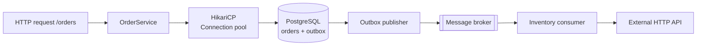
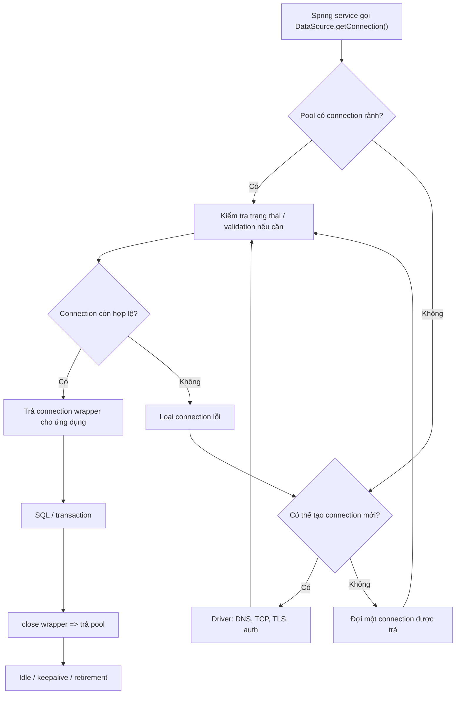
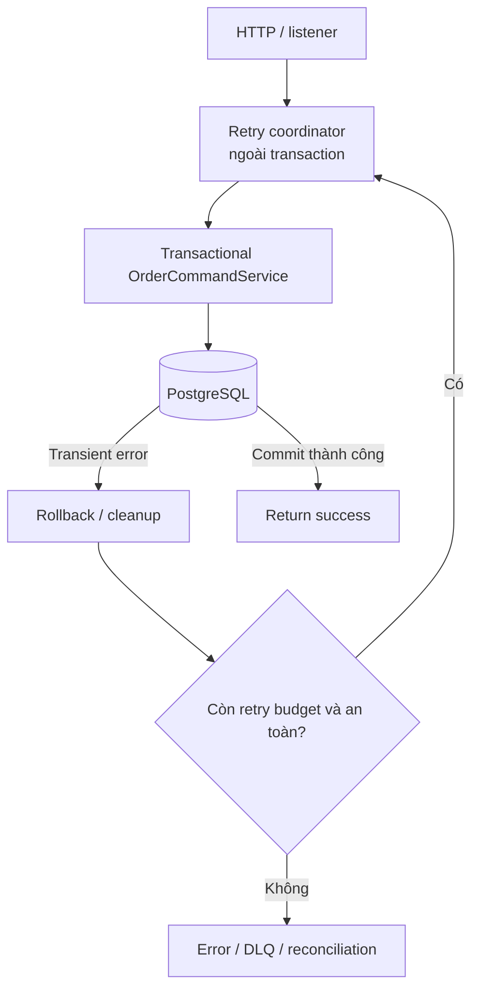
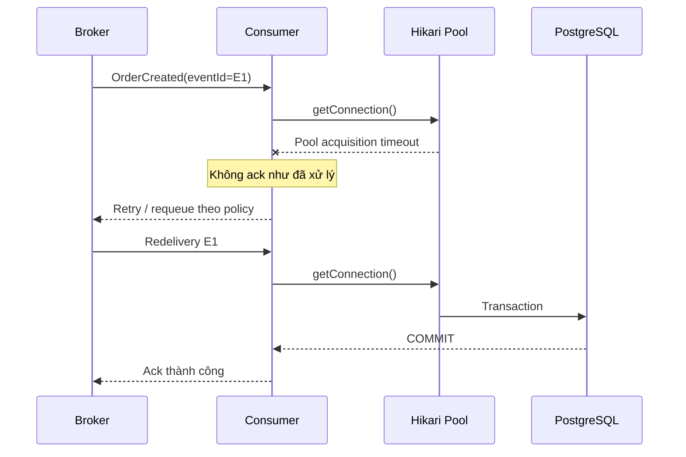

# Connection timeout, validation và kết nối không còn hợp lệ

Trong một hệ thống Spring Boot, lỗi SQL không phải lúc nào cũng đến từ câu lệnh `SELECT` hay `INSERT`. Ứng dụng có thể thất bại **trước khi nhận được connection**, bị treo khi đang mở kết nối TCP, lấy trúng kết nối mà database đã đóng, hoặc gặp lỗi giữa một transaction vì network/proxy database thay đổi trạng thái.

Ví dụ, dịch vụ đặt hàng lưu một đơn và outbox event trong PostgreSQL. Khi lượng request tăng cao, HikariCP có thể báo không lấy được connection trong thời gian cho phép. Khi PostgreSQL được restart, connection từng hoạt động trong pool có thể không còn hợp lệ. Nếu ứng dụng chỉ bắt exception rồi retry bừa bãi, hệ quả có thể là **giữ khóa quá lâu, phát message trùng, ghi đơn hai lần, hoặc báo thành công khi dữ liệu chưa commit**.

Bài thuộc chương **Kết nối SQL** của module **SPRING_BOOT_INTEGRATION**. Trọng tâm không phải riêng thuộc tính HikariCP mà là toàn bộ ranh giới giữa **HTTP client, SQL transaction, cache, broker và các adapter Spring Integration**: cấu hình thời gian chờ, hợp đồng dữ liệu, phân loại lỗi, xử lý trùng lặp, kiểm thử và quan sát luồng tích hợp thực tế.

> **Phạm vi:** Ví dụ chính dùng Java 17+, Spring Boot 3.x, Spring JDBC, HikariCP và PostgreSQL 16. Các tên thuộc tính của Spring Boot, HikariCP và pgJDBC cần được đối chiếu theo phiên bản triển khai. Nguyên lý áp dụng cho nhiều hệ cơ sở dữ liệu, nhưng mã lỗi SQLState, cú pháp health query, driver timeout và failover có thể khác nhau.

## 1. Mục tiêu học tập

Sau bài này, bạn có thể:

1. Phân biệt **pool acquisition timeout**, **TCP connect timeout**, **validation timeout**, **socket/read timeout**, **statement timeout** và **transaction timeout**.
2. Hiểu vòng đời một JDBC `Connection` từ lúc tạo, mượn, dùng, trả về pool đến khi hết tuổi hoặc bị loại.
3. Cấu hình các thuộc tính HikariCP thường dùng: `connectionTimeout`, `validationTimeout`, `maxLifetime`, `idleTimeout`, `keepaliveTime` và kích thước pool.
4. Giải thích vì sao `Connection.isValid(...)` giúp phát hiện connection chết nhưng không bảo đảm câu SQL tiếp theo chắc chắn thành công.
5. Chẩn đoán các tình huống pool cạn, database restart, network half-open, server idle timeout và kết nối bị ngắt giữa transaction.
6. Thiết kế retry **đúng ranh giới transaction** và tránh side effect trùng khi luồng có HTTP/broker.
7. Kiểm thử timeout và khôi phục connection bằng HikariCP, Spring Boot, PostgreSQL/Testcontainers và mô phỏng lỗi.
8. Theo dõi metric/log phục vụ phân biệt vấn đề pool, database, network và nghiệp vụ.

## 2. Tình huống thực tế: đơn hàng, outbox và kết nối SQL

Giả sử ứng dụng nhận `POST /orders`:



Ứng dụng mong muốn:

- `orders` và `outbox` được ghi **cùng một transaction SQL**.
- Nếu SQL rollback, không phát sự kiện `OrderCreated` như thể transaction đã commit.
- Khi consumer xử lý lại message, không giữ tồn kho hai lần.
- Nếu database bị ngắt, service trả lỗi phù hợp, có giới hạn thời gian chờ và không làm nghẽn tất cả request.

Tuy nhiên, luồng có thể gặp các lỗi rất khác nhau:

| Điểm lỗi | Ví dụ | Hệ quả có thể xảy ra |
| --- | --- | --- |
| Trước khi mượn connection | 20 thread chờ pool 10 connection đang bận | Không thể bắt đầu thao tác SQL |
| Khi tạo physical connection | Host không truy cập được, TCP timeout | Pool không có connection mới |
| Khi kiểm tra connection cũ | Server đã kill idle session | Phải loại và tạo connection khác |
| Trong một câu SQL | Socket đứt, server restart | Transaction có thể thất bại, kết quả chưa rõ |
| Sau SQL commit nhưng trước HTTP response | Client mất kết nối với ứng dụng | Caller có thể retry và gửi lại cùng đơn |
| Sau commit SQL nhưng trước publish broker | Publisher chết | Cần outbox/recovery, không chỉ retry HTTP request |

Điểm cốt lõi: **cùng từ “timeout” nhưng vị trí và cách khôi phục khác nhau**. Một cấu hình duy nhất không thể giải quyết mọi tình huống.

## 3. Vòng đời của JDBC Connection trong HikariCP

### 3.1. Connection “logic” và connection “physical”

Khi code gọi:

```java
try (Connection connection = dataSource.getConnection()) {
    // Thực hiện SQL.
}
```

với một pooled `DataSource` như HikariCP, đối tượng trả về thường là **connection wrapper/proxy**. Gọi `close()` trên wrapper có nghĩa **trả connection về pool** nếu còn tốt, không nhất thiết đóng socket TCP ngay.

Một physical connection tới PostgreSQL gồm TCP/SSH? Không, JDBC thông thường kết nối **TCP/TLS trực tiếp theo giao thức PostgreSQL**, không liên quan SSH trừ khi hạ tầng dùng tunnel riêng. Các bước có thể bao gồm DNS, TCP connect, TLS, authentication, tạo database session và thiết lập state.



Một số bước được Hikari thực hiện bất đồng bộ hoặc có optimization nội bộ; sơ đồ mô tả **quá trình ở mức khái niệm**, không bảo đảm mỗi lần borrow đều kiểm tra network.

### 3.2. Ba trạng thái cần phân biệt

- **Idle connection:** đã tạo, đang ở trong pool và chưa được request mượn.
- **Active/borrowed connection:** đang được request, transaction hoặc job dùng.
- **Broken/stale connection:** physical connection đã chết, nhưng pool/ứng dụng có thể chưa phát hiện ngay.

Pool quản lý vòng đời connection rảnh và cố phát hiện connection chết khi mượn/kiểm tra. Nhưng **connection đang được ứng dụng dùng có thể chết bất kỳ lúc nào**, kể cả ngay sau validation thành công.

### 3.3. Phần nào thuộc trách nhiệm của ai?

| Lớp | Trách nhiệm |
| --- | --- |
| Spring Boot | Tạo và cấu hình `DataSource`/HikariCP khi dependency phù hợp |
| HikariCP | Quản lý số connection, chờ borrow, validate, retire, keepalive, metric |
| JDBC driver | Mở socket/TLS/auth, chạy SQL, hỗ trợ `Connection.isValid`, query timeout |
| PostgreSQL | Xử lý transaction, connection/session, SQL, lock, timeout server |
| OS/network/proxy | DNS, TCP, firewall, NAT, load balancer, idle connection policy |
| Business service | Giao dịch, idempotency, retry boundaries, response contract |
| Observability | Thu metric/log/trace từ nhiều lớp để xác định nguyên nhân |

Không nên gán mọi lỗi `CannotGetJdbcConnectionException` cho HikariCP; phần gốc có thể đến từ database, DNS, TLS, secret hoặc hạ tầng mạng.

## 4. Sáu nhóm timeout dễ bị nhầm

| Loại | Nằm ở đâu | Bắt đầu tính từ đâu? | Điển hình |
| --- | --- | --- | --- |
| **Pool acquisition timeout** | HikariCP `connectionTimeout` | Khi caller chờ `getConnection()` trả một connection usable | Pool đầy, connection không available |
| **Physical connect timeout** | JDBC driver `connectTimeout` | Khi thiết lập socket tới host/port | Database down, firewall drop |
| **Validation timeout** | HikariCP `validationTimeout` / JDBC `isValid` | Khi xác minh connection còn dùng được | Idle socket đã chết |
| **Socket/read timeout** | Driver `socketTimeout` | Khi chờ đọc dữ liệu từ socket theo cơ chế driver | Query/hạ tầng không phản hồi |
| **SQL statement timeout** | JDBC `Statement.setQueryTimeout`, DB `statement_timeout` | Khi statement chạy hoặc theo semantics server/driver | Query quá lâu/lock |
| **Transaction timeout** | Spring `@Transactional(timeout=...)` hoặc DB | Theo scope transaction/transaction manager | Transaction vượt ngân sách |

Một request end-to-end có thể còn có **HTTP server timeout, service deadline, broker listener timeout** và client cancellation bên ngoài bảng này.

### 4.1. Pool acquisition timeout

`connectionTimeout` của HikariCP là **thời gian tối đa caller chờ có một connection có thể mượn từ pool**. Nó không đồng nghĩa “TCP connection timeout”.

Ví dụ pool có 10 connection và cả 10 bị giữ bởi các transaction đang chạy. Request thứ 11 gọi `getConnection()` sẽ chờ. Khi hết `connectionTimeout`, Hikari thường báo ngoại lệ dạng `SQLTransientConnectionException`, ví dụ:

```text
OrdersPool - Connection is not available,
request timed out after 3000ms.
```

Thông điệp thực tế khác nhau theo version. Nó cho biết **không mượn được connection đúng hạn**, chưa chứng minh database đã down. Có thể là pool quá nhỏ, SQL/transaction quá lâu, thread leak, connection bị quên close hoặc hạ tầng không tạo connection mới được.

**Không sửa bằng cách chỉ tăng `connectionTimeout` lên 60 giây**; điều đó có thể chỉ biến lỗi nhanh thành hàng nghìn request chờ lâu hơn.

### 4.2. Physical connect timeout của JDBC driver

Khi cần physical connection mới, JDBC driver phải thiết lập kết nối tới PostgreSQL. Với pgJDBC, thuộc tính `connectTimeout` được chỉ định bằng **giây**, ví dụ:

```text
jdbc:postgresql://db.internal.example:5432/orders?connectTimeout=5
```

Điều này khác Hikari `connection-timeout: 3000` tính bằng **mili giây**.

Có các giai đoạn khác như DNS resolution, TLS, authentication và failover nhiều host; hành vi từng timeout phụ thuộc driver/OS. Vì vậy **không coi `connectTimeout=5` là bảo đảm mọi bước thiết lập session hoàn tất trong đúng 5 giây**.

### 4.3. Validation timeout

`validationTimeout` giới hạn thời gian Hikari dành để xác nhận connection còn sống theo cơ chế được hỗ trợ. Hikari yêu cầu thời gian này nhỏ hơn `connectionTimeout` và có mức tối thiểu theo version; ví dụ 1.000 ms khi acquisition là 3.000 ms.

Validation thường dựa trên JDBC 4 `Connection.isValid(...)`, không phải một câu business query đầy đủ.

### 4.4. Socket/read timeout

pgJDBC `socketTimeout` được chỉ định bằng **giây**. Nó giới hạn thời gian chờ đọc socket ở tầng driver theo hợp đồng của driver; timeout có thể khiến connection bị đóng/đánh dấu không còn dùng được.

```text
jdbc:postgresql://db.internal.example:5432/orders?socketTimeout=30
```

Không dùng socket timeout làm thay thế cho query timeout/transaction deadline. Một kết nối có thể trả dữ liệu rải rác, hoặc một query bị lock nhưng socket vẫn còn mở; cần hiểu semantics cụ thể của driver.

### 4.5. Statement timeout

Spring JDBC cho phép đặt query timeout qua `JdbcTemplate` hoặc `Statement`, ví dụ:

```java
JdbcTemplate jdbc = new JdbcTemplate(dataSource);
jdbc.setQueryTimeout(8); // Đơn vị giây.
```

PostgreSQL còn có `statement_timeout` phía server; ví dụ trong một transaction có thể cấu hình theo chính sách:

```sql
SET LOCAL statement_timeout = '8s';
SELECT ...;
```

`SET LOCAL` có phạm vi transaction hiện tại; cách cấu hình và phạm vi phải xét kỹ nếu ứng dụng dùng connection pooling. Đừng đặt session state không được reset khiến request tiếp theo mượn connection bị ảnh hưởng ngoài dự kiến.

Statement timeout hạn chế **một câu SQL** theo semantics của DB/driver. Nó không nhất thiết bao phủ chờ connection pool, DNS, HTTP client hoặc các lần retry.

### 4.6. Transaction timeout

`@Transactional(timeout = 10)` đặt ngân sách transaction ở tầng Spring khi transaction manager hỗ trợ:

```java
@Transactional(timeout = 10)
public void createOrder(...) {
    // Các thao tác SQL cùng transaction.
}
```

Đơn vị là **giây**. Việc thực thi timeout phụ thuộc transaction manager, framework và cách thực hiện câu SQL. Ví dụ Spring JDBC có thể áp dụng transaction time remaining lên statement được tạo qua API của Spring; không thể coi annotation này là timer cắt mọi công việc Java/HTTP bất kỳ đúng ở mốc 10 giây.

Đặc biệt, nếu code chờ remote HTTP **ở giữa transaction SQL**, không có bảo đảm universal rằng Spring sẽ lập tức ngắt HTTP call khi transaction timeout. Cần timeout/deadline riêng cho HTTP client và thiết kế transaction ngắn.

## 5. HikariCP: cấu hình đúng các thuộc tính

### 5.1. Dependencies và giả định

Với Spring Boot 3.x, Spring JDBC cùng HikariCP thường được đưa vào qua starter:

```groovy
dependencies {
    implementation 'org.springframework.boot:spring-boot-starter-jdbc'
    runtimeOnly 'org.postgresql:postgresql'

    testImplementation 'org.springframework.boot:spring-boot-starter-test'
    testImplementation 'org.springframework.boot:spring-boot-testcontainers'
    testImplementation 'org.testcontainers:junit-jupiter'
    testImplementation 'org.testcontainers:postgresql'
}
```

Khi HikariCP có trên classpath và không có cấu hình datasource khác chiếm quyền, Spring Boot thường tự cấu hình `HikariDataSource`. Nếu dự án có nhiều `DataSource`, Spring Boot custom datasource hoặc JNDI, cần xác minh **bean nào thực sự được dùng** trước khi giả định các property có hiệu lực.

### 5.2. application.yml cho một service đặt hàng

```yaml
spring:
  datasource:
    url: ${ORDERS_JDBC_URL}
    username: ${ORDERS_DB_USERNAME}
    password: ${ORDERS_DB_PASSWORD}
    hikari:
      pool-name: OrdersPool
      maximum-pool-size: 12
      minimum-idle: 4

      connection-timeout: 3000
      validation-timeout: 1000

      idle-timeout: 600000
      max-lifetime: 1500000
      keepalive-time: 120000

      leak-detection-threshold: 20000
```

**Giải thích thông số, không phải “cấu hình chuẩn cho mọi hệ thống”:**

| Property | Giá trị ví dụ | Ý nghĩa |
| --- | ---: | --- |
| `maximum-pool-size` | 12 | Số connection vật lý tối đa trong pool |
| `minimum-idle` | 4 | Mục tiêu giữ một số connection rảnh khi có thể |
| `connection-timeout` | 3.000 ms | Chờ lấy connection usable từ pool |
| `validation-timeout` | 1.000 ms | Ngân sách kiểm tra connection còn sống |
| `idle-timeout` | 600.000 ms | Mục tiêu retire connection idle dư khi pool có thể co lại |
| `max-lifetime` | 1.500.000 ms | Giới hạn tuổi connection, tránh dùng mãi |
| `keepalive-time` | 120.000 ms | Định kỳ kiểm tra một số connection **idle** để giữ kết nối sống |
| `leak-detection-threshold` | 20.000 ms | Log cảnh báo nếu connection bị mượn quá lâu; không tự đóng connection |

Trong HikariCP, nhiều timeout/lifetime property cấu hình bằng **mili giây**. Không copy giá trị `connectTimeout=5` (đơn vị giây của pgJDBC) vào Hikari rồi hiểu như 5 giây.

**Ràng buộc quan trọng:**

- `validationTimeout < connectionTimeout`.
- `keepaliveTime < maxLifetime` khi bật keepalive.
- `idleTimeout` chủ yếu có ý nghĩa khi pool được phép co lại, tức `minimumIdle < maximumPoolSize`.
- Kích thước pool không nên được chọn chỉ theo số request/second; phải xét độ dài transaction, sức chịu tải database và số instance cùng chạy.

### 5.3. Vì sao không đặt các timeout quá nhỏ?

Ví dụ `connectionTimeout = 300 ms` và `validationTimeout = 250 ms` có thể tạo lỗi giả khi database hợp lệ nhưng network có jitter, DNS/TLS handshake chậm hoặc pool tạm căng.

Ngược lại, `connectionTimeout = 120.000 ms` có thể khiến request HTTP chờ quá lâu, làm tăng số thread đang giữ tài nguyên ở tầng ứng dụng.

Hãy bắt đầu từ **SLO và ngân sách thời gian**:

```text
HTTP request deadline:        8.000 ms
┌─ Validation business:         200 ms
├─ Chờ SQL connection:        1.000 ms
├─ SQL transaction:           2.000 ms
├─ Outbound HTTP:             3.000 ms
└─ Reserve logging/response:    800 ms
Tổng budget ví dụ:            7.000 ms
```

Các con số chỉ để minh họa. Timeout mỗi lớp có thể lồng nhau và không cộng đơn giản trong mọi code path. Mục tiêu là bảo đảm **đường đi chậm nhất và retry** không vô tình vượt quá deadline nghiệp vụ.

## 6. PostgreSQL JDBC: connectTimeout, socketTimeout và bảo mật

### 6.1. JDBC URL có thuộc tính driver

Ví dụ cho môi trường local:

```text
jdbc:postgresql://localhost:5432/orders?connectTimeout=5&socketTimeout=30&tcpKeepAlive=true
```

Hoặc cấu hình bằng biến môi trường:

```bash
export ORDERS_JDBC_URL='jdbc:postgresql://localhost:5432/orders?connectTimeout=5&socketTimeout=30&tcpKeepAlive=true' # Ví dụ local, không phải production.
```

Với pgJDBC:

- `connectTimeout=5`: timeout thiết lập TCP socket, **giây**.
- `socketTimeout=30`: socket read timeout, **giây**; driver có thể đóng kết nối khi hết hạn.
- `tcpKeepAlive=true`: bật cơ chế TCP keepalive của hệ điều hành. Chu kỳ OS-level có thể dài và không tương đương Hikari `keepaliveTime`.

Nếu kết nối đi qua proxy/load balancer, cần xem cả idle timeout và vòng đời kết nối của **tất cả thành phần trung gian**.

### 6.2. Không nhầm TCP keepalive với Hikari keepalive

| Cơ chế | Ai thực hiện | Mục đích |
| --- | --- | --- |
| OS TCP keepalive | Network stack | Thăm dò TCP peer ở cấp kết nối |
| pgJDBC `tcpKeepAlive` | Bật tính năng trên socket theo khả năng driver/OS | Hỗ trợ phát hiện kết nối TCP chết dài hạn |
| Hikari `keepaliveTime` | Connection pool | Kiểm tra connection **đang idle trong pool** theo chu kỳ |
| JDBC `Connection.isValid()` | Driver | Kiểm tra connection còn dùng được tại một thời điểm |
| Business health query | Ứng dụng/DB | Kiểm tra chức năng mà business thực sự cần |

TCP keepalive không chứng minh tài khoản còn quyền, transaction sẽ commit hay query sẽ đủ nhanh. Ngược lại, `isValid` thành công không ngăn connection chết ngay ở mili giây tiếp theo.

### 6.3. TLS và chứng chỉ

Với PostgreSQL production, cân nhắc cấu hình TLS kiểm tra danh tính server (ví dụ `sslmode=verify-full` trong pgJDBC khi có CA/trust material phù hợp).

```text
jdbc:postgresql://db.prod.example:5432/orders?sslmode=verify-full&connectTimeout=5
```

Đây chỉ là ví dụ. Để hoạt động đúng cần certificate authority tin cậy, server certificate đúng host, cấu hình driver và đường dẫn trust material tương ứng. Không dùng `sslmode=disable` hoặc tắt hostname verification trong production chỉ để “khắc phục” timeout/handshake lỗi.

Quản lý username/password từ secret manager hoặc biến môi trường được bảo vệ; rotation credential có thể yêu cầu mở lại physical connection, không chỉ đổi biến môi trường của process đang chạy.

## 7. Connection validation thực chất là gì?

### 7.1. JDBC 4 Connection.isValid(timeoutSeconds)

JDBC có API:

```java
boolean alive = connection.isValid(2);
```

Theo API JDBC, `isValid(int timeout)` trả boolean hoặc ném exception tùy tình huống, với timeout truyền vào tính bằng **giây**. Driver thường triển khai một cơ chế đủ nhẹ để xác nhận connection còn dùng được.

Với HikariCP và driver JDBC4 hiện đại, **ưu tiên cơ chế `Connection.isValid(...)`**. Thông thường không cần tự đặt một câu `SELECT 1` làm `connectionTestQuery` chỉ để “chắc chắn”.

### 7.2. Vì sao connectionTestQuery thường không cần?

Hikari có thể cấu hình:

```yaml
spring:
  datasource:
    hikari:
      connection-test-query: "SELECT 1"
```

Nhưng với PostgreSQL JDBC hiện đại hỗ trợ JDBC4 `isValid`, cấu hình thêm `connectionTestQuery` thường **không đem lại lợi ích** và có thể làm validation tốn chi phí khác đi.

Nên chỉ sử dụng `connectionTestQuery` khi driver **không hỗ trợ `isValid` đúng**, hoặc có lý do tương thích được xác minh rõ bằng test. Không dùng query nghiệp vụ nặng làm validation, chẳng hạn kiểm tra một bảng triệu dòng mỗi lần borrow.

### 7.3. Hikari validate khi nào?

Một số sự kiện liên quan:

1. Khi tạo physical connection mới, driver thực hiện quá trình kết nối/auth.
2. Khi pool mượn connection idle, Hikari có thể kiểm tra connection đã chết trước khi trả cho caller.
3. Một optimization nội bộ có thể **bỏ qua validation lặp quá gần nhau** khi connection vừa được sử dụng; không có hợp đồng “mỗi lần borrow đều phát SELECT 1”.
4. Khi keepalive bật và connection ở trạng thái **idle**, pool có thể định kỳ kiểm tra để hạn chế kết nối bị server/proxy đóng do nhàn rỗi.
5. Khi phát hiện connection đã hỏng, pool loại bỏ và tìm/tạo connection khác trong giới hạn thời gian/chính sách.

**Không hứa tuyệt đối “pool luôn thay kết nối trước khi SQL chạy”.** Đây là vấn đề *time-of-check versus time-of-use*: connection có thể hợp lệ lúc kiểm tra nhưng chết ngay khi statement tiếp theo được gửi.

### 7.4. Validation không kiểm chứng được điều gì?

`isValid` có thể thành công trong khi:

- User không có quyền `INSERT` vào bảng cần thiết.
- Schema migration chưa chạy hoặc bảng bị rename.
- Transaction gặp deadlock hoặc serialization conflict.
- Query cụ thể bị lock và vượt statement timeout.
- Server đã nhận `COMMIT` nhưng kết nối mất trước khi client đọc được acknowledgment.
- Business constraint từ chối dữ liệu dù connection hoàn toàn khỏe.

Do đó phải phân biệt **connection liveness** với **database readiness theo nghiệp vụ**. Health check giúp xác định hệ thống có khả năng thực hiện một bước, chứ không chứng minh toàn bộ quy trình tích hợp thành công.

## 8. Connection không còn hợp lệ: những nguyên nhân thường gặp

### 8.1. Database restart/failover

Khi PostgreSQL restart, physical sessions cũ có thể bị ngắt. HikariCP giữ một số wrapper/idle connection; lần mượn sau cần loại connection chết và tạo session mới.

Các vấn đề đi kèm:

- Active transaction đang chạy có thể thất bại và cần rollback/retry có kiểm soát.
- DNS hoặc endpoint primary có thể thay đổi sau failover.
- Read replica có thể chưa cho phép ghi; validation cấp TCP/JDBC vẫn có thể thành công nhưng business write fail.
- Credential hoặc TLS certificate có thể được thay đổi đồng thời.
- Pool có thể đồng loạt tạo connection mới, tạo spike lên database vừa phục hồi.

### 8.2. Server/proxy idle timeout

Connection idle quá lâu có thể bị đóng bởi:

- Database policy.
- Proxy như PgBouncer hoặc cloud database proxy.
- Firewall, NAT gateway hoặc load balancer.
- Network policy của môi trường chạy.

Trong PostgreSQL có những cấu hình liên quan như `idle_session_timeout` và `idle_in_transaction_session_timeout`. Hai cơ chế này **khác nhau**: session idle hoàn toàn khác transaction đang mở nhưng không làm việc. Không dùng pool keepalive để “bảo vệ” một transaction bị giữ idle lâu; đó thường là thiết kế xấu cần sửa.

### 8.3. Network half-open

Một phía có thể mất state TCP mà phía kia chưa nhận được tín hiệu FIN/RST. Pool có thể vẫn xem connection là idle và hợp lệ ở phía Java cho tới khi thực hiện I/O hoặc kiểm tra.

Hệ quả:

- Lần borrow ban đầu có thể nhận một connection nhìn bề ngoài bình thường.
- Khi chạy query, driver bị treo tới socket timeout hoặc trả lỗi I/O.
- Hikari loại connection khi biết nó hỏng, nhưng transaction đang chạy **không được tự phục hồi giữa chừng**.

### 8.4. Ứng dụng không close connection

Một connection không bị đóng vật lý nhưng **không bao giờ được trả về pool** cũng tạo hiệu ứng tương tự database mất kết nối: pool dần cạn, caller chờ và timeout.

Lỗi thường gặp:

```java
Connection connection = dataSource.getConnection();
PreparedStatement statement = connection.prepareStatement(
        "SELECT * FROM orders WHERE order_id = ?");
statement.setString(1, orderId);
// Không close statement/connection nếu exception xảy ra.
```

Cách đúng:

```java
try (Connection connection = dataSource.getConnection();
     PreparedStatement statement = connection.prepareStatement(
             "SELECT state FROM orders WHERE order_id = ?")) {

    statement.setString(1, orderId);
    try (ResultSet rs = statement.executeQuery()) {
        if (rs.next()) {
            return rs.getString("state");
        }
        return null;
    }
}
```

Trong ứng dụng Spring Boot, `JdbcTemplate` thường đơn giản và an toàn hơn cho thao tác SQL phổ biến vì nó quản lý resource/exception translation phù hợp với Spring transaction.

## 9. maxLifetime, idleTimeout và keepaliveTime có tác dụng khác nhau

### 9.1. maxLifetime: retire connection theo tuổi

`maxLifetime` điều khiển tuổi tối đa của connection được pool quản lý. Hikari cố retire connection khi không còn được sử dụng, không chủ động “giật” connection đang chạy SQL giữa transaction chỉ vì tới mốc tuổi.

Một hướng cấu hình hợp lý là đặt `maxLifetime` **ngắn hơn giới hạn vòng đời connection do database/proxy/hạ tầng áp đặt**, với khoảng đệm đủ lớn. Nhưng nếu server cắt connection idle sau 5 phút, chỉ đặt `maxLifetime=25 phút` không giải quyết được idle timeout; cần xem `keepaliveTime` hoặc chính sách giữ idle thấp hơn.

### 9.2. idleTimeout: co pool khi rảnh

Khi `minimumIdle < maximumPoolSize`, những connection idle dư có thể được retire để giảm footprint. Không nên kỳ vọng `idleTimeout` là thời điểm đóng chính xác từng connection đến mili giây: background housekeeping và chính sách pool có thể tạo độ lệch.

Nếu không đặt `minimumIdle` trong HikariCP, pool thường có thể được cấu hình theo hướng fixed size, khi đó `idleTimeout` không có cùng tác dụng như một elastic pool. Kiểm tra cấu hình runtime thật.

### 9.3. keepaliveTime: kiểm tra connection idle

`keepaliveTime` giúp pool thăm dò connection đang idle, nhằm hạn chế việc một connection rảnh bị thiết bị trung gian đóng mà ứng dụng không biết.

Giới hạn:

- Chỉ áp dụng theo cơ chế pool với connection idle.
- Không phải một heartbeat của mọi active transaction.
- Không bảo đảm server/proxy sẽ giữ session bất kể idle policy.
- Không thay thế driver socket timeout hoặc retry.
- Quá ngắn có thể gây tải không cần thiết khi nhiều ứng dụng cùng giữ pool lớn.

### 9.4. Một ví dụ về tương tác các giá trị

Giả sử proxy database cắt connection idle sau **10 phút**, trong khi ứng dụng có nhiều đợt traffic cách nhau 15 phút:

```text
Proxy idle cutoff:       10 phút
Hikari maxLifetime:      25 phút
Hikari keepaliveTime:     2 phút
Hikari idleTimeout:      10 phút (pool có thể co)
```

Keepalive 2 phút có thể giúp idle connection không rơi vào trạng thái bị cắt chỉ vì nhàn rỗi, **nếu hạ tầng xem hoạt động thăm dò này là I/O giữ session sống** và policy không chặn theo tuổi session tuyệt đối. Cần test thực tế với proxy/server.

Nếu policy server **chấm dứt session bất kể hoạt động sau 20 phút**, keepalive không ngăn nó; lúc này `maxLifetime` với buffer phù hợp mới có vai trò chính.

## 10. Pool quá nhỏ, quá lớn và nhu cầu sizing

### 10.1. Pool exhaustion không luôn là network outage

Giả sử:

```text
App instances:             8
Hikari maximumPoolSize:   25 / instance
Tối đa connections:      200
Database max_connections: 150
```

Ngay cả khi từng instance “chỉ” cần 25 connection, tổng nhu cầu lý thuyết là 200, vượt khả năng database. Còn phải trừ connection dành cho admin, migration, monitoring, background jobs và ứng dụng khác.

Một công thức kiểm tra sơ bộ:

\[
\text{PotentialConnections} =
\sum_{i=1}^{N} \text{maximumPoolSize}_i
\]

Đây là **giới hạn kết nối**, không phải công thức tối ưu throughput. Số connection tốt nhất phụ thuộc CPU của database, I/O, thời gian giữ transaction, loại query, lock contention và công việc nền.

### 10.2. Pool quá lớn cũng làm chậm

Khi database không đủ tài nguyên để xử lý nhiều query đồng thời, tăng `maximumPoolSize` có thể:

- Tăng số câu SQL tranh CPU/I/O.
- Tăng lock contention và transaction duration.
- Tăng số connection memory trên database.
- Khiến thời gian hoàn thành query p95/p99 cao hơn.
- Làm database phục hồi chậm khi các instance cùng reconnect.

Đừng coi “pool lớn hơn = nhanh hơn”. Đo **thời gian mượn connection, thời gian giữ connection, SQL latency và CPU/locks ở database** trước khi tuning.

### 10.3. Pool quá nhỏ hoặc giữ connection quá lâu

Một phương thức làm:

```java
@Transactional
public void badWorkflow(String orderId) {
    orderRepository.insert(orderId);   // Giữ SQL transaction.
    remoteInventoryApi.reserve(orderId); // Chờ HTTP 10 giây.
    orderRepository.markReserved(orderId);
}
```

có thể giữ connection/transaction và khóa SQL suốt lúc chờ HTTP. Khi hàng trăm request cùng đến, pool cạn dù SQL thực tế chỉ mất vài chục mili giây.

Một cách tốt hơn là:

- Transaction SQL ngắn để ghi trạng thái và outbox.
- Worker ngoài transaction gọi HTTP.
- Cập nhật kết quả trong transaction mới, có operation ID/idempotency và state machine.
- Có cơ chế đối soát khi HTTP timeout nhưng phía đích có thể đã xử lý.

Đây là cải tiến **kiến trúc luồng tích hợp**, không phải chỉ đổi `connectionTimeout`.

## 11. Phân loại lỗi: nên retry hay không?

### 11.1. Các nhóm lỗi SQL/JDBC

| Nhóm | Biểu hiện | Cách tiếp cận |
| --- | --- | --- |
| **Hết connection pool** | `SQLTransientConnectionException`, “Connection is not available” | Kiểm tra active/idle/pending, transaction duration, pool size |
| **Connection lỗi** | `SQLState` thuộc nhóm `08` (với driver hỗ trợ), I/O error | Loại connection, kiểm tra DB/network, retry toàn operation nếu an toàn |
| **Deadlock/serialization failure** | PostgreSQL `40P01` / `40001` | Retry transaction **từ đầu** có giới hạn và idempotency |
| **Unique constraint violation** | PostgreSQL `23505` | Thường là lỗi dữ liệu hoặc duplicate; không retry nguyên lệnh vô hạn |
| **Permission denied** | Lỗi quyền database | Sửa role/secret/migration, không retry liên tục |
| **Syntax/schema mismatch** | Query/table/column sai | Sửa code/migration; retry không giúp |
| **Transaction timeout** | Query timeout, transaction bị hủy | Xác định statement/lock và state, rollback/retry phù hợp |
| **Commit outcome không chắc** | Kết nối mất sau khi server nhận COMMIT | Đối soát theo ID, **không tự kết luận rollback** |

**Lưu ý:** SQLState là một phần của hợp đồng JDBC nhưng không phải mọi driver/lỗi đều cung cấp thông tin đồng nhất. SQLState nhóm `08` thường liên quan connection exception. Lỗi Hikari pool timeout có thể không có cùng SQLState như lỗi PostgreSQL trả về từ server.

### 11.2. Spring JDBC exception translation

Khi dùng `JdbcTemplate`, nhiều `SQLException` được chuyển thành các subclass của `DataAccessException`, chẳng hạn:

- `CannotGetJdbcConnectionException` khi lấy JDBC connection không thành công.
- `DuplicateKeyException` khi unique constraint không cho ghi trùng theo cơ chế translator.
- `DataIntegrityViolationException` cho lỗi dữ liệu/ràng buộc liên quan.
- `QueryTimeoutException` trong một số trường hợp timeout được phân loại.

Không nên viết:

```java
catch (DataAccessException ex) {
    return "SUCCESS";
}
```

vì như vậy che cả lỗi kết nối, SQL constraint và transaction state. Nên giữ exception cause, SQLState/error category khi an toàn và chuyển thành kết quả phù hợp ở đúng boundary.

### 11.3. SQLException fatal và non-fatal đối với connection

Một số lỗi SQL chỉ làm **statement thất bại**, connection vẫn có thể dùng tiếp sau khi transaction được xử lý đúng. Một số lỗi khác báo **connection vật lý đã hỏng**, Hikari cần loại bỏ nó.

Đừng mặc định cứ có `DataAccessException` là pool phải đóng connection; cũng đừng mặc định cứ catch SQLException rồi tiếp tục dùng connection trong cùng transaction. Ví dụ PostgreSQL, khi một statement bị lỗi trong transaction, transaction có thể ở trạng thái **aborted** cho tới khi rollback (hoặc rollback về savepoint hợp lệ).

## 12. Kết nối chết giữa @Transactional: hậu quả và retry

### 12.1. Ranh giới transaction là điều quyết định

Ví dụ:

```java
package com.example.integration.orders;

import org.springframework.jdbc.core.JdbcTemplate;
import org.springframework.stereotype.Service;
import org.springframework.transaction.annotation.Transactional;

@Service
public class OrderCommandService {

    private final JdbcTemplate jdbc;

    public OrderCommandService(JdbcTemplate jdbc) {
        this.jdbc = jdbc;
    }

    @Transactional
    public void createOrderAndOutbox(
            String orderId, String eventId, String payloadJson) {

        jdbc.update(
                "INSERT INTO purchase_order (order_id, state) VALUES (?, ?)",
                orderId, "CREATED");

        jdbc.update("""
                INSERT INTO order_outbox (event_id, order_id, payload_json)
                VALUES (?, ?, ?)
                """,
                eventId, orderId, payloadJson);
    }
}
```

Nếu connection bị ngắt trong lúc transaction đang chạy:

1. Một lệnh SQL có thể ném exception và transaction phải bị đánh giá thất bại.
2. Hikari có thể loại connection hỏng khi phát hiện.
3. Spring transaction manager cố rollback/cleanup theo khả năng của connection.
4. Ứng dụng **không nên tiếp tục dùng transaction cũ** như không có gì xảy ra.
5. Nếu cần retry, phải tạo **transaction mới** và bảo đảm dữ liệu không bị nhân đôi.

Không retry từng lệnh SQL bên trong một transaction đã hỏng theo kiểu “gửi lại INSERT”; cần hiểu toàn bộ operation đã làm gì.

### 12.2. Retry ở ngoài transaction

Một nguyên tắc thực hành tốt là đặt **retry wrapper ở bên ngoài** bean có `@Transactional`, để mỗi attempt gọi qua Spring proxy và dùng transaction mới:



Ví dụ cần xây một coordinator dùng `RetryTemplate` hoặc một cơ chế retry có backoff phù hợp, chỉ retry **loại lỗi được cho phép**. Có thể kiểm tra Spring Retry `RetryTemplate`, nhưng đừng đặt `@Retryable` và `@Transactional` trên cùng một method mà không hiểu thứ tự AOP advice thực tế.

Một điểm cần chú ý: nếu lỗi xảy ra tại **commit**, coordinator vẫn phải hiểu rằng outcome có thể bất định đối với một số sự cố mạng. Retry mù có thể tạo duplicate nếu operation ID không ổn định hoặc phía SQL chưa có unique constraint.

### 12.3. Idempotency ở database

Tạo khóa ổn định cho yêu cầu:

```sql
CREATE TABLE purchase_order (
    order_id VARCHAR(64) PRIMARY KEY,
    state VARCHAR(32) NOT NULL
);

CREATE TABLE order_outbox (
    event_id VARCHAR(128) PRIMARY KEY,
    order_id VARCHAR(64) NOT NULL
        REFERENCES purchase_order(order_id),
    payload_json TEXT NOT NULL
);
```

Với một request có `orderId` và `eventId` bất biến, unique constraint cho phép phát hiện duplicate. Một cách idempotent trên PostgreSQL là:

```sql
INSERT INTO purchase_order (order_id, state)
VALUES (:orderId, 'CREATED')
ON CONFLICT (order_id) DO NOTHING;
```

Nhưng `ON CONFLICT DO NOTHING` **không tự chứng minh payload của lần retry giống lần đầu**. Nếu cùng `orderId` nhưng khác tổng tiền/tenant, application phải phát hiện conflict nghiệp vụ. Tương tự, outbox cần unique event ID và transaction hợp lý, không bỏ qua dữ liệu khác một cách im lặng.

### 12.4. Unknown commit outcome

Giả sử client gửi `COMMIT` tới PostgreSQL:

```text
Application                   PostgreSQL
    |                              |
    |---------- COMMIT ----------->|
    |                        commit thành công
    |<--------- connection mất -----X
    |
    +-- App không biết commit đã xảy ra hay chưa.
```

Một exception ở thời điểm này **không chứng minh transaction đã rollback**. Sau khi hệ thống có lại connection, cần đối soát trạng thái qua business ID/idempotency key, hoặc dùng giao thức quy trình có khả năng tìm lại kết quả.

Đặc biệt, nếu sau khi SQL commit, application tiếp tục gọi HTTP API hoặc publish broker thì phải quản lý thứ tự và rủi ro duplicate/mất message, thường bằng **transactional outbox**.

## 13. Kết nối SQL với HTTP, cache và broker

### 13.1. Không kéo dài transaction vì HTTP

Một API đặt hàng có thể gọi payment gateway hoặc inventory API. Các lời gọi này **không tự rollback** khi SQL transaction rollback.

- SQL transaction ngắn để ghi yêu cầu và trạng thái.
- Outbox/worker xử lý external side effect sau commit.
- Operation ID/idempotency key ổn định qua retry.
- Sau HTTP timeout, xác minh trạng thái remote khi có unknown outcome.
- Cập nhật SQL trạng thái kết quả bằng một transaction riêng có kiểm soát optimistic lock/version.

### 13.2. Cache có thể che lỗi nguồn dữ liệu

Nếu SQL không kết nối được nhưng Redis cache vẫn trả dữ liệu cũ, ứng dụng có thể trả response “thành công” mà không biết dữ liệu đã stale.

Cần phân biệt:

- **Read API chấp nhận stale:** có thể fallback cache với TTL và đánh dấu độ mới.
- **Write API hoặc quyết định quan trọng:** không xác nhận thành công chỉ vì cache hit.
- **Cache invalidation sau commit:** cần gắn với điểm commit bền vững; tránh xóa/cập nhật cache theo trạng thái SQL chưa commit.

Không dùng cache để thay thế nguyên tắc tính đúng đắn của transaction.

### 13.3. Broker redelivery sau lỗi SQL

Khi listener Kafka/RabbitMQ không lấy được SQL connection, adapter có thể retry message hoặc requeue theo cấu hình:



Yêu cầu:

- Ack message **sau khi dữ liệu cần bảo đảm đã commit**, hoặc dùng transaction/ack policy được thiết kế rõ.
- Dùng `eventId`/inbox constraint để tránh duplicate nếu broker redeliver sau khi SQL đã commit nhưng trước ack.
- Retry có giới hạn và backoff để không tạo **retry storm** khi database đang down.
- Phân loại contract error (không retry nguyên payload) với transient DB error.
- Khi cần, chuyển vào DLQ/quarantine và có quy trình replay.

### 13.4. Spring Integration channel và thread boundary

Trong Spring Integration, transaction context thường gắn với thread/transaction manager hiện tại. Nếu luồng dùng `DirectChannel` và gọi service đồng bộ, exception và transaction có thể truyền theo stack phù hợp. Nếu luồng chuyển sang `ExecutorChannel`, queue, poller hoặc broker listener, điểm bắt đầu/commit transaction có thể nằm ở thread và scope khác.

Không giả định transaction đang giữ connection ở inbound HTTP còn bao phủ mọi bước bất đồng bộ. Ngược lại, không bao giờ để một async worker giữ JDBC connection “đợi” API ngoài trong thời gian dài mà không có lý do nghiệp vụ rõ.

## 14. Startup, readiness và health checks

### 14.1. Database không sẵn lúc khởi động

Nếu database chưa sẵn khi Spring Boot start:

- Hikari có thể thử tạo connection ban đầu và báo lỗi, tùy `initializationFailTimeout`, minimum idle và cấu hình.
- Spring Boot/Flyway/Liquibase có thể cần connection để chạy migration và làm context khởi động thất bại.
- `@PostConstruct` hoặc scheduled job tự query DB cũng có thể khiến startup fail.
- Một cấu hình “không fail fast” không tự làm ứng dụng readiness pass.

**`initializationFailTimeout` của Hikari không phải `connectionTimeout`**. Nó ảnh hưởng cách pool xử lý bước xác minh/khởi tạo ban đầu; giá trị dương, 0 hoặc âm có semantics khác nhau theo Hikari. Chỉ điều chỉnh sau khi hiểu chiến lược startup/retry và readiness của môi trường.

### 14.2. Liveness khác readiness

- **Liveness:** process còn hoạt động và có thể phục hồi được hay không. Không nên luôn giết/restart process chỉ vì một phụ thuộc ngoài như PostgreSQL tạm thời không sẵn.
- **Readiness:** instance có sẵn sàng nhận traffic cho chức năng chính không. Với service phụ thuộc SQL, mất DB có thể khiến instance không sẵn sàng xử lý write.

Spring Boot Actuator có health indicators và probe support; cách gắn chỉ số DB vào readiness/liveness phải theo thiết kế ứng dụng. Nếu mọi pod cùng bị mark unready do một DB outage, có thể khiến toàn bộ dịch vụ ngừng tiếp nhận traffic; đôi khi đó là đúng, đôi khi cần fallback/read-only mode có kiểm soát.

### 14.3. Health query không phải business transaction

Một kết nối trả về `isValid(true)` không chứng minh bảng đơn hàng hiện có, migration đã chạy hoặc quyền `INSERT` hợp lệ. Health check có thể gồm những mức:

1. **Process health**: service chạy và event loop/thread còn phản hồi.
2. **Pool/connectivity health**: có thể lấy connection và kiểm tra.
3. **Database service health**: có thể chạy truy vấn nhẹ.
4. **Business capability health**: có thể đáp ứng một loại chức năng, có thể cần kiểm tra schema/version/role.

Không đưa một giao dịch thay đổi dữ liệu thật vào health probe liên tục; tạo side effect và tải không cần thiết.

## 15. Quan sát: metric nào giúp phân biệt nguyên nhân?

### 15.1. Tín hiệu từ HikariCP

Với Spring Boot Actuator/Micrometer phù hợp, các metric Hikari có thể xuất hiện với tên tương ứng trong exporter đang dùng. Những chỉ số quan trọng về mặt khái niệm:

| Metric/tín hiệu | Ý nghĩa |
| --- | --- |
| **Active connections** | Connection đang được mượn |
| **Idle connections** | Connection rảnh trong pool |
| **Pending threads** | Số caller đang chờ connection |
| **Total connections** | Số connection hiện có |
| **Connection acquire time** | Thời gian chờ mượn connection |
| **Connection usage time** | Thời gian connection được giữ bởi caller |
| **Connection creation time** | Thời gian tạo physical connection |
| **Connection timeout count** | Số lần không mượn được connection đúng hạn |

Nếu dùng Micrometer Prometheus, một số metric thường có prefix `hikaricp_connections_*`, nhưng tên, đơn vị, labels và khả năng xuất hiện cụ thể phụ thuộc Spring Boot/Hikari/Micrometer version. Xác minh thực tế trong `/actuator/metrics` hoặc backend metrics, không hardcode dashboard từ một blog cũ.

### 15.2. Chẩn đoán từ kết hợp metric

**Trường hợp A: Pool saturation**

```text
active ≈ maximumPoolSize
idle ≈ 0
pending tăng
acquire latency tăng
SQL duration có thể cao
```

Nghi vấn: pool không đủ cho workload, transaction lâu, connection leak hoặc DB chậm. Kiểm tra usage time, slow queries và transaction đang giữ khóa trước khi tăng pool.

**Trường hợp B: Database/network failure**

```text
pending tăng
connection creation failure tăng
TCP connect/validation timeout
DB health báo lỗi
```

Nghi vấn: endpoint không đến được, DB hết connection/đang restart, TLS hoặc credentials sai.

**Trường hợp C: Connection bị giữ lâu**

```text
active cao
usage duration p99 rất cao
HTTP outbound latency trong transaction tăng
```

Nghi vấn: application giữ connection trong lúc chờ HTTP/file/broker, query lock hoặc quên close.

**Trường hợp D: Idle connection stale sau traffic thấp**

```text
Lỗi xuất hiện trên request đầu sau thời gian yên lặng
validation/network exceptions sau idle dài
Request tiếp theo thường thành công
```

Nghi vấn: server/proxy đóng idle session, Hikari keepalive/lifetime chưa phù hợp, hoặc cache session cũ. Cần đối chiếu log database/proxy và thử fault injection, không chỉ suy từ mô hình thời gian.

### 15.3. Diagnostic bằng SQL PostgreSQL

Trên database phù hợp và với quyền được cấp, có thể xem session đang hoạt động:

```sql
SELECT
    pid,
    state,
    wait_event_type,
    wait_event,
    now() - xact_start AS transaction_age,
    now() - query_start AS query_age
FROM pg_stat_activity
WHERE datname = current_database()
ORDER BY xact_start NULLS LAST;
```

Không chạy `pg_terminate_backend` trên production để “xử lý” pool cạn nếu chưa có quy trình vận hành được phê duyệt. Việc kill session có thể hủy transaction đang chạy và làm tăng retry/unknown outcome.

Với pool có nhiều instance, hãy xem tổng connection và tìm **session ở trạng thái idle in transaction**. Đây thường là dấu hiệu transaction được giữ lâu, chứ không phải lý do để tăng max pool.

### 15.4. Leak detection

Hikari `leakDetectionThreshold` có thể log cảnh báo khi connection bị mượn quá lâu. Nó không tự đóng connection và không chứng minh luôn có code leak:

- Một query lớn hợp lệ có thể giữ connection lâu hơn ngưỡng.
- Một transaction chờ HTTP có thể trigger cảnh báo.
- Một request thực sự quên close cũng trigger cảnh báo.

Đặt threshold đủ cao so với thời gian sử dụng bình thường để hạn chế false positive; kết hợp stack trace với metrics và transaction duration. Không bật logging quá chi tiết hoặc ghi credential trong production.

## 16. Kiểm thử với HikariCP và PostgreSQL thật

### 16.1. Vì sao mock DataSource không đủ?

Mock `JdbcTemplate` hoặc `DataSource` có thể chứng minh business method phân loại một exception giả đúng, nhưng không xác nhận:

- Hikari acquisition timeout khi pool hết connection.
- JDBC driver timeout/SSL behavior.
- Connection validation khi socket chết.
- Transaction rollback sau database restart.
- SQLState của PostgreSQL thật.
- Hành vi connection pool sau failover.

Test integration nên dùng PostgreSQL thực qua Testcontainers hoặc môi trường cô lập có thể điều khiển network/fault. Không chạy fault injection trên database production.

### 16.2. Testcontainers setup

Ví dụ Gradle:

```groovy
dependencies {
    implementation 'org.springframework.boot:spring-boot-starter-jdbc'
    runtimeOnly 'org.postgresql:postgresql'

    testImplementation 'org.springframework.boot:spring-boot-starter-test'
    testImplementation 'org.springframework.boot:spring-boot-testcontainers'
    testImplementation 'org.testcontainers:junit-jupiter'
    testImplementation 'org.testcontainers:postgresql'
}
```

Ví dụ Spring Boot integration test cho JDBC connectivity:

```java
package com.example.integration.sql;

import static org.junit.jupiter.api.Assertions.*;

import org.junit.jupiter.api.Test;
import org.springframework.beans.factory.annotation.Autowired;
import org.springframework.boot.test.context.SpringBootTest;
import org.springframework.boot.testcontainers.service.connection.ServiceConnection;
import org.springframework.jdbc.core.JdbcTemplate;

import org.testcontainers.containers.PostgreSQLContainer;
import org.testcontainers.junit.jupiter.Container;
import org.testcontainers.junit.jupiter.Testcontainers;

@SpringBootTest
@Testcontainers
class PostgreSqlConnectionIT {

    @Container
    @ServiceConnection
    static PostgreSQLContainer<?> postgres =
            new PostgreSQLContainer<>("postgres:16-alpine");

    @Autowired
    JdbcTemplate jdbc;

    @Test
    void connectsAndExecutesSimpleQuery() {
        Integer value = jdbc.queryForObject("SELECT 1", Integer.class);
        assertEquals(1, value);
    }
}
```

Test này chỉ xác nhận datasource kết nối và query đơn giản. Nó chưa mô phỏng pool exhaustion hoặc stale connection, vì vậy phần dưới bổ sung test chuyên biệt.

### 16.3. Test acquisition timeout khi pool có 1 connection

Có thể tạo **pool riêng trong test** để đo đúng hành vi Hikari, không sửa pool của toàn bộ Spring context:

```java
package com.example.integration.sql;

import static org.junit.jupiter.api.Assertions.*;

import java.sql.Connection;
import java.sql.SQLException;
import java.sql.SQLTransientConnectionException;

import com.zaxxer.hikari.HikariConfig;
import com.zaxxer.hikari.HikariDataSource;
import org.junit.jupiter.api.Test;
import org.testcontainers.containers.PostgreSQLContainer;

class HikariAcquisitionTimeoutTest {

    @Test
    void waitsThenTimesOutWhenOnlyConnectionIsBorrowed() throws Exception {
        try (PostgreSQLContainer<?> postgres =
                     new PostgreSQLContainer<>("postgres:16-alpine")) {
            postgres.start();

            HikariConfig config = new HikariConfig();
            config.setJdbcUrl(postgres.getJdbcUrl());
            config.setUsername(postgres.getUsername());
            config.setPassword(postgres.getPassword());

            config.setMaximumPoolSize(1);
            config.setMinimumIdle(0);
            config.setConnectionTimeout(800); // Milliseconds.
            config.setValidationTimeout(500); // Must be smaller.

            try (HikariDataSource pool = new HikariDataSource(config);
                 Connection held = pool.getConnection()) {

                assertThrows(SQLTransientConnectionException.class,
                        () -> pool.getConnection());
            }

            // Sau khi connection được trả, có thể test borrow lại
            // nếu vẫn giữ pool mở ở scope lớn hơn.
        }
    }
}
```

**Giải thích:** Test giữ connection duy nhất và cố mượn connection thứ hai. Vì pool không thể cho mượn thêm, call thứ hai dự kiến timeout ở Hikari. Phép kiểm tra này không cần database down.

Đây là **tình huống minh họa có thể chạy khi Testcontainers/Docker sẵn sàng**; môi trường CI tải cao có thể làm thời điểm thực tế lệch đôi chút. Test nên xác nhận **loại lỗi và trạng thái pool**, không assert thời gian kết thúc đúng tuyệt đối 800 ms.

### 16.4. Test connection chết khi đang idle

Một kịch bản integration test mô phỏng:

1. Tạo Hikari pool với `maximumPoolSize=1` và lấy một connection.
2. Trên connection đó truy vấn `SELECT pg_backend_pid()` để lấy PostgreSQL backend PID.
3. Trả connection vào pool (`close()` wrapper).
4. Dùng **connection quản trị độc lập** từ test để gọi `SELECT pg_terminate_backend(?)` với PID vừa lấy.
5. Mượn connection từ pool lần nữa và thực hiện `SELECT 1`.
6. Xác minh pool loại hoặc thay connection cũ theo cơ chế validation/recovery, rồi sử dụng connection mới để query thành công.
7. Kiểm tra log và metric về connection eviction/creation.

**Điều kiện:** Tài khoản test phải có quyền kết thúc backend tương ứng; PostgreSQL container dev thường có đủ quyền. Không làm việc này với account production.

**Độ ổn định test:** Hikari có optimization validation khi connection vừa được sử dụng, và việc server kết thúc backend có thể được nhận bất đồng bộ. Do đó test không nên dựa trên thời gian ngủ cố định vài mili giây rồi mong borrow lần đầu chắc chắn thành công. Dùng polling/await có deadline, hoặc fault-injection tool có thể chờ tín hiệu “backend đã đóng”. Nếu borrow trúng stale connection và query thất bại một lần, điều cần kiểm tra là **pool phục hồi ở lần borrow sau** trong giới hạn đã đặt, không phải “không bao giờ thấy một lỗi”.

### 16.5. Test database restart và network outage

Với Testcontainers, có thể mô phỏng stop/restart hoặc đặt network proxy (ví dụ Toxiproxy) để gây:

- Không kết nối được TCP ngay từ đầu.
- Connection thành công nhưng bị cắt giữa transaction.
- Kết nối bị drop sau thời gian idle.
- Query bị trì hoãn vượt socket/statement timeout.
- Database restart khi pool còn nhiều connection idle.

Đo **số lần retry, độ trễ khôi phục, trạng thái SQL sau lỗi và khả năng phát event trùng**. Đừng chỉ assert “request cuối cùng trả 200”.

### 16.6. Test commit outcome và idempotency

Một kịch bản quan trọng:

```text
Given:
  orderId = ORD-101
  eventId = EVT-101
  SQL có UNIQUE(order_id), UNIQUE(event_id)

When:
  App thực hiện createOrderAndOutbox.
  Mạng bị cắt ở thời điểm không biết commit đã trả ACK hay chưa.
  Caller retry cùng orderId/eventId.

Then:
  SQL chỉ có tối đa một order và một outbox event đúng payload.
  Nếu commit trước đó đã thành công, retry không tạo dữ liệu khác.
  Nếu commit chưa thành công, retry có thể hoàn tất an toàn.
  Publisher/consumer vẫn xử lý redelivery idempotently.
```

Việc giả lập chính xác “mất ACK sau commit” rất khó; kết hợp fault test với thiết kế **business-key reconciliation** và unique constraint là thực tế hơn việc tìm cách đoán outcome từ exception text.

## 17. Những anti-pattern và cách sửa

| Anti-pattern | Vì sao nguy hiểm | Thay bằng |
| --- | --- | --- |
| Tăng `maximumPoolSize` vô hạn khi pool timeout | Database có thể quá tải hơn | Đo DB CPU/locks, usage time, giới hạn concurrency |
| Đặt `connectionTimeout` rất lớn để “đợi DB” | Tăng request latency và thread chờ | Thiết kế deadline và fail-fast phù hợp |
| Nhầm `connectionTimeout` với driver `connectTimeout` | Cấu hình không tác động đúng lớp | Ghi rõ tầng và đơn vị |
| Dùng `connectionTestQuery` nặng | Validation thêm tải và chậm | JDBC4 `isValid` nếu driver hỗ trợ |
| Tắt validation/host TLS khi lỗi | Rủi ro kết nối tới peer sai/hỏng | Sửa endpoint/driver/TLS/trust |
| Coi `keepaliveTime` là query timeout | Không giải quyết query chậm | Statement/transaction timeout và query tuning |
| Gọi HTTP trong transaction SQL dài | Giữ connection/lock, pool exhaustion | Outbox/job và transaction ngắn |
| Catch `DataAccessException` rồi trả success | Che thất bại commit/rollback | Trả lỗi đúng contract hoặc retry có kiểm soát |
| Retry từng `INSERT` trong transaction đã abort | Transaction có thể không còn hợp lệ | Rollback rồi retry toàn transaction mới |
| Retry khi không rõ commit outcome mà không có ID | Có thể tạo duplicate | Idempotency key và đối soát |
| Dựa vào `isValid` để kết luận business write chắc chắn OK | Check-and-use race, thiếu quyền/migration | Test business contract, transaction và readiness |
| Tạo datasource/pool mới cho mỗi request | Tốn tài nguyên và quá tải DB | Bean datasource sống theo vòng đời ứng dụng |
| Đóng physical connection bằng cơ chế ngoài pool | Pool mất track trạng thái | Đóng wrapper đúng API, cho pool evict khi lỗi |
| Chỉ test bằng H2/mock | Không phản ánh PostgreSQL timeout/SQLState | Integration test trên DB cùng engine |

## 18. Playbook chẩn đoán khi production báo SQL connection timeout

### Bước 1 — Xác định exception đầu tiên và tầng lỗi

Thu thập một số dữ liệu **không chứa secret**:

- Exception type và root cause.
- SQLState/vendor error code nếu có.
- Pool name, app instance, request/correlation ID.
- Mốc thời gian, trạng thái database, thời gian chờ.
- Đang ở startup, transaction hay sau một idle period?

Phân biệt:

```text
Hikari: Connection is not available
    → pool acquisition / capacity / creation issue

Driver: connection refused / connect timeout
    → network, host/port, server listener

Driver: socket read timed out
    → waiting for server/network I/O

Database: too many connections
    → DB capacity / multiple pools

SQLState 08xxx
    → connection failure class (kiểm tra cause)
```

### Bước 2 — Kiểm tra pool metrics

- Active có chạm max không?
- Pending có tăng đều không?
- Idle có về 0 không?
- Usage time p95/p99 có bất thường không?
- Creation time và validation failure có tăng không?

Nếu active cao và usage time dài, kiểm tra transaction/slow SQL trước khi tăng pool. Nếu creation failure tăng nhưng active thấp, nghi DB/network/auth.

### Bước 3 — Kiểm tra database và mạng

- PostgreSQL còn nhận kết nối tại đúng host/port không?
- Có failover, restart, credential/TLS rotation không?
- `max_connections`/proxy pool có bị chạm không?
- Có nhiều `idle in transaction` không?
- Có connection idle timeout ở proxy/firewall không?
- DNS/service discovery có trả endpoint hợp lệ không?

Không tắt TLS/host verification hoặc thay production credential trong log để chẩn đoán.

### Bước 4 — Xác minh policy timeout có tương thích nhau

So sánh:

```text
HTTP deadline
    ├─ Hikari acquisition timeout (ms)
    ├─ Driver connect timeout (s)
    ├─ Statement / server statement_timeout
    ├─ Driver socket timeout (s)
    └─ Retry attempts + backoff
```

Tổng thời gian có thể vượt HTTP deadline nếu mỗi tầng đặt giới hạn độc lập. Khi request bị cancel, kiểm tra xem transaction/SQL có tiếp tục chạy và giữ connection hay không theo khả năng cancellation của framework.

### Bước 5 — Phục hồi có kiểm soát

- Nếu DB thật sự down: giảm tải/stop retry storm, chờ readiness và cho pool tự tạo connection mới.
- Nếu connection stale: điều chỉnh lifecycle/keepalive theo proxy/server, test failover.
- Nếu pool leak: tìm đường code quên close hoặc transaction giữ connection quá lâu.
- Nếu database quá tải: tối ưu SQL, lock, concurrency và pool sizing.
- Nếu commit outcome không chắc: **đối soát theo business ID**, không gửi lại blind.

### Bước 6 — Kiểm chứng không có dữ liệu sai

Sau khi dịch vụ phục hồi:

- Đếm order, outbox, inbox theo ID bất biến.
- Kiểm tra event nào đã publish, retry, DLQ và phản hồi đối tác.
- Đối soát với HTTP external side effect nếu có.
- Xác nhận không có transaction/connection leak kéo dài.

## 19. Checklist cấu hình trước khi triển khai

- [ ] Biết rõ Spring Boot, HikariCP, pgJDBC và PostgreSQL version.
- [ ] Tất cả timeout được ghi đúng **đơn vị** và tầng áp dụng.
- [ ] `validationTimeout` nhỏ hơn `connectionTimeout`.
- [ ] `maxLifetime` cân đối với giới hạn session/proxy, có buffer.
- [ ] `keepaliveTime` chỉ bật khi có nhu cầu và nhỏ hơn `maxLifetime`.
- [ ] `idleTimeout` và `minimumIdle` phù hợp việc pool có co lại hay không.
- [ ] Tổng `maximumPoolSize × số instance` không vượt sức chịu tải DB.
- [ ] SQL transaction ngắn, không chờ HTTP/broker/file transfer quá lâu trong transaction.
- [ ] Dùng `try-with-resources` hoặc Spring JDBC để trả connection đúng lifecycle.
- [ ] Không catch rồi báo success khi SQL failed.
- [ ] Retry có budget, phân loại lỗi, mở transaction mới và giữ idempotency key ổn định.
- [ ] Outbox/inbox hoặc cơ chế phù hợp bảo vệ message khi có partial failure.
- [ ] TLS, credentials và rotation có cấu hình an toàn.
- [ ] Có metric pool saturation, acquire time, SQL latency, timeout/error count.
- [ ] Có test DB restart/stale connection và pool exhaustion.
- [ ] Có quy trình đối soát khi mất ACK sau commit.

## 20. Câu hỏi tự kiểm tra

1. Hikari `connectionTimeout` và pgJDBC `connectTimeout` khác nhau ở vị trí và đơn vị nào?
2. Nếu Hikari báo “Connection is not available”, có thể kết luận PostgreSQL đã down không?
3. `validationTimeout` dùng để làm gì, và vì sao cần nhỏ hơn `connectionTimeout`?
4. Khi dùng PostgreSQL JDBC hiện đại, vì sao thường không cần `connectionTestQuery = SELECT 1`?
5. `Connection.isValid()` thành công có bảo đảm `INSERT` tiếp theo sẽ thành công không?
6. `maxLifetime` có tự đóng connection đang được transaction sử dụng khi hết tuổi không?
7. `keepaliveTime` và OS `tcpKeepAlive` khác nhau như thế nào?
8. Nếu proxy cắt idle session sau 5 phút, thay `connectionTimeout` có giải quyết được không?
9. Vì sao một pool 20 connections ở 10 replica có thể làm DB `max_connections=150` quá tải?
10. Một connection không được close khác gì connection đã bị server đóng, xét về triệu chứng pool?
11. Vì sao catch `SQLException` trong PostgreSQL transaction rồi chạy query tiếp có thể vẫn thất bại?
12. Khi database restart giữa transaction, tại sao nên retry toàn operation trong transaction mới thay vì retry từng SQL?
13. Nếu mạng mất ngay sau `COMMIT`, ứng dụng có thể xác nhận chắc SQL đã rollback không?
14. Unique constraint và idempotency key giúp gì khi caller retry sau timeout?
15. Tại sao nên tránh gọi remote HTTP API trong lúc SQL transaction đang giữ connection?
16. Trong Spring Integration, đổi từ `DirectChannel` sang async channel có thể ảnh hưởng transaction boundary thế nào?
17. Test pool exhaustion có thể thực hiện bằng cách giữ một connection trong pool size 1 ra sao?
18. Vì sao test “borrow connection mới ngay sau khi kill backend” có thể flaky?
19. Những metric nào phân biệt pool saturation với database connection creation failure?
20. Khi liveness probe thấy DB down, có nên luôn restart mọi pod không? Vì sao?

### Bài tập thực hành

Xây một Spring Boot service tạo đơn với PostgreSQL, HikariCP và transactional outbox:

1. Cấu hình Hikari `maximumPoolSize=5`, `connectionTimeout=3000ms`, `validationTimeout=1000ms` cùng JDBC driver `connectTimeout=5s`, `socketTimeout=30s`.
2. Viết `OrderCommandService` dùng `@Transactional` ghi `purchase_order` và `order_outbox` trong cùng transaction.
3. Viết integration test với Testcontainers chứng minh rollback khi câu SQL thứ hai thất bại.
4. Tạo pool riêng có `maximumPoolSize=1`, giữ connection rồi xác nhận call thứ hai timeout.
5. Mô phỏng PostgreSQL backend bị terminate khi connection idle, quan sát Hikari loại/recreate connection và query tiếp theo khôi phục trong thời gian giới hạn.
6. Mô phỏng database restart giữa transaction; kiểm tra trạng thái order/outbox sau lỗi.
7. Triển khai retry ngoài transaction với budget và operation ID bất biến; không retry lỗi unique constraint một cách vô hạn.
8. Mô phỏng lỗi mạng khi commit outcome không rõ; đối soát lại bằng `orderId`.
9. Đưa outbox event vào broker, giả lập redelivery và chứng minh consumer idempotent.
10. Mở metric Actuator/Micrometer, theo dõi active/idle/pending, acquire latency, timeout count và request latency.
11. Viết một runbook gồm các bước phân biệt pool timeout, TCP connect timeout, socket timeout và SQL statement timeout.

**Tiêu chí hoàn thành:** Khi PostgreSQL chậm hoặc restart, service có giới hạn chờ rõ ràng, không giữ connection vô hạn, không làm mất order/outbox đã commit, không phát duplicate side effect và có đủ metric/log để chẩn đoán nguyên nhân.

## 21. Ghi nhớ

- **Connection timeout không phải một khái niệm duy nhất.** Hikari acquisition timeout, pgJDBC TCP connect timeout, validation timeout, socket timeout và SQL/transaction timeout nằm ở các lớp khác nhau.
- **HikariCP quản lý vòng đời pooled connection**, trong khi pgJDBC quản lý network/protocol tới PostgreSQL. `close()` trên pooled wrapper thường trả connection về pool.
- **JDBC4 `Connection.isValid`** là cơ chế validation thường được ưu tiên; không cần cấu hình `connectionTestQuery` nếu driver hỗ trợ tốt.
- **Validation là ảnh chụp tại một thời điểm**, không bảo đảm connection sẽ sống tới cuối transaction.
- **`maxLifetime`, `idleTimeout`, `keepaliveTime`** giải quyết những vấn đề khác nhau về tuổi, co pool và giữ connection idle.
- **Pool exhaustion** có thể do transaction lâu, pool sizing, leak hoặc DB yếu; tăng số connection không phải lúc nào cũng tốt.
- **Connection bị ngắt giữa transaction cần rollback/recovery có chủ đích**, không tiếp tục dùng transaction cũ hoặc retry mù.
- **Commit outcome có thể không chắc chắn** sau lỗi mạng. Business ID, unique constraint, idempotency và đối soát là cơ chế an toàn hơn việc đoán theo exception.
- Trong **SPRING_BOOT_INTEGRATION**, phải thiết kế kết nối SQL cùng HTTP client, cache, broker và Spring Integration flow để hạn chế duplicate, lỗi phân tán và mất khả năng phục hồi.

### Tài liệu tham khảo

1. [HikariCP — Configuration](https://github.com/brettwooldridge/HikariCP#configuration-knobs-baby)
2. [Spring Boot — Data Access](https://docs.spring.io/spring-boot/reference/data/sql.html)
3. [Spring Boot — Common Application Properties](https://docs.spring.io/spring-boot/appendix/application-properties/index.html)
4. [PostgreSQL JDBC — Connection Parameters](https://jdbc.postgresql.org/documentation/use/#connection-parameters/)
5. [Java JDBC — Connection.isValid](https://docs.oracle.com/en/java/javase/17/docs/api/java.sql/java/sql/Connection.html#isValid(int))
6. [Spring Framework — Declarative Transaction Management](https://docs.spring.io/spring-framework/reference/data-access/transaction/declarative.html)
7. [Spring Boot — Testcontainers](https://docs.spring.io/spring-boot/reference/testing/testcontainers.html)
8. [PostgreSQL — Client Connection Defaults](https://www.postgresql.org/docs/current/runtime-config-client.html)
9. [Spring Integration — Reference](https://docs.spring.io/spring-integration/reference/)

**Kết luận:** Muốn kết nối SQL ổn định trong Spring Boot, không thể chỉ đặt `connectionTimeout` rồi cho rằng database sẽ luôn sẵn sàng. Cần biết timeout nằm ở tầng nào, validation phát hiện được gì, pool xử lý connection chết ra sao, transaction có thể đã commit hay chưa và retry có tạo side effect trùng không. Khi các yếu tố này được kiểm thử cùng PostgreSQL thực, có dữ liệu đối soát và metric rõ ràng, luồng tích hợp qua HTTP, SQL, cache, broker và Spring Integration sẽ phục hồi có kiểm soát thay vì thất bại âm thầm.
