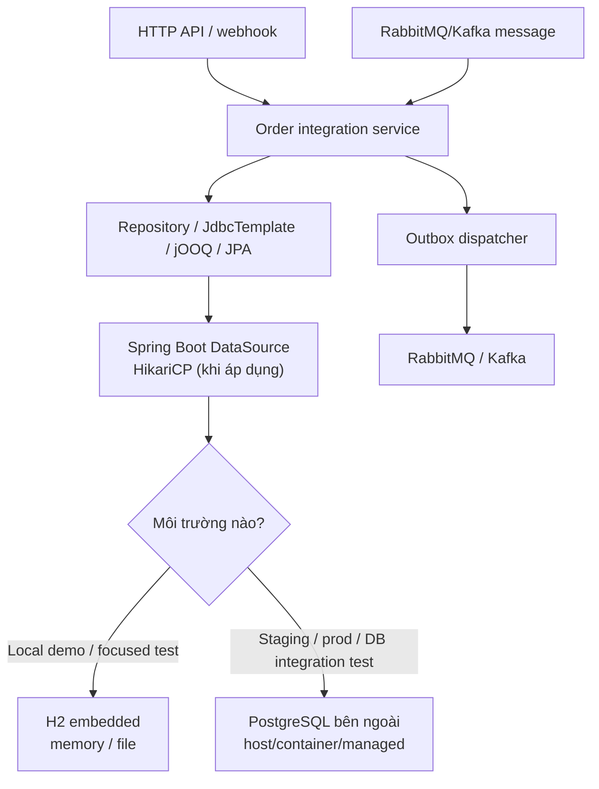
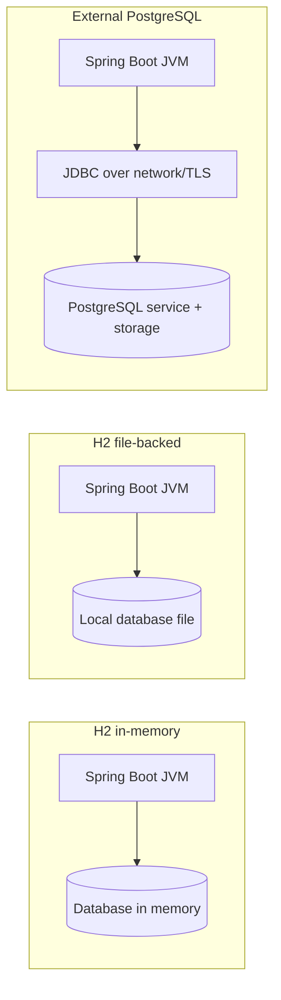
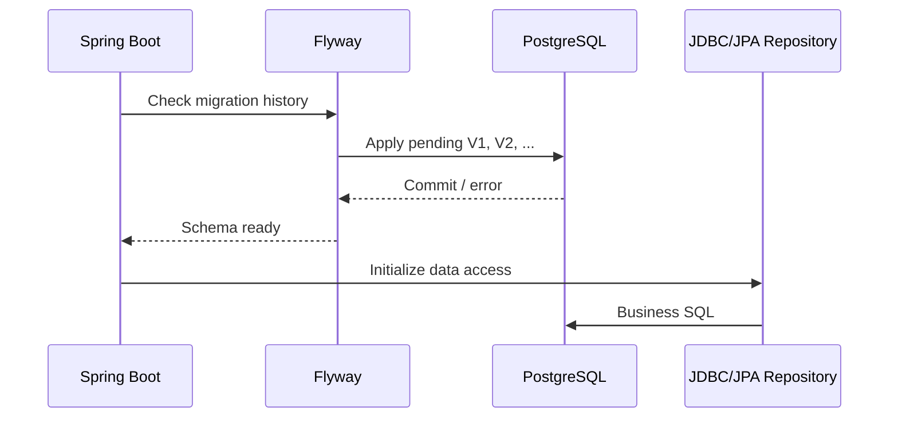
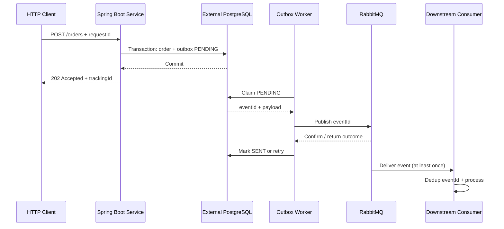
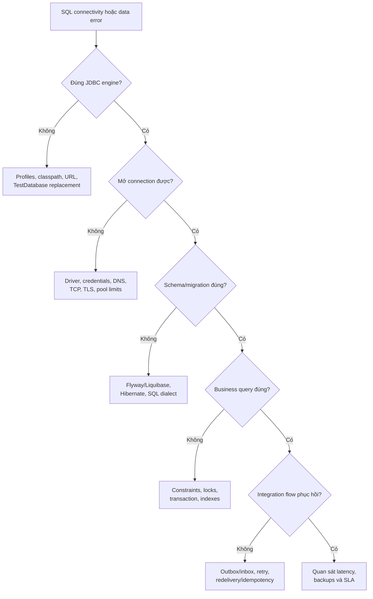

# Phân biệt cơ sở dữ liệu nhúng với hệ quản trị bên ngoài

## 1. Tại sao phải phân biệt ngay khi thiết kế kết nối SQL?

Trong module **SPRING_BOOT_INTEGRATION**, ứng dụng Spring Boot không chỉ gọi HTTP client hoặc nhận message từ broker, mà còn cần nơi lưu dữ liệu để phối hợp nhiều hệ thống: trạng thái đồng bộ, bảng inbox chống xử lý trùng, bản ghi outbox chuẩn bị publish và dữ liệu nghiệp vụ. Một quyết định tưởng nhỏ — dùng **database nhúng** hay **hệ quản trị cơ sở dữ liệu bên ngoài** — ảnh hưởng tới vòng đời dữ liệu, JDBC URL, connection pool, khả năng kiểm thử, bảo mật, deployment và cách ứng dụng phục hồi sau lỗi.

Hai tình huống phổ biến:

- Developer chạy service Spring Boot với **H2 in-memory** trên laptop. Database xuất hiện trong process, thường mất dữ liệu khi process dừng. Cấu hình ít, phù hợp một số smoke test và demo.
- Cùng service ở staging/production kết nối **PostgreSQL** chạy ở container, VM hoặc managed database bên ngoài JVM. Server database có vòng đời, quản trị, kết nối mạng và quyền truy cập riêng; dữ liệu có thể tồn tại sau khi ứng dụng restart.

Nếu test xanh với H2, điều đó **không tự chứng minh** ứng dụng sẽ chạy đúng trên PostgreSQL/MySQL. Ngược lại, một integration test dùng PostgreSQL container thật thường có giá trị lớn hơn với SQL dialect, migration, lock, constraint và connection behavior, nhưng nặng hơn unit test.

### Mục tiêu bài học

Sau bài này, bạn có thể:

1. Phân biệt database engine nhúng, in-memory, lưu file và DBMS server bên ngoài.
2. Hiểu Spring Boot phát hiện embedded database và tạo `DataSource` ra sao.
3. Cấu hình H2 cho thử nghiệm ngắn và PostgreSQL cho môi trường bên ngoài một cách tường minh.
4. Không nhầm **database lifetime** với **JVM lifetime**, **connection lifetime** hoặc trạng thái Docker container.
5. Phân biệt script `schema.sql`/`data.sql`, JPA schema generation và Flyway/Liquibase.
6. Xác định khi nào H2 đủ làm test double, khi nào phải dùng Testcontainers với cùng DBMS production.
7. Bảo vệ JDBC secrets, kết nối TLS, pool, readiness, migration và dữ liệu sau restart.
8. Áp dụng lựa chọn vào luồng HTTP → SQL → broker, có idempotency và khả năng phục hồi.

> Phạm vi: Java 17+, Spring Boot 3.x, Spring Framework 6.x, JDBC/HikariCP, H2 và PostgreSQL. Các giá trị cấu hình/khả năng auto-configuration có thể khác giữa những phiên bản lớn; hãy đối chiếu đúng Spring Boot BOM/driver/server đang dùng.

## 2. Định nghĩa: nhúng là mô hình triển khai, không đồng nghĩa in-memory

**Cơ sở dữ liệu nhúng (embedded database)** là database engine chạy bên trong hoặc cùng tiến trình ứng dụng, không cần một DBMS server độc lập để thực hiện các truy vấn thông thường. Trong Java, một số lựa chọn quen thuộc là **H2**, **HSQLDB** và **Apache Derby** ở chế độ embedded.

**Hệ quản trị cơ sở dữ liệu bên ngoài (external DBMS)** là hệ thống chạy trong một tiến trình/dịch vụ riêng, ứng dụng kết nối qua một giao thức thích hợp. PostgreSQL, MySQL/MariaDB và Microsoft SQL Server là những ví dụ quen thuộc.

**In-memory** chỉ nói nơi lưu dữ liệu chủ yếu. Nó không phải từ đồng nghĩa của embedded:

- H2 **in-memory**: engine chạy cùng JVM, dữ liệu thường không bền qua lần JVM khởi động lại.
- H2 **file-backed embedded**: engine chạy cùng JVM nhưng lưu dữ liệu vào file trên disk; có thể tồn tại qua restart khi file vẫn còn và được đóng/khôi phục đúng cách.
- H2 **server mode**: cùng một engine H2 nhưng một tiến trình server riêng nhận kết nối qua TCP; cách vận hành gần hơn external DBMS.
- PostgreSQL trong Docker local: **vẫn là DBMS bên ngoài JVM**, dù container và ứng dụng cùng máy.
- PostgreSQL managed cloud: DBMS bên ngoài với vận hành, backups, network, credentials và SLA của dịch vụ quản lý.

Một cơ sở dữ liệu không trở thành “nhúng” chỉ vì được chạy ở `localhost`. Tiêu chí quan trọng là **engine/lifecycle thuộc tiến trình nào, kết nối đi qua đâu và ai sở hữu dữ liệu**.

## 3. So sánh tổng quan hai mô hình

| Tiêu chí | Database nhúng (ví dụ H2 embedded) | DBMS bên ngoài (ví dụ PostgreSQL) |
| --- | --- | --- |
| Engine chạy ở đâu? | Cùng JVM/tiến trình ứng dụng | Tiến trình/database service độc lập |
| Đường truy cập | JDBC gọi engine trong process | JDBC driver dùng kết nối tới server |
| Cần server trước khi app start? | Thường không | Có; phải có endpoint và quyền đăng nhập |
| Lưu trữ | In-memory hoặc file, tùy URL | Disk/managed storage, tùy DBMS |
| Vòng đời | Thường gắn JVM/connection/file | Độc lập app; có chính sách vận hành riêng |
| Khả năng chia sẻ giữa replicas | Thường không phù hợp trực tiếp | Được thiết kế cho nhiều clients/processes |
| Network/TLS | Embedded mode thường không cần network | Cần network policy, TLS, credentials |
| Backup/restore/HA | Thường do ứng dụng/chủ file tự chịu | Công cụ/chính sách DBMS, HA/replication |
| SQL dialect | H2/HSQLDB/Derby dialect | PostgreSQL/MySQL/SQL Server dialect |
| Constraint/index/locking | Có, nhưng behavior không y hệt production DBMS | Theo engine/version production |
| Test startup | Thường rất nhanh | Tốn thời gian provision; Testcontainers giúp cô lập |
| Vận hành production | Hợp use case giới hạn, phải tự đánh giá durability | Phổ biến cho hệ thống nhiều instances |
| Scale nhiều ứng dụng | Hạn chế với engine nhúng/file | Có thể scale các app và quản trị DB riêng |

**Không có luật “nhúng chỉ dùng test, bên ngoài chỉ dùng production” tuyệt đối.** H2 file-backed có thể phù hợp một ứng dụng desktop/thiết bị nhỏ nếu backup và concurrency được thiết kế đúng. Ngược lại, DBMS bên ngoài qua Testcontainers là lựa chọn tốt cho nhiều bài kiểm thử tích hợp.

## 4. Cấu trúc kết nối trong Spring Boot Integration



Các lớp cần tách rõ:

1. **Database engine**: H2 hay PostgreSQL, process/lifecycle và khả năng dữ liệu tồn tại.
2. **JDBC Driver**: hiện thực giao thức `java.sql` cho đúng engine (`org.h2.Driver` so với `org.postgresql.Driver`).
3. **`DataSource`**: factory/pool để ứng dụng lấy JDBC `Connection`.
4. **Spring data access**: `JdbcTemplate`, `JdbcClient`, Spring Data JDBC/JPA, jOOQ hoặc thư viện khác.
5. **Schema manager**: `schema.sql`, Hibernate DDL hoặc migration tool.
6. **Business integration**: idempotency keys, SQL transactions, inbox/outbox, retry và message handling.

Một `DataSource` được tạo thành công **không chứng minh** schema có đúng, database có sẵn sàng cho nghiệp vụ hoặc retry/publish message đã an toàn.

## 5. Những embedded databases Spring Boot thường phát hiện

Trong Spring Boot 3.x, JDBC DataSource auto-configuration có cơ chế nhận diện một số database nhúng qua classpath, đặc biệt:

| Engine | JDBC driver | URL minh họa |
| --- | --- | --- |
| H2 | `org.h2.Driver` | `jdbc:h2:mem:orders` |
| HSQLDB | `org.hsqldb.jdbc.JDBCDriver` | `jdbc:hsqldb:mem:orders` |
| Apache Derby | Driver phù hợp phiên bản Derby | `jdbc:derby:memory:orders;create=true` |

**Đừng hiểu rằng tất cả database embedded đều được Spring Boot tự nhận diện theo cùng một cách.** SQLite cũng là hệ quản trị nhúng phổ biến, nhưng không mặc nhiên nằm trong tập engine embedded mặc định của JDBC `DataSourceAutoConfiguration`; thường cần dependency, JDBC URL/driver và điều chỉnh dialect/config riêng.

### Điều kiện phát hiện cần chú ý

Khi có `spring-boot-starter-jdbc` (hoặc dependency phù hợp), JDBC driver của embedded DB trên classpath, **không có cấu hình kết nối khác chiếm ưu tiên** và các điều kiện auto-configuration thỏa mãn, Spring Boot có thể tự tạo `DataSource` dùng embedded DB mà không cần bạn chỉ rõ URL.

Nhưng:

- Có `DataSource` bean tự tạo → auto-configuration có thể back off.
- Có cấu hình R2DBC `ConnectionFactory` → điều kiện JDBC `DataSource` auto-configuration có thể không thỏa, cần hiểu stack được chọn.
- Nhiều embedded drivers cùng nằm trong runtime classpath → lựa chọn tự động có thể không như bạn mong muốn; đừng dựa vào thứ tự tình cờ.
- `spring.datasource.url` hoặc các connection details khác được cấp → dùng nguồn được cấu hình theo điều kiện tương ứng.
- Một runtime có cả driver PostgreSQL và H2 mà **thiếu JDBC URL thực sự** có thể rơi về H2, gây lỗi triển khai âm thầm nếu không guard cấu hình môi trường.

**Nguyên tắc:** demo/test nhỏ có thể dựa vào tự phát hiện; staging/production phải có cấu hình database được kiểm soát và kiểm chứng.

## 6. Dependencies cơ bản cho JDBC và H2

Ví dụ Maven dành cho Spring Boot (version do BOM quản lý):

```xml
<dependencies>
    <dependency>
        <groupId>org.springframework.boot</groupId>
        <artifactId>spring-boot-starter-jdbc</artifactId>
    </dependency>
    <dependency>
        <groupId>com.h2database</groupId>
        <artifactId>h2</artifactId>
        <scope>runtime</scope>
    </dependency>
</dependencies>
```

Gradle:

```groovy
dependencies {
    implementation 'org.springframework.boot:spring-boot-starter-jdbc'
    runtimeOnly 'com.h2database:h2'
}
```

Nếu H2 chỉ phục vụ test, nên để **test scope** thay vì đưa vào production classpath:

```xml
<dependency>
    <groupId>com.h2database</groupId>
    <artifactId>h2</artifactId>
    <scope>test</scope>
</dependency>
```

```groovy
testRuntimeOnly 'com.h2database:h2'
```

Đừng thêm H2 runtime dependency vào build production chỉ vì test đã dùng nó. Cấu hình test scope giúp giảm rủi ro production vô tình chạy với H2 nếu biến môi trường database thiếu.

**JPA starter khác JDBC starter:** nếu dùng `spring-boot-starter-data-jpa` thì đã có hạ tầng JDBC/DataSource cần thiết trong các cấu hình thông dụng, nhưng JPA thêm ORM/Hibernate và vòng đời entity. Bài này chú trọng **SQL connectivity**; cùng logic lựa chọn embedded/external ảnh hưởng cả JDBC, jOOQ và JPA.

## 7. H2 in-memory: dùng thế nào và mất dữ liệu khi nào?

Ví dụ `application-local.yml`:

```yaml
spring:
  datasource:
    url: jdbc:h2:mem:orders;DB_CLOSE_DELAY=-1
    driver-class-name: org.h2.Driver
    username: sa
    password: ""
  sql:
    init:
      mode: always
```

Cách hiểu URL:

- `jdbc:h2:` chỉ H2 JDBC.
- `mem:orders` là database **in-memory có tên**, nằm trong phạm vi thích hợp của JVM/classloader/H2 configuration.
- `DB_CLOSE_DELAY=-1` cho phép database in-memory được giữ sống sau khi connection cuối đóng **cho tới khi JVM dừng**; đây là tùy chọn H2, không phải thuộc tính chung của JDBC.
- `username: sa` và mật khẩu rỗng chỉ là thông số đơn giản phục vụ ví dụ local, không phải mẫu tài khoản production.
- `spring.sql.init.mode=always` cho phép Spring Boot chạy SQL initialization scripts theo điều kiện áp dụng; cần tránh trộn với Flyway/Hibernate schema management.

### Lỗi thường gặp: tưởng dữ liệu sẽ tồn tại qua restart

```text
Startup #1
  Spring Boot JVM
    H2 mem:orders  --> INSERT eventId=evt-1001
  Stop JVM
    in-memory state is lost

Startup #2
  Spring Boot JVM
    H2 mem:orders  --> new database; row evt-1001 absent
```

Đừng dùng H2 in-memory làm **system of record** cho outbox/inbox thật nếu yêu cầu phục hồi sau crash. Một hàng đợi nội bộ JVM hay H2 in-memory có thể làm demo “publish sau” trông hoạt động, nhưng mất toàn bộ intent khi process restart.

### Tại sao có lúc dữ liệu biến mất ngay trong một lần chạy?

Với in-memory database, tên database, kết nối đang mở, tùy chọn `DB_CLOSE_DELAY` và scope của classloader có thể ảnh hưởng lifecycle. Nếu không giữ DB sống sau connection cuối, việc đóng toàn bộ connections có thể làm database bị hủy và tạo lại ở lần lấy connection tiếp theo. Dùng đúng URL và **không** lấy behavior của H2 làm hợp đồng chung cho DBMS bên ngoài.

## 8. H2 file-backed: nhúng nhưng có dữ liệu trên disk

Ví dụ:

```yaml
spring:
  datasource:
    url: jdbc:h2:file:./data/orderdb
    driver-class-name: org.h2.Driver
    username: sa
    password: ""
```

Sự khác biệt so với `mem:`:

- Dữ liệu và metadata được ghi vào file theo cơ chế H2, **có thể còn sau restart** nếu disk/path được giữ và database đóng/khôi phục đúng.
- Đường dẫn `./data/orderdb` là **relative path theo working directory** của process, không phải luôn theo vị trí file YAML.
- Database file có thể bị lock khi hai tiến trình cùng mở ở embedded mode; cách mở nhiều process phải theo cơ chế H2 hỗ trợ, không suy rằng nhiều replicas có thể dùng chung trên shared volume.
- `chmod`, file ownership, disk space, crash recovery, backup, encryption và restore trở thành trách nhiệm vận hành của bạn.
- Trong Kubernetes, file nằm ở **ephemeral container filesystem** có thể biến mất khi pod bị thay, dù engine là file-backed. Muốn bền phải có volume và chiến lược backup/restore phù hợp.

Vì thế, **file-backed không tự đồng nghĩa durable theo SLA**. Durability đòi hỏi nơi lưu dữ liệu, đồng bộ ghi, transaction và quy trình khôi phục. Tách biệt giữa “có file” và “phục hồi đáng tin cậy”.

### Nhúng trong ứng dụng nhiều replicas là một rủi ro thiết kế

Nếu chạy ba replicas, mỗi replica dùng `jdbc:h2:file:./data/orderdb` trên filesystem riêng, bạn có **ba databases khác nhau**, không phải một database dùng chung. Nếu mỗi replica tự phát outbox, dữ liệu và khả năng idempotency sẽ bị chia tách. Các nghiệp vụ cần dữ liệu dùng chung thường phù hợp DBMS server độc lập hơn.

## 9. H2 Console: công cụ local, không phải giao diện production

Khi dùng H2 trong môi trường dev và có web stack tương ứng, Spring Boot có thể hỗ trợ H2 console (phụ thuộc version/dependency):

```yaml
spring:
  h2:
    console:
      enabled: true
      path: /h2-console
```

**Không bật console công khai trong production.** Nó cung cấp giao diện thao tác SQL, có thể làm lộ dữ liệu/metadata hoặc cho phép sửa/xóa nếu credentials bị lộ. Một số cấu hình Spring Security/firewall/CSRF/frames cần được xử lý riêng cho local development, không copy các ngoại lệ bảo mật sang runtime thật.

Khi console kết nối với H2 in-memory, cần điền **đúng JDBC URL** như ứng dụng (ví dụ `jdbc:h2:mem:orders;DB_CLOSE_DELAY=-1`), nếu không bạn có thể nhìn thấy một database khác và tưởng bảng đã “mất”.

Đừng dùng console để thay thế migration scripts. Mọi schema cần có cách tái tạo trong CI và khi tạo môi trường mới.

## 10. PostgreSQL bên ngoài: chuẩn bị những gì?

Một PostgreSQL server, dù chạy trên laptop, VM hay managed cloud, có vòng đời độc lập. Spring Boot cần tối thiểu:

1. **Host, port và database name**.
2. **Credentials** và quyền thao tác đủ nhưng tối thiểu.
3. **JDBC driver** phù hợp.
4. **Network reachability**: DNS, firewall, security group, private network.
5. **TLS/trust configuration** nếu môi trường yêu cầu.
6. **Schema migration** và quyền tạo/sửa bảng theo deployment policy.
7. **Connection pool limits**, timeout và readiness.
8. **Backup/restore, monitoring, retention và failure recovery** do DB/operator sở hữu.

Ví dụ Maven:

```xml
<dependencies>
    <dependency>
        <groupId>org.springframework.boot</groupId>
        <artifactId>spring-boot-starter-jdbc</artifactId>
    </dependency>
    <dependency>
        <groupId>org.postgresql</groupId>
        <artifactId>postgresql</artifactId>
        <scope>runtime</scope>
    </dependency>
</dependencies>
```

Gradle:

```groovy
dependencies {
    implementation 'org.springframework.boot:spring-boot-starter-jdbc'
    runtimeOnly 'org.postgresql:postgresql'
}
```

**Không cần H2** trong runtime deployment PostgreSQL. Nếu bạn đồng thời có H2 để test, kiểm tra scope và đảm bảo profile production fail-fast khi thiếu endpoint.

## 11. application-prod.yml: kết nối tường minh và secrets bên ngoài

Ví dụ `application-prod.yml`:

```yaml
spring:
  datasource:
    url: ${DB_JDBC_URL}
    username: ${DB_USERNAME}
    password: ${DB_PASSWORD}
    driver-class-name: org.postgresql.Driver
    hikari:
      maximum-pool-size: 12
      minimum-idle: 2
      connection-timeout: 5s

  sql:
    init:
      mode: never

  jpa:
    hibernate:
      ddl-auto: validate
```

Trong đó:

- `DB_JDBC_URL` có thể là `jdbc:postgresql://db.internal.example:5432/orders` trong hệ thống phù hợp.
- Không commit mật khẩu thực vào Git; cấp từ secret manager, workload identity hoặc biến môi trường do deployment kiểm soát.
- `driver-class-name` thường có thể được Spring Boot suy từ JDBC URL, nhưng khai tường minh có thể hữu ích ở môi trường cần chặn cấu hình sai. Nó không tự giải quyết vấn đề thiếu driver dependency.
- `HikariCP` là pool mặc định thông dụng khi có trên classpath và phù hợp điều kiện. Các settings ví dụ phải được benchmark theo số replicas và giới hạn kết nối của DB.
- `spring.sql.init.mode=never` tắt script initialization mặc định trong profile này; migration bởi Flyway/Liquibase có thể được thực hiện riêng.
- `ddl-auto=validate` chỉ có tác dụng khi app thực sự dùng JPA/Hibernate; với JDBC-only nó không tạo schema/validate ORM.

Để fail-fast khi thiếu DB endpoint, không đặt giá trị mặc định `localhost` hoặc `jdbc:h2:mem` trong production property. Sự thiếu biến cấu hình nên là một deployment failure rõ ràng thay vì silently chuyển tới database sai.

### Docker hostname phụ thuộc nơi app chạy

Nếu ứng dụng chạy **trên host** và PostgreSQL container publish cổng, dùng host/mapped port phù hợp. Nếu ứng dụng chạy **trong cùng Docker Compose network**, hostname thường là service name, ví dụ `postgres`, và port container. Không sao chép `localhost:5432` vào container ứng dụng rồi tưởng nó trỏ sang container PostgreSQL; `localhost` trong container là chính container đó.

## 12. Đặc điểm quan trọng nhất: vòng đời dữ liệu và ranh giới thất bại



Cách hiểu failure:

| Tình huống | H2 in-memory | H2 file-backed | PostgreSQL external |
| --- | --- | --- | --- |
| App process restart | State thường mất | State có thể còn nếu file còn và valid | State còn nếu DB service/storage còn |
| App replica bị thay | Data riêng của replica mất | Có thể mất nếu disk ephemeral | App mới kết nối lại cùng DB nếu cấu hình đúng |
| DB engine dừng | Cùng JVM thường dừng | Cùng JVM thường dừng | Có thể dừng riêng app |
| Lỗi network giữa app và DB | Embedded không cần network thông thường | Embedded không cần network thông thường | Có thể timeout/reset/connect refused |
| Nhiều app cùng đọc/ghi | Khó chia sẻ đúng ngữ nghĩa | File-lock/concurrency hạn chế | Nhiều DB clients được hỗ trợ |
| Backup/restore | Không có dữ liệu bền để backup nếu chỉ memory | Phải backup file đúng cách | DBMS backup/WAL/PITR tùy engine |
| Read replicas/HA | Không theo mô hình DBMS server thông thường | Không theo mô hình DBMS server thông thường | Có thể có replication/failover nếu triển khai |

**Phân biệt failure của app với failure của DB:** PostgreSQL tiếp tục chạy sau khi một pod Java crash, nhưng network outage vẫn khiến app không truy cập được. Cơ chế retry của client cần tôn trọng transaction outcome và idempotency, không mặc định mọi lỗi network là ghi chưa thành công.

## 13. JDBC URL không chỉ là chuỗi host: nó chọn engine và semantics

Một số URL minh họa:

```text
jdbc:h2:mem:orders;DB_CLOSE_DELAY=-1
jdbc:h2:file:./data/orderdb
jdbc:postgresql://db.internal.example:5432/orders
jdbc:mysql://mysql.internal.example:3306/orders
```

Mỗi URL thuộc một driver/engine khác nhau. **Đừng lấy JDBC URL của H2 rồi thay `h2` bằng `postgresql`**; cú pháp, connection options, SQL dialect, auth/TLS và database lifecycle khác nhau.

Một số JDBC URL có thể chứa username/password dưới dạng query parameters. Thực hành tốt là **không đặt secrets trong URL khi có cách cấu hình credentials riêng**, để tránh log, exception trace, process diagnostics hoặc deployment metadata làm lộ thông tin.

Khi cần nhiều datasources trong cùng ứng dụng, mỗi nguồn nên có identity và bean ownership rõ: datasource name, credentials, pool, transaction manager, repository/jOOQ contexts, schema migration. Một `spring.datasource.url` mặc định không thể biểu diễn đầy đủ cấu hình hai databases không liên quan.

## 14. DataSource, Connection và connection pool khác nhau thế nào?

Một `DataSource` là đối tượng để lấy JDBC `Connection`; nó không phải một JDBC connection đơn lẻ. Trong Spring Boot, `DataSourceAutoConfiguration` có thể tạo pooled DataSource (thường HikariCP) khi điều kiện đáp ứng.

Ví dụ:

```java
import javax.sql.DataSource;
import java.sql.Connection;
import java.sql.DatabaseMetaData;

import org.springframework.stereotype.Component;

@Component
public class DatabaseDiagnostics {

    private final DataSource dataSource;

    public DatabaseDiagnostics(DataSource dataSource) {
        this.dataSource = dataSource;
    }

    public String databaseProduct() throws Exception {
        try (Connection connection = dataSource.getConnection()) {
            DatabaseMetaData metaData = connection.getMetaData();
            return metaData.getDatabaseProductName();
        }
    }
}
```

Method này đọc metadata để biết **engine thực tế** (ví dụ `H2` hoặc `PostgreSQL`). Đừng log JDBC URL đầy đủ hoặc credentials. Nếu ứng dụng có nhiều datasources, inject đúng một bean bằng `@Qualifier`; không dựa vào mặc định mà không kiểm tra.

Cách dùng `try-with-resources` với pooled datasource **trả connection về pool** khi `close()`, không nhất thiết đóng physical TCP connection ngay. Nhờ vậy, cùng một cách code Java có thể làm việc với embedded và external JDBC; nhưng số kết nối, latency và failure mode vẫn khác.

### Pool capacity và DB server giới hạn nhau

Ví dụ app có 5 replicas, mỗi replica Hikari maximum 20 connections: lý thuyết có thể cần khoảng 100 connections tới PostgreSQL, chưa tính maintenance jobs, migrations, admin tools và các services khác. Nếu database chỉ cho phép 80 connections, một cấu hình tối đa 20/replica sẽ không ổn dù “20” có vẻ nhỏ.

Với H2 embedded, một pool lớn có thể cho test xanh trong máy đơn nhưng không mô phỏng contention của database server với nhiều replicas. Pool tuning phải dựa trên concurrency thật và DB operational limits.

## 15. Readiness: có DataSource bean chưa nghĩa là database sẵn sàng

Một application context có thể đã định nghĩa `DataSource` nhưng chưa mở được connection thực tế, hoặc startup health chỉ kiểm tra một phần.

Các trạng thái khác nhau:

1. JDBC driver có trên classpath.
2. Spring tạo `DataSource` bean.
3. Pool lấy được connection.
4. Credentials được chấp nhận.
5. Query thử `SELECT 1` thành công.
6. Migration/schema tồn tại đúng phiên bản.
7. Business query/transaction thực hiện được theo quyền và data constraints.
8. Luồng HTTP → database → message broker hoạt động và có thể phục hồi.

H2 embedded thường tránh được một số vấn đề network/secret, vì vậy **không kiểm tra** network partition, TLS verification, firewall, DNS hoặc chuyển leader của một PostgreSQL cluster thật.

Với external DBMS, nên có readiness/health checks và alert phù hợp. Không tự retry kết nối với vòng lặp vô hạn làm che một cấu hình production sai; có timeout/backoff/deadline, phân biệt lỗi tạm với sai username/password hoặc schema.

## 16. Thực hành với JdbcTemplate: business code không cần biết engine

Ví dụ một service ghi nhận event đã xử lý:

```sql
CREATE TABLE processed_event (
    source_system VARCHAR(80) NOT NULL,
    event_id VARCHAR(120) NOT NULL,
    processed_at TIMESTAMP WITH TIME ZONE NOT NULL,
    PRIMARY KEY (source_system, event_id)
);
```

Mẫu `JdbcTemplate`:

```java
import java.time.OffsetDateTime;

import org.springframework.jdbc.core.JdbcTemplate;
import org.springframework.stereotype.Repository;

@Repository
public class ProcessedEventRepository {

    private final JdbcTemplate jdbc;

    public ProcessedEventRepository(JdbcTemplate jdbc) {
        this.jdbc = jdbc;
    }

    public void markProcessed(
            String source, String eventId, OffsetDateTime now) {
        jdbc.update(
            """
            INSERT INTO processed_event
              (source_system, event_id, processed_at)
            VALUES (?, ?, ?)
            """,
            source, eventId, now
        );
    }

    public boolean exists(String source, String eventId) {
        Integer count = jdbc.queryForObject(
            """
            SELECT COUNT(*) FROM processed_event
            WHERE source_system = ? AND event_id = ?
            """,
            Integer.class, source, eventId
        );
        return count != null && count > 0;
    }
}
```

`JdbcTemplate` dùng `DataSource` do Spring cấp; code trên không ghép JDBC URL và dùng **bind parameters** thay vì nối input vào SQL.

Tuy nhiên, đây **chưa phải idempotency implementation an toàn với concurrency**: hai consumer có thể đồng thời `exists(false)` rồi cùng gọi `markProcessed`. Khóa duy nhất `PRIMARY KEY(source_system, event_id)` là cơ chế chống race ở database; code nghiệp vụ phải xử lý unique-conflict như duplicate event **trong transaction phù hợp**, và đảm bảo business side effect cùng một ranh giới.

Ở PostgreSQL bạn có thể dùng `INSERT ... ON CONFLICT DO NOTHING`; cú pháp/behavior khác engine, cần test thật. Không dùng exception chung để suy mọi DBMS phản hồi unique conflict giống hệt nhau.

## 17. Chèn script khởi tạo schema.sql và data.sql trong Spring Boot

Spring Boot có khả năng chạy các script như `schema.sql` và `data.sql` theo cấu hình và điều kiện. Một số thuộc tính Spring Boot 3.x:

```yaml
spring:
  sql:
    init:
      mode: embedded
      continue-on-error: false
```

Về nguyên tắc:

- `mode: embedded` (giá trị mặc định thông dụng) thực hiện initialization khi datasource được nhận diện là **embedded**.
- `mode: always` yêu cầu khởi tạo cả với database không nhúng, khi có script và điều kiện phù hợp.
- `mode: never` tắt script initializer.
- `continue-on-error: false` giúp startup fail khi SQL script sai thay vì lờ đi.
- `schema.sql`/`data.sql` là scripts tài nguyên của ứng dụng; có cơ chế platform-specific scripts/tùy chọn path theo version.

**Không nên chạy script tạo bảng không idempotent ở mỗi startup production.** Nếu nhiều replicas cùng chạy `schema.sql`, hoặc schema đã có bảng, startup có thể fail hoặc tạo race.

Một application đơn giản với H2 in-memory dùng script để demo nhanh có thể phù hợp. Còn hệ thống production có nhiều môi trường và lịch sử schema cần migration được version hóa.

### H2 và PostgreSQL không tự hiểu cùng script

Một `schema.sql` dùng cú pháp H2 riêng có thể fail trên PostgreSQL. Ngược lại, PostgreSQL có `JSONB`, `ON CONFLICT`, partial indexes hoặc DDL riêng mà H2 không thực hiện giống. Nếu dùng script theo platform, phải kiểm tra **đúng engine thật** thay vì nghĩ mọi SQL đều portable.

## 18. Hibernate ddl-auto: vì sao mặc định khác giữa nhúng và bên ngoài?

Với Spring Data JPA/Hibernate, property:

```yaml
spring:
  jpa:
    hibernate:
      ddl-auto: validate
```

Một số giá trị thường gặp:

| Giá trị | Ý nghĩa chính | Nhận xét |
| --- | --- | --- |
| `none` | Không tự thay đổi schema | Phù hợp khi Flyway/Liquibase quản lý schema |
| `validate` | Kiểm tra ánh xạ với schema hiện có | Bắt lỗi lệch entity/table; không tạo bảng |
| `update` | Cố cập nhật schema theo model | Không thay thế migration, khó kiểm soát thay đổi |
| `create` | Tạo schema theo mappings | Có thể phá dữ liệu; chỉ dùng có chủ đích |
| `create-drop` | Tạo và xóa schema theo vòng đời SessionFactory | Phù hợp một số test/demo, nguy hiểm nếu nối nhầm DB |

Trong các phiên bản Spring Boot 3.x thông dụng, khi **không phát hiện schema manager như Flyway/Liquibase**, Boot có thể chọn mặc định `create-drop` cho embedded database và `none` cho database không nhúng. Nhưng **đây là behavior có điều kiện**, không phải tính chất cố hữu của H2/PostgreSQL. Đừng dựa vào default để quyết định xóa/giữ dữ liệu.

Ví dụ H2 test tự tạo bảng bằng Hibernate trong khi PostgreSQL production giữ schema do Flyway tạo. Nếu entity thay đổi, test H2 vẫn xanh nhưng migration production bị thiếu; đây là một lỗ hổng kiểm thử.

**Ưu tiên cấu hình ddl-auto có chủ đích** theo profile và có migration owner rõ. Với hệ thống cần bền vững, `validate` kết hợp schema migrations có thể giúp phát hiện lệch model nhưng không thay thế integration test SQL thực tế.

## 19. Flyway hoặc Liquibase: quản lý schema có lịch sử rõ ràng

Đối với database bên ngoài được chia sẻ qua nhiều lần deploy, nên quản lý thay đổi schema bằng một công cụ có **versioned migrations** như Flyway hoặc Liquibase, thay vì gọi DDL rời rạc mỗi lần app khởi động.

Ví dụ Maven Flyway:

```xml
<dependency>
    <groupId>org.flywaydb</groupId>
    <artifactId>flyway-core</artifactId>
</dependency>
```

Tùy version Flyway mới và DBMS, có thể còn cần module riêng (ví dụ `flyway-database-postgresql` trong những bản Flyway có tách database support). Hãy dùng dependency versions do BOM tương thích quản lý và xem startup logs để xác minh engine thực sự được nhận diện.

Tệp migration ví dụ `src/main/resources/db/migration/V1__create_processed_event.sql`:

```sql
CREATE TABLE processed_event (
    source_system VARCHAR(80) NOT NULL,
    event_id VARCHAR(120) NOT NULL,
    processed_at TIMESTAMP WITH TIME ZONE NOT NULL
        DEFAULT CURRENT_TIMESTAMP,
    PRIMARY KEY (source_system, event_id)
);

CREATE INDEX idx_processed_event_time
    ON processed_event (processed_at);
```

Trình tự thông dụng:



**Giữ một nguồn sở hữu schema rõ ràng:**

- Flyway/Liquibase dùng để quản lý lịch sử DDL.
- Nếu dùng JPA, `ddl-auto=validate` có thể kiểm tra entity mapping tương ứng sau khi migration.
- Không trộn `schema.sql`, Hibernate `create-drop` và Flyway cùng tạo/xóa một bảng theo lịch trình khác nhau.
- Migration phải được test trên DBMS production; thành công trên H2 chưa chắc có nghĩa DDL phù hợp PostgreSQL.
- Dữ liệu đã có trước migration cần kế hoạch backfill, khóa, downtime và rolling compatibility.
- Trong production, có thể chạy migration như một bước deployment/job riêng thay vì cấp quyền DDL cho mọi application replica.

Flyway không tự giải quyết nguy cơ tương thích giữa producer schema v2 và consumer v1 khi deploy rolling. Với SQL schema được dùng bởi nhiều services, cần chiến lược **expand → migrate/backfill → contract** và test phiên bản cũ/mới cùng tồn tại trong khoảng chuyển giao.

## 20. Khi nào dùng schema.sql, Hibernate DDL hay migration?

| Tình huống | Cách phù hợp hơn | Giới hạn cần biết |
| --- | --- | --- |
| Ví dụ một bảng H2 ngắn, dữ liệu bỏ được | `schema.sql`/`data.sql` | Không có lịch sử version migration |
| Unit/component test dùng embedded DB độc lập | SQL init hoặc migration test | Test có thể không đại diện SQL dialect production |
| Ứng dụng JPA prototype | `ddl-auto=create-drop` có chủ đích | Không dùng với dữ liệu thật; mapping không thay thế migration |
| Production PostgreSQL có dữ liệu bền | Flyway/Liquibase hoặc schema provisioning có kiểm soát | Cần quản lý permissions và deploy order |
| Nhiều replicas cùng start | Migration job/locking strategy rõ | Tránh chạy DDL mâu thuẫn/cạnh tranh |
| Thay đổi bảng outbox đang được worker đọc | Versioned migration và backward compatibility | Không phá message/workflow đang chờ |
| Cần test rollback migration | Test migration cụ thể trên DBMS thật | Một số DDL có semantics transaction khác nhau |

**Không dùng chế độ tự xóa schema trên nguồn dữ liệu cần giữ.** Một cấu hình test bị kích hoạt nhầm khi service nối vào production database là sự cố nghiêm trọng, không chỉ là lỗi phát triển phần mềm.

### Thứ tự Hibernate và data.sql

Nếu project dùng Hibernate tạo bảng rồi muốn `data.sql` chạy sau đó, Spring Boot có property `spring.jpa.defer-datasource-initialization=true` trong những phiên bản phù hợp. Tuy nhiên đây là **cơ chế ordering**, không phải giải pháp quản lý schema lâu dài. Nếu dùng Flyway/Liquibase, ưu tiên đưa seed data có version vào migration hoặc quy trình dữ liệu thử nghiệm phù hợp.

## 21. SQL “chuẩn” chưa chắc hành xử giống trên H2 và PostgreSQL

H2 hữu ích để test mapping, nhưng mỗi DBMS có dialect/feature/optimizer khác nhau. Những khác biệt dễ ảnh hưởng Spring Boot Integration:

| Khía cạnh | H2 nhúng | PostgreSQL bên ngoài |
| --- | --- | --- |
| Upsert | H2 có syntax/extension riêng; compatibility mode có giới hạn | `INSERT ... ON CONFLICT` là tính năng cụ thể |
| JSON | Một số khả năng JSON tùy H2 version | `json`/`jsonb`, operators và indexes riêng |
| Identity/sequence | Cách tự tăng và sequence theo H2 | `GENERATED ... AS IDENTITY`, sequences, PostgreSQL syntax |
| Case/identifier | Quy tắc folding/quoting của H2 | PostgreSQL fold identifiers không quote về lowercase |
| Collation | Phụ thuộc engine/settings | ICU/libc/database locale/collation settings |
| Timestamp/time zone | Dạng và conversion tùy H2 | `timestamp` vs `timestamptz` có semantics rõ của PostgreSQL |
| Locks/concurrency | Một process, cách lock H2 | MVCC, row-level locks, isolation và contention production |
| DDL transaction | H2 có đặc điểm riêng | Nhiều DDL trên PostgreSQL transactional, có ngoại lệ |
| Query planner | H2 optimizer | PostgreSQL planner/index statistics/EXPLAIN |
| Partial/expression indexes | Không đồng nhất | PostgreSQL hỗ trợ phong phú |
| `FOR UPDATE SKIP LOCKED` | Có thể khác hoặc chưa tương thích đầy đủ | Dùng phổ biến khi claim outbox rows |
| Error codes/exceptions | SQLState và vendor codes theo H2 | PostgreSQL SQLState/vendor behavior riêng |

Ví dụ:

```sql
INSERT INTO processed_event(source_system, event_id)
VALUES ('billing', 'evt-1001')
ON CONFLICT (source_system, event_id) DO NOTHING;
```

Câu trên là **PostgreSQL-specific**; lại còn giả định `processed_at` có default như migration mục 19. Dù H2 compatibility mode có thể nhận một số cú pháp tương tự, **không thể suy ra toàn bộ atomicity/concurrency semantics giống PostgreSQL**.

Các phần tích hợp nhạy với duplicate/retry phải được test với database engine thực thay vì chỉ “SQL không báo lỗi”.

## 22. H2 MODE=PostgreSQL giúp tương thích đến đâu?

Một lựa chọn hay gặp:

```yaml
spring:
  datasource:
    url: jdbc:h2:mem:orders;MODE=PostgreSQL;DB_CLOSE_DELAY=-1
    username: sa
    password: ""
```

H2 có chế độ tương thích một phần cú pháp và hành vi PostgreSQL. Nó có thể giúp một số query/DDL portable hơn, nhưng:

1. Engine vẫn là **H2**, không biến thành PostgreSQL thật.
2. Transaction locking, concurrency, isolation, JSONB, indexes, sequences, server extensions và query planner **không tương đương hoàn toàn**.
3. H2 version khác có thể thay đổi mức độ tương thích.
4. Không test được TCP/TLS/auth/network failure của PostgreSQL.
5. Một query H2 chấp nhận không có nghĩa PostgreSQL bản thật sẽ chấp nhận hoặc cho kết quả tương tự.
6. Một số JDBC driver features, SQLState và Hikari session initialization khác nhau.

**Dùng compatibility mode để hỗ trợ local convenience**, không dùng nó như bằng chứng cuối cùng cho production. Nếu một tính năng liên quan `INSERT ... ON CONFLICT`, `SKIP LOCKED`, `jsonb`, transaction, index hay migration, hãy test với PostgreSQL thật.

## 23. Đồng bộ dữ liệu qua nhiều worker: H2 có thể che race condition

Giả sử hai RabbitMQ consumers cùng nhận lại `eventId=evt-1001`. Nếu code làm:

```text
if (!repository.exists(eventId)) {
    performBusinessSideEffect();
    repository.save(eventId);
}
```

thì hai workers có thể cùng thấy “chưa tồn tại”, cùng xử lý và sau đó một worker mới gặp unique conflict. `exists()` rồi `save()` **không phải khóa nguyên tử**.

Cách tiếp cận đáng tin cậy hơn:

- Có unique constraint cho `(source_system, event_id)` tại database.
- Claim/dedup trong transaction phù hợp trước hoặc cùng business side effect.
- Nếu dùng PostgreSQL, có thể thiết kế `INSERT ... ON CONFLICT DO NOTHING RETURNING ...` để nhận biết record có được tạo hay không.
- Không gọi HTTP/broker rồi giả định SQL rollback có thể đảo ngược side effect remote.
- Kiểm thử concurrent insert với **database production-compatible** và đo được transaction outcome.
- Tái sử dụng stable event ID khi retry sau database timeout.

H2 in-memory với một test thread có thể khiến toàn bộ flow “đúng” vì không có contention, nhưng không kiểm tra được tình huống nhiều replicas/consumers cùng claim công việc.

### Một ví dụ PostgreSQL idempotent claim

```sql
INSERT INTO processed_event(
    source_system, event_id, processed_at
)
VALUES (
    'billing', 'evt-1001', CURRENT_TIMESTAMP
)
ON CONFLICT (source_system, event_id)
DO NOTHING
RETURNING event_id;
```

Hai literal `'billing'` và `'evt-1001'` chỉ dùng để minh họa trực tiếp trên PostgreSQL; trong `JdbcTemplate`, dùng placeholder `?` và bind parameters thay vì ghép dữ liệu vào câu SQL. Quan trọng hơn, ghi dấu “đã xử lý” trước side effect **nếu không cùng transaction** có thể dẫn tới mất tác vụ khi crash; hãy thiết kế inbox status, claim/lease và idempotency phù hợp thay vì dùng một SQL statement như lời giải hoàn chỉnh.

## 24. Test nhanh trên H2: biết chính xác đang chứng minh điều gì

Với Spring Boot Test, `@JdbcTest` và `@DataJpaTest` hỗ trợ các slice tests cho data access. Trong nhiều cấu hình/version, test slice có thể **thay database đã cấu hình bằng embedded datasource** nếu embedded driver có trên classpath, trừ khi bạn chủ động giữ database test thực.

Ví dụ một test `JdbcTemplate` chạy với H2 profile/test dependencies phù hợp:

```java
import static org.assertj.core.api.Assertions.assertThat;

import java.sql.Connection;
import javax.sql.DataSource;

import org.junit.jupiter.api.Test;
import org.springframework.beans.factory.annotation.Autowired;
import org.springframework.boot.test.autoconfigure.jdbc.JdbcTest;

@JdbcTest
class EmbeddedJdbcSmokeTest {

    @Autowired
    DataSource dataSource;

    @Test
    void dataSourceIsH2InThisTestConfiguration() throws Exception {
        try (Connection connection = dataSource.getConnection()) {
            assertThat(connection.getMetaData().getDatabaseProductName())
                .isEqualTo("H2");
        }
    }
}
```

Test này kiểm tra **DataSource test thực tế** là H2. Nó chưa kiểm tra migration production, query JSONB, SQL locking, network/TLS hoặc multi-replica behavior.

Điều kiện chạy:

- Có dependency `spring-boot-starter-test`, JDBC starter và H2 ở test classpath.
- Test context có auto-configuration thích hợp; nếu không, cần cấu hình data source cụ thể.
- Nếu có nhiều `DataSource` beans, hãy xác định rõ test target thay vì phụ thuộc vào lựa chọn mặc định.
- Nếu chạy Flyway trong slice, các migration phải tương thích H2 hoặc test phải cô lập migration theo mong đợi.

**Không coi `@JdbcTest` xanh là bằng chứng cho PostgreSQL production.** Nó xác nhận một phần Spring/JDBC wiring và SQL portable đã thực sự chạy ở H2.

## 25. Khi slice test thay DataSource: tránh kết luận sai

Với những test tập trung repository, Spring Boot cung cấp `@AutoConfigureTestDatabase`. Nếu bạn **cố ý** muốn dùng PostgreSQL Testcontainers thay vì embedded replacement:

```java
import org.springframework.boot.test.autoconfigure.jdbc.AutoConfigureTestDatabase;

@AutoConfigureTestDatabase(
    replace = AutoConfigureTestDatabase.Replace.NONE
)
```

Annotation trên là **phần bổ sung cho class test thích hợp** (ví dụ `@JdbcTest`/`@DataJpaTest`), không phải một class test độc lập.

Lưu ý thay đổi giữa Spring Boot 3.x: những phiên bản mới có các chế độ replacement như `NON_TEST` để nhận diện database test connection, nên mặc định có thể khác. `Replace.NONE` là cách tường minh giữ datasource bạn cấu hình, nhưng bạn vẫn phải đảm bảo connection details/Testcontainers thực sự được áp dụng.

### Một bẫy phổ biến

1. Test kết nối PostgreSQL container ở `@BeforeAll`.
2. Slice test tự thay DataSource sang H2 vì có embedded driver trong classpath.
3. Assertions chạy xanh, developer cho rằng mình đã kiểm thử PostgreSQL.
4. Production gặp lỗi `ON CONFLICT`/sequence/lock/JSONB.

Giải pháp: ở ít nhất một integration test quan trọng, **assert database product name** hoặc thực hiện một feature đặc trưng PostgreSQL để chứng minh test thực sự dùng đúng engine.

## 26. PostgreSQL Testcontainers: kiểm thử với DBMS thật

Testcontainers tạo PostgreSQL container riêng, thường dùng mapped host port động để tránh xung đột trên máy developer/CI. Với Spring Boot có hỗ trợ service connections, có thể không cần tự ghép `spring.datasource.url`.

Ví dụ dependencies Maven (artifact Testcontainers cần đối chiếu BOM/version; cấu trúc phổ biến cho Spring Boot 3.x/Testcontainers 1.x):

```xml
<dependencies>
    <dependency>
        <groupId>org.springframework.boot</groupId>
        <artifactId>spring-boot-testcontainers</artifactId>
        <scope>test</scope>
    </dependency>
    <dependency>
        <groupId>org.testcontainers</groupId>
        <artifactId>junit-jupiter</artifactId>
        <scope>test</scope>
    </dependency>
    <dependency>
        <groupId>org.testcontainers</groupId>
        <artifactId>postgresql</artifactId>
        <scope>test</scope>
    </dependency>
</dependencies>
```

Các dependencies test này bổ sung cho `spring-boot-starter-test`, `spring-boot-starter-jdbc`, PostgreSQL JDBC driver và Flyway nếu dự án dùng migration.

Một integration test Spring Boot:

```java
import static org.assertj.core.api.Assertions.assertThat;

import org.junit.jupiter.api.Test;
import org.springframework.beans.factory.annotation.Autowired;
import org.springframework.boot.test.context.SpringBootTest;
import org.springframework.boot.testcontainers.service.connection.ServiceConnection;
import org.springframework.jdbc.core.JdbcTemplate;
import org.testcontainers.containers.PostgreSQLContainer;
import org.testcontainers.junit.jupiter.Container;
import org.testcontainers.junit.jupiter.Testcontainers;

@SpringBootTest
@Testcontainers
class PostgreSqlConnectivityIT {

    @Container
    @ServiceConnection
    static PostgreSQLContainer<?> postgres =
        new PostgreSQLContainer<>("postgres:16-alpine")
            .withDatabaseName("orders_test")
            .withUsername("orders_test")
            .withPassword("test_only_password");

    @Autowired
    JdbcTemplate jdbc;

    @Test
    void usesRealPostgreSqlAndMigratedSchema() {
        String database = jdbc.queryForObject(
            "SELECT current_database()", String.class
        );
        assertThat(database).isEqualTo("orders_test");

        Long rows = jdbc.queryForObject(
            "SELECT COUNT(*) FROM processed_event",
            Long.class
        );
        assertThat(rows).isNotNull();
    }
}
```

Giả định `processed_event` được tạo bởi migration như mục 19 và được chạy khi test context khởi động. Nếu test project chưa cấu hình migration, test phải tạo schema theo một quy trình rõ ràng; không tự diễn giải “table not found” là lỗi kết nối.

**Điều `@ServiceConnection` giải quyết:** Spring Boot nhận `JdbcConnectionDetails` do container cung cấp (JDBC URL/username/password, mapped port) cho datasource do Boot quản lý. Nó **không sửa giá trị của `spring.datasource.url` trong Environment** và không tự cấu hình một DataSource custom do code ứng dụng tạo thủ công.

**Điều nó không giải quyết:** migration, unique constraints, concurrency, timeout, backup, broker publish hoặc idempotency. Những thứ đó cần kiểm thử ở cấp tích hợp riêng.

## 27. So sánh chi phí và độ tin cậy của các lớp test

Một chiến lược hợp lý không phải “thay mọi test bằng Testcontainers”, mà chọn mức gần thực tế theo thứ cần xác minh.

| Lớp test | Database nên dùng | Chứng minh | Chưa chứng minh |
| --- | --- | --- | --- |
| Unit test domain rule | Không DB, fake repository | Quy tắc thuần và phân loại lỗi | SQL, driver, migration |
| Component test JDBC đơn giản | H2 embedded | Mapping một số SQL portable, bean wiring | PostgreSQL-specific behavior |
| Repository test production-critical | PostgreSQL Testcontainers | Queries/constraints/migration engine thật | Cluster failover và load production |
| Integration test outbox | PostgreSQL + broker | Commit → publish, duplicate, retry, ack | Hệ thống deployment nhiều vùng |
| End-to-end staging | DB service gần production | DNS/TLS, credentials, deployment, topology | Mọi failure path/load peak |
| Load/failover test | Môi trường cô lập có topology tương tự | Pool saturation, lock, timeout, replica lag | Tuyệt đối mọi lỗi production |

**Đừng gọi H2 test là “mock PostgreSQL” theo nghĩa hoàn toàn thay thế.** Nó chỉ là một công cụ test với engine riêng. Với những phần phụ thuộc behavior PostgreSQL như advisory lock, `jsonb`, `SKIP LOCKED`, materialized view hoặc `ON CONFLICT`, test bằng PostgreSQL.

### TestContainers cần chính sách vòng đời

- Static `@Container` và `@Testcontainers` để JUnit extension quản lý trong mẫu trên.
- Spring Boot service connection nhận details từ container; annotation **không đồng nghĩa mọi test container sẽ tự được start bằng cùng một cách**.
- Spring Test context caching và container lifecycle khác nhau giữa test classes có thể dẫn tới context giữ DataSource trỏ tới container đã stop; thiết kế chia sẻ/caching có chủ đích.
- Docker runner trong CI phải có quyền và resource đủ, container images được pin/version và đáp ứng security policy.
- Không dùng PostgreSQL production credentials/data thật trong Testcontainers.

## 28. Docker Compose local: external database nhưng dev setup đơn giản

Nếu developer muốn dùng PostgreSQL thật mỗi ngày, có thể chạy service bằng Docker Compose thay vì H2:

```yaml
services:
  postgres:
    image: postgres:16-alpine
    environment:
      POSTGRES_DB: orders
      POSTGRES_USER: app
      POSTGRES_PASSWORD: local_only_password
    ports:
      - "5432"
```

`ports: ["5432"]` cho phép Docker publish container port 5432 qua một **host port động** trong cách khai báo Compose này. Nếu bạn cố tình muốn fixed port để tool SQL bên ngoài dùng, có thể chọn mapping cố định nhưng phải xử lý xung đột.

Với các phiên bản Spring Boot hỗ trợ, dependency phát triển:

```groovy
dependencies {
    developmentOnly 'org.springframework.boot:spring-boot-docker-compose'
}
```

có thể giúp Boot khởi động/phát hiện Compose service và tạo typed `JdbcConnectionDetails`. Đây là **development support**, không phải một cách tự động vận hành PostgreSQL production.

### Phân biệt ba con đường kết nối local

| Cách | Ai cấp JDBC URL? | Tính chất |
| --- | --- | --- |
| H2 embedded | Boot tự nhận embedded hoặc bạn cấp `jdbc:h2:...` | Engine trong JVM |
| PostgreSQL Compose thủ công | Người dùng/config cấp host và published port | External DBMS |
| Spring Boot Docker Compose service connection | Boot nhận thông tin từ Compose service được hỗ trợ | Vẫn là external PostgreSQL, không phải H2 |
| PostgreSQL Testcontainers | Container + `@ServiceConnection` hoặc `@DynamicPropertySource` | External DBMS cho test, ephemeral/lifecycle rõ |

Nếu Compose đã được bật, phải hiểu **lifecycle**: app khởi động/dừng Compose services khi nào, services có chạy sẵn/được dùng chung không, và việc dừng app có ảnh hưởng các developer processes khác không. Không suy rằng database Docker tự xóa khi JVM dừng — persistent volumes, container lifecycle và Compose policy quyết định.

## 29. External DBMS làm xuất hiện nhiều failure mode mới

Với H2 embedded, một JDBC call thường không gặp DNS/TCP/TLS. Với PostgreSQL remote, thất bại có thể đến từ:

1. DNS hoặc service discovery trỏ sai.
2. Firewall, security group hoặc network policy chặn cổng.
3. TLS cert hết hạn, trust chain/hostname không đúng.
4. User/password sai hoặc quyền database/table thiếu.
5. Server chưa ready, đang upgrade/failover.
6. Hikari pool cạn, connection acquisition timeout.
7. TCP connection bị reset khi transaction đang chạy.
8. Deadlock, lock wait, serialization failure.
9. Disk đầy, WAL storage chạm quota, read-only replica.
10. Schema migration đang chạy hoặc entity/query không tương thích version.

Không phải tất cả exception từ `JdbcTemplate` đều là “database unavailable”. Spring có `DataAccessException` hierarchy giúp phân nhóm một số lỗi như duplicate key, integrity violation, transient resource failure; JDBC driver cũng cung cấp SQLState/vendor diagnostics. Tuy nhiên cách phân loại cuối cùng phải dựa trên engine/operation cụ thể.

**Đặc biệt:** network timeout sau khi gửi `COMMIT` có thể khiến app **không biết chắc transaction đã commit hay chưa**. Tự phát lại event hoặc tạo payment với ID mới có thể nhân đôi business effect; cần idempotency key/unique constraints/reconciliation, không chỉ retry SQL mù.

## 30. Bảo mật kết nối: embedded không miễn mọi trách nhiệm, external cần TLS

### Embedded/file-backed

- Giới hạn quyền truy cập file/folder chứa DB; không đặt trong thư mục public hoặc image artifact có secrets.
- Không expose H2 console cho user ngoài.
- Nếu database chứa dữ liệu nhạy cảm, cân nhắc encryption, backup/restore và secret lifecycle.
- File database trên shared volume vẫn cần permissions, ownership và lock policy.
- Đừng để test H2 dùng một dữ liệu dump production có PII mà không có phê duyệt và biện pháp bảo vệ.

### External PostgreSQL

- Dùng network private, firewall/ACL, tài khoản có quyền tối thiểu.
- Bật TLS đúng chính sách, xác minh certificate/trust/hostname theo JDBC driver.
- Với PostgreSQL JDBC URL, có các tùy chọn `sslmode` như `verify-full`; cần cấu hình certificate trust đúng thay vì chỉ ghép `ssl=true` rồi cho rằng đã xác minh danh tính server.
- Secret manager hoặc workload identity được ưu tiên thay cho hardcoded password.
- Nếu dùng connection pool/proxy trung gian, kiểm tra certificate và auth giữa **mọi hop**, không chỉ app tới proxy.
- Không log raw JDBC URL nếu có credentials/options nhạy cảm; tuyệt đối không ghi `DB_PASSWORD` trong exception/report.

**TLS không thay thế authorization.** Kết nối được mã hóa nhưng dùng một tài khoản superuser chung giữa mọi services vẫn tạo rủi ro lớn.

## 31. Multi-replica, pool sizing và khả năng mở rộng

Một ứng dụng có thể chạy 10 replicas trong Kubernetes. Nếu dùng H2 in-memory/file local, mỗi replica có thể mang trạng thái riêng; các events do instance A xử lý không có dấu idempotency trên instance B. Load balancer chuyển request sang replica khác có thể tạo kết quả khác nhau.

Với PostgreSQL external, các replicas có thể chia sẻ một **nguồn dữ liệu chung** và dùng database constraints để chống xử lý trùng. Tuy nhiên:

- Tổng connection pool phải phù hợp giới hạn DBMS/proxy.
- Race condition vẫn tồn tại, không biến mất chỉ vì dùng một database chung.
- Khi dùng read replica, dữ liệu đọc có thể trễ sau ghi; cần chọn consistency policy.
- Khi failover, in-flight transactions có outcome chưa chắc chắn.
- Khi tăng số workers/broker consumers, lock contention và retry rate có thể tăng.
- Migrations phải phối hợp phiên bản app cũ/mới trong rolling deployments.
- Transaction/cursor/pool leaks có thể làm database phục vụ chậm dù SQL đúng.

Giới hạn connection nên gắn với **đo đạc**: active/idle/pending pool connections, DB server connections, query p95/p99, lock waits, CPU, disk I/O, replication lag, retries và business backlog.

## 32. Mối liên hệ với outbox, inbox và broker messages

Giả sử Order API nhận HTTP POST, ghi order và cần phát sự kiện RabbitMQ:



**Tại sao database lựa chọn có ý nghĩa?**

- Nếu dùng H2 in-memory làm outbox và app crash, những event `PENDING` có thể biến mất. HTTP response 202 trước đó trở nên sai lời hứa.
- Nếu dùng H2 file-backed trên ephemeral pod disk, deploy replica mới có thể không nhìn thấy outbox cũ.
- Nếu dùng PostgreSQL external với storage/backup phù hợp, outbox vẫn ở đó sau khi app process restart và worker có thể claim tiếp.
- Nếu nhiều workers cùng đọc outbox, cần SQL claim/lease/locking tương thích PostgreSQL và idempotent publish/consumer.
- Nếu PostgreSQL commit rồi broker đang down, worker không nên mark event SENT khi chưa xác định kết quả publish.
- Nếu publish thành công nhưng confirm mất, event có thể được publish lại; consumer phải xử lý trùng.

**External database giúp dựng nền tảng bền vững hơn, nhưng không tự tạo exactly-once processing.** Cần unique constraints, transaction boundaries, event IDs, bounded retry và observability.

## 33. Kiểm thử migration, rollback và dữ liệu còn sau restart

Một bộ test có giá trị nên kiểm tra cả ba trạng thái:

### H2 in-memory

1. Start Spring Boot context với `jdbc:h2:mem`.
2. Chạy migration/script và ghi một row.
3. Dừng **toàn JVM/test context tương ứng**.
4. Start môi trường độc lập mới, xác minh không kỳ vọng row cũ tồn tại.
5. Không diễn giải việc restart tạo DB mới là bug của H2.

### H2 file-backed

1. Dùng thư mục test tạm có ownership riêng.
2. Ghi dữ liệu và đóng engine/app đúng cách.
3. Start lại với đúng file path và verify row còn tồn tại.
4. Test file lock/permission/disk full/backup khi use case thật đòi.
5. Không share cùng file giữa hai process nếu chưa thiết kế cách truy cập được H2 hỗ trợ.

### PostgreSQL external

1. Start PostgreSQL Testcontainers, migrate schema, ghi dữ liệu.
2. Restart **ứng dụng** nhưng giữ **cùng PostgreSQL container/volume** còn hoạt động.
3. Verify rows vẫn còn, migration history không bị tạo lại.
4. Sau đó thử recreate DB container **không giữ volume**: dữ liệu có thể mất. “External” không đồng nghĩa data sống sót sau khi xóa storage.
5. Nếu production đòi durability, phải kiểm tra backup/restore và storage persistence của deployment, không chỉ test app restart.

**Đừng dùng Testcontainers mới cho từng lần app restart mà vẫn mong dữ liệu cũ còn**: điều đó kiểm tra một database mới, không phải persistence của cùng database service.

## 34. Khi nào nên dùng R2DBC thay JDBC?

**R2DBC** là API truy cập SQL theo mô hình reactive, dùng `ConnectionFactory` thay vì JDBC `DataSource`. Database vẫn có thể là H2 hoặc PostgreSQL, nhưng **stack Java và cách cấu hình khác**.

| Khía cạnh | JDBC | R2DBC |
| --- | --- | --- |
| API hạ tầng | `DataSource` / `Connection` | `ConnectionFactory` |
| Cách I/O ở Java | Thông thường blocking JDBC | Reactive/nonblocking theo driver hỗ trợ |
| Spring integration | `JdbcTemplate`, JPA/JDBC, jOOQ | `DatabaseClient`, R2dbcEntityTemplate, reactive repositories |
| URL | `jdbc:postgresql://...` | `r2dbc:postgresql://...` |
| Transaction manager | JDBC/JPA transaction manager | `R2dbcTransactionManager` |
| Auto-configuration | `DataSourceAutoConfiguration` | `R2dbcAutoConfiguration` và điều kiện liên quan |

**Một R2DBC `ConnectionFactory` không tự trở thành JDBC `DataSource`.** Trong các phiên bản Spring Boot, khi đã cấu hình R2DBC ConnectionFactory, auto-configuration JDBC DataSource có thể back off; nếu app thực sự cần cả Flyway/JDBC và reactive access, phải thiết kế bean/configuration riêng theo version.

Không bắt buộc đổi SQL engine chỉ vì chuyển WebFlux: vẫn có thể dùng PostgreSQL server như cũ với driver R2DBC. Ngược lại, nhúng H2 không tự khiến code JDBC nonblocking.

## 35. Nhiều DataSource hoặc nhiều loại DBMS trong một app

Spring Boot đơn giản thường có một JDBC `DataSource` chính. Nhưng một integration service có thể cần:

- PostgreSQL cho orders và outbox.
- Một SQL Server legacy chỉ để đọc dữ liệu đối tác.
- H2 in-memory cho một tính năng test/local tạm.
- Read replica của PostgreSQL cho báo cáo.

Khi có nhiều datasource, phải xác định rõ:

1. Mỗi `DataSource` lấy JDBC URL, credentials và pool từ đâu?
2. Bean nào là `@Primary`, bean nào cần `@Qualifier`?
3. `JdbcTemplate`/repositories/jOOQ DSLContext nào dùng database nào?
4. Flyway/Liquibase instance nào migrate database nào?
5. Transaction manager nào bao trùm các SQL operations?
6. Domain data và event idempotency có được ghi vào đúng system of record?
7. Nếu một SQL query trả thành công ở database phụ nhưng order DB fail, có rollback/compensation nào thực sự tồn tại?

**Không giả định một `@Transactional` mặc định tự bao trùm PostgreSQL, SQL Server và RabbitMQ.** Kết nối nhiều hệ thống là một thiết kế consistency/workflow riêng, không thể giải quyết chỉ bằng tên bean `DataSource`.

## 36. Observability: nhận biết ứng dụng đang dùng engine nào

Khi vận hành, biết **database product** thực là quan trọng, đặc biệt nếu image production vô tình mang H2 runtime driver.

Những điểm nên theo dõi:

| Tín hiệu | Cách sử dụng |
| --- | --- |
| JDBC product/vendor | Xác minh driver/engine thực tế ở startup diagnostics |
| Database name/role (đã sanitize) | Phát hiện nối nhầm môi trường |
| Pool active/idle/pending connections | Đo cạn pool và queue wait |
| DB connect/timeout/auth failures | Phân biệt network vs permission/config |
| Query latency p95/p99 | Phát hiện regression, lock contention |
| Migration version/status | Biết schema có đúng bản app không |
| Outbox backlog age | Biết message chờ publish bao lâu |
| Inbox duplicate count | Theo dõi redelivery/idempotent effect |
| PostgreSQL server CPU/I/O/locks | Xác định bottleneck thật ngoài ứng dụng |
| Backup freshness/restore test | Xác thực mục tiêu durability/recovery |

Actuator/Micrometer có thể cung cấp `db` health indicator và pool metrics khi dependencies/conditions phù hợp. Nhưng một `SELECT 1` xanh không chứng minh migration đã đúng hoặc quyền ghi business table hoạt động.

**Chống cardinality cao:** không đưa `orderId`, `eventId`, toàn bộ JDBC URL hay credentials vào metric labels. IDs nằm trong trace/log có chính sách bảo vệ. Hạn chế truy cập Actuator diagnostics để tránh lộ thông tin nội bộ.

## 37. Troubleshooting theo triệu chứng

| Triệu chứng | Nguyên nhân khả dĩ | Ưu tiên chẩn đoán |
| --- | --- | --- |
| `Failed to configure a DataSource` | Thiếu URL/driver/embedded DB | Runtime classpath, `spring.datasource.*`, auto-config conditions |
| `Cannot load driver class: org.postgresql.Driver` | Thiếu PostgreSQL JDBC driver | Dependency scope/BOM, runtime artifact |
| Test xanh nhưng production SQL syntax fail | H2 dialect khác PostgreSQL | Chạy Testcontainers bằng đúng engine |
| H2 tables biến mất sau app restart | In-memory lifecycle | URL `mem:`, persistence requirements |
| H2 file có dữ liệu trên máy A nhưng máy B không thấy | Per-instance local file | Volume/replicas, nguồn dữ liệu dùng chung |
| H2 console không nhìn thấy bảng | Trỏ nhầm H2 URL/DB scope | Console JDBC URL, case/identifier naming |
| App chạy trong Docker không connect `localhost:5432` | `localhost` trỏ vào app container | Compose service DNS, host/mapped port |
| `Connection refused` / timeout | DB chưa chạy, network policy, wrong port | DNS/TCP, DB readiness, proxy |
| PostgreSQL authentication failed | Sai secret/username/role | Secret source, grants, TLS/auth policy |
| Hikari timeout lấy connection | Pool full, query/transaction giữ lâu | Pool metrics, lock waits, leaked connections |
| Flyway migration failed | DDL sai engine, schema lệch, quyền thiếu | Migration history, server version, SQL dialect |
| Hibernate `validate` fail | Entity và bảng không khớp | Compare migration/model, đúng database |
| Test slice dùng nhầm H2 | Embedded replacement | `@AutoConfigureTestDatabase`, JDBC product name |
| External PostgreSQL restart khiến app fail | Connection stale/failover | Pool reconnection, retries, readiness |
| Trùng event sau DB failover | Outcome chưa chắc chắn + retry | Stable event ID, unique key, reconciliation |
| DB dùng toàn bộ connections | Quá nhiều replicas/pools | Tổng pool limits và DB admission |
| Read replica trả dữ liệu cũ | Replication lag | Read/write routing và consistency policy |

### Sơ đồ chẩn đoán



**Không chữa sai tầng:** tăng Hikari pool khi PostgreSQL báo `max_connections` có thể làm vấn đề tệ hơn. Chuyển sang H2 để “chữa” SQL syntax error PostgreSQL chỉ làm test kém đại diện hơn. Bật Hibernate `ddl-auto=update` để che migration thất bại có thể gây thay đổi schema ngoài quy trình.

## 38. Anti-pattern thường gặp

1. **Gọi H2 in-memory là “PostgreSQL mini”.** H2 là DBMS khác, SQL dialect khác.
2. **Để H2 runtime dependency trong production và bỏ trống DB URL.** App có thể nối nhầm embedded database nếu auto-config conditions cho phép.
3. **Trả 202 sau khi ghi vào H2 in-memory outbox.** Process crash có thể xóa intent.
4. **Tưởng H2 file-backed trên container disk là storage bền vững.** Pod/volume lifecycle quyết định.
5. **Dùng H2 Console trong production.** Tăng bề mặt truy cập dữ liệu/SQL.
6. **Chỉ chạy `@DataJpaTest` mặc định.** Test slice có thể dùng H2 thay external DBMS đã định.
7. **Tin MODE=PostgreSQL là đầy đủ.** Không test PostgreSQL-specific locks/indexes/JSONB.
8. **Dùng Hibernate `create-drop` trên database có dữ liệu cần giữ.** Nguy cơ mất dữ liệu.
9. **Trộn `schema.sql`, `ddl-auto=update` và Flyway không có owner.** Schema lifecycle mâu thuẫn.
10. **Hardcode host port Docker trong CI.** Dễ conflict khi tests chạy song song.
11. **Nối JDBC URL trong code từng request.** Bỏ qua DataSource pool/secret/observability.
12. **Không đóng `Connection`.** Hikari pool bị cạn.
13. **Copy `localhost:5432` vào app container.** Sai namespace network.
14. **Tăng pool tùy ý cho mọi replicas.** Vượt DB server connection limit.
15. **Coi `SELECT 1` xanh là business ready.** Schema và quyền ghi có thể sai.
16. **Quên unique constraint cho eventId.** Redelivery tạo duplicate business effects.
17. **Retry insert sau timeout mà không kiểm tra commit outcome.** Có thể nhân đôi side effect.
18. **Log JDBC URL chứa password.** Làm lộ secret.
19. **Bỏ qua TLS/hostname verification cho managed DB.** Rủi ro MITM/cấu hình sai.
20. **Chỉ backup mà không thử restore.** Không chứng minh được recovery objective.

## 39. Tình huống áp dụng: hệ thống thanh toán dùng H2 ở local, PostgreSQL ở production

Một nhóm phát triển tích hợp thanh toán:

- Local service dùng `jdbc:h2:mem:orders`.
- Dev test `processed_event` bằng `JdbcTemplate`, lưu event IDs và publish RabbitMQ.
- Production dùng PostgreSQL managed service và nhiều application replicas.
- Gần ngày ra mắt, nhóm thay đổi schema để thêm `eventId` nhưng quên migration.
- H2 test vẫn xanh vì `ddl-auto=create-drop` tự tạo bảng.
- PostgreSQL startup fail với `column does not exist`.
- Trong lúc retry, một số messages đã được publish nhưng caller timeout, làm xử lý lặp.

### Phân tích từng bước

**Bước 1 — Nhận diện khác biệt engine.** H2 chạy cùng JVM, còn PostgreSQL là server với schema/lifecycle riêng. Đừng kết luận “cùng JDBC API nên tương đương”.

**Bước 2 — Chọn schema owner.** Chuyển database schema sang Flyway migrations có version. Cấu hình JPA `ddl-auto=validate` nếu có JPA; không để Hibernate tự tạo/đổi bảng production.

**Bước 3 — Bổ sung Testcontainers.** Chạy repository/integration tests quan trọng trên PostgreSQL thật. Assert database product/DB name và migration history. Test `ON CONFLICT` hoặc outbox claim SQL theo version production.

**Bước 4 — Cấu hình production rõ ràng.** Cấp JDBC URL/credentials từ deployment secret manager. Nếu thiếu, startup fail; không fallback H2.

**Bước 5 — Thiết kế transaction/idempotency.** Lưu order và outbox trong một transaction PostgreSQL, dùng eventId ổn định và unique constraint; consumer dedup khi broker redeliver.

**Bước 6 — Phân loại timeout.** Nếu kết nối reset sau commit hoặc publish confirm mất, cần kiểm tra trạng thái/sử dụng stable ID; không mặc định “chưa xảy ra” rồi tạo bản ghi mới.

**Bước 7 — Xem failure của DBMS bên ngoài.** Test DB down, credentials sai, network timeout, pool saturation, migration failure và startup readiness. H2 test không bao phủ những tình huống này.

**Bước 8 — Đánh giá nhiều replicas.** Tổng kết nối Hikari không vượt DB limit; worker claim/replay có khả năng chống race. Không chia sẻ H2 file dưới dạng DB chung cho nhiều pods.

**Bước 9 — Giám sát và khôi phục.** Theo dõi migration version, outbox backlog age, SQL error classification, pool wait và replica lag. Thực hành backup/restore trên môi trường cô lập.

**Kết luận:** H2 rất tiện cho vòng lặp phát triển nhanh, nhưng không thay thế kiểm thử tương thích với PostgreSQL và thiết kế dữ liệu bền vững. Một môi trường “dễ khởi động” không đồng nghĩa “đủ giống production”.

## 40. Bài tập tự kiểm tra

### Tình huống A — H2 có dữ liệu sau restart

**Đề:** Một app dùng `jdbc:h2:file:./data/orders` giữ được rows sau restart, đồng nghiệp kết luận “H2 không phải nhúng nữa vì dữ liệu vẫn còn”.

**Phân tích:** Kết luận sai. Database vẫn là H2 **embedded file-backed** nếu engine chạy cùng JVM; tính bền của file không làm nó trở thành PostgreSQL-like server. Cần kiểm tra working directory, volume, file locks và backup.

### Tình huống B — Test tự động dùng H2

**Đề:** `@DataJpaTest` chạy xanh dù query production dùng `jsonb`. Vì sao?

**Phân tích:** Slice test có thể được auto-replace bằng H2 hoặc không chạy query `jsonb` thực sự. Dùng PostgreSQL Testcontainers, ngăn replacement khi cần và assert engine/query behavior.

### Tình huống C — maxPoolSize cao vẫn timeout

**Đề:** 8 replicas, mỗi Hikari pool 30, PostgreSQL chỉ cho phép khoảng 150 connections cho ứng dụng. Nhóm thấy connection timeout và muốn tăng mỗi pool lên 60.

**Phân tích:** 8 × 30 = 240 connections đã vượt quota xấp xỉ, chưa tính các clients khác. Tăng pool có thể làm nặng thêm. Phải đo active/pending pool connections, query duration, tổng DB capacity và hạn mức theo service/replica.

### Tình huống D — PostgreSQL bị mất kết nối sau COMMIT

**Đề:** Client không nhận được response từ database sau một transaction. Có nên retry bằng một eventId mới?

**Phân tích:** Không. Outcome có thể chưa chắc chắn; dùng eventId/idempotency key ổn định, kiểm tra trạng thái bằng unique key và thiết kế retry/reconciliation theo hợp đồng.

### Tình huống E — Postgres trong Docker Compose là database nhúng?

**Đề:** App và PostgreSQL chạy trên cùng laptop bằng Compose. Developer gọi đây là “embedded DB”.

**Phân tích:** Không. PostgreSQL vẫn là server riêng; Spring Boot gọi tới endpoint qua network. Việc cùng máy chỉ ảnh hưởng deployment location, không chuyển engine thành embedded mode.

## 41. Checklist trước khi triển khai

- [ ] Xác định rõ engine thực: H2/HSQLDB/Derby embedded hay PostgreSQL/MySQL/SQL Server bên ngoài.
- [ ] Phân biệt in-memory, file-backed và server mode; tài liệu hóa dữ liệu tồn tại sau JVM/pod restart ra sao.
- [ ] Không để H2 test dependency lẫn vào production runtime nếu production không dùng H2.
- [ ] Production profile có JDBC URL/credentials tường minh, fail-fast nếu thiếu.
- [ ] Có driver phù hợp và kết nối đúng hostname/port theo vị trí app (host vs container vs cloud).
- [ ] Hikari pool, timeout, tổng connection budget và DB quotas được đo trước khi scale replicas.
- [ ] Bật TLS, xác minh certificate/trust/hostname và phân quyền least privilege cho DBMS bên ngoài.
- [ ] Không bật H2 console công khai hoặc log JDBC URL/secrets.
- [ ] Schema owner rõ: Flyway/Liquibase, `schema.sql` hoặc Hibernate DDL; không dùng nhiều cơ chế xung đột.
- [ ] Hibernate `ddl-auto` được đặt có chủ đích; production không tự xóa/tạo schema.
- [ ] Các migration quan trọng được test trên đúng DBMS/version đang triển khai.
- [ ] Test slices không âm thầm thay PostgreSQL bằng H2 khi mục tiêu là compatibility.
- [ ] H2 compatibility mode không được coi là bằng chứng cho JSONB/lock/upsert/performance của PostgreSQL.
- [ ] Business code inject `DataSource`/`JdbcTemplate` thay vì tự ghép JDBC URL và tạo connections riêng.
- [ ] SQL dùng bind parameters và unique constraints cho business IDs/idempotency keys.
- [ ] Inbox/outbox có durability phù hợp và còn sau app process crash; broker redelivery được xử lý an toàn.
- [ ] Connection failure, pool saturation, credential error, migration failure và outage được test/quan sát.
- [ ] Có health/readiness checks nhưng không coi `SELECT 1` là đầy đủ.
- [ ] Có chính sách backup, restore, retention, HA/failover theo SLA, đặc biệt với database bên ngoài.
- [ ] Đối chiếu Spring Boot/driver/database/Testcontainers versions và auto-configuration khi nâng cấp.

**Ghi nhớ:** “**nhúng**” mô tả nơi engine chạy; “**in-memory**” mô tả nơi dữ liệu tồn tại chủ yếu; “**file-backed**” mô tả cách lưu; còn “**bên ngoài**” mô tả một DBMS có tiến trình và vòng đời riêng. Spring Boot cung cấp `DataSource` abstraction để dùng cả hai, nhưng **không đồng nhất SQL dialect, persistence lifecycle, network failures, bảo mật hoặc khả năng phục hồi nghiệp vụ**. Trong **SPRING_BOOT_INTEGRATION**, chọn database theo ranh giới dữ liệu, cần test với engine thật ở những điểm có concurrency/schema/driver đặc thù và bảo vệ inbox/outbox bằng persistence, khóa duy nhất, retry cùng event ID cùng khả năng quan sát.

## Tài liệu tham khảo

- [Spring Boot Reference – SQL Databases](https://docs.spring.io/spring-boot/reference/data/sql.html): embedded databases, DataSource, Hikari, JDBC/JPA, SQL initialization và schema migration.
- [Spring Boot Reference – Test Slices](https://docs.spring.io/spring-boot/reference/testing/spring-boot-applications.html): `@JdbcTest`, `@DataJpaTest` và test database replacement.
- [Spring Boot Reference – Testcontainers](https://docs.spring.io/spring-boot/reference/testing/testcontainers.html): `@ServiceConnection` và JDBC connection details.
- [Spring Boot Reference – Docker Compose Support](https://docs.spring.io/spring-boot/reference/features/dev-services.html): local PostgreSQL development services.
- [H2 Database Documentation](https://h2database.com/html/main.html): in-memory/file URLs, PostgreSQL compatibility mode và database lifecycle.
- [PostgreSQL Documentation](https://www.postgresql.org/docs/): SQL dialect, transaction isolation, `ON CONFLICT`, locking, TLS, operational limits.
- [Flyway Documentation](https://documentation.red-gate.com/flyway): versioned schema migrations và deployment.
- [Testcontainers for Java – PostgreSQL](https://java.testcontainers.org/modules/databases/postgres/): integration tests với PostgreSQL container thật.
- [HikariCP Project](https://github.com/brettwooldridge/HikariCP): connection pooling, timeout và tuning.

Tài liệu có thể được cập nhật theo phiên bản mới hơn của Spring Boot hoặc driver. Trước khi sao chép mã/configuration vào hệ thống thật, hãy đối chiếu BOM, database engine version, schema tooling và network topology đang triển khai.
