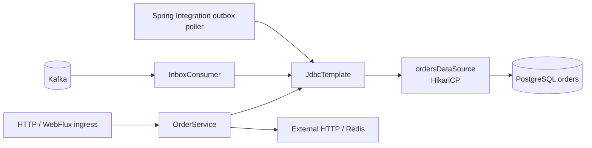
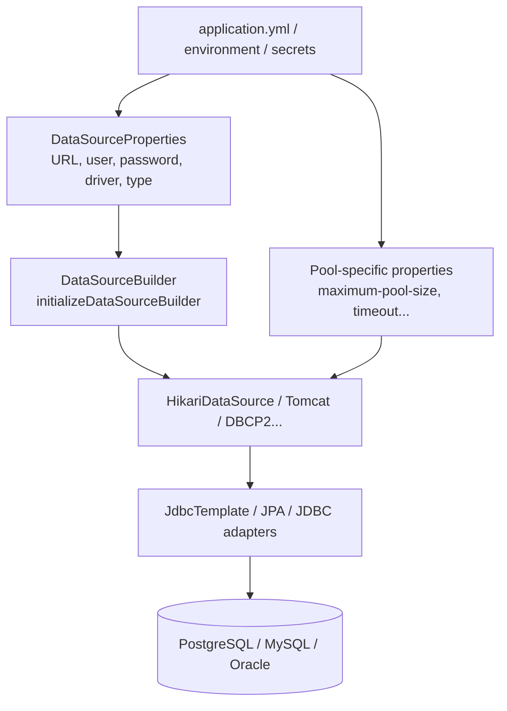
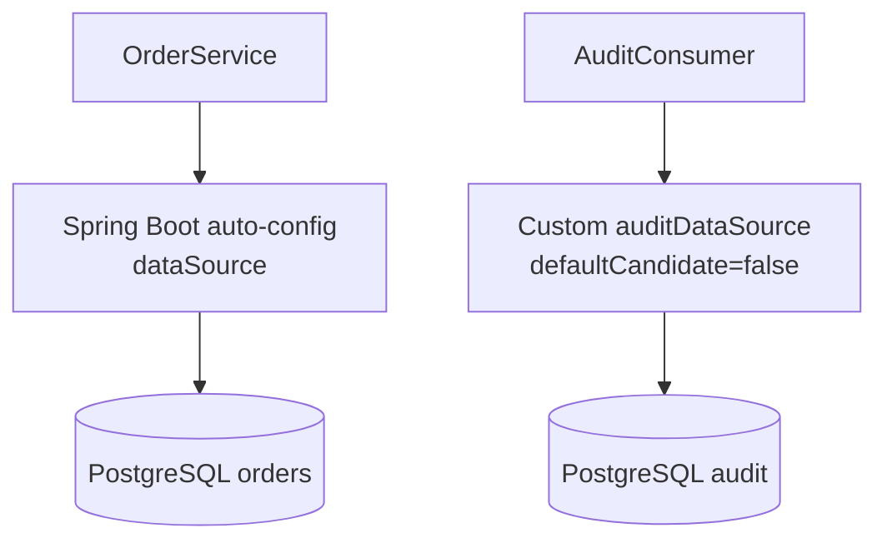
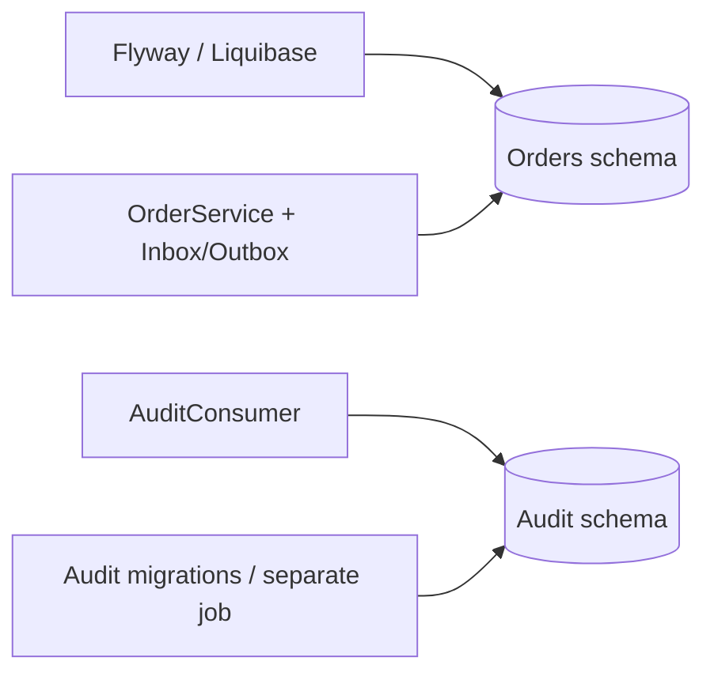
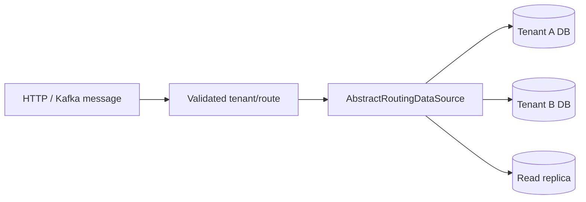
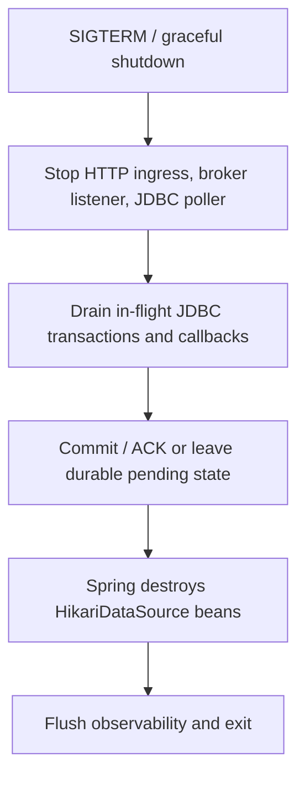
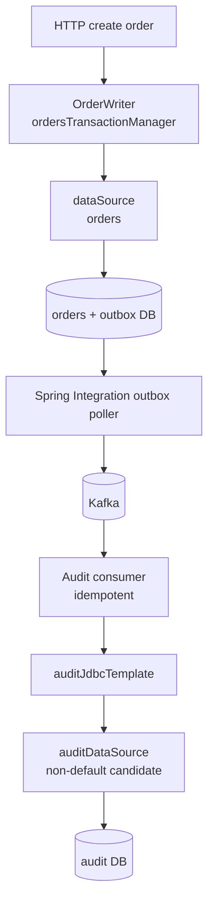

# DataSourceBuilder, DataSourceProperties và tùy chỉnh nguồn dữ liệu

## 1. Vì sao cần hiểu cách Spring Boot tạo DataSource?

Trong ứng dụng Spring Boot tích hợp hệ thống, **kết nối SQL không chỉ là một JDBC URL**. Một dịch vụ có thể vừa nhận request HTTP, vừa đọc bảng outbox, ghi inbox chống trùng khi tiêu thụ Kafka, chạy Flyway khi triển khai và gửi thông tin sang Redis hoặc HTTP API khác. Các luồng đó phụ thuộc vào những câu hỏi rất cụ thể:

- Bean `DataSource` nào đang cấp connection?
- Ai chọn HikariCP hoặc một pool khác, và ai áp các thuộc tính `maximumPoolSize`?
- `JdbcTemplate`, JPA, Spring Batch và Spring Integration JDBC adapter đang dùng **cùng** hay **khác** datasource?
- `@Transactional` có trỏ đúng `PlatformTransactionManager` của connection đó không?
- Nếu tạo `DataSource` thủ công, những cấu hình tự động nào của Spring Boot còn chạy?
- Khi có hai database hoặc một R2DBC `ConnectionFactory`, điều kiện auto-configuration thay đổi ra sao?

Ví dụ hệ thống tiếp nhận đơn hàng:



Nếu `ordersDataSource` thiếu URL, cấu hình Hikari không được bind, hoặc service đang dùng nhầm `auditDataSource`, application có thể lỗi ngay lúc startup **hoặc** tệ hơn: khởi động thành công nhưng đọc/ghi nhầm database và transaction boundary.

Trong module **SPRING_BOOT_INTEGRATION**, trọng tâm của bài là các công cụ Spring Boot giúp **khởi tạo và tùy chỉnh nguồn dữ liệu JDBC** có kiểm soát: `DataSourceBuilder`, `DataSourceProperties`, property binding, auto-configuration conditions và cách gắn chúng với transaction, migration, kiểm thử, vận hành.

### Mục tiêu học tập

Sau bài này, bạn có thể:

1. Phân biệt `javax.sql.DataSource`, `DataSourceBuilder` và `DataSourceProperties`.
2. Giải thích khi nào Spring Boot tự tạo Hikari `DataSource`, khi nào back off.
3. Dùng `DataSourceBuilder` để chọn một `DataSource` implementation rõ ràng và hiểu giới hạn của builder.
4. Dùng `DataSourceProperties.initializeDataSourceBuilder()` để bind `url` đúng với Hikari `jdbcUrl`.
5. Tạo một datasource tự quản lý với namespace `app.datasource.*`, hoặc thêm datasource thứ hai mà không vô tình làm mất datasource chính.
6. Liên kết `JdbcTemplate`, `JdbcClient`, transaction manager, JPA và Flyway với đúng database.
7. Tổ chức JDBC cùng R2DBC, JNDI hoặc Testcontainers mà không suy đoán auto-config.
8. Thiết kế pooling, TLS/secrets, startup/shutdown, metrics và kiểm thử kết nối đáng tin cậy.

> **Phạm vi phiên bản:** Các API và ví dụ chính dùng **Spring Boot 3.5.x, Spring Framework 6.x, Java 17+, JDBC/PostgreSQL và HikariCP**. `DataSourceBuilder` thuộc `org.springframework.boot.jdbc`; `DataSourceProperties` thuộc `org.springframework.boot.autoconfigure.jdbc` ở Boot 3.5. Package/conditions có thể khác ở Boot 4.x; hãy dùng tài liệu đúng phiên bản chạy thực tế.

## 2. Ba lớp trách nhiệm: interface, builder và properties

Để tránh nhầm lẫn, nên hình dung:



| Thành phần | Vai trò | Không làm gì? |
| --- | --- | --- |
| `javax.sql.DataSource` | Hợp đồng Java cung cấp JDBC `Connection` | Không quy định pool size, retry hay transaction nghiệp vụ |
| `DataSourceBuilder<T>` | Tạo implementation từ một số thuộc tính phổ biến, có thể chọn loại pool | Không bind mọi tùy chọn riêng của Hikari/DB vendor |
| `DataSourceProperties` | Bean cấu hình Boot chứa URL, username, password, driver, type... và hỗ trợ suy luận/khởi tạo builder | Không phải bản thân connection pool |
| `@ConfigurationProperties` | Bind cấu hình bên ngoài vào bean | Không tự tạo bean nếu không có cơ chế đăng ký |
| `DataSourceAutoConfiguration` | Định nghĩa cách Boot tự cấu hình datasource theo conditions | Không luôn chạy khi app tự khai báo `DataSource` |
| `HikariDataSource` | Pool implementation thực sự quản lý JDBC connections | Không tự quản lý Kafka offsets hoặc idempotency |
| `JdbcTransactionManager` | Gắn và commit/rollback JDBC transaction theo datasource | Không tự bao phủ HTTP/Kafka hoặc R2DBC transaction |

### 2.1. `DataSource` là factory, không phải một connection dùng chung

```java
// Ví dụ JDBC thuần, minh họa ownership
try (Connection connection = dataSource.getConnection()) {
    try (PreparedStatement ps = connection.prepareStatement(
            "SELECT COUNT(*) FROM orders")) {
        try (ResultSet rs = ps.executeQuery()) {
            rs.next();
            long count = rs.getLong(1);
        }
    }
}
```

Khi `dataSource` là Hikari, `Connection.close()` trên proxy thường **trả connection về pool**, không nhất thiết đóng socket vật lý. `HikariDataSource.close()` lại có nghĩa đóng cả pool: không được gọi nó sau mỗi request.

Đa phần ứng dụng Spring nên dùng `JdbcTemplate`/`JdbcClient` hoặc repository API, để Spring hỗ trợ lấy/trả connection và transaction synchronization đúng cách. Một `Connection` JDBC **không nên dùng chung tùy tiện giữa các threads**.

### 2.2. Bộ ba không tạo transaction nguyên tử qua mọi tích hợp

`DataSourceBuilder` tạo datasource, không tạo message broker transaction. Nếu `OrderService` ghi PostgreSQL rồi gọi HTTP API hoặc publish Kafka, rollback JDBC không hoàn tác request đã đến đối tác. Với các luồng đó cần outbox/inbox, idempotency, error recovery và timeout budgets.

## 3. Trước tiên: khi nào không cần tự viết DataSource bean?

Với một SQL database và HikariCP, **cấu hình Boot mặc định thường là lựa chọn tốt nhất**:

```xml
<dependencies>
    <dependency>
        <groupId>org.springframework.boot</groupId>
        <artifactId>spring-boot-starter-jdbc</artifactId>
    </dependency>
    <dependency>
        <groupId>org.postgresql</groupId>
        <artifactId>postgresql</artifactId>
        <scope>runtime</scope>
    </dependency>
</dependencies>
```

```yaml
spring:
  datasource:
    url: jdbc:postgresql://db.internal.example:5432/orders
    username: ${DB_USERNAME}
    password: ${DB_PASSWORD}
    hikari:
      pool-name: orders-hikari
      maximum-pool-size: 12
      minimum-idle: 2
      connection-timeout: 3000
```

Spring Boot với JDBC starter/Hikari trên classpath và điều kiện phù hợp sẽ:

1. Bind `spring.datasource.*` vào `DataSourceProperties`.
2. Suy luận driver khi URL nhận diện được.
3. Chọn HikariCP khi có trên classpath và không bị override, theo thứ tự pool ưu tiên.
4. Bind `spring.datasource.hikari.*` vào cấu hình pool.
5. Cấu hình một số hạ tầng JDBC phụ thuộc datasource như `JdbcTemplate`, transaction manager, health/metrics theo dependencies/conditions.

**Không nên thêm `@Bean HikariDataSource` chỉ để đổi `maximum-pool-size` từ 10 thành 12**. Property sẵn có đã giải quyết việc đó, đồng thời giữ sự nhất quán với Boot auto-configuration.

### 3.1. Các điều kiện quan trọng

`DataSourceAutoConfiguration` của Boot 3.5:

- Yêu cầu các lớp JDBC/embedded database infrastructure cần thiết trên classpath.
- **Back off khi có R2DBC `io.r2dbc.spi.ConnectionFactory` bean**, theo `@ConditionalOnMissingBean(type = "io.r2dbc.spi.ConnectionFactory")`.
- Đường tạo datasource pooled thông thường cũng xét các bean `DataSource`/XA tương ứng.
- Khi bạn khai báo một `DataSource` custom là candidate thông thường, Boot sẽ không tạo thêm một datasource mặc định theo đường auto-config đó.

**Sự hiện diện của `spring.datasource.url` không bảo đảm bean được tạo** nếu điều kiện khác đã khiến auto-config back off. Khi lỗi, đọc condition evaluation report thay vì đoán từ YAML.

### 3.2. Cơ chế chọn pool

Theo tài liệu Boot 3.5, đối với cấu hình thông thường, lựa chọn ưu tiên là HikariCP khi available, sau đó các pool như Tomcat JDBC, Commons DBCP2, Oracle UCP theo điều kiện. Có thể override bằng `spring.datasource.type` cho đường auto-configuration thích hợp.

Trong ứng dụng có nhiều connection pools trên classpath, **không** giả định một dependency vừa được thêm sẽ không làm thay đổi loại pool được suy luận. Nếu yêu cầu cố định một implementation, dùng `.type(HikariDataSource.class)` và test.

### 3.3. Embedded database là một trường hợp khác

H2/HSQLDB/Derby có thể được Boot cấu hình cho local/test khi dependencies/conditions phù hợp. Nếu không có `spring.datasource.url`, Boot có thể thử embedded database trước khi báo lỗi thiếu URL. Đừng để test chạy H2 thành công rồi kết luận production PostgreSQL `jsonb`, `FOR UPDATE SKIP LOCKED`, isolation và schema migrations đều đúng.

## 4. `DataSourceBuilder`: công cụ tạo instance khi cần custom

API chính của Spring Boot 3.5:

```java
import org.springframework.boot.jdbc.DataSourceBuilder;

// Giá trị minh họa, không hard-code secret trong production.
HikariDataSource dataSource = DataSourceBuilder.create()
        .type(HikariDataSource.class)
        .driverClassName("org.postgresql.Driver")
        .url("jdbc:postgresql://localhost:5432/orders")
        .username("orders_app")
        .password("dev-only-secret")
        .build();
```

Ở ví dụ này, imports còn cần `com.zaxxer.hikari.HikariDataSource`. `DataSourceBuilder` cung cấp các phương thức tiêu biểu:

| Phương thức | Mục đích |
| --- | --- |
| `create()` / `create(ClassLoader)` | Khởi tạo builder và phát hiện implementations phù hợp |
| `type(Class<D>)` | Chọn chính xác implementation `DataSource` |
| `url(String)` | Đặt JDBC URL phổ biến, builder xử lý property names phù hợp |
| `driverClassName(String)` | Chọn JDBC driver khi không suy ra/không muốn suy ra |
| `username(String)` / `password(String)` | Thông tin đăng nhập JDBC |
| `build()` | Tạo datasource instance |
| `derivedFrom(DataSource)` | Tạo builder từ settings cơ bản của datasource khác |

**Builder không phải ORM, pool manager hay connection validator**. Nó chủ yếu hỗ trợ một tập thuộc tính chung và phát hiện implementation. Các tính năng riêng như `maximumPoolSize`, `idleTimeout`, `leakDetectionThreshold` phải được cấu hình qua bean/pool-specific binding.

### 4.1. Vì sao chọn `type(Class)`?

Nếu gọi:

```java
DataSource dataSource = DataSourceBuilder.create().build();
```

builder chọn implementation từ classpath theo thứ tự hỗ trợ. Điều này tiện cho bài demo nhưng không tốt khi production đòi **Hikari metrics/pool behavior nhất quán**, đặc biệt khi nhiều JDBC libraries kéo thêm một pool khác.

```java
HikariDataSource dataSource = DataSourceBuilder.create()
        .type(HikariDataSource.class)
        .build();
```

giúp chữ ký method trả về kiểu cụ thể, có metadata IDE tốt hơn khi bind `@ConfigurationProperties`, và ngăn thay pool vô tình qua classpath.

### 4.2. `derivedFrom` không phải clone pool sống

```java
DataSourceBuilder<?> builder =
        DataSourceBuilder.derivedFrom(existingDataSource);
```

Hàm này có thể khởi tạo một builder dựa trên **loại datasource và một số thuộc tính connection cơ bản** của instance có sẵn. Nó **không sao chép mọi cấu hình pool**, connection vật lý đang mở, transaction context, metrics hay secret rotation policy. Đừng dùng nó như cách “duplicate pool y hệt” trong production nếu chưa rà từng property.

### 4.3. Khi nào dùng builder thuần?

- Có một `DataSource` đặc thù được tạo theo code/properties riêng.
- Cần cố định implementation class.
- Cần datasource không pooled để làm một công cụ quản trị/test có phạm vi rõ.
- Cần chuyển từ cấu hình vendor-specific sang một bean type chuẩn.

Đối với một Hikari `DataSource` gắn `spring.datasource.url` hoặc `app.datasource.url`, nên dùng **`DataSourceProperties.initializeDataSourceBuilder()`** nếu muốn tránh lỗi binding `url` vs `jdbc-url`.

## 5. `DataSourceProperties`: lớp chuẩn hóa cấu hình JDBC của Spring Boot

`org.springframework.boot.autoconfigure.jdbc.DataSourceProperties` lưu một số thuộc tính chung:

- `url`, `username`, `password`, `driverClassName`.
- `type` nếu ứng dụng cho phép chọn datasource implementation.
- Một số tùy chọn embedded database, tên datasource, JNDI và XA metadata.
- Khả năng xác định URL/driver/username khi hợp lý và khởi tạo `DataSourceBuilder` đã chứa cấu hình.

Điểm quan trọng nhất:

```java
HikariDataSource pool = properties
        .initializeDataSourceBuilder()
        .type(HikariDataSource.class)
        .build();
```

`initializeDataSourceBuilder()` không “bật database”; nó chuyển các thông tin trong `DataSourceProperties` sang builder và hỗ trợ bước chuẩn hóa cần thiết khi datasource implementation có tên property khác nhau.

### 5.1. Bẫy nổi tiếng: Hikari `jdbcUrl` không có `url`

Giả sử:

```java
@Bean
@ConfigurationProperties("app.datasource")
public HikariDataSource dataSource() {
    return DataSourceBuilder.create()
            .type(HikariDataSource.class)
            .build();
}
```

và:

```yaml
app:
  datasource:
    url: jdbc:postgresql://localhost:5432/orders
    username: orders_app
```

**Vấn đề:** Hikari `HikariDataSource` có JavaBean property `jdbcUrl` chứ không có `url`. Khi `@ConfigurationProperties` bind **trực tiếp lên Hikari bean**, `app.datasource.url` không map như nhiều người kỳ vọng. Có thể nhận lỗi tương tự “jdbcUrl is required with driverClassName”, hoặc cấu hình vẫn thiếu URL.

Nếu bind trực tiếp Hikari, URL phải là:

```yaml
app:
  datasource:
    jdbc-url: jdbc:postgresql://localhost:5432/orders
    username: orders_app
```

Nhưng với `DataSourceProperties`, ta có thể dùng **`url` chuẩn** và để builder thực hiện chuyển đổi. Đó là lý do cách hai tầng ở phần sau hữu ích hơn.

### 5.2. Những prefix không đồng nghĩa

| Prefix | Đường cấu hình | Ghi chú |
| --- | --- | --- |
| `spring.datasource.url` | Boot-standard `DataSourceProperties` | Được xử lý khi auto-config mặc định |
| `spring.datasource.hikari.maximum-pool-size` | Hikari-specific settings của datasource auto-config | Không tự áp cho mọi custom bean |
| `app.datasource.url` | Tùy bạn khai báo `@ConfigurationProperties("app.datasource")` lên `DataSourceProperties` | Prefix **custom**, không tự động hiểu bởi Boot |
| `app.datasource.configuration.maximum-pool-size` | Tùy bạn bind lên `HikariDataSource` custom | Chỉ có hiệu lực khi annotation đúng prefix |
| `app.datasource.jdbc-url` | Bind trực tiếp vào Hikari bean | Dễ phụ thuộc implementation |
| `spring.r2dbc.url` | R2DBC `ConnectionFactory` | Không cấp URL cho JDBC datasource |

Không thể tự đặt một key lạ trong YAML rồi kỳ vọng Boot bind nó. **Bean method được annotate `@ConfigurationProperties` nào mới xác định prefix áp dụng.**

### 5.3. Khác biệt giữa class `DataSourceProperties` và Bean `DataSourceProperties`

Class là một kiểu Java có API; bean là instance đã được đăng ký trong Spring context, được bind theo prefix. `new DataSourceProperties()` trong một method bình thường mà không có binder không tự đọc `application.yml`.

Trong bean method, `@ConfigurationProperties` đảm nhận binding sau khi instance được tạo. Spring Boot có thể cung cấp bean mặc định của kiểu này khi JDBC auto-configuration chạy; nếu bạn cần custom namespace, hãy **đăng ký bean riêng** như mục 6, tránh phụ thuộc một bean có thể không tồn tại khi điều kiện auto-config thay đổi.

## 6. Một DataSource custom đầy đủ: DataSourceProperties + Hikari

Đây là ví dụ nên dùng khi muốn namespace `app.datasource.*` riêng, nhưng vẫn tận dụng cơ chế chuẩn hóa JDBC URL và driver của Boot.

### 6.1. YAML hai tầng

```yaml
app:
  datasource:
    url: jdbc:postgresql://db.internal.example:5432/orders
    username: ${ORDERS_DB_USER}
    password: ${ORDERS_DB_PASSWORD}
    configuration:
      pool-name: orders-custom-hikari
      maximum-pool-size: 12
      minimum-idle: 2
      connection-timeout: 3000
      validation-timeout: 1000
```

- `app.datasource.url/username/password` được bind vào `DataSourceProperties`.
- `app.datasource.configuration.*` được bind vào `HikariDataSource`.
- `configuration` là **namespace tự chọn**, không phải một prefix mặc định của Spring Boot.
- Các biến môi trường yêu cầu được cung cấp bằng secret management; không lưu password production trong source.

### 6.2. Java configuration

```java
// OrdersDataSourceConfiguration.java
package example.integration.config;

import com.zaxxer.hikari.HikariDataSource;
import org.springframework.beans.factory.annotation.Qualifier;
import org.springframework.boot.autoconfigure.jdbc.DataSourceProperties;
import org.springframework.boot.context.properties.ConfigurationProperties;
import org.springframework.context.annotation.Bean;
import org.springframework.context.annotation.Configuration;
import org.springframework.context.annotation.Primary;

@Configuration(proxyBeanMethods = false)
public class OrdersDataSourceConfiguration {

    @Bean("ordersDataSourceProperties")
    @Primary
    @ConfigurationProperties("app.datasource")
    DataSourceProperties ordersDataSourceProperties() {
        return new DataSourceProperties();
    }

    @Bean("dataSource")
    @Primary
    @ConfigurationProperties("app.datasource.configuration")
    HikariDataSource ordersDataSource(
            @Qualifier("ordersDataSourceProperties")
            DataSourceProperties properties) {

        return properties.initializeDataSourceBuilder()
                .type(HikariDataSource.class)
                .build();
    }
}
```

`@Primary` trên properties giúp tránh ambiguous injection nếu một bean properties khác tồn tại. `@Primary` trên datasource xác định đường ưu tiên khi ứng dụng có thêm bean phụ. `@Qualifier` bảo đảm bean `dataSource` dùng đúng `ordersDataSourceProperties`.

### 6.3. Sơ đồ binding

```text
app.datasource.url ----------------------+
app.datasource.username/password -------+--> DataSourceProperties bean
                                        |
                                        v
                             initializeDataSourceBuilder()
                                        |
                                        v
                            HikariDataSource jdbcUrl
                                        ^
app.datasource.configuration.* ---------+--> Hikari setters
```

Nếu quên `@ConfigurationProperties` thứ hai, pool vẫn có thể kết nối DB nhưng `maximum-pool-size` không được áp và giữ default Hikari. Nếu quên `@ConfigurationProperties` trên `DataSourceProperties`, JDBC URL có thể bị thiếu ngay từ bước tạo bean.

### 6.4. Kiểu trả về cụ thể có ích gì?

Khi `@Bean` trả `HikariDataSource` thay vì chỉ `DataSource`, Spring Boot tooling/IDE có nhiều thông tin hơn về pool-specific properties. Đồng thời bạn cố định loại pool trong code; `app.datasource.type` không tự đổi nó sang một implementation khác khi có `.type(HikariDataSource.class)`.

### 6.5. Không tạo pool trong từng HTTP request

```java
// Anti-pattern: tạo pool mới cho mỗi request, không do Spring quản lý.
public void handleRequest() {
    HikariDataSource ds = properties.initializeDataSourceBuilder()
            .type(HikariDataSource.class)
            .build();
    // ...
}
```

Mỗi lần `build()` tạo một datasource mới, có thể mở thêm nhiều connections và khó cleanup. Thông thường tạo **một Spring-managed bean cho mỗi pool**, inject vào clients/handlers, để Spring đóng lúc ApplicationContext shutdown.

## 7. So sánh ba cách custom DataSource

| Cách | Ví dụ | Ưu điểm | Điều cần cảnh giác |
| --- | --- | --- | --- |
| Boot auto-config | Chỉ `spring.datasource.*` và `spring.datasource.hikari.*` | Ít code, giữ wiring/metrics/initialization | Auto-config conditions có thể back off |
| Builder + bind trực tiếp | `DataSourceBuilder.create().type(...).build()` + `@ConfigurationProperties` | Linh hoạt, ngắn | Hikari `jdbc-url` không phải `url` khi bind trực tiếp |
| Custom DataSourceProperties + builder + pool binding | Hai beans và prefix riêng | URL chuẩn, cấu hình tách hai tầng, test dễ | Phải giữ prefix/qualifier/bean names đúng |

### 7.1. Chọn cách phù hợp

- Một DB/Hikari thông thường: **ưu tiên Boot auto-config**.
- Một DB với namespace riêng: `DataSourceProperties` + explicit pool.
- Hai DB: quyết định primary/secondary và bean candidate semantics.
- Application server quản lý pool: cân nhắc JNDI thay vì tạo pool chồng lên.
- R2DBC runtime nhưng Flyway cần JDBC: không nhất thiết application có `DataSource` nếu migration tool có JDBC URL riêng.

### 7.2. Binding thành công không chứng minh cấu hình đúng business

`@ConfigurationProperties` bind và có thể validate kiểu/constraints, nhưng không tự chứng minh:

- URL trỏ đúng database/tenant.
- User chỉ có quyền cần thiết.
- TLS CA/hostname verification đúng.
- Schema migration đã chạy.
- Pool phù hợp concurrency/latency thực tế.

Cần runtime connectivity tests và contract tests cho các mục trên.

## 8. Hai DataSources: giữ Boot default và thêm pool phụ

Hệ thống có database chính `orders` và database phụ `audit`:



Spring Boot 3.5 chạy trên Spring Framework 6.2, hỗ trợ `@Bean(defaultCandidate = false)`. Điều này rất quan trọng nếu muốn **bổ sung một datasource nhưng giữ datasource chính được Boot tự tạo**. Nếu bean phụ là default candidate bình thường, `@ConditionalOnMissingBean(DataSource.class)` có thể khiến datasource chính không được auto-configured.

### 8.1. YAML minh họa

```yaml
spring:
  datasource:
    url: jdbc:postgresql://orders-db.internal:5432/orders
    username: ${ORDERS_DB_USER}
    password: ${ORDERS_DB_PASSWORD}
    hikari:
      pool-name: orders-pool
      maximum-pool-size: 12

app:
  audit:
    datasource:
      url: jdbc:postgresql://audit-db.internal:5432/audit
      username: ${AUDIT_DB_USER}
      password: ${AUDIT_DB_PASSWORD}
      configuration:
        pool-name: audit-pool
        maximum-pool-size: 4
```

### 8.2. Secondary DataSource theo Boot 3.5

```java
// AuditDataSourceConfiguration.java
package example.integration.config;

import com.zaxxer.hikari.HikariDataSource;
import org.springframework.beans.factory.annotation.Qualifier;
import org.springframework.boot.autoconfigure.jdbc.DataSourceProperties;
import org.springframework.boot.context.properties.ConfigurationProperties;
import org.springframework.context.annotation.Bean;
import org.springframework.context.annotation.Configuration;

@Configuration(proxyBeanMethods = false)
public class AuditDataSourceConfiguration {

    @Bean(name = "auditDataSourceProperties", defaultCandidate = false)
    @Qualifier("audit")
    @ConfigurationProperties("app.audit.datasource")
    DataSourceProperties auditDataSourceProperties() {
        return new DataSourceProperties();
    }

    @Bean(name = "auditDataSource", defaultCandidate = false)
    @Qualifier("audit")
    @ConfigurationProperties("app.audit.datasource.configuration")
    HikariDataSource auditDataSource(
            @Qualifier("audit") DataSourceProperties properties) {
        return properties.initializeDataSourceBuilder()
                .type(HikariDataSource.class)
                .build();
    }
}
```

Ví dụ chỉ thêm datasource phụ; Boot vẫn có thể tạo `dataSource` chính từ `spring.datasource.*` khi các điều kiện khác cho phép. `@Qualifier("audit")` chọn injection point, còn `defaultCandidate=false` giúp bean phụ không làm điều kiện tự cấu hình mặc định back off.

### 8.3. Phân biệt @Primary, @Qualifier và defaultCandidate

| Annotation | Giải quyết vấn đề gì? | Không giải quyết điều gì? |
| --- | --- | --- |
| `@Primary` | Chọn bean ưu tiên khi injection có nhiều candidates | Không giữ Boot auto-config khỏi back off nếu bean phụ vẫn là default candidate |
| `@Qualifier` | Chọn bean cụ thể ở injection point | Không tự tạo connection/transaction |
| `@Bean(defaultCandidate=false)` | Bean phụ không được coi là candidate mặc định trong các điều kiện liên quan | Không làm bean biến mất khi được inject bằng qualifier |

**Đừng thay `defaultCandidate=false` bằng `@Primary` trên datasource phụ.** Hai annotation có ý nghĩa hoàn toàn khác.

### 8.4. Pool-specific settings không “chảy” sang bean phụ

Trong ví dụ, `spring.datasource.hikari.maximum-pool-size` áp cho pool chính; `app.audit.datasource.configuration.maximum-pool-size` áp cho pool phụ. Một `HikariDataSource` custom không tự bind prefix mặc định của Boot nếu không có annotation/configurer tương ứng.

### 8.5. Kỳ vọng bean graph

```text
dataSource                 -> HikariDataSource (orders-db)
auditDataSource            -> HikariDataSource (audit-db)
dataSourceProperties       -> spring.datasource.*
auditDataSourceProperties  -> app.audit.datasource.*
```

Tên bean chính thông thường là `dataSource`; nếu có custom/third-party auto-config khác, xác minh tên/URL thực trong context.

## 9. Hai DataSources đều explicit: một phương án khác

Khi ứng dụng cần kiểm soát hoàn toàn cả hai pools, có thể tự khai báo cả hai:

```text
ordersDataSource (@Primary)
auditDataSource  (chỉ inject có qualifier)
```

### 9.1. Java configuration

```java
// TwoExplicitDataSourcesConfiguration.java
package example.integration.config;

import com.zaxxer.hikari.HikariDataSource;
import org.springframework.beans.factory.annotation.Qualifier;
import org.springframework.boot.autoconfigure.jdbc.DataSourceProperties;
import org.springframework.boot.context.properties.ConfigurationProperties;
import org.springframework.context.annotation.Bean;
import org.springframework.context.annotation.Configuration;
import org.springframework.context.annotation.Primary;

@Configuration(proxyBeanMethods = false)
public class TwoExplicitDataSourcesConfiguration {

    @Bean("ordersProperties")
    @Primary
    @ConfigurationProperties("app.orders.datasource")
    DataSourceProperties ordersProperties() {
        return new DataSourceProperties();
    }

    @Bean("auditProperties")
    @ConfigurationProperties("app.audit.datasource")
    DataSourceProperties auditProperties() {
        return new DataSourceProperties();
    }

    @Bean("ordersDataSource")
    @Primary
    @ConfigurationProperties("app.orders.datasource.configuration")
    HikariDataSource ordersDataSource(
            @Qualifier("ordersProperties") DataSourceProperties properties) {
        return properties.initializeDataSourceBuilder()
                .type(HikariDataSource.class)
                .build();
    }

    @Bean("auditDataSource")
    @ConfigurationProperties("app.audit.datasource.configuration")
    HikariDataSource auditDataSource(
            @Qualifier("auditProperties") DataSourceProperties properties) {
        return properties.initializeDataSourceBuilder()
                .type(HikariDataSource.class)
                .build();
    }
}
```

**Không bật cấu hình này cùng lúc với các cấu hình minh họa của mục 6/8**. Chúng là các phương án thay thế, nếu chồng lên sẽ có bean name conflicts hoặc nhiều `@Primary` dẫn tới wiring không như dự kiến.

### 9.2. YAML

```yaml
app:
  orders:
    datasource:
      url: jdbc:postgresql://orders-db.internal:5432/orders
      username: ${ORDERS_DB_USER}
      password: ${ORDERS_DB_PASSWORD}
      configuration:
        pool-name: orders-pool
        maximum-pool-size: 12
  audit:
    datasource:
      url: jdbc:postgresql://audit-db.internal:5432/audit
      username: ${AUDIT_DB_USER}
      password: ${AUDIT_DB_PASSWORD}
      configuration:
        pool-name: audit-pool
        maximum-pool-size: 4
```

### 9.3. @Primary không phải transaction manager

`@Primary` chỉ giải quyết bean selection ở injection. Nó **không** biến hai datasources thành một transaction, không cho audit `JdbcTemplate` tự tham gia transaction của orders, và không kiểm soát database schema owner.

## 10. Tùy chỉnh JdbcTemplate, JdbcClient và các adapter theo đúng DataSource

Khi chỉ có một datasource, Boot thường tự tạo `JdbcTemplate`, `NamedParameterJdbcTemplate`, `JdbcClient` dựa trên beans và conditions. Khi có hai nguồn dữ liệu với nghiệp vụ khác nhau, **tạo client theo tên** sẽ dễ review và kiểm thử hơn.

### 10.1. Tạo hai JdbcTemplate

```java
// JdbcClientsConfiguration.java
package example.integration.config;

import javax.sql.DataSource;
import org.springframework.beans.factory.annotation.Qualifier;
import org.springframework.context.annotation.Bean;
import org.springframework.context.annotation.Configuration;
import org.springframework.context.annotation.Primary;
import org.springframework.jdbc.core.JdbcTemplate;
import org.springframework.jdbc.core.simple.JdbcClient;

@Configuration(proxyBeanMethods = false)
public class JdbcClientsConfiguration {

    @Bean("ordersJdbcTemplate")
    @Primary
    JdbcTemplate ordersJdbcTemplate(
            @Qualifier("ordersDataSource") DataSource dataSource) {
        return new JdbcTemplate(dataSource);
    }

    @Bean("auditJdbcTemplate")
    JdbcTemplate auditJdbcTemplate(
            @Qualifier("auditDataSource") DataSource dataSource) {
        return new JdbcTemplate(dataSource);
    }

    @Bean("auditJdbcClient")
    JdbcClient auditJdbcClient(
            @Qualifier("auditJdbcTemplate") JdbcTemplate jdbc) {
        return JdbcClient.create(jdbc);
    }
}
```

Code trên ứng với **mục 9** (hai custom beans, primary tên `ordersDataSource`). Nếu sử dụng **mục 8**, bean orders chính thường mang tên `dataSource`; thay `@Qualifier("ordersDataSource")` bằng `@Qualifier("dataSource")`.

Một số điều kiện auto-configuration của Boot `JdbcTemplate`/`NamedParameterJdbcTemplate` có thể back off khi user đã khai báo custom bean. Khi đã có nhiều templates, đừng kỳ vọng một `JdbcClient` unqualified luôn tồn tại/chọn đúng; tạo bean cụ thể và inject `@Qualifier`.

### 10.2. Repository/service theo pool có chủ đích

```java
// AuditRecorder.java
package example.integration.audit;

import org.springframework.beans.factory.annotation.Qualifier;
import org.springframework.jdbc.core.JdbcTemplate;
import org.springframework.stereotype.Service;

@Service
public class AuditRecorder {

    private final JdbcTemplate auditJdbc;

    public AuditRecorder(
            @Qualifier("auditJdbcTemplate") JdbcTemplate auditJdbc) {
        this.auditJdbc = auditJdbc;
    }

    public int record(String eventId, String category) {
        return auditJdbc.update("""
                INSERT INTO integration_audit (event_id, category)
                VALUES (?, ?)
                ON CONFLICT (event_id) DO NOTHING
                """, eventId, category);
    }
}
```

Đây là SQL PostgreSQL cần migration tạo bảng `integration_audit`. `ON CONFLICT` giúp lặp cùng event ID không sinh thêm audit row, nhưng không thay xác minh **cùng ID phải có cùng business payload** nếu producer có thể gửi thông tin mâu thuẫn.

### 10.3. `JdbcClient` không biến JDBC thành reactive

`JdbcClient` là API fluent trên Spring JDBC, vẫn blocking. Trong WebFlux, nếu dùng JDBC phải tách khỏi Netty event loop, giới hạn concurrency và theo dõi Hikari pending. `JdbcClient` không phải R2DBC `DatabaseClient`.

### 10.4. Spring Integration JDBC adapter

`JdbcPollingChannelAdapter`, `JdbcMessageHandler` và `JdbcOutboundGateway` sử dụng `DataSource`/`JdbcOperations` theo cấu hình. Nếu adapter audit dùng audit datasource nhưng transaction advice dùng orders transaction manager, nó **không thuộc cùng transaction**. Luôn đặt tên/qualifier rõ và kiểm thử rollback.

## 11. Transaction managers: datasource nào quản lý transaction nào?

`JdbcTransactionManager` (`PlatformTransactionManager`) quản lý các JDBC connections của một `DataSource`. Khi có hai datasource:

```java
// JdbcTransactionsConfiguration.java
package example.integration.config;

import javax.sql.DataSource;
import org.springframework.beans.factory.annotation.Qualifier;
import org.springframework.context.annotation.Bean;
import org.springframework.context.annotation.Configuration;
import org.springframework.context.annotation.Primary;
import org.springframework.jdbc.support.JdbcTransactionManager;
import org.springframework.transaction.PlatformTransactionManager;

@Configuration(proxyBeanMethods = false)
public class JdbcTransactionsConfiguration {

    @Bean("ordersTransactionManager")
    @Primary
    PlatformTransactionManager ordersTransactionManager(
            @Qualifier("ordersDataSource") DataSource dataSource) {
        return new JdbcTransactionManager(dataSource);
    }

    @Bean("auditTransactionManager")
    PlatformTransactionManager auditTransactionManager(
            @Qualifier("auditDataSource") DataSource dataSource) {
        return new JdbcTransactionManager(dataSource);
    }
}
```

Ví dụ ứng với mục 9. Với datasource chính do Boot tự cấu hình (mục 8), chỉnh qualifier orders thành `dataSource`. Không khai báo trùng nhiều transaction managers mặc định rồi dùng `@Transactional` unqualified nếu không biết manager sẽ được chọn.

### 11.1. Service chọn transaction owner

```java
// OrderWriter.java
package example.integration.orders;

import org.springframework.beans.factory.annotation.Qualifier;
import org.springframework.jdbc.core.JdbcTemplate;
import org.springframework.stereotype.Service;
import org.springframework.transaction.annotation.Transactional;

@Service
public class OrderWriter {

    private final JdbcTemplate jdbc;

    public OrderWriter(
            @Qualifier("ordersJdbcTemplate") JdbcTemplate jdbc) {
        this.jdbc = jdbc;
    }

    @Transactional(transactionManager = "ordersTransactionManager")
    public void save(String orderId) {
        jdbc.update("""
                INSERT INTO orders(order_id, status)
                VALUES (?, 'NEW')
                """, orderId);
    }
}
```

Method được Spring proxy gọi từ bean khác sẽ sử dụng orders transaction manager. Nếu trong cùng method bạn gọi audit `JdbcTemplate`, **audit transaction không tự join** orders transaction chỉ vì có một annotation trên method.

### 11.2. Hai DataSources không tự có distributed transaction

Giả sử:

```text
ordersDataSource → INSERT orders
auditDataSource  → INSERT audit_events
```

Nếu orders commit nhưng audit fail, bạn có thể có order mà chưa có audit. Các phương án:

- Dùng **một database/transaction owner** nếu hai writes thực sự phải atomic.
- Ghi **transactional outbox** cùng orders trong một transaction; worker ghi audit về sau với retry/idempotency.
- Saga/compensation khi mỗi hệ độc lập và cần phục hồi.
- XA/JTA nếu có hạ tầng hỗ trợ, hiểu chi phí/timeout/heuristic outcomes.

Không tuyên bố **exactly-once effect qua hai DB** chỉ nhờ `@Transactional`. Test cần chèn fault giữa hai commits và đánh giá tính nhất quán.

### 11.3. JPA dùng transaction manager riêng khi phù hợp

Nếu `ordersDataSource` nuôi `EntityManagerFactory` của Hibernate/JPA, thường cần `JpaTransactionManager` để điều phối JPA operations. `JdbcTransactionManager` được chọn cho Spring JDBC; không thay JPA manager bằng JDBC manager mà bỏ qua persistence context/flush semantics.

Với nhiều EntityManagerFactories, mỗi nhóm repositories cần `entityManagerFactoryRef`, `transactionManagerRef`, packages scanning và migrations phù hợp. Một `@Primary DataSource` **không** tạo đủ mọi cấu hình JPA thứ hai.

## 12. Flyway/Liquibase và schema initialization khi có nhiều pool

Migration cần trỏ **đúng database**, đúng user có quyền schema và đúng thứ tự trước khi business handlers/pollers dùng bảng.



### 12.1. Mặc định Flyway chọn nguồn nào?

Theo tài liệu Boot 3.5, Flyway thường dùng datasource chính (hoặc `@Primary`) khi không có lựa chọn riêng. Nếu muốn Flyway chạy **một nguồn migration khác**, có thể:

- Đánh dấu bean bằng `@FlywayDataSource`.
- Dùng `spring.flyway.url`/`user`/`password` để Flyway tạo connection JDBC riêng.
- Chạy migration bằng CI/CD job hoặc Flyway CLI có credentials độc lập với app.

```yaml
spring:
  flyway:
    enabled: true
    locations: classpath:db/migration
    url: jdbc:postgresql://orders-db.internal:5432/orders
    user: ${DB_MIGRATION_USER}
    password: ${DB_MIGRATION_PASSWORD}
    validate-on-migrate: true
    clean-disabled: true
```

Mặc định Flyway không tự migrate **tất cả** datasource beans. Đừng giả định `auditDataSource` cũng có bảng mới chỉ vì Flyway chạy thành công trên `ordersDataSource`.

### 12.2. Ví dụ @FlywayDataSource cho pool migration riêng

```java
// MigrationDataSourceConfiguration.java
package example.integration.config;

import com.zaxxer.hikari.HikariDataSource;
import org.springframework.boot.autoconfigure.flyway.FlywayDataSource;
import org.springframework.boot.autoconfigure.jdbc.DataSourceProperties;
import org.springframework.boot.context.properties.ConfigurationProperties;
import org.springframework.context.annotation.Bean;
import org.springframework.context.annotation.Configuration;
import org.springframework.beans.factory.annotation.Qualifier;

@Configuration(proxyBeanMethods = false)
public class MigrationDataSourceConfiguration {

    @Bean(name = "migrationProperties", defaultCandidate = false)
    @ConfigurationProperties("app.migration.datasource")
    DataSourceProperties migrationProperties() {
        return new DataSourceProperties();
    }

    @Bean(name = "migrationDataSource", defaultCandidate = false)
    @FlywayDataSource
    @ConfigurationProperties("app.migration.datasource.configuration")
    HikariDataSource migrationDataSource(
            @Qualifier("migrationProperties")
            DataSourceProperties properties) {
        return properties.initializeDataSourceBuilder()
                .type(HikariDataSource.class)
                .build();
    }
}
```

Đây là **một lựa chọn thay thế** cho `spring.flyway.url/user/password`; không cần tạo thêm migration pool nếu Flyway-native connection đã đáp ứng yêu cầu. `defaultCandidate=false` giúp bean phụ không làm auto-configuration datasource chính back off. Đảm bảo bean migration không bị business clients sử dụng qua injection không qualifier.

### 12.3. Liquibase cũng cần chọn nguồn

Liquibase thường chọn datasource chính; `@LiquibaseDataSource` có thể chỉ định bean khác. Nếu project có cả Flyway, Liquibase, `schema.sql/data.sql` và Hibernate `ddl-auto=update`, tránh để **nhiều schema owners** sửa cùng tables production.

Một pattern rõ ràng:

```yaml
spring:
  sql:
    init:
      mode: never
  jpa:
    hibernate:
      ddl-auto: validate
```

Nhánh JPA chỉ áp dụng nếu ứng dụng thực sự dùng JPA. `validate` kiểm tra schema có phù hợp entities, không tự tạo schema.

### 12.4. Migration nhiều databases

Nếu orders DB và audit DB độc lập, có thể cần **hai migration jobs/configurations**, mỗi cái có schema history riêng. Chỉ định `locations`, database URL và credentials cho từng job; không copy migrations của orders vào audit một cách vô tình.

Nếu Kubernetes chạy nhiều replicas cùng startup, cần bảo đảm migration locking/coordination đúng công cụ và rollout contract (expand/contract). Đặc biệt không để endpoint Kafka poll bảng chưa được migrate xong.

## 13. Nếu dùng R2DBC bên cạnh JDBC

R2DBC có `io.r2dbc.spi.ConnectionFactory`, không phải `javax.sql.DataSource`. Spring Boot 3.5 có điều kiện `DataSourceAutoConfiguration` **back off khi có bean R2DBC ConnectionFactory**.

```text
Spring context
  ├── ConnectionFactory (R2DBC, nonblocking)
  │      └── DatabaseClient / Reactive repositories
  └── DataSource (JDBC, blocking) [nếu app chủ động tạo]
         └── JdbcTemplate / Flyway / Integration JDBC adapter
```

Khai báo cả `spring.r2dbc.url` và `spring.datasource.url` chưa chắc tạo cả hai beans. Nếu thực sự cần hai đường, có thể **tự khai báo DataSource** theo mục 6/9 hoặc dùng cơ chế re-enable auto-configuration mà tài liệu Boot 3.5 mô tả với `@Import(DataSourceAutoConfiguration.class)`; phải kiểm chứng bằng context test.

### 13.1. Không trộn hai loại transactions

- `R2dbcTransactionManager` quản lý reactive transaction qua Reactor Context.
- `JdbcTransactionManager` quản lý JDBC transaction gắn thread.
- Hai connections **không tự chia sẻ một transaction** dù cùng PostgreSQL host/database.

Nếu cùng một business workflow cần ghi order và outbox nguyên tử, dùng **một** stack truy cập SQL trong **một** transaction, không để order dùng R2DBC rồi outbox dùng JDBC mà kỳ vọng atomicity.

### 13.2. Không đưa JDBC blocking vào WebFlux event loop

Khi WebFlux phải gọi legacy `JdbcTemplate`, isolate blocking call:

```java
return Mono.fromCallable(() -> legacyJdbcService.load(orderId))
        .subscribeOn(Schedulers.boundedElastic());
```

Ví dụ cần imports `reactor.core.publisher.Mono` và `reactor.core.scheduler.Schedulers`. Đây **chỉ chuyển thread**, không biến JDBC thành nonblocking hay tạo atomicity với R2DBC; vẫn cần Hikari capacity, timeout và giới hạn concurrency.

## 14. JNDI: DataSource do container/application server sở hữu

Nếu ứng dụng chạy trong một Jakarta EE application server hoặc môi trường có datasource đặt trong JNDI:

```yaml
spring:
  datasource:
    jndi-name: java:jboss/datasources/orders
```

`spring.datasource.jndi-name` là đường cấu hình Boot hỗ trợ để tra datasource đã được container quản lý thay vì tạo pool mới từ URL/credentials ở app.

Đặc điểm:

- Application server sở hữu pool/connections, nên settings pool phải được quản lý ở server.
- Không tự `close()` một JNDI datasource như thể nó do Spring Boot tạo và sở hữu.
- Transaction và JTA involvement cần kiểm tra theo cấu hình server.
- Đây không phải giải pháp mặc định cho containerized Spring Boot fat JAR tự chạy, nơi thường dùng Hikari do Boot quản lý.

### 14.1. JNDI không nên bị trộn vô thức với builder

Nếu đã dùng `spring.datasource.jndi-name`, đừng tạo thêm một `DataSourceBuilder` trong application cho **cùng nguồn** chỉ vì quen cấu hình URL. Điều đó có thể mở pool thứ hai, bypass server-managed transactions và khiến metrics/credentials khó quản lý.

## 15. JdbcConnectionDetails và nguồn cấu hình động

Từ Spring Boot 3.1, `JdbcConnectionDetails` là một interface cung cấp các thông tin kết nối JDBC như URL, username, password và driver. Spring Boot có thể sử dụng nó trong auto-configuration, nhất là khi dùng **Testcontainers `@ServiceConnection`** hoặc các service connections khác.

```text
spring.datasource.*      ───────┐
                                ├─> Boot auto-configuration → DataSource
JdbcConnectionDetails    ───────┘
  (e.g. Testcontainers service connection)
```

Tuy nhiên, **DataSourceBuilder và một bean thủ công không tự biết tất cả các connection details sources**:

```java
@Bean
HikariDataSource myDataSource(DataSourceProperties properties) {
    return properties.initializeDataSourceBuilder()
            .type(HikariDataSource.class)
            .build();
}
```

Đoạn code trên sử dụng **những giá trị trong `DataSourceProperties` đã được bind**, không tự lấy `JdbcConnectionDetails` khác nếu bạn chưa nối chúng. Vì vậy:

- Với datasource do Boot auto-config, `@ServiceConnection` cho PostgreSQL Testcontainer thường là lựa chọn tiện.
- Với datasource custom `app.orders.datasource.*` và `app.audit.datasource.*`, dùng `@DynamicPropertySource` hoặc cấu hình test tường minh cho **đúng các prefixes** nếu không có custom connection-details integration.
- Nếu tự định nghĩa `JdbcConnectionDetails`, phải kiểm tra nó thực sự được datasource creation path tiêu thụ; không chỉ assert interface bean tồn tại.

### 15.1. Không đồng nhất connection details với secret rotation

Một `JdbcConnectionDetails` có thể cung cấp credentials lúc bean được tạo, nhưng không tự khiến mọi connection trong Hikari pool được xác thực lại bằng password mới ngay tức khắc. Rotation cần xét **cách lấy credentials, pool replacement/recycle, connection lifetime, TLS và in-flight transactions**.

### 15.2. Thứ tự ưu tiên nguồn cấu hình

Environment variables, `application-{profile}.yml`, command-line args, config imports, Kubernetes secrets và service connection details có các quy tắc ưu tiên/điều kiện riêng của Spring Boot. Không nên tự hứa một **thứ tự ưu tiên chung** không xét việc datasource được tạo bằng auto-config hay bean custom.

Trong test hoặc staging, kiểm tra giá trị effective **không in password ra logs**, và xác nhận JDBC URL/username/schema/pool name đúng.

## 16. Chia cấu hình theo môi trường và quản lý secrets

Một cấu hình có thể dùng placeholders:

```yaml
app:
  datasource:
    url: ${ORDERS_JDBC_URL}
    username: ${ORDERS_DB_USER}
    password: ${ORDERS_DB_PASSWORD}
    configuration:
      pool-name: orders-main
      maximum-pool-size: ${ORDERS_POOL_MAX:12}
      connection-timeout: ${ORDERS_POOL_ACQUIRE_MS:3000}
```

Tất cả keys này chỉ hoạt động khi **bean `DataSourceProperties` và `HikariDataSource` thực sự bind prefix `app.datasource` và `app.datasource.configuration`** theo mục 6.

### 16.1. Phân biệt cấu hình local/test/prod

| Môi trường | Nguồn database | Lưu ý |
| --- | --- | --- |
| Local | PostgreSQL local/container, account quyền tối thiểu | Không dùng credentials thật của production |
| Unit test | Fake datasource khi test mapping/config thuần | Không xác minh SQL/vendor behavior |
| Integration test | Testcontainers PostgreSQL | Kiểm chứng driver, schema, pool, transaction |
| Staging | Infrastructure giống production | TLS, network, database roles và max connections |
| Production | Managed PostgreSQL/cluster | Secret rotation, failover, SLO, backup và monitoring |

### 16.2. Không để secrets trong metadata và logs

Tránh:

```java
log.info("Datasource config {}", properties);
log.info("JDBC URL = {}", dataSource.getJdbcUrl());
```

JDBC URL đôi khi chứa query parameters hoặc credentials/vendor-specific options. Chỉ log **pool name, datasource logical name, host alias đã được lọc, database role không nhạy cảm, trạng thái kết nối và duration** ở mức cần thiết. Actuator `/env`, `/configprops`, `/conditions` có thể tiết lộ thông tin cấu hình; hạn chế exposure và RBAC.

### 16.3. TLS/hostname verification theo JDBC driver

Ví dụ PostgreSQL:

```yaml
app:
  datasource:
    url: "jdbc:postgresql://orders-db.internal:5432/orders?sslmode=verify-full&sslrootcert=/etc/db-ca/ca.pem"
```

`sslmode=verify-full` yêu cầu TLS và kiểm tra tên máy theo PostgreSQL JDBC driver semantics. Certificate CA phải được mount vào container đúng path và quyền đọc. Các drivers MySQL, Oracle, SQL Server có cấu hình TLS khác; không copy nguyên query parameters giữa vendors. Tránh cấu hình cho phép tin mọi certificate hoặc bỏ hostname verification chỉ để vượt lỗi kết nối.

### 16.4. Phân quyền DB theo workload

```text
orders_runtime  → SELECT/INSERT/UPDATE các bảng nghiệp vụ cần thiết
audit_runtime   → INSERT audit table và đọc rất hạn chế
migration_role  → DDL/Flyway (chỉ dùng tại migration stage)
reporting_role  → read-only / replica nếu hợp đồng cho phép
```

Tạo nhiều datasources là cơ hội **giảm quyền** và cô lập tài nguyên, không phải lý do dùng một superuser cho mọi kết nối.

## 17. HikariCP tuning: đừng coi maximumPoolSize là thông số duy nhất

Spring Boot 3.5 với Hikari auto-config dùng namespace `spring.datasource.hikari.*`. Khi pool custom của mục 6/9, các key tương ứng thường nằm dưới `*.configuration.*`.

### 17.1. Các thông số cốt lõi

| Hikari property | Ý nghĩa | Điểm cần tránh |
| --- | --- | --- |
| `maximumPoolSize` | Giới hạn số connections mà pool quản lý | Đặt lớn hơn năng lực database/overall pods |
| `minimumIdle` | Số idle connections mục tiêu | Đặt quá cao trên nhiều replicas làm lãng phí |
| `connectionTimeout` | Giới hạn thời gian **chờ lấy connection từ pool** (ms) | Hiểu nhầm là SQL query timeout |
| `validationTimeout` | Thời gian kiểm tra connection (ms) | Đặt vô lý so với connectionTimeout |
| `idleTimeout` | Thời gian idle connection có thể bị retire khi điều kiện phù hợp | Hiểu nhầm tất cả connections sẽ đóng sau đúng thời gian |
| `maxLifetime` | Lifetime tối đa dự kiến cho connection trong pool | Lớn hơn database/network idle/lifetime policy gây connection bị reset |
| `keepaliveTime` | Thực hiện ping phù hợp khi connection idle | Không thay validation và firewall/network design |
| `leakDetectionThreshold` | Log cảnh báo connection held quá lâu | Không phải bằng chứng connection leak chắc chắn |
| `poolName` | Tên pool dùng trong logs/metrics | Tên trùng khiến khó phân biệt database |

### 17.2. Cấu hình ví dụ có chủ đích

```yaml
spring:
  datasource:
    hikari:
      pool-name: orders-pool
      maximum-pool-size: 12
      minimum-idle: 2
      connection-timeout: 3000
      validation-timeout: 1000
      idle-timeout: 600000
      max-lifetime: 1500000
      keepalive-time: 300000
```

Thời gian trên là milliseconds theo Hikari properties, **giá trị minh họa**, không phải bộ defaults bắt buộc cho mọi môi trường. Phải đo bằng traffic thật và điều chỉnh theo database max connections, network/firewall, latency và failover behavior. Hikari cũng có ràng buộc nội bộ về min/max durations và quan hệ giữa timeouts; tra tài liệu đúng phiên bản nếu startup báo property validation error.

### 17.3. Connection acquisition timeout khác query timeout

```text
HTTP request
  → Hikari.getConnection() [connectionTimeout]
  → SQL statement execute [query/statement timeout]
  → COMMIT [transaction/DB timeout]
```

Nếu `connectionTimeout=3000`, chỉ có nghĩa caller có thể đợi tối đa khoảng 3 giây để lấy connection theo pool semantics. Một SQL `SELECT` sau khi đã lấy connection vẫn có thể chạy rất lâu nếu bạn không đặt query/statement timeout và lock timeout phù hợp.

Với Spring JDBC có thể cấu hình `JdbcTemplate` query timeout, transaction timeout hoặc database `statement_timeout`/lock timeout theo vendor. Cần chú ý scope và precedence: statement timeout trong session có thể bị áp cho các query khác nếu dùng session settings không được reset.

### 17.4. Leak detection không tự fix lỗi

Nếu thấy Hikari cảnh báo connection leak, nguyên nhân có thể là:

- Code tự lấy `Connection` nhưng không close.
- Transaction dài giữ connection khi gọi HTTP partner.
- Query chờ lock/DB I/O quá lâu.
- Thread bị blocked trong external call.
- Lỗi từ việc dùng raw JDBC connection ngoài Spring transaction management.

Không khắc phục bằng cách tăng `maximumPoolSize` vô hạn; cần xem thread dumps, transaction durations, slow queries và ownership của connection.

## 18. Tính ngân sách connections cho toàn hệ thống

Giả sử một pod có:

```text
orders Hikari max = 12 connections
audit Hikari max  =  4 connections
reporting pool    =  3 connections
-------------------------------
up to             = 19 application connections/pod
```

Nếu chạy 6 replicas, tiềm năng mở tới `6 × 19 = 114` application connections, chưa tính Flyway, monitoring, background job, admin clients và những ứng dụng khác.

### 18.1. Công thức capacity

\[
C_{\mathrm{app,max}} =
\sum_{i=1}^{N_{\mathrm{replicas}}}
\sum_{j=1}^{M_{\mathrm{datasources}}}P_{i,j}.
\]

\(P_{i,j}\) là maximum pool size của datasource j ở replica i. Đây là **giới hạn cấu hình tổng**, không phải số connections thực luôn tồn tại. Database cần chừa reserve cho migrations, replication/maintenance và incident handling.

### 18.2. Thông số pool không tự cải thiện throughput

Nếu PostgreSQL CPU/IO hoặc row locks đã bão hòa, tăng connections có thể làm throughput xấu hơn. Nếu Kafka consumer concurrency tăng nhưng Hikari max cố định, số thread **chờ connection** tăng, tạo latency và redelivery do handler chậm.

Một chiến lược:

- Giới hạn HTTP concurrency/rate theo downstream budget.
- Giảm Kafka poll/prefetch hoặc điều chỉnh listener concurrency theo DB capacity.
- Dùng SQL indexes, batch size và transaction ngắn.
- Tách report heavy queries sang read replica nếu consistency contract cho phép.
- Theo dõi oldest outbox/inbox pending age, không chỉ Hikari active.

### 18.3. Read replica không thay read-after-write contract

Nếu một datasource trỏ primary, datasource kia trỏ replica, replication lag có thể khiến request vừa ghi order rồi query replica thấy dữ liệu cũ. Một retry “not found” không mặc định là database mất dữ liệu. Hãy thiết kế nhất quán đọc/ghi, user-facing guarantees và fallback phù hợp.

## 19. Routing DataSource, đa tenant và phân tách đọc/ghi

Khi có nhiều tenant hoặc read/write DB, có thể dùng `AbstractRoutingDataSource` của Spring Framework. Nó quyết định datasource đích **khi lấy connection**, dựa vào một lookup key:



Điều này mạnh nhưng có những rủi ro:

1. **Routing key phải được xác thực:** không dùng HTTP header `X-Tenant-ID` chưa xác thực để tự chọn database của tenant khác.
2. **Thread-bound context:** `ThreadLocal` route key có thể không truyền qua `@Async`, `ExecutorChannel`, WebFlux scheduler; cần thiết kế context propagation phù hợp.
3. **Transaction bắt đầu lúc nào:** một connection đã bind vào transaction có thể không đổi datasource giữa chừng dù routing key thay đổi.
4. **Không gọi read replica cho read-after-write** nếu contract yêu cầu strong consistency.
5. **Resource count:** nhiều tenant pools có thể mở quá nhiều connections; cần policy tạo/đóng/evict và global budget.

### 19.1. Routing không tự là sharding/multi-tenant security

`AbstractRoutingDataSource` chọn target datasource, không cung cấp migration, per-tenant ACL, data isolation policy hoặc distributed transaction. Trước khi mở rộng đến hàng nghìn tenants, đánh giá pool-per-tenant overhead và topology database.

### 19.2. Tránh mutate một DataSource để đổi tenant

Không dùng `hikari.setJdbcUrl(...)` trên một pool đang chạy để đổi sang tenant khác trong từng request. Pool có thể đang chứa connections tới database cũ; thay đổi live configuration không bảo đảm chuyển toàn bộ connections atomically. Dùng routing/tenant-aware clients với lifecycle và resource isolation rõ ràng.

## 20. Startup, readiness, failover, rotation và graceful shutdown

Một bean `DataSource` được tạo thành công chưa chắc database đã sẵn sàng. Với Hikari, connection acquisition hoặc pool initialization có thể phụ thuộc cấu hình và thời điểm lần đầu sử dụng.

### 20.1. Những ranh giới startup

```text
Spring context creates DataSource bean
    ↓
Hikari tries to initialize/acquire connections
    ↓
Flyway/Liquibase migrates schema
    ↓
JdbcTemplate/Repositories become usable
    ↓
HTTP readiness and broker consumers accept work
```

Thứ tự thực phụ thuộc bean dependencies và auto-configuration. Không tự tạo một `@PostConstruct` Kafka poller hoặc background thread query schema **trước** khi migrations hoàn tất. Spring Boot có các cơ chế phát hiện database initializers và annotation `@DependsOnDatabaseInitialization` cho trường hợp custom beans cần phụ thuộc quá trình đó.

### 20.2. Không coi DB health là mọi thứ đều ổn

`DataSourceHealthIndicator` có thể kiểm tra connectivity qua JDBC theo Actuator configuration. Nhưng một DB `UP` không chứng minh:

- Đúng schema migration version.
- User có quyền INSERT/UPDATE bảng nghiệp vụ.
- Replica lag đáp ứng SLO.
- Hikari pool còn capacity khi traffic tăng.
- Kafka listener có idempotency khi redelivery.
- External HTTP partner sẵn sàng.

Health checks có vai trò riêng: readiness nên phản ánh instance có thể nhận traffic mới không; liveness không nên fail liên tục chỉ vì một query tạm chậm khiến pod restart storm.

### 20.3. Failover không đồng nghĩa thay URL được ngay

PostgreSQL primary failover có thể đổi IP/endpoint hoặc cắt socket. Hikari có thể phát hiện connections invalid và tạo lại theo driver/database/network behavior; **các transaction đã bị cắt không tự resume**. Business operations cần retry **toàn transaction** có giới hạn và idempotency, không lặp một HTTP charge không có idempotency key.

Với DNS failover/managed proxy, kiểm tra driver, DNS cache, connection lifetime và health behavior; không gọi `DataSourceBuilder.build()` trong một retry loop của từng request để sửa connection outage.

### 20.4. Secret/password rotation

Thay environment variable sau startup **không tự bảo đảm** datasource bean đang chạy nhận password mới. Một chiến lược:

1. Hệ thống cấp secret mới, có giai đoạn credentials overlap nếu hỗ trợ.
2. App lấy cấu hình mới qua cơ chế hợp lệ và tạo/recycle connections theo driver/pool semantics.
3. Kiểm thử quyền và TLS trước khi thu hồi credentials cũ.
4. Cho transactions in-flight hoàn tất; không đột ngột đóng pool khi broker listener vẫn chạy.
5. Có rollback/restart plan nếu rotation thất bại.

Một số cơ chế có thể yêu cầu **rolling restart** thay vì hot reload; lựa chọn phụ thuộc secret provider, pool ownership và JDBC driver. Không hứa `@RefreshScope` tự làm credentials rotation an toàn cho mọi pool.

### 20.5. Dừng nguồn công việc trước khi đóng pools



Nếu `@PreDestroy` của một business bean tự gọi `dataSource.close()` trước khi Kafka consumer/poller dừng, handler có thể nhận “HikariPool has been closed”. Thông thường để Spring manage lifecycle resource, `SmartLifecycle` điều phối stop ingress và worker, rồi pool được đóng khi context destroy.

Shutdown graceful chỉ cải thiện tỷ lệ tasks hoàn tất; với `SIGKILL`/node crash, tính đúng đắn vẫn cần inbox/outbox, idempotency và broker redelivery.

## 21. Testcontainers: xác minh cả hai pools trỏ đúng database

Đối với nhiều datasources, mock `DataSource` chỉ xác minh injection; nó không chứng minh URLs, JDBC drivers, schema và pool binding. Testcontainers PostgreSQL giúp kiểm tra **hai kết nối độc lập**.

### 21.1. Dependencies test

```xml
<dependency>
    <groupId>org.springframework.boot</groupId>
    <artifactId>spring-boot-starter-test</artifactId>
    <scope>test</scope>
</dependency>
<dependency>
    <groupId>org.testcontainers</groupId>
    <artifactId>junit-jupiter</artifactId>
    <scope>test</scope>
</dependency>
<dependency>
    <groupId>org.testcontainers</groupId>
    <artifactId>postgresql</artifactId>
    <scope>test</scope>
</dependency>
```

Với Boot parent/BOM, để starter và Testcontainers compatible versions theo BOM; không tự ghép các bản bất kỳ. Test có thể cần Docker runtime hoặc hạ tầng Testcontainers tương thích.

### 21.2. Integration test hai explicit datasources

```java
// TwoDataSourcesIT.java
package example.integration.config;

import com.zaxxer.hikari.HikariDataSource;
import org.junit.jupiter.api.Test;
import org.springframework.beans.factory.annotation.Autowired;
import org.springframework.beans.factory.annotation.Qualifier;
import org.springframework.boot.test.context.SpringBootTest;
import org.springframework.jdbc.core.JdbcTemplate;
import org.springframework.test.context.DynamicPropertyRegistry;
import org.springframework.test.context.DynamicPropertySource;
import org.testcontainers.containers.PostgreSQLContainer;
import org.testcontainers.junit.jupiter.Container;
import org.testcontainers.junit.jupiter.Testcontainers;

import static org.assertj.core.api.Assertions.assertThat;

@SpringBootTest
@Testcontainers
class TwoDataSourcesIT {

    @Container
    static PostgreSQLContainer<?> orders =
            new PostgreSQLContainer<>("postgres:16-alpine")
                    .withDatabaseName("orders");

    @Container
    static PostgreSQLContainer<?> audit =
            new PostgreSQLContainer<>("postgres:16-alpine")
                    .withDatabaseName("audit");

    @DynamicPropertySource
    static void databases(DynamicPropertyRegistry registry) {
        registry.add("app.orders.datasource.url", orders::getJdbcUrl);
        registry.add("app.orders.datasource.username", orders::getUsername);
        registry.add("app.orders.datasource.password", orders::getPassword);
        registry.add("app.orders.datasource.configuration.maximum-pool-size",
                () -> "8");

        registry.add("app.audit.datasource.url", audit::getJdbcUrl);
        registry.add("app.audit.datasource.username", audit::getUsername);
        registry.add("app.audit.datasource.password", audit::getPassword);
        registry.add("app.audit.datasource.configuration.maximum-pool-size",
                () -> "3");
    }

    @Autowired
    @Qualifier("ordersJdbcTemplate")
    JdbcTemplate ordersJdbc;

    @Autowired
    @Qualifier("auditJdbcTemplate")
    JdbcTemplate auditJdbc;

    @Autowired
    @Qualifier("ordersDataSource")
    HikariDataSource ordersPool;

    @Autowired
    @Qualifier("auditDataSource")
    HikariDataSource auditPool;

    @Test
    void bothPoolsHaveCorrectUrlAndConfiguration() {
        String fromOrders = ordersJdbc.queryForObject(
                "SELECT current_database()", String.class);
        String fromAudit = auditJdbc.queryForObject(
                "SELECT current_database()", String.class);

        assertThat(fromOrders).isEqualTo("orders");
        assertThat(fromAudit).isEqualTo("audit");
        assertThat(fromOrders).isNotEqualTo(fromAudit);

        assertThat(ordersPool.getMaximumPoolSize()).isEqualTo(8);
        assertThat(auditPool.getMaximumPoolSize()).isEqualTo(3);
        assertThat(ordersPool.getJdbcUrl()).startsWith("jdbc:postgresql:");
        assertThat(auditPool.getJdbcUrl()).startsWith("jdbc:postgresql:");
    }
}
```

Ví dụ test này giả định Spring Boot application context chỉ đăng ký **phương án hai explicit datasources mục 9** cùng `JdbcClientsConfiguration` mục 10, và không có cấu hình Flyway yêu cầu những bảng chưa tồn tại. Nếu module vẫn bật Flyway/JPA auto-init, hãy cung cấp migrations test hoặc tắt những initialization jobs không liên quan trong profile test một cách có chủ đích.

**Vì sao `@DynamicPropertySource` thay vì chỉ `@ServiceConnection`?** Các beans ở mục 9 dùng **prefix tùy chỉnh** và `DataSourceProperties` do ứng dụng tạo. `@DynamicPropertySource` gán chính xác URLs/credentials cho những prefixes ấy; không suy đoán `@ServiceConnection` sẽ tự map cả hai custom datasources.

### 21.3. Test negative binding case

Trong một context test riêng, cố tình bind:

```yaml
app:
  datasource:
    url: jdbc:postgresql://localhost:5432/orders
```

trực tiếp vào `@Bean HikariDataSource` qua `@ConfigurationProperties("app.datasource")` và kiểm tra `getJdbcUrl()` không nhận giá trị mong muốn (hoặc startup/connection acquisition fail) theo Hikari version. Rồi dùng `DataSourceProperties.initializeDataSourceBuilder()` với **cùng `url`**, assert `getJdbcUrl()` được set đúng.

Test cần cách ly cấu hình và không cố kết nối DB không tồn tại; mục tiêu là chứng minh **property binding difference**, không phải test network.

### 21.4. Test transaction manager trỏ đúng DataSource

Một integration test có thể:

1. Tạo bảng `orders` ở database orders, `integration_audit` ở database audit.
2. Trong `@Transactional("ordersTransactionManager")`, insert một order rồi throw exception.
3. Assert order insert rollback trên orders database.
4. Trong `@Transactional("auditTransactionManager")`, insert một audit record rồi throw exception.
5. Assert audit rollback riêng trên audit database.
6. Tạo tình huống ghi cả hai, fail giữa chừng; chứng minh **không có cross-DB atomicity mặc định**.

**Không đặt `@Transactional` trên test method** nếu cần xác minh commits thật và concurrency threads: Spring Test có thể rollback test-managed transaction làm kết quả khó hiểu. Dùng Spring service proxies trong test và chuẩn bị fixtures với transactions đã commit.

### 21.5. Test lifecycle khi đóng ApplicationContext

Để chứng minh không có poller dùng datasource đã đóng:

```text
Start Spring context and JDBC poller
  → begin a transaction/handler with controllable latch
  → request context shutdown
  → stop poller/consumer, wait in-flight work
  → close Hikari pool
  → verify no "pool closed" during active business work
```

Đây là integration test có timing; dùng latch/futures with deadlines và đúng lifecycle owner. Không dùng `Thread.sleep(1000)` như bằng chứng chắc mọi transaction đã hoàn tất.

## 22. Chẩn đoán auto-configuration và binding

### 22.1. Bật condition report

```bash
java -jar orders-service.jar --debug
```

Hoặc cấu hình logger (ở profile dev/test, không cần bật dài hạn trên production):

```yaml
logging:
  level:
    org.springframework.boot.autoconfigure: DEBUG
```

Tìm các mục như:

- `DataSourceAutoConfiguration`: matched/backed off?
- `DataSourceConfiguration.Hikari`: có Hikari và thiếu user-defined default datasource?
- `JdbcTemplateAutoConfiguration`, `DataSourceTransactionManagerAutoConfiguration`: bean conditions nào bị lệch?
- `FlywayAutoConfiguration`/`LiquibaseAutoConfiguration`: migration database nào được chọn?
- `R2dbcAutoConfiguration`: có ConnectionFactory làm JDBC path back off?

**Đừng chỉ grep câu “Hikari” trong logs rồi kết luận bean đã được bind mọi properties đúng.** Hãy test `getJdbcUrl()`, `getMaximumPoolSize()`, connection query và database name/schema.

### 22.2. Actuator conditions/configprops

`/actuator/conditions`, `/actuator/configprops` và `/actuator/health` có thể hỗ trợ debug khi được expose/cấp quyền theo policy. Không public `env`/`configprops` để xem secrets; kiểm soát sanitized values, audit access và role-based permissions.

### 22.3. Phân biệt lỗi binding và lỗi kết nối

```text
Missing jdbcUrl/driver             → cấu hình bean/property binding
No suitable driver                 → driver classpath/JDBC URL mismatch
Connection refused/timed out      → host/port/network/database availability
Password authentication failed    → credentials/roles
PKIX/hostname verification failed → TLS trust/certificate/SAN
Relation does not exist           → wrong DB/schema/migration
Hikari pool exhausted             → pool/workload/long transactions
```

Một lỗi TLS không được sửa bằng cách đổi `url` sang `jdbc-url` nếu datasource đã có URL đúng. Một lỗi binding cũng không được sửa bằng tăng `connection-timeout` mà không kiểm tra property mapping.

## 23. Bảng xử lý lỗi: từ startup tới production

| Triệu chứng | Nguyên nhân thường gặp | Hướng kiểm tra/khắc phục |
| --- | --- | --- |
| `Failed to configure a DataSource` | Thiếu URL, embedded DB hoặc driver | Xem effective properties/driver dependency và auto-config report |
| `No suitable driver` | JDBC URL sai scheme hoặc thiếu PostgreSQL/MySQL driver | Kiểm tra `jdbc:postgresql://...`, driver trong runtime classpath |
| Hikari báo `jdbcUrl is required` | Bind trực tiếp `app.datasource.url` vào Hikari | Dùng `jdbc-url` direct binding hoặc `DataSourceProperties` |
| `@ConfigurationProperties` không nhận `maximum-pool-size` | Sai prefix giữa `DataSourceProperties` và pool bean | Kiểm tra annotation trên cả hai bean methods |
| Đã đặt `spring.datasource.hikari.maximum-pool-size` nhưng custom pool vẫn giữ default | Custom pool bind `app.*.configuration`, không phải prefix mặc định | Dùng prefix của bean thực và test `getMaximumPoolSize()` |
| Có auditDataSource nhưng biến mất bean dataSource chính | Secondary bean làm Boot JDBC auto-config back off | `@Bean(defaultCandidate=false)` theo Boot 3.5, hoặc khai báo cả hai explicit |
| `NoUniqueBeanDefinitionException: DataSource` | Hai beans default candidates, không có selection | `@Primary`, `@Qualifier`, default candidate semantics rõ |
| Chọn nhầm orders DB khi ghi audit | Inject unqualified `JdbcTemplate`/DataSource | Đặt tên templates/managers, `@Qualifier` |
| Transaction không rollback ở audit | Manager quản lý orders datasource, audit query dùng datasource khác | Đồng bộ datasource và transaction manager, kiểm thử rollback |
| Flyway migrate nhầm database | Không đặt `@FlywayDataSource` hoặc migration JDBC URL | Chọn migration owner/credentials và test schema version |
| JPA không tạo EntityManagerFactory | DataSource/EntityManagerFactory/repo packages chưa đúng | Kiểm tra JPA starter, primary, entity scanning và config |
| Có `spring.datasource.url` nhưng không có bean `DataSource` | R2DBC ConnectionFactory khiến JDBC auto-config back off | Tạo explicit JDBC bean hoặc documented re-enable và test |
| `JdbcTemplate` missing | JDBC starter/bean conditions không đáp ứng | Kiểm tra client auto-config và khai báo template rõ |
| App khởi động nhưng đọc nhầm bảng | URL trỏ sai DB, default schema/search_path khác | Query `current_database()`, `current_schema()` với đúng user |
| `password authentication failed` | Secret/profile/role sai hoặc rotated credentials | Xác minh secret provisioning, account và failover; không log password |
| `PKIX path building failed` | Truststore/CA không tin cậy | Kiểm tra JDBC driver TLS trust, CA chain, certificate hostname |
| `HikariPool has been closed` giữa lúc consumer xử lý | DataSource bị destroy trước poller/worker | Ngừng ingress/drain trước resource close |
| Hikari connection timeout | Pool cạn vì concurrency/queries/locks | Hikari active/pending, DB lock waits, query timeouts và pool budget |
| Hikari leak detection warnings | Transaction dài, unclosed connection hoặc lock wait | Thread dump, transaction duration, `try-with-resources` |
| Testcontainers `@ServiceConnection` không map custom bean | Custom namespace không được connection details mapping | Dùng `@DynamicPropertySource` đúng custom prefixes |
| Production database connections vượt max | Tổng pool sizes nhân số replicas quá lớn | Capacity toàn cụm, giảm concurrency/pools, chừa reserve |
| Failover xong lỗi một phần requests | Connections stale/transactions bị ngắt | Retry bounded toàn transaction, idempotency; không đổi pool liên tục |

### 23.1. Runbook 1: sau khi thêm audit DataSource, orders DataSource biến mất

1. Xác nhận **trước khi đổi** có một `dataSource` do Boot auto-config.
2. Tìm bean `auditDataSource` vừa thêm: nó có `@Bean(defaultCandidate=false)` không?
3. Đọc `DataSourceAutoConfiguration` condition report.
4. Kiểm tra app có R2DBC `ConnectionFactory` mới xuất hiện không.
5. Chọn một trong hai chiến lược: giữ primary auto + secondary non-default, hoặc tạo cả hai custom.
6. Xem `@Qualifier` ở các JDBC clients/transaction managers/migration configs.
7. Chạy integration test với hai PostgreSQL containers, query `current_database()` từ cả hai.
8. Chỉ deploy khi SQL business requests và outbox/inbox đã được kiểm tra đúng database.

### 23.2. Runbook 2: pool size đặt 12 nhưng chạy 10

1. Kiểm tra source config đúng môi trường/profile chưa.
2. Xác định bean là Hikari auto-config hay custom.
3. Với auto-config, kiểm tra `spring.datasource.hikari.maximum-pool-size`.
4. Với custom, kiểm tra `@ConfigurationProperties("...configuration")` đúng prefix.
5. Query giá trị thực `HikariDataSource.getMaximumPoolSize()` trong integration test.
6. Nếu đang dùng JNDI, chỉnh pool ở container owner thay vì Hikari config của ứng dụng.
7. Xem có hai pool khác nhau cùng tên và log đang quan sát nhầm pool không.

### 23.3. Runbook 3: @Transactional vẫn ghi sang database sai

1. Tìm bean method/service đang dùng và `@Qualifier` của JdbcTemplate.
2. Tìm datasource của `JdbcTemplate`.
3. Tìm `PlatformTransactionManager` được chọn và datasource nó quản lý.
4. Kiểm tra `@Transactional` được Spring proxy intercept (không self-invocation).
5. Kiểm tra xem code đổi thread qua `@Async`/`ExecutorChannel` hay không.
6. Gây lỗi giữa hai JDBC operations; assert rollback ở đúng database.
7. Nếu cross-DB consistency cần thiết, dùng outbox/saga hoặc công nghệ distributed transaction được thiết kế riêng, không chỉ đổi annotation.

## 24. Tình huống tổng hợp: thêm datasource audit làm hỏng luồng order

**Bối cảnh giả định:** một dịch vụ `orders-integration` đang dùng Spring Boot `spring-boot-starter-jdbc` với PostgreSQL orders. Service nhận HTTP, ghi order + outbox trong một JDBC transaction và có Spring Integration poller publish Kafka.

Đội muốn ghi audit events vào database riêng, nên thêm:

```java
// Anti-pattern khi muốn giữ Boot auto-config datasource chính:
@Bean
@ConfigurationProperties("app.audit.datasource")
public HikariDataSource auditDataSource() {
    return DataSourceBuilder.create()
            .type(HikariDataSource.class).build();
}
```

Và YAML:

```yaml
app:
  audit:
    datasource:
      url: jdbc:postgresql://audit-db.internal:5432/audit
      username: ${AUDIT_DB_USER}
      password: ${AUDIT_DB_PASSWORD}
```

### 24.1. Ba lỗi có thể cùng xuất hiện

**Lỗi 1 — Auto-config back off:** Vì bean `auditDataSource` là default candidate, điều kiện datasource chính có thể không còn match. `dataSource` từ `spring.datasource.*` không được tạo. Một số clients inject `DataSource` không qualifier giờ nhận audit datasource, hoặc context báo thiếu bean `dataSource`.

**Lỗi 2 — `url` không bind vào Hikari:** `@ConfigurationProperties("app.audit.datasource")` bind trực tiếp vào Hikari, nhưng Hikari cần `jdbc-url`. Audit pool có thể khởi tạo mà thiếu URL hoặc không connect được.

**Lỗi 3 — Sai transaction manager:** Nếu service writer lấy audit JdbcTemplate nhưng vẫn dùng orders transaction manager, các SQL writes không thuộc transaction mong đợi. Một event có thể được ghi audit dù transaction orders rollback, hoặc ngược lại.

### 24.2. Cách sửa có thể review

1. Để datasource orders chính auto-config từ `spring.datasource.*`.
2. Định nghĩa audit **DataSourceProperties** và `HikariDataSource` riêng, cả hai `@Bean(defaultCandidate=false)` theo mục 8.
3. Đặt `@Qualifier("audit")` cho injection của audit datasource; tạo `auditJdbcTemplate` và `auditTransactionManager` rõ.
4. Dùng `app.audit.datasource.url` qua `DataSourceProperties`, và `app.audit.datasource.configuration.maximum-pool-size` cho Hikari settings.
5. Xác định outbox/inbox trên **orders database** và giữ business transaction orders ở đó.
6. Nếu audit phải được ghi sau commit, đưa event vào outbox orders, publish hoặc replay tới audit service/DB với idempotency; không giả định cross-DB atomicity.
7. Testcontainers khởi tạo hai databases, query `current_database()` từ hai clients.
8. Thử transaction rollback và Kafka redelivery, kiểm tra orders/outbox và audit effects theo contract.

### 24.3. Flow sau khi sửa



Thiết kế sau sửa bảo toàn order/outbox atomicity trong **một datasource**; audit có thể nhất quán cuối cùng theo at-least-once delivery. Nếu audit DB tạm outage, Kafka/outbox/inbox/retry và eventId receipt giúp không mất hoặc nhân đôi business effect.

### 24.4. Không kết luận từ việc ứng dụng khởi động được

Một app có thể startup dù đã lựa chọn **sai datasource**. Chỉ một test kiểu `contextLoads()` không đủ. Điều cần xác nhận gồm:

- Bean graph với **đúng hai datasource**.
- JDBC URL, database/schema name và user đúng.
- Primary/secondary pool sizes và qualifier wiring.
- Transaction rollback trên DB cần thiết.
- Flyway migrations chạy đúng schema.
- Outbox consumer ACK sau durable boundary và chống trùng.
- Shutdown không đóng Hikari pool khi JDBC poller vẫn chạy.

## 25. Những nguyên tắc thiết kế nguồn dữ liệu cho tích hợp thực tế

### 25.1. Chỉ tạo một datasource khi nó có trách nhiệm rõ

Đừng thêm một pool chỉ để tách một class Java nếu cùng DB/user/connection budget đã đủ. Mỗi pool tăng:

- Connections và resource cost.
- Secret/TLS/configuration surface.
- Metrics/health/alert cần theo dõi.
- Khả năng transaction cross-boundary.
- Rủi ro khi migration/rollout/rotation/shutdown.

Nên thêm datasource khi có **database khác, database role khác, workload isolation, tenancy hoặc read replica consistency contract** thực sự cần.

### 25.2. Chọn config owner duy nhất cho từng thuộc tính

```text
Boot auto-config orders:
  spring.datasource.*
  spring.datasource.hikari.*

Custom audit:
  app.audit.datasource.*
  app.audit.datasource.configuration.*
```

Tránh cấu hình rải rác giữa `spring.datasource.url`, `app.datasource.url`, một hard-coded Java builder và environment variable mới cho cùng JDBC connection. Sự mơ hồ precedence rất khó review.

### 25.3. Mỗi JDBC workload có bounded concurrency và timeout

- HTTP ingestion giới hạn concurrent requests.
- Kafka listener concurrency không vượt DB transaction throughput.
- Spring Integration JDBC poller có batch size, poll cadence và backoff hợp lý.
- Hikari `maximum-pool-size` nhỏ hơn budget database được cấp cho pod.
- SQL statement, transaction lock và connection acquire có deadlines.
- Queues trong JVM không thay durable inbox/outbox.

### 25.4. Quan sát theo business completion

Hikari active/idle/pending là tín hiệu kỹ thuật, nhưng cần bổ sung:

- HTTP requests được ghi nhận thành công.
- Inbox events đã commit, duplicate receipt count.
- Outbox pending oldest age và broker ACK errors.
- Audit/reports chưa đồng bộ.
- Retry/DLT/parking age.
- Connection failover/secret rotation events.

Một dịch vụ có pool không bị cạn vẫn có thể **mất message** nếu ACK broker trước DB commit hoặc đẩy vào volatile queue rồi process chết.

## 26. Checklist trước khi triển khai

1. **Quyết định có cần custom bean không**; nếu chỉ đổi Hikari size, dùng Boot properties.
2. **Classpath:** JDBC starter, driver đúng version/URL và Hikari implementation.
3. **Auto-config conditions:** kiểm tra `DataSourceAutoConfiguration` và R2DBC `ConnectionFactory`.
4. **DataSourceBuilder:** hiểu `type`, `url`, `driverClassName`, `build`, giới hạn pool-specific binding.
5. **DataSourceProperties:** dùng đúng prefix; `initializeDataSourceBuilder()` chuẩn hóa URL/driver.
6. **Hikari URL:** direct binding dùng `jdbc-url`; qua properties chuẩn dùng `url`.
7. **Pool-specific binding:** có annotation thứ hai đúng namespace `*.configuration.*`.
8. **Bean ownership:** chỉ một managed pool per role; không `build()` theo request.
9. **Hai DataSources:** dùng `defaultCandidate=false` cho pool phụ nếu muốn giữ Boot auto primary.
10. **Primary/qualifier:** `@Primary` cho default injection; `@Qualifier` cho target rõ.
11. **Transaction manager:** mỗi JDBC data source có manager đúng; không gộp cross-DB transaction tưởng tượng.
12. **JPA:** nếu dùng Hibernate, cấu hình EntityManagerFactory/transaction manager/repo packages riêng.
13. **JDBC clients:** `JdbcTemplate`/`JdbcClient`/Integration JDBC adapter inject đúng datasource.
14. **Migrations:** chọn Flyway/Liquibase owner/schema/database; không tự migrate mọi datasource.
15. **JNDI:** không tạo thêm pool nếu container đã sở hữu datasource.
16. **R2DBC:** `ConnectionFactory` không thay `DataSource`, reactive transaction không bao JDBC.
17. **Service connections:** với custom prefixes, test rõ `@DynamicPropertySource`/connection details.
18. **TLS/secrets:** CA/hostname, credentials least privilege, rotation và không log raw URL/password.
19. **Hikari settings:** pool size, acquire timeout, max lifetime, keepalive, validation, leak warnings.
20. **Capacity:** tính tổng max pools × replicas; chừa DB connections cho migrations/ops.
21. **Routing/tenancy:** validated route key, context propagation và transaction scope.
22. **Health/metrics:** Actuator có RBAC, Hikari pending/latency, SQL locks, business completion.
23. **Testing:** bean graph, pool binding, two Testcontainers databases, schema, transaction rollback.
24. **Failure testing:** DB failover, wrong credentials, TLS issue, query timeout, pool exhaustion.
25. **Shutdown:** ngừng HTTP consumers/pollers, drain JDBC work rồi mới destroy pool.
26. **Integration correctness:** inbox/outbox, idempotency, retry budget và broker ACK timing.

### Câu hỏi tự kiểm tra

**1.** `DataSourceBuilder` khác `DataSourceProperties` ở trách nhiệm nào? Tại sao builder không tự bind mọi Hikari settings?

**2.** Với một datasource PostgreSQL Hikari bình thường, khi nào chỉ dùng `spring.datasource.*` tốt hơn tự viết `@Bean`?

**3.** Vì sao `@Bean HikariDataSource` + `@ConfigurationProperties("app.datasource")` có thể không nhận `url`?

**4.** `DataSourceProperties.initializeDataSourceBuilder()` giải quyết bẫy `url`/`jdbc-url` như thế nào?

**5.** `@Primary` và `@Bean(defaultCandidate=false)` khác nhau ra sao khi thêm audit datasource?

**6.** Nếu orders datasource do Boot tạo, audit datasource explicit, làm sao bảo đảm audit JdbcTemplate không dùng orders database?

**7.** Hai `JdbcTransactionManager` trên hai datasources có tự tạo distributed transaction không?

**8.** `spring.datasource.hikari.maximum-pool-size=12` có tự áp cho `app.audit.datasource.configuration.*` không?

**9.** Khi Flyway khởi động, làm sao bảo đảm nó migrate **orders schema**, không phải audit schema?

**10.** Tại sao Testcontainers với hai databases có giá trị hơn `contextLoads()` cho cấu hình nhiều datasource?

**11.** `connectionTimeout=3000` của Hikari có giới hạn tổng thời gian SQL query là 3 giây không?

**12.** Nếu 6 pods mỗi pod có pools 12 và 4 connections, tổng giới hạn ứng dụng theo cấu hình là bao nhiêu, và còn phải chừa connections cho những gì?

**13.** Tại sao Redis/Kafka/HTTP client retries vẫn cần idempotency dù PostgreSQL có transaction?

**14.** Tại sao JDBC `DataSource` và R2DBC `ConnectionFactory` không thể thay thế nhau trong transaction?

**15.** Nếu sau rolling deployment xuất hiện lỗi “HikariPool has been closed” trong Spring Integration poller, bạn sẽ kiểm tra lifecycle nào trước?

## Tài liệu tham khảo

- [Spring Boot 3.5 — Configure a Custom DataSource / Two DataSources](https://docs.spring.io/spring-boot/3.5/how-to/data-access.html): cách dùng `DataSourceBuilder`, `DataSourceProperties`, `@Bean(defaultCandidate=false)` và URL binding.
- [Spring Boot 3.5 — SQL Databases](https://docs.spring.io/spring-boot/3.5/reference/data/sql.html): auto-configuration, Hikari, JDBC clients, JPA, JNDI và R2DBC.
- [Spring Boot 3.5 — DataSourceBuilder API](https://docs.spring.io/spring-boot/3.5/api/java/org/springframework/boot/jdbc/DataSourceBuilder.html): methods, pool type detection và `derivedFrom`.
- [Spring Boot 3.5 — DataSourceProperties API](https://docs.spring.io/spring-boot/3.5/api/java/org/springframework/boot/autoconfigure/jdbc/DataSourceProperties.html): common properties, `initializeDataSourceBuilder()` và URL/driver determination.
- [Spring Boot 3.5 — DataSourceAutoConfiguration API](https://docs.spring.io/spring-boot/3.5/api/java/org/springframework/boot/autoconfigure/jdbc/DataSourceAutoConfiguration.html): conditional auto-configuration và R2DBC exclusion.
- [Spring Boot 3.5 — JdbcConnectionDetails API](https://docs.spring.io/spring-boot/3.5/api/java/org/springframework/boot/autoconfigure/jdbc/JdbcConnectionDetails.html): connection details contract.
- [Spring Boot 3.5 — Database Initialization](https://docs.spring.io/spring-boot/3.5/how-to/data-initialization.html): Flyway/Liquibase, migration datasource và script initialization.
- [Spring Framework — JDBC](https://docs.spring.io/spring-framework/reference/data-access/jdbc.html): `JdbcTemplate`, `JdbcClient`, connections và SQL exceptions.
- [Spring Framework — Transaction Management](https://docs.spring.io/spring-framework/reference/data-access/transaction.html): `PlatformTransactionManager`, transaction scopes và propagation.
- [HikariCP — Configuration](https://github.com/brettwooldridge/HikariCP#configuration-knobs-baby): pool size, timeouts, lifetime, keepalive và leak detection.
- [Spring Integration — JDBC](https://docs.spring.io/spring-integration/reference/jdbc.html): JDBC adapters, gateways và transaction boundaries.
- [Testcontainers — PostgreSQL](https://java.testcontainers.org/modules/databases/postgres/): kiểm thử PostgreSQL thật.

## Kết luận

`DataSourceBuilder` và `DataSourceProperties` giúp Spring Boot tạo **JDBC `DataSource` có chủ đích**, nhưng hai công cụ có trách nhiệm khác nhau: builder tạo implementation từ một số properties chung; `DataSourceProperties` làm lớp cấu hình/chuẩn hóa URL, driver và khởi tạo builder, đặc biệt quan trọng khi Hikari dùng `jdbcUrl` thay vì `url` ở direct binding. Với **một database Hikari thông thường**, hãy ưu tiên Boot auto-configuration và `spring.datasource.*`. Khi cần **datasource custom hoặc nhiều nguồn dữ liệu**, chọn namespace rõ, `@ConfigurationProperties` hai tầng, `@Primary`/`@Qualifier` và `defaultCandidate=false` đúng ngữ cảnh, rồi kiểm tra pool/transaction/migration thực tế. Đối với các luồng HTTP, PostgreSQL, cache, broker và Spring Integration, correctness còn phụ thuộc vào **đúng transaction manager, bounded connections, TLS/secrets, graceful shutdown, inbox/outbox và idempotency**, không chỉ việc `DataSource` bean được tạo thành công.
