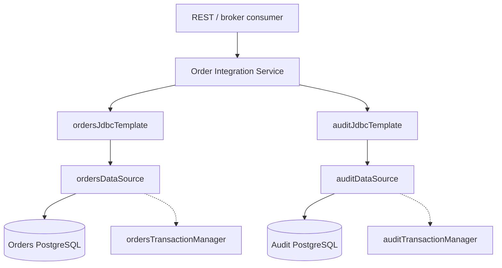
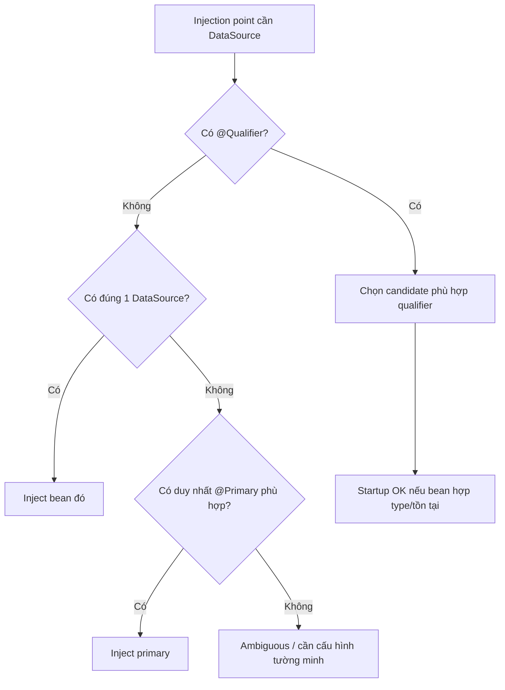
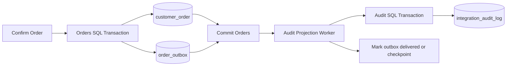

# Cấu hình nhiều DataSource với @Primary và qualifier

## 1. Khi nào một ứng dụng Spring Boot cần nhiều DataSource?

Trong một ứng dụng tích hợp, dữ liệu thường không nằm trong một database duy nhất. Ví dụ **Order Integration Service** vừa xử lý đơn hàng trên PostgreSQL chính, vừa lưu bản ghi đối soát/audit trên một PostgreSQL khác. Hoặc ứng dụng cần đọc cơ sở dữ liệu ERP cũ trong khi ghi các bảng nghiệp vụ mới, truy vấn reporting replica, hoặc ghi thông tin integration checkpoint vào database riêng.

Với một `DataSource`, Spring Boot thường auto-configure connection pool, `JdbcTemplate`, transaction manager và các thành phần database khác từ `spring.datasource.*`. Khi có **nhiều DataSource beans**, sự lựa chọn không còn hiển nhiên:

- Controller/service nào phải dùng database Orders?
- Audit repository phải lấy connection từ database Audit nào?
- Bean mặc định khi inject `DataSource` là bean nào?
- `@Transactional` rollback trên database nào?
- Flyway/Liquibase chạy migration vào datasource nào?
- JPA repositories và `EntityManagerFactory` được gắn với persistence unit nào?
- Khi hai databases commit riêng, bảo đảm nhất quán ra sao?

Hai công cụ Spring cơ bản là **`@Primary`** và **`@Qualifier`**, nhưng chúng chỉ giải quyết **cách chọn bean khi dependency injection**. Chúng **không** tự tạo một transaction phân tán, không tự định tuyến truy vấn SQL theo tên bảng và không đảm bảo framework initializer/chương trình migration luôn trỏ vào đúng database.

Bài nằm trong chương **Kết nối SQL** của module **SPRING_BOOT_INTEGRATION**, với phạm vi tổ chức tích hợp Spring Boot qua HTTP client, cơ sở dữ liệu, cache, broker thông điệp và Spring Integration adapters. Các ví dụ liên kết cách chọn datasource với cấu hình, hợp đồng dữ liệu, transaction, lỗi, retry, testing, observability và idempotency.

### 1.1. Mục tiêu học tập

Sau bài này, bạn có thể:

1. Cấu hình hai `DataSourceProperties` và hai `HikariDataSource` độc lập trong Spring Boot.
2. Hiểu quy tắc chọn `@Primary` khi inject theo type và cách `@Qualifier` chọn bean chính xác.
3. Tạo `JdbcTemplate`/`NamedParameterJdbcTemplate`/`JdbcClient` theo datasource, không vô tình query sai DB.
4. Đăng ký `PlatformTransactionManager` độc lập và dùng `@Transactional(transactionManager = "...")` đúng vùng dữ liệu.
5. Phân biệt cấu hình JDBC nhiều datasource với cấu hình JPA nhiều `EntityManagerFactory`/`@EnableJpaRepositories`.
6. Chỉ định Flyway/migration cho từng database có kiểm soát, tránh một migration ghi nhầm DB.
7. Nhận diện giới hạn transaction xuyên databases, tránh suy luận `@Primary` làm toàn bộ thao tác atomic.
8. Kiểm thử routing, pool isolation, rollback và database ownership bằng PostgreSQL Testcontainers.
9. Chẩn đoán startup error, bean ambiguity, binding `url`/`jdbcUrl`, pool exhaustion và lỗi sai transaction manager.

> **Phiên bản và phạm vi:** Ví dụ sử dụng Java 17+, Spring Boot 3.2+/Spring Framework 6.x, PostgreSQL và HikariCP. Một vài auto-configuration hooks hoặc API builder có thể thay đổi theo minor version; đối chiếu BOM/docs của phiên bản dự án trước khi áp dụng. Java snippets lược bỏ imports/package, test code là khung minh họa; thiết kế phải hoàn thiện theo schema và hạ tầng thực. Không đọc secrets từ nguồn user request.

### 1.2. Hai databases trong ví dụ xuyên suốt

| Datasource | Vai trò | Những dữ liệu ví dụ | Chủ sở hữu giao dịch |
|---|---|---|---|
| `ordersDataSource` | Database nghiệp vụ chính | `customer_order`, `order_outbox` | `ordersTransactionManager` |
| `auditDataSource` | Database log/đối soát | `integration_audit_log` | `auditTransactionManager` |

Sơ đồ:



Hai databases có thể cùng một server trong development, nhưng là **hai connection pools** và hai transaction managers riêng. Để thể hiện failure window rõ ràng, ví dụ dùng **hai PostgreSQL databases độc lập**; không cố tạo một transaction duy nhất chỉ bằng việc sử dụng chung Java thread.

## 2. Hiểu đúng @Primary và @Qualifier

### 2.1. @Primary là ứng viên mặc định khi có nhiều beans cùng type

Nếu Spring container có:

```java
@Bean("ordersDataSource")
@Primary
DataSource ordersDataSource() { /* ... */ }

@Bean("auditDataSource")
DataSource auditDataSource() { /* ... */ }
```

thì một điểm injection đơn giản:

```java
@Component
class DefaultDataSourceUser {
    DefaultDataSourceUser(DataSource dataSource) {
        // Trong ví dụ, bean primary là ordersDataSource.
    }
}
```

thường nhận `ordersDataSource` vì đó là **một** primary candidate phù hợp. Điều này hữu ích cho auto-configuration hoặc code cũ kỳ vọng chỉ một DataSource mặc định.

**Nhưng `@Primary` không tự:**

- Chuyển mọi `JdbcTemplate` sang database Orders nếu chúng được gắn qualifier Audit.
- Suy ra đúng bean theo tên bảng hoặc tên repository.
- Áp dụng một transaction tới cả hai databases.
- Chọn đúng `@Transactional` manager trong mọi topology có nhiều `PlatformTransactionManager`.
- Kiểm soát Flyway/Liquibase bên ngoài logic auto-configuration.

Nên chỉ có **một** candidate primary cho mỗi type trong vùng injection có thể trùng; nếu đánh dấu cả hai DataSources `@Primary`, container vẫn có thể gặp ambiguity.

### 2.2. @Qualifier thể hiện dependency cụ thể

Với một repository chuyên Audit:

```java
@Repository
public class AuditLogRepository {
    private final JdbcTemplate auditJdbc;

    public AuditLogRepository(
            @Qualifier("auditJdbcTemplate")
            JdbcTemplate auditJdbc) {
        this.auditJdbc = auditJdbc;
    }
}
```

Bean name/qualifier ở constructor là **hợp đồng wiring tường minh**: Audit repository không bị chuyển sang Orders chỉ vì Orders được đánh dấu primary. Nếu bean qualifier không tồn tại, app fail startup — tốt hơn việc âm thầm ghi sai database.

Tên field hoặc parameter `auditJdbcTemplate` đôi khi có thể được Spring dùng làm gợi ý resolution nếu build giữ tên parameter, nhưng **đừng dựa vào điều đó** cho dữ liệu quan trọng. Dùng `@Qualifier` rõ và test.

### 2.3. Thứ tự suy luận khi có nhiều beans

Một số quy tắc quan trọng:

- Bean type là điều kiện đầu tiên: `@Qualifier("auditDataSource")` không biến một `HikariDataSource` thành bean `JdbcTemplate`.
- `@Primary` ưu tiên candidate mặc định khi injection point không yêu cầu qualifier cụ thể.
- `@Qualifier` trên injection point lọc/chọn candidate theo qualifier/bean name hợp lệ, kể cả khi một bean khác là primary.
- `@Resource(name = "...")` theo bean name có semantics khác nhưng vẫn có thể sử dụng; trong code Spring hiện đại với constructor injection, `@Qualifier` thường rõ hơn.
- Khi inject một collection như `List<DataSource>` hoặc `Map<String, DataSource>`, việc có primary **không có nghĩa các beans còn lại bị loại**. Primary chủ yếu giải ambiguity của một dependency đơn giá trị.
- Custom `@Bean` với cùng type có thể khiến những auto-configurations dùng `@ConditionalOnMissingBean` **back off**; không nghĩ Boot vẫn tạo một DataSource dự phòng.

### 2.4. Một sơ đồ giải ambiguity



Sơ đồ lược bỏ các cơ chế resolution sâu hơn (fallback, priority, parameter name matching) theo từng phiên bản Spring; với một hệ thống tích hợp nhiều database, quy ước **qualifier rõ ràng** khiến code dễ kiểm tra hơn dựa vào heuristic.

### 2.5. Đừng chọn primary theo “database quan trọng nhất” một cách cảm tính

Primary nên là datasource mà các thành phần **cần mặc định** sử dụng, chẳng hạn Orders database. Khi tự viết code có side effect, vẫn nên sử dụng qualifier cụ thể dù primary đã tồn tại.

Nếu dịch vụ chỉ dùng hai databases ngang vai trò, bạn có thể cân nhắc **không đặt primary** cho dependencies ở application layer để buộc caller chọn. Tuy nhiên một số Spring Boot auto-configuration/features kỳ vọng một single candidate và cần explicit overrides; bài học này chọn Orders là primary để minh họa Boot integration, đồng thời dùng qualifier ở DAO/transaction boundaries.

## 3. DataSourceProperties, HikariDataSource và cách bind URL

### 3.1. Những thành phần cần phân biệt

| Thành phần | Vai trò | Ví dụ |
|---|---|---|
| `DataSourceProperties` | Đọc JDBC URL/driver/username/password từ config | `app.datasource.orders.url` |
| `DataSource` | Interface cung cấp JDBC connections | `ordersDataSource` |
| `HikariDataSource` | Connection pool implementation | `maximumPoolSize=10` |
| `JdbcTemplate` | SQL operations qua đúng datasource | `ordersJdbcTemplate` |
| `PlatformTransactionManager` | Local begin/commit/rollback | `ordersTransactionManager` |
| `EntityManagerFactory` | JPA persistence unit, nếu dùng JPA | `ordersEntityManagerFactory` |

Trong Boot mặc định với **một datasource**, nhiều bean có thể được framework tự tạo. Khi tạo **hai user-defined DataSource beans**, bạn phải quyết định rõ cách dựng pool, cấp JdbcTemplate/transaction manager và initialization/migrations. Không giả định Boot tự tạo hai bộ template/manager riêng.

### 3.2. Vì sao dùng DataSourceProperties thay vì bind URL trực tiếp vào Hikari?

HikariCP dùng setter/property `jdbcUrl`, trong khi cấu hình phổ biến Spring Boot thường là `spring.datasource.url`. `DataSourceProperties` biết cách chuyển **`url` thành pool-specific `jdbcUrl`** khi gọi:

```java
properties.initializeDataSourceBuilder()
    .type(HikariDataSource.class)
    .build();
```

Nếu bạn annotate trực tiếp `HikariDataSource` với `@ConfigurationProperties("app.datasource.orders")` nhưng đặt YAML chỉ có `url`, có thể gặp `jdbcUrl is required with driverClassName` hoặc pool không nhận URL đúng. Pattern chia hai namespace **connection** và **pool configuration** giảm lỗi này.

### 3.3. Quy ước cấu hình cho hai databases

```yaml
# application-local.yml, minh họa; production dùng secrets
app:
  datasource:
    orders:
      url: jdbc:postgresql://127.0.0.1:15432/orders
      username: orders_user
      password: ${ORDERS_DB_PASSWORD:orders-local-only}
      driver-class-name: org.postgresql.Driver
      configuration:
        pool-name: orders-pool
        maximum-pool-size: 10
        minimum-idle: 2
        connection-timeout: 3000
        validation-timeout: 1000
    audit:
      url: jdbc:postgresql://127.0.0.1:25432/audit
      username: audit_user
      password: ${AUDIT_DB_PASSWORD:audit-local-only}
      driver-class-name: org.postgresql.Driver
      configuration:
        pool-name: audit-pool
        maximum-pool-size: 4
        minimum-idle: 1
        connection-timeout: 3000
        validation-timeout: 1000
```

`app.datasource.*` là namespace **do ứng dụng tự định nghĩa**, không phải một property chuẩn mà Spring Boot sẽ tự đọc thành hai Datasources. Phần tiếp theo phải có hai `@ConfigurationProperties` beans và hai `DataSource` beans tương ứng.

`connection-timeout` ở Hikari đo thời gian chờ **mượn connection từ pool** khi pool không có connection sẵn; nó **không phải** TCP connect timeout của PostgreSQL driver. Với PostgreSQL driver, kiểm tra JDBC URL/driver properties như `connectTimeout`, `socketTimeout` và TLS theo documentation phiên bản đang dùng. Không dùng connection timeout Hikari để khẳng định database network không thể treo quá 3 giây trong mọi trường hợp.

Các password fallback trong YAML chỉ để chạy local; trong production **không cung cấp default password giả** để ứng dụng tự khởi động trên môi trường sai. Dùng secret manager, env injection, network segmentation, TLS và database roles chỉ có quyền cần thiết.

## 4. Cấu hình hai DataSource beans với @Primary

### 4.1. Java configuration tự chứa

```java
// MultiDataSourceConfiguration.java — imports lược bỏ
@Configuration(proxyBeanMethods = false)
public class MultiDataSourceConfiguration {

    @Bean("ordersDataSourceProperties")
    @Primary
    @ConfigurationProperties("app.datasource.orders")
    public DataSourceProperties ordersDataSourceProperties() {
        return new DataSourceProperties();
    }

    @Bean("auditDataSourceProperties")
    @ConfigurationProperties("app.datasource.audit")
    public DataSourceProperties auditDataSourceProperties() {
        return new DataSourceProperties();
    }

    @Bean("ordersDataSource")
    @Primary
    @ConfigurationProperties(
            "app.datasource.orders.configuration")
    public HikariDataSource ordersDataSource(
            @Qualifier("ordersDataSourceProperties")
            DataSourceProperties props) {
        return props.initializeDataSourceBuilder()
                .type(HikariDataSource.class)
                .build();
    }

    @Bean("auditDataSource")
    @ConfigurationProperties(
            "app.datasource.audit.configuration")
    public HikariDataSource auditDataSource(
            @Qualifier("auditDataSourceProperties")
            DataSourceProperties props) {
        return props.initializeDataSourceBuilder()
                .type(HikariDataSource.class)
                .build();
    }
}
```

Giải thích:

1. `ordersDataSourceProperties` đọc `url`, `username`, `password`, `driver-class-name` ở `app.datasource.orders`.
2. `auditDataSourceProperties` đọc các thuộc tính tương ứng của `app.datasource.audit`.
3. `ordersDataSource` được dựng từ **Orders properties** rồi bind thêm Hikari settings ở `app.datasource.orders.configuration`.
4. `auditDataSource` được dựng từ **Audit properties** rồi bind Hikari settings độc lập.
5. `@Primary` đặt trên Orders `DataSourceProperties` **và** Orders `DataSource` vì một số auto-configuration/initialization integrations có thể cần default candidate cho cả hai types.
6. `@Qualifier` ở method parameters ngăn trường hợp Orders/Audit DataSource xây từ properties của nhau.

**Không** đánh dấu Audit datasource là `@Primary`. Khi wiring thành công, `DataSource` inject theo type không qualifier thường là Orders; khi method cần Audit, truyền `@Qualifier("auditDataSource")`.

### 4.2. Tại sao bean method trả HikariDataSource?

Khai báo return type `HikariDataSource` giúp Spring Binder nhìn thấy các setter pool-specific như `setMaximumPoolSize`, `setPoolName`. Nếu method chỉ trả `DataSource` và dùng `@ConfigurationProperties` trực tiếp trên method ấy, binding pool-specific properties có thể không hoạt động như dự kiến vì type metadata của bean ít cụ thể hơn.

Với phiên bản Spring Boot khác, `DataSourceBuilder` có thể hỗ trợ nhiều implementations; nếu muốn dùng Tomcat JDBC pool/DBCP2, chọn type tương ứng và đối chiếu property names. Không copy `HikariDataSource` bean nhưng đặt các thuộc tính độc quyền của Tomcat pool.

### 4.3. Bean names nên là hợp đồng cấu hình

Quy ước:

```text
ordersDataSourceProperties
ordersDataSource
ordersJdbcTemplate
ordersTransactionManager

auditDataSourceProperties
auditDataSource
auditJdbcTemplate
auditTransactionManager
```

Sử dụng một prefix nhất quán sẽ giúp trace code rõ từ repository → template → datasource → pool → database. Nếu đổi bean name `auditDataSource` nhưng không đổi qualifier `@Qualifier("auditDataSource")` ở service, application fail startup thay vì âm thầm chuyển sang Orders.

### 4.4. Hiểu Spring Boot auto-configuration khi đã có DataSource beans

Thông thường `DataSourceAutoConfiguration` tạo datasource khi không có bean user-defined phù hợp. Khi bạn tự định nghĩa cả `ordersDataSource` và `auditDataSource`, **đừng chờ Boot tự sinh thêm một bean từ `spring.datasource.*`**. Những autoconfigs khác có thể dùng primary candidate hoặc cần explicit configuration:

- `JdbcTemplateAutoConfiguration` có thể tạo template mặc định cho single candidate, nhưng **không tự tạo đầy đủ hai templates có names bạn kỳ vọng**.
- `DataSourceTransactionManagerAutoConfiguration` có điều kiện về bean transaction manager; khi bạn tạo managers riêng, cần chủ động lựa chọn.
- `HibernateJpaAutoConfiguration` cần datasource/persistence configuration phù hợp và thường không tự xây hai `EntityManagerFactory` từ hai pools.
- `FlywayAutoConfiguration`/SQL initialization thường cần một datasource rõ và có thể hướng về primary; hai migrations riêng cần điều phối riêng.
- Health/metrics có thể nhìn thấy nhiều pools; kiểm tra tên metric/tags thay vì mặc định chỉ có một.

Đặc biệt, nếu còn cả `spring.datasource.url` lẫn `app.datasource.orders.url`, hãy xác định **bean thực** sử dụng namespace nào; một property nằm trong YAML nhưng không được bind vào bean thì không có tác dụng.

### 4.5. Chặn config rỗng hoặc sai ngay lúc startup

`DataSourceProperties` sẽ phát hiện một số thiếu sót khi build pool, nhưng đừng chỉ dựa vào driver error đầu tiên lúc ứng dụng gọi SQL. Có thể kiểm tra binding hoặc tạo một validated properties record dành cho policy bổ sung:

```java
// Minh họa validation ở startup, không phải thay thế
// DataSourceProperties mặc định của Spring Boot.
@ConfigurationProperties(prefix = "app.db-policy")
public record DatabasePolicy(
        boolean requireTls,
        int maxTotalConnections
) {
    public DatabasePolicy {
        if (maxTotalConnections < 1) {
            throw new IllegalArgumentException(
                    "max-total-connections phải dương");
        }
    }
}
```

Với production, xác thực JDBC URL host/database theo deployment config được tin cậy, yêu cầu TLS/truststore/hostname verification và ngăn ứng dụng kết nối nhầm môi trường khác. Không cho client tự truyền arbitrary JDBC URL qua HTTP input vì nguy cơ SSRF/database exfiltration.

## 5. JdbcTemplate và @Qualifier cho từng database

### 5.1. Tạo hai JdbcTemplate beans

```java
// Thêm vào MultiDataSourceConfiguration
@Bean("ordersJdbcTemplate")
@Primary
public JdbcTemplate ordersJdbcTemplate(
        @Qualifier("ordersDataSource") DataSource ds) {
    return new JdbcTemplate(ds);
}

@Bean("auditJdbcTemplate")
public JdbcTemplate auditJdbcTemplate(
        @Qualifier("auditDataSource") DataSource ds) {
    return new JdbcTemplate(ds);
}
```

`JdbcTemplate` là reusable/thread-safe khi cấu hình xong; mỗi template giữ reference tới datasource được truyền vào. **Không** thay datasource của một singleton `JdbcTemplate` theo request/tenant bằng cách mutate runtime. Nếu cần nhiều tenants động, dùng chiến lược multitenancy/routing riêng có contract và bảo vệ quyền, không thay bừa `@Qualifier` từ user input.

### 5.2. Repository chỉ truy cập database được giao

```java
@Repository
public class OrderJdbcRepository {
    private final JdbcTemplate jdbc;

    public OrderJdbcRepository(
            @Qualifier("ordersJdbcTemplate")
            JdbcTemplate jdbc) {
        this.jdbc = jdbc;
    }

    public int confirm(String tenant, String orderId) {
        return jdbc.update("""
            UPDATE customer_order
               SET status = 'CONFIRMED'
             WHERE tenant_id = ?
               AND order_id = ?
               AND status = 'PENDING'
            """, tenant, orderId);
    }
}

@Repository
public class AuditJdbcRepository {
    private final JdbcTemplate jdbc;

    public AuditJdbcRepository(
            @Qualifier("auditJdbcTemplate")
            JdbcTemplate jdbc) {
        this.jdbc = jdbc;
    }

    public int write(
            UUID eventId, String tenantId,
            String orderId, String eventType) {
        return jdbc.update("""
            INSERT INTO integration_audit_log(
                event_id, tenant_id,
                aggregate_id, event_type)
            VALUES (?, ?, ?, ?)
            ON CONFLICT (event_id) DO NOTHING
            """, eventId, tenantId,
                 orderId, eventType);
    }
}
```

Đây là PostgreSQL SQL; schema/migrations cần tạo bảng. `ON CONFLICT` không phải cú pháp tương thích mọi database. Luôn dùng bind parameters thay vì nối user input vào SQL, nhất là `tenantId`/`orderId` từ REST/broker message. Chọn database bằng bean wiring, không bằng việc ghép datasource URL từ giá trị do người dùng cung cấp.

### 5.3. Đừng để @Primary che một DAO thiếu qualifier

Anti-pattern:

```java
@Repository
class AuditRepositoryIncorrect {
    AuditRepositoryIncorrect(JdbcTemplate jdbcTemplate) {
        // Nếu ordersJdbcTemplate là @Primary,
        // đoạn này sẽ ghi AUDIT vào Orders DB!
    }
}
```

Đôi khi lỗi không xuất hiện ngay: nếu cả hai databases có bảng tên `integration_audit_log` do copy schema, SQL có thể chạy “thành công” nhưng ghi sai nguồn. Vì vậy **test phải xác minh DB đích bằng dữ liệu trong cả hai databases**, không chỉ assert method return.

### 5.4. NamedParameterJdbcTemplate và JdbcClient cũng cần qualifier

Với các SQL queries có nhiều parameters, có thể tạo helper riêng:

```java
@Bean("ordersNamedJdbc")
@Primary
NamedParameterJdbcTemplate ordersNamedJdbc(
        @Qualifier("ordersDataSource") DataSource ds) {
    return new NamedParameterJdbcTemplate(ds);
}

@Bean("auditNamedJdbc")
NamedParameterJdbcTemplate auditNamedJdbc(
        @Qualifier("auditDataSource") DataSource ds) {
    return new NamedParameterJdbcTemplate(ds);
}
```

Trong Spring Framework 6.1+, `JdbcClient` cung cấp API fluent cho JDBC:

```java
@Bean("ordersJdbcClient")
@Primary
JdbcClient ordersJdbcClient(
        @Qualifier("ordersDataSource") DataSource ds) {
    return JdbcClient.create(ds);
}

@Bean("auditJdbcClient")
JdbcClient auditJdbcClient(
        @Qualifier("auditDataSource") DataSource ds) {
    return JdbcClient.create(ds);
}
```

`JdbcClient` thuận tiện hơn cho một số CRUD/read operations, nhưng **không thay đổi phạm vi transaction**: client được xây từ Audit DataSource vẫn dùng Audit connections. Đừng nghĩ vì hai clients đều dùng interface fluent giống nhau mà chúng chia sẻ transaction.

### 5.5. Các integration components khác cũng phải chọn datasource

Trong module Spring Boot Integration, nhiều thành phần có thể cần database:

- Spring Integration JDBC inbound poller/outbound adapter.
- JdbcMessageStore hoặc persistent message channels.
- Outbox publisher checkpoint, lock table hay scheduling state.
- Spring Batch metadata store.
- Spring Session JDBC.
- Quartz JDBC JobStore.
- Flyway/Liquibase schema migration.
- Application-specific reconciliation/reporting service.

Không phải adapter nào cũng tự dùng bean `auditDataSource` khi thấy tên bảng `audit_*`. Hãy kiểm tra constructor/factory DSL có nhận `DataSource`/`JdbcTemplate`/`PlatformTransactionManager` nào; truyền đúng `@Qualifier` hoặc explicit config. Khi có một primary, autoconfiguration có thể dùng **Orders** mặc định nếu không chỉ rõ. Điều đó có thể đúng với business database nhưng sai với integration metadata.

## 6. @Transactional và hai PlatformTransactionManager

### 6.1. Mỗi database có một local transaction manager

Với JDBC imperative, dùng `JdbcTransactionManager` (Spring JDBC) hoặc `DataSourceTransactionManager`:

```java
// Thêm vào MultiDataSourceConfiguration
@Bean("ordersTransactionManager")
@Primary
public PlatformTransactionManager ordersTransactionManager(
        @Qualifier("ordersDataSource") DataSource ds) {
    return new JdbcTransactionManager(ds);
}

@Bean("auditTransactionManager")
public PlatformTransactionManager auditTransactionManager(
        @Qualifier("auditDataSource") DataSource ds) {
    return new JdbcTransactionManager(ds);
}
```

Các managers trên điều khiển connection/commit/rollback trong datasource được truyền vào. Chúng không tự đồng bộ commit giữa Orders và Audit; cũng không phải XA/JTA transaction manager.

### 6.2. Đánh dấu đúng transaction manager ở service boundary

```java
@Service
public class OrderCommandService {
    private final OrderJdbcRepository orders;

    public OrderCommandService(OrderJdbcRepository orders) {
        this.orders = orders;
    }

    @Transactional("ordersTransactionManager")
    public void confirm(String tenantId, String orderId) {
        int changed = orders.confirm(tenantId, orderId);
        if (changed != 1) {
            throw new IllegalStateException(
                    "Order không ở trạng thái PENDING");
        }
        // Cùng Orders DB có thể ghi order_outbox tại đây.
    }
}

@Service
public class AuditCommandService {
    private final AuditJdbcRepository audit;

    public AuditCommandService(AuditJdbcRepository audit) {
        this.audit = audit;
    }

    @Transactional("auditTransactionManager")
    public void record(
            UUID eventId, String tenantId,
            String orderId, String type) {
        audit.write(eventId, tenantId, orderId, type);
    }
}
```

Tuy `ordersTransactionManager` là `@Primary`, explicit `@Transactional("...")` làm code rõ và tránh phụ thuộc vào manager resolution convention. Với transaction managers có tên tùy biến, chỉ một bean được primary chưa phải là thiết kế thay thế cho việc chỉ định manager ở các use case database-specific.

### 6.3. Cùng thread không đồng nghĩa cùng transaction giữa hai databases

Anti-pattern:

```java
@Transactional("ordersTransactionManager")
public void confirmAndAuditBad(
        String tenantId, String orderId) {
    ordersJdbcTemplate.update("""
        UPDATE customer_order SET status='CONFIRMED'
         WHERE tenant_id=? AND order_id=?
        """, tenantId, orderId);
    auditJdbcTemplate.update("""
        INSERT INTO integration_audit_log(
            event_id, tenant_id,
            aggregate_id, event_type)
        VALUES (?, ?, ?, 'ORDER_CONFIRMED')
        """, UUID.randomUUID(), tenantId, orderId);
}
```

`ordersTransactionManager` đang quản lý **Orders connection**. Khi `auditJdbcTemplate` lấy connection từ `auditDataSource`, nó không tự enlist vào Orders transaction. Tùy pool/driver/cấu hình, audit SQL có thể auto-commit độc lập. Nếu Orders rollback sau đó, Audit row đã commit vẫn tồn tại.

**Vấn đề không được giải bằng cách đặt cả hai DataSource `@Primary` hay hai `@Transactional` lồng nhau.** Cần chọn semantics nghiệp vụ: Audit có thể best-effort hay bắt buộc; nếu bắt buộc, cân nhắc ghi audit intent/outbox cùng Orders transaction rồi xử lý sang Audit DB theo at-least-once + idempotency.

### 6.4. REQUIRES_NEW chỉ mở local transaction mới

```java
@Transactional(
        transactionManager = "auditTransactionManager",
        propagation = Propagation.REQUIRES_NEW)
public void writeAuditInIndependentTx(...) { /* ... */ }
```

Nó tạo scope transaction theo **Audit manager** khi được gọi qua proxy, nhưng không biến Orders+Audit thành một commit atomic. Khi gọi từ một Orders transaction, có thể xảy ra:

1. Audit commit thành công.
2. Orders commit lỗi hoặc rollback.
3. Audit row vẫn còn.

Nếu Audit “không được ghi khi Order rollback”, cần outbox/after-commit flow với durability và compensation, không trông chờ `REQUIRES_NEW` là distributed rollback.

### 6.5. Rollback rules vẫn áp dụng tại manager đã chọn

Mặc định Spring transaction interceptor thường rollback với unchecked exceptions (`RuntimeException`/`Error`), còn checked exceptions cần rule thích hợp nếu muốn rollback theo thiết kế. Ví dụ:

```java
@Transactional(
        transactionManager = "ordersTransactionManager",
        rollbackFor = IOException.class)
public void writeAndValidate(...) throws IOException {
    // JDBC work trên Orders DB
}
```

Rule này chỉ thay **rollback của Orders local transaction**. Một HTTP POST, RabbitMQ publish, hoặc SQL trên Audit DataSource không được manager Orders sở hữu vẫn không trở thành rollback-able cùng Order.

### 6.6. TransactionSynchronizationManager không phải bộ định tuyến DB

Trong imperative JDBC/JPA, Spring gắn resources với thread và transaction manager; `TransactionSynchronizationManager.isActualTransactionActive()` có thể cho biết có một transaction context đang active, nhưng **không đủ để kết luận Audit JDBC work đang tham gia Orders transaction**. Kiểm tra correct DataSource resource/transaction manager và xác minh rollback bằng dữ liệu thật.

Nếu dùng `@Async`, `CompletableFuture` hoặc Spring Integration `ExecutorChannel`, thread-bound transaction không tự truyền sang worker thread. Worker cần transaction riêng trên đúng database, còn mọi cross-system guarantees cần outbox/idempotency/reconciliation.

## 7. Đọc/ghi hai databases an toàn: local transaction và outbox

### 7.1. Bài toán Order + Audit cross-database

Giả sử nghiệp vụ “xác nhận Order rồi ghi audit” có hợp đồng:

> Một Order đã `CONFIRMED` phải có một bản ghi audit tương ứng cuối cùng, kể cả khi Audit DB đang offline. Không được ghi audit cho một Order chưa commit.

Nếu code chỉ ghi Audit DB ngay trong `@Transactional("ordersTransactionManager")`, hai commits có thể lệch nhau. Đường đảm bảo durability thực tế là **ghi Order + audit intent/outbox vào cùng Orders database transaction**, sau đó có worker idempotent chuyển intent sang Audit database.



### 7.2. Schema minh họa trên Orders database

```sql
CREATE TABLE customer_order (
    tenant_id    VARCHAR(80) NOT NULL,
    order_id     VARCHAR(80) NOT NULL,
    status       VARCHAR(32) NOT NULL,
    version      BIGINT NOT NULL DEFAULT 0,
    PRIMARY KEY (tenant_id, order_id)
);

CREATE TABLE order_outbox (
    event_id          UUID PRIMARY KEY,
    tenant_id         VARCHAR(80) NOT NULL,
    aggregate_id      VARCHAR(80) NOT NULL,
    event_type        VARCHAR(80) NOT NULL,
    payload_json      JSONB NOT NULL,
    status            VARCHAR(24) NOT NULL DEFAULT 'PENDING',
    attempts          INTEGER NOT NULL DEFAULT 0,
    created_at        TIMESTAMPTZ NOT NULL
                      DEFAULT CURRENT_TIMESTAMP,
    delivered_at      TIMESTAMPTZ,
    CONSTRAINT ck_orders_outbox_status
      CHECK (status IN ('PENDING','SENT'))
);
```

### 7.3. Schema minh họa trên Audit database

```sql
CREATE TABLE integration_audit_log (
    event_id      UUID PRIMARY KEY,
    tenant_id     VARCHAR(80) NOT NULL,
    aggregate_id  VARCHAR(80) NOT NULL,
    event_type    VARCHAR(80) NOT NULL,
    processed_at  TIMESTAMPTZ NOT NULL
                  DEFAULT CURRENT_TIMESTAMP
);
```

Unique `event_id` làm Audit insert idempotent. Nếu worker crash sau Audit commit nhưng trước khi mark Orders outbox `SENT`, event có thể được chuyển lại; Audit `INSERT ... ON CONFLICT DO NOTHING` ngăn tạo hai audit rows. Nếu nghiệp vụ chỉ cho phép một event type/operation theo aggregate, cần thêm unique business key phù hợp.

### 7.4. Transaction ghi Order và outbox

```java
@Service
public class ConfirmOrderWithOutboxService {
    private final JdbcTemplate ordersJdbc;
    private final ObjectMapper mapper;

    public ConfirmOrderWithOutboxService(
            @Qualifier("ordersJdbcTemplate")
            JdbcTemplate ordersJdbc,
            ObjectMapper mapper) {
        this.ordersJdbc = ordersJdbc;
        this.mapper = mapper;
    }

    @Transactional("ordersTransactionManager")
    public void confirm(
            String tenantId, String orderId, UUID eventId) {
        // Validate IDs và authorization ở application boundary.
        int changed = ordersJdbc.update("""
            UPDATE customer_order
               SET status='CONFIRMED', version=version+1
             WHERE tenant_id=? AND order_id=?
               AND status='PENDING'
            """, tenantId, orderId);

        if (changed != 1) {
            throw new IllegalStateException(
                    "Order không thể confirm");
        }

        String payload;
        try {
            payload = mapper.writeValueAsString(
                Map.of("tenantId", tenantId, "orderId", orderId));
        } catch (JsonProcessingException ex) {
            throw new IllegalStateException(
                    "Không serialize được event", ex);
        }

        ordersJdbc.update("""
            INSERT INTO order_outbox(
                event_id, tenant_id, aggregate_id,
                event_type, payload_json)
            VALUES (?, ?, ?, 'ORDER_CONFIRMED',
                    CAST(? AS jsonb))
            """, eventId, tenantId, orderId, payload);
    }
}
```

Đây là ví dụ **local atomic commit**; production cần một unique command/operation ID ở entrypoint HTTP/broker để retry `confirm` không tạo event ID mới, và cần schema version/contract validation. `eventId` phải ổn định qua replay. Không tạo UUID mới mỗi lần cùng logical command được retry.

### 7.5. Audit consumer/worker dùng Audit manager riêng

```java
@Service
public class AuditProjectionService {
    private final JdbcTemplate auditJdbc;

    public AuditProjectionService(
            @Qualifier("auditJdbcTemplate")
            JdbcTemplate auditJdbc) {
        this.auditJdbc = auditJdbc;
    }

    @Transactional("auditTransactionManager")
    public void apply(
            UUID eventId, String tenantId,
            String aggregateId, String eventType) {
        auditJdbc.update("""
            INSERT INTO integration_audit_log(
                event_id, tenant_id, aggregate_id,
                event_type)
            VALUES (?, ?, ?, ?)
            ON CONFLICT (event_id) DO NOTHING
            """, eventId, tenantId,
                 aggregateId, eventType);
    }
}
```

Worker đọc `order_outbox` từ Orders datasource, gọi `AuditProjectionService.apply` trong Audit transaction, chờ commit rồi mark Orders outbox SENT trong **một Orders transaction khác**. Nếu crash giữa Audit commit và Orders mark, worker có thể apply lại, nhưng Audit unique key ngăn trùng.

Không giữ Orders transaction open trong khi chờ Audit DB hoặc broker/HTTP. Với nhiều workers, cần claim/lease/fencing token hoặc partition ownership cho outbox thay vì query rồi update không đồng bộ. Trường hợp audit insert fail phải **giữ outbox PENDING**, retry có giới hạn, backoff và có đường manual review.

### 7.6. Một transaction chain tự viết không đảm bảo distributed atomicity

Bạn có thể thấy code:

```java
@Transactional("ordersTransactionManager")
public void confirm(...) {
    orderService.confirmLocally(...);
    auditService.writeWithAuditTransaction(...);
}
```

Dù mỗi method được proxy đúng và Audit dùng `REQUIRES_NEW`, **thứ tự commit của hai databases** vẫn có cửa sổ lỗi; nếu một commit thành công và commit kia fail, không có tự rollback ngược hệ thống trước. `@Primary` không liên quan vấn đề này.

Nếu tổ chức thật sự yêu cầu ACID qua hai XA-capable resources, cần JTA/XA coordinator và datasource phù hợp cùng recovery logs/operational plan. Không tự cho rằng việc thêm `JtaTransactionManager` nhưng vẫn dùng hai local `HikariDataSource` thường sẽ điều phối hai pha. Với microservices, outbox/idempotency/compensation thường dễ kiểm soát hơn.

## 8. Nhiều DataSource khi ứng dụng dùng Spring Data JPA

### 8.1. JDBC multi-DataSource khác JPA multi-EntityManagerFactory

`JdbcTemplate` chỉ cần được cấp `DataSource`. Ngược lại, Spring Data JPA repository cần:

- `EntityManagerFactory` nào chứa entity mapping và persistence unit.
- `JpaTransactionManager` nào điều phối EntityManager/connection cho persistence unit ấy.
- `@EnableJpaRepositories` scan những repository packages nào.
- Các Hibernate/JPA settings và schema validation nào áp dụng cho từng database.

Chỉ tạo hai `DataSource` rồi annotate hai JPA repositories `@Qualifier("auditDataSource")` thường **không đủ**, vì repository factory infrastructure cần `EntityManagerFactory` cụ thể, không chỉ JDBC connection.

### 8.2. Packages được tách theo ownership

Ví dụ project structure:

```text
com.example.integration
  /orders
    /jpa
      OrderEntity
      OrderJpaRepository
  /audit
    /jpa
      AuditEntity
      AuditJpaRepository
  /configuration
      MultiDataSourceConfiguration
      OrdersJpaConfiguration
      AuditJpaConfiguration
```

Không để Orders `@Entity` và Audit `@Entity` bị scan nhầm vào cùng persistence unit nếu chúng thuộc hai schemas/DB khác nhau. `@EnableJpaRepositories` ở hai config classes phải trỏ **hai package không chồng lấn**, hoặc cấu hình filters rõ.

### 8.3. Orders EntityManagerFactory/transaction manager

```java
@Configuration(proxyBeanMethods = false)
@EnableJpaRepositories(
    basePackages = "com.example.integration.orders.jpa",
    entityManagerFactoryRef = "ordersEntityManagerFactory",
    transactionManagerRef = "ordersJpaTransactionManager")
public class OrdersJpaConfiguration {

    @Bean("ordersEntityManagerFactory")
    @Primary
    public LocalContainerEntityManagerFactoryBean
    ordersEntityManagerFactory(
            EntityManagerFactoryBuilder builder,
            @Qualifier("ordersDataSource") DataSource ds) {
        return builder
                .dataSource(ds)
                .packages(
                    com.example.integration.orders.jpa
                        .OrderEntity.class)
                .persistenceUnit("orders-unit")
                .build();
    }

    @Bean("ordersJpaTransactionManager")
    @Primary
    public PlatformTransactionManager ordersJpaTransactionManager(
            @Qualifier("ordersEntityManagerFactory")
            EntityManagerFactory emf) {
        return new JpaTransactionManager(emf);
    }
}
```

`EntityManagerFactoryBuilder` là builder do Boot JPA auto-configuration cung cấp khi điều kiện phù hợp; có thể cần cấu hình/bean custom theo phiên bản nếu auto-configuration bị override. `@Primary` ở EMF và JpaTransactionManager giúp các điểm injection cần default JPA resources; vẫn nên chỉ định repository package/manager rõ.

### 8.4. Audit EntityManagerFactory/transaction manager

```java
@Configuration(proxyBeanMethods = false)
@EnableJpaRepositories(
    basePackages = "com.example.integration.audit.jpa",
    entityManagerFactoryRef = "auditEntityManagerFactory",
    transactionManagerRef = "auditJpaTransactionManager")
public class AuditJpaConfiguration {

    @Bean("auditEntityManagerFactory")
    public LocalContainerEntityManagerFactoryBean
    auditEntityManagerFactory(
            EntityManagerFactoryBuilder builder,
            @Qualifier("auditDataSource") DataSource ds) {
        return builder
                .dataSource(ds)
                .packages(
                    com.example.integration.audit.jpa
                        .AuditEntity.class)
                .persistenceUnit("audit-unit")
                .build();
    }

    @Bean("auditJpaTransactionManager")
    public PlatformTransactionManager auditJpaTransactionManager(
            @Qualifier("auditEntityManagerFactory")
            EntityManagerFactory emf) {
        return new JpaTransactionManager(emf);
    }
}
```

Với cách tách này, `OrderJpaRepository` dùng Orders EMF còn `AuditJpaRepository` dùng Audit EMF. Không chuyển Audit EMF thành primary chỉ vì một repository không hoạt động; kiểm tra `basePackages`, `entityManagerFactoryRef` và `transactionManagerRef` chính xác.

### 8.5. Chọn đúng manager trong JPA service

```java
@Service
public class JpaOrderApplicationService {
    private final OrderJpaRepository orders;

    public JpaOrderApplicationService(
            OrderJpaRepository orders) {
        this.orders = orders;
    }

    @Transactional("ordersJpaTransactionManager")
    public void confirm(String orderId) {
        OrderEntity order = orders.findById(orderId)
                .orElseThrow();
        order.confirm();
    }
}

@Service
public class JpaAuditApplicationService {
    private final AuditJpaRepository audits;

    public JpaAuditApplicationService(
            AuditJpaRepository audits) {
        this.audits = audits;
    }

    @Transactional("auditJpaTransactionManager")
    public void record(AuditEntity audit) {
        audits.save(audit);
    }
}
```

**Đây là một biến thể cấu hình JPA của bài JDBC**, không yêu cầu đăng ký song song `ordersTransactionManager` kiểu JDBC và `ordersJpaTransactionManager` kiểu JPA trên cùng datasource mà không có chiến lược resolution rõ. Nếu dự án dùng cả JPA và JdbcTemplate trên cùng Orders database, `JpaTransactionManager` có thể hỗ trợ JDBC access qua cùng DataSource nếu setup tương thích; cần test transaction participation và cùng connection, không mặc định tạo hai managers tranh nhau trên cùng pool.

### 8.6. Các bẫy JPA trong multi-datasource

- `@EnableJpaRepositories` scan nhầm package khiến repository tìm entity không được quản lý và ném `Not a managed type`.
- Chỉ định đúng EMF nhưng `transactionManagerRef` trỏ sang manager của database khác.
- Hibernate `ddl-auto=update` vô tình thay đổi schema khác; ưu tiên Flyway/Liquibase và `validate` khi production cần migration versioned.
- `spring.jpa.properties.*` là global defaults cho builder, nhưng mỗi persistence unit có thể cần dialect, schema/naming strategy hoặc vendor-specific settings khác nhau. Cấu hình EMF per unit khi có khác biệt, không tin một property chung áp đúng cả hai.
- Một Spring Data JPA repository có `@Transactional` metadata mặc định, nhưng **service boundary** và manager được `@EnableJpaRepositories` chọn vẫn cần đối chiếu đúng; không trộn transaction JPA Audit với JDBC Orders.
- Open EntityManager in View không phải giải pháp cho JPA multi-database transactions; giữ persistence context qua HTTP request có thể tăng connection/latency và làm lỗi lazy loading khó chẩn đoán.
- Nếu database thứ hai chỉ là read replica, việc dùng JPA viết nhầm vào replica hoặc kỳ vọng read-your-writes phải được giải quyết bằng routing/consistency policy riêng.

## 9. Database migration: hai databases phải có owner rõ ràng

### 9.1. Flyway auto-configuration chỉ có “mặc định” khi không chỉ rõ

Với một datasource, Boot có thể auto-configure Flyway migration. Trong multi-datasource, nếu không định tuyến tường minh, một migration intended cho Audit có thể chạy vào Orders primary datasource hoặc chỉ một database được migrate, database còn lại thiếu bảng khi chạy.

`@FlywayDataSource` (khi được hỗ trợ theo phiên bản Boot) giúp chọn một datasource cho **một Flyway auto-configuration**; nó không có nghĩa Boot sẽ tự tạo hai độc lập `Flyway` migrators từ mọi DataSource beans. Nếu hai databases cần migrations tách biệt, tạo hai migrators được chỉ định rõ hoặc có deployment migration pipelines riêng.

### 9.2. Cấu hình hai Flyway beans có init rõ

Ví dụ dùng Spring Boot application-managed migration trong môi trường thực hành:

```yaml
spring:
  flyway:
    enabled: false
  sql:
    init:
      mode: never
```

Và:

```java
@Configuration(proxyBeanMethods = false)
public class MultiDatabaseMigrationConfiguration {

    @Bean(name = "ordersFlyway", initMethod = "migrate")
    public Flyway ordersFlyway(
            @Qualifier("ordersDataSource") DataSource ds) {
        return Flyway.configure()
                .dataSource(ds)
                .locations("classpath:db/migration/orders")
                .load();
    }

    @Bean(name = "auditFlyway", initMethod = "migrate")
    public Flyway auditFlyway(
            @Qualifier("auditDataSource") DataSource ds) {
        return Flyway.configure()
                .dataSource(ds)
                .locations("classpath:db/migration/audit")
                .load();
    }
}
```

`spring.flyway.enabled=false` ngăn Boot tự chọn một datasource để migrate trong ví dụ manual này; **không** ngăn các `@Bean(initMethod="migrate")` tự chạy migration khi Spring khởi tạo bean. `spring.sql.init.mode=never` tránh schema.sql/data.sql initializer không mong muốn. Production có thể chạy Flyway ở deployment job/CI/CD thay vì mỗi pod; quan trọng là **mỗi datasource có migration owner và locations rõ**.

### 9.3. Phải đảm bảo migration xong trước JPA/DAO sử dụng bảng

Chỉ khai báo hai Flyway beans không tự chứng minh mọi initializer khác chạy **sau** migrations theo thứ tự mong muốn. Với config tự quản lý, tạo dependency rõ:

```java
@Bean("ordersJdbcTemplate")
@Primary
@DependsOn("ordersFlyway")
JdbcTemplate ordersJdbcTemplate(
        @Qualifier("ordersDataSource") DataSource ds) {
    return new JdbcTemplate(ds);
}

@Bean("auditJdbcTemplate")
@DependsOn("auditFlyway")
JdbcTemplate auditJdbcTemplate(
        @Qualifier("auditDataSource") DataSource ds) {
    return new JdbcTemplate(ds);
}
```

Đoạn trên là **phiên bản thay thế** của các bean JdbcTemplate ở mục 5, không đăng ký lại beans cùng tên hai lần. Với JPA, dùng `@DependsOn("ordersFlyway")` trên Orders EMF bean và tương tự Audit EMF; nếu dùng framework auto-initializer khác, kiểm tra lifecycle thực trước khi sản xuất.

Không chạy hai migrations độc lập nhưng dùng cùng Flyway schema history table trong cùng schema thiếu namespacing. Nếu hai DataSources thật sự trỏ tới **cùng physical database/schema**, thiết kế history table/locations và ownership khác biệt; tốt nhất xác nhận vì sao lại có hai pools trước khi chồng migrations.

### 9.4. Schema changes across databases không atomic

Một deployment có thể migrate Orders thành công nhưng Audit migration fail. Không có transaction manager application nào tự rollback migration Orders chỉ vì Audit DB gặp outage. Lập migration plan có:

- Backwards-compatible expand/migrate/contract giữa app versions.
- Order và Audit schema versions được theo dõi riêng.
- Test migrations trên hai databases bằng Testcontainers.
- Rollforward/recovery path nếu một migration fail giữa deployment.
- Kiểm tra Hibernate validation và repository SQL mapping sau migration.
- Không dùng `Flyway.clean()` trên production để khắc phục sai bean qualifier.

### 9.5. Spring Batch, Quartz và Spring Integration JDBC stores

Tùy phiên bản Boot/starter, những subsystems có annotation hoặc cấu hình để chọn datasource riêng, ví dụ `@BatchDataSource` cho Batch metadata hoặc `@QuartzDataSource` cho Quartz JDBC store. Những annotations này giải quyết **người dùng cụ thể của subsystem**, không làm thay đổi các `@Qualifier` ở application repositories.

Với Spring Integration `JdbcMessageStore`, JDBC poller/adapters, phải cung cấp `DataSource`/`JdbcTemplate`/transaction advice đúng:

```java
// Minh họa bean JDBC message store, namespace
// schema/message group cần cấu hình theo phiên bản.
@Bean("auditMessageStore")
JdbcMessageStore auditMessageStore(
        @Qualifier("auditDataSource") DataSource ds) {
    return new JdbcMessageStore(ds);
}
```

Nếu message store nằm ở Audit DB, việc một Order transaction rollback **không** tự rollback insert vào Audit JDBC store. Với đường tích hợp yêu cầu atomic persistence + queue intent, lưu outbox/integration state cùng DB nghiệp vụ hoặc chọn transaction/routing pattern phù hợp.

## 10. Những mô hình nhiều kết nối dễ bị nhầm với multi-DataSource

### 10.1. Hai pools, cùng physical database: có đáng không?

Hai Hikari pools có thể trỏ tới cùng PostgreSQL cluster và cùng database/schema, nhưng dùng credentials hoặc workload khác nhau. Chúng **vẫn là hai datasource beans và hai connection pools độc lập**. Nếu mỗi pool có max 10 connections và application chạy 5 replicas, tối đa có thể đạt khoảng 100 pool connections (chưa tính migration/maintenance), không phải 10.

Chỉ làm vậy khi có mục đích rõ như:

- Isolate long-running reporting queries khỏi OLTP operations.
- Dùng read-only credentials khác cho analytic/reporting.
- Giới hạn max connections/statement timeout của một background worker.
- Routing tới read replica theo consistency policy.

Nếu cả hai pools dùng cùng DB và quyền như nhau mà không có lý do, bạn đang nhân đôi resource/lifecycle complexity. `@Primary` không hạn chế tổng số connections trên database server.

### 10.2. Read replica và consistency boundary

Một pattern khác là:

```text
ordersWriteDataSource -> PostgreSQL primary
ordersReadDataSource  -> PostgreSQL replica
```

Không dùng `@Primary` như công cụ tự động chọn read replica cho câu `SELECT`. Nếu một `OrderService` cần **read-your-writes** ngay sau commit, query qua replica có thể chưa thấy state mới do replication lag. Nên tách DAO/read use cases hoặc routing policy rõ, có điều kiện fallback sang primary.

Ví dụ service:

```java
@Service
class OrderReadService {
    private final JdbcTemplate replicaJdbc;

    OrderReadService(
            @Qualifier("ordersReadJdbcTemplate")
            JdbcTemplate replicaJdbc) {
        this.replicaJdbc = replicaJdbc;
    }

    public Optional<String> findStatus(
            String tenant, String orderId) {
        // Replica có thể lag và trả stale status.
        List<String> statuses = replicaJdbc.query(
                """
                SELECT status FROM customer_order
                 WHERE tenant_id=? AND order_id=?
                """,
                (rs, rowNum) -> rs.getString(1),
                tenant, orderId);
        return statuses.stream().findFirst();
    }
}
```

`ordersReadJdbcTemplate` cần bean từ read datasource **được định nghĩa thêm riêng**, không có trong config Orders/Audit trước đó. Code minh họa semantics, không phải một bean đã tồn tại sẵn. Với các quyết định quan trọng như xác nhận thanh toán hoặc giữ tồn kho, đừng dùng stale replica read làm điều kiện commit.

### 10.3. AbstractRoutingDataSource là một bài toán khác

`AbstractRoutingDataSource` chọn datasource tại runtime dựa trên routing key (thường context/thread-local) và có thể được dùng cho read/write hoặc multitenancy:

```java
public class TenantRoutingDataSource
        extends AbstractRoutingDataSource {
    @Override
    protected Object determineCurrentLookupKey() {
        return TenantContext.getTenantId();
    }
}
```

Đây chỉ là skeleton; `TenantContext` là helper cần viết, phải set/clear an toàn, gắn với authorized principal và có test async thread propagation. Routing DataSource thường chọn connection **khi được lấy**; nếu transaction đã lấy/bind connection trước khi tenant key thay đổi, đổi routing key sau đó có thể không chuyển database.

**Không dùng `ThreadLocal` tenant key từ HTTP header chưa xác thực** để cho phép user chọn database của người khác. Trong `@Async`/executor hoặc Reactor reactive context, ThreadLocal có hạn chế riêng; cần mô hình context và security phù hợp.

### 10.4. @Primary không thay thế datasource routing theo từng request

Với hai databases cố định Orders/Audit, `@Qualifier` ở repository thường đơn giản và dễ audit hơn một dynamic routing datasource. Nếu chỉ một service phải đọc Audit đôi lúc, không nên làm toàn bộ application phụ thuộc vào thread-local routing có thể rò tenant giữa reused worker threads.

### 10.5. Một connection cho một transaction: không tự thêm datasource thứ hai

Trong một `@Transactional("ordersTransactionManager")`, `JdbcTemplate` từ Orders DataSource nhận connection đã được transaction manager bind khi đúng configuration. Khi gọi thêm `JdbcTemplate` từ Audit DataSource, đó là **connection khác** và không cùng manager. Không có khái niệm “hai connection JDBC cùng transaction vì cùng Java thread” trừ khi một transaction coordinator thực sự enlist cả hai.

### 10.6. Isolation level có ý nghĩa theo database

`@Transactional(isolation = Isolation.REPEATABLE_READ)` với Orders manager áp dụng isolation trên Orders JDBC connection (nếu driver/database hỗ trợ). Nó không đặt isolation cho Audit DataSource nếu Audit work chạy transaction khác. Tương tự `readOnly=true` là hint/context được manager/driver xử lý tùy implementation; nó **không phải security boundary** thay database-level read-only credentials.

### 10.7. LazyConnectionDataSourceProxy và transaction-aware proxies

Spring có các wrappers như `LazyConnectionDataSourceProxy`/`TransactionAwareDataSourceProxy`. Chúng có use cases để trì hoãn việc lấy connection hoặc tích hợp legacy code, nhưng khi thêm vào hệ multi-DataSource phải kiểm tra **bean identity và transaction manager dùng đúng target datasource**.

Đừng bọc một source bằng proxy rồi inject **một DataSource instance khác** trực tiếp vào JdbcTemplate nếu muốn transaction manager/DAO chia sẻ connection; test commit/rollback trên connection thực. Không thêm wrappers chỉ để “chữa” NoUniqueBeanDefinitionException — lỗi đó phải được giải quyết bằng qualifier/primary đúng.

## 11. Testcontainers: chứng minh cả hai DataSource đi tới đúng database

### 11.1. Vì sao test đơn giản chưa đủ?

Một unit test:

```java
DataSource ds = mock(DataSource.class);
JdbcTemplate jdbc = new JdbcTemplate(ds);
```

có thể test constructor/wiring giả lập, nhưng không chứng minh:

- Orders và Audit nhận JDBC URL khác nhau.
- Hikari connection pool dùng đúng username/password/database.
- Migrations chạy vào đúng schemas.
- `@Transactional("ordersTransactionManager")` rollback trên Orders mà không ảnh hưởng Audit.
- Spring Boot không auto-replace datasource trong test slice.
- Hai transaction managers thực sự được chọn theo qualifier trong runtime.

Tạo **hai PostgreSQL containers độc lập** giúp test sát production hơn mà vẫn không chạm database thật.

### 11.2. Cấu hình test dependencies

```xml
<dependencies>
  <dependency>
    <groupId>org.springframework.boot</groupId>
    <artifactId>spring-boot-starter-jdbc</artifactId>
  </dependency>
  <dependency>
    <groupId>com.zaxxer</groupId>
    <artifactId>HikariCP</artifactId>
  </dependency>
  <dependency>
    <groupId>org.postgresql</groupId>
    <artifactId>postgresql</artifactId>
    <scope>runtime</scope>
  </dependency>
  <dependency>
    <groupId>org.springframework.boot</groupId>
    <artifactId>spring-boot-starter-test</artifactId>
    <scope>test</scope>
  </dependency>
  <dependency>
    <groupId>org.testcontainers</groupId>
    <artifactId>junit-jupiter</artifactId>
    <scope>test</scope>
  </dependency>
  <dependency>
    <groupId>org.testcontainers</groupId>
    <artifactId>postgresql</artifactId>
    <scope>test</scope>
  </dependency>
</dependencies>
```

`spring-boot-starter-jdbc` thường đã kéo HikariCP qua starter quản lý, nên khai báo HikariCP riêng có thể không cần; chỉ giữ nếu dự án có dependency exclusions hoặc cần type explicit. Phải để Spring Boot BOM quản lý versions tương thích, không trộn PostgreSQL/Jakarta packages sai phiên bản.

### 11.3. Một test Spring context với hai containers

```java
// MultiDataSourceIT.java — imports/static imports lược bỏ
@SpringBootTest(
    webEnvironment = SpringBootTest.WebEnvironment.NONE)
@Testcontainers
class MultiDataSourceIT {

    @Container
    static PostgreSQLContainer<?> ordersDb =
        new PostgreSQLContainer<>("postgres:16-alpine")
            .withDatabaseName("orders")
            .withUsername("orders_user")
            .withPassword("orders-test-secret");

    @Container
    static PostgreSQLContainer<?> auditDb =
        new PostgreSQLContainer<>("postgres:16-alpine")
            .withDatabaseName("audit")
            .withUsername("audit_user")
            .withPassword("audit-test-secret");

    @DynamicPropertySource
    static void databaseProperties(
            DynamicPropertyRegistry registry) {
        registry.add(
            "app.datasource.orders.url", ordersDb::getJdbcUrl);
        registry.add(
            "app.datasource.orders.username",
            ordersDb::getUsername);
        registry.add(
            "app.datasource.orders.password",
            ordersDb::getPassword);
        registry.add(
            "app.datasource.audit.url", auditDb::getJdbcUrl);
        registry.add(
            "app.datasource.audit.username",
            auditDb::getUsername);
        registry.add(
            "app.datasource.audit.password",
            auditDb::getPassword);
    }

    @Autowired
    ApplicationContext context;

    @Autowired
    @Qualifier("ordersDataSource")
    DataSource ordersDataSource;

    @Autowired
    @Qualifier("auditDataSource")
    DataSource auditDataSource;

    @Autowired
    @Qualifier("ordersJdbcTemplate")
    JdbcTemplate ordersJdbc;

    @Autowired
    @Qualifier("auditJdbcTemplate")
    JdbcTemplate auditJdbc;

    @Test
    void primaryAndQualifiersSelectCorrectBeans()
            throws SQLException {
        assertSame(ordersDataSource,
                context.getBean(DataSource.class));

        assertNotSame(ordersDataSource, auditDataSource);

        try (Connection orders =
                     ordersDataSource.getConnection();
             Connection audit =
                     auditDataSource.getConnection()) {

            assertNotEquals(
                    orders.getMetaData().getURL(),
                    audit.getMetaData().getURL());
            assertEquals(
                    "orders", orders.getCatalog());
            assertEquals(
                    "audit", audit.getCatalog());
        }
    }
}
```

Trong PostgreSQL, `Connection.getCatalog()` thường thể hiện database name, nhưng test nên xem cách driver version đang dùng trả catalog; kiểm tra metadata URL/database name và query `current_database()` khi cần chắc chắn:

```java
assertEquals("orders", ordersJdbc.queryForObject(
        "SELECT current_database()", String.class));
assertEquals("audit", auditJdbc.queryForObject(
        "SELECT current_database()", String.class));
```

Không log đầy đủ JDBC URLs/password trong production diagnostics. Test sử dụng credentials tạm do Testcontainers tạo. `@DynamicPropertySource` trỏ **custom namespaces** `app.datasource.*`, không phải mặc định `spring.datasource.url` vì các beans tự bind theo prefixes ấy.

### 11.4. Vì sao không tự dùng @ServiceConnection cho hai databases?

`@ServiceConnection` thuận tiện khi Spring Boot có thể sinh `ConnectionDetails` rõ cho một loại service. Khi cùng test context có **hai PostgreSQL containers và hai custom DataSourceProperties prefixes**, không nên giả định Spring Boot sẽ phân biệt tự động chúng thành Orders và Audit. `@DynamicPropertySource` như trên xác định chính xác URL/user/password của từng source.

Nếu project sử dụng `@ServiceConnection` với named connection details hoặc test-specific auto config theo phiên bản, phải có test chứng minh đúng mapping; không trộn một single default service connection vào hai beans với kỳ vọng tự chọn theo tên container.

### 11.5. Kiểm thử không bị database replacement

`@JdbcTest`/`@DataJpaTest` là test slices thường auto-configure embedded datasource nếu có dependency, và có thể không import toàn bộ `MultiDataSourceConfiguration`. Khi cần test multi-database thật:

- Dùng `@SpringBootTest` + Testcontainers như trên hoặc import explicit configs vào slice.
- Nếu dùng slice và nó có test database replacement, xem `@AutoConfigureTestDatabase(replace = AutoConfigureTestDatabase.Replace.NONE)` theo Boot version.
- Không chỉ assert một repository method trả value; so sánh `current_database()` hoặc row trong từng DB.
- Test migrations trên cả Orders và Audit để tránh một DB “tình cờ” có schema đúng từ test run khác.

### 11.6. Tách tests read-only metadata và tests ghi

Test wiring chỉ nên xác minh bean identity/database names. Test transaction phải thêm data fixtures và assert commit/rollback. Nếu một test có `@Transactional` trên test method, service method `@Transactional(REQUIRED)` có thể tham gia outer test transaction được rollback mặc định, khiến bạn hiểu nhầm rằng service đã commit.

Khi cần kiểm tra **thực sự commit**, dùng `@SpringBootTest` test method không annotated `@Transactional`; gọi service qua Spring bean proxy, rồi query từ JDBC connection khác sau khi method return. Để kiểm soát transaction test thủ công, có thể dùng `TestTransaction` nhưng cần nắm rõ manager đang dùng.

## 12. Kiểm thử commit/rollback và lỗi cross-database

### 12.1. Happy path với hai database độc lập

Sau khi migrations đã tạo `customer_order` ở Orders và `integration_audit_log` ở Audit:

```java
@Autowired
OrderCommandService orderCommands;

@Autowired
AuditCommandService auditCommands;

@Test
void writesToTheRightDatabase() {
    String tenant = "TENANT-A";
    String orderId = "O-" + UUID.randomUUID();
    UUID eventId = UUID.randomUUID();

    ordersJdbc.update("""
        INSERT INTO customer_order(
            tenant_id, order_id, status)
        VALUES (?, ?, 'PENDING')
        """, tenant, orderId);

    orderCommands.confirm(tenant, orderId);
    auditCommands.record(
            eventId, tenant, orderId, "ORDER_CONFIRMED");

    assertEquals("CONFIRMED", ordersJdbc.queryForObject("""
        SELECT status FROM customer_order
         WHERE tenant_id=? AND order_id=?
        """, String.class, tenant, orderId));

    assertEquals(1, auditJdbc.queryForObject("""
        SELECT COUNT(*) FROM integration_audit_log
         WHERE event_id=?
        """, Integer.class, eventId));
}
```

Trong ví dụ test methods/fields được đặt trong `MultiDataSourceIT` ở mục 11. Cần migrations và schema phù hợp. Để kiểm tra chống routing sai hơn nữa, gọi `SELECT current_database()` từ từng template trong test, và có thể thiết kế schema sao cho Audit repository không tồn tại ở Orders DB — một wiring sai sẽ fail rõ.

**Giới hạn của happy path:** nó chưa chứng minh hai writes atomic cross databases; chỉ chứng minh từng manager/repository có thể ghi thành công khi cả hai DB khỏe.

### 12.2. Test rollback trong Orders local transaction

Tạo một bean riêng để đi qua Spring proxy:

```java
@TestConfiguration(proxyBeanMethods = false)
class RollbackProbeConfig {
    @Bean
    OrdersRollbackProbe ordersRollbackProbe(
            @Qualifier("ordersJdbcTemplate")
            JdbcTemplate jdbc) {
        return new OrdersRollbackProbe(jdbc);
    }
}

class OrdersRollbackProbe {
    private final JdbcTemplate jdbc;

    OrdersRollbackProbe(JdbcTemplate jdbc) {
        this.jdbc = jdbc;
    }

    @Transactional("ordersTransactionManager")
    public void changeThenFail(
            String tenant, String orderId) {
        jdbc.update("""
            UPDATE customer_order
               SET status='CONFIRMED'
             WHERE tenant_id=? AND order_id=?
            """, tenant, orderId);
        throw new IllegalStateException(
                "Fault injection after SQL");
    }
}
```

Import `RollbackProbeConfig` vào test context (ví dụ `@Import(RollbackProbeConfig.class)`), tạo Order ở trạng thái PENDING trước, sau đó:

```java
assertThrows(IllegalStateException.class,
        () -> rollbackProbe.changeThenFail(tenant, orderId));

assertEquals("PENDING", ordersJdbc.queryForObject("""
    SELECT status FROM customer_order
     WHERE tenant_id=? AND order_id=?
    """, String.class, tenant, orderId));
```

Đây là test rollback thực vì SQL UPDATE đã chạy trong Orders transaction rồi ngoại lệ unchecked làm proxy rollback. Nếu test method cũng mang `@Transactional`, outer test transaction có thể làm hành vi khó phân biệt; dùng test method không transactional và query lại sau service call.

### 12.3. Test rollback Audit độc lập

Tương tự:

```java
@Transactional("auditTransactionManager")
public void writeAuditThenFail(
        UUID eventId, String tenantId,
        String orderId, String eventType) {
    auditJdbc.update("""
        INSERT INTO integration_audit_log(
            event_id, tenant_id,
            aggregate_id, event_type)
        VALUES (?, ?, ?, ?)
        """, eventId, tenantId,
             orderId, eventType);
    throw new IllegalStateException(
            "Simulated Audit rollback");
}
```

Đoạn này phải nằm trong **Spring-managed bean được gọi qua proxy**; copy method vào test class và gọi trực tiếp không tự kích hoạt `@Transactional`. Test assert sau lỗi, `Audit` không có row mới; Orders database không bị thay đổi. Các cột `tenant_id`/`aggregate_id` được truyền đầy đủ đúng schema đã minh họa, vì lỗi NOT NULL không phải là kiểm thử rollback chủ đích.

### 12.4. Test chứng minh hai databases không cùng atomic transaction

Một test intentionally unsafe giúp hiểu giới hạn:

```java
@Service
class CrossDatabaseFailureProbe {
    private final JdbcTemplate ordersJdbc;
    private final AuditCommandService auditService;

    CrossDatabaseFailureProbe(
            @Qualifier("ordersJdbcTemplate")
            JdbcTemplate ordersJdbc,
            AuditCommandService auditService) {
        this.ordersJdbc = ordersJdbc;
        this.auditService = auditService;
    }

    @Transactional("ordersTransactionManager")
    public void auditCommitsButOrdersRollsBack(
            String tenant, String orderId,
            UUID auditEventId) {
        ordersJdbc.update("""
            UPDATE customer_order
               SET status='CONFIRMED'
             WHERE tenant_id=? AND order_id=?
            """, tenant, orderId);

        // Bean khác, transaction manager của Audit:
        auditService.record(
                auditEventId, tenant,
                orderId, "ORDER_CONFIRMED");

        // Audit transaction đã commit trước lỗi này.
        throw new IllegalStateException(
                "Orders rollback after Audit commit");
    }
}
```

Kỳ vọng sau khi gọi bean qua Spring proxy:

| Database | Dữ liệu sau lỗi | Tại sao? |
|---|---|---|
| Orders | Order vẫn `PENDING` | `ordersTransactionManager` rollback |
| Audit | `integration_audit_log` có event | `auditTransactionManager` commit độc lập |

Test được làm trên dữ liệu disposable/containers, không dùng để tạo audit không nhất quán trên production. Đây là bằng chứng quan trọng rằng **@Primary hoặc hai @Transactional annotations không tự tạo distributed atomicity**. Sau đó thay probe bằng outbox worker và chứng minh failure window an toàn theo mục 7.

### 12.5. Concurrent write và unique constraints

Khi hai workers cùng xử lý `eventId` ở Audit:

```sql
INSERT INTO integration_audit_log(
    event_id, tenant_id, aggregate_id, event_type)
VALUES (?, ?, ?, ?)
ON CONFLICT (event_id) DO NOTHING;
```

Unique PK ngăn hai local inserts cùng commit một event. Để test, chạy hai connections/transactions độc lập và đồng thời; nếu cả hai gọi `existsById` rồi insert, vẫn có race. Dùng unique constraint/conditional insert cho idempotency, không chỉ dùng `synchronized` trong một JVM khi hệ thống chạy nhiều replicas.

### 12.6. Tại sao cần test đúng DataSource ngay cả khi SQL chạy thành công?

Nếu Orders và Audit có table name giống nhau do lịch sử migration, một repository thiếu `@Qualifier` có thể dùng Orders primary và ghi “thành công”. Vì vậy các acceptance tests nên assert:

1. `ordersJdbcTemplate` trả `current_database() = orders`.
2. `auditJdbcTemplate` trả `current_database() = audit`.
3. Gọi Audit repository làm tăng row count **chỉ ở Audit database**.
4. Rollback Audit manager chỉ rollback những Audit updates đã tham gia transaction.
5. Các beans names/qualifiers chính xác; một cố tình đổi qualifier sai phải khiến test fail hoặc startup error.

### 12.7. JPA multiple EMF test

Với biến thể JPA, kiểm tra:

```java
@Autowired
@Qualifier("ordersEntityManagerFactory")
EntityManagerFactory ordersEmf;

@Autowired
@Qualifier("auditEntityManagerFactory")
EntityManagerFactory auditEmf;

@Test
void entityPackagesAreSeparated() {
    assertNotNull(ordersEmf.getMetamodel()
            .entity(OrderEntity.class));
    assertNotNull(auditEmf.getMetamodel()
            .entity(AuditEntity.class));

    assertThrows(IllegalArgumentException.class,
            () -> ordersEmf.getMetamodel()
                .entity(AuditEntity.class));
}
```

Trong test này, nếu application deliberately maps shared entities vào cả hai persistence units, kỳ vọng thứ ba phải điều chỉnh. Mục tiêu là phát hiện **scan nhầm entity/repository**, không coi việc hai EMFs độc lập là bằng chứng hai commits atomic.

### 12.8. Kiểm thử failover từng datasource

Khi chỉ Audit database unavailable:

- Orders service có thể tiếp tục nhận command và commit local outbox nếu hợp đồng cho phép.
- Audit projection worker retry, không xóa durable event intent.
- Không tạo thread/connection storm khi Audit connection pool bị cạn hoặc DNS fail.
- Health/readiness policy cần phản ánh yêu cầu nghiệp vụ; đừng để liveness liên tục restart Order Service vì Audit đang outage nếu app vẫn có đường replay.

Khi Orders database unavailable, API xác nhận đơn không được “fake success” chỉ vì Audit vẫn hoạt động. Nếu business state không commit được, không gửi Rabbit/HTTP side effect dựa trên dữ liệu chưa commit.

## 13. Pool sizing và timeout của nhiều HikariDataSource

### 13.1. Hai pools không chia sẻ chung quota tự động

Giả sử:

```text
orders maximum-pool-size = 10
audit maximum-pool-size  = 4
application replicas      = 6

theoretical pool maxima:
  orders = 10 × 6 = 60 connections
  audit  =  4 × 6 = 24 connections
```

Đây là ước lượng **trần connections theo cấu hình pool**, không phải đo active connections thực; database server còn connections từ migrations, admin clients, monitoring và services khác. Nếu hai pools trỏ tới cùng PostgreSQL cluster, tổng có thể vượt `max_connections` và gây outage theo cụm.

### 13.2. Các Hikari settings quan trọng

| Cấu hình Hikari | Ý nghĩa | Lỗi thường gặp |
|---|---|---|
| `maximumPoolSize` | Giới hạn tổng connections trong pool | Đặt quá lớn, nhiều replicas gây DB overload |
| `minimumIdle` | Số idle connections mục tiêu | Preallocate quá nhiều resources không cần |
| `connectionTimeout` | Thời gian tối đa chờ mượn connection | Nhầm với TCP connect timeout |
| `validationTimeout` | Giới hạn validation connection | Đặt không tương thích connection timeout |
| `idleTimeout` | Thời gian idle trước khi pool cân nhắc retire | Không phải TTL của transaction |
| `maxLifetime` | Thời gian tồn tại tối đa của pool connection | Đặt lớn hơn server/network lifetime, connection bị reset |
| `keepaliveTime` | Probe idle connections theo pool policy | Không thay socket read timeout của statement |
| `leakDetectionThreshold` | Cảnh báo connection giữ quá lâu | Không tự đóng/leak-fix connection |
| `poolName` | Nhãn pool trong logs/metrics | Trùng tên khiến dashboard khó phân biệt |

Trong YAML ví dụ, `connection-timeout: 3000` là milliseconds cho Hikari. Với PostgreSQL driver, URL query/driver properties như `connectTimeout` hay `socketTimeout` có đơn vị khác tùy driver (PostgreSQL JDBC thường tính seconds cho các property này). Không copy một số `3000` từ Hikari sang driver mà không kiểm tra đơn vị.

### 13.3. Query timeout khác connection timeout

Một DAO có connection rồi chạy SQL mất 60 giây; `Hikari connectionTimeout=3000ms` **không** làm statement dừng sau 3 giây. Xem database-side `statement_timeout`, JDBC `Statement#setQueryTimeout` hoặc `JdbcTemplate#setQueryTimeout` khi phù hợp và test theo driver/server.

Với PostgreSQL, có thể thiết lập `statement_timeout` theo user/session/transaction nếu có chính sách, nhưng không tự đặt một timeout toàn cục làm migration/maintenance queries fail. Tách query deadline ở use case và tổng caller SLA, không dùng pool checkout timeout thay cho statement timeout.

### 13.4. Open transaction qua HTTP/broker sẽ làm cạn pool

Anti-pattern:

```java
@Transactional("ordersTransactionManager")
public void confirmSlow(String orderId) {
    ordersJdbc.update(...);
    shippingHttpClient.createShipment(...); // chờ network
    rabbitTemplate.convertAndSend(...);
}
```

JDBC transaction có thể giữ connection và row locks trong khi Shipping/RabbitMQ chậm. Nếu 10 concurrent requests dùng hết Orders pool, các request mới đợi pool và gặp timeout; tăng pool vô hạn làm database overload.

Tách outbound side effects ra khỏi SQL transaction bằng outbox/worker/idempotency; ngắn hóa thời gian giữ connection. Dù dùng virtual threads, connection pool và database server vẫn có finite limits.

### 13.5. Pool riêng giúp cô lập lỗi, nhưng không mặc định hoàn hảo

Audit DB chậm có thể khiến Audit pool 4 connections cạn mà Orders pool 10 còn hoạt động. Nhưng nếu chung application worker executor hoặc HTTP request synchronous chờ Audit, toàn application vẫn có thể nghẽn thread. Để cô lập thật:

- Worker/queue riêng cho audit projection.
- Timeout/backoff/circuit breaker và bounded retries.
- Pool riêng + metrics riêng.
- Business APIs không chờ Audit remote commit nếu không cần.
- Durable outbox để đợi khi Audit DB offline.

## 14. TLS, secrets và quyền truy cập cho từng DataSource

### 14.1. Cấu hình credential/roles đúng vùng dữ liệu

Orders user nên chỉ được thao tác vào schema Orders cần thiết. Audit user có thể có quyền append/read audit rows theo nghiệp vụ, không có quyền UPDATE Order, DROP tables hoặc đọc dữ liệu khách hàng ngoài scope. Không dùng một superuser PostgreSQL cho cả hai pools.

`@Qualifier("auditDataSource")` là kiểm soát wiring **bên trong ứng dụng**, không phải security boundary với một codebase bị compromise. Database grants, network ACL, TLS và auditing tại database là lớp bắt buộc.

### 14.2. PostgreSQL TLS và hostname verification

Ví dụ JDBC URL được đưa qua secret/trusted deployment config:

```text
jdbc:postgresql://orders-db.internal:5432/orders?sslmode=verify-full
jdbc:postgresql://audit-db.internal:5432/audit?sslmode=verify-full
```

`sslmode=verify-full` yêu cầu xác minh certificate hostname theo PostgreSQL JDBC driver semantics khi CA/trust configuration phù hợp. Trong production, cần cấu hình CA root/truststore theo cách driver yêu cầu và test chứng chỉ của cả hai endpoints. Không sửa TLS handshake error bằng cách dùng `sslmode=disable` hoặc trust-all.

### 14.3. Không ghi credentials trong exception/Actuator response

Spring Boot Actuator `env`/`configprops` có cơ chế sanitization tùy version, nhưng vẫn phải bảo vệ endpoint. Không tự dump `DataSourceProperties` hoặc JDBC URL có query token/certificate paths/password vào logs. Khi cần kiểm tra effective config, chỉ log tên pool, database role/host đã redacted và connectivity outcome — không log nguyên secret.

### 14.4. Secret rotation và pool lifecycle

Hikari pool giữ các physical connections đã authenticate. Khi rotate password/secret, các connections cũ có thể vẫn hoạt động tới khi server đóng/revoke, còn connections mới có thể fail nếu cấu hình bean chưa được refresh. Cần workflow rotation:

1. Cấp credential mới và test permissions.
2. Deploy/reconfigure pools dùng secret mới.
3. Drain/evict old connections theo lifecycle policy.
4. Xác minh cả Orders và Audit đều kết nối bằng roles đúng.
5. Thu hồi credential cũ sau compatibility window.

Không mutate `HikariDataSource` username/password giữa lúc nhiều threads đang dùng rồi tin tất cả connections đổi đồng loạt. Nếu cần dynamic rotation, dùng giải pháp secrets/connection management được hỗ trợ và integration tests.

### 14.5. Tenant isolation không được suy ra từ primary bean

Một tenant ID trong HTTP request không được tự quyết định DataSource host/schema. Validate/authorize tenant từ principal, bind query parameters và giới hạn tenant predicates. Với multi-tenant sharding, dùng routing registry/secret mapping đã tin cậy, không allow user gửi một JDBC URL tùy ý. Cross-tenant leaks có thể không gây SQL exception, vì truy vấn “thành công” nhưng trả dữ liệu sai người.

## 15. Quan sát hai databases như hai dependencies độc lập

### 15.1. Đặt pool name có ý nghĩa

```yaml
app:
  datasource:
    orders:
      configuration:
        pool-name: orders-pool
    audit:
      configuration:
        pool-name: audit-pool
```

Hai tên pool có ích trong Hikari logs và Micrometer metrics. Khi một service báo “connection timeout”, cần biết đang chờ **orders-pool** hay **audit-pool**. Nếu cả hai pools dùng tên mặc định kiểu `HikariPool-1`, dashboard nhiều replicas/đợt restart khó đối chiếu.

### 15.2. Metric hữu ích cho từng pool

| Nhóm | Metric/thuộc tính | Câu hỏi vận hành |
|---|---|---|
| Connection | Active/idle/total/pending connections theo pool | Pool nào đang cạn? |
| Acquisition | Thời gian chờ lấy connection, timeout count | Có thread xếp hàng vì max pool? |
| Usage | Connection usage duration | Có transaction giữ connection quá lâu? |
| Connection creation | Thời gian mở physical connection, errors | Database/network/TLS có chậm? |
| Application | Orders commit/rollback, Audit projection success/fail | Lỗi thuộc business DB hay audit worker? |
| Outbox | PENDING count, oldest age, retry attempts | Audit DB outage có làm event tồn? |
| DB server | Active sessions, lock wait, statement latency | Pool tăng là nguyên nhân hay hệ quả? |
| Health | Orders reachability vs Audit reachability | Khi Audit down có nên chặn Order API? |

Spring Boot Actuator/Micrometer có thể thu metrics Hikari nếu dependencies/observation được kích hoạt; tên metrics thường tương tự `hikaricp.connections.active`, `hikaricp.connections.pending` với pool tag, nhưng **kiểm tra names/tags theo phiên bản** đang dùng. Domain metrics như `audit_projection_retry_total` cần instrument trong application service, không tự có chỉ từ Hikari.

### 15.3. Một metric không nên dùng IDs bất kỳ làm tag

Tag ổn:

```text
datasource=orders|audit
operation=confirm_order|project_audit
outcome=commit|rollback|timeout
database_role=primary|audit
```

Không gắn raw `orderId`, `tenantId`, email address, connection URL có credentials hoặc SQL text chứa PII vào metric tags; high cardinality có thể làm hỏng hệ thống metrics và lộ dữ liệu. Nếu cần điều tra một transaction cụ thể, lưu correlation trong structured logs/traces được phân quyền, có redaction và retention.

### 15.4. Health check cho hai pools

Boot health indicators có thể dùng `DataSource` beans để kiểm tra kết nối. Nhưng:

- Health `UP` chỉ chứng minh một query/test connection thành công tại thời điểm kiểm tra, không chắc mọi migrations/repositories/transactions đúng DB.
- Nếu Audit DB offline, aggregate health có thể `DOWN`; nhưng Orders API vẫn có thể nhận lệnh và ghi outbox khi business cho phép.
- Liveness probe không nên tự kill/restart service liên tục chỉ vì một dependency phụ trợ outage.
- Readiness được thiết kế theo khả năng nhận workload mới, không mặc định mỗi datasource DOWN làm toàn hệ thống không-ready.

Cấu hình health groups và bảo vệ Actuator endpoints theo chính sách. Không public endpoint trả toàn bộ JDBC connection URL, database users hoặc chi tiết nội bộ network.

### 15.5. Theo dõi transaction runtime

Với debug/test có kiểm soát:

```yaml
logging:
  level:
    org.springframework.transaction: DEBUG
    org.springframework.jdbc.datasource: DEBUG
    com.zaxxer.hikari: INFO
```

Nhật ký Spring transaction có thể giúp xác định manager nào đang begin/commit/rollback, nhưng **một log “Executing SQL” không tự chứng minh commit**. Kiểm tra JDBC transaction outcome và dữ liệu đọc từ transaction khác. Không bật SQL bind parameter logs ở production bừa bãi vì có thể ghi tokens, email và dữ liệu cá nhân.

### 15.6. Quan sát cross-db consistency bằng độ trễ projection

Nếu Audit DB chỉ là read model và Order commit có outbox:

```text
Orders committed at T0
Audit event projected at T1
projection lag = T1 - T0
```

Đo lag, số outbox pending và số lỗi retry. Một Order thiếu Audit row **trong vài milliseconds** có thể đúng theo eventual consistency; một Order thiếu Audit row **sau SLA** là dấu hiệu lỗi. Không dùng một eventual consistency workflow để tuyên bố read-after-write Audit luôn linearizable.

## 16. Troubleshooting multi-DataSource có hệ thống

### 16.1. Ma trận lỗi và nguyên nhân

| Triệu chứng | Nguyên nhân có thể | Hướng xác minh |
|---|---|---|
| `NoUniqueBeanDefinitionException: DataSource` | Hai beans cùng type, không single candidate | Đặt đúng một primary hoặc qualifier ở injection |
| Constructor Audit inject nhầm Orders | Thiếu `@Qualifier`, Orders là primary | Kiểm tra `current_database()` ở template |
| `jdbcUrl is required with driverClassName` | Bind `url` trực tiếp vào Hikari | Dùng `DataSourceProperties.initializeDataSourceBuilder()` hoặc property `jdbc-url` đúng |
| `spring.datasource.*` đổi nhưng Orders không đổi | App dùng custom namespace `app.datasource.orders` | Inspect effective properties/bean creator |
| Pool settings không có tác dụng | Bind sai `.configuration` hoặc setter, bean không phải Hikari | Inspect pool MXBean/config trong test |
| Có hai `JdbcTemplate` và injection ambiguous | Không primary/qualifier đúng | Tên beans và constructor injection |
| `@Transactional` không chạy | Method self-invocation/object không qua proxy | Call qua Spring service bean, test rollback |
| Audit SQL không rollback khi Orders fail | Audit connection ngoài Orders local TX | Chọn manager đúng; outbox nếu phải consistent |
| `UnexpectedRollbackException` | Inner TX đánh rollback-only, outer catch rồi return | Trace propagation/exception gốc |
| `Not a managed type` trong JPA | Entity không trong EMF packages | Fix `@EnableJpaRepositories`/EMF scanning |
| JPA repository ghi sai DB | Wrong `entityManagerFactoryRef`/`transactionManagerRef` | Test EMF/URL/tables riêng |
| Flyway migration vào Orders thay Audit | Default/primary candidate được dùng | Manual per-DB Flyway beans/locations |
| `relation does not exist` chỉ ở Audit | Audit migration chưa chạy/nhầm schema | Verify Flyway history/database/schema |
| Hikari timeout chỉ khi reporting chạy | Pool saturation/long transactions | Active/pending/usage metrics |
| Driver connect fail dù pool checkout timeout cao | DNS/network/TLS, driver connect timeout riêng | Inspect driver cause/JDBC URL |
| Read replica trả status cũ | Replication lag/read-your-writes mismatch | Query primary, monitor replica lag |
| Test passing nhưng production nhầm DB | In-memory slice datasource replacement | Testcontainers cho hai DB + current_database |
| Audit DB down làm cả app restart | Health/liveness policy quá nghiêm | Separate readiness/business progress |
| Secrets rotate rồi pool fail | Connections cũ/mới credential mismatch | Rotation workflow, pool drain |
| Spring Integration JDBC store dữ liệu ở Orders | Adapter dùng primary auto-selected DS | Inject đúng Audit DataSource bean |

### 16.2. Runbook kiểm tra đúng DataSource trong bảy bước

**Bước 1 — Xác nhận database ownership.** Vẽ mapping `Orders DAO → Orders JdbcTemplate → Orders DataSource → Orders PostgreSQL`; tương tự Audit. Nêu use case nào được phép đọc/ghi vào từng DB.

**Bước 2 — Inspect bean definitions.** Xác minh có đúng hai `DataSourceProperties`, hai `HikariDataSource`, hai `JdbcTemplate` và managers với bean names định sẵn. `@Primary` chỉ đặt cho Orders đối với các types có ambiguity.

**Bước 3 — Inspect effective configuration.** Active profiles, environment property precedence, URL, username, pool settings. Cẩn thận khi xem `/actuator/configprops` vì có thể chứa thông tin nhạy cảm, không log secrets.

**Bước 4 — Xác nhận physical database.** Trong môi trường an toàn, chạy `SELECT current_database()` từ cả hai templates. Không chỉ dựa vào tên bean hoặc tên pool.

**Bước 5 — Xác định transaction manager.** Xem `@Transactional("...")` trên service public method được gọi qua Spring proxy; DAO và manager phải trỏ cùng datasource.

**Bước 6 — Xác định migration/adapter.** Flyway migrations đã chạy cho cả hai DB và đúng order chưa? JPA EMF/repository packages có đúng không? Spring Batch/Quartz/Integration stores được trỏ đúng source chưa?

**Bước 7 — Tái hiện và kiểm chứng.** Viết test SQL commit/rollback thật và hai Testcontainers. Một config change chưa có behavioral test chỉ là giả thuyết; không chốt incident chỉ từ việc app khởi động.

### 16.3. Dấu hiệu url và jdbcUrl bị nhầm

Một ví dụ sai:

```java
@Bean("ordersDataSource")
@ConfigurationProperties("app.datasource.orders")
HikariDataSource wrongDirectBinding() {
    return new HikariDataSource();
}
```

Với YAML:

```yaml
app:
  datasource:
    orders:
      url: jdbc:postgresql://localhost:15432/orders
      driver-class-name: org.postgresql.Driver
```

Hikari dùng `jdbcUrl`, nên binding trên có thể không điền vào setting đúng. Thay bằng `DataSourceProperties` đã triển khai ở mục 4, hoặc nếu cố ý bind trực tiếp Hikari thì dùng một namespace có `jdbc-url` và verify Hikari config. Không “chữa” bằng cách set URL hardcode trong method và giữ YAML không được sử dụng.

### 16.4. @Primary không chọn đúng transaction manager trong mọi hoàn cảnh

`@Primary` giúp resolution dependency, nhưng transaction infrastructure có nhiều quy tắc và có thể tồn tại `TransactionManagementConfigurer`, bean tên `transactionManager`, repository-provided transactionManagerRef hoặc explicit `@Transactional("...")`. Vì vậy:

- Không mặc định tất cả `@Transactional` đều dùng Orders manager chỉ vì Orders DataSource primary.
- Đặt `@Transactional(transactionManager = "ordersTransactionManager")` hoặc `@Transactional("auditTransactionManager")` rõ khi có nhiều managers.
- Với JPA, đảm bảo `@EnableJpaRepositories(transactionManagerRef = "...")` cũng đúng.
- Khi một method gọi chéo service DB, xem chính xác manager/propagation của từng method.

### 16.5. Khi DataSource primary đổi vì refactor

Nếu developer chuyển `@Primary` từ Orders sang Audit mà không update DAOs thiếu qualifier:

1. Một số SQL sẽ chạy trên database khác.
2. Có thể fail vì bảng không tồn tại, hoặc tệ hơn: chạy được nhưng ghi sai.
3. Auto-configuration migrations/health/scheduler metadata cũng có thể đổi target.

Đổi primary là **thay đổi hành vi hệ thống**, không chỉ refactor annotation. Cần kiểm thử database routing, transaction managers, initializer/migrations và integration adapters. Có thể thêm static code review/lint rule yêu cầu tất cả DAO constructors dùng qualifier.

### 16.6. Khi SQLException chain không nói rõ datasource

Một stack trace có thể chỉ báo `PSQLException: connection refused` hoặc `SQLTransientConnectionException: Connection is not available`. Nếu không có pool name/bean context, rất khó biết Orders hay Audit lỗi. Hãy:

- Gắn service operation + logical datasource name vào log (không raw URL/secrets).
- Theo dõi Hikari pool name và active/pending metrics.
- Xem cause chain: authentication, DNS, TCP connect, TLS, query timeout, pool exhaustion.
- Kiểm tra đúng target host/port từ trusted config.
- Correlate với database server metrics và deployment/restart timeline.

Đừng catch mọi `SQLException` rồi trả `Optional.empty()` hoặc `Collections.emptyList()` như “không có dữ liệu”: database outage không đồng nghĩa business record không tồn tại.

### 16.7. Sự cố khi cả hai databases cùng host

Nếu Orders và Audit khác database name nhưng cùng PostgreSQL host, một server outage có thể khiến cả hai pools fail đồng thời. “Hai DataSources” không có nghĩa **hai failure domains** độc lập. Muốn isolate availability, cần topology, permissions, capacity và backup/restore tương ứng. Ngoài ra, nếu cả hai pools dùng cùng DB server, tổng connection pressure vẫn cộng dồn.

## 17. Lộ trình thiết kế, nâng cấp và đưa multi-DataSource vào production

### 17.1. Một bảng chọn pattern

| Nhu cầu | Thiết kế ưu tiên | Lưu ý |
|---|---|---|
| App gọi hai PostgreSQL DB cố định | Hai DataSourceProperties + Hikari + qualified templates | Chọn một @Primary nếu cần default |
| Hai groups JPA repositories | Hai EMF + JpaTransactionManager + @EnableJpaRepositories | Không dùng một EMF quét nhầm entities |
| Audit best-effort có thể mất khi down | Separate audit service/transaction | Phải ghi rõ mức bảo đảm |
| Audit bắt buộc không được mất sau Order commit | Orders outbox + Audit idempotent projection | Eventual consistency, retry |
| Query reporting replica | Separate read DataSource hoặc routing có policy | Replication lag, consistency/authorization |
| SaaS multi-tenant shards động | Trusted routing registry + per-tenant policy | Không chọn DB từ input chưa xác thực |
| Spring Batch metadata riêng | Subsystem datasource selection đúng Boot version | Không mặc định dùng primary |
| Quartz JDBC JobStore riêng | Subsystem datasource config riêng | Kiểm tra migration/transaction |
| Flyway cho cả hai DB | Hai migrators/owner riêng | Tránh chạy nhầm schema |
| Strong ACID qua hai DB | XA/JTA infrastructure tương thích hoặc đổi data ownership | @Primary không giải quyết |
| Hai DB không cần ghi chung | Qualified DAO/service contracts | Tránh overengineering distributed TX |

### 17.2. Các quyết định trước khi code

Trước khi viết hai `@Bean DataSource`, thống nhất:

1. **Owner:** Orders và Audit là hai databases độc lập hay hai schema trên cùng server?
2. **Consistency:** Có yêu cầu commit đồng thời hay eventual consistency được chấp nhận?
3. **Technology:** JDBC-only hay Spring Data JPA? Có mixed JDBC/JPA cùng DataSource không?
4. **Migrations:** Ai khởi động Flyway/Liquibase cho từng DB, ai cấp quyền DDL?
5. **Resilience:** Audit DB down thì Orders API còn xử lý được không?
6. **Capacity:** Pool max của mỗi source × replicas so với max DB connections?
7. **Observability:** Tên pools, latency, error budget và backlog metrics có riêng không?
8. **Security:** Roles, schemas, TLS/CA, secrets và tenant isolation?
9. **Recovery:** Có outbox/inbox/idempotency khi write xuyên databases?
10. **Testing:** Có hai real DB test fixtures để xác minh routing/rollback không?

Nếu không xác định ownership/consistency, tăng số DataSources thường chỉ làm lỗi khó phát hiện hơn.

### 17.3. Kế hoạch di chuyển từ một sang hai datasources

Ví dụ ứng dụng ban đầu chỉ có `spring.datasource.*` trỏ vào Orders DB và nay thêm Audit DB:

```text
Step 1. Kiểm kê repositories/services/migrations hiện tại
Step 2. Chốt Orders là default/primary nếu phù hợp
Step 3. Tạo app.datasource.orders và app.datasource.audit
Step 4. Tạo DataSourceProperties/Hikari beans rõ qualifier
Step 5. Cấp JdbcTemplate và transaction managers riêng
Step 6. Chuyển Audit DAO sang @Qualifier("auditJdbcTemplate")
Step 7. Tách Flyway schemas/locations và migration ownership
Step 8. Chạy Testcontainers routing + transaction tests
Step 9. Thiết kế outbox nếu cross-db audit phải không mất
Step 10. Cập nhật metrics, pools, secrets, health/readiness, rollout
```

Không chỉ đổi tên `spring.datasource.url` thành `app.datasource.orders.url` rồi kỳ vọng tất cả Boot auto-config còn như cũ: khi tự tạo DataSource bean, một số Boot defaults phải được đăng ký lại/kiểm chứng. Giữ regression tests cho những frameworks dùng datasource (Batch, Quartz, Integration JDBC, Session, JPA).

### 17.4. Nâng cấp Spring Boot/Hibernate/Hikari

Khi nâng cấp:

- Kiểm tra `DataSourceProperties.initializeDataSourceBuilder`/Hikari settings binding vẫn khớp với Boot minor version.
- Kiểm tra `@Primary` cho DataSourceProperties/DataSource và explicit transaction managers.
- Kiểm tra auto-configuration condition report nếu Boot chuyển cách tạo manager/JdbcTemplate/JPA builder.
- Kiểm tra Spring Framework 6.1+ `JdbcClient` API nếu dùng.
- Kiểm tra Hibernate/Jakarta persistence package/version, `EntityManagerFactoryBuilder`, repository scanning và per-EMF vendor settings.
- Kiểm tra Flyway support cho phiên bản PostgreSQL đang chạy, database plugin migrations và deployment order.
- Kiểm tra Hikari connection validation, `maxLifetime`/`keepaliveTime` vs server idle timeout.
- Chạy tests với hai real containers và fault injection Audit down/Orders down.

Không kết luận migration hoàn tất chỉ vì `contextLoads()` pass. Một classpath dependency thay đổi có thể ảnh hưởng transaction manager/default bean resolution và pool configuration.

### 17.5. Checklist deployment và rollback

#### Trước deployment

- Có two-DB migration/rollback strategy.
- Secrets và CA trust cho mỗi DB đã được provision.
- Roles có quyền tối thiểu trên schema tương ứng.
- Pool max dự kiến × replicas nằm trong DB capacity budget.
- Routing/transaction tests pass, không dùng in-memory database replacement.
- Các integrations dùng datasource thứ hai đã được cấu hình rõ và test.
- Alert outbox/pending audit projection đã được thiết lập.
- Backup/restore đã diễn tập cho từng database và consistency repair runbook có owner.

#### Trong rollout

- Tăng replicas theo từng bước, quan sát pool connections/pending và DB CPU/locks.
- Kiểm tra `current_database()`/data source identity qua một diagnostic chỉ được dùng nội bộ.
- Theo dõi unexpected writes/permissions failures tại Orders/Audit.
- Nếu Audit DB outage, xác nhận Orders APIs không bị chặn ngoài policy và outbox backlog tăng có kiểm soát.
- Không tự hạ cấp TLS hoặc dùng superuser khi thấy connection lỗi.

#### Sau deployment

- So sánh Order confirmations với Audit projection lag theo SLO.
- Kiểm tra Flyway history của **cả hai** databases.
- Kiểm tra transaction manager bean names, Actuator sanitized config và metrics pool names.
- Có lịch diễn tập replay/dedup và thử lỗi connection/failover trên staging.

## 18. Bài tập tổng hợp, câu hỏi và checklist kiến thức

### 18.1. Bài tập A — Đăng ký hai DataSources

Tạo `ordersDataSourceProperties`/`auditDataSourceProperties` từ hai custom prefixes, dựng `ordersDataSource`/`auditDataSource` bằng Hikari. Chọn Orders làm primary. Tạo một component nhận `DataSource` không qualifier và một component khác nhận `@Qualifier("auditDataSource")`.

**Tiêu chí đạt:** injected default bean là Orders; Audit bean đúng instance và JDBC URL khác. Tất cả pools bind max size/pool name đã cấu hình; app không tạo datasource thứ ba ngoài ý muốn.

### 18.2. Bài tập B — JDBC binding và lỗi url/jdbcUrl

Tạo cố ý một `HikariDataSource` bind trực tiếp với YAML `url`, ghi nhận behavior/exception khi không có `jdbcUrl`. Chuyển sang `DataSourceProperties.initializeDataSourceBuilder()` và verify connection hoạt động. Thử thêm pool prefix `.configuration` và so sánh `maximumPoolSize` thực trong bean.

**Tiêu chí đạt:** phân biệt basic JDBC connection properties và Hikari-specific settings; không sửa lỗi bằng hardcode DB URL.

### 18.3. Bài tập C — Qualifier ngăn ghi sai database

Viết Orders DAO và Audit DAO với constructor injection qualifiers. Tạo bảng test marker cùng tên trong cả hai databases để lỗi routing **không tự ném exception**. Gọi Audit DAO, assert Audit DB có thêm row và Orders DB không thay đổi.

**Tiêu chí đạt:** có assertion cho destination database, không chỉ assert method return value.

### 18.4. Bài tập D — Transaction managers độc lập

Tạo `ordersTransactionManager` và `auditTransactionManager`, annotate hai service methods. Test rollback Orders không rollback Audit đã commit trong một orchestration cố tình sai. Sau đó thiết kế lại bằng `Order + Outbox` trong Orders SQL transaction và Audit projection worker.

**Tiêu chí đạt:** có bảng failure windows và chứng minh durable intent/replay, không tuyên bố hai managers là một transaction atomic.

### 18.5. Bài tập E — Hai EntityManagerFactories

Tạo package `orders.jpa` với `OrderEntity`/`OrderJpaRepository` và package `audit.jpa` với `AuditEntity`/`AuditJpaRepository`. Tạo hai EMFs/`JpaTransactionManager`, đặt đúng `entityManagerFactoryRef`/`transactionManagerRef`. Test `getMetamodel()` và save/read từ đúng database.

**Tiêu chí đạt:** không có `Not a managed type`, không ghi sai DB, service transaction manager explicit.

### 18.6. Bài tập F — Flyway cho từng database

Tạo `db/migration/orders/V1__orders.sql` và `db/migration/audit/V1__audit.sql`, hai Flyway migrators. Chạy Testcontainers app lần đầu và kiểm tra Flyway history của từng DB. Tắt một migrator cố ý: test của DB đó phải phát hiện schema thiếu.

**Tiêu chí đạt:** không có migration của Audit chạy vào Orders; dependent DAO/EMF không khởi tạo trước migration yêu cầu.

### 18.7. Bài tập G — Audit DB outage

Sau khi Order + outbox commit, dừng Audit Testcontainer hoặc làm network unavailable trong môi trường kiểm thử. Audit projection retry nhưng không xóa outbox. Khôi phục Audit DB, worker xử lý cùng event ID và Audit unique constraint ngăn duplicate.

**Tiêu chí đạt:** Order transaction vẫn đúng, Audit projection eventually catches up, không mất event, không retry storm.

### 18.8. Bài tập H — Hikari pool saturation

Giới hạn `audit maximum-pool-size=2` và tạo hai transaction lâu ở Audit trong test có đồng bộ latch. Request thứ ba phải gặp pool checkout wait/timeout theo policy, trong khi Orders pool vẫn hoạt động.

**Tiêu chí đạt:** xác định đúng pool, không nhầm Hikari acquisition timeout với PostgreSQL network/query timeout; dọn connections/transactions sau test.

### 18.9. Bài tập I — Read replica và read-your-writes

Mô phỏng một replica trả dữ liệu trễ sau Orders commit. Viết service có chính sách đọc từ primary cho operation cần freshness, còn reporting query có thể dùng read datasource. Đo lag và ghi rõ consistency guarantee trong API.

**Tiêu chí đạt:** không đưa stale replica result vào một quyết định transactional quan trọng mà không kiểm tra version/freshness.

### 18.10. Câu hỏi tự kiểm tra

1. `@Primary` quyết định gì khi có hai `DataSource` beans?
2. `@Qualifier("auditDataSource")` làm gì mà `@Primary` không thể tự làm?
3. Tại sao nên đặt `@Primary` trên cả `ordersDataSourceProperties` và `ordersDataSource` trong cấu hình mẫu?
4. Vì sao `HikariDataSource` dùng `jdbcUrl` còn `DataSourceProperties` nhận `url`?
5. `spring.datasource.hikari.maximum-pool-size` có chắc áp vào bean ở `app.datasource.audit` không?
6. Vì sao Boot không tự tạo `ordersJdbcTemplate` và `auditJdbcTemplate` chỉ vì có hai pools?
7. Làm sao xác minh Audit repository không ghi nhầm Orders khi hai schemas có cùng table name?
8. Khi một `@Transactional("ordersTransactionManager")` gọi `auditJdbcTemplate`, Audit SQL có tự rollback với Orders không?
9. `REQUIRES_NEW` của Audit manager có tạo distributed ACID không?
10. Nếu cần audit log bền sau Order commit mà Audit DB offline, pattern nào phù hợp?
11. Vì sao `@EnableJpaRepositories` cần `entityManagerFactoryRef` và `transactionManagerRef`?
12. Lỗi `Not a managed type` trong JPA multi-DB thường liên quan gì?
13. Vì sao `@FlywayDataSource` không đồng nghĩa tự có hai độc lập migration pipelines?
14. Hai `@Bean(initMethod="migrate")` có cần ordering trước EMF/DAO không?
15. `JdbcClient` hoặc `NamedParameterJdbcTemplate` có thay đổi transaction domain không?
16. Spring Integration JdbcMessageStore nên được inject datasource nào nếu metadata thuộc Audit DB?
17. Vì sao Hikari connection timeout khác PostgreSQL socket/query timeout?
18. Công thức ước lượng tổng max connections khi có hai pools và nhiều replicas là gì?
19. Read replica có bảo đảm thấy Order vừa commit ngay không?
20. `AbstractRoutingDataSource` có phù hợp khi cần hai fixed DAOs hơn qualifier không? Những rủi ro tenant context?
21. `@DataJpaTest`/`@JdbcTest` có thể vô tình dùng DB nào trong test?
22. Vì sao `@SpringBootTest` + hai PostgreSQL Testcontainers phù hợp cho routing/rollback tests?
23. Một test `@Transactional` trên method có thể làm sai lệch assertion commit như thế nào?
24. Nếu Audit database unavailable, readiness/liveness nên được thiết kế theo điều gì?
25. Vì sao một database user có quyền superuser làm `@Qualifier` không trở thành security boundary?
26. Khi rotate credentials ở hai connection pools, cần điều phối lifecycle gì?
27. Khi đổi primary từ Orders sang Audit, những test/regression nào cần chạy lại?
28. Khi xem metric `hikaricp.connections.pending`, làm sao biết pool nào đang bị nghẽn?

### 18.11. Checklist chuẩn bị production

- [ ] Có tài liệu ownership và lý do cần nhiều DataSources thay vì một datasource/schema.
- [ ] Hai `DataSourceProperties` bind từ đúng custom prefixes, không nhầm `url` và `jdbcUrl`.
- [ ] Hikari pools có tên riêng, max/min connections, timeout và lifecycle đúng.
- [ ] Chỉ một primary candidate rõ cho `DataSource`/`DataSourceProperties` (nếu cần default).
- [ ] Những repositories/adapters quan trọng sử dụng `@Qualifier` tường minh, không dựa vào tên parameter.
- [ ] `JdbcTemplate`/`NamedParameterJdbcTemplate`/`JdbcClient` theo đúng DataSource.
- [ ] `PlatformTransactionManager` riêng từng DB, các transactional service methods chọn manager đúng tên.
- [ ] Không giả định transaction Orders tự rollback HTTP/broker/Audit commits.
- [ ] Cross-db consistent event/audit dùng local outbox, idempotent destination và retry/reconciliation khi cần.
- [ ] Nếu dùng JPA, có EMF/repository packages/manager ref rõ, entity mappings không bị trộn.
- [ ] Mỗi database có migration owner/locations/history/version độc lập và startup order được xác minh.
- [ ] Spring Batch, Quartz, Spring Integration JDBC stores, message stores và schedulers chọn đúng datasource.
- [ ] Không dùng `spring.sql.init` hoặc Hibernate auto DDL làm thay migration chủ đích trên production.
- [ ] Credentials, roles, TLS, CA, host allowlist và tenant authorization được tách rõ.
- [ ] Pool sizes × replicas phù hợp DB connection quotas; connection/query/read timeout có ý nghĩa riêng.
- [ ] Health/readiness/liveness phân biệt primary business DB và optional audit/reporting dependencies.
- [ ] Metric/logs có pool name và datasource operation, không chứa secrets hoặc high-cardinality IDs.
- [ ] Testcontainers xác minh `current_database()`, bean wiring và commit/rollback độc lập.
- [ ] Test nhầm qualifier, migration thiếu, Audit DB down và pool saturation đã được chạy.
- [ ] Có runbook xử lý cross-db partial commits, stale replicas, projection backlog và secret rotation.

**Ghi nhớ:** `@Primary` chọn **một bean mặc định** khi có nhiều candidates cùng type; `@Qualifier` chỉ định **đúng bean** cho DAO, template, transaction manager hoặc integration adapter. Trong Spring Boot multi-DataSource, bạn phải cấu hình tường minh **properties → Hikari pools → templates/EMFs → transaction managers → migrations/tests**. Hai local transaction managers không tạo một distributed ACID transaction: khi cần đồng bộ dữ liệu giữa Orders và Audit, hãy thiết kế **outbox, retry và idempotency** thay vì dựa vào annotation chọn bean.
