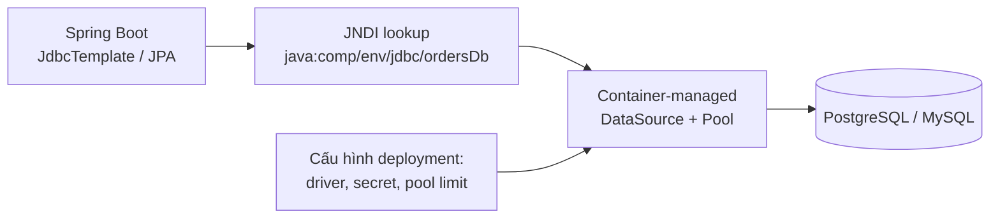

# JNDI DataSource và kết nối do môi trường triển khai quản lý

## 1. Bối cảnh: ai chịu trách nhiệm tạo kết nối SQL?

Trong module **SPRING_BOOT_INTEGRATION**, ứng dụng Spring Boot kết nối đến cơ sở dữ liệu, HTTP service, cache và message broker để triển khai các luồng tích hợp. Riêng với SQL, cách ứng dụng nhận được `DataSource` ảnh hưởng trực tiếp đến việc quản lý cấu hình, giao dịch, retry, giới hạn kết nối và khả năng vận hành.

Trong một ứng dụng Spring Boot chạy độc lập, ta thường khai báo `spring.datasource.url`, username/password và để Spring Boot tạo connection pool (thường là HikariCP nếu có trên classpath). Nhưng trong doanh nghiệp, ứng dụng có thể được triển khai như **WAR trên application server hoặc servlet container** đã có sẵn connection pool do đội vận hành quản lý.

Thay vì tự tạo pool, ứng dụng tra cứu một resource theo tên trong **JNDI (Java Naming and Directory Interface)**:

```text
JNDI name: java:comp/env/jdbc/ordersDb
Resource type: javax.sql.DataSource
Managed by: container / application server
Used by: Spring JdbcTemplate, Spring Data JDBC hoặc JPA
```

JNDI giống một **danh bạ tài nguyên của runtime**. Tên `jdbc/ordersDb` cho biết cần lấy tài nguyên nào; cấu hình pool, địa chỉ database, driver và credentials nằm ở môi trường triển khai. `DataSource` là đối tượng ứng dụng gọi để mượn `Connection`. Với pooled `DataSource`, `Connection.close()` thông thường **trả kết nối về pool**, không đóng kết nối vật lý mỗi lần.



**Mục tiêu bài học:** cấu hình và kiểm chứng một Spring Boot application sử dụng JNDI `DataSource` do môi trường triển khai quản lý, hiểu ranh giới trách nhiệm và giao dịch, phát hiện đúng các lỗi về naming context, connection pool và quy trình release.

## 2. Phân biệt JNDI, DataSource và connection pool

| Thành phần | Vai trò | Ví dụ |
| --- | --- | --- |
| JNDI naming context | Ánh xạ tên logic thành object khi ứng dụng chạy. | `java:comp/env/jdbc/ordersDb` |
| `DataSource` | API chuẩn để ứng dụng lấy JDBC `Connection`. | `javax.sql.DataSource` |
| Connection pool | Quản lý tập kết nối vật lý, borrowing, idle, timeout và validation. | Tomcat JDBC Pool, pool do application server cung cấp |
| JDBC driver | Giao tiếp giao thức với database. | `org.postgresql.Driver` |
| Spring JDBC/JPA | Dùng `DataSource` để chạy truy vấn và phối hợp transaction. | `JdbcTemplate`, `EntityManager` |
| Transaction manager | Quyết định BEGIN/COMMIT/ROLLBACK cho phạm vi tài nguyên tương ứng. | `JdbcTransactionManager`, `JpaTransactionManager`, `JtaTransactionManager` |

**JNDI không phải pool và cũng không phải database.** Lookup chỉ đưa về đối tượng đã được container đăng ký. Nếu không có resource tương ứng, ứng dụng không thể tự suy ra server URL hoặc tài khoản.

### Hiểu đường dẫn `java:comp/env`

- `java:comp/env` là namespace môi trường của component trong cách triển khai Java/Jakarta EE phổ biến; resource `jdbc/ordersDb` ở đó thường được hiển thị đầy đủ thành `java:comp/env/jdbc/ordersDb`.
- Đây là **tên logic**, không phải hostname hoặc JDBC URL. Tên phải khớp với binding thực tế của container.
- Một số application server có namespace riêng, chẳng hạn tên dạng `java:/...` hoặc `java:jboss/...`. Khi đó sử dụng **tên mà server đã bind**, không tự đổi sang `java:comp/env`.
- Kiểu JDBC chuẩn vẫn là **`javax.sql.DataSource` thuộc Java SE**, kể cả trong ứng dụng sử dụng `jakarta.servlet.*` của Jakarta EE. Đừng tự đổi thành `jakarta.sql.DataSource`.

## 3. Khi nào nên sử dụng JNDI DataSource?

| Nhu cầu | Cách tiếp cận phù hợp |
| --- | --- |
| Spring Boot executable JAR chạy như service hoặc container Docker thông thường | Thường cấu hình `spring.datasource.url` và để ứng dụng quản lý pool. |
| WAR được triển khai trong Tomcat/application server có resource SQL do vận hành cấp | JNDI `DataSource` giúp lấy đúng tài nguyên container cung cấp. |
| Nhiều ứng dụng cần cùng chính sách pool, driver, tài khoản và giám sát hạ tầng | JNDI có thể giúp thống nhất chính sách ở phía container; vẫn cần cô lập quyền và giới hạn kết nối cho từng ứng dụng. |
| Hệ thống cần transaction phân tán nhiều resource | Chỉ JNDI là **chưa đủ**; cần đánh giá loại `DataSource`, transaction manager và JTA/XA thực tế. |
| Unit test hoặc integration test chạy bên ngoài application server | Có thể cấp một `DataSource` khác qua profile/test configuration. |

Lợi ích chính là **tách cấu hình kết nối khỏi mã và artifact**, dùng khả năng quản trị của môi trường. Đổi lại, ứng dụng **phụ thuộc naming context và resource của runtime**; deployment phải phối hợp ứng dụng, application server và cơ sở dữ liệu.

## 4. Cấu hình Spring Boot tra cứu JNDI

Spring Boot hỗ trợ property `spring.datasource.jndi-name`. Ví dụ dành riêng cho môi trường container:

```yaml
# application-container.yml
spring:
  datasource:
    jndi-name: java:comp/env/jdbc/ordersDb
```

Khi deploy, bật profile bằng biến môi trường hoặc cấu hình tương đương:

```text
SPRING_PROFILES_ACTIVE=container
```

Với cách cấu hình này, Spring Boot tra cứu `DataSource` từ JNDI và sử dụng bean đó cho các tích hợp JDBC/JPA được tự cấu hình phù hợp. **Không khai báo thêm `spring.datasource.url`, `username` và `password` để mong Spring Boot tự tạo một pool thứ hai** cho cùng mục đích. Thông số của pool JNDI cần cấu hình ở **nơi resource được tạo**.

Để chạy local ngoài application server, tách cấu hình:

```yaml
# application-local.yml
spring:
  datasource:
    url: jdbc:postgresql://localhost:5432/orders
    username: ${DB_USERNAME:orders_dev}
    password: ${DB_PASSWORD:local_only}
    hikari:
      maximum-pool-size: 5
```

Hai profile có **cơ chế sở hữu DataSource khác nhau**:

- `container`: JNDI lookup, pool thuộc container; thuộc tính `spring.datasource.hikari.*` không điều khiển pool được container tạo.
- `local`: Spring Boot tạo pool, có thể cấu hình `spring.datasource.hikari.*` nếu sử dụng HikariCP.

Không kích hoạt đồng thời hai profile khi chúng cung cấp hai phương thức cấu hình xung đột. Các giá trị local ở trên chỉ phục vụ thử nghiệm; môi trường thật phải cấp credentials qua cơ chế quản lý secret phù hợp và giới hạn quyền theo nguyên tắc ít quyền nhất.

### Dependency cần có

Với Spring JDBC, cần Spring Boot JDBC starter và JDBC driver theo môi trường:

```groovy
dependencies {
    implementation 'org.springframework.boot:spring-boot-starter-jdbc'
    implementation 'org.springframework.boot:spring-boot-starter-web'
    // Chạy JAR/local với JDBC URL: đưa driver vào classpath ứng dụng.
    runtimeOnly 'org.postgresql:postgresql'
}
```

Trên **external Tomcat** khi resource JDBC được tạo và quản lý bởi Tomcat, JDBC driver thường phải hiển thị cho **classloader của Tomcat**, chẳng hạn trong `CATALINA_BASE/lib`, tùy cấu hình máy chủ. Driver chỉ nằm trong `WEB-INF/lib` của WAR có thể không được factory/pool của container nhìn thấy. Cần kiểm tra tài liệu đúng container đang triển khai và phối hợp vị trí driver để tránh hai phiên bản driver gây xung đột.

## 5. Ví dụ cấu hình resource JNDI tại external Tomcat

Giả sử deploy ứng dụng Spring Boot dạng WAR vào Tomcat có hỗ trợ JNDI. Đội vận hành tạo context descriptor cho ứng dụng, ví dụ `conf/Catalina/localhost/orders.xml` trong `CATALINA_BASE`, với nội dung minh họa:

```xml
<Context>
    <Resource
        name="jdbc/ordersDb"
        auth="Container"
        type="javax.sql.DataSource"
        factory="org.apache.tomcat.jdbc.pool.DataSourceFactory"
        driverClassName="org.postgresql.Driver"
        url="jdbc:postgresql://db.internal:5432/orders"
        username="orders_app"
        password="REPLACE_VIA_SECURE_DEPLOYMENT"
        initialSize="3"
        minIdle="3"
        maxIdle="10"
        maxActive="25"
        maxWait="10000"
        validationQuery="SELECT 1"
        testOnBorrow="true" />
</Context>
```

Đây là ví dụ cho **Tomcat JDBC Pool** với `org.apache.tomcat.jdbc.pool.DataSourceFactory`. Nếu container dùng pool khác, tên thuộc tính như `maxActive`/`maxWait` có thể thay đổi; không chuyển nguyên xi sang HikariCP hay DBCP2.

Giải thích các thuộc tính chính:

| Thuộc tính | Ý nghĩa |
| --- | --- |
| `name="jdbc/ordersDb"` | Tên local của resource; ứng dụng tra cứu `java:comp/env/jdbc/ordersDb` trong cấu hình Tomcat này. |
| `type="javax.sql.DataSource"` | Kiểu interface JDBC mà Spring sử dụng. |
| `driverClassName`, `url` | Chỉ định driver và endpoint database. |
| `username`, `password` | Tài khoản ứng dụng do triển khai cấp; cần cách lưu secret an toàn. |
| `initialSize` / `minIdle` / `maxIdle` | Số kết nối khởi tạo, idle tối thiểu và tối đa theo semantics của pool. |
| `maxActive` | Số kết nối đồng thời pool có thể cấp. |
| `maxWait` | Thời gian chờ mượn kết nối (mili giây) trước khi báo lỗi theo cơ chế pool. |
| `validationQuery` / `testOnBorrow` | Kiểm tra kết nối còn dùng được khi mượn, đánh đổi một phần chi phí kiểm tra. |

Thông số chỉ là **giá trị minh họa**, phải tính theo số replica, mức độ đồng thời, giới hạn kết nối của database và tải thực tế. Ví dụ 4 instance mỗi instance cho phép tối đa 25 kết nối có thể đẩy lên **100 kết nối SQL** trước khi tính worker khác, migration, monitoring và đường dự phòng.

**Không đưa password thật vào source code hoặc WAR.** Nếu container lưu password trong file context, file đó vẫn là tài liệu chứa bí mật: cần quyền truy cập giới hạn, cơ chế cấp secret/rotation của nền tảng, và tránh sao chép sang log hoặc kho mã nguồn. Một placeholder như `REPLACE_VIA_SECURE_DEPLOYMENT` **không tự động lấy secret từ vault**; cách cấp secret thực tế phụ thuộc vào deployment platform.

### Ứng dụng Spring Boot dạng WAR

Khi triển khai vào servlet container bên ngoài, Spring Boot application có thể cần `SpringBootServletInitializer` và được đóng gói WAR theo build đang dùng:

```java
import org.springframework.boot.SpringApplication;
import org.springframework.boot.autoconfigure.SpringBootApplication;
import org.springframework.boot.builder.SpringApplicationBuilder;
import org.springframework.boot.web.servlet.support.SpringBootServletInitializer;

@SpringBootApplication
public class OrdersApplication extends SpringBootServletInitializer {

    @Override
    protected SpringApplicationBuilder configure(
            SpringApplicationBuilder application) {
        return application.sources(OrdersApplication.class);
    }

    public static void main(String[] args) {
        SpringApplication.run(OrdersApplication.class, args);
    }
}
```

Trong Gradle, khi tạo WAR cần kích hoạt packaging `war`, dùng cấu hình dependency servlet container phù hợp (thường `providedRuntime` cho starter Tomcat) và xác minh phiên bản Servlet/Jakarta của external Tomcat tương thích với phiên bản Spring Boot. **Chạy `java -jar` với embedded Tomcat không tự tạo ra JNDI resource ở trên.** Cấu hình resource của external Tomcat chỉ có tác dụng khi ứng dụng thực sự chạy trong context nơi nó được bind.

## 6. Sử dụng DataSource qua Spring JDBC

Khi đã có bean `DataSource`, lập trình viên nên sử dụng `JdbcTemplate` hoặc các abstraction Spring Data/JPA quen thuộc. Truy vấn ứng dụng không cần biết pool đang thuộc Tomcat hay Spring Boot:

```java
import java.util.Optional;
import org.springframework.jdbc.core.JdbcTemplate;
import org.springframework.stereotype.Repository;
import org.springframework.transaction.annotation.Transactional;

@Repository
public class OrderRepository {

    private final JdbcTemplate jdbc;

    public OrderRepository(JdbcTemplate jdbc) {
        this.jdbc = jdbc;
    }

    public Optional<String> findStatus(long orderId) {
        return jdbc.query(
                "SELECT status FROM customer_orders WHERE id = ?",
                (rs, rowNum) -> rs.getString("status"),
                orderId)
                .stream()
                .findFirst();
    }

    @Transactional
    public boolean markShippedIfReady(long orderId) {
        int updated = jdbc.update("""
                UPDATE customer_orders
                   SET status = 'SHIPPED'
                 WHERE id = ? AND status = 'READY'
                """, orderId);
        return updated == 1;
    }
}
```

`JdbcTemplate` mượn và trả `Connection` thông qua cơ chế Spring JDBC. Khi method chạy trong Spring-managed transaction, Spring tham gia vào connection/transaction đang được bind đúng cách với thread. Nếu dùng JDBC thuần:

```java
try (var connection = dataSource.getConnection();
     var statement = connection.prepareStatement("SELECT 1");
     var resultSet = statement.executeQuery()) {
    // Sử dụng resultSet.
}
// close() connection handle để trả về pool.
```

Tránh giữ `Connection` trong field singleton, cache hoặc session HTTP; tránh quên close trong nhánh xử lý exception. Đối với transaction do Spring quản lý, ưu tiên `JdbcTemplate`, hoặc nếu phải thao tác thấp hơn thì dùng những API lấy/release connection phù hợp với transaction của Spring. Gọi `DriverManager.getConnection(...)` trực tiếp sẽ đi vòng qua resource JNDI và chính sách pool của container.

### Điểm dễ hiểu nhầm về `@Transactional`

`@Transactional` chỉ có tác dụng khi transaction management thực sự được cấu hình và lời gọi đi qua Spring proxy/context phù hợp. Trong ứng dụng JDBC có một `DataSource`, Spring Boot thường tự cấu hình transaction manager thích hợp. Nhưng phải xác nhận manager đó sử dụng **đúng `DataSource` JNDI**.

Giả sử một service cập nhật SQL, rồi publish message sang RabbitMQ:

```text
BEGIN SQL TRANSACTION
UPDATE customer_orders ...
COMMIT SQL TRANSACTION
PUBLISH event ...
```

Lệnh publish **không mặc nhiên nằm trong transaction SQL**. Nếu DB commit thành công nhưng publish thất bại, hai hệ thống có thể lệch. Khi cần tính nhất quán, cân nhắc **transactional outbox**, idempotency, retry và xử lý bù; JNDI không tự giải quyết atomicity giữa SQL và broker.

## 7. JNDI DataSource khác gì JTA/XA DataSource?

Đây là hai quyết định kiến trúc khác nhau:

- **JNDI** trả lời câu hỏi **lấy resource ở đâu**. Một `DataSource` thường cũng có thể được bind vào JNDI.
- **JDBC local transaction** giới hạn trong một connection/database resource. Spring JDBC có thể dùng `JdbcTransactionManager` hoặc `DataSourceTransactionManager`.
- **JTA/XA** giải quyết phối hợp transaction giữa các resource có khả năng tham gia giao dịch phân tán, với transaction manager và XA support cụ thể.

Một resource được đặt tên `java:comp/env/jdbc/ordersDb` **không trở thành XA chỉ vì nó nằm trong JNDI**. Nếu server cung cấp XA DataSource và JTA transaction manager, cấu hình Spring/ứng dụng phải được rà soát theo đúng application server đó. Cần cân nhắc chi phí, recovery, heuristic failure và khả năng hỗ trợ của từng resource trước khi dùng XA.

Trong nhiều hệ thống Spring Boot tích hợp qua HTTP, cache, SQL và broker, các giao dịch *end-to-end* thường cần **outbox/inbox, idempotency, event-driven compensation** thay vì trông chờ mọi hệ thống tham gia cùng XA transaction.

## 8. Kiểm thử trong local và môi trường triển khai

### Kiểm thử logic repository bên ngoài container

Máy phát triển hoặc test runner không nhất thiết có naming context `java:comp/env`. Khi viết unit/integration test cho `OrderRepository`, sử dụng profile `local` hoặc `test` với `DataSource` độc lập, chẳng hạn PostgreSQL Testcontainers. Việc đó kiểm tra SQL và transaction logic mà không cần phải giả lập toàn bộ application server.

Ví dụ test Spring JDBC sau khi test profile đã cấp một `DataSource` hoạt động:

```java
import static org.assertj.core.api.Assertions.assertThat;
import org.junit.jupiter.api.Test;
import org.springframework.beans.factory.annotation.Autowired;
import org.springframework.boot.test.context.SpringBootTest;
import org.springframework.test.context.ActiveProfiles;

@SpringBootTest
@ActiveProfiles("test")
class OrderRepositoryIntegrationTest {

    @Autowired
    OrderRepository orders;

    @Test
    void readsAnExistingOrder() {
        // Fixture test phải tạo row id=101, status=READY.
        assertThat(orders.findStatus(101L)).contains("READY");
    }
}
```

Đây là skeleton tích hợp: fixture `customer_orders` và `application-test.yml` hoặc `@TestConfiguration` phải có trong test thực tế. Test này **chưa chứng minh JNDI lookup**; nó chỉ kiểm tra repository và việc dùng `DataSource`.

### Kiểm thử thực sự trên runtime có JNDI

Sau khi deploy WAR vào container đã cấu hình resource:

1. Bật profile `container`, kiểm tra ứng dụng **khởi động thành công** và không có lỗi lookup.
2. Kiểm tra runtime đã bind đúng tên, kiểu `javax.sql.DataSource` và quyền truy cập SQL.
3. Chạy truy vấn read-only có parameter, xác nhận database/schema/role mong đợi.
4. Thử một transaction ghi trên **dữ liệu test có thể rollback** để xác minh transaction manager và rollback hoạt động.
5. Quan sát pool metrics/JMX, connections active/idle và lỗi borrow timeout trên container.
6. Kiểm tra recovery khi database tạm thời unavailable, failover, đổi credential hoặc restart application server theo kế hoạch.

Một probe đơn giản ở môi trường test, không ghi dữ liệu:

```java
import javax.sql.DataSource;
import org.springframework.boot.ApplicationArguments;
import org.springframework.boot.ApplicationRunner;
import org.springframework.context.annotation.Profile;
import org.springframework.stereotype.Component;

@Component
@Profile("container")
public class ContainerDataSourceProbe implements ApplicationRunner {
    private final DataSource dataSource;

    public ContainerDataSourceProbe(DataSource dataSource) {
        this.dataSource = dataSource;
    }

    @Override
    public void run(ApplicationArguments args) throws Exception {
        try (var connection = dataSource.getConnection()) {
            if (!connection.isValid(3)) {
                throw new IllegalStateException("JNDI database connection invalid");
            }
        }
    }
}
```

Đoạn probe này kiểm tra kết nối lúc startup; trong production cần quyết định rõ có muốn startup **fail fast** khi database chưa sẵn sàng hay không. Một số hệ thống chấp nhận khởi động để đợi DB hồi phục, dùng readiness/health checks theo chính sách triển khai. Không nên chạy liên tục truy vấn thử kết nối nặng trên mỗi request.

Khi có `spring-boot-starter-actuator`, endpoint health của DataSource có thể hỗ trợ readiness/diagnostics theo cấu hình. Tuy nhiên, các metric chi tiết như active/idle/waiting của **pool do container quản lý** có thể nằm ở JMX/console của container, không tự xuất hiện dưới tên metric HikariCP của ứng dụng.

## 9. Ma trận lỗi thường gặp và hướng xử lý

| Triệu chứng | Nguyên nhân cần kiểm tra | Cách khoanh vùng |
| --- | --- | --- |
| `NameNotFoundException` | Tên JNDI sai, resource chưa bind hoặc không thuộc context ứng dụng. | So sánh `spring.datasource.jndi-name` với resource name, context descriptor và log khởi tạo Tomcat. |
| `NoInitialContextException` | Ứng dụng chạy ở nơi không có naming context JNDI phù hợp, ví dụ local executable JAR. | Xác định chế độ chạy và profile; chuyển sang `local` khi không có JNDI. |
| Lỗi `ClassCastException` hoặc resource sai kiểu | Binding trả object khác `javax.sql.DataSource`. | Kiểm tra `type`/factory và tài nguyên được bind thực tế. |
| `ClassNotFoundException: org.postgresql.Driver` | Driver không hiển thị cho classloader cấp resource. | Kiểm tra vị trí/phiên bản JDBC driver và log container. |
| `SQLException: authentication failed` | Tài khoản/secret sai hoặc role chưa có quyền. | Kiểm tra cơ chế cấp secret, hạn sử dụng, quyền DB; không in credential ra log. |
| `CannotGetJdbcConnectionException` hoặc borrow timeout | Pool hết connection, leak, database nghẽn hoặc mạng lỗi. | Xem active/idle/waiting, maxActive, truy vấn chậm và session DB. |
| Connection stale sau failover | Validation/idle eviction và timeout chưa phù hợp. | Thử recovery, xem pool validation và driver/network timeout. |
| Tinh chỉnh `spring.datasource.hikari.maximum-pool-size` nhưng không thấy tác dụng | Pool đang nằm trong Tomcat, không phải Hikari của Boot. | Kiểm tra DataSource thực tế và cấu hình resource trong container. |
| App chạy local được, deploy WAR lỗi | Packaging, phiên bản Servlet, thiếu resource/driver hoặc profile sai. | Đọc deployment logs và kiểm tra tương thích Boot/Tomcat/Jakarta. |
| `@Transactional` không rollback như kỳ vọng | Wrong transaction manager, tự gọi method nội bộ, tạo connection ngoài Spring. | Kiểm tra proxy, manager đang active, DataSource và ranh giới transaction. |

### Phân biệt lỗi JNDI lookup và lỗi mượn connection

1. **Lookup thất bại**: chưa lấy được `DataSource`; nguyên nhân chủ yếu ở namespace/binding/resource startup. Lúc này còn chưa chắc đã thử kết nối database.
2. **Lookup thành công nhưng `getConnection()` thất bại**: resource tồn tại, nhưng driver, network, authentication hoặc pool có vấn đề.
3. **Kết nối thành công nhưng SQL lỗi**: xem schema, query, quyền, transaction isolation, timeout, deadlock và migration version.

Phân loại chính xác giảm thời gian tìm lỗi, đặc biệt khi nhiều đội phụ trách code, container và database.

## 10. Vận hành pool: capacity, timeout và cô lập lỗi

Khi pool thuộc môi trường, ứng dụng vẫn phải hiểu các giới hạn:

- **Số connection tối đa**: ước lượng từ tất cả instance, worker và tiến trình phụ, chừa dự phòng cho database và kết nối quản trị.
- **Borrow timeout**: thời gian chờ connection; quá ngắn có thể tăng lỗi khi tải đột biến, quá dài khiến request/worker chiếm tài nguyên và backlog.
- **Validation**: tránh phát connection đã chết sau sự cố mạng hoặc DB failover; cân nhắc chi phí nếu validate mỗi lần borrow.
- **Idle eviction và lifetime**: phối hợp với server/database idle timeout và các proxy mạng để tránh connection stale.
- **Transaction duration**: transaction càng dài càng giữ connection lâu; tránh gọi HTTP/broker chậm trong lúc đang giữ transaction SQL khi không cần thiết.
- **Quyền truy cập**: mỗi application identity chỉ có các quyền cần thiết; không dùng chung credential admin để tiện cấu hình.
- **Observability**: đo request latency, SQL latency, số connection active/idle/waiting, borrow failures, số transaction rollback và thời gian chờ pool.

Nên diễn tập ít nhất hai trường hợp: **DB mất kết nối trong khi ứng dụng đang chạy** và **pool bị sử dụng hết dưới tải có giới hạn**. Nếu chỉ thử startup thành công và `SELECT 1`, chưa biết hệ thống sẽ ứng xử ra sao khi timeout, deadlock, failover hoặc quá tải.

### Không tự sửa transaction bằng retry mù quáng

Một lỗi SQL có thể xảy ra ở **thời điểm COMMIT** sau khi câu lệnh đã được chạy. Khi client mất kết nối, kết quả commit có thể không rõ ràng ở phía consumer. Với các thao tác tạo đơn, trừ tiền hoặc ghi nhận event từ broker, cần khóa nghiệp vụ/idempotency, unique constraint và chiến lược retry có kiểm soát. Đổi DataSource sang JNDI **không làm biến mất** nguy cơ xử lý trùng lặp hoặc trạng thái commit không chắc chắn.

## 11. Bài thực hành đề xuất

**Tình huống:** một service Spring Boot quản lý đơn hàng dùng JDBC. Trong local, đội phát triển kết nối PostgreSQL bằng HikariCP. Ở production, ứng dụng chạy như WAR trên external Tomcat, đội vận hành quản lý pool trong context `java:comp/env/jdbc/ordersDb`.

Yêu cầu:

1. Xây dựng hai profile `local` và `container`; xác minh mỗi profile sở hữu connection pool đúng nơi.
2. Cấu hình Tomcat resource như ví dụ, xác nhận tên JNDI và driver hiện diện trong classloader thích hợp.
3. Tạo bảng `customer_orders(id, status)` và kiểm tra `findStatus`/`markShippedIfReady`.
4. Cố tình đổi tên resource `jdbc/ordersDb` thành `jdbc/ordersMissing`: ghi nhận **loại lỗi lookup** và thao tác sửa.
5. Giới hạn maxActive trong môi trường test rồi tạo tải đồng thời có kiểm soát: quan sát connection wait và phản ứng timeout.
6. Thử rollback của `@Transactional` khi một câu lệnh SQL ném exception; xác minh DB không lưu trạng thái dở dang.
7. Xác nhận metric/health thực sự xuất phát từ pool container, bổ sung cảnh báo khi borrow timeout tăng.

### Tiêu chí hoàn thành

| Kiểm chứng | Mong đợi |
| --- | --- |
| Profile local | App nhận DataSource do Boot tạo, truy vấn hoạt động, cấu hình Hikari có tác dụng. |
| Profile container | WAR nhận đúng JNDI DataSource; thông số pool nằm ở external Tomcat. |
| JNDI name sai | Startup/lần lookup thất bại có log rõ ràng; không rơi sang kết nối DB khác ngoài ý muốn. |
| Sai DB credential | Lookup có thể thành công nhưng lấy connection thất bại; lỗi xác định được ở pool/DB. |
| DB transaction rollback | Các thay đổi SQL cùng transaction không bị commit một phần. |
| Pool exhaustion | Có giới hạn chờ, lỗi được đo và phục hồi sau khi connection được trả về pool. |
| Recovery | Sau khi DB trở lại, connection được validate/thay mới theo chính sách đã cấu hình. |

## 12. Câu hỏi ôn tập

1. Tại sao `spring.datasource.jndi-name` khác về trách nhiệm vận hành so với `spring.datasource.url`?
2. `java:comp/env/jdbc/ordersDb` trỏ đến file cấu hình, database hay object `DataSource`?
3. Trong Tomcat, vì sao driver nằm trong WAR đôi khi không đủ cho resource do Tomcat quản lý?
4. `javax.sql.DataSource` có cần đổi thành `jakarta.sql.DataSource` khi dùng Spring Boot 3 và Tomcat 10 không?
5. Có thể kiểm thử repository bên ngoài JNDI context như thế nào? Kiểm thử đó chưa chứng minh điều gì?
6. JNDI DataSource có tự bảo đảm transaction phân tán giữa SQL và RabbitMQ hay không?
7. Khi `NameNotFoundException` xuất hiện, bước đầu tiên để khoanh vùng khác gì khi `getConnection()` bị timeout?
8. Vì sao thay `spring.datasource.hikari.maximum-pool-size` không tác động đến Tomcat JDBC Pool?

## Tổng kết

**JNDI DataSource** là cách Spring Boot sử dụng kết nối SQL đã được môi trường triển khai đăng ký và quản lý. Ứng dụng chỉ cần biết tên resource hợp lệ, chẳng hạn `java:comp/env/jdbc/ordersDb`; container chịu trách nhiệm driver, pool, endpoint và cơ chế cấp credentials. Phân biệt rõ lookup với borrow connection, Spring-managed transaction với JTA/XA, và pool của container với pool của Boot là chìa khóa để triển khai và khắc phục sự cố chính xác. Khi tích hợp SQL với HTTP, cache hoặc broker, vẫn phải thiết kế độc lập các chính sách idempotency, xử lý lỗi và quan sát giao dịch.

### Tài liệu tham khảo

- [Spring Boot Reference — Working with SQL Databases](https://docs.spring.io/spring-boot/reference/data/sql.html)
- [Apache Tomcat — JNDI DataSource HOW-TO](https://tomcat.apache.org/tomcat-10.1-doc/jndi-datasource-examples-howto.html)
- [Apache Tomcat — JNDI Resources HOW-TO](https://tomcat.apache.org/tomcat-10.1-doc/jndi-resources-howto.html)
- [Spring Framework — Controlling Database Connections](https://docs.spring.io/spring-framework/reference/data-access/jdbc/connections.html)
