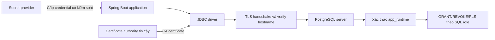
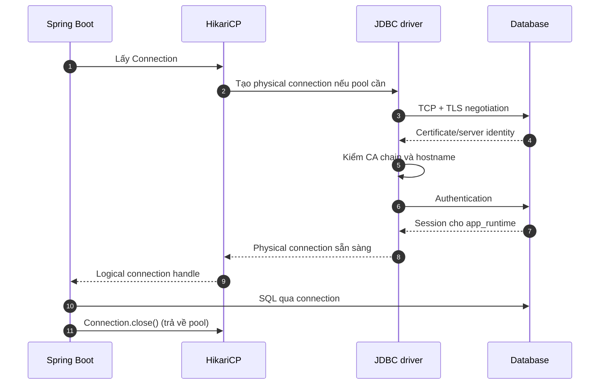
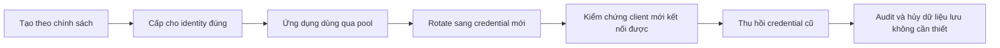
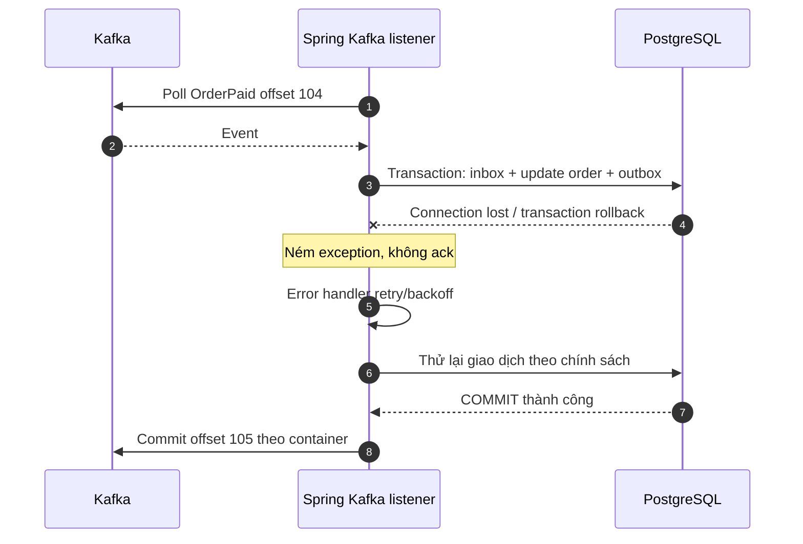

# SSL, tài khoản giới hạn quyền và quản lý thông tin bí mật

Một ứng dụng Spring Boot kết nối tới PostgreSQL, MySQL hoặc hệ quản trị SQL khác thường cần ba thứ: **đường truyền được bảo vệ**, **danh tính database chỉ có quyền cần thiết** và **thông tin xác thực được quản lý an toàn trong suốt vòng đời**. Chỉ bật một tham số `ssl=true` hoặc giấu password vào biến môi trường chưa đủ để đảm bảo ba yêu cầu này.

Hãy hình dung `order-service` nhận HTTP request, ghi đơn hàng vào PostgreSQL, cập nhật bảng inbox/outbox để đồng bộ với Kafka và gọi hệ thống thanh toán. Nếu kết nối SQL không xác minh máy chủ, ứng dụng có thể gửi credential đến đầu cuối giả mạo. Nếu chạy bằng tài khoản chủ sở hữu schema, một lỗi SQL injection hoặc cấu hình sai có thể xóa bảng. Nếu thay password nhưng Hikari pool vẫn tạo kết nối mới bằng credential cũ, một lần xoay vòng bí mật có thể biến thành sự cố mất kết nối production.

Bài thuộc chương **Kết nối SQL** của mô-đun **SPRING_BOOT_INTEGRATION**. Mục tiêu là tổ chức tích hợp trong Spring Boot qua HTTP client, cơ sở dữ liệu, cache, broker và Spring Integration adapters; đặc biệt chú ý cấu hình, hợp đồng dữ liệu, giao dịch, lỗi, chống xử lý trùng, kiểm thử và quan sát. Các ví dụ chính dùng Spring Boot 3.x, JDBC/HikariCP và PostgreSQL; khi áp dụng cho phiên bản driver hoặc DB khác, cần xác nhận chính xác thuộc tính và hành vi của phiên bản được triển khai.

## 1. Kết quả cần đạt

Sau bài này, bạn có thể:

1. Phân biệt mã hóa TLS, xác minh chứng chỉ CA, xác minh **hostname** và xác thực bằng tài khoản database.
2. Cấu hình kết nối PostgreSQL với `sslmode=verify-full`, hiểu sự khác nhau với `require` và các chế độ có thể hạ cấp.
3. Thiết kế quyền theo **least privilege** cho tài khoản runtime, migration, read-only và vận hành.
4. Tách bí mật khỏi mã nguồn/artifact, nạp qua môi trường chạy hoặc secret store và hoạch định **rotation** không làm ứng dụng đứt kết nối.
5. Hiểu vòng đời Hikari connection pool, các tham số timeout, kiểm tra kết nối và các rủi ro khi đổi credential.
6. Kết nối yêu cầu bảo mật SQL với Flyway/Liquibase, transaction, inbox/outbox, audit và dịch vụ phụ thuộc.
7. Thiết kế kiểm thử cả đường thành công lẫn trường hợp chứng chỉ sai, không đủ quyền, secret hết hiệu lực và database tạm ngừng phục vụ.

## 2. Ba lớp kiểm soát độc lập

Một thiết kế kết nối SQL an toàn cần xem xét **transport**, **identity/authorization** và **secret lifecycle** như những vấn đề khác nhau:

| Lớp | Mục tiêu | Ví dụ kiểm soát | Nó không tự bảo đảm |
|---|---|---|---|
| **TLS/SSL** | Mã hóa dữ liệu khi truyền và xác minh đầu cuối | TLS + CA tin cậy + hostname validation | User kết nối chỉ có quyền cần thiết |
| **Database authentication/authorization** | Xác minh user và giới hạn tài nguyên được truy cập | SCRAM/cơ chế auth phù hợp, `GRANT` tối thiểu | Password không bị lộ trong log hoặc artifact |
| **Secrets management** | Bảo vệ, cấp phát, luân chuyển và thu hồi credential | Vault/Kubernetes Secret/mounted secret, IAM, audit | Driver tự xác minh hostname hoặc query không bị SQL injection |

Các biện pháp hỗ trợ khác cũng quan trọng: private network, firewall/security group, kiểm soát egress, kiểm tra input, parameterized query, backup, encryption at rest và monitoring. Chúng bổ sung cho ba lớp trên nhưng không thay thế lẫn nhau.

### 2.1. Tại sao SSL trong tên bài nên được hiểu là TLS?

`SSL` là tên lịch sử; hệ thống hiện đại thường thương lượng **TLS**. Một option hoặc class có chữ `ssl` không có nghĩa đang dùng giao thức SSL cũ. Cần kiểm tra **TLS version/cipher** mà driver và server thương lượng được, cũng như chính sách tắt giao thức yếu. Không dùng việc có biểu tượng ổ khóa hoặc URL chứa `ssl` làm bằng chứng đủ.

### 2.2. Mô hình tin cậy



Trong sơ đồ, chứng chỉ CA không phải password bí mật. Nó là **trust anchor** để xác nhận danh tính máy chủ; cần đảm bảo nội dung CA không bị thay bởi nguồn không đáng tin. Database password/token mới là credential cần cấp quyền đọc tối thiểu và xoay vòng.

## 3. Đường đi của một kết nối JDBC

Trình tự đơn giản hóa khi Spring Boot dùng `DataSource`:



Khi ứng dụng gọi `Connection.close()` trên connection lấy từ Hikari, thường là **trả connection về pool**, không phải đóng TCP và thực hiện TLS handshake lại ngay. Đó là lý do đổi secret hoặc CA certificate không tự có hiệu lực trên mọi connection đang tồn tại.

### 3.1. Những trạng thái cần phân biệt

- **TCP connected:** socket mở được, nhưng có thể chưa xác thực TLS/server.
- **TLS established:** có phiên mã hóa, nhưng chế độ TLS có thể chưa xác minh CA/hostname.
- **Authenticated:** database chấp nhận principal/password/certificate, nhưng chưa chứng minh role có quyền SELECT/INSERT cần thiết.
- **Authorized:** query cụ thể được quyền thực hiện; quyền có thể khác theo schema/table/column.
- **Application usable:** schema migration và các invariant nghiệp vụ đáp ứng; không suy ra chỉ từ `SELECT 1`.

## 4. TLS bảo vệ gì và những rủi ro nào còn lại?

TLS có hai mục tiêu chính: bảo vệ **tính bí mật/toàn vẹn trên đường truyền** và, khi được cấu hình xác minh đúng, xác nhận **đúng máy chủ** mà ứng dụng dự định kết nối.

Nếu chỉ mã hóa mà không xác minh hostname/CA, kết nối tới máy chủ giả vẫn có thể thương lượng TLS. Kẻ kiểm soát một điểm mạng hoặc địa chỉ DNS sai có thể thu thập credential hoặc dữ liệu ứng dụng tùy cơ chế xác thực và cách thiết lập kết nối.

Ví dụ:

```text
Ứng dụng muốn gọi:
  db.orders.internal.example

Certificate hợp lệ cho:
  staging-db.internal.example

CA có thể hợp lệ, nhưng hostname không khớp.
Khi strict hostname verification được bật -> kết nối phải FAIL.
```

Không “chữa” lỗi này bằng cách tắt xác minh chứng chỉ. Cần cấp lại certificate với DNS Subject Alternative Name phù hợp hoặc sửa hostname kết nối đúng với certificate và topology.

### 4.1. TLS không chống được mọi rủi ro SQL

Ngay cả một kết nối `verify-full` vẫn không tránh được:

- SQL injection do ghép chuỗi query thay vì bind parameters;
- Ứng dụng bị RCE và đọc password từ bộ nhớ;
- Runtime role được cấp `SUPERUSER` hoặc quyền DDL thừa;
- Secrets bị commit vào Git, build artifact hoặc container image;
- Backup/replica được cấu hình lưu dữ liệu nhạy cảm không an toàn;
- Một transaction SQL chưa commit nhưng offset Kafka đã được ack.

Vì vậy cấu hình SQL connection phải đi cùng nguyên tắc dữ liệu và vận hành của hệ thống tích hợp.

## 5. PostgreSQL JDBC: sslmode phải được chọn có chủ đích

PgJDBC hỗ trợ các chế độ `sslmode`. Các chế độ đáng chú ý:

| `sslmode` | Thực tế mong muốn | Rủi ro và khi nào dùng |
|---|---|---|
| `disable` | Không dùng TLS | Chỉ chấp nhận trong test/local được kiểm soát nếu chính sách cho phép |
| `allow` | Có thể bắt đầu không TLS rồi thử TLS tùy tình huống | Có đường hạ cấp; không phù hợp yêu cầu TLS bắt buộc |
| `prefer` | Ưu tiên TLS nhưng có thể fallback không TLS | Không xem là “enforce TLS”; kiểm tra hành vi driver |
| `require` | Yêu cầu kết nối TLS | Chưa đủ để khẳng định đã xác minh đầy đủ hostname/server identity |
| `verify-ca` | TLS và kiểm CA certificate | Không xác minh hostname như `verify-full` |
| `verify-full` | TLS, kiểm CA certificate **và** server hostname | Lựa chọn khởi đầu phù hợp khi cần xác thực server nghiêm ngặt |

Các chi tiết của `require`/`verify-ca` có thể thay đổi theo driver/SSL factory và truststore; hãy dựa vào tài liệu PgJDBC version đang dùng. Đối với production, định nghĩa yêu cầu **verify-full**, CA được quản lý và hostname ổn định để tránh các vùng mơ hồ.

### 5.1. Cấu hình PostgreSQL verify-full

Giả sử tên DNS của database là `db.orders.internal.example`, server certificate có SAN tương ứng, và CA tin cậy được mount tại `/etc/db-certs/ca.pem`.

```yaml
# application-prod.yml
spring:
  datasource:
    url: jdbc:postgresql://db.orders.internal.example:5432/orders?sslmode=verify-full&sslrootcert=/etc/db-certs/ca.pem
    username: app_runtime
    hikari:
      maximum-pool-size: 12
      minimum-idle: 2
      connection-timeout: 3000     # milliseconds
      validation-timeout: 2000     # milliseconds
      max-lifetime: 1500000        # milliseconds
      keepalive-time: 120000       # milliseconds
  flyway:
    enabled: false
```

Không có `spring.datasource.password` trong ví dụ trên. Password sẽ đến từ secret provider hoặc một file configuration tree (xem phần sau). `flyway.enabled: false` minh họa mô hình production chạy migration bằng một job có đặc quyền riêng; trong local/test có thể có chính sách khác.

Điều kiện để kết nối thành công:

1. Client gọi đúng hostname xuất hiện trong certificate SAN.
2. CA root/intermediate chain cần thiết được driver tin cậy đúng cách.
3. Certificate còn hạn và phù hợp mục đích server authentication.
4. Server cho phép TLS cùng TLS version/cipher phù hợp.
5. Principal `app_runtime` xác thực được và có quyền truy cập database.
6. Network firewall, DNS và routing cho phép đi tới server.

Nếu có proxy/connection pooler như PgBouncer, **TLS hostname verification phải xác minh chính đầu cuối TLS** mà JDBC driver kết nối. Cần hiểu nó có terminate TLS và kết nối tiếp tới DB bằng TLS khác không; không suy ra kiểm tra client→proxy bảo vệ luôn proxy→database.

### 5.2. Vì sao không dùng địa chỉ IP tùy tiện?

Nếu URL dùng `jdbc:postgresql://10.0.1.10:5432/...` nhưng chứng chỉ chỉ có DNS SAN `db.orders.internal.example`, `verify-full` có thể fail do thiếu IP SAN. Không nên đổi sang `verify-ca` để vượt qua lỗi hostname. Dùng DNS/service name đã được cấp certificate tương ứng hoặc cấp certificate có SAN phù hợp.

### 5.3. Certificate authority và client certificate

Phân biệt:

- **Server TLS:** server trình chứng chỉ, client kiểm CA và hostname.
- **mTLS/client certificate authentication:** database có thể yêu cầu client trình chứng chỉ; driver cần private key/certificate và server phải cấu hình trust/client identity.
- **Password authentication qua TLS:** client vẫn dùng username/password; TLS bảo vệ đường truyền và xác minh server.

Một PostgreSQL triển khai có thể dùng TLS xác minh server **và** SCRAM password auth mà không bắt buộc mTLS. Nếu doanh nghiệp yêu cầu client cert, cấu hình `sslcert`/`sslkey` và file format do phiên bản PgJDBC hỗ trợ, quyền đọc private key, cơ chế cấp phát/rotation riêng. Private key là bí mật nhạy cảm; **không** gắn vào Git, image hoặc log.

Không tự suy luận rằng cứ có `sslcert` là ứng dụng không còn cần username/database role; mapping chứng chỉ tới principal phụ thuộc cấu hình authentication của PostgreSQL và hợp đồng vận hành.

## 6. Những hệ quản trị khác có cú pháp khác

Không áp `sslmode=verify-full` của PostgreSQL cho mọi JDBC driver:

| Driver/hệ quản trị | Gợi ý chế độ strict | Cần kiểm tra thêm |
|---|---|---|
| **PostgreSQL PgJDBC** | `sslmode=verify-full` | CA file/truststore, hostname SAN, driver SSL factory |
| **MySQL Connector/J 8.x** | `sslMode=VERIFY_IDENTITY` | Truststore, certificate chain, hostname, server hỗ trợ TLS |
| **Microsoft SQL Server JDBC** | `encrypt=true` và `trustServerCertificate=false` | Hostname validation, driver/JVM truststore, policy certificate |
| **Oracle JDBC** | TCPS với certificate/trust configuration được xác minh | Wallet/truststore, endpoint/service name, version driver |

Ví dụ MySQL:

```text
jdbc:mysql://mysql.orders.internal.example:3306/orders?sslMode=VERIFY_IDENTITY
```

Với MySQL Connector/J, cần cấu hình trust anchors/truststore phù hợp nếu chứng chỉ không nằm trong nguồn tin cậy mặc định. `VERIFY_CA` kiểm CA nhưng mức xác minh hostname khác `VERIFY_IDENTITY`. Không dùng `sslMode=PREFERRED` khi yêu cầu **bắt buộc** TLS, vì đây không phải chính sách chống fallback.

Ví dụ SQL Server:

```text
jdbc:sqlserver://sql.orders.internal.example:1433;databaseName=orders;encrypt=true;trustServerCertificate=false
```

Đoạn URL SQL Server chỉ minh họa policy cơ bản. Một số driver đời mới có default encrypt khác trước và các thuộc tính `encrypt` nâng cao; hãy kiểm tra version, hostname/certificate và truststore. Cờ `trustServerCertificate=true` bỏ qua xác minh chứng chỉ và không nên được dùng chỉ để kết nối “cho qua” lỗi cấu hình production.

## 7. Xác minh kết nối thực sự dùng TLS

Một cấu hình trên giấy chưa đủ. Với PostgreSQL, trên **chính session của ứng dụng**, có thể truy vấn:

```sql
SELECT
    ssl,
    version,
    cipher,
    bits
FROM pg_stat_ssl
WHERE pid = pg_backend_pid();
```

Kết quả `ssl=true` và `version` phù hợp xác nhận session hiện tại được mã hóa. Nó **không tự chứng minh client đã kiểm hostname**; điều đó cần test cấu hình driver và một test negative với hostname/chứng chỉ sai.

Có thể xác minh role:

```sql
SELECT current_user, session_user, current_database();
```

Với MySQL, có thể xem SSL cipher của session bằng query trạng thái session tùy phiên bản:

```sql
SHOW SESSION STATUS LIKE 'Ssl_cipher';
```

Một giá trị cipher không rỗng là dấu hiệu TLS đã được thương lượng. Cũng giống PostgreSQL, không suy ra hostname verification chỉ từ cipher.

### 7.1. Test negative quan trọng hơn một dòng log “SSL enabled”

Tạo môi trường test có chứng chỉ không được tin cậy hoặc SAN không khớp hostname. Với cấu hình strict, ứng dụng phải **không kết nối được**. Nếu vẫn kết nối, test phải điều tra SSL mode và trust settings. Không làm phép thử này bằng cách sửa production cert/secret đang phục vụ.

## 8. Least privilege: ứng dụng không cần là chủ database

**Nguyên tắc quyền tối thiểu** nghĩa là mỗi tài khoản chỉ có quyền cần để thực hiện nhiệm vụ được giao, trong thời gian và phạm vi cần thiết. Với ứng dụng ghi đơn, ít nhất nên tách:

| Danh tính | Quyền hợp lý | Tránh cấp |
|---|---|---|
| `app_runtime` | CONNECT; USAGE trên schema; SELECT/INSERT/UPDATE cần thiết trên bảng và sequence | SUPERUSER, CREATEDB, CREATEROLE, CREATE/DROP schema, DDL production |
| `app_readonly` | CONNECT, USAGE, SELECT bảng/view được phép | INSERT/UPDATE/DELETE/DDL |
| `app_migrator` | Quyền tạo/thay đổi schema, bảng/index trong phạm vi migration | Superuser toàn cluster nếu không cần |
| `db_operator` | Quyền vận hành có kiểm soát, backup/diagnostics theo công việc | Dùng chung credential với runtime |
| `replication_user` | Quyền replication tối thiểu theo topology | Quyền thao tác dữ liệu nghiệp vụ không cần thiết |

Phân quyền nên xét **đúng hành vi ứng dụng**: read model có thể chỉ cần SELECT; consumer inbox cần INSERT vào bảng idempotency; outbox publisher cần UPDATE `published_at`; migration job cần DDL. Nếu một bean SQL không dùng DELETE, không tự cấp DELETE chỉ vì “CRUD cho đủ”.

### 8.1. Tại sao tài khoản runtime không được cấp DDL?

Nếu một SQL injection hoặc lỗi binding dẫn tới lệnh `DROP TABLE orders`, database phải từ chối khi runtime role không có quyền sở hữu/DDL phù hợp. Quyền tối thiểu là lớp bảo vệ giảm thiệt hại, nhưng không thay thế parameterized queries hoặc input validation.

### 8.2. Role dùng chung giữa service gây khó truy cứu

Nếu `order-service` và `billing-service` cùng đăng nhập bằng `app_runtime` với quyền trên mọi schema, audit database khó xác định nguồn truy cập và một sự cố có thể ảnh hưởng cả hai. Ưu tiên danh tính riêng cho service, môi trường và chức năng; phân quyền theo schema/table/view và nhu cầu thật.

## 9. PostgreSQL: thiết kế role runtime và migrator

Ví dụ database `orders` có schema `orders`, migration do principal `app_migrator` thực hiện. DBA/automation có quyền quản trị sẽ tạo role và cấp credential qua quy trình secret management; không đặt password thật vào script tài liệu.

```sql
-- Thực hiện bằng tài khoản quản trị được phân quyền.
CREATE ROLE app_migrator LOGIN;
CREATE ROLE app_runtime LOGIN;
CREATE ROLE app_readonly LOGIN;

-- Schema được sở hữu bởi role chạy migration trong ví dụ này.
CREATE SCHEMA orders AUTHORIZATION app_migrator;

GRANT CONNECT ON DATABASE orders TO app_runtime, app_readonly;
GRANT USAGE ON SCHEMA orders TO app_runtime, app_readonly;

-- Runtime có thể đọc và ghi trên những bảng đã tồn tại.
GRANT SELECT, INSERT, UPDATE ON ALL TABLES
    IN SCHEMA orders TO app_runtime;

-- Read-only không được ghi.
GRANT SELECT ON ALL TABLES
    IN SCHEMA orders TO app_readonly;

-- Chỉ khi các bảng sử dụng sequence tương ứng.
GRANT USAGE ON ALL SEQUENCES
    IN SCHEMA orders TO app_runtime;

-- Các bảng/sequences được app_migrator tạo trong tương lai.
ALTER DEFAULT PRIVILEGES FOR ROLE app_migrator IN SCHEMA orders
    GRANT SELECT, INSERT, UPDATE ON TABLES TO app_runtime;

ALTER DEFAULT PRIVILEGES FOR ROLE app_migrator IN SCHEMA orders
    GRANT SELECT ON TABLES TO app_readonly;

ALTER DEFAULT PRIVILEGES FOR ROLE app_migrator IN SCHEMA orders
    GRANT USAGE ON SEQUENCES TO app_runtime;
```

Ví dụ nhằm minh họa cách tách quyền. Nó **không** khẳng định app cần UPDATE mọi bảng: production nên thay `ON ALL TABLES` bằng grants trên bảng/view cụ thể hoặc role theo nhóm nghiệp vụ, và grant DELETE chỉ khi có use case hợp lệ.

Các lưu ý của PostgreSQL:

1. Quyền **USAGE trên schema** không tự cho phép SELECT/INSERT bảng.
2. `ALTER DEFAULT PRIVILEGES FOR ROLE app_migrator` áp dụng cho object **được tạo về sau bởi role đó** theo phạm vi khai báo; không cấp lại quyền cho object đã tồn tại.
3. Các object được tạo bởi role **khác** có default privileges khác; đừng giả định chúng nhận quyền của `app_migrator`.
4. Chủ sở hữu bảng/schema có quyền vượt xa role chỉ được cấp `GRANT`; không dùng owner role cho runtime.
5. Kiểm tra cả sequence, function, view, schema search path, trigger và các extension có quyền đặc biệt.
6. Tài khoản có `CREATEROLE`, `SUPERUSER` hoặc quyền membership cao có thể mở rộng phạm vi; cần rà soát cả đặc quyền kế thừa.

### 9.1. Quyền mặc định của database và schema

Trong PostgreSQL, một số đặc quyền có thể được cấp cho `PUBLIC` theo cấu hình/phiên bản và lịch sử database, chẳng hạn quyền CONNECT hoặc quyền liên quan schema `public`. Đừng suy luận rằng chỉ cấp `GRANT CONNECT` cho ba role thì những role khác không thể CONNECT.

Nếu cần hardening, DBA phải kiểm tra và thu hồi quyền thừa theo policy, nhưng làm việc này trên production cần đánh giá tác động tới những ứng dụng khác:

```sql
-- CHỈ khi đã xác nhận ảnh hưởng và quyền cần thiết:
REVOKE CREATE ON SCHEMA public FROM PUBLIC;
```

Không tự chạy các câu REVOKE rộng trên database chia sẻ chỉ vì một bài học khuyến nghị least privilege. Dùng audit grants và thử trước trên môi trường kiểm soát.

### 9.2. SQL kiểm tra quyền hiệu lực

Đăng nhập **bằng đúng runtime account** rồi kiểm tra:

```sql
SELECT
    current_user,
    has_database_privilege(current_user, current_database(), 'CONNECT')
        AS can_connect,
    has_schema_privilege(current_user, 'orders', 'USAGE')
        AS can_use_orders_schema,
    has_schema_privilege(current_user, 'orders', 'CREATE')
        AS can_create_in_orders;

SELECT
    has_table_privilege(
        current_user, 'orders.order_events', 'SELECT') AS can_read,
    has_table_privilege(
        current_user, 'orders.order_events', 'INSERT') AS can_insert,
    has_table_privilege(
        current_user, 'orders.order_events', 'DELETE') AS can_delete;
```

Các query giả định bảng `orders.order_events` tồn tại. Nếu chưa tạo, `has_table_privilege` theo tên object có thể báo lỗi; kiểm tra schema migration trước. Kết quả mong đợi phải xuất phát từ ma trận quyền của từng service, không phải mọi runtime role đều phải có quyền giống nhau.

## 10. Migration và runtime: hai vòng đời đặc quyền khác nhau

Flyway/Liquibase cần tạo bảng, alter column, tạo index và đôi khi chạy data migration. Những quyền đó thường **không cần** trong ngày thường khi ứng dụng xử lý request/message.

Hai phương án phổ biến:

| Phương án | Cách hoạt động | Đánh đổi |
|---|---|---|
| **Migration chạy cùng Spring Boot startup** | App có credential migrator riêng trong quá trình startup, sau đó runtime dùng account ít quyền | Dễ local, nhưng binary/process runtime vẫn có thể tiếp cận credential DDL |
| **Migration job tách khỏi ứng dụng** | Pipeline/job chạy migrator trước rollout; runtime chỉ nhận credential ít quyền | Phân tách đặc quyền tốt hơn, cần CI/CD orchestration và schema compatibility |

Với môi trường production yêu cầu phân tách mạnh, migration job riêng thường rõ ràng hơn. Nếu dùng Flyway trong Spring Boot development, có thể cấu hình datasource riêng cho migration theo các thuộc tính được hỗ trợ:

```yaml
# Ví dụ dành cho profile development có migration tại startup.
spring:
  datasource:
    url: jdbc:postgresql://db.dev.example:5432/orders?sslmode=verify-full&sslrootcert=/etc/db-certs/ca.pem
    username: app_runtime
  flyway:
    enabled: true
    url: jdbc:postgresql://db.dev.example:5432/orders?sslmode=verify-full&sslrootcert=/etc/db-certs/ca.pem
    user: app_migrator
    schemas: orders
```

Cần cấp `spring.datasource.password` và `spring.flyway.password` từ **hai secret khác nhau**, không viết thật trong file. Không suy luận rằng chỉ đổi `spring.flyway.user` thì mọi version Spring Boot đều tạo datasource/migration role đúng cách; kiểm tra cấu hình cuối cùng và log khởi tạo.

Trong một deployment mà migration chạy riêng, runtime app nên tắt migration tự động hoặc đặt mode/điều kiện phù hợp, và kiểm tra version schema trước khi nhận traffic. Một migration phá vỡ tương thích với code cũ có thể gây downtime dù tài khoản migrator được bảo vệ tốt.

### 10.1. Tài khoản migrator cũng không nên là superuser

Trong PostgreSQL, nếu migrator sở hữu schema và các bảng của ứng dụng, nó có thể thực hiện DDL trên phạm vi đó mà không cần `SUPERUSER` hay `CREATEDB`. Nếu migration cần extension hoặc thao tác cluster-level, hãy tách thành job DBA/infra đã duyệt, không cấp thêm quyền vĩnh viễn cho migrator chỉ để “chạy một lần”.

### 10.2. Read-only user có thật sự read-only?

Account chỉ có `SELECT` trên các bảng được phép vẫn có thể gọi một function có side effect nếu function và quyền `EXECUTE` cho phép, hoặc truy cập dữ liệu qua view không phù hợp. Đặc biệt với PostgreSQL, cần đánh giá functions, default `PUBLIC` execute, owner/`SECURITY DEFINER` và row-level security nếu dùng. Least privilege là **quyền hiệu lực**, không chỉ một dòng `GRANT SELECT`.

## 11. Row-level security và isolation theo tenant

Nếu nhiều tenant dùng cùng schema, chỉ tách database role theo service chưa đủ để tách dữ liệu từng tenant. PostgreSQL Row-Level Security (RLS) có thể bổ sung hàng rào theo tenant, nhưng phải được thiết kế cẩn thận:

```sql
-- Minh họa trên bảng orders.orders có tenant_id.
ALTER TABLE orders.orders ENABLE ROW LEVEL SECURITY;

CREATE POLICY orders_tenant_policy ON orders.orders
    USING (tenant_id = current_setting('app.tenant_id', true))
    WITH CHECK (tenant_id = current_setting('app.tenant_id', true));
```

Ở đây phải đảm bảo `tenant_id` và `app.tenant_id` cùng kiểu hoặc ép kiểu phù hợp; nếu tenant_id là UUID cần cast hợp lệ. Biến session phải được thiết lập **từ danh tính đã xác thực**, không tin trực tiếp HTTP header tùy ý. Trong connection pool, một biến session đặt sai phạm vi có thể rò tenant sang request khác.

Ví dụ với PostgreSQL, dùng `SET LOCAL` trong transaction khi thích hợp và đảm bảo query sau đó chạy trong cùng connection/transaction; không đặt session variable bền qua nhiều borrower rồi quên reset. Account owner hoặc `BYPASSRLS` có thể bỏ qua policy theo điều kiện PostgreSQL; cần test bằng runtime role thực, không test bằng schema owner.

RLS là lựa chọn theo kiến trúc, không bắt buộc với mọi service. Dù có RLS vẫn cần authorization ở ứng dụng, constraints và test cross-tenant.

## 12. Secrets: điều gì là bí mật, điều gì không?

Trong kết nối SQL, những dữ liệu sau có mức nhạy cảm khác nhau:

| Thông tin | Mức nhạy cảm thường gặp | Cách quản lý |
|---|---|---|
| DB password | Credential bí mật | Secret store, quyền truy cập tối thiểu, rotation |
| Client TLS private key | Bí mật rất nhạy cảm | File/keystore bảo vệ, mount read-only, rotation |
| IAM database auth token | Token có thời hạn | Tạo và làm mới theo identity, tránh log |
| CA public certificate | Không phải password | Phân phối có kiểm soát tính toàn vẹn, version/rotation |
| DB hostname/database name | Thông tin topology, thường không phải password | Cấu hình theo môi trường; hạn chế lộ nếu policy yêu cầu |
| DB username | Thông tin cấu hình; đôi khi nhạy cảm | Externalized config, không cần hardcode secret nếu policy yêu cầu |
| JDBC URL | Có thể chứa credential nếu viết sai | Không đặt password/token trong URL; redact khi log |

Một password có thể rò ở nhiều nơi: `application.yml` commit lên Git, biến environment bị in trong debug diagnostics, CI logs, heap dump, exception chứa JDBC URL, file backup, shell history hoặc dashboard actuator mở quyền quá rộng.

### 12.1. Không mã hóa password trong source rồi đặt khóa cùng source

Ví dụ đưa password qua Base64 hoặc mã hóa file config nhưng đặt decryption key trong cùng repository **không** tạo phân tách bí mật hiệu quả. Nếu cần ứng dụng giải mã, khóa phải được cấp qua cơ chế khác với quyền và vòng đời riêng.

### 12.2. Cơ chế nạp secret vào ứng dụng

Các lựa chọn thường gặp:

1. **Environment variable** do orchestrator/CI inject: dễ triển khai, nhưng có thể bị lộ qua log/process inspection/debug nếu quyền không được kiểm soát.
2. **Mounted secret file** chỉ có quyền đọc cho ứng dụng: tránh một số đường lộ qua environment, cần đọc đúng path và quản lý permission.
3. **Secrets manager/Vault** qua integration được tổ chức cấp phát: hỗ trợ audit, version, rotation, dynamic credentials theo khả năng nền tảng.
4. **Identity-based authentication** như IAM/managed identity cho database hỗ trợ: giảm password cố định nhưng cần token refresh phù hợp với pool.

Không có cách nào tự động “miễn nhiễm với lộ bí mật”. Chọn phương án phù hợp nền tảng, phân tách quyền, log redaction, incident response và khả năng rotation.

## 13. Spring Boot externalized configuration: bí mật không nằm trong artifact

Spring Boot có cơ chế externalized configuration, cho phép override cấu hình qua property sources khác nhau theo môi trường.

Ví dụ đơn giản khi môi trường chạy cấp các biến:

```text
SPRING_DATASOURCE_URL
SPRING_DATASOURCE_USERNAME
SPRING_DATASOURCE_PASSWORD
```

Đây là tên environment variables theo relaxed binding phổ biến của Spring Boot. Không viết giá trị thực vào bài học hoặc shell history. Với production, URL có thể được cấu hình qua ConfigMap/CI còn password đến từ secret store.

### 13.1. Nạp bằng config tree từ mounted files

Spring Boot hỗ trợ configuration trees, trong đó **tên file là property key** và nội dung file là value:

```text
/run/secrets/orders-db/
  spring.datasource.password
```

Nội dung của file `spring.datasource.password` chỉ là password do nền tảng mount (không tạo thủ công trong repository).

Cấu hình production:

```yaml
spring:
  config:
    import: "configtree:/run/secrets/orders-db/"
  datasource:
    url: jdbc:postgresql://db.orders.internal.example:5432/orders?sslmode=verify-full&sslrootcert=/etc/db-certs/ca.pem
    username: app_runtime
```

Khi file hiện diện và Spring Boot đọc được, property key `spring.datasource.password` được nạp theo cơ chế config tree. Không dùng tiền tố `optional:` ở production nếu thiếu secret phải làm startup thất bại; local/test có thể có profile riêng. Kiểm soát permission của thư mục và bảo đảm mount tồn tại **trước** khi app khởi động.

Đặc biệt: **không phải mọi môi trường có secret mounted đều tự map sang Spring properties**. Docker/Kubernetes chỉ tạo file; ứng dụng cần `spring.config.import` hoặc integration đọc secret tương ứng.

### 13.2. Ví dụ Kubernetes secret mount khái quát

Đoạn dưới đây là **phần pod spec minh họa**, không phải một manifest Deployment hoàn chỉnh:

```yaml
spec:
  containers:
    - name: order-service
      image: example/order-service:1.0
      volumeMounts:
        - name: orders-db-secret
          mountPath: /run/secrets/orders-db
          readOnly: true
  volumes:
    - name: orders-db-secret
      secret:
        secretName: orders-db-credentials
        items:
          - key: password
            path: spring.datasource.password
```

Secret `orders-db-credentials` phải được tạo bằng cơ chế an toàn của cluster và có key `password`. Cần RBAC, chính sách secret encryption at rest, hạn chế quyền đọc Pod/secret và audit. Không commit một Secret manifest chứa password base64 rồi gọi đó là “bí mật được mã hóa”: Base64 chỉ là encoding.

### 13.3. Secrets và configuration profiles

Profile `local` có thể dùng database Testcontainers hoặc tài khoản phát triển giới hạn quyền; profile `prod` cần URL strict TLS và secret provider production. Không để một profile `dev` có `sslmode=disable` vô tình được kích hoạt tại production. Điều kiện môi trường cần có phép kiểm tra startup/CI.

## 14. Vòng đời credential: cấp phát, sử dụng, xoay vòng, thu hồi

Một credential có vòng đời:



Các bài toán thường xảy ra:

- Secret mới đã cập nhật ở store nhưng process vẫn đang giữ password cũ trong cấu hình đã bind.
- Kết nối hiện tại trong Hikari vẫn đang hoạt động nhưng kết nối mới bị từ chối.
- Nhiều replica rollout không đồng thời; nếu đổi password trực tiếp cho một login duy nhất, replica cũ có thể không tạo được kết nối mới.
- Certificate hoặc CA cũ hết hạn trong khi không có kế hoạch chồng lấn trust.
- Token IAM hết hạn nhanh hơn vòng đời physical connection; tạo connection mới thất bại nếu Hikari vẫn dùng token hết hạn.

### 14.1. Rotation an toàn bằng hai danh tính khi cần

Một phương án rotation có kiểm soát:

1. Tạo login/credential mới có **cùng quyền tối thiểu**, chẳng hạn `app_runtime_v2`, trong khi `app_runtime_v1` còn hoạt động.
2. Cấp secret mới cho phiên bản ứng dụng mới; kiểm tra TLS, xác thực và quyền.
3. Rollout từng replica, chuyển traffic và quan sát pool/new connection failures.
4. Xác nhận không còn instance cần credential cũ; thu hồi login/credential cũ theo kế hoạch.
5. Kiểm tra session cũ và đóng/terminate theo policy nếu phải loại bỏ ngay vì sự cố bảo mật.

Đây là một **chiến lược** chứ không phải lệnh PostgreSQL duy nhất. Nếu dùng một role và đổi password in-place, phải điều phối thời điểm update secret, refresh/restart pool và rollout để tránh gãy các kết nối mới. Với dynamic DB credentials của Vault/IAM, cần thiết kế TTL, renewal/revoke khác.

### 14.2. Đổi secret file không tự làm Hikari refresh credentials

Configuration properties thường được bind khi ứng dụng khởi tạo. File mount của Kubernetes có thể được cập nhật, nhưng HikariDataSource hiện hữu không tự đọc lại password chỉ vì file trên disk đổi. Cần một phương án được hỗ trợ:

- Rolling restart ứng dụng sau rotation;
- Secret refresh integration có khả năng cập nhật datasource đúng cách;
- Cấp datasource/pool mới rồi drain pool cũ theo kế hoạch;
- Với token ngắn hạn, sử dụng datasource/credential provider được thiết kế cấp token mới tại lúc tạo physical connection.

Không tự gọi các setter thay đổi password trên Hikari rồi mặc định mọi connection đang mở sử dụng credential mới. Kiểm thử thật kịch bản pool tăng thêm connection sau khi thay bí mật.

## 15. HikariCP: bảo mật phụ thuộc vào vòng đời kết nối

Spring Boot thường sử dụng HikariCP cho JDBC connection pooling khi dependency phù hợp có trên classpath. Hikari quản lý nhiều physical connections để tránh mỗi query lại thực hiện TCP/TLS/auth handshake.

```text
HTTP request / Kafka listener
  -> DataSource.getConnection()
  -> Hikari trả một connection sẵn trong pool
  -> bắt đầu transaction/SQL
  -> Connection.close()
  -> connection quay lại pool
```

Các tham số cần hiểu:

| Thuộc tính Hikari | Ý nghĩa | Cần kiểm tra |
|---|---|---|
| `maximumPoolSize` | Số physical connections tối đa pool có thể quản lý | Tổng mọi replica có vượt giới hạn DB không? |
| `minimumIdle` | Số idle connections pool cố gắng duy trì | Startup surge, footprint |
| `connectionTimeout` | Thời gian tối đa đợi connection từ pool | Không phải timeout cho một SQL query |
| `validationTimeout` | Timeout kiểm tra tính hợp lệ của connection | Không thay thế statement/query timeout |
| `maxLifetime` | Vòng đời tối đa của physical connection theo pool | Nên ngắn hơn các time limit tầng DB/proxy để tránh connection già |
| `idleTimeout` | Giới hạn idle trước khi pool được phép đóng connection dư | Phụ thuộc `minimumIdle` và điều kiện pool |
| `keepaliveTime` | Cơ chế giữ connection idle sống và kiểm tra định kỳ | Không biến network/DB outage thành success |
| `leakDetectionThreshold` | Chẩn đoán nghi vấn giữ connection quá lâu | Cần ngưỡng đủ lớn, không dùng thay cho quản lý resource |

`maxLifetime` không cưỡng bức đóng một connection đang được ứng dụng mượn giữa transaction. Nó chủ yếu kiểm soát khi connection được retire; cần thiết kế timeout ở tầng query và transaction riêng.

### 15.1. Tính tổng số connection theo replica

Giả sử mỗi replica có `maximumPoolSize=12` và có 10 replica, tổng số physical connections tiềm năng từ ứng dụng là:

\[
10 \times 12 = 120
\]

Đó là mức **tối đa có thể** của riêng nhóm app này, chưa gồm Flyway, admin clients, worker, monitoring và ứng dụng khác. Cần so với giới hạn database/proxy, mức CPU và workload thật. Không tăng pool size chỉ vì thấy request timeout: nguyên nhân có thể là query chậm/lock contention hoặc connection leak.

### 15.2. Timeouts thuộc những lớp khác nhau

```text
connectionTimeout (pool): chờ mượn Connection
JDBC connect timeout: thiết lập TCP/TLS/auth
statement/query timeout: giới hạn thực thi SQL
transaction deadline: giới hạn toàn đơn vị nghiệp vụ
API deadline: thời gian tổng thể của HTTP request/workflow
```

Một `connectionTimeout=3000` không tự ngắt `SELECT` bị lock chờ 30 giây. Cần statement/transaction timeout theo DB/driver, Spring `@Transactional(timeout=...)` trong phạm vi được hỗ trợ, hoặc cấu hình SQL phù hợp. Đồng thời phải xác nhận điều kiện rollback và retry idempotent.

### 15.3. Connection pool và rotation

Khi đổi password, existing sessions đã xác thực có thể tiếp tục sống trong khi new connections bị từ chối nếu password cũ đã bị thu hồi. Pool có thể “trông có vẻ còn chạy” rồi bất ngờ lỗi khi scale hoặc retire connection. Vì vậy test rotation cần tạo **kết nối mới thực sự**, không chỉ chạy SELECT trên connection có sẵn.

## 16. Fail fast, retry và sự cố bảo mật

Không phải mọi lỗi kết nối SQL đều cần retry theo cùng một cách:

| Lỗi | Nguyên nhân khả dĩ | Hành vi nên ưu tiên |
|---|---|---|
| Hostname certificate mismatch | URL sai hoặc certificate SAN sai | Fail fast, báo cấu hình; không hạ cấp xác minh |
| CA không được tin | CA mount sai hoặc rotation chưa cập nhật | Fail fast, xử lý trust chain |
| Password/role bị từ chối | Secret sai/hết hạn hoặc role bị thu hồi | Fail fast/escalate; không retry nóng vô hạn |
| Permission denied | Role thiếu `GRANT` cần thiết | Sửa ma trận quyền/migration; không nâng role tùy tiện |
| Connection refused/timeout ngắn | DB chưa ready, network sự cố | Retry hữu hạn với backoff trong startup/recovery budget |
| Connection pool exhausted | Pool nhỏ, query chậm, leak, DB chậm | Quan sát pool/SQL latency; xử lý nguyên nhân |
| Deadlock/serialization failure | Transaction conflict | Retry toàn transaction nếu nghiệp vụ idempotent và DB error cho phép |
| SQL constraint violation | Duplicate ID, foreign key hoặc validation | Thường lỗi dữ liệu/nghiệp vụ; không retry không điều kiện |
| Schema không tồn tại | Migration chưa chạy hoặc app dùng sai database/schema | Kiểm tra deployment order, fail readiness phù hợp |

Ví dụ nhóm SQLSTATE PostgreSQL:

```text
08xxx : class 08, lỗi kết nối
28P01 : invalid_password
42501 : insufficient_privilege
42P01 : undefined_table
23505 : unique_violation
40001 : serialization_failure
40P01 : deadlock_detected
```

Không ánh xạ mọi `SQLException` thành lỗi transient chỉ vì muốn hệ thống “tự lành”. Driver và Spring exception translation có thể phân loại lỗi khác nhau; nên test với database thật và chọn retry dựa trên SQLSTATE/error contract, transaction boundary, số lần thử và idempotency.

### 16.1. Không downgrade TLS khi lỗi

Một anti-pattern nguy hiểm:

```text
Connection failed with sslmode=verify-full
    -> retry using sslmode=require
    -> retry using sslmode=disable
```

Nó biến lỗi trust/hostname thành kết nối không được bảo vệ như ban đầu. Nếu production yêu cầu xác thực máy chủ, hãy giữ strict TLS và sửa nguyên nhân. Chỉ dùng chế độ ít nghiêm ngặt ở môi trường cô lập theo chính sách được phê duyệt.

## 17. Kết nối SQL đúng không có nghĩa query đã an toàn

Giả sử ứng dụng đã dùng TLS verify-full và runtime role chỉ có `SELECT/INSERT/UPDATE` trên một số bảng. Nếu code nối input từ HTTP request vào SQL, attacker vẫn có thể điều khiển logic query trong phạm vi quyền runtime:

```java
// Ví dụ sai: input được đưa trực tiếp vào SQL string.
String sql = "SELECT * FROM orders.orders WHERE order_id = '"
    + untrustedOrderId + "'";
return jdbcTemplate.queryForList(sql);
```

Hãy dùng bind parameters:

```java
String sql = """
    SELECT order_id, status, total_minor
    FROM orders.orders
    WHERE order_id = ?
    """;

return jdbcTemplate.queryForList(sql, untrustedOrderId);
```

Điều này bảo vệ ranh giới giữa **SQL code** và **giá trị dữ liệu**, kết hợp với least privilege để hạn chế tác hại nếu có lỗi khác. Không đưa một đoạn SQL hoàn chỉnh, tên bảng hoặc tên cột tùy ý từ request vào dấu `?` rồi mong driver coi đó như identifier; identifiers cần được chọn từ allowlist hoặc ghép theo cấu trúc an toàn do ứng dụng kiểm soát.

### 17.1. Quyền hạn thay đổi hậu quả của SQL injection

| Quyền runtime | Khi ứng dụng có lỗi SQL injection |
|---|---|
| Chỉ SELECT bảng được phép | Vẫn có rủi ro đọc lộ dữ liệu, nhưng hạn chế khả năng cập nhật/xóa |
| SELECT/INSERT/UPDATE một nhóm bảng | Có thể đọc/sửa dữ liệu trong phạm vi đó |
| Schema owner/DDL | Có thể thay đổi hoặc phá cấu trúc dữ liệu |
| Superuser/role đặc quyền toàn cluster | Rủi ro có thể vượt xa một schema/service |

Least privilege là **giảm phạm vi thiệt hại**, không phải thay thế query parameterization, validation, audit và database constraints.

### 17.2. SQL error và thông tin nhạy cảm

Log lỗi kết nối nên chứa loại lỗi, service logical name, SQLSTATE, trace ID và trạng thái retry. Hạn chế log:

- JDBC URL nếu có query parameters chứa credential/token;
- giá trị bind parameters có PII, số thẻ hoặc token;
- nội dung secret file hoặc biến môi trường;
- full stacktrace lặp hàng nghìn lần trong vòng retry;
- thông tin schema chi tiết ở endpoint hướng ra Internet.

Có thể giữ error details nội bộ theo quyền và retention chính sách, nhưng response HTTP thường chỉ cần mã lỗi an toàn cùng correlation ID.

## 18. Quyền tối thiểu cho inbox/outbox và các adapter tích hợp

Ứng dụng tích hợp thường có các bảng phục vụ **độ tin cậy** ngoài bảng nghiệp vụ: `processed_events` (inbox), `outbox_messages`, `integration_jobs` hoặc `webhook_attempts`.

Ví dụ:

```sql
CREATE TABLE orders.processed_events (
    consumer_name VARCHAR(100) NOT NULL,
    event_id VARCHAR(160) NOT NULL,
    processed_at TIMESTAMPTZ NOT NULL DEFAULT now(),
    PRIMARY KEY (consumer_name, event_id)
);

CREATE TABLE orders.outbox_messages (
    message_id UUID PRIMARY KEY,
    event_type VARCHAR(100) NOT NULL,
    payload_json JSONB NOT NULL,
    published_at TIMESTAMPTZ,
    created_at TIMESTAMPTZ NOT NULL DEFAULT now()
);
```

Các bảng nên do migration principal tạo. Với hệ thống tách service ghi order và service publish outbox, có thể cấp theo vai trò:

```sql
-- Chỉ là ví dụ; các role phải được tạo và cấp CONNECT/USAGE trước.
GRANT SELECT, INSERT ON orders.processed_events TO app_runtime;
GRANT SELECT, INSERT ON orders.outbox_messages TO app_runtime;

-- Nếu có một worker riêng, cấp quyền có chủ đích:
GRANT SELECT, UPDATE ON orders.outbox_messages TO outbox_publisher;
```

Không nên kết luận rằng mọi outbox publisher chỉ cần SELECT/UPDATE: tùy cơ chế claim, cleanup, archival và trạng thái publish, nó có thể cần thêm quyền trên bảng cụ thể. Ngược lại, nếu publisher không cần DELETE, không cấp DELETE. Nếu sử dụng `FOR UPDATE SKIP LOCKED`, kiểm tra quyền và cách transaction thực thi theo DB thật.

### 18.1. Giao dịch cùng database phải cùng ranh giới transaction

Giả sử Kafka consumer nhận `OrderPaidEvent`, thực hiện:

```text
BEGIN DB transaction (app_runtime)
  INSERT processed_events(eventId)
  UPDATE orders SET paid = true
  INSERT outbox_messages(InvoiceRequested)
COMMIT

Sau DB commit:
  acknowledge Kafka record/offset theo chính sách container
```

Nếu database từ chối INSERT inbox do thiếu quyền, phải **rollback toàn giao dịch** và không ack như thể event đã xử lý. Nếu cập nhật nghiệp vụ thành công nhưng outbox INSERT thất bại và giao dịch vẫn commit một phần do lập trình sai, sự kiện đầu ra có thể mất. Quyền đúng và transaction boundary là hai điều kiện cùng cần thiết.

### 18.2. Không “nâng quyền tạm” lúc runtime để chữa lỗi

Khi app báo `permission denied for relation processed_events`, phản xạ cấp `ALL PRIVILEGES` cho runtime có thể che giấu nguyên nhân migration chưa chạy hoặc sai schema. Hãy xác minh:

1. Ứng dụng đang kết nối vào database/schema nào và principal nào?
2. Object có tồn tại với đúng owner không?
3. Ma trận quyền của service có định nghĩa thao tác này không?
4. Có role membership, RLS hoặc grant mặc định ảnh hưởng không?
5. Chỉ khi hành vi là hợp lệ, cấp quyền tối thiểu và ghi nhận qua migration/infra-as-code phù hợp.

## 19. Xác thực và secret rotation trong hạ tầng được quản lý

Không phải mọi SQL deployment đều cần một password cố định:

| Phương án | Đặc điểm | Điểm cần thiết kế với Spring Boot |
|---|---|---|
| Username/password lâu dài | Tương thích rộng, dễ hiểu | Secret store, rotation và revoke rõ |
| Dynamic database credentials | Secret provider tạo account/password có TTL | Renewal, pool retire, quyền cho credentials tạm |
| IAM/managed identity token | Identity runtime lấy token có thời hạn | Cấp token mới khi tạo connection, phân quyền IAM và DB |
| Client certificate authentication | Identity qua TLS client certificate nếu DB hỗ trợ | Private key rotation, trust chain, certificate-to-role mapping |

Với token IAM ngắn hạn, **không** lấy token một lần khi startup rồi cấu hình như password vĩnh viễn cho Hikari pool nếu token hết hạn nhanh. Cần một connection acquisition/credential provider có khả năng cung cấp token mới theo cơ chế được vendor/driver hỗ trợ.

### 19.1. Secret refresh theo sự kiện khác rotation của physical pool

Có ba vòng đời phải phối hợp:

```text
Secret store version
       |
       v
Application configuration / credential provider
       |
       v
New physical connections from pool
       |
       v
Existing authenticated database sessions
```

Ứng dụng biết secret mới **không đồng nghĩa** mọi physical connection được mở lại. Thu hồi password cũ **không đồng nghĩa** những database sessions cũ bị đóng ngay lập tức. Chính sách rotate theo compliance có thể yêu cầu drain/restart session hoặc terminate connections khi phát hiện compromise.

### 19.2. Tránh “secret bootstrap problem”

Nếu app phải gọi secret manager bằng một mật khẩu hardcode nằm trong JAR, đó vẫn là bí mật có vòng đời khó quản lý. Ưu tiên runtime identity được nền tảng cấp (service account, workload identity, instance identity), hạn chế phạm vi đọc secret và kiểm soát ai có thể giả mạo identity đó.

## 20. Cấp và thu hồi certificate: TLS cũng cần lifecycle

Một server certificate có ngày hết hạn và có thể đổi khi nâng cấp managed DB, thay proxy, đổi domain hoặc CA. Hệ thống cần kế hoạch:

1. **Inventory:** biết app nào kết nối host nào, tin CA nào, dùng driver version nào.
2. **Phát hành certificate mới:** SAN khớp DNS mà client dùng; chuỗi CA được quản lý.
3. **Trust overlap khi cần:** nếu thay CA, đưa CA mới vào truststore của client trước khi server chuyển certificate, trong giai đoạn hỗ trợ được cả cũ và mới theo chính sách.
4. **Kiểm thử strict connection:** tạo physical connection mới, xác minh hostname và TLS version.
5. **Chuyển server certificate:** theo lịch triển khai, quan sát failure rates và handshakes.
6. **Thu hồi trust cũ:** sau khi không còn client/server phụ thuộc, hoàn tất audit.

Không có một quy trình chung áp dụng nguyên vẹn cho mọi managed database; có nền tảng phát CA bundle và rotation deadline riêng. Nhưng nguyên tắc là **không tắt verify-full để qua một lần đổi certificate**.

### 20.1. Nếu certificate còn hợp lệ nhưng private key lộ

Phải thực hiện incident response: cấp cert/key mới, thu hồi hoặc loại bỏ key cũ theo PKI, kiểm tra khả năng mạo danh, cập nhật trust/revocation theo kiến trúc. “Restart app” không đủ nếu một đầu cuối giả còn có thể được client tin cậy.

## 21. Docker Compose và local development: tránh đưa cấu hình yếu lên production

Môi trường phát triển thường có PostgreSQL container không bật TLS. Điều này có thể được phép trong phạm vi localhost cô lập theo policy, nhưng cần ghi rõ chỗ **không đại diện cho production**.

Ví dụ Compose chỉ dùng local development:

```yaml
services:
  postgres:
    image: postgres:16-alpine
    environment:
      POSTGRES_DB: orders
      POSTGRES_USER: postgres
      POSTGRES_PASSWORD_FILE: /run/secrets/postgres_password
    secrets:
      - postgres_password
    ports:
      - "127.0.0.1:55432:5432"
    healthcheck:
      test: ["CMD-SHELL", "pg_isready -U postgres -d orders"]
      interval: 3s
      timeout: 2s
      retries: 20

secrets:
  postgres_password:
    file: ./local-secrets/postgres_password.txt
```

Lệnh `POSTGRES_PASSWORD_FILE` được hỗ trợ bởi official PostgreSQL Docker image trong các phiên bản thường dùng; xác minh image/tag đang chạy. File `./local-secrets/postgres_password.txt` chỉ tồn tại **ngoài version control** và phải có quyền truy cập phù hợp. Ví dụ này cố tình chỉ nói về Postgres container, chưa cấu hình secret cho Java process trên host.

Ứng dụng Spring Boot chạy trên **host** sẽ kết nối published port:

```yaml
# application-local.yml; tuyệt đối không dùng làm production.
spring:
  datasource:
    url: jdbc:postgresql://localhost:55432/orders
    username: postgres
```

Password local cần được cấp qua môi trường hoặc mounted file như phần 13. Việc dùng admin role `postgres` có thể chấp nhận cho **test container cô lập**, nhưng để kiểm thử least privilege nên tạo và dùng `app_runtime` ngay cả ở integration test. Với ứng dụng chạy trong Compose network, host sẽ là `postgres:5432` thay vì `localhost:55432`.

### 21.1. Service healthy không chứng minh account ít quyền dùng được

`pg_isready` chỉ xác nhận server đang nhận kết nối phù hợp với probe; health check đó không chứng minh:

- `app_runtime` đăng nhập được bằng secret mới;
- JDBC client có TLS verify-full;
- schema đã được migration;
- role có quyền INSERT inbox/outbox;
- database không từ chối các thao tác khi transaction bắt đầu.

Local Compose/Testcontainers health check giải quyết thứ tự khởi động. Kiểm thử ứng dụng vẫn phải thực hiện bằng chính datasource/account dự kiến.

## 22. Liveness, readiness và bảo mật SQL

Spring Boot Actuator có thể cung cấp `db` health indicator khi ứng dụng có datasource và Actuator. Cần phân biệt:

- **Liveness:** tiến trình còn có khả năng tiến bộ không? DB mất tạm thời không có nghĩa restart app là cách sửa đúng.
- **Readiness:** instance có thể nhận workload theo hợp đồng không? Nếu mọi request đều cần DB, readiness có thể phụ thuộc DB; nếu DB chỉ dùng ở một chức năng tùy chọn, cần quyết định degraded mode hợp lý.
- **Security failure:** chứng chỉ không hợp lệ/credential bị thu hồi thường cần cảnh báo rõ và fail fast/recovery có kiểm soát, không retry vô hạn.

Ví dụ bật probes:

```yaml
management:
  endpoint:
    health:
      probes:
        enabled: true
      group:
        readiness:
          include: readinessState,db
  endpoints:
    web:
      exposure:
        include: health,info
```

Ví dụ này chỉ phù hợp khi bean `db` health indicator có mặt và DB là điều kiện bắt buộc để nhận traffic. Đừng đưa DB vào liveness chỉ để khi DB mất thì mọi replica tự restart. Hãy đo cả khả năng tự reconnect sau sự cố.

### 22.1. Management endpoints cũng cần bảo vệ

Không public rộng `/actuator/env`, `/actuator/configprops`, thread dumps hay heap dumps. Tùy version và cấu hình, Actuator có thể sanitize nhiều giá trị nhạy cảm, nhưng **sanitization không thay thế authentication/authorization hoặc network restrictions**. Hạn chế management plane theo security policy, tránh log datasource password và secret properties.

## 23. Quan sát Hikari và lỗi SQL mà không lộ secrets

Khi có Micrometer/Actuator phù hợp, ứng dụng có thể thu thập metrics Hikari connection pool, JDBC và SQL tùy instrumentation.

| Metric/tín hiệu | Câu hỏi cần trả lời |
|---|---|
| Pool active/idle/pending/max | Có thiếu connection hay connection leak không? |
| Connection acquire latency | Request đợi pool bao lâu? |
| Connection creation failures | Driver/DB có từ chối connection mới không? |
| Query/transaction latency | SQL chậm hay pool chậm? |
| SQLSTATE error counts theo loại | Thiếu quyền, credential lỗi, connection fail, deadlock? |
| DB ready/unready transitions | App có vượt qua outage và hồi phục không? |
| Certificate expiry dashboard | Có CA/server/client cert nào sắp hết hạn? |
| Secret rotation deployment status | Replica nào đang dùng version credential nào? |
| Connection retry/backoff exhausted | Hệ thống có mắc kẹt ở bước tự phục hồi? |
| Inbox/outbox lag | Lỗi SQL có làm ngừng luồng tích hợp không? |

Không dùng JDBC URL chứa query values, database username tùy ý, secret version raw hoặc order ID làm metric labels. Tên pool có thể là giá trị ổn định như `orders-primary`, `orders-readonly` nếu không lộ thông tin nhạy cảm và số label hữu hạn.

### 23.1. Log khi kết nối mới thất bại

Ví dụ log đã giảm thông tin:

```text
event=db_connection_failed
datasource=orders-primary
sqlState=28P01
errorClass=AUTHENTICATION
attempt=1
action=REQUIRE_CREDENTIAL_REVIEW
traceId=<controlled trace id>
```

Không ghi `password=...`, `Authorization=...`, `clientKey=...`. Nếu exception message do driver chứa host/schema/user, chỉ log khi policy cho phép và cần kiểm soát quyền truy cập logs.

### 23.2. Pool còn hoạt động sau khi bí mật bị thu hồi

Một dấu hiệu cảnh báo rotation lỗi là:

```text
active connections: 5
idle connections: 0
pending threads: tăng
new connection failures: tăng
application success rate: đang giảm dần
```

Đừng kết luận DB đã khỏe vì vài query trên existing connections còn trả về 200; hãy phân tích sự khác biệt giữa established sessions và new connection authentication.

## 24. Kiểm thử least privilege bằng chính tài khoản runtime

Một integration test chỉ sử dụng superuser `postgres` có thể pass ngay cả khi production role bị thiếu quyền hoặc có quyền quá rộng. Nên dùng datasource đăng nhập **bằng account runtime** cho các test về quyền.

Ví dụ JUnit với `JdbcTemplate`:

```java
import static org.assertj.core.api.Assertions.assertThat;

import org.junit.jupiter.api.Test;
import org.springframework.beans.factory.annotation.Autowired;
import org.springframework.boot.test.context.SpringBootTest;
import org.springframework.jdbc.core.JdbcTemplate;

@SpringBootTest
class SqlRuntimePrivilegeTest {

    @Autowired
    JdbcTemplate jdbc;

    @Test
    void runtimeRoleCanReadButCannotCreateSchemaObjects() {
        Boolean canRead = jdbc.queryForObject("""
            SELECT has_table_privilege(
                current_user, 'orders.order_events', 'SELECT')
            """, Boolean.class);

        Boolean canCreate = jdbc.queryForObject("""
            SELECT has_schema_privilege(
                current_user, 'orders', 'CREATE')
            """, Boolean.class);

        assertThat(canRead).isTrue();
        assertThat(canCreate).isFalse();
    }
}
```

Test này giả định schema và bảng `orders.order_events` đã được migration, `JdbcTemplate` sẵn có và datasource test dùng đúng principal `app_runtime`. Nó **không tự tạo database/role**; setup role, grants và schema phải được chuẩn bị trước, chẳng hạn trong test fixture/migration. Tránh test quyền DDL bằng cách tạo/xóa bảng thật trên production; có thể kiểm tra privilege metadata rồi xác nhận negative behavior trong database test cô lập.

### 24.1. Kiểm thử negative thực tế

Trong môi trường test riêng:

```text
Given: app_runtime chỉ có SELECT/INSERT/UPDATE được cấp

When:
  app_runtime cố DELETE bảng không có quyền DELETE

Then:
  database từ chối (PostgreSQL có thể dùng SQLSTATE 42501)
  transaction rollback
  ứng dụng ghi metric/audit theo chính sách
  không retry vô hạn với cùng permission error
```

Đảm bảo test không thực hiện trên production dataset. Các account test phải có isolation, hạn chế mạng và cleanup phù hợp.

### 24.2. Kiểm thử migration principal riêng

Một bộ test nên xác minh:

1. `app_migrator` tạo/sửa schema theo script mà không cần superuser.
2. `app_runtime` kết nối được sau migration và thao tác đúng bảng.
3. `app_runtime` **không** được CREATE/DROP/ALTER nếu contract không yêu cầu.
4. `app_readonly` đọc các view/bảng cho phép nhưng không ghi dữ liệu.
5. Object mới tạo sau migration nhận đúng default privileges nếu policy dùng.

Không chỉ kiểm tra một bảng cũ rồi suy ra permissions cho tất cả bảng mới; default privileges là điểm dễ sai khi đổi owner/migrator.

## 25. Kiểm thử TLS bằng chứng chỉ đúng và sai

Test SSL cần đi qua **JDBC driver và database thực sự bật TLS**, vì nhiều fake JDBC/in-memory databases không thực hiện certificate validation tương đương. Có thể sử dụng Testcontainers hoặc môi trường database test có CA riêng, certificate/SAN rõ ràng và server TLS thực sự bật.

Ma trận tối thiểu:

| Tình huống | Cấu hình/kích thích | Kỳ vọng |
|---|---|---|
| CA và hostname đúng | `verify-full`, đúng CA/SAN | Kết nối thành công |
| CA sai | `verify-full`, tin một CA khác | Kết nối thất bại |
| Hostname sai | `verify-full`, gọi hostname không thuộc SAN | Kết nối thất bại |
| Cert hết hạn | Test certificate đã hết hạn | Kết nối thất bại |
| Server không hỗ trợ TLS | Client bắt buộc TLS | Kết nối thất bại |
| Role/password sai | TLS hợp lệ, credential sai | Auth thất bại, không fallback |
| Role thiếu SELECT/INSERT | TLS/auth hợp lệ | Query bị từ chối theo least privilege |
| Rotation CA | Giai đoạn hai CA được tin đúng policy | New connection không gián đoạn khi đổi cert |

**Lưu ý:** PostgreSQLContainer mặc định dùng trong nhiều integration test **không nhất thiết bật TLS**, nên một test JDBC chạy được trên Testcontainers chưa chứng minh strict TLS. Muốn test `verify-full` cần cấu hình certificate/server SSL cụ thể hoặc dùng môi trường TLS test tương đương.

### 25.1. Kiểm chứng handshake và connection mới

Test nên tạo **physical connection mới** qua JDBC với certificate và hostname tương ứng; tránh chỉ chạy query trên connection đã có trong pool. Nếu test chạy qua Hikari, có thể cấu hình một datasource mới cho từng case hoặc dùng driver trực tiếp trong test harness để chắc chắn handshake mới được thực hiện.

### 25.2. Không đưa private key vào test fixture public

Nếu dùng CA/private key cho integration test, chỉ sử dụng key/cert **giả lập, không có giá trị ngoài môi trường test**, và không dùng lại làm chứng chỉ production. Tách secret thực khỏi repository, test logs và artifacts. Với private PKI nội bộ, việc lưu các public CA cert để test có thể phù hợp nếu policy cho phép, nhưng private key phải được kiểm soát.

## 26. Kiểm thử secret rotation không gián đoạn

Một test rotation có giá trị phải mô phỏng cả **old sessions** và **new connections**:

```text
Given:
  App đang chạy với app_runtime_v1.
  Hikari đã mở các physical connections.
  Có request và Kafka consumer đang xử lý bình thường.

When:
  DBA/secret manager tạo app_runtime_v2 với quyền tương đương.
  Cấp secret mới cho ứng dụng.
  Rolling restart hoặc refresh datasource theo cơ chế được hỗ trợ.
  Mở thêm physical connections.
  Thu hồi credential v1 sau khi v2 hoạt động ổn định.

Then:
  New connections xác thực bằng v2.
  Không tạo role quyền rộng hơn policy.
  Application error rate và pool wait nằm trong ngưỡng chấp nhận.
  Transaction SQL in-flight hoàn tất/rollback đúng.
  Kafka record không bị ack trước khi DB commit.
  Old sessions/credential được thu hồi theo kế hoạch.
```

Nếu rotate cùng một role bằng cách đổi password in-place, điều kiện test phải phản ánh overlap hoặc cách đồng bộ rollout thực tế; có thể thấy failed new connections trước khi toàn bộ instance nhận secret mới. Không tuyên bố zero downtime nếu chưa có bằng chứng ở scale và timeout production tương ứng.

### 26.1. Kịch bản rotation thất bại

Nếu secret mới sai hoặc bị cấp thiếu quyền, quy trình cần **dừng rollout** theo guardrail, giữ những instance khỏe theo chính sách và báo đúng nguyên nhân. Rollback secret chỉ an toàn khi credential cũ còn hợp lệ; nếu đã thu hồi, cần một phương án cấp lại/khôi phục riêng. Không đổi rộng sang superuser để chữa tạm.

## 27. Database outage và giao dịch qua Kafka/HTTP

Trong một Spring Boot integration service, lỗi SQL còn ảnh hưởng đến thời điểm xác nhận message và kết quả HTTP.

### 27.1. Kafka consumer và inbox/outbox



Nếu DB connection mất **trước** commit, giao dịch có thể rollback. Nếu lỗi mạng xảy ra **đúng lúc commit**, client đôi khi không biết DB đã commit chưa. Không được tự suy luận rollback chỉ vì nhận exception; dùng business key và inbox unique constraint để retry idempotent.

Nếu DB commit thành công nhưng Kafka offset commit chưa xong, Kafka có thể phát lại record; inbox xử lý duplicate. Nếu listener ack offset trước khi transaction DB bền vững, có thể mất xử lý.

### 27.2. HTTP request và kết quả chưa rõ

Một endpoint `POST /orders` ghi DB rồi gọi Payment API cần state machine/outbox nếu muốn không mất công việc sau DB commit. Bật TLS và least privilege cho DB **không tự tạo distributed transaction** giữa PostgreSQL và Payment.

Nếu DB tạm lỗi, API nên trả mã trạng thái phù hợp (chẳng hạn 503 khi không thể tiếp nhận bền vững), không trả 200 rồi để dữ liệu biến mất. Với thao tác đã được tiếp nhận, cần operation ID và status endpoint để caller tra cứu và retry không trùng.

### 27.3. Read replica và least privilege

Nếu sử dụng read replica:

- Có thể tạo datasource read-only với role riêng, TLS verify-full tới replica.
- Replica lag ảnh hưởng consistency của read-after-write; không khẳng định SELECT trên replica lập tức thấy DB commit mới.
- Không gửi outbox claim hoặc transaction ghi sang read-only replica.
- Nếu routing theo `@Transactional(readOnly=true)`, phải biết implementation thực sự có đưa query sang replica hay chỉ là hint của transaction manager.

Phân tách datasource còn giúp đặt pool và monitoring riêng, nhưng tăng chi phí quản lý credential/TLS cho mỗi endpoint.

## 28. Troubleshooting: xác định đúng lớp hỏng

Khi startup báo “Cannot get JDBC Connection”:

| Triệu chứng | Khả năng cần kiểm tra | Hành động |
|---|---|---|
| `UnknownHostException` | DNS/hostname sai, private DNS không resolve | Kiểm DNS, VPC/network, config endpoint |
| `ConnectException: Connection refused` | DB chưa lắng nghe hoặc network policy | Check server readiness, port/firewall |
| Connect timeout | Network drop, proxy/DB quá tải | Check route, firewall, connection timeout |
| TLS handshake/certificate error | CA, SAN/hostname, cert expiry, TLS version | Kiểm cert và trust; giữ strict verify |
| `invalid_password`/auth failed | Secret sai, role hết hạn/đã revoke | Audit secret version, role, rotation |
| `permission denied for relation` | Sai grants/owner/schema/RLS | Kiểm `current_user`, grants, migration |
| `relation does not exist` | Migration thiếu/sai schema/search_path | Kiểm DB/schema version, không retry vô hạn |
| Pool timeout | Hikari active max, query chậm, lock, leak | Xem pool/SQL latency, sizing |
| Chỉ lỗi sau rotation | Existing sessions sống, new connection fail | Test login mới, kiểm credential refresh |
| Chỉ lỗi khi chạy trong container | `localhost` trỏ container, DNS/CA path khác | Kiểm topology và mounted files |
| Chỉ lỗi trên replica | Read-only mode, lag, wrong endpoint | Kiểm routing, SSL URL, role |

### 28.1. Quy trình điều tra không làm lộ secrets

1. Xác định environment, logical datasource, driver version, SQLSTATE và mốc lỗi.
2. Kiểm tra network reachability và DNS từ **đúng runtime namespace** (host/container/pod).
3. Xác minh certificate chain/hostname trong môi trường kiểm soát, không log private key.
4. Xác minh secret có được mount/cấp đúng version và app đã reload/restart theo policy.
5. Đăng nhập bằng runtime role ở môi trường kiểm thử để kiểm tra quyền cần thiết; trên production chỉ dùng truy vấn chẩn đoán được phê duyệt.
6. Kiểm tra migration state, default grants, connection pool, lock waits, database limits.
7. Xác nhận tác động đến HTTP/Kafka/RabbitMQ: có event nào chưa ack, outbox backlog hay transaction chưa chắc kết quả?
8. Sửa phạm vi tối thiểu, triển khai theo thứ tự, đo recovery và ghi incident timeline.

Không paste JDBC URL có password hoặc nội dung Secret vào issue/ticket. Nếu cần chia sẻ chẩn đoán, dùng bản đã redact được tổ chức chấp thuận.

## 29. Ma trận bài tập và hướng giải

### Tình huống A — TLS có mã hóa nhưng vẫn kết nối sai máy chủ

Ứng dụng dùng `sslmode=require`. Một DNS record bị cấu hình trỏ tới proxy khác có certificate không khớp `db.orders.internal.example`, nhưng kết nối vẫn được chấp nhận.

**Hướng giải:** chính sách chỉ yêu cầu TLS chưa đủ cho xác thực hostname. Dùng `sslmode=verify-full` với CA/SAN đúng, kiểm tra trust chain và test negative hostname mismatch.

### Tình huống B — Sửa lỗi migration bằng cách cấp superuser

Sau deploy, runtime app gặp `permission denied to CREATE TABLE`. Nhóm vận hành muốn cấp `SUPERUSER` cho `app_runtime` để ứng dụng tiếp tục.

**Hướng giải:** xem lại migration đã được giao cho `app_migrator`/job riêng chưa. Runtime không cần DDL trong ngày thường; tạo hoặc sửa schema bằng migration principal trong scope giới hạn, sau đó giữ runtime least privilege.

### Tình huống C — Password đã rotate nhưng chỉ một số request lỗi

Secret mới được mount; các request đang dùng connection idle cũ vẫn chạy, nhưng khi traffic tăng, Hikari cần mở connection mới và nhận `invalid_password`.

**Hướng giải:** config đã bind/pool chưa nhận credential mới, hoặc DB đã thu hồi role cũ trước khi rollout hoàn tất. Xác minh new physical connection và phương án refresh/restart; không suy ra secret rotation thành công chỉ từ vài query sẵn có.

### Tình huống D — Kafka lag tăng sau khi thu hồi quyền INSERT inbox

Kafka listener lấy được record, đọc DB được, nhưng INSERT `processed_events` bị từ chối; error handler retry khiến lag tăng.

**Hướng giải:** xem grants thực của runtime role, migration owner và schema; khôi phục đúng quyền INSERT nếu contract cần. Giữ việc ack Kafka sau DB commit và không nuốt lỗi bằng cách bỏ qua inbox, vì làm vậy mất deduplication.

### Tình huống E — Testcontainers xanh nhưng production fail TLS

Unit/integration test kết nối PostgreSQLContainer không bật TLS, trong production `verify-full` thất bại do SAN.

**Hướng giải:** test Testcontainers đó chỉ chứng minh SQL/schema/cấu hình business. Bổ sung riêng test TLS enabled với CA và hostname tương ứng, gồm cả ca test hostname/CA sai.

### Tình huống F — Readonly user vẫn sửa được dữ liệu

DB account báo chỉ có `GRANT SELECT` trên bảng, nhưng có function `SECURITY DEFINER` được `EXECUTE` cho `PUBLIC` và function đó thực hiện UPDATE.

**Hướng giải:** ma trận quyền phải đánh giá **effective privileges**, bao gồm function execute, owner, RLS và role inheritance. Kiểm thử bằng đúng principal, thu hồi quyền function vượt phạm vi nếu hợp đồng yêu cầu.

### Tình huống G — Tenant data bị lẫn trong Hikari pool

Ứng dụng đặt `app.tenant_id` ở session scope, query xong trả connection về pool. Request khác mượn cùng connection và đọc dữ liệu tenant cũ.

**Hướng giải:** không giữ tenant context không được reset trên pooled session. Dùng transaction-scoped setting như `SET LOCAL` khi thích hợp, gắn principal đã xác thực, kiểm tra transaction boundary và cross-tenant tests.

### Tình huống H — Rớt database đúng lúc COMMIT

Listener đã thực hiện SQL nhưng mất mạng khi gọi commit. App nhận exception và retry event. Có thể bản ghi đã commit không?

**Hướng giải:** có thể. Kết quả COMMIT có thể không rõ với client khi response mất; phải dùng unique event ID/inbox trong cùng local transaction và retry idempotent, không tạo thêm order/charge chỉ vì thiếu response.

## 30. Checklist production cho SQL connectivity

- [ ] JDBC driver/version và TLS mode được cố định, kiểm tra theo policy; production bắt buộc xác minh server hostname.
- [ ] CA/certificate được phân phối an toàn, SAN khớp hostname thực; có lịch rotation và cảnh báo hết hạn.
- [ ] Không cho TLS downgrade sau verify failure; có negative tests với sai CA/hostname.
- [ ] Database user riêng theo service/môi trường; runtime không là owner/superuser nếu không có lý do được phê duyệt.
- [ ] Quyền trên database, schema, bảng, sequence, functions, views và RLS đã được rà soát.
- [ ] Migration dùng principal/job riêng; không trao DDL production cho runtime service.
- [ ] Secret không nằm trong Git, image, URL, config dump hoặc log; quyền đọc secret được giới hạn.
- [ ] Spring Boot nhận secret qua cơ chế external config/mounted file/identity đã kiểm tra.
- [ ] Rotation có kế hoạch cho existing sessions, new connections và nhiều replica; không dựa vào file update tự động reload pool.
- [ ] Hikari pool, connection acquisition, validation và lifecycle timeouts được đo theo workload và DB limits.
- [ ] Có SQL query/transaction timeout riêng; retry chỉ cho lỗi phù hợp và thao tác idempotent.
- [ ] Parameterized queries và constraints được dùng; least privilege bổ sung chứ không thay thế.
- [ ] Health/readiness đo đúng khả năng nhận workload; không restart mọi replica do DB outage ngắn.
- [ ] Có test thực với role runtime, negative privilege tests và TLS tests ngoài happy path.
- [ ] Có metrics cho pool, auth/TLS/permission failures, rotation, inbox/outbox lag và error rate.
- [ ] Kafka/RabbitMQ acknowledgement chỉ sau khi intent/transaction DB đã bền vững theo contract.
- [ ] Outbox/inbox và recovery xử lý an toàn khi kết quả DB commit hoặc broker ack không rõ.
- [ ] Có runbook cho certificate mismatch, invalid password, missing grant, schema mismatch và rotation lỗi.

## 31. Tổng kết

Kết nối SQL an toàn trong Spring Boot cần ba loại bảo vệ **đồng thời**. Thứ nhất, cấu hình TLS có xác minh CA và hostname để ứng dụng biết mình đang gửi dữ liệu cho đúng database. Thứ hai, runtime account chỉ được phép đọc/ghi những tài nguyên nghiệp vụ thật sự cần; migration, read-only và vận hành có danh tính riêng. Thứ ba, password, client key và token phải được cấp, sử dụng, xoay vòng và thu hồi qua quy trình bí mật có thể kiểm chứng, bao gồm cả vòng đời physical connections trong Hikari pool.

Đối với mô-đun **SPRING_BOOT_INTEGRATION**, các kiểm soát ấy phải phù hợp với ranh giới transaction và message acknowledgement: lỗi xác thực hoặc thiếu quyền SQL cần được phát hiện đúng lớp, dữ liệu inbox/outbox phải commit nhất quán, và retry không được biến thành xử lý trùng. Khi có negative tests, quan sát pool/SSL/SQLSTATE và runbook rotation rõ ràng, ứng dụng có thể phục hồi sau lỗi kết nối mà vẫn giữ đúng quyền hạn và hợp đồng dữ liệu.
