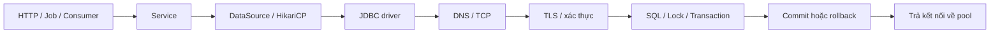
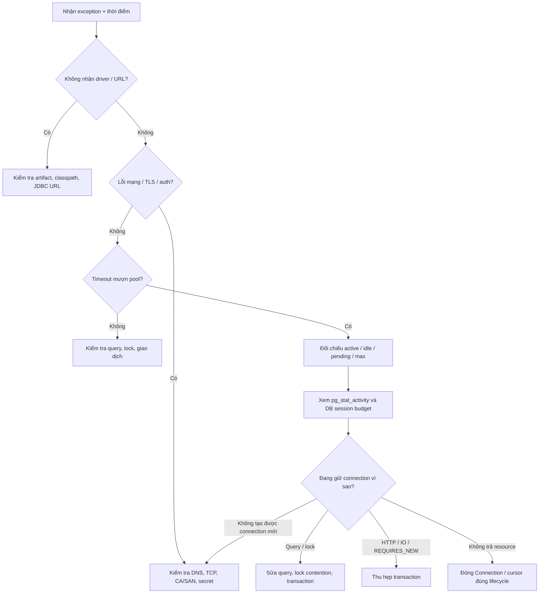

# Chẩn đoán lỗi driver, chứng thư, cạn pool và giao dịch giữ kết nối lâu

Trong một ứng dụng Spring Boot, thông báo “không kết nối được cơ sở dữ liệu” có thể xuất phát từ nhiều chặng khác nhau: Java không tìm thấy JDBC driver, driver không bắt tay TLS được với máy chủ, HikariCP không còn kết nối rảnh để cấp cho yêu cầu mới, hoặc một giao dịch đã mượn kết nối nhưng giữ quá lâu. Các tình huống này có thể tạo ra triệu chứng giống nhau ở tầng HTTP (tăng độ trễ, lỗi 500/503), song cần cách xử lý khác nhau.

Bài học thuộc chương **Kết nối SQL**, đặt trong bối cảnh **SPRING_BOOT_INTEGRATION**: tổ chức tích hợp Spring Boot với các hệ thống bên ngoài và cơ sở dữ liệu một cách có thể cấu hình, xử lý lỗi, kiểm thử và quan sát được. Trọng tâm là **chẩn đoán có bằng chứng** trước khi đổi cấu hình hoặc tác động lên hệ thống đang chạy.

Sau bài này, người học có thể:

- Xác định lỗi xảy ra ở lúc nạp driver, tạo kết nối mạng/TLS, mượn kết nối từ pool hay khi chạy giao dịch.
- Đọc chuỗi nguyên nhân ngoại lệ (exception chain), SQLState, metric HikariCP và trạng thái phiên SQL để hình thành giả thuyết.
- Phân biệt **cạn pool**, **rò rỉ kết nối**, **truy vấn chậm**, **khóa chờ** và **giao dịch giữ kết nối lâu**.
- Khắc phục đúng nguyên nhân, kiểm chứng sau thay đổi và xây dựng kịch bản kiểm thử tái hiện sự cố.

> **Phạm vi ví dụ:** mã ứng dụng dùng Spring Boot + JDBC/JPA + HikariCP; truy vấn chẩn đoán cơ sở dữ liệu minh họa bằng PostgreSQL. Tên thuộc tính TLS, mã lỗi và câu lệnh quản trị thay đổi theo driver/hệ quản trị. Những con số cấu hình là ví dụ, không phải giá trị tối ưu áp dụng cho mọi hệ thống.

## 1. Xác định chặng xảy ra lỗi

### 1.1. Đường đi của một thao tác SQL



Đây là đường đi **logic**. HikariCP quản lý những kết nối vật lý do driver tạo; khi một luồng gọi `DataSource.getConnection()`, nó thường nhận một proxy tới kết nối đang có hoặc đợi pool tạo/cấp kết nối. Với JPA, thời điểm bắt đầu `@Transactional` và thời điểm mượn kết nối vật lý có thể khác nhau tùy ORM và cách cấu hình. Vì vậy **thời lượng giao dịch** và **thời lượng giữ kết nối** cần đo riêng khi có thể.

| Chặng | Triệu chứng thường gặp | Câu hỏi phân biệt đầu tiên |
|---|---|---|
| Nạp driver / cấu hình JDBC | `ClassNotFoundException`, `Cannot load driver class`, `No suitable driver` | Driver có nằm trong gói chạy thực tế và URL có đúng giao thức? |
| Mạng / xác thực | `Connection refused`, kết nối hết thời gian chờ, `password authentication failed` | Đã tới đúng host/port? Máy chủ có chấp nhận đăng nhập? |
| TLS / chứng thư | `SSLHandshakeException`, `PKIX path building failed`, sai tên máy chủ, chứng thư hết hạn | Chứng thư máy chủ có hợp lệ với tên đích và tập CA được tin cậy? |
| Mượn kết nối | `Connection is not available, request timed out` | Bao nhiêu kết nối `active`/`idle`/`pending`? Pool có tạo thêm được không? |
| SQL / giao dịch | Query rất lâu, `idle in transaction`, chờ lock, deadlock | Kết nối đã được mượn đang làm gì và giao dịch mở bao lâu? |

**Không suy luận chỉ từ ngoại lệ bề mặt.** Chẳng hạn Hikari báo hết thời gian mượn kết nối vì pool bị chiếm hết; pool có thể bị chiếm vì truy vấn đang đợi lock, vì gọi HTTP từ bên trong giao dịch, vì rò rỉ `Connection`, hoặc vì cơ sở dữ liệu không cho tạo kết nối mới. Việc tăng `maximum-pool-size` trước khi kiểm tra có thể khiến sự cố nặng hơn.

### 1.2. Tạo một “ảnh chụp” sự cố trước khi sửa

Ghi lại ít nhất:

1. **Thời điểm và phạm vi:** sự cố xảy ra khi startup hay sau khi chạy một thời gian; một instance hay tất cả; sau deploy/đổi secret/đổi chứng thư hay khi tải tăng?
2. **Lỗi gốc:** đầy đủ chuỗi `Caused by`, loại ngoại lệ JDBC, SQLState, vendor code, timeout ghi trong thông báo; loại bỏ mật khẩu/token trước khi chia sẻ log.
3. **Môi trường chạy thực tế:** artifact/container image, profile, driver, JDK, URL JDBC đã che thông tin nhạy cảm, host/port và các cấu hình TLS/pool hiệu lực.
4. **Pool và database cùng mốc thời gian:** số `active`, `idle`, `pending`, số kết nối tối đa, số phiên DB, transaction age, lock wait và độ trễ query.
5. **Đường gọi:** HTTP request, job, message consumer hoặc batch nào phát sinh lỗi; có trace/span, correlation ID hay log transaction không?

Quan sát theo **cùng mốc thời gian** có giá trị hơn các ảnh chụp rời rạc. Pool ở mức tối đa trong một giây tải cao chưa chứng minh có rò rỉ; ngược lại, số kết nối đang dùng tăng đều qua nhiều giờ dù tải ổn định là tín hiệu đáng điều tra.

### 1.3. Đừng gộp mọi timeout làm một

| Loại giới hạn | Nó chờ điều gì? | Ý nghĩa khi hết hạn |
|---|---|---|
| Hikari `connectionTimeout` | Một luồng **mượn** kết nối từ pool | Không được cấp kết nối kịp; chưa cho biết SQL có chạy hay không |
| Driver `connectTimeout` (tên/đơn vị tùy driver) | Thiết lập kết nối tới DB | Có thể liên quan mạng, routing, firewall, listener |
| TLS handshake timeout | Hoàn thành phiên TLS | Có thể do mạng, tương thích TLS, chứng thư hoặc server |
| JDBC query/statement timeout | Lệnh SQL đang thực thi | Có thể là truy vấn chậm, khóa chờ, server quá tải |
| Transaction timeout | Giới hạn giao dịch ở framework/DB | Cơ chế áp dụng phụ thuộc transaction manager/driver; không đồng nghĩa ngắt mọi thao tác tức thì |
| Driver socket/read timeout | Chờ dữ liệu trên socket | Server chậm, mạng gián đoạn hoặc timeout cấu hình quá gắt |

Nên ghi tên cấu hình, đơn vị và phạm vi của **driver đang dùng**; không sao chép ngầm các giá trị timeout giữa PostgreSQL, MySQL và SQL Server.

## 2. Dựng cấu hình nền có thể quan sát

Giả sử ứng dụng Spring Boot dùng PostgreSQL. Một cấu hình tham khảo:

```kotlin
// build.gradle.kts — trình bày phần dependencies liên quan
dependencies {
    implementation("org.springframework.boot:spring-boot-starter-jdbc")
    implementation("org.springframework.boot:spring-boot-starter-actuator")
    runtimeOnly("org.postgresql:postgresql")
}
```

```yaml
# application.yml — giá trị chỉ mang tính minh họa
spring:
  datasource:
    url: "jdbc:postgresql://pg.internal.example:5432/orders?sslmode=verify-full&sslrootcert=/etc/db-certs/ca.pem&ApplicationName=orders-api"
    username: ${DB_USERNAME}
    password: ${DB_PASSWORD}
    hikari:
      pool-name: orders-main
      maximum-pool-size: 10
      connection-timeout: 5000 # mili giây; thời gian chờ mượn connection

management:
  endpoints:
    web:
      exposure:
        include: health,info,metrics
```

Đặt mật khẩu trong secret store hoặc biến môi trường; cấp chứng thư CA bằng cơ chế triển khai được kiểm soát. Đường dẫn `/etc/db-certs/ca.pem` và tên miền trên là giả định. `sslmode=verify-full` và `sslrootcert` là **cú pháp của PostgreSQL JDBC**, không phải cài đặt TLS chung cho mọi driver.

Trong Spring Boot, starter JDBC/JPA thường cấu hình một `DataSource` và dùng HikariCP nếu có trên classpath; cấu hình ứng dụng thực tế, bean tùy chỉnh hoặc nhiều datasource có thể thay đổi hành vi này. Không cần đặt `spring.datasource.driver-class-name` nếu Boot/driver tự nhận ra driver từ URL, nhưng khi cấu hình thủ công thì tên class phải đúng.

Nếu hệ thống bật Actuator và Micrometer, các metric Hikari thường có dạng:

- `hikaricp.connections.active` — kết nối đang được mượn;
- `hikaricp.connections.idle` — kết nối sẵn sàng cấp;
- `hikaricp.connections.pending` — luồng đang chờ mượn;
- `hikaricp.connections.max` / `hikaricp.connections.min` — giới hạn/cấu hình kích thước;
- `hikaricp.connections.acquire`, `hikaricp.connections.usage`, `hikaricp.connections.creation` — các phép đo thời gian nếu được instrument;
- `hikaricp.connections.timeout` — số lần không mượn được kết nối trong thời hạn nếu được xuất.

Có thể kiểm tra danh mục metric qua endpoint Actuator đã cấp quyền, ví dụ `/actuator/metrics` và `/actuator/metrics/hikaricp.connections.active`. Tên metric xuất sang Prometheus thường chuyển đổi dấu chấm thành dấu gạch dưới và có thể thêm hậu tố theo loại metric; hãy xác nhận trong hệ thống giám sát đang dùng. **Không công khai endpoint Actuator/metric chi tiết ra Internet**.

## 3. Nhóm lỗi 1 — JDBC driver và cấu hình kết nối

### 3.1. Nhận diện chính xác

Các thông báo ví dụ:

```text
java.lang.ClassNotFoundException: org.postgresql.Driver
Cannot load driver class: org.postgresql.Driver
java.sql.SQLException: No suitable driver found for jdbc:...
Failed to configure a DataSource: 'url' attribute is not specified ...
```

Chúng **không hoàn toàn tương đương**:

- `ClassNotFoundException` / `Cannot load driver class`: class cần thiết không hiện diện hoặc không được load trong runtime.
- `No suitable driver`: không có driver đăng ký nhận URL đó; có thể do classpath **hoặc URL sai**.
- `url attribute is not specified`: ứng dụng thiếu cấu hình datasource hiệu lực; không thể kết luận thiếu thư viện driver.
- Driver nạp được nhưng `Connection refused` hoặc `password authentication failed`: đã qua bước nhận diện driver, nên chuyển sang chẩn đoán mạng/xác thực.

### 3.2. Thứ tự kiểm tra

**Bước 1 — xác minh JDBC URL.** Cú pháp điển hình:

```text
PostgreSQL: jdbc:postgresql://pg.internal.example:5432/orders
MySQL:      jdbc:mysql://mysql.internal.example:3306/orders
SQL Server: jdbc:sqlserver://sql.internal.example:1433;databaseName=orders
```

Ví dụ `jdbc:postgres://...` không phải tiền tố URL chuẩn của PostgreSQL JDBC. Xem cấu hình sau khi áp dụng profile, biến môi trường, secret và command-line override; không chỉ đọc `application.yml` trong source.

**Bước 2 — xác minh dependency có ở runtime.** Trong Gradle, `compileOnly` hoặc `testImplementation` không bảo đảm có driver ở artifact chạy production. `runtimeOnly("org.postgresql:postgresql")` là một cách khai báo đúng khi dùng Gradle và driver được framework tự phát hiện. Với Maven, đặt dependency driver ở phạm vi runtime phù hợp.

**Bước 3 — xem nội dung artifact thực tế.** Với Spring Boot executable JAR dùng layout mặc định:

```bash
jar tf build/libs/app.jar | grep 'BOOT-INF/lib/postgresql-'
```

Nếu đang dùng PowerShell, có thể thay `grep` bằng `Select-String`. Với container, cần kiểm tra **JAR/image được triển khai**, vì tập tin trong máy developer có thể khác image đang chạy. Với WAR, exploded deployment hoặc native image, cách kiểm tra packaging sẽ khác.

**Bước 4 — kiểm tra cách khởi tạo datasource.** Có `DataSource` do ứng dụng tự tạo? Có nhiều datasource và một datasource thiếu dependency/cấu hình? Có profile nào chuyển URL sang loại cơ sở dữ liệu khác? Có cấu hình ép `driver-class-name` không đúng?

**Bước 5 — kiểm tra riêng lớp mạng.** Khi driver đã được load, kiểm tra tên miền, cổng, chính sách mạng, DB listener và authentication. Không tiếp tục sửa classpath nếu ngoại lệ gốc chỉ ra máy chủ từ chối TCP.

### 3.3. Biện pháp sửa và cách xác nhận

Sửa dependency runtime, URL hoặc cách bind cấu hình theo đúng kết quả ở trên; xây lại artifact/image và chạy thử ngay bằng gói giống production. Một kiểm thử khởi động có thể lấy kết nối từ `DataSource` và thực hiện `SELECT 1` trên PostgreSQL thử nghiệm. Kiểm thử này xác nhận khả năng thiết lập kết nối ở môi trường thử nghiệm; nó không xác nhận chứng thư production hoặc quyền truy cập toàn bộ bảng dữ liệu.

**Không “sửa” lỗi driver bằng cách tăng kích thước pool hoặc tắt TLS.** Những thay đổi này thuộc chặng khác của đường kết nối.

## 4. Nhóm lỗi 2 — chứng thư và phiên TLS

TLS bảo vệ kênh truyền dữ liệu giữa ứng dụng và SQL server. Với xác thực đầy đủ, client cần xác minh **chuỗi tin cậy** và **danh tính hostname** của máy chủ. Nếu DB yêu cầu mTLS, client còn phải trình chứng thư client phù hợp.

### 4.1. Đọc thông báo để tìm đúng nhánh

| Triệu chứng | Giả thuyết ưu tiên | Điều cần kiểm tra |
|---|---|---|
| `PKIX path building failed` / `unable to find valid certification path` | Client không dựng được đường tin cậy tới CA | CA gốc/trung gian, file CA/truststore, cơ chế trust của driver |
| `No subject alternative DNS name matching ...` | Host trong URL không khớp SAN chứng thư | DNS name trong JDBC URL, SAN của chứng thư máy chủ |
| `CertificateExpiredException` / chứng thư chưa hiệu lực | Đồng hồ/chứng thư không nằm trong khoảng hiệu lực | Thời gian hệ thống, `notBefore`/`notAfter`, lịch xoay chứng thư |
| `handshake_failure` / `bad_certificate` | Bất tương thích TLS hoặc chứng thư client bị từ chối | TLS versions/ciphers được hỗ trợ, yêu cầu mTLS, key/cert client |
| Kết nối cũ chạy, kết nối mới lỗi sau xoay cert | Chứng thư hoặc CA mới chưa đồng bộ đến các instance | Certificate chain mới, mount secret, pod rollout, nguồn CA thực tế |

Thông báo có thể bị bao bởi `PSQLException`, `SQLNonTransientConnectionException` hoặc ngoại lệ của pool. Luôn đi đến **nguyên nhân cuối cùng có ý nghĩa** trong exception chain.

### 4.2. Quy trình xác minh an toàn

1. **Kiểm tra đúng endpoint.** JDBC URL có dùng bí danh DNS, IP, endpoint của proxy/load balancer hay hostname khác với SAN trên chứng thư? Kết nối tới địa chỉ IP khi chứng thư chỉ cấp cho DNS thường dẫn đến mismatch.
2. **Kiểm tra chứng thư máy chủ đang trình bày.** Xác nhận chủ thể, SAN, ngày hiệu lực, issuer và chuỗi CA/trung gian ở chính endpoint ứng dụng đi qua. Không tự suy diễn từ chứng thư lưu trên một máy DB khác.
3. **Kiểm tra tập CA client đang tin cậy.** File có thực sự được mount trong container không? Đường dẫn có quyền đọc không? Driver đang dùng file CA riêng hay Java truststore? Một số JDBC driver có cách cấu hình trust riêng.
4. **Nếu bật mTLS**, kiểm tra client certificate và private key thuộc đúng cặp, còn hiệu lực, được server chấp nhận; đừng thêm client certificate khi máy chủ chỉ yêu cầu TLS một chiều.
5. **Đối chiếu thời điểm.** Nếu lỗi xuất hiện ngay sau rotate/rollout, kiểm tra từng instance đang dùng phiên bản cấu hình/chứng thư nào. Kết nối vật lý đã tồn tại có thể tiếp tục chạy trong khi việc tạo kết nối mới thất bại.
6. **Kiểm thử từ cùng môi trường chạy.** Dùng một ứng dụng thử nhỏ hoặc công cụ hỗ trợ đúng giao thức/driver, cùng hostname và CA. Một kết quả “TCP port mở” chưa chứng minh TLS trust hợp lệ.

**Ví dụ PostgreSQL JDBC với xác minh hostname:**

```properties
spring.datasource.url=jdbc:postgresql://pg.internal.example:5432/orders?sslmode=verify-full&sslrootcert=/etc/db-certs/ca.pem
```

`sslmode=verify-full` yêu cầu xác minh chứng thư và tên đích. `sslrootcert` cung cấp đường dẫn chứng thư CA được PostgreSQL JDBC sử dụng theo cơ chế SSL của driver. Khi sử dụng Java truststore hoặc `SSLFactory` tùy chỉnh, cần xác nhận đúng quy tắc của driver/version đang chạy; không mặc định rằng `-Djavax.net.ssl.trustStore` chi phối mọi cấu hình JDBC TLS.

Các driver có tên thuộc tính khác nhau:

| Driver | Chế độ minh họa yêu cầu xác minh danh tính |
|---|---|
| PostgreSQL JDBC | `sslmode=verify-full` |
| MySQL Connector/J | `sslMode=VERIFY_IDENTITY` |
| Microsoft JDBC Driver for SQL Server | `encrypt=true` cùng `trustServerCertificate=false` và hostname phù hợp |

Đây là **gợi ý tra cứu cấu hình theo driver**, không phải chuỗi tham số thay thế trực tiếp cho nhau. Đọc tài liệu của đúng driver/version để thiết lập CA, truststore, keystore và certificate rotation.

### 4.3. Điều không nên làm khi gặp chứng thư sai

- Không chuyển sang `sslmode=disable`, `trustServerCertificate=true` hoặc cơ chế bỏ qua hostname verification trong production chỉ để làm mất lỗi. Làm vậy xóa bỏ lớp xác thực máy chủ và có thể che giấu việc đi sai endpoint.
- Không chép private key vào source code, log hoặc hình chụp màn hình.
- Không xem kết quả `pg_isready`, `ping` hay kiểm tra TCP port là bằng chứng đủ rằng JDBC đã xác minh TLS thành công.
- Nếu bật log handshake (chẳng hạn `javax.net.debug=ssl,handshake` cho môi trường Java phù hợp), chỉ bật có thời hạn, giới hạn nơi lưu log và lọc dữ liệu nhạy cảm.

### 4.4. Kiểm chứng sau khắc phục

Từ một instance mới, tạo được kết nối TLS có xác thực đầy đủ, chạy `SELECT 1`, đóng kết nối và xác nhận không còn lỗi handshake. Cần kiểm tra việc **tạo kết nối mới** sau khi CA/certificate rotation, không chỉ thử trên session DB đã mở trước khi rotate.

## 5. Nhóm lỗi 3 — pool không cấp được kết nối

HikariCP là một connection pool: các yêu cầu đồng thời cạnh tranh một số hữu hạn kết nối vật lý. Khi không có kết nối khả dụng trước `connectionTimeout`, luồng mượn nhận ngoại lệ, ví dụ:

```text
java.sql.SQLTransientConnectionException:
orders-main - Connection is not available, request timed out after 5000ms
```

Đây là triệu chứng **không mượn được kết nối đúng hạn**. Nó chưa chứng minh “pool quá nhỏ”.

### 5.1. Đọc metric theo tương quan

Ký hiệu:

- `A` = kết nối đang được mượn (`active`).
- `I` = kết nối rảnh (`idle`).
- `P` = luồng chờ mượn (`pending`).
- `M` = giới hạn pool (`maximumPoolSize`).

| Quan sát theo thời gian | Có thể đang xảy ra | Điều tra tiếp |
|---|---|---|
| `A ≈ M`, `I ≈ 0`, `P > 0` | Pool đang bão hòa | Duration mượn, query latency, giao dịch mở, khóa DB, leak |
| `A < M` nhưng `P > 0` kéo dài | Pool không tạo/cấp thêm được kịp | Chậm tạo connection, giới hạn DB, lỗi mạng/TLS, thread scheduling |
| `A` tăng dần và không trở về mức nền khi tải giảm | Có thể giữ kết nối lâu hoặc leak | Stack mượn, giao dịch chưa kết thúc, luồng bị treo |
| `P` tăng khi query latency và lock wait cùng tăng | Kết nối bị chiếm do SQL/lock chậm | DB wait event, câu SQL, blocking transaction |
| DB báo “too many connections” khi pool muốn tạo mới | Tổng số kết nối vượt ngân sách DB | Pool của mọi replica/datasource và client khác |

**Lưu ý:** trạng thái pool tại một thời điểm không đủ để kết luận. Một kết nối `active` có thể đang thực thi query hợp lệ; Hikari chỉ biết nó đã được mượn, không tự biết nó đang làm gì trong DB.

### 5.2. Tập bằng chứng tối thiểu

Đặt biểu đồ cạnh nhau cho cùng khoảng thời gian:

- `active`, `idle`, `pending`, `max` và số lần `timeout` của **đúng pool**.
- Thời gian `acquire` và `usage` của kết nối, nếu thư viện instrumentation đang cung cấp.
- Request rate, độ trễ HTTP/job/consumer, số thread xử lý và số lượng instance.
- DB: số session, số transaction đang mở, session chờ lock, độ trễ query, CPU/IO.
- Số connection failed/new connection failed do xác thực, TLS, giới hạn DB hoặc mạng.

Nếu pool có tên `orders-main`, lọc theo tag pool tương ứng để tránh cộng nhầm nhiều pool. Trong ứng dụng nhiều datasource, đo riêng từng pool.

### 5.3. Chẩn đoán phía PostgreSQL

**Nhóm kết nối theo ứng dụng và trạng thái:**

```sql
SELECT application_name,
       state,
       COUNT(*) AS sessions
FROM pg_stat_activity
WHERE datname = current_database()
GROUP BY application_name, state
ORDER BY application_name, state;
```

**Tìm giao dịch giữ kết nối lâu hoặc chờ:**

```sql
SELECT pid,
       usename,
       application_name,
       state,
       now() - xact_start AS transaction_age,
       now() - query_start AS query_age,
       wait_event_type,
       wait_event,
       LEFT(query, 160) AS query_sample
FROM pg_stat_activity
WHERE datname = current_database()
  AND pid <> pg_backend_pid()
ORDER BY xact_start ASC NULLS LAST;
```

**Tìm phiên đang bị chặn bởi các phiên khác:**

```sql
SELECT pid,
       application_name,
       state,
       now() - xact_start AS transaction_age,
       wait_event_type,
       wait_event,
       pg_blocking_pids(pid) AS blocking_pids,
       LEFT(query, 160) AS query_sample
FROM pg_stat_activity
WHERE datname = current_database()
  AND cardinality(pg_blocking_pids(pid)) > 0
ORDER BY transaction_age DESC NULLS LAST;
```

Các lệnh trên là ví dụ dành cho PostgreSQL và phụ thuộc quyền giám sát. Cột `query` có thể chứa dữ liệu ứng dụng nếu SQL được dựng bằng cách chèn literal; hạn chế quyền truy cập và che dữ liệu trước khi xuất báo cáo. Với MySQL/SQL Server, dùng performance schema, DMVs hoặc công cụ tương ứng thay vì chạy SQL PostgreSQL.

`state = 'idle in transaction'` nghĩa là session đang trong giao dịch nhưng không thực thi query tại thời điểm quan sát; session đó có thể vẫn giữ lock và tài nguyên transaction. `state = 'active'` không có nghĩa luôn đang tiêu thụ CPU: nó có thể đang **chờ lock hoặc IO**. Dùng `wait_event_type` và `pg_blocking_pids` để phân biệt.

### 5.4. Đánh giá dung lượng trước khi tăng pool

Một ước lượng cơ bản về số kết nối cần đồng thời là:

\[
\text{số kết nối bận trung bình} \approx
\text{số thao tác DB/giây} \times
\text{thời gian mỗi thao tác giữ kết nối (giây)}
\]

Đây là cách vận dụng quan hệ lưu lượng–thời gian, chỉ là **ước lượng trung bình**, không thay thế đo đỉnh tải và phân phối độ trễ. Dùng **connection hold time**, không dùng toàn bộ thời gian HTTP request nếu request còn gọi dịch vụ ngoài DB.

Giả sử 6 replica, mỗi replica có pool tối đa 18 kết nối: riêng nhóm này đã có thể mở **108 connection**. Nếu ngân sách DB dành cho ứng dụng chỉ khoảng 80 connection sau khi trừ dự phòng và các service khác, tăng pool hoặc tăng replica sẽ vượt khả năng phục vụ. Phải tính tổng của các datasource, worker, scheduler, batch, migration và ứng dụng khác; không dùng `max_connections` của DB làm toàn bộ ngân sách ứng dụng.

Cần xử lý nguyên nhân trước: truy vấn chậm, lock, transaction giữ connection, tạo connection thất bại hoặc leak. Chỉ điều chỉnh `maximum-pool-size` khi DB còn ngân sách tài nguyên, ứng dụng có nhu cầu song song hợp lý và thử nghiệm tải xác nhận cải thiện. Với Hikari, không cần chủ động đặt `minimum-idle` nếu không có yêu cầu đặc thù; để mặc định thường làm pool vận hành gần dạng kích thước cố định.

### 5.5. Phân biệt “leak” với mượn lâu hợp lệ

Hikari hỗ trợ cảnh báo khi kết nối được mượn lâu hơn ngưỡng `leakDetectionThreshold`. Có thể bật tạm thời trong môi trường được kiểm soát:

```yaml
spring:
  datasource:
    hikari:
      leak-detection-threshold: 20000 # ms, chỉ để chẩn đoán có thời hạn
```

Một stack trace “apparent connection leak” cho biết kết nối **được mượn quá ngưỡng**; giao dịch thực sự chạy lâu cũng kích hoạt cảnh báo. Nếu sau đó kết nối được trả về, đó có thể là một lần mượn lâu, chưa chắc là leak vĩnh viễn. Chọn ngưỡng cao hơn thời gian mượn hợp lệ thông thường, xét giới hạn được Hikari hỗ trợ và tắt lại khi điều tra xong để giảm nhiễu log.

Rò rỉ thật thường xuất hiện khi ứng dụng tự quản lý `Connection` nhưng không đóng trong mọi nhánh lỗi. Ví dụ đóng tài nguyên đúng cách:

```java
import java.sql.Connection;
import java.sql.PreparedStatement;
import java.sql.ResultSet;
import javax.sql.DataSource;

public long countPending(DataSource dataSource) throws Exception {
    String sql = "SELECT COUNT(*) FROM orders WHERE status = ?";

    try (Connection connection = dataSource.getConnection();
         PreparedStatement statement = connection.prepareStatement(sql)) {
        statement.setString(1, "PENDING");
        try (ResultSet result = statement.executeQuery()) {
            result.next();
            return result.getLong(1);
        }
    }
}
```

Trong ứng dụng Spring, `JdbcTemplate` và các thành phần ORM thông thường quản lý việc lấy/trả kết nối theo cơ chế Spring; nên ưu tiên cơ chế sẵn có để giảm lỗi thủ công. Với streaming result, cursor hoặc API trả dữ liệu lười (lazy), phải xác nhận vòng đời resource vẫn được đóng đúng sau khi consumer đọc xong.

## 6. Nhóm lỗi 4 — giao dịch giữ kết nối quá lâu

### 6.1. Vì sao một giao dịch dài làm cạn pool?

Kết nối vật lý sau khi được mượn để chạy SQL trong giao dịch thường không thể cấp cho giao dịch khác cho đến khi giao dịch kết thúc và kết nối được trả về. Nếu nhiều luồng vừa giữ connection vừa chờ HTTP, file IO, message broker hoặc lock của DB, số `active` có thể đạt trần mặc dù CPU của DB thấp.

Ví dụ một giao dịch có phạm vi quá rộng:

```java
@Service
public class CheckoutService {
    private final OrderRepository orders;
    private final InventoryClient inventory;

    public CheckoutService(OrderRepository orders, InventoryClient inventory) {
        this.orders = orders;
        this.inventory = inventory;
    }

    @Transactional
    public void checkout(OrderRequest request) {
        orders.save(Order.pending(request));    // Có thể bắt đầu mượn connection
        inventory.reserve(request.productId()); // Gọi HTTP lâu trong DB transaction
        orders.markReserved(request.orderId());
    }
}
```

Đây là ví dụ minh họa, chưa phải mã nghiệp vụ hoàn chỉnh. Tùy Hibernate/transaction manager, connection vật lý có thể được lấy trễ hơn lúc vào phương thức `@Transactional`; tuy nhiên một khi kết nối đã được mượn và giao dịch còn mở, call HTTP ở giữa thường kéo dài thời gian giữ kết nối. Timeout của HTTP client và của pool là **hai ranh giới khác nhau**.

### 6.2. Thu hẹp biên giao dịch một cách có chủ đích

Nếu nghiệp vụ cho phép, thực hiện tra cứu/call HTTP trước khi bắt đầu transaction, rồi chỉ giữ giao dịch quanh thao tác SQL cần nguyên tử:

```java
@Service
public class CheckoutService {
    private final InventoryClient inventory;
    private final TransactionTemplate tx;
    private final OrderRepository orders;
    private final OutboxRepository outbox;

    public CheckoutService(
            InventoryClient inventory,
            TransactionTemplate tx,
            OrderRepository orders,
            OutboxRepository outbox) {
        this.inventory = inventory;
        this.tx = tx;
        this.orders = orders;
        this.outbox = outbox;
    }

    public void checkout(OrderRequest request) {
        ReservationQuote quote = inventory.quote(request.productId()); // Ngoài DB transaction

        tx.executeWithoutResult(status -> {
            Order order = orders.save(Order.pending(request, quote));
            outbox.save(OutboxEvent.orderCreated(order.getId()));
        });
    }
}
```

Ví dụ dùng `TransactionTemplate` để ranh giới giao dịch nhìn thấy rõ trong code; các lớp `Order`, `ReservationQuote` và repository chỉ là kiểu minh họa. Outbox phải được ghi **cùng transaction** với dữ liệu nghiệp vụ, sau đó một worker riêng chuyển sự kiện cho hệ thống bên ngoài. Mẫu này phù hợp khi cần phát sự kiện tin cậy sau commit.

**Giới hạn cần thiết:** chuyển HTTP ra ngoài transaction không tự làm cho hành động ở hệ thống ngoài và DB trở thành nguyên tử. Trạng thái `quote` có thể thay đổi trước khi commit; nghiệp vụ cần version, idempotency, kiểm tra lại điều kiện, hoặc quy trình bù trừ khi cần. Nếu đã giữ chỗ thật ở hệ thống khác trước khi ghi DB, phải có cách hoàn tác/đối soát để xử lý lỗi.

### 6.3. Các bẫy phổ biến

| Mẫu code / tình huống | Rủi ro | Hướng chẩn đoán / chỉnh sửa |
|---|---|---|
| `@Transactional` bao cả request HTTP, gọi broker, sleep hoặc xử lý file | Giữ connection/lock dài hơn thời gian SQL cần thiết | Đo đoạn ngoài DB; thu hẹp transaction, dùng outbox khi cần |
| Query lớn hoặc thiếu index trong transaction | Connection bận lâu, các request xếp hàng | Query plan, slow query, index, paging/batch phù hợp |
| Một transaction chờ lock của transaction khác | Session `active` nhưng không tiến triển | `pg_blocking_pids`, transaction age, thứ tự cập nhật/lock |
| Gọi `REQUIRES_NEW` từ transaction đang giữ connection | Có thể cần **thêm** connection cho inner transaction | Đối chiếu số luồng đồng thời và dung lượng pool; tránh lồng không cần thiết |
| Dùng streaming result rồi trả đối tượng stream ra ngoài vòng đời quản lý | Cursor/connection có thể không được đóng sớm | Consume/close resource trong scope hợp lệ |
| Bật Open Session in View | Có thể phát sinh query muộn lúc render response, che giấu N+1 | Tách DTO/load quan hệ cần thiết trong service; đo connection usage thực tế |
| Self-invocation gọi phương thức `@Transactional` của cùng object | Proxy transaction của Spring có thể không áp dụng | Kiểm tra boundary qua proxy, tách bean hoặc dùng `TransactionTemplate` |

Không mặc định “có `@Transactional` là chắc chắn đã mượn connection từ đầu”: thời điểm acquisition, cách Hibernate release và cấu hình datasource ảnh hưởng kết luận. Đo trace và metric thực tế. Tương tự, `Open Session in View` không tự động đồng nghĩa với việc connection bị giữ xuyên suốt HTTP response.

### 6.4. Xem transaction trên PostgreSQL

Từ truy vấn `pg_stat_activity` ở phần trên, chú ý:

- `xact_start`: thời điểm transaction bắt đầu; `now() - xact_start` là tuổi giao dịch.
- `query_start`: thời điểm câu query hiện tại/ gần nhất bắt đầu; diễn giải cùng `state`.
- `idle in transaction` kéo dài: ứng dụng hoặc client chưa kết thúc transaction.
- `wait_event_type = 'Lock'`: cần tìm phiên chặn, sau đó truy ra code path giữ transaction.
- `pg_blocking_pids(pid)`: danh sách PID đang chặn session; chỉ xem PID rồi kill ngay có thể gây rollback và tác động nghiệp vụ.

Trong incident production, chỉ kết thúc phiên DB thủ công khi đã đánh giá hậu quả và có quy trình vận hành phù hợp. Việc hủy một transaction dài có thể giải phóng lock nhanh nhưng không khắc phục code gây ra nó.

### 6.5. Timeout nên đặt ở đúng tầng

Ví dụ PostgreSQL hỗ trợ `statement_timeout` để giới hạn một statement và `idle_in_transaction_session_timeout` để tránh session nằm idle trong transaction quá lâu. Các giá trị phải dựa vào workload, quyền quản trị, luồng migration và SLO thực tế. Timeout từ Spring `@Transactional(timeout=...)` hoặc `TransactionTemplate` phụ thuộc transaction manager và cách lệnh SQL được thực hiện; không được coi là sự thay thế tuyệt đối cho timeout của DB hoặc driver.

Một lựa chọn cấu hình “an toàn” cần trả lời: yêu cầu bình thường chạy tối đa bao lâu, transaction bị hủy có rollback đầy đủ không, ứng dụng có retry không, retry có idempotent không, và timeout đó có cắt ngang batch hợp lệ không?

## 7. Runbook xử lý sự cố theo bằng chứng

Quy trình dưới đây ưu tiên cô lập lỗi với ít thay đổi nhất. Có thể dùng cho HTTP API, scheduled job và consumer xử lý message trong Spring Boot.

### Bước 1 — định vị triệu chứng gốc

- Thất bại ngay lúc tạo `DataSource`/khởi động: xem driver, cấu hình URL, secret, kết nối mới, TLS.
- Chạy ổn rồi bắt đầu timeout mượn kết nối: xem pool và session DB.
- Query đang thực thi quá lâu hoặc deadlock: xem lock, execution plan và transaction.
- Chỉ một nhóm instance lỗi: đối chiếu deployment, profile, CA mount, cấu hình và reachability của nhóm đó.

### Bước 2 — ghép bằng chứng ứng dụng với cơ sở dữ liệu



### Bước 3 — áp dụng thay đổi có mục tiêu

| Kết luận từ bằng chứng | Thay đổi chính | Cách xác minh |
|---|---|---|
| Driver không nằm trong artifact | Sửa runtime dependency/package | Artifact mới có driver và test kết nối thành công |
| URL sai driver / thiếu datasource config | Sửa URL, profile, binding | Ứng dụng dùng đúng endpoint và tạo `DataSource` |
| CA/SAN/TLS sai | Sửa CA chain, hostname hoặc phát hành chứng thư đúng | Kết nối mới xác minh TLS thành công |
| DB cạn session | Giảm tổng connection budget, sửa luồng giữ connection, phối hợp DBA | DB nhận connection mới, số session nằm trong ngân sách |
| Query/lock chậm | Tối ưu SQL/index, giảm lock scope, xử lý transaction chặn | Query latency/lock wait giảm, `pending` giảm |
| HTTP/IO trong transaction | Thu hẹp ranh giới giao dịch | `connection usage` và transaction age giảm |
| Manual `Connection` không được đóng | Sửa lifecycle bằng try-with-resources/cơ chế Spring | `active` trở về mức nền sau tải, không còn dấu vết leak |

### Bước 4 — kiểm chứng và ghi lại sự kiện

Sau deploy/fix, quan sát qua một khoảng tải đủ đại diện: tỷ lệ lỗi, đỉnh `pending`, `active`, connection borrow latency, query latency, transaction age, số phiên DB và tỉ lệ timeout. So với baseline trước incident, đồng thời kiểm tra lỗi mới do retry/rollback. Ghi lại **nguyên nhân gốc**, **tín hiệu giúp phân biệt**, **biện pháp đã áp dụng** và **điều kiện phát hiện sớm** cho runbook lần sau.

## 8. Bốn tình huống chẩn đoán điển hình

### Tình huống A — deploy mới báo không tìm thấy driver

**Triệu chứng:** bản local chạy được, image production startup lỗi `Cannot load driver class: org.postgresql.Driver`.

**Đối chiếu:** mã trong source dùng driver, nhưng artifact/image production không có `postgresql-*.jar`. Dependency vô tình khai báo ở `testImplementation` hoặc bị loại khỏi runtime packaging.

**Xử lý:** sửa dependency thành runtime, build lại image, kiểm tra nội dung artifact **trong image mới** và chạy smoke test `SELECT 1`. Thay đổi pool không giải quyết sự cố này.

### Tình huống B — sau xoay chứng thư, chỉ connection mới lỗi

**Triệu chứng:** một số request vẫn hoạt động trên kết nối cũ; instance khởi động mới báo `PKIX path building failed`. Có thể Hikari đồng thời ghi timeout khi pool không tạo bổ sung được.

**Đối chiếu:** CA mới chưa được mount hoặc chain server thiếu intermediate CA; một nhóm instance còn chứa bundle CA cũ. Kiểm tra thêm SAN nếu endpoint vừa đổi tên.

**Xử lý:** phân phối đúng CA/chain, bảo đảm hostname tương ứng SAN, rollout có kiểm chứng. Test bằng **kết nối JDBC mới** với verification bật. Không tắt kiểm tra chứng thư để “giữ dịch vụ chạy”.

### Tình huống C — pool 10 kết nối bão hòa nhưng DB CPU thấp

**Triệu chứng:** `active=10`, `idle=0`, `pending` tăng, API nhận `Connection is not available`; DB CPU thấp. `pg_stat_activity` thấy nhiều phiên `idle in transaction`.

**Đối chiếu:** các luồng đang giữ transaction sau lệnh `INSERT` trong khi chờ HTTP tới inventory service khoảng 12 giây. Vấn đề không nằm ở số lượng truy vấn SQL; thời gian mượn connection bị kéo dài bởi network IO.

**Xử lý:** đưa HTTP ra ngoài transaction khi nghiệp vụ cho phép, viết outbox nếu cần phát sự kiện sau commit, cấu hình timeout của HTTP client và bảo đảm retry/idempotency. Kiểm chứng thời gian giữ connection giảm, số `pending` và timeout giảm ở cùng mức tải.

### Tình huống D — số active không giảm sau khi traffic đã hết

**Triệu chứng:** `active` tăng từ từ sau nhiều giờ, ít request mới nhưng pool vẫn gần đầy. Cảnh báo leak chỉ về một phương thức dùng `dataSource.getConnection()` thủ công.

**Đối chiếu:** nhánh trả về sớm/ngoại lệ không chạy `close()`. Không tìm thấy transaction dài hợp lệ tương ứng; connection được mượn rồi không trả.

**Xử lý:** dùng try-with-resources hoặc chuyển sang `JdbcTemplate`; thêm kiểm thử gây exception giữa các thao tác để xác nhận luôn đóng tài nguyên. Sau sửa, kết nối trở về pool khi request hoàn tất; theo dõi lại qua nhiều chu kỳ tải.

## 9. Kiểm thử phòng ngừa và quan sát sản xuất

### 9.1. Ma trận kiểm thử thực tế

| Lớp kiểm thử | Kịch bản | Kết quả mong đợi |
|---|---|---|
| Package/smoke | Khởi động artifact được deploy với driver runtime và URL thử nghiệm | Driver được load, ứng dụng tạo kết nối, `SELECT 1` chạy được |
| TLS integration | Dùng server/cert tương tự production với đúng CA và hostname | Kết nối thành công khi verify bật |
| TLS negative | Dùng CA sai, hostname sai hoặc chứng thư hết hạn trong môi trường thử | Kết nối bị từ chối rõ ràng; không có fallback bỏ qua xác minh |
| Pool saturation | Pool nhỏ (ví dụ `maximum-pool-size=2`), chạy nhiều thao tác DB đồng thời có kiểm soát | Luồng chờ/timeout theo chính sách; kết thúc tải thì connection được trả |
| Failure path | Gây exception sau khi mượn `Connection` hoặc giữa transaction | Kết nối được đóng/trả, transaction rollback như thiết kế |
| Transaction latency | Giả lập remote HTTP chậm hoặc query bị lock trong môi trường thử | Trace chỉ ra thời gian giữ kết nối; cải tiến giảm `usage` |
| Recovery | Tạm thời từ chối tạo kết nối mới rồi phục hồi trong môi trường kiểm thử | Ứng dụng phục hồi được hoặc báo lỗi rõ theo chính sách retry |

Testcontainers với PostgreSQL hữu ích để tái hiện SQL và pool ở môi trường CI. Tuy nhiên, container PostgreSQL không bật TLS mặc định **không chứng minh** cơ chế xác minh CA/hostname đúng; TLS cần kịch bản riêng có chứng thư, endpoint và CA rõ ràng. Không chạy kịch bản làm cạn pool, cố tình treo transaction hay xoay cert trực tiếp trên production.

### 9.2. Những cảnh báo có hành động rõ ràng

Một hệ thống vận hành tốt cần ít nhất biểu đồ theo từng datasource/pool, có liên kết sang trace và trạng thái DB. Các cảnh báo nên xuất phát từ SLO/baseline và có thời lượng duy trì hợp lý, ví dụ:

- `pending > 0` kéo dài **đồng thời** số `timeout` tăng và request latency vượt SLO;
- `active` duy trì sát `max` dù lưu lượng đã giảm hoặc `usage` tăng bất thường;
- số transaction có `transaction_age` lớn hơn mức hợp lệ của ứng dụng;
- số phiên `idle in transaction` hoặc lock wait tăng;
- số lần kết nối mới thất bại vì TLS, auth hoặc DB connection limit tăng sau deploy/rotate.

Không đặt ngưỡng “active cao = lỗi” một cách độc lập. Một pool bận ở đỉnh tải có thể hoạt động bình thường nếu độ trễ và timeout vẫn trong SLO; cảnh báo phải đủ thông tin để người trực ca chọn bước tiếp theo.

### 9.3. Lưu ý về bảo mật và độ tin cậy

- Log JDBC có thể chứa SQL, tham số, URL và thông tin cá nhân. Mask secret, hạn chế quyền xem log và không bật full SQL binding/handshake debug vô thời hạn.
- Gắn `application_name` hoặc thông tin nhận diện instance đáng tin cậy vào kết nối SQL để ghép `pg_stat_activity` với metrics/log (không dùng chuỗi nhạy cảm làm tên ứng dụng).
- Tách timeout cho mượn connection, tạo kết nối, query và HTTP client; retry có giới hạn, backoff và idempotency phù hợp. Retry không kiểm soát có thể làm pool/DB càng nghẽn.
- Khi dùng nhiều replica, cân nhắc tổng kết nối tới DB và giới hạn connection của các thành phần khác, kể cả batch/job và administration.
- Sau sửa, kiểm tra cả đường đi **commit/rollback/close**, không chỉ đường đi thành công.

## 10. Checklist ngắn khi trực sự cố

1. Lấy stack trace gốc, SQLState, mốc thời gian, phiên bản artifact và phạm vi instance.
2. Phân loại: driver/URL → DNS/TCP/auth → TLS → pool borrow → query/transaction.
3. Với driver: xác minh **classpath của artifact thực chạy**, JDBC URL và profile hiệu lực.
4. Với TLS: xác minh hostname/SAN, CA chain, ngày hiệu lực và yêu cầu client certificate bằng kết nối mới.
5. Với pool: nhìn **active + idle + pending + max + timeout** theo thời gian, cùng số session DB.
6. Với transaction: xem `pg_stat_activity`, `transaction_age`, `idle in transaction`, lock wait, query và đoạn code có HTTP/IO bên trong `@Transactional`.
7. Khắc phục nguyên nhân, test trong môi trường kiểm soát, quan sát kết quả ở tải đại diện và ghi lại bằng chứng.

**Điểm nhớ chính:** ngoại lệ ở `DataSource.getConnection()` cho biết **nơi yêu cầu thất bại**, chưa chắc cho biết **nơi nguyên nhân bắt đầu**. Chẩn đoán chính xác cần nối bằng chứng từ driver và TLS đến HikariCP, SQL server, giao dịch và luồng nghiệp vụ.
