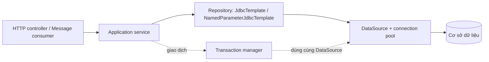

# `JdbcTemplate`, `NamedParameterJdbcTemplate` và cấu hình do Spring Boot cung cấp

Trong **SPRING_BOOT_INTEGRATION**, cơ sở dữ liệu thường là một mắt xích của luồng tích hợp: nhận yêu cầu HTTP hoặc thông điệp, kiểm tra trạng thái, cập nhật dữ liệu và trả kết quả hoặc phát sự kiện tiếp theo. `JdbcTemplate` và `NamedParameterJdbcTemplate` giúp thực thi SQL có kiểm soát, tận dụng kết nối, giao dịch, cơ chế ánh xạ lỗi và quan sát do Spring Boot cung cấp. Bài này thuộc chương **JDBC và jOOQ**, tập trung vào lớp truy cập dữ liệu bằng JDBC; jOOQ được đặt cạnh JDBC ở phần lựa chọn công cụ.

## Mục tiêu học tập

Sau bài học, bạn có thể:

- Giải thích vai trò của `DataSource`, connection pool, `JdbcTemplate` và `NamedParameterJdbcTemplate` trong ứng dụng Spring Boot.
- Cấu hình kết nối, biến môi trường, SQL initialization và các thuộc tính pool phù hợp với từng môi trường.
- Viết truy vấn có tham số, ánh xạ kết quả thành đối tượng Java, cập nhật và xử lý danh sách tham số.
- Xác định ranh giới giao dịch, số dòng bị tác động, lỗi có thể thử lại và cách chống xử lý trùng thông điệp.
- Chọn chiến lược kiểm thử và các tín hiệu quan sát cho một luồng tích hợp dữ liệu thực tế.

## 1. JDBC nằm ở đâu trong kiến trúc tích hợp?

JDBC là API của Java để làm việc với cơ sở dữ liệu quan hệ thông qua driver. Nếu dùng JDBC thuần, lập trình viên phải quản lý `Connection`, `PreparedStatement`, `ResultSet`, đóng tài nguyên và chuyển đổi `SQLException`. Spring JDBC giữ lại quyền kiểm soát SQL nhưng xử lý phần lớn công việc lặp lại đó.



Các vai trò không hoán đổi cho nhau:

| Thành phần | Trách nhiệm |
| --- | --- |
| `DataSource` | Cung cấp kết nối đến hệ quản trị cơ sở dữ liệu. |
| Connection pool (thường là HikariCP) | Tái sử dụng kết nối; kiểm soát số kết nối đang mở và thời gian chờ lấy kết nối. |
| `JdbcTemplate` | Thực thi SQL dùng dấu `?`, gắn tham số, ánh xạ kết quả, giải phóng tài nguyên và chuyển lỗi JDBC sang hệ ngoại lệ Spring. |
| `NamedParameterJdbcTemplate` | Cung cấp cú pháp `:tenThamSo`; chuyển đổi sang tham số JDBC, thuận tiện cho truy vấn nhiều điều kiện và `IN`. |
| `PlatformTransactionManager` | Kết nối các thao tác JDBC vào cùng giao dịch khi chạy trong ngữ cảnh `@Transactional`. |

`JdbcTemplate` không phải ORM: nó không tự sinh truy vấn theo quan hệ đối tượng, không tự theo dõi thay đổi entity và không tạo giao dịch phân tán giữa database, HTTP và broker. Đó là những ranh giới quan trọng khi thiết kế adapter tích hợp.

## 2. Spring Boot tự cấu hình những gì?

Khi ứng dụng có các dependency JDBC, driver cơ sở dữ liệu và thuộc tính kết nối phù hợp, Spring Boot có thể tự tạo `DataSource`, `JdbcTemplate`, `NamedParameterJdbcTemplate` và hạ tầng transaction JDBC. Với cấu hình thông dụng, HikariCP là pool mặc định khi có mặt trên classpath. Nếu ứng dụng khai báo các bean tùy chỉnh, điều kiện tự cấu hình có thể thay đổi; với nhiều `DataSource`, cần chọn rõ bean và transaction manager tương ứng.

Ví dụ Maven sử dụng PostgreSQL (version được quản lý bởi Spring Boot BOM hoặc parent của dự án):

```xml
<dependencies>
    <dependency>
        <groupId>org.springframework.boot</groupId>
        <artifactId>spring-boot-starter-jdbc</artifactId>
    </dependency>
    <dependency>
        <groupId>org.postgresql</groupId>
        <artifactId>postgresql</artifactId>
        <scope>runtime</scope>
    </dependency>
</dependencies>
```

Ví dụ `application.yml` (giá trị chỉ mang tính minh họa, cần điều chỉnh theo năng lực database và tải thực tế):

```yaml
spring:
  datasource:
    url: jdbc:postgresql://${DB_HOST:localhost}:5432/${DB_NAME:integration_demo}
    username: ${DB_USER}
    password: ${DB_PASSWORD}
    hikari:
      pool-name: integration-db-pool
      maximum-pool-size: 10
      minimum-idle: 2
      connection-timeout: 30000
  sql:
    init:
      mode: never
```

`DB_USER` và `DB_PASSWORD` phải được cấp từ biến môi trường hoặc hệ quản lý bí mật; không đưa mật khẩu thật vào mã nguồn. Driver thường được Boot nhận diện từ JDBC URL và dependency. `spring.datasource.hikari.connection-timeout` tính bằng mili giây; hết thời gian lấy kết nối có thể khiến thao tác thất bại ngay cả khi SQL của nó rất nhanh.

| Cấu hình | Cách hiểu và lưu ý |
| --- | --- |
| `spring.datasource.url` | JDBC URL chứa host, cổng, tên database và các tùy chọn kết nối cần thiết. |
| `spring.datasource.username/password` | Danh tính truy cập theo nguyên tắc quyền tối thiểu, lấy từ nguồn bí mật. |
| `spring.datasource.hikari.maximum-pool-size` | Giới hạn kết nối của pool; phải cân đối với tổng số instance, các ứng dụng khác và giới hạn DB. |
| `spring.datasource.hikari.connection-timeout` | Giới hạn thời gian đợi một kết nối rảnh từ pool, không phải thời gian tối đa của mọi câu SQL. |
| `spring.sql.init.mode` | Kiểm soát chạy các script `schema.sql`/`data.sql`; `never` dùng khi quản lý schema bằng migration riêng. |

Đối với dịch vụ thực tế, nên quản lý thay đổi schema bằng Flyway hoặc Liquibase và chỉ chọn **một** cơ chế sở hữu việc tạo/sửa schema. `spring.sql.init.mode=always` cho phép chạy script SQL init cả trên database không nhúng, hữu ích với demo nhưng dễ xung đột migration hoặc dữ liệu sản xuất nếu dùng sai. Tách cấu hình theo profile (`dev`, `test`, `prod`) và không để các tùy chọn thuận tiện khi thử nghiệm vô tình đi vào production.

### Schema dùng xuyên suốt ví dụ

Các ví dụ sau dùng PostgreSQL và hai bảng đơn giản:

```sql
CREATE TABLE customer_profile (
    id           BIGINT GENERATED ALWAYS AS IDENTITY PRIMARY KEY,
    email        VARCHAR(320) NOT NULL UNIQUE,
    display_name VARCHAR(160) NOT NULL,
    status       VARCHAR(20) NOT NULL,
    updated_at   TIMESTAMPTZ NOT NULL DEFAULT NOW()
);

CREATE TABLE processed_message (
    message_id   VARCHAR(100) PRIMARY KEY,
    processed_at TIMESTAMPTZ NOT NULL
);
```

`customer_profile` là dữ liệu nghiệp vụ; `processed_message` ghi nhận một message đã được xử lý trong cùng database, phục vụ ví dụ chống xử lý trùng ở phần giao dịch. DDL trên dùng cú pháp PostgreSQL và cần migration tương ứng trước khi chạy ứng dụng.

## 3. `JdbcTemplate`: SQL vị trí, ánh xạ kết quả và cập nhật

`JdbcTemplate` phù hợp với SQL ngắn, số tham số ít và thứ tự tham số rõ ràng. Đối tượng được tạo qua dependency injection, không cần `new JdbcTemplate(...)` ở từng lời gọi. Dưới đây là một repository có thể dùng lại trong Spring Boot:

```java
import java.util.List;
import java.util.Optional;

import org.springframework.jdbc.core.JdbcTemplate;
import org.springframework.jdbc.core.RowMapper;
import org.springframework.stereotype.Repository;

public record Customer(long id, String email, String displayName, String status) {}

@Repository
public class CustomerRepository {
    private static final String COLUMNS =
            "id, email, display_name, status";

    private static final RowMapper<Customer> CUSTOMER_MAPPER = (rs, rowNum) ->
            new Customer(
                    rs.getLong("id"),
                    rs.getString("email"),
                    rs.getString("display_name"),
                    rs.getString("status"));

    private final JdbcTemplate jdbc;

    public CustomerRepository(JdbcTemplate jdbc) {
        this.jdbc = jdbc;
    }

    public Optional<Customer> findById(long id) {
        List<Customer> rows = jdbc.query(
                "SELECT " + COLUMNS + " FROM customer_profile WHERE id = ?",
                CUSTOMER_MAPPER,
                id);
        return rows.stream().findFirst();
    }

    public int rename(long id, String newName) {
        return jdbc.update(
                "UPDATE customer_profile " +
                "SET display_name = ?, updated_at = NOW() WHERE id = ?",
                newName, id);
    }
}
```

**Lưu ý về đoạn mã:** Java yêu cầu mỗi `public` top-level type nằm ở file riêng. Khi đưa ví dụ vào ứng dụng, đặt `Customer` trong `Customer.java` và `CustomerRepository` trong `CustomerRepository.java`; đoạn code gộp nhằm dễ đối chiếu.

Phương thức `query(sql, rowMapper, args...)` dùng `PreparedStatement`; dữ liệu được bind vào dấu `?` theo thứ tự. `RowMapper<Customer>` biến **một dòng** `ResultSet` thành **một** đối tượng; `query(...)` trả về danh sách rỗng khi không có dòng phù hợp. `update(...)` trả về số dòng bị tác động: nếu cập nhật theo khóa chính mà kết quả là `0`, bản ghi có thể không tồn tại; giá trị khác `1` cần xem lại giả định truy vấn.

Khi truy vấn phải trả về đúng một dòng, `queryForObject(...)` là lựa chọn ngắn gọn nhưng cần biết rằng nó ném ngoại lệ nếu không có dòng hoặc nhiều hơn một dòng. Với API trả về `Optional`, cách dùng `query(...)` như trên giúp diễn đạt trường hợp không tìm thấy một cách trực tiếp.

**Không ghép giá trị đầu vào vào SQL:**

```java
// Sai: dữ liệu từ client trở thành một phần cú pháp SQL.
String unsafe = "SELECT id FROM customer_profile WHERE email = '" + email + "'";

// Đúng: email được truyền như một giá trị SQL.
List<Long> ids = jdbc.queryForList(
        "SELECT id FROM customer_profile WHERE email = ?",
        Long.class,
        email);
```

Tham số bind bảo vệ phần **giá trị**; tên bảng, tên cột và chiều `ORDER BY` không thể đưa qua `?` hay `:param`. Với truy vấn sắp xếp động, hãy ánh xạ lựa chọn của người dùng vào một danh sách định danh SQL được cho phép và chỉ ghép các định danh đã kiểm soát.

## 4. `NamedParameterJdbcTemplate`: SQL dễ đọc khi tham số nhiều

`NamedParameterJdbcTemplate` bọc các thao tác JDBC tương ứng nhưng dùng `:id`, `:status` thay cho các dấu `?` lặp lại. Spring Boot thường cung cấp bean này cùng `JdbcTemplate`, vì vậy có thể inject trực tiếp trong repository.

```java
import java.util.Collection;
import java.util.List;

import org.springframework.jdbc.core.RowMapper;
import org.springframework.jdbc.core.namedparam.MapSqlParameterSource;
import org.springframework.jdbc.core.namedparam.NamedParameterJdbcTemplate;
import org.springframework.stereotype.Repository;

@Repository
public class CustomerSearchRepository {
    private static final RowMapper<Customer> MAPPER = (rs, rowNum) ->
            new Customer(
                    rs.getLong("id"),
                    rs.getString("email"),
                    rs.getString("display_name"),
                    rs.getString("status"));

    private final NamedParameterJdbcTemplate namedJdbc;

    public CustomerSearchRepository(NamedParameterJdbcTemplate namedJdbc) {
        this.namedJdbc = namedJdbc;
    }

    public List<Customer> findByStatusAndIds(
            String status, Collection<Long> customerIds) {
        if (customerIds.isEmpty()) {
            return List.of();
        }

        String sql = """
                SELECT id, email, display_name, status
                FROM customer_profile
                WHERE status = :status AND id IN (:ids)
                ORDER BY id
                """;

        var params = new MapSqlParameterSource()
                .addValue("status", status)
                .addValue("ids", customerIds);

        return namedJdbc.query(sql, params, MAPPER);
    }
}
```

Trong ví dụ này, `:ids` được mở rộng thành số placeholder phù hợp với số phần tử trong collection. Danh sách rỗng được xử lý trước vì `IN ()` không phải SQL hợp lệ trên nhiều hệ quản trị. Với danh sách quá lớn, chia lô hoặc dùng bảng tạm/cách join phù hợp thay vì tạo truy vấn có hàng nghìn tham số mà không kiểm soát.

`MapSqlParameterSource` tiện khi muốn khai báo các giá trị và, nếu cần, kiểu JDBC tường minh. `Map<String, ?>` cũng phù hợp cho truy vấn đơn giản. Với batch, có thể dùng `namedJdbc.batchUpdate(sql, SqlParameterSource[])`; hãy xem số dòng cập nhật mà driver trả về và kiểm tra yêu cầu nghiệp vụ, vì một số driver có thể báo trạng thái `SUCCESS_NO_INFO` thay vì đếm chính xác từng thao tác.

### Nên chọn API nào?

| Nhu cầu | Công cụ thường phù hợp | Điểm cần kiểm tra |
| --- | --- | --- |
| Truy vấn nhỏ, ít tham số | `JdbcTemplate` | Thứ tự các dấu `?`. |
| Truy vấn nhiều điều kiện, lặp lại cùng giá trị | `NamedParameterJdbcTemplate` | Tên tham số phải khớp với SQL. |
| Truy vấn `IN` theo danh sách | `NamedParameterJdbcTemplate` | Collection rỗng và giới hạn tham số. |
| Query động phức tạp, cần DSL SQL và kiểu dữ liệu sinh từ schema | jOOQ | Cấu hình dialect, code generation và cách quản lý migration. |
| Muốn mapping aggregate và repository theo mô hình Spring Data | Spring Data JDBC | Quy tắc mapping/aggregate, khác với việc kiểm soát từng câu SQL. |

`JdbcTemplate` và jOOQ không loại trừ nhau: các adapter khác nhau có thể cùng sử dụng `DataSource` và transaction manager phù hợp. Hãy chọn theo độ phức tạp SQL, khả năng bảo trì và yêu cầu kiểm soát truy vấn, không theo tên công nghệ.

## 5. Giao dịch: nhất quán giữa nhiều câu SQL

Một câu `update(...)` đơn lẻ không bảo đảm tính nguyên tử cho **toàn bộ** luồng nghiệp vụ. Khi một sự kiện đòi hỏi ghi nhiều bảng, hãy đặt ranh giới giao dịch ở service có ý nghĩa nghiệp vụ hoặc handler được Spring quản lý:

```java
import org.springframework.jdbc.core.JdbcTemplate;
import org.springframework.stereotype.Service;
import org.springframework.transaction.annotation.Transactional;

@Service
public class CustomerStatusHandler {
    private final JdbcTemplate jdbc;

    public CustomerStatusHandler(JdbcTemplate jdbc) {
        this.jdbc = jdbc;
    }

    @Transactional
    public void applyStatusChanged(String messageId, long customerId, String status) {
        int firstDelivery = jdbc.update(
                "INSERT INTO processed_message (message_id, processed_at) " +
                "VALUES (?, NOW()) ON CONFLICT (message_id) DO NOTHING",
                messageId);

        if (firstDelivery == 0) {
            return; // Message này đã được xử lý và commit trước đó.
        }

        int changed = jdbc.update(
                "UPDATE customer_profile " +
                "SET status = ?, updated_at = NOW() WHERE id = ?",
                status, customerId);

        if (changed != 1) {
            throw new IllegalStateException("Không tìm thấy khách hàng: " + customerId);
        }
    }
}
```

Đây là một phương án **idempotency theo `messageId`** dành riêng cho PostgreSQL. Khóa chính của `processed_message` và `ON CONFLICT ... DO NOTHING` khiến lần giao lặp lại không cập nhật trạng thái lần nữa. Nếu cập nhật khách hàng thất bại và ngoại lệ làm transaction rollback, dấu vết trong `processed_message` cũng bị rollback, cho phép hệ thống thử lại sau khi xử lý nguyên nhân. Cần dùng message ID ổn định, được xác định theo hợp đồng của nguồn gửi; không tự sinh ID mới mỗi lần retry.

Các điều kiện để ví dụ hoạt động đúng:

1. Hai lệnh JDBC dùng cùng `DataSource` đang được transaction manager quản lý.
2. `applyStatusChanged(...)` được gọi qua Spring bean/proxy, không gọi nội bộ từ một method khác của chính instance rồi kỳ vọng `@Transactional` được áp dụng.
3. Ngoại lệ khi thiếu bản ghi được đưa ra ngoài để rollback. Theo mặc định, `@Transactional` rollback với `RuntimeException` và `Error`; checked exception có quy tắc khác, cần cấu hình khi cần.
4. Cơ chế xác nhận message của broker phải được thiết kế phù hợp với thời điểm commit. Một transaction của database **không** tự bao trùm việc ack broker hay gọi một HTTP service khác.

Nếu cần **ghi database rồi phát thông điệp** đáng tin cậy, cân nhắc transactional outbox: ghi dòng dữ liệu và bản ghi outbox trong cùng transaction, sau đó một publisher độc lập gửi outbox đi và ghi nhận tiến độ. Kết hợp outbox với xử lý idempotent ở consumer để chịu được giao trùng; không suy diễn thành bảo đảm “exactly once” trên toàn bộ các hệ thống.

`@Transactional(readOnly = true)` hữu ích để mô tả ý định chỉ đọc và có thể hỗ trợ tối ưu theo driver/database; nó không phải một cơ chế bảo mật bảo đảm mọi lệnh ghi đều bị chặn. Tránh giữ transaction mở trong lúc chờ HTTP hoặc broker vì thời gian giữ connection và lock có thể tăng đáng kể.

## 6. Xử lý lỗi và retry trong adapter database

Spring JDBC dịch `SQLException` thành họ ngoại lệ không checked `DataAccessException`. Nhờ đó service có thể phân loại lỗi theo mục đích xử lý mà không phụ thuộc trực tiếp vào mã lỗi của từng driver.

| Dấu hiệu | Ví dụ tình huống | Hướng xử lý |
| --- | --- | --- |
| `DuplicateKeyException` | Trùng khóa chính/unique khi insert | Xác định có phải yêu cầu trùng hợp lệ hay xung đột nghiệp vụ; không retry mù quáng. |
| `DataIntegrityViolationException` | Vi phạm ràng buộc dữ liệu | Kiểm tra hợp đồng đầu vào, ràng buộc DB và luồng cập nhật. |
| `CannotGetJdbcConnectionException` | Database không sẵn sàng, pool/kết nối thất bại | Quan sát kết nối/pool, retry có giới hạn nếu tác vụ an toàn để lặp. |
| `QueryTimeoutException` | Truy vấn vượt giới hạn thời gian đã cấu hình | Xem execution plan, lock, tải DB và deadline của toàn request. |
| `EmptyResultDataAccessException` | `queryForObject(...)` không tìm được dòng | Quy đổi sang `404`, `Optional.empty()` hoặc kết quả nghiệp vụ phù hợp. |

Không phải mọi lỗi đều transient và cũng không phải mọi lệnh ghi đều an toàn để retry. Khi phải retry một công việc có side effect, dùng khóa idempotency, giới hạn số lần, backoff và phân biệt lỗi kết nối tạm thời với lỗi hợp đồng dữ liệu. Giới hạn thời gian chờ kết nối, thực thi SQL và deadline request/message cần thống nhất để tránh backlog tích tụ.

## 7. Hiệu năng, bảo mật và khả năng quan sát

**Một số nguyên tắc khi vận hành:**

- **Connection pool:** đừng đặt `maximum-pool-size` bằng số request đồng thời nếu DB không chịu nổi. Tổng connection của mọi instance mới là con số cần kiểm tra; quan sát số connection đang dùng, chờ và timeout trước khi tăng pool.
- **Truy vấn:** chọn cột cần thiết thay vì `SELECT *`, đặt index cho khóa lọc/join thực tế, phân trang khi đọc nhiều dòng và xem execution plan khi có truy vấn chậm.
- **Batch và kích thước dữ liệu:** dùng `batchUpdate` cho nhiều lệnh cùng khuôn; với tập dữ liệu lớn, xử lý theo trang/chunk có kiểm soát bộ nhớ và transaction.
- **Ranh giới tin cậy:** bind toàn bộ **giá trị** đầu vào; chỉ cho phép các tên cột, bảng và hướng sắp xếp đã được kiểm duyệt. Phân quyền user DB ở mức tối thiểu.
- **Thời gian và giao dịch:** hạn chế thao tác I/O ngoài database bên trong transaction; kiểm soát lock và thiết lập timeout phù hợp với công việc.
- **Dữ liệu nhạy cảm:** tránh ghi SQL kèm giá trị bí mật, thông tin cá nhân hay toàn bộ payload trong log; thay bằng request/correlation ID và trường đã lọc.

Với Spring Boot Actuator và Micrometer được cấu hình, có thể theo dõi health của database, độ bận và thời gian chờ pool HikariCP (chẳng hạn nhóm metric `hikaricp.connections.*` khi được xuất), độ trễ request và lỗi ở tầng dịch vụ. Correlation ID cần đi xuyên qua HTTP request/message, service và truy vấn để nối một lỗi DB với luồng tích hợp gây ra nó. Log SQL ở mức chi tiết chỉ nên bật có thời hạn trong môi trường kiểm soát, tránh lộ giá trị tham số.

## 8. Kiểm thử theo ranh giới cần bảo đảm

| Cấp độ | Mục tiêu | Gợi ý thực hiện |
| --- | --- | --- |
| Unit test service | Kiểm tra phân nhánh nghiệp vụ, xử lý kết quả `0/1` dòng, phản ứng trước lỗi | Dùng repository giả lập hoặc mock; không khẳng định đúng cú pháp SQL từ loại test này. |
| JDBC slice test | Kiểm tra SQL, mapping và repository với một database thử nghiệm | Dùng `@JdbcTest`; cấu hình import repository khi cần, chuẩn bị schema và dữ liệu rõ ràng. |
| Integration test với DB thật | Kiểm tra cú pháp/dialect, unique constraint, transaction, `ON CONFLICT` | Dùng PostgreSQL qua Testcontainers, chạy migration thực tế và chọn cấu hình không thay bằng embedded DB. |
| Test consumer/adapter | Kiểm tra redelivery, xử lý trùng, rollback và ack | Phát lại cùng `messageId`, gây lỗi giữa transaction, xác nhận số lần cập nhật và điều kiện retry. |

Không dùng H2 để kết luận rằng SQL đặc thù PostgreSQL (`ON CONFLICT`, kiểu dữ liệu, locking) đã được kiểm chứng. Với `@JdbcTest`, Spring Boot có thể tự thay database bằng embedded database tùy dependency/cấu hình; khi cần PostgreSQL thật, hãy cấu hình `@AutoConfigureTestDatabase(replace = NONE)` phù hợp với phiên bản Boot và cấp JDBC URL từ Testcontainers.

Một bộ tình huống có giá trị cho ví dụ `CustomerStatusHandler`:

1. **Message mới, customer tồn tại:** tạo đúng một `processed_message`, cập nhật đúng một customer.
2. **Message lặp lại:** gọi hai lần với cùng ID, trạng thái và các side effect không bị áp dụng lần thứ hai.
3. **Customer không tồn tại:** ném lỗi, không lưu dấu `processed_message` sau rollback.
4. **Hai consumer đồng thời:** cùng `messageId` phải tuân theo unique constraint, không cộng dồn tác động nghiệp vụ.
5. **Lỗi DB tạm thời:** retry theo chính sách bounded backoff, không biến một message lỗi cố định thành vòng lặp vô hạn.

## 9. Cạm bẫy thường gặp

**`JdbcTemplate` đã chạy SQL, sao dữ liệu chưa commit?** Nếu method nằm trong transaction khác đang mở, thay đổi chỉ commit khi toàn transaction thành công. Xem ranh giới `@Transactional`, loại exception và transaction manager đang dùng.

**Vì sao kết nối cạn dù pool đã bật?** Pool chỉ tái sử dụng kết nối, không vô hạn hóa số connection. Truy vấn chậm, giao dịch kéo dài, stream/result set không được đóng đúng cách hoặc tăng quá nhiều instance đều có thể khiến request phải đợi. Với callback/query thông thường, `JdbcTemplate` quản lý tài nguyên; khi dùng API streaming cần bảo đảm đóng stream theo hợp đồng của API.

**Vì sao `IN (:ids)` lỗi với danh sách rỗng?** Cú pháp SQL sau khi mở rộng không hợp lệ ở nhiều database. Trả về kết quả rỗng sớm hoặc định nghĩa rõ semantics cho filter rỗng.

**Có nên đặt SQL trong controller?** Không. Đặt SQL trong repository/adapter và gọi từ service để controller/consumer tập trung vào hợp đồng đầu vào, orchestration và chuyển lỗi phù hợp. Nhờ vậy cùng logic có thể dùng cho HTTP, scheduled job hoặc message consumer.

**Khi nào cần chuyển sang jOOQ?** Khi câu SQL có nhiều phép join, CTE, subquery, điều kiện động hoặc cần DSL có kiểm tra kiểu theo schema. `JdbcTemplate` vẫn hữu ích cho câu lệnh trực tiếp và adapter nhỏ; cả hai đều phải xử lý transaction, timeout, retry và khả năng quan sát ở mức hệ thống.

## 10. Checklist áp dụng vào một luồng tích hợp thực tế

Trước khi đưa adapter JDBC vào môi trường chạy thực, hãy tự kiểm tra: hợp đồng dữ liệu và ràng buộc DB đã thống nhất chưa; SQL bind tham số và xét đủ trường hợp không có dòng chưa; đã định nghĩa rõ transaction boundary và cách kiểm tra số dòng thay đổi chưa; message redelivery có khóa idempotency chưa; timeout/retry có giới hạn và có phân loại lỗi chưa; đã kiểm thử bằng đúng database dialect, unique constraint và trường hợp cạnh tranh chưa; pool, truy vấn chậm và lỗi DB có thể quan sát từ metrics/log/trace chưa.

**Ghi nhớ:** Spring Boot cung cấp cấu hình kết nối và hạ tầng, `JdbcTemplate`/`NamedParameterJdbcTemplate` giúp thao tác SQL an toàn và rõ ràng, còn tính đúng đắn của tích hợp đến từ hợp đồng dữ liệu, transaction, xử lý trùng, chiến lược lỗi, kiểm thử và vận hành của chính ứng dụng.
