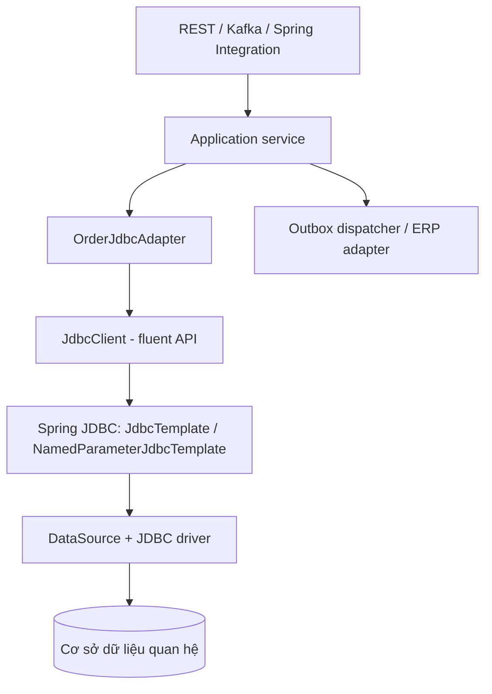

# `JdbcClient` và API truy vấn SQL theo phong cách fluent

## 1. `JdbcClient` giải quyết nhu cầu gì?

Khi ứng dụng Spring Boot tích hợp với PostgreSQL, MySQL hoặc một cơ sở dữ liệu quan hệ khác, nhiều thao tác không cần đến một mô hình ORM đầy đủ. Chẳng hạn, một adapter chỉ cần tra cứu đơn hàng theo mã hệ thống ngoài, cập nhật trạng thái khi nhận thông điệp từ broker, ghi bản ghi đối soát, hoặc lưu sự kiện vào outbox. SQL tường minh thường phù hợp vì người phát triển kiểm soát được bảng, điều kiện lọc, join và thời điểm cập nhật dữ liệu.

**`JdbcClient`** là API đồng bộ, theo phong cách *fluent*, được bổ sung trong **Spring Framework 6.1** để làm việc với Spring JDBC. Thay vì truyền SQL, tham số và bộ ánh xạ trong một lời gọi dài tới `JdbcTemplate`, ta ghép các bước theo chuỗi: **`sql(...)` → `param(...)`/`params(...)` → `query(...)`/`update()` → `list()`/`single()`/`optional()`**.

Trong module **`SPRING_BOOT_INTEGRATION`**, `JdbcClient` hữu ích cho các luồng tích hợp qua HTTP client, cơ sở dữ liệu, cache, broker thông điệp và adapter Spring Integration. Độ ngắn gọn của API chỉ là một phần: cần đồng thời thiết kế **cấu hình kết nối, hợp đồng dữ liệu, giao dịch, phân loại lỗi, xử lý trùng lặp, kiểm thử và quan sát SQL**.

Ví dụ xuyên suốt: dịch vụ `order-integration` nhận một `externalOrderId` từ REST hoặc Kafka, tra bảng `integration_order`, chuyển trạng thái `PENDING` sang `PROCESSING`, tạo một outbox event và để worker riêng gửi yêu cầu tới ERP. Chúng ta sẽ sử dụng `JdbcClient` để thao tác dữ liệu và giải thích các ranh giới an toàn của thiết kế này.

Sau bài học, bạn có thể:

- Cấu hình và lấy `JdbcClient` trong Spring Boot phù hợp với phiên bản framework.
- Viết `SELECT`, `INSERT`, `UPDATE`, `DELETE` bằng API fluent, dùng tham số đặt tên hoặc theo vị trí.
- Chọn đúng giữa `.list()`, `.optional()`, `.single()` và `RowMapper`.
- Hiểu mối quan hệ giữa `JdbcClient`, `JdbcTemplate`, `NamedParameterJdbcTemplate`, `DataSource` và transaction manager.
- Áp dụng prepared statements, unique constraint, optimistic update, timeout và outbox trong luồng tích hợp.
- Biết khi nào nên giữ `JdbcClient`, khi nào cần `JdbcTemplate`, jOOQ hoặc công cụ truy cập dữ liệu khác.

## 2. `JdbcClient` nằm ở đâu trong hệ sinh thái JDBC?

JDBC chuẩn của Java cung cấp `Connection`, `PreparedStatement`, `ResultSet` và các thao tác quản lý tài nguyên. Spring JDBC xây dựng thêm cơ chế lấy/trả connection, ràng buộc tham số, chuyển đổi exception, ánh xạ hàng và tham gia Spring transaction. `JdbcClient` đặt một mặt tiền fluent trên hạ tầng đã có, **không phải một driver JDBC hoặc ORM mới**.

| Thành phần | Trách nhiệm chính | Khi nào phù hợp? |
|---|---|---|
| JDBC thuần | Làm việc trực tiếp với `Connection`, `PreparedStatement`, `ResultSet`. | Cần kiểm soát API JDBC ở mức thấp, chấp nhận nhiều mã xử lý tài nguyên. |
| `JdbcTemplate` | Thực thi SQL và xử lý vòng đời JDBC; hỗ trợ callback, batch, nhiều API chi tiết. | Các trường hợp cần API linh hoạt/cấp thấp, batch update hoặc callback tùy chỉnh. |
| `NamedParameterJdbcTemplate` | Hỗ trợ `:name` trong SQL, ánh xạ tên sang tham số JDBC. | SQL có nhiều tham số đặt tên, điều kiện động có kiểm soát. |
| **`JdbcClient`** | Mặt tiền fluent thống nhất thao tác JDBC phổ biến. | Repository/adapter đọc ghi SQL thông thường, muốn code gọn và rõ mục đích. |
| jOOQ | DSL sinh SQL có hiểu cấu trúc và dialect, có thể sinh mã từ schema. | Truy vấn phức tạp, nhiều biểu thức SQL, yêu cầu type safety/dialect. |
| Spring Data JPA | ORM và quản lý entity/persistence context. | Nghiệp vụ thực sự cần mô hình entity, quan hệ và vòng đời đối tượng. |



Vì sử dụng Spring JDBC ở bên dưới, `JdbcClient` có thể tham gia cùng Spring transaction với các thao tác JDBC khác **nếu chúng sử dụng `DataSource` và transaction manager được cấu hình đúng**. Nó vẫn là API *blocking*: gọi từ thread xử lý request truyền thống thường phù hợp, nhưng không nên để nó block event loop của WebFlux.

## 3. Điều kiện phiên bản, dependency và auto-configuration

`JdbcClient` có từ **Spring Framework 6.1**, thường đi cùng **Spring Boot 3.2 trở lên** trong thế hệ Boot 3.x. Ở các dự án cũ dùng Boot 3.0/3.1 (Spring Framework 6.0), không nên giả định class này đã có sẵn. Khi áp dụng ví dụ, trước hết hãy kiểm tra phiên bản Spring Boot/Spring Framework thực tế và BOM của dự án.

Với Maven:

```xml
<dependency>
    <groupId>org.springframework.boot</groupId>
    <artifactId>spring-boot-starter-jdbc</artifactId>
</dependency>

<dependency>
    <groupId>org.postgresql</groupId>
    <artifactId>postgresql</artifactId>
    <scope>runtime</scope>
</dependency>
```

Với Gradle Kotlin DSL:

```kotlin
dependencies {
    implementation("org.springframework.boot:spring-boot-starter-jdbc")
    runtimeOnly("org.postgresql:postgresql")
}
```

Nếu ứng dụng đã có starter mang theo Spring JDBC, ví dụ `spring-boot-starter-data-jpa`, có thể không cần khai báo `starter-jdbc` lần nữa; cần kiểm tra dependency graph thay vì thêm trùng vì thói quen. `spring-boot-starter-jdbc` thường cung cấp **HikariCP** làm connection pool theo cấu hình mặc định phổ biến của Boot, nhưng driver của hệ quản trị cơ sở dữ liệu vẫn phải có trên classpath.

Ví dụ `application.yml`:

```yaml
spring:
  datasource:
    url: ${ORDERS_DB_URL}
    username: ${ORDERS_DB_USERNAME}
    password: ${ORDERS_DB_PASSWORD}
    hikari:
      maximum-pool-size: 12
      connection-timeout: 500
```

`spring.datasource.hikari.connection-timeout` được tính bằng **mili giây**; trong ví dụ là 500 ms để chờ lấy connection từ pool, **không phải** timeout tối đa của SQL query. Con số pool/timeout phải được chọn từ tải và giới hạn database, không sao chép nguyên từ demo vào production.

Ở cấu hình Boot 3.2+ tiêu chuẩn, khi có các điều kiện về Spring JDBC và một ứng viên `NamedParameterJdbcOperations` phù hợp, Boot có thể **auto-configure `JdbcClient` bean**. Nếu không thấy bean này, cần kiểm tra classpath, `DataSource`, cấu hình JDBC, số lượng bean `NamedParameterJdbcOperations`, bean do người dùng tự khai báo và *Condition Evaluation Report* của phiên bản Boot đang chạy. Trong môi trường có **nhiều DataSource**, không nên mong đợi Boot tự suy ra datasource nghiệp vụ nào cần dùng; hãy khai báo tên/qualifier và cấu hình rõ ràng.

Nếu cần khởi tạo bằng tay, có thể dùng:

```java
import javax.sql.DataSource;
import org.springframework.context.annotation.Bean;
import org.springframework.context.annotation.Configuration;
import org.springframework.jdbc.core.simple.JdbcClient;

@Configuration
class OrdersJdbcConfiguration {
    @Bean("ordersJdbcClient")
    JdbcClient ordersJdbcClient(DataSource ordersDataSource) {
        return JdbcClient.create(ordersDataSource);
    }
}
```

Đoạn này chỉ phù hợp khi `ordersDataSource` được inject đúng nguồn dữ liệu mong muốn. Nếu có nhiều `DataSource`, sử dụng `@Qualifier("ordersDataSource")` cho tham số và cân nhắc không tạo thêm một bean `JdbcClient` không cần thiết nếu Boot đã tạo đúng bean cho trường hợp một datasource.

## 4. API fluent cơ bản: từ SQL đến kết quả

Cú pháp thông dụng:

```java
jdbcClient.sql("SELECT ... WHERE id = :id")
          .param("id", id)
          .query(rowMapper)
          .optional();
```

Giải nghĩa từng bước:

1. **`sql(String)`** bắt đầu một truy vấn hoặc một lệnh cập nhật. SQL vẫn là câu lệnh do lập trình viên viết; Spring không tự phát hiện cấu trúc bảng.
2. **`param(...)`/`params(...)`** ràng buộc giá trị tham số. Có thể dùng tham số đặt tên `:id` hoặc dấu hỏi `?` theo vị trí.
3. **`query(...)`** cấu hình cách ánh xạ `ResultSet`, chẳng hạn `RowMapper<T>` hoặc kiểu kết quả đơn giản.
4. **`.list()`/`.optional()`/`.single()`/`.stream()`** thực thi truy vấn và tiêu thụ kết quả theo kỳ vọng cardinality.
5. **`.update()`** thực thi `INSERT`, `UPDATE`, `DELETE` hoặc lệnh thay đổi dữ liệu phù hợp và trả số dòng bị ảnh hưởng.

Đừng nhầm `JdbcClient` với một query builder DSL đầy đủ. Fluent ở đây là **fluent Java API bao quanh SQL thuần**, không phải mọi cấu trúc SQL đều được tạo từ các method có type safety như `select(...).from(...).where(...)` của jOOQ.

### 4.1. Tham số đặt tên

```java
List<String> statuses = jdbcClient.sql("""
        SELECT status
        FROM integration_order
        WHERE customer_id = :customerId
        ORDER BY updated_at DESC
        """)
    .param("customerId", customerId)
    .query(String.class)
    .list();
```

Tên `:customerId` trong SQL phải khớp tên truyền vào `.param("customerId", ...)`. Dùng tham số đặt tên đặc biệt dễ đọc khi câu lệnh có nhiều điều kiện hoặc tham số xuất hiện hơn một lần.

### 4.2. Tham số theo vị trí

```java
List<String> statuses = jdbcClient.sql("""
        SELECT status
        FROM integration_order
        WHERE customer_id = ? AND source_system = ?
        """)
    .param(customerId)
    .param("ERP-A")
    .query(String.class)
    .list();
```

Với dấu `?`, giá trị được bind theo thứ tự. Nếu vị trí các điều kiện thay đổi, cần rà soát thứ tự parameter; vì thế tham số đặt tên thường giảm lỗi bảo trì với SQL dài. Một câu lệnh nên dùng **một kiểu tham số nhất quán** để tránh khó hiểu và phụ thuộc hành vi không được dự kiến.

### 4.3. Bind nhiều tham số cùng lúc

```java
Map<String, Object> filters = Map.of(
    "customerId", customerId,
    "sourceSystem", "ERP-A"
);

List<String> statuses = jdbcClient.sql("""
        SELECT status
        FROM integration_order
        WHERE customer_id = :customerId
          AND source_system = :sourceSystem
        """)
    .params(filters)
    .query(String.class)
    .list();
```

`Map.of(...)` không chứa được giá trị `null`; nếu một tham số có thể rỗng, cần chủ động chọn cấu trúc và kiểu SQL phù hợp. Truy vấn động có nhiều tham số là lý do nên tách bước xây dựng SQL và binding, đồng thời kiểm tra danh sách điều kiện được phép.

## 5. `RowMapper`: biến một hàng SQL thành model rõ nghĩa

Giả sử bảng nghiệp vụ do migration quản lý:

```sql
CREATE TABLE integration_order (
    id BIGINT PRIMARY KEY,
    external_order_id VARCHAR(100) NOT NULL UNIQUE,
    source_system VARCHAR(40) NOT NULL,
    status VARCHAR(30) NOT NULL,
    updated_at TIMESTAMP WITH TIME ZONE NOT NULL
);
```

Schema này minh họa theo **PostgreSQL**; ở database khác, kiểu timestamp, cú pháp tạo bảng và cách ánh xạ thời gian có thể khác.

Ta định nghĩa model đọc dữ liệu:

```java
import java.time.OffsetDateTime;

public record IntegrationOrder(
        long id,
        String externalOrderId,
        String sourceSystem,
        String status,
        OffsetDateTime updatedAt) { }
```

Và `RowMapper` tường minh:

```java
import org.springframework.jdbc.core.RowMapper;

static final RowMapper<IntegrationOrder> ORDER_ROW_MAPPER = (rs, rowNum) ->
        new IntegrationOrder(
                rs.getLong("id"),
                rs.getString("external_order_id"),
                rs.getString("source_system"),
                rs.getString("status"),
                rs.getObject("updated_at", OffsetDateTime.class)
        );
```

`RowMapper<T>` chạy cho mỗi hàng trong `ResultSet`. Cần lưu ý cách driver chuyển `TIMESTAMP WITH TIME ZONE`: ví dụ ở đây dùng PostgreSQL JDBC với `OffsetDateTime`; với database/driver khác, có thể phải chuyển từ `Timestamp`, `Instant` hoặc kiểu thời gian khác theo hợp đồng.

Ưu điểm của mapper tường minh là phát hiện rõ những quyết định quan trọng: cột `external_order_id` ánh xạ vào `externalOrderId`, trạng thái là chuỗi hay enum, thời điểm có offset hay không. Đối với hợp đồng dữ liệu nhạy cảm, ánh xạ tường minh dễ kiểm thử và review hơn.

`JdbcClient` cũng hỗ trợ query theo class, ví dụ `.query(String.class)` cho cột đơn hoặc ánh xạ object phù hợp. Tuy nhiên, đừng giả định cơ chế tự ánh xạ luôn hiểu đúng tên cột, constructor, enum và dữ liệu `null` của mọi domain class; dùng `RowMapper` khi có quy tắc chuyển đổi cụ thể.

## 6. `.list()`, `.optional()` và `.single()`: khai báo kỳ vọng số hàng

Ba cách lấy kết quả thể hiện **hợp đồng cardinality** khác nhau:

| API | Kỳ vọng | Trường hợp 0 hàng | Trường hợp nhiều hàng |
|---|---|---|---|
| `.list()` | Bất kỳ số hàng nào | Danh sách rỗng | Danh sách nhiều phần tử |
| `.optional()` | 0 hoặc 1 hàng | `Optional.empty()` | Ném lỗi kích thước kết quả không đúng |
| `.single()` | Chính xác 1 hàng | Ném lỗi không tìm thấy kết quả | Ném lỗi kích thước kết quả không đúng |

Ví dụ tìm một đơn theo `external_order_id`:

```java
public Optional<IntegrationOrder> findByExternalId(String externalId) {
    return jdbcClient.sql("""
            SELECT id, external_order_id, source_system, status, updated_at
            FROM integration_order
            WHERE external_order_id = :externalId
            """)
        .param("externalId", externalId)
        .query(ORDER_ROW_MAPPER)
        .optional();
}
```

Vì bảng có `UNIQUE (external_order_id)`, `.optional()` đúng với hợp đồng truy vấn. Nếu không có unique constraint mà vẫn dùng `.optional()`, dữ liệu trùng sẽ gây exception: đây thường là tín hiệu cần điều tra thay vì lấy ngẫu nhiên một hàng.

Trong luồng cần chính xác một cấu hình hệ thống, `.single()` có thể diễn đạt tốt ràng buộc dữ liệu. Nhưng với tra cứu theo ID do người dùng nhập, **không tìm thấy thường là tình huống nghiệp vụ bình thường**; `.optional()` giúp application service quyết định trả 404 hoặc kết quả phù hợp.

Các API trên có thể ném `DataAccessException` hoặc các subclass như `EmptyResultDataAccessException`, `IncorrectResultSizeDataAccessException` tùy trường hợp. Không trả `null` cho mọi lỗi, vì sẽ trộn tình huống **không có bản ghi** với **database đang ngắt kết nối**.

### Đọc nhiều hàng và giới hạn kết quả

```java
public List<IntegrationOrder> findPending(int limit) {
    int safeLimit = Math.max(1, Math.min(limit, 500));
    return jdbcClient.sql("""
            SELECT id, external_order_id, source_system, status, updated_at
            FROM integration_order
            WHERE status = :status
            ORDER BY id
            LIMIT :limit
            """)
        .param("status", "PENDING")
        .param("limit", safeLimit)
        .query(ORDER_ROW_MAPPER)
        .list();
}
```

`LIMIT` là cú pháp minh họa PostgreSQL. Với database khác, chọn cú pháp phân trang tương ứng. Trong integration job hoặc REST API, truy vấn nhiều dữ liệu phải có **giới hạn, phân trang hoặc streaming**, tránh vô tình đưa hàng triệu hàng vào RAM.

## 7. `INSERT`, `UPDATE`, `DELETE` với `.update()`

Khác `SELECT`, một thao tác ghi thường cần biết **số dòng đã thay đổi** để quyết định bước tiếp theo.

```java
public int updateStatus(long id, String newStatus) {
    return jdbcClient.sql("""
            UPDATE integration_order
            SET status = :status, updated_at = CURRENT_TIMESTAMP
            WHERE id = :id
            """)
        .param("status", newStatus)
        .param("id", id)
        .update();
}
```

Giá trị trả về thường là số dòng bị ảnh hưởng theo JDBC driver. Không nên mặc nhiên xem `update()` trả `1` là tất cả thao tác tích hợp đã thành công: nếu sau đó còn gọi API ngoài hoặc publish event, những tác vụ đó có kết quả và giao dịch riêng.

### 7.1. Chuyển trạng thái có điều kiện

Khi nhận lại cùng một event từ Kafka/RabbitMQ, một thao tác `UPDATE` không có điều kiện trạng thái có thể ghi đè kết quả của worker khác. Một cách an toàn hơn là **compare-and-set ở database**:

```java
public boolean claimPendingOrder(long id) {
    int updated = jdbcClient.sql("""
            UPDATE integration_order
            SET status = 'PROCESSING', updated_at = CURRENT_TIMESTAMP
            WHERE id = :id AND status = 'PENDING'
            """)
        .param("id", id)
        .update();

    return updated == 1;
}
```

Nếu kết quả là `0`, đơn không tồn tại hoặc đã rời trạng thái `PENDING`; ứng dụng cần xác định điều nào xảy ra nếu nghiệp vụ đòi hỏi. Trong điều kiện cạnh tranh, database bảo đảm tính nguyên tử cho câu `UPDATE` đơn theo isolation/locking phù hợp; mã Java kiểm tra trước rồi mới ghi **không thay thế** điều kiện `WHERE status = 'PENDING'`.

### 7.2. Insert và unique constraint

```java
public int insertOrder(long id, String externalId, String sourceSystem) {
    return jdbcClient.sql("""
            INSERT INTO integration_order
                (id, external_order_id, source_system, status, updated_at)
            VALUES (:id, :externalId, :sourceSystem, 'PENDING', CURRENT_TIMESTAMP)
            """)
        .param("id", id)
        .param("externalId", externalId)
        .param("sourceSystem", sourceSystem)
        .update();
}
```

Tình huống nhận lặp `externalOrderId` phải được xử lý dựa trên **unique constraint trong DB** và chính sách nghiệp vụ. Đừng chỉ kiểm tra `SELECT` trước `INSERT` rồi xem là đã chống trùng: hai consumer có thể cùng thấy “chưa có” và cùng chèn. Tùy database, có thể dùng insert có điều kiện/upsert được thiết kế đúng, hoặc bắt `DuplicateKeyException` rồi đọc bản ghi đã tồn tại và kiểm tra nội dung trùng có nhất quán hay không.

Nếu cần khóa chính do database sinh, nghiên cứu API lấy generated keys của phiên bản `JdbcClient` đang dùng hoặc dùng `JdbcTemplate`/`SimpleJdbcInsert` với `KeyHolder`. Không giả định mọi database/driver trả generated keys theo cùng cách.

### 7.3. Delete có điều kiện

```java
int deleted = jdbcClient.sql("""
        DELETE FROM integration_order
        WHERE id = :id AND status = 'CANCELLED'
        """)
    .param("id", orderId)
    .update();
```

Câu lệnh giữ điều kiện `status = 'CANCELLED'` để không xóa nhầm đơn đang xử lý. Với bảng có yêu cầu audit hoặc đối soát, cân nhắc **soft delete** hay trạng thái nghiệp vụ thay vì xóa vật lý.

## 8. Truy vấn động và ranh giới chống SQL injection

`JdbcClient` cho phép ràng buộc giá trị qua prepared statement; nó **không thể** bind tên bảng, tên cột hoặc hướng `ORDER BY` như một giá trị thông thường. Không ghép trực tiếp chuỗi do người dùng truyền vào để tạo cấu trúc SQL.

Ví dụ **không an toàn**:

```java
// Không làm: sortField đến trực tiếp từ query parameter.
String sql = "SELECT * FROM integration_order ORDER BY " + sortField;
```

Thay bằng allowlist:

```java
String orderBy = switch (sortKey) {
    case "updated" -> "updated_at";
    case "id" -> "id";
    default -> throw new IllegalArgumentException("Unsupported sort key");
};

String sql = """
        SELECT id, external_order_id, source_system, status, updated_at
        FROM integration_order
        WHERE source_system = :sourceSystem
        ORDER BY """ + orderBy + " ASC";

List<IntegrationOrder> results = jdbcClient.sql(sql)
        .param("sourceSystem", sourceSystem)
        .query(ORDER_ROW_MAPPER)
        .list();
```

Ở đây chỉ có **hằng số đã được ứng dụng cho phép** xuất hiện trong cấu trúc SQL, còn dữ liệu `sourceSystem` vẫn đi qua `.param(...)`. `switch` giả định giá trị `sortKey` không null; nếu có thể null, cần xử lý mặc định trước.

Với điều kiện `IN (:ids)`, Spring JDBC có thể mở rộng collection cho named parameters trong những trường hợp thông dụng. Tuy nhiên, **danh sách rỗng** có thể tạo SQL không hợp lệ hoặc có ngữ nghĩa khác nhau theo database; khi `ids.isEmpty()` hãy xử lý trước, chẳng hạn trả danh sách rỗng. Danh sách rất lớn còn có thể chạm giới hạn số tham số của DB, nên phải chia batch, dùng bảng tạm hoặc giải pháp phù hợp dialect.

SQL query dài có thể vẫn rõ ràng nếu tách thành các đoạn có kiểm soát, nhưng khi số biểu thức động, join và dialect quá nhiều, đánh giá jOOQ thay vì tự xây dựng một bộ sinh SQL bằng nối chuỗi.

## 9. Transaction với `JdbcClient`: phạm vi thật sự

Khi Spring Boot có JDBC `DataSource` và transaction manager tương ứng, `@Transactional` cho phép nhiều câu lệnh SQL cùng tham gia một giao dịch database.

Ví dụ lệnh nhận đơn và ghi outbox trong cùng một database:

```java
import java.util.UUID;
import org.springframework.stereotype.Service;
import org.springframework.transaction.annotation.Transactional;

@Service
public class OrderAcceptanceService {
    private final JdbcClient jdbcClient;

    public OrderAcceptanceService(JdbcClient jdbcClient) {
        this.jdbcClient = jdbcClient;
    }

    @Transactional
    public boolean claimAndRecordEvent(long orderId, String payload) {
        int changed = jdbcClient.sql("""
                UPDATE integration_order
                SET status = 'PROCESSING', updated_at = CURRENT_TIMESTAMP
                WHERE id = :id AND status = 'PENDING'
                """)
            .param("id", orderId)
            .update();

        if (changed == 0) {
            return false;
        }

        jdbcClient.sql("""
                INSERT INTO outbox_event
                    (event_id, aggregate_id, event_type, payload, created_at)
                VALUES (:eventId, :aggregateId, :eventType, :payload,
                        CURRENT_TIMESTAMP)
                """)
            .param("eventId", UUID.randomUUID().toString())
            .param("aggregateId", orderId)
            .param("eventType", "ORDER_CLAIMED")
            .param("payload", payload)
            .update();

        return true;
    }
}
```

Ví dụ giả định bảng `outbox_event` tồn tại với các cột/kiểu dữ liệu phù hợp, được tạo qua migration, và `event_id` có unique constraint. Transaction sẽ **commit cả hai thao tác SQL** hoặc rollback cả hai khi gặp lỗi làm transaction rollback theo chính sách Spring. Với các exception unchecked, cấu hình rollback mặc định thường phù hợp; với checked exception hoặc chính sách riêng cần khai báo rõ.

Một worker/outbox dispatcher khác sẽ đọc `outbox_event` và publish lên broker/ERP sau khi transaction đã commit. Điều này tránh lỗi **ghi DB thành công nhưng gửi message thất bại** hoặc **gửi message rồi transaction DB rollback** xảy ra khi hai thao tác nằm tách rời mà không có outbox.

Đừng hiểu `@Transactional` là một giao dịch ACID tự động bao gồm HTTP, SOAP, Kafka hoặc RabbitMQ. Timeout bên ngoài sau khi gửi một yêu cầu ghi có thể tạo trạng thái **chưa biết đã xử lý hay chưa**; cần idempotency key, trạng thái pending và đối soát. Outbox bảo đảm việc ghi thay đổi nghiệp vụ và tạo ý định phát sự kiện cùng transaction DB; delivery tới broker vẫn có thể **at-least-once**, nên consumer phải chống trùng.

### 9.1. Những bẫy transaction thường gặp

- `@Transactional` thường được triển khai qua proxy; lời gọi tự gọi method từ chính bean (*self-invocation*) có thể không đi qua interceptor transaction.
- Hai `JdbcClient` dùng **hai `DataSource` khác nhau** không tự động tham gia chung một local transaction; cần thiết kế rõ giới hạn giao dịch và cơ chế nhất quán.
- Gọi HTTP tới ERP khi đang giữ transaction DB làm kéo dài thời gian chiếm connection/lock; ưu tiên transaction ngắn và workflow tách các bước khi nghiệp vụ cho phép.
- Transaction isolation không giải quyết hoàn toàn tất cả race condition: cần unique constraint, conditional update, optimistic/pessimistic locking tùy trường hợp.
- `@Transactional(readOnly = true)` chủ yếu thể hiện ý định và có thể hỗ trợ tối ưu ở driver/database; không phải lớp bảo mật tuyệt đối ngăn mọi câu `UPDATE`.

## 10. Quản lý lỗi, timeout và giới hạn pool

API fluent gọn vẫn cần chính sách vận hành tường minh. Spring JDBC chuyển nhiều `SQLException` sang các lớp trong hệ `DataAccessException`, giúp tầng ứng dụng phân loại lỗi mà không phụ thuộc hoàn toàn vào mã lỗi vendor.

| Nhóm lỗi | Ví dụ | Cách xử lý trong luồng tích hợp |
|---|---|---|
| Dữ liệu trùng | `DuplicateKeyException` | Kiểm tra business key, idempotency; không retry `INSERT` y nguyên một cách mù quáng. |
| Vi phạm ràng buộc | `DataIntegrityViolationException` | Xem hợp đồng dữ liệu, FK, NOT NULL, độ dài cột; đưa vào lỗi nghiệp vụ hoặc hàng chờ xử lý sai dữ liệu. |
| Kết quả không đúng số hàng | `EmptyResultDataAccessException`, `IncorrectResultSizeDataAccessException` | Kiểm tra yêu cầu `.single()`/`.optional()` và unique constraint. |
| DB không sẵn sàng | Lỗi lấy JDBC connection, driver/network | Retry có giới hạn nếu thao tác an toàn, log/metric cụ thể, tránh dồn tải. |
| Lock, deadlock, timeout | Lỗi DB được Spring chuyển đổi tùy driver/dialect | Đánh giá transaction, isolation và retry theo loại thao tác; đừng retry toàn bộ workflow có side effect bên ngoài. |
| Sai SQL/schema | Bad SQL grammar, thiếu bảng/cột | Sửa code/migration; không lặp retry vì thường không phải lỗi tạm thời. |

Với Boot/Hikari, phân biệt:

```yaml
spring:
  datasource:
    hikari:
      maximum-pool-size: 12
      connection-timeout: 500
  jdbc:
    template:
      query-timeout: 2s
```

`connection-timeout` là thời gian chờ **xin connection từ Hikari pool**. `spring.jdbc.template.query-timeout` là thiết lập timeout query/statement mà Boot áp dụng cho `JdbcTemplate` được auto-configure khi có điều kiện phù hợp; vì `JdbcClient` dùng hạ tầng template, cần bảo đảm client dùng **đúng template đã được cấu hình**. Nếu tự tạo `JdbcClient` từ `DataSource`, đừng mặc nhiên kỳ vọng toàn bộ thiết lập query timeout của template do Boot tạo sẽ được áp dụng cho client tự tạo.

Query timeout là biện pháp bổ sung, **không đảm bảo toàn bộ deadline end-to-end** vì còn chờ pool, transaction lock, network và các bước trước/sau SQL. Một request có ngân sách 300 ms cho DB không nên dùng cấu hình query timeout 2 giây rồi coi là đã đạt SLA; cần thiết kế giới hạn ở tầng gọi và đo thời gian thực.

### 10.1. Pool size và số replica

Nếu có 5 instance ứng dụng, mỗi instance dùng `maximum-pool-size: 12`, tổng số connection tối đa tiềm năng từ pool này là khoảng **60** tới cùng datasource (chưa tính rolling deployment, batch worker, các pool khác). Phải đối chiếu quota tổng của database và phần dành cho dịch vụ khác. Tăng pool khi database chậm do lock thường làm chờ lâu hơn, vì vậy cần xem active/pending connections, query plan và thời lượng transaction trước khi tăng giới hạn.

### 10.2. Timeout, retry và idempotency

Nếu một consumer nhận lại message do broker redelivery, câu lệnh đọc `SELECT` thường an toàn để thử lại có giới hạn. Ngược lại, sau khi SQL `INSERT` đã commit nhưng ack message thất bại, consumer xử lý lại sẽ có nguy cơ chèn trùng. Dùng **unique business key + xử lý DuplicateKey theo nghiệp vụ**, và xác nhận chỉ ack khi kết quả đã được lưu/đối soát theo hợp đồng của hệ thống.

## 11. `JdbcClient` cho batch hoặc stream dữ liệu lớn

`.list()` tải toàn bộ kết quả vào bộ nhớ, phù hợp với tập kết quả đã giới hạn. Với tập lớn, có hai hướng:

1. **Phân trang/keyset pagination:** truy vấn các trang nhỏ có thứ tự ổn định, phù hợp worker checkpoint/restart.
2. **Streaming/cursor:** xử lý từng hàng trong một dòng dữ liệu có kiểm soát, nhưng connection có thể bị giữ cho đến khi stream đóng; cần hiểu behavior của driver, fetch size, transaction và tài nguyên.

Ví dụ ý tưởng streaming:

```java
try (Stream<IntegrationOrder> rows = jdbcClient.sql("""
        SELECT id, external_order_id, source_system, status, updated_at
        FROM integration_order
        WHERE status = :status
        ORDER BY id
        """)
        .param("status", "PENDING")
        .query(ORDER_ROW_MAPPER)
        .stream()) {

    rows.forEach(order -> processOrder(order));
}
```

`Stream` ở đây là `java.util.stream.Stream`. Cần đảm bảo đóng stream để giải phóng tài nguyên JDBC. **Không nên gọi HTTP chậm cho từng item trong lúc giữ một cursor/connection DB lâu**; thường tốt hơn là đọc một trang ID, giải phóng DB, rồi xử lý theo queue/worker với cơ chế checkpoint.

Với ghi nhiều hàng, `JdbcTemplate.batchUpdate(...)` hoặc công cụ batch khác có thể phù hợp hơn việc gọi `.update()` hàng nghìn lần trong vòng lặp. `JdbcClient` không thay thế mọi API của `JdbcTemplate`; có thể dùng song song cùng một datasource và transaction manager nếu cấu hình nhất quán.

## 12. Khi nào chọn `JdbcClient`, khi nào chọn jOOQ?

Vì bài học nằm trong chương **JDBC và jOOQ**, cần hiểu hai công cụ cùng thao tác SQL nhưng có triết lý khác nhau.

| Tiêu chí | `JdbcClient` | jOOQ |
|---|---|---|
| Cách biểu diễn SQL | SQL string viết tay, fluent ở bước bind/map/execute. | DSL Java biểu diễn nhiều thành phần SQL, có thể sinh SQL theo dialect. |
| Type safety của schema | Không kiểm tra tên bảng/cột lúc biên dịch; cần test/migration đồng bộ. | Có thể sinh class từ schema giúp kiểm tra nhiều tham chiếu tên/kiểu khi biên dịch. |
| Truy vấn đơn giản | Rất gọn; không cần code generation. | Cũng tốt nhưng có thêm hạ tầng/cấu hình. |
| Join, CTE, window function, SQL động phức tạp | Cần tự viết và quản lý SQL string. | DSL thường dễ tổ chức, tái sử dụng biểu thức và hỗ trợ dialect. |
| Database-specific SQL | Viết trực tiếp theo database. | Có khả năng render SQL theo dialect, nhưng vẫn phải kiểm tra khác biệt ngữ nghĩa. |
| Chi phí phụ thuộc | Chủ yếu Spring JDBC và driver. | Thêm dependency, có thể có codegen/license considerations tùy phiên bản/edition. |
| Transaction | Tham gia Spring transaction qua datasource/transaction manager phù hợp. | Có thể tích hợp Spring transaction nhưng cần cấu hình DSLContext/ConnectionProvider đúng. |

Ví dụ minh họa cùng một truy vấn:

```java
// JdbcClient: SQL viết tay.
var pendingIds = jdbcClient.sql("""
        SELECT id FROM integration_order
        WHERE status = :status
        ORDER BY id
        """)
    .param("status", "PENDING")
    .query(Long.class)
    .list();
```

Với jOOQ (giả định đã sinh `INTEGRATION_ORDER` từ schema), ý tưởng tương ứng là:

```java
var pendingIds = dsl.select(INTEGRATION_ORDER.ID)
    .from(INTEGRATION_ORDER)
    .where(INTEGRATION_ORDER.STATUS.eq("PENDING"))
    .orderBy(INTEGRATION_ORDER.ID)
    .fetch(INTEGRATION_ORDER.ID);
```

Hai đoạn minh họa sử dụng ngữ cảnh khác nhau: `jdbcClient` cần bean Spring JDBC, còn `dsl` và `INTEGRATION_ORDER` chỉ tồn tại sau khi cấu hình jOOQ/code generation thích hợp. Quyết định sử dụng dựa vào **độ phức tạp của SQL, khả năng quản lý schema, kiến thức nhóm và yêu cầu vận hành**, không chỉ số dòng code.

## 13. Tách adapter SQL khỏi logic tích hợp

Một cấu trúc ứng dụng hữu ích:

```text
com.example.integration.orders
├── application
│   └── AcceptOrderService       # Quy tắc nghiệp vụ, transaction boundary
├── domain
│   ├── IntegrationOrder
│   └── OrderStatus
└── infrastructure
    ├── jdbc
    │   └── OrderJdbcAdapter     # JdbcClient, SQL, RowMapper
    ├── messaging
    │   └── OutboxDispatcher     # Publish và ack/retry
    └── erp
        └── ErpClient            # HTTP/SOAP integration
```

`OrderJdbcAdapter` chỉ nên đưa ra thao tác có ngữ nghĩa như `findByExternalId`, `claimPendingOrder` hoặc `saveOutboxEvent`; controller và consumer không cần biết câu SQL hoặc tên cột. Nếu hệ thống thay đổi schema, ảnh hưởng được khoanh vùng trong adapter và migration. Nếu thay PostgreSQL bằng hệ khác, phần cần đánh giá gồm dialect SQL, mapping, isolation, generated keys và lock semantics.

Khi Spring Integration flow gọi adapter, cần xác định step nào **đồng bộ** trên thread của caller, step nào chuyển sang queue và khi nào xác nhận message. `JdbcClient` blocking nên đặt ở endpoint/executor phù hợp; không để một luồng message tăng concurrency vô hạn rồi làm cạn Hikari pool. Với tác vụ có thể chạy lại, thiết kế idempotency ở **bảng dữ liệu/unique constraint**, không dựa duy nhất vào cơ chế ack của broker.

## 14. Kiểm thử `JdbcClient` và hợp đồng SQL

Để bảo đảm SQL chính xác, cần kiểm thử với schema thực tế hoặc môi trường database gần với production. Mock `JdbcClient` có thể giúp kiểm tra luồng nghiệp vụ, nhưng không phát hiện sai cú pháp SQL, sai tên cột, `NOT NULL`, timezone, concurrency hay isolation.

| Mức kiểm thử | Mục tiêu | Gợi ý |
|---|---|---|
| Unit test adapter mapper | Chuyển đổi `ResultSet` đúng kiểu và nullability. | Fixture/mapping test phù hợp; kiểm tra cột thiếu hoặc kiểu thời gian sai. |
| JDBC slice test | SQL chạy trên context dữ liệu được cấu hình đúng. | `@JdbcTest`, migration/schema test và `JdbcClient` được inject nếu phiên bản Boot hỗ trợ. |
| Integration test với DB thật | Unique constraint, transaction, dialect và lock đúng. | Testcontainers cho PostgreSQL/MySQL tương ứng khi điều kiện dự án cho phép. |
| Test xử lý lặp | Hai lần nhận cùng external ID không ghi trùng. | Chạy insert/update cạnh tranh, kiểm tra unique business key. |
| Test lỗi bên ngoài | DB commit nhưng ERP/broker timeout vẫn có thể đối soát. | Test outbox, replay, retry và trạng thái chưa xác định. |

Ví dụ dạng kiểm thử tích hợp:

```java
@SpringBootTest(properties = "spring.batch.job.enabled=false")
class OrderJdbcAdapterIntegrationTest {
    @Autowired JdbcClient jdbcClient;

    @Test
    void returnsEmptyWhenExternalOrderDoesNotExist() {
        var result = jdbcClient.sql("""
                SELECT id, external_order_id, source_system, status, updated_at
                FROM integration_order
                WHERE external_order_id = :externalId
                """)
            .param("externalId", "missing-order-123")
            .query(ORDER_ROW_MAPPER)
            .optional();

        assertThat(result).isEmpty();
    }
}
```

Ví dụ trên giả định đã cấu hình JUnit, AssertJ, Spring Test, database test, bảng dữ liệu và `ORDER_ROW_MAPPER`; thuộc tính `spring.batch.job.enabled=false` chỉ là minh họa nếu ứng dụng đồng thời dùng Spring Batch và muốn tránh startup job trong test. Trong dự án chỉ dùng JDBC, không cần thuộc tính đó. Một test chạy được phải tự tạo dữ liệu và bảo đảm isolation; đừng phụ thuộc vào trạng thái database sẵn có.

Khi migration được nâng cấp, chạy lại test SQL với chính schema phiên bản mới; lỗi JDBC phát sinh lúc runtime nên **compile thành công không bảo đảm SQL đúng**.

## 15. Quan sát hiệu năng và lỗi truy vấn

Trong môi trường production, cần đo các tín hiệu sau theo datasource/operation:

- **Connection pool:** Hikari active/idle/pending, thời gian xin connection, số lần acquisition timeout.
- **Query:** thời gian thực thi, số hàng đọc/ghi, query timeout và các truy vấn có độ trễ cao; phân biệt thời gian xin connection với thời gian SQL thực thi.
- **Transaction:** duration, commit/rollback, tranh chấp lock, deadlock và giao dịch giữ connection lâu.
- **Lỗi:** SQL grammar, integrity constraint, disconnect, timeout, lỗi mapping và số lần retry.
- **Luồng tích hợp:** correlation ID, business key đã được che/ẩn, số event outbox chưa phát và độ trễ từ DB commit đến broker ack.

Spring Boot Actuator/Micrometer có thể cung cấp metric của connection pool nếu bật registry và instrumentation tương ứng. `JdbcClient` không tự bảo đảm mọi câu SQL đều có metric đủ chi tiết; cần bổ sung quan sát ở tầng adapter hoặc datasource instrumentation phù hợp, đồng thời tránh tạo cardinality quá cao.

**Không ghi raw SQL chứa dữ liệu nhạy cảm hoặc tất cả bind parameters vào log production.** Ghi tên operation ổn định như `order.findByExternalId`, thời lượng, trạng thái, số dòng và mã lỗi đã chuẩn hóa. Nếu cần slow query log ở DB, phải giới hạn quyền truy cập, thời gian lưu và che dữ liệu theo chính sách.

## 16. Những lỗi thiết kế thường gặp

| Sai lầm | Vì sao nguy hiểm | Cách xử lý |
|---|---|---|
| Tin rằng fluent API loại bỏ SQL injection trong mọi trường hợp | Identifier/`ORDER BY` ghép chuỗi vẫn có thể bị chèn. | Bind **giá trị**, allowlist **cấu trúc SQL**. |
| Dùng `.single()` cho tra cứu có thể không tìm thấy | Ném exception cho trường hợp nghiệp vụ bình thường. | Dùng `.optional()` khi quan hệ 0..1 là hợp đồng. |
| Không đặt unique constraint mà chỉ `SELECT` rồi `INSERT` | Race condition giữa hai consumer. | Unique key + xử lý duplicate/upsert phù hợp. |
| Nhầm `JdbcClient` thành asynchronous/non-blocking | Thread bị giữ khi query hoặc chờ pool. | Đưa blocking JDBC vào thread/executor phù hợp, bound concurrency. |
| Gọi ERP trong transaction DB dài | Giữ connection/lock và không rollback được side effect ngoài DB. | Transaction ngắn, outbox/đối soát. |
| `.list()` không giới hạn dữ liệu | Tăng heap, GC và thời gian giữ connection. | Phân trang/keyset hoặc stream có kiểm soát. |
| Tạo JDBC pool mới cho mỗi request | Hết socket/connection, bỏ qua pooling. | Dùng datasource singleton do Boot quản lý. |
| Retry mọi `DataAccessException` | Có lỗi hợp đồng, constraint hoặc SQL sai không thể tự phục hồi. | Phân loại lỗi, giới hạn retry và idempotency. |
| Coi timeout là khẳng định lệnh chưa thực hiện | Có thể đã commit khi client ngừng chờ. | Đối soát trạng thái, request/business key và unique constraint. |
| Chuyển sang jOOQ chỉ vì thích DSL | Thêm codegen và cấu hình khi SQL rất đơn giản. | Chọn theo độ phức tạp truy vấn và khả năng vận hành thực tế. |

## 17. Checklist trước khi đưa adapter JDBC vào môi trường thật

- [ ] Phiên bản Spring Framework/Spring Boot có `JdbcClient`; dependency JDBC và driver nhất quán BOM.
- [ ] Có `DataSource`, connection pool và transaction manager đúng; nhiều datasource được đặt tên/qualifier rõ.
- [ ] SQL dùng bind parameter cho dữ liệu; identifier/sort key động lấy từ allowlist.
- [ ] RowMapper kiểm soát cột, kiểu số tiền, enum, timezone và `NULL` đúng hợp đồng.
- [ ] Chọn `.list()`, `.optional()`, `.single()` theo cardinality; database có unique constraint khi cần.
- [ ] Các thao tác ghi kiểm tra affected rows; cập nhật trạng thái cạnh tranh dùng điều kiện SQL nguyên tử.
- [ ] Có migration cho bảng, index, unique constraint và outbox; test SQL với schema thực tế.
- [ ] Transaction ngắn, đúng datasource; không mặc định remote HTTP/broker nằm trong DB transaction.
- [ ] Retry chỉ cho lỗi phù hợp; message redelivery có idempotency key/unique business key.
- [ ] Connection acquisition timeout, query timeout, concurrency và deadline đầu-cuối được phân biệt.
- [ ] Đọc nhiều dữ liệu có pagination/stream và quản lý lifecycle kết nối.
- [ ] Có test duplicate, rollback, restart/replay và metric pool/query/error theo dependency.

## 18. Tổng kết

`JdbcClient` giúp viết các thao tác SQL phổ biến trong Spring Boot theo phong cách fluent mà vẫn tận dụng Spring JDBC: `DataSource`, `JdbcTemplate`, named parameter binding, mapping và transaction integration. Mô hình thường dùng là **`sql` → `param` → `query` → `optional/list/single`** cho truy vấn, hoặc **`sql` → `param` → `update`** cho lệnh ghi. Người phát triển vẫn cần chịu trách nhiệm với SQL, schema, chỉ mục, cardinality và ngữ nghĩa giao dịch.

Trong tích hợp hệ thống, chất lượng adapter không được đo bằng số dòng Java ít hay nhiều mà bằng tính ổn định khi gặp message trùng, database quá tải, dữ liệu sai hợp đồng, transaction rollback và dịch vụ ngoài timeout. Chọn `JdbcClient` cho các câu SQL rõ ràng, giữ `JdbcTemplate` khi cần API JDBC chuyên biệt và cân nhắc jOOQ khi truy vấn động/phức tạp đòi hỏi DSL hiểu schema. Kết hợp các công cụ này với **unique constraint, conditional update, outbox, kiểm thử và quan sát** sẽ tạo nên một ranh giới tích hợp có thể vận hành và phục hồi được.
