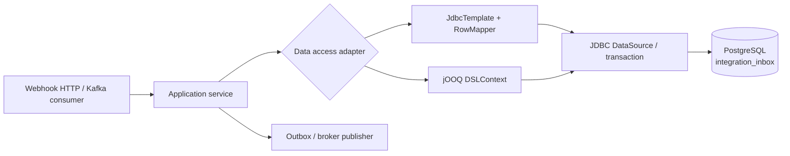
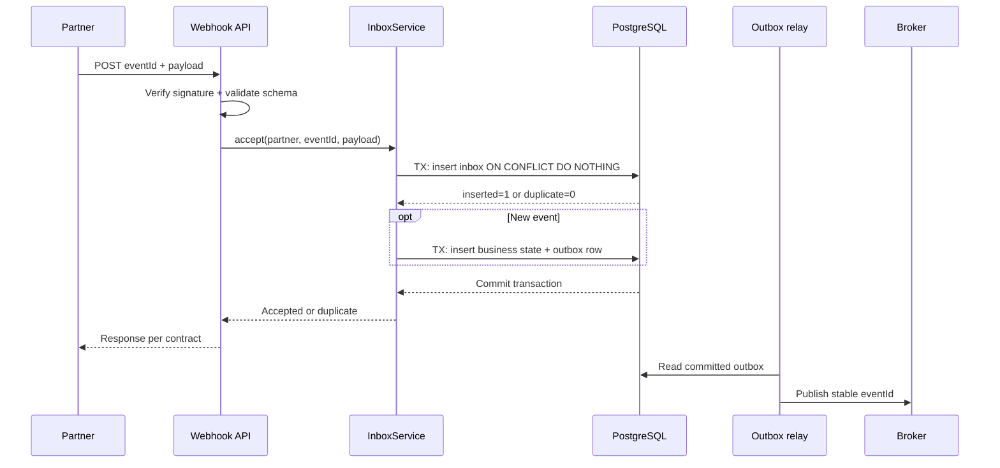

# Ánh xạ hàng dữ liệu, tham số và xử lý giá trị null

> **Chương:** JDBC và jOOQ  
> **Module:** `SPRING_BOOT_INTEGRATION` — tổ chức tích hợp hệ thống trong Spring Boot qua HTTP client, cơ sở dữ liệu, cache, broker thông điệp và các adapter Spring Integration. Trọng tâm là cấu hình, hợp đồng dữ liệu, giao dịch, xử lý lỗi/trùng lặp, kiểm thử và quan sát luồng tích hợp.

## 1. Bài toán: cùng một hàng SQL nhưng mã Java hiểu sai trạng thái

Giả sử dịch vụ Spring Boot nhận webhook từ đối tác giao hàng. Một webhook có thể được gửi lại nếu đối tác không nhận được HTTP response. Dịch vụ lưu từng event vào bảng inbox, sau đó xử lý và phát thông điệp sang broker.

Một hàng trong database có thể chứa:

- `event_id = 'evt-42'`: định danh bắt buộc để chống xử lý trùng.
- `external_ref = NULL`: đối tác chưa trả mã tham chiếu; khác với chuỗi rỗng.
- `retry_count = NULL`: chưa có số liệu retry; **khác** với `0` lần retry đã được xác nhận.
- `processed_at = NULL`: sự kiện chưa được xử lý; khác với timestamp hiện tại.

Nếu Java đọc `retry_count` bằng `ResultSet.getInt(...)` mà không kiểm tra `wasNull()`, giá trị SQL `NULL` bị nhìn nhầm thành `0`. Nếu code truy vấn `WHERE external_ref = ?` với tham số `null`, nó không tìm thấy các hàng `external_ref IS NULL` vì SQL dùng logic ba giá trị. Nếu câu SQL tự ghép chuỗi từ webhook, dữ liệu có thể làm hỏng cú pháp hoặc gây SQL injection.

Vì vậy, khi dùng JDBC hoặc jOOQ, cần hiểu đồng thời **ba ranh giới**:

1. **Ánh xạ hàng dữ liệu (row mapping):** từ cột và kiểu SQL sang Java object/DTO.
2. **Tham số truy vấn (parameter binding):** từ giá trị Java sang tham số JDBC có kiểu, không ghép dữ liệu trực tiếp vào SQL.
3. **Ngữ nghĩa `NULL`:** phân biệt giá trị chưa biết/không áp dụng với chuỗi rỗng, số `0`, Boolean `false` và field bị thiếu.

### Mục tiêu học tập

Sau bài này, bạn có thể:

- Viết `RowMapper<T>` với `JdbcTemplate` và `NamedParameterJdbcTemplate`.
- Dùng positional/named parameters, typed `NULL`, batch parameters và xử lý an toàn dữ liệu đến từ HTTP/broker.
- Ánh xạ kết quả kiểu nullable sang Java reference type, `Optional` ở ranh giới truy vấn và timestamp theo timezone.
- Dùng jOOQ `DSLContext`, record/field type được sinh từ schema, bind value và điều kiện `IS NULL`.
- Thiết kế inbox/outbox có unique constraint, SQL upsert, transaction và idempotency.
- Chẩn đoán lỗi mapping/SQL parameter, tối ưu batch/streaming và kiểm thử với database thật.

## 2. JDBC, Spring JDBC và jOOQ có trách nhiệm gì?

| Lớp | Vai trò | Ví dụ API |
|---|---|---|
| **JDBC** | Đặc tả Java để mở connection, tạo statement, bind giá trị và đọc `ResultSet`. | `Connection`, `PreparedStatement`, `ResultSet`, `Types` |
| **Spring JDBC** | Giảm boilerplate mở/đóng connection, xử lý exception, tích hợp Spring transaction. | `JdbcTemplate`, `NamedParameterJdbcTemplate`, `RowMapper` |
| **jOOQ** | DSL biểu diễn SQL bằng Java, hỗ trợ kiểu SQL, dialect và có thể sinh class từ schema. | `DSLContext`, `Field<T>`, `Record`, code generation |
| **Spring Boot** | Tạo/cấu hình bean theo dependency và property khi điều kiện phù hợp. | `DataSource`, `JdbcTemplate`, `NamedParameterJdbcTemplate`, `DSLContext` theo auto-configuration |
| **Ứng dụng** | Quy định schema, idempotency, transaction, contract, retry, logging và xử lý nghiệp vụ. | `InboxRepository`, `WebhookIntakeService` |

**JDBC và jOOQ đều có thể sử dụng JDBC driver** để giao tiếp với database quan hệ. jOOQ không tự biến lời gọi JDBC đồng bộ thành reactive I/O. Khi ứng dụng dùng Spring WebFlux, cần kiểm soát nơi chạy code JDBC blocking, hoặc chọn công nghệ reactive khác phù hợp yêu cầu.

### 2.1. Dependency và kết nối Spring Boot

Ví dụ Gradle Groovy DSL khi sử dụng cả Spring JDBC và jOOQ; giả định dự án đã áp dụng Spring Boot dependency management phù hợp:

```gradle
dependencies {
    implementation("org.springframework.boot:spring-boot-starter-jdbc")
    implementation("org.springframework.boot:spring-boot-starter-jooq")
    runtimeOnly("org.postgresql:postgresql")
    testImplementation("org.springframework.boot:spring-boot-starter-test")
}
```

```yaml
spring:
  datasource:
    url: ${DB_JDBC_URL}
    username: ${DB_USERNAME}
    password: ${DB_PASSWORD}
  jooq:
    sql-dialect: POSTGRES
```

Spring Boot có thể tự cấu hình `DataSource`, `JdbcTemplate`, `NamedParameterJdbcTemplate` và `DSLContext` khi classpath và bean conditions phù hợp. Cần kiểm tra phiên bản Spring Boot, jOOQ, JDBC driver và kiểu bean thực tế nếu ứng dụng có nhiều datasource hoặc custom configuration. **jOOQ code generation** là bước cấu hình build riêng: thêm starter không tự sinh các Java class `INTEGRATION_INBOX` trong ví dụ ở mục 9.



Hai cách truy cập dữ liệu có thể được dùng trong cùng một ứng dụng, nhưng không nên lẫn lộn cách bind tham số, ranh giới transaction hay quy ước mapping của từng cách.

## 3. Schema mẫu và ý nghĩa của từng giá trị NULL

Xuyên suốt bài dùng PostgreSQL với schema minh họa:

```sql
CREATE TABLE integration_inbox (
    id BIGINT GENERATED BY DEFAULT AS IDENTITY PRIMARY KEY,
    partner VARCHAR(64) NOT NULL,
    event_id VARCHAR(128) NOT NULL,
    payload TEXT NOT NULL,
    external_ref VARCHAR(128) NULL,
    retry_count INTEGER NULL CHECK (retry_count >= 0),
    processed_at TIMESTAMPTZ NULL,
    status VARCHAR(24) NOT NULL,
    received_at TIMESTAMPTZ NOT NULL DEFAULT CURRENT_TIMESTAMP,
    CONSTRAINT uq_inbox_partner_event UNIQUE (partner, event_id)
);

CREATE INDEX idx_inbox_pending
    ON integration_inbox (status, received_at);
```

Đây là DDL dành cho PostgreSQL, không phải DDL JDBC/jOOQ tự động sinh trong mọi database. Các hệ quản trị khác có cú pháp identity/timestamp khác. Production cần migration có version như Flyway hoặc Liquibase.

### 3.1. Hợp đồng cột và kiểu Java

| Cột SQL | NULL được phép? | Kiểu Java gợi ý | Ý nghĩa |
|---|---:|---|---|
| `id BIGINT` | Không | `long` hoặc `Long` | Khóa nội bộ; do DB sinh |
| `partner VARCHAR` | Không | `String` | Nguồn webhook |
| `event_id VARCHAR` | Không | `String` | ID ổn định khi giao lại cùng event |
| `payload TEXT` | Không | `String` | Payload đã validate/canonicalize theo contract |
| `external_ref VARCHAR` | Có | `String` nullable | Có thể chưa có mã đối tác |
| `retry_count INTEGER` | Có | `Integer` nullable | `NULL` nghĩa là chưa biết/chưa đo; `0` nghĩa là đã biết bằng không |
| `processed_at TIMESTAMPTZ` | Có | `Instant` nullable | Chưa xử lý thì `null` |
| `status VARCHAR` | Không | `String` hoặc enum sau validation | `RECEIVED`, `PROCESSED`, `FAILED` theo contract |
| `received_at TIMESTAMPTZ` | Không | `Instant` | Thời điểm hệ thống nhận |

Ràng buộc `UNIQUE (partner, event_id)` chỉ đáng tin làm khóa chống trùng khi cả hai cột đều **`NOT NULL`**. Với PostgreSQL, unique constraint thông thường không coi các giá trị `NULL` là trùng nhau; một khóa nghiệp vụ nullable có thể cho phép nhiều hàng tưởng như “giống nhau”. Đặt `NOT NULL` cho danh tính message trước khi nghĩ đến câu SQL upsert.

### 3.2. Định nghĩa DTO không mất nghĩa NULL

```java
import java.time.Instant;

public record InboxRow(
    long id,
    String partner,
    String eventId,
    String payload,
    String externalRef,
    Integer retryCount,
    Instant processedAt,
    String status
) {}
```

`Integer` được dùng thay cho `int` vì `retry_count` có thể SQL `NULL`. `String externalRef` và `Instant processedAt` cũng có thể `null`. Record không tự kiểm tra constraint từ database; nếu cần invariant nghiêm ngặt, hãy validate trong constructor/factory và ánh xạ rõ trạng thái chưa biết.

DTO này là **projection tầng dữ liệu**, không mặc nhiên là hợp đồng JSON trả thẳng cho client. Khi xây API cần quyết định rõ field thiếu và field có giá trị `null` khác nhau như thế nào, đồng thời tránh để lộ `payload` có PII hoặc credential.

## 4. RowMapper<T> với JdbcTemplate: mỗi hàng thành một object

Spring JDBC cung cấp `RowMapper<T>`:

```java
@FunctionalInterface
public interface RowMapper<T> {
    T mapRow(ResultSet rs, int rowNum) throws SQLException;
}
```

Method được gọi **mỗi hàng** của `ResultSet`. Nó có trách nhiệm lấy đúng cột, chuyển kiểu và tạo Java object. `rowNum` thường là vị trí hàng trong tập kết quả, không phải khóa ID từ database.

Ví dụ ánh xạ có xử lý `NULL`:

```java
import java.sql.ResultSet;
import java.sql.SQLException;
import java.sql.Timestamp;
import java.time.Instant;
import org.springframework.jdbc.core.RowMapper;

public final class InboxRowMapper implements RowMapper<InboxRow> {

    @Override
    public InboxRow mapRow(ResultSet rs, int rowNum) throws SQLException {
        Integer retryCount = (Integer) rs.getObject("retry_count");
        Timestamp processedTimestamp = rs.getTimestamp("processed_at");

        Instant processedAt = processedTimestamp == null
            ? null
            : processedTimestamp.toInstant();

        return new InboxRow(
            rs.getLong("id"),
            rs.getString("partner"),
            rs.getString("event_id"),
            rs.getString("payload"),
            rs.getString("external_ref"),
            retryCount,
            processedAt,
            rs.getString("status")
        );
    }
}
```

Ở PostgreSQL JDBC, `INTEGER` khi đọc qua `getObject(...)` thường trả `Integer`. Khi cần hỗ trợ nhiều driver và kiểu SQL khác nhau, có thể dùng `getObject("retry_count", Integer.class)` nếu driver hỗ trợ mapping typed thích hợp, hoặc dùng `getInt(...)` rồi `wasNull()` như mục kế tiếp.

Đối với `TIMESTAMPTZ`, `Timestamp.toInstant()` giữ thời điểm tuyệt đối khi driver chuyển đổi đúng. Nếu dùng JDBC 4.2 và driver hỗ trợ, có thể đọc `OffsetDateTime` qua `getObject("processed_at", OffsetDateTime.class)` rồi chuyển `toInstant()`. Luôn kiểm tra hành vi timezone của driver và migration thực tế.

### 4.1. Cột nào đọc bằng tên, cột nào bằng chỉ số?

`rs.getString("event_id")` tham chiếu **column label**. Nếu query alias:

```sql
SELECT event_id AS message_key FROM integration_inbox
```

thì mapper cần đọc `"message_key"`, không nhất thiết là tên cột gốc `"event_id"`. Khi dùng `SELECT` projection, luôn đặt alias ổn định và chỉ lấy những cột mapper cần.

Đọc theo index `rs.getString(3)` dễ bị sai khi thứ tự `SELECT` thay đổi. Đọc theo label thường dễ bảo trì hơn; nhưng label cũng phải nhất quán với câu SQL.

### 4.2. Không gọi phương thức có side effect trong RowMapper

`RowMapper` nên là hàm chuyển dữ liệu, không gọi HTTP client, không publish Kafka message và không cập nhật một bảng khác ngay khi đọc hàng. Nó có thể được gọi lại nếu query được retry hoặc khi chạy batch. Đặt side effect vào application service với transaction và idempotency phù hợp.

## 5. Bẫy getInt(), getBoolean() và wasNull()

JDBC getter cho **kiểu nguyên thủy** trả về giá trị mặc định khi SQL cột là `NULL`:

- `ResultSet.getInt(...)` trả `0` khi SQL `NULL`.
- `ResultSet.getLong(...)` trả `0L` khi SQL `NULL`.
- `ResultSet.getBoolean(...)` trả `false` khi SQL `NULL`.

Vì vậy, muốn phân biệt `NULL` và giá trị thật, gọi `wasNull()` **ngay sau getter tương ứng**:

```java
int rawRetryCount = rs.getInt("retry_count");
Integer retryCount = rs.wasNull() ? null : rawRetryCount;

boolean rawFlag = rs.getBoolean("verified");
Boolean verified = rs.wasNull() ? null : rawFlag;
```

Đoạn `verified` giả sử bảng khác có cột `verified BOOLEAN NULL`; bảng inbox ở mục 3 không có cột này.

**Đừng làm thế này:**

```java
int count = rs.getInt("retry_count");
String partner = rs.getString("partner");
boolean countWasNull = rs.wasNull(); // SAI: kiểm tra cột vừa đọc "partner"
```

`wasNull()` trả trạng thái **giá trị vừa được đọc từ `ResultSet`**, không phải một bản đồ nhớ NULL cho mọi cột. Nếu đọc thêm cột khác trước khi gọi, kết quả có thể sai.

### 5.1. Getter trả reference type

`getString(...)` trả `null` nếu SQL `NULL`. `getTimestamp(...)` cũng có thể trả `null`; không được gọi `.toInstant()` trực tiếp khi chưa kiểm tra.

```java
// Sai nếu processed_at NULL:
Instant processedAt = rs.getTimestamp("processed_at").toInstant();

// Đúng:
Timestamp ts = rs.getTimestamp("processed_at");
Instant processedAt = ts == null ? null : ts.toInstant();
```

Với `getObject(column, Integer.class)`, Java type rõ hơn nhưng khả năng chuyển đổi vẫn tùy JDBC driver và SQL type. Không mặc nhiên ép mọi `NUMERIC`, `DECIMAL` hoặc `BIGINT` thành `Integer`.

### 5.2. Không tự biến NULL thành 0 hoặc chuỗi rỗng

`COALESCE(retry_count, 0)` có thể tiện để thống kê nhưng **làm mất thông tin “chưa đo”**. Chỉ dùng khi nghiệp vụ thực sự định nghĩa “chưa có” tương đương với số không.

Tương tự:

```java
String externalRef = rs.getString("external_ref");
// Không mặc nhiên: externalRef == null ? "" : externalRef
```

Nếu hợp đồng nói thiếu mã đối tác là trạng thái chờ xác nhận, trả `""` có thể khiến bước xử lý phía sau tưởng mã đã được cấp nhưng rỗng. Hãy giữ `null` hoặc tạo kiểu trạng thái tường minh khi chuyển qua domain.

## 6. Viết repository với JdbcTemplate và positional parameters

`JdbcTemplate` giảm boilerplate tạo `PreparedStatement`, đóng tài nguyên và dịch lỗi `SQLException` sang hệ `DataAccessException` của Spring. Khi truy vấn, hãy **bind giá trị**, không nối chuỗi.

```java
import java.util.List;
import java.util.Optional;
import org.springframework.jdbc.core.JdbcTemplate;
import org.springframework.stereotype.Repository;

@Repository
public class JdbcInboxReader {
    private static final String SELECT_COLUMNS = """
        SELECT id, partner, event_id, payload,
               external_ref, retry_count, processed_at, status
        FROM integration_inbox
        """;

    private final JdbcTemplate jdbc;
    private final InboxRowMapper mapper = new InboxRowMapper();

    public JdbcInboxReader(JdbcTemplate jdbc) {
        this.jdbc = jdbc;
    }

    public Optional<InboxRow> findByEvent(String partner, String eventId) {
        String sql = SELECT_COLUMNS
            + " WHERE partner = ? AND event_id = ?";

        List<InboxRow> rows = jdbc.query(sql, mapper, partner, eventId);
        return rows.stream().findFirst();
    }
}
```

Ở đây `?` là **parameter marker**. Spring/JDBC bind `partner` và `eventId` theo thứ tự; giá trị đầu vào chứa dấu nháy hoặc ký tự SQL được xử lý như **dữ liệu**, không trở thành lệnh SQL.

`Optional<InboxRow>` dùng ở **kết quả tìm kiếm có thể không tồn tại**, phù hợp hơn trả `null` cho cả object khi không có hàng. Không nhất thiết bọc **mọi field nullable** trong record bằng `Optional`.

### 6.1. query(), queryForObject() và không có hàng

- `query(...)` thường trả `List<T>` (có thể rỗng).
- `queryForObject(...)` theo hợp đồng cần một hàng/kết quả tương ứng; khi không có hàng có thể ném `EmptyResultDataAccessException`, khi nhiều hàng có thể ném ngoại lệ kích thước.
- `queryForList(...)`/`queryForMap(...)` phù hợp dữ liệu động nhưng bỏ bớt an toàn kiểu của DTO.

Khi unique constraint bảo đảm tối đa một hàng, `query(...)` rồi chuyển list thành `Optional` có thể dễ diễn đạt “không tìm thấy” mà không dùng exception làm nhánh bình thường. Nếu bất ngờ có nhiều hàng do schema lệch, nên kiểm tra thay vì âm thầm chọn phần tử đầu.

### 6.2. SQL injection và tên bảng động

Bind parameter chỉ dùng cho **giá trị dữ liệu**. Không thể dùng `?` để bind tùy ý tên bảng/cột hoặc một từ khóa SQL:

```sql
-- Sai ý tưởng: JDBC parameter không đóng vai tên bảng:
SELECT * FROM ?
```

Nếu cần chọn bảng/column theo nghiệp vụ, sử dụng **allowlist** tên định danh đã biết, không đưa chuỗi từ webhook/HTTP trực tiếp vào SQL. Với jOOQ, có thể dùng `DSL.name(...)` để biểu diễn identifier có cấu trúc nhưng vẫn phải áp dụng allowlist/authorization nếu nó đến từ người dùng.

## 7. NamedParameterJdbcTemplate: tham số có tên và typed NULL

Câu SQL có nhiều biến cùng xuất hiện sẽ dễ đọc hơn khi dùng `NamedParameterJdbcTemplate`:

```java
import java.sql.Types;
import org.springframework.jdbc.core.namedparam.MapSqlParameterSource;
import org.springframework.jdbc.core.namedparam.NamedParameterJdbcTemplate;
import org.springframework.stereotype.Repository;

@Repository
public class NamedInboxWriter {

    private final NamedParameterJdbcTemplate jdbc;

    public NamedInboxWriter(NamedParameterJdbcTemplate jdbc) {
        this.jdbc = jdbc;
    }

    public int insertIfAbsent(
            String partner,
            String eventId,
            String payload,
            String externalRef,
            Integer retryCount) {

        String sql = """
            INSERT INTO integration_inbox (
                partner, event_id, payload,
                external_ref, retry_count, status
            )
            VALUES (
                :partner, :eventId, :payload,
                :externalRef, :retryCount, :status
            )
            ON CONFLICT (partner, event_id) DO NOTHING
            """;

        MapSqlParameterSource params = new MapSqlParameterSource()
            .addValue("partner", partner, Types.VARCHAR)
            .addValue("eventId", eventId, Types.VARCHAR)
            .addValue("payload", payload, Types.VARCHAR)
            .addValue("externalRef", externalRef, Types.VARCHAR)
            .addValue("retryCount", retryCount, Types.INTEGER)
            .addValue("status", "RECEIVED", Types.VARCHAR);

        return jdbc.update(sql, params);
    }
}
```

Ở PostgreSQL, lệnh `INSERT ... ON CONFLICT ... DO NOTHING` trả update count `1` khi thêm một hàng và `0` nếu hàng trùng khóa bị bỏ qua. Đây là cơ sở cho idempotency nhận webhook **ở mức database**.

`externalRef` hoặc `retryCount` có thể `null`. Truyền `Types.VARCHAR` và `Types.INTEGER` cung cấp thông tin kiểu JDBC cho Spring/driver khi bind giá trị. Với một số driver và trường hợp `NULL`, thiếu SQL type có thể khiến driver không suy ra kiểu phù hợp.

**Lưu ý:** chỉ cung cấp kiểu không chứng minh dữ liệu hợp lệ; `partner` và `eventId` vẫn phải được validate ở ranh giới HTTP/message. Unique constraint phải có thật qua migration.

### 7.1. Typed NULL với PreparedStatement thuần

JDBC cung cấp `setNull(index, sqlType)`:

```java
String sql = """
    UPDATE integration_inbox
    SET retry_count = ?
    WHERE partner = ? AND event_id = ?
    """;

try (PreparedStatement ps = connection.prepareStatement(sql)) {
    ps.setNull(1, java.sql.Types.INTEGER);
    ps.setString(2, partner);
    ps.setString(3, eventId);
    int updated = ps.executeUpdate();
}
```

Đoạn này minh họa **phần statement**, giả định `connection` được tạo/quản lý bên ngoài. Khi dùng JDBC thuần, phải quản lý vòng đời connection, statement, transaction và xử lý SQLException đúng cách. Trong ứng dụng Spring, `JdbcTemplate`/`NamedParameterJdbcTemplate` thường giảm rủi ro rò tài nguyên và phối hợp transaction tốt hơn.

### 7.2. Một chuỗi NULL phải được bind, không ghép chữ “NULL”

```java
// Không làm: SQL ghép dữ liệu đầu vào, nguy cơ injection.
String unsafe = "WHERE event_id = '" + eventId + "'";

// Đúng: bind.
jdbc.query(
    "SELECT id FROM integration_inbox WHERE event_id = :eventId",
    new MapSqlParameterSource("eventId", eventId),
    (rs, rowNum) -> rs.getLong("id")
);
```

Một giá trị Java `null` được bind thông qua API phù hợp là **SQL NULL**, không phải chuỗi văn bản `"null"` hoặc ký tự `'NULL'`. Nhưng điều đó không làm toán tử `=` trở thành phép kiểm tra `IS NULL`; cần xử lý điều kiện SQL riêng.

### 7.3. Danh sách tham số IN

`NamedParameterJdbcTemplate` có thể mở rộng một collection vào `IN (:ids)` bằng các placeholder tương ứng:

```java
String sql = """
    SELECT id, partner, event_id, payload,
           external_ref, retry_count, processed_at, status
    FROM integration_inbox
    WHERE id IN (:ids)
    """;

var params = new MapSqlParameterSource("ids", List.of(10L, 11L, 12L));
List<InboxRow> rows = jdbc.query(sql, params, new InboxRowMapper());
```

Nếu danh sách `ids` rỗng, nhiều database không hỗ trợ `IN ()` hoặc cách mở rộng rỗng có hành vi không mong muốn. Ứng dụng nên chủ động trả danh sách rỗng (nếu đúng nghiệp vụ) hoặc phát câu SQL khác. Không dùng một danh sách do client gửi mà không giới hạn độ dài.

## 8. SQL NULL dùng logic ba giá trị

SQL có **TRUE**, **FALSE** và **UNKNOWN** trong điều kiện. Một phép so sánh với `NULL` qua `=` hoặc `<>` thường cho kết quả `UNKNOWN`; `WHERE` chỉ giữ những hàng có điều kiện `TRUE`.

```sql
-- Không tìm được hàng có external_ref NULL:
SELECT * FROM integration_inbox WHERE external_ref = NULL;

-- Đúng:
SELECT * FROM integration_inbox WHERE external_ref IS NULL;

-- Tìm hàng đã có external_ref:
SELECT * FROM integration_inbox WHERE external_ref IS NOT NULL;
```

Ngay cả khi JDBC bind Java `null` vào `?`:

```sql
WHERE external_ref = ?
```

với giá trị `NULL` vẫn **không có nghĩa** `external_ref IS NULL`.

### 8.1. Định nghĩa ý nghĩa của null ở API tìm kiếm

Một API có thể có ba yêu cầu khác nhau:

1. **Không có filter:** tìm tất cả inbox, không thêm điều kiện `external_ref`.
2. **Filter externalRef bằng một giá trị:** dùng `external_ref = :externalRef` và bind string.
3. **Tìm bản ghi externalRef chưa có:** dùng `external_ref IS NULL`.

Nếu Java dùng duy nhất `String externalRef` với `null` biểu diễn cả “không lọc” và “lọc NULL”, API bị mơ hồ. Có thể dùng DTO có enum/filter mode, cờ `onlyMissingExternalRef`, hoặc các endpoint rõ hợp đồng.

### 8.2. Dynamic predicate với JdbcTemplate

```java
public List<InboxRow> findByExternalRef(String externalRef) {
    String sql = """
        SELECT id, partner, event_id, payload,
               external_ref, retry_count, processed_at, status
        FROM integration_inbox
        WHERE external_ref
        """;

    if (externalRef == null) {
        return jdbc.query(sql + " IS NULL", new InboxRowMapper());
    }

    return jdbc.query(sql + " = ?", new InboxRowMapper(), externalRef);
}
```

Ở ví dụ này `null` **có chủ ý** nghĩa là “tìm các hàng external_ref SQL NULL”. Nếu yêu cầu là “không áp filter”, đừng dùng cùng quy ước này; thay bằng một nhánh không chứa `WHERE external_ref`.

### 8.3. NULL-safe comparison đặc thù PostgreSQL

PostgreSQL hỗ trợ `IS NOT DISTINCT FROM` để so sánh null-safe:

```sql
SELECT id
FROM integration_inbox
WHERE external_ref IS NOT DISTINCT FROM :externalRef;
```

Đoạn trên dùng ký hiệu named parameter khi thông qua `NamedParameterJdbcTemplate`. Với `externalRef = null`, hàng SQL `NULL` được coi là khớp; với string, nó hoạt động như so sánh giá trị. Đây là cú pháp hỗ trợ bởi PostgreSQL và một số hệ DB, không nên giả định toàn bộ SQL dialect có cùng hỗ trợ và hiệu năng.

### 8.4. Các biểu thức SQL dễ hiểu sai

| Biểu thức | Hành vi cần nhớ |
|---|---|
| `col = NULL` | `UNKNOWN`, không tìm SQL NULL |
| `col IS NULL` | `TRUE` nếu `col` là SQL NULL |
| `COALESCE(col, 0)` | Trả `0` nếu NULL; có thể làm mất “unknown” |
| `COUNT(*)` | Đếm mọi hàng phù hợp |
| `COUNT(col)` | Chỉ đếm hàng `col IS NOT NULL` |
| `SUM(col)` | Bỏ qua NULL; khi không có giá trị phù hợp kết quả có thể NULL |
| `NULLIF(a, b)` | Có thể biến hai giá trị bằng nhau thành NULL |
| `NOT (col = :v)` khi `col` NULL | Vẫn `UNKNOWN`, không tự chọn hàng NULL |

**Không ép dữ liệu sai hợp đồng về giá trị mặc định** chỉ để tránh `NullPointerException`. Nếu `retry_count NULL` thật sự nghĩa là “chưa đo”, nên bảo toàn trạng thái này tới khi nghiệp vụ quyết định nó tương đương `0` hay một trạng thái riêng.

## 9. jOOQ: field có kiểu, record và ánh xạ rõ ràng

jOOQ tạo SQL qua DSL và có thể **sinh Java classes từ schema database**. Với generated code, một cột SQL như `retry_count INTEGER` được biểu diễn bằng `Field<Integer>`; `processed_at TIMESTAMPTZ` thường được ánh xạ thành type thời gian tương ứng theo dialect/generator.

Ví dụ giả định đã chạy code generation cho schema mục 3 và sinh bảng `INTEGRATION_INBOX`. Tên package thực tế phụ thuộc cấu hình generator.

### 9.1. Select và ánh xạ record sang DTO

```java
import static com.example.jooq.tables.IntegrationInbox.INTEGRATION_INBOX;

import java.time.OffsetDateTime;
import java.util.Optional;
import org.jooq.DSLContext;
import org.springframework.stereotype.Repository;

@Repository
public class JooqInboxReader {
    private final DSLContext dsl;

    public JooqInboxReader(DSLContext dsl) {
        this.dsl = dsl;
    }

    public Optional<InboxRow> findByEvent(String partner, String eventId) {
        return dsl.selectFrom(INTEGRATION_INBOX)
            .where(INTEGRATION_INBOX.PARTNER.eq(partner))
            .and(INTEGRATION_INBOX.EVENT_ID.eq(eventId))
            .fetchOptional(record -> {
                OffsetDateTime processed =
                    record.get(INTEGRATION_INBOX.PROCESSED_AT);

                return new InboxRow(
                    record.get(INTEGRATION_INBOX.ID),
                    record.get(INTEGRATION_INBOX.PARTNER),
                    record.get(INTEGRATION_INBOX.EVENT_ID),
                    record.get(INTEGRATION_INBOX.PAYLOAD),
                    record.get(INTEGRATION_INBOX.EXTERNAL_REF),
                    record.get(INTEGRATION_INBOX.RETRY_COUNT),
                    processed == null ? null : processed.toInstant(),
                    record.get(INTEGRATION_INBOX.STATUS)
                );
            });
    }
}
```

Điều kiện để ví dụ hoạt động:

- Code generator đã sinh `IntegrationInbox` với các field đúng tên, đúng kiểu từ database.
- `PROCESSED_AT` được ánh xạ thành `OffsetDateTime` trong cấu hình/dialect đang dùng; nếu mapping khác, phải chuyển đổi theo Java type thực tế.
- `ID` là `BIGINT NOT NULL`, được codegen ánh xạ thành `Long` và autounbox vào `long`. Với các cột có thể null, tránh autounbox trực tiếp sang primitive.
- `DSLContext` được cấu hình với datasource, SQL dialect và transaction integration phù hợp.

jOOQ có thể map trực tiếp record vào POJO/record bằng API như `fetchInto(...)` theo khả năng mapping và naming convention, nhưng **mapping tường minh** ở ví dụ trên giúp dễ kiểm tra semantics null và thời gian.

### 9.2. jOOQ không biến NULL thành Optional tự động

`record.get(INTEGRATION_INBOX.RETRY_COUNT)` có thể trả `null` nếu cột SQL `NULL`. jOOQ cung cấp typed field ở compile time, nhưng `Field<Integer>` không tự có nghĩa là mọi hàng đều non-null. DDL `NOT NULL` và tính nhất quán dữ liệu mới quyết định điều đó; đối với kết quả outer join, ngay cả cột gốc `NOT NULL` cũng có thể xuất hiện là `NULL` trong projection.

Khi mapper có record từ `LEFT JOIN`, phải xem liệu cả phía tham chiếu có vắng mặt hay không. Không nên dùng `rs.getInt(...)` hay Java autounbox làm mất thông tin đó.

### 9.3. RecordMapper riêng khi query phức tạp

Có thể tạo `RecordMapper<R, U>` khi nhiều query dùng cùng projection, nhưng mapper phải khớp tập field được select. Một mapping nhận `Record` không rõ schema và ép kiểu bằng index có thể gặp cùng rủi ro như JDBC mapping theo cột số.

Chọn một lớp **adapter repository** chịu trách nhiệm biến record jOOQ thành DTO/domain; đừng lan các generated table type vào controller hoặc business contract.

## 10. jOOQ và tham số: bind tự động, typed NULL, truy vấn an toàn

Trong jOOQ, biểu thức:

```java
dsl.selectFrom(INTEGRATION_INBOX)
   .where(INTEGRATION_INBOX.PARTNER.eq(partner))
   .and(INTEGRATION_INBOX.EVENT_ID.eq(eventId))
   .fetch();
```

thường tạo SQL với bind variables cho **giá trị**, không nối trực tiếp chuỗi `partner`/`eventId` vào SQL. Cách render/bind cụ thể có thể tùy jOOQ settings, `ParamType` và dialect; khi cần an toàn, không ép inline dữ liệu không đáng tin và không tự dựng SQL bằng nối chuỗi.

### 10.1. INSERT với nullable field và idempotency

```java
import static com.example.jooq.tables.IntegrationInbox.INTEGRATION_INBOX;
import org.jooq.DSLContext;

public int insertIfAbsent(DSLContext dsl,
                          String partner,
                          String eventId,
                          String payload,
                          String externalRef,
                          Integer retryCount) {

    return dsl.insertInto(INTEGRATION_INBOX)
        .set(INTEGRATION_INBOX.PARTNER, partner)
        .set(INTEGRATION_INBOX.EVENT_ID, eventId)
        .set(INTEGRATION_INBOX.PAYLOAD, payload)
        .set(INTEGRATION_INBOX.EXTERNAL_REF, externalRef)
        .set(INTEGRATION_INBOX.RETRY_COUNT, retryCount)
        .set(INTEGRATION_INBOX.STATUS, "RECEIVED")
        .onConflict(
            INTEGRATION_INBOX.PARTNER,
            INTEGRATION_INBOX.EVENT_ID
        )
        .doNothing()
        .execute();
}
```

Đây là ví dụ cho **PostgreSQL và dialect có hỗ trợ tương ứng trong phiên bản jOOQ**. Kết quả `execute()` biểu diễn số hàng bị ảnh hưởng; với `ON CONFLICT DO NOTHING` của PostgreSQL, `1` thường nghĩa là được insert, `0` là duplicate bị bỏ qua.

`retryCount = null` không bị thay thành `0`. jOOQ biết SQL type từ generated field. Khi tạo một biểu thức SQL động không dựa vào generated field, có thể cần cung cấp kiểu dữ liệu tường minh để tránh tham số `NULL` không rõ loại.

### 10.2. Điều kiện IS NULL phải được viết rõ

```java
// Tìm các hàng chưa có mã tham chiếu:
dsl.selectFrom(INTEGRATION_INBOX)
   .where(INTEGRATION_INBOX.EXTERNAL_REF.isNull())
   .fetch();

// Tìm các hàng đã có mã:
dsl.selectFrom(INTEGRATION_INBOX)
   .where(INTEGRATION_INBOX.EXTERNAL_REF.isNotNull())
   .fetch();
```

Đối với optional filter, chọn câu điều kiện có chủ đích:

```java
import org.jooq.Condition;

Condition condition = externalRef == null
    ? INTEGRATION_INBOX.EXTERNAL_REF.isNull()
    : INTEGRATION_INBOX.EXTERNAL_REF.eq(externalRef);

var rows = dsl.selectFrom(INTEGRATION_INBOX)
    .where(condition)
    .fetch();
```

Không nhầm “tham số Java null” với “không áp filter”. Nếu `null` nghĩa là không lọc, hãy xây `Condition` khác (ví dụ chỉ thêm điều kiện khi người dùng có filter). jOOQ có thể có một số tiện ích so sánh null-safe theo dialect, nhưng `isNull()/isNotNull()` dễ hiểu và thể hiện hợp đồng rõ nhất.

### 10.3. Bind value không phải SQL identifier

`dsl.select(...).where(field.eq(value))` bind **value**. Khi phải chọn tên cột do người dùng yêu cầu, chỉ cho phép một tập field đã biết:

```java
import org.jooq.Field;

Field<?> selectedField = switch (sortBy) {
    case "receivedAt" -> INTEGRATION_INBOX.RECEIVED_AT;
    case "status" -> INTEGRATION_INBOX.STATUS;
    default -> throw new IllegalArgumentException("Unsupported sort field");
};
```

Đây là ví dụ allowlist; đừng dùng `DSL.field(userInput)` như cách coi input là SQL fragment tin cậy. SQL injection có thể xảy ra tại **identifier, raw SQL fragment hoặc inline rendering**, dù các giá trị lọc thông thường đã dùng bind parameter.

## 11. Kiểu dữ liệu và conversion: null chỉ là một phần của bài toán

### 11.1. BIGINT, INTEGER và overflow

- `BIGINT` thường ánh xạ sang `Long`/`long`.
- `INTEGER` thường ánh xạ sang `Integer`/`int`.
- `NUMERIC/DECIMAL` nên dùng `BigDecimal`, đặc biệt với số tiền hoặc tỷ giá, tránh `float/double` nếu cần tính chính xác thập phân.
- Khi ép kiểu từ `Long` sang `int` có thể overflow. Không coi mọi ID database là số nguyên 32-bit.

### 11.2. TIMESTAMP, TIMESTAMPTZ và timezone

PostgreSQL phân biệt `TIMESTAMP WITHOUT TIME ZONE` và `TIMESTAMP WITH TIME ZONE`. Nên dùng:

- `Instant` hoặc `OffsetDateTime` khi dữ liệu là **thời điểm tuyệt đối**.
- `LocalDate` cho ngày nghiệp vụ không mang thời gian.
- `LocalDateTime` khi thực sự đang biểu diễn thời gian địa phương không có offset và contract quy định rõ.

`processed_at = NULL` vẫn phải được giữ là trạng thái chưa xử lý. Không tạo `Instant.now()` trong mapper khi thấy SQL NULL: như vậy là bịa ra thời điểm xử lý.

Với JDBC driver/jOOQ converter, cần kiểm tra timezone của connection, cách driver ánh xạ và định dạng JSON của API để tránh dịch sai thời điểm trong hệ thống khác múi giờ.

### 11.3. Enum và trạng thái chưa biết

Một cột `status VARCHAR NOT NULL` có thể map về Java enum:

```java
public enum InboxStatus {
    RECEIVED, PROCESSING, PROCESSED, FAILED
}
```

Dùng `InboxStatus.valueOf(raw)` chỉ an toàn khi đã xác định cách xử lý **giá trị mới** do hệ thống khác hoặc migration thêm vào. Với dữ liệu bên ngoài, nên có validation/versioning và một nhánh lỗi rõ; không chuyển tất cả trạng thái lạ thành `FAILED` mà bỏ qua dữ liệu gốc.

### 11.4. Boolean nullable, JSON và binary

- `BOOLEAN NULL` khác `false`; dùng `Boolean` nếu có ba trạng thái.
- `JSONB` của PostgreSQL có kiểu driver riêng; nếu cần map JSONB, sử dụng adapter/converter đã được kiểm thử, không giả định `getString` có cùng behavior trên mọi driver.
- `BYTEA` và BLOB cần quản lý memory/stream/size; không biến payload lớn thành String trong log.

## 12. RowMapper tự viết hay mapper tự động?

Spring JDBC có các tiện ích như `BeanPropertyRowMapper` và `DataClassRowMapper` (tùy phiên bản), còn jOOQ có `fetchInto` và mapper từ record tới POJO.

| Tiêu chí | Manual RowMapper | Mapping tự động | jOOQ generated field + manual mapping |
|---|---|---|---|
| Cột và alias | Tường minh | Dựa vào tên và convention | Tường minh/được type-check |
| Xử lý SQL NULL | Chủ động từng field | Phụ thuộc mapper/converter | Java reference null cần được xử lý |
| DTO bất biến/record | Dễ xây bằng constructor | Cần mapper hỗ trợ constructor/record | Dễ tạo DTO từ `record.get(Field<T>)` |
| Tính linh hoạt SQL | Cao, tự chịu trách nhiệm | Thích hợp CRUD/projection đơn giản | Cao với DSL/dialect |
| Khả năng phát hiện lỗi schema | Runtime khi query | Runtime/mapper conventions | Codegen giúp phát hiện một phần ở compile time |
| Chi phí code | Nhiều | Ít | Cần generator + adapter |

**Lưu ý:** `BeanPropertyRowMapper` hướng tới JavaBean có setter/constructor phù hợp; không mặc định map tốt mọi record bất biến hoặc case null vào primitive. `DataClassRowMapper` được thiết kế hỗ trợ data class/record qua constructor theo khả năng phiên bản Spring. Khi auto-mapping không diễn đạt được “NULL nghĩa là chưa biết”, manual mapping rõ ràng thường dễ review hơn.

### 12.1. Đừng phụ thuộc SELECT * khi mapping ổn định quan trọng

Một migration thêm cột hoặc đổi join có thể thay đổi column labels bị trùng. Nên chọn projection cụ thể:

```sql
SELECT i.id AS inbox_id,
       i.partner,
       i.event_id,
       i.processed_at
FROM integration_inbox i
WHERE i.status = ?
```

Mapper phải đọc alias `inbox_id` thay vì `id`. Khi query join, đặt prefix alias đủ phân biệt để không đọc nhầm ID giữa các bảng.

## 13. Transaction và xử lý trùng: ví dụ inbox nhận webhook

### 13.1. Đưa mapping vào luồng tích hợp đúng ranh giới



Ví dụ service dùng `NamedInboxWriter` đã khai báo ở mục 7:

```java
import org.springframework.stereotype.Service;
import org.springframework.transaction.annotation.Transactional;

@Service
public class WebhookInboxService {
    private final NamedInboxWriter inboxWriter;
    private final OutboxWriter outboxWriter;

    public WebhookInboxService(
            NamedInboxWriter inboxWriter,
            OutboxWriter outboxWriter) {
        this.inboxWriter = inboxWriter;
        this.outboxWriter = outboxWriter;
    }

    @Transactional
    public boolean accept(String partner, String eventId, String payload) {
        int inserted = inboxWriter.insertIfAbsent(
            partner, eventId, payload, null, null);

        if (inserted == 0) {
            return false;
        }

        outboxWriter.insertEvent(eventId, partner, payload);
        return true;
    }
}
```

`OutboxWriter` là interface/adapter **do ứng dụng tự triển khai**. Để ví dụ thực sự bảo đảm tính nguyên tử, `NamedInboxWriter`, `OutboxWriter` và `@Transactional` phải dùng **cùng datasource và transaction manager**; outbox table có khóa/chính sách phù hợp và được tạo bằng migration.

Nếu database commit thành công nhưng process chết trước khi publish broker, relay vẫn có bản ghi outbox để retry. Nếu broker đã nhận event nhưng relay không nhận confirm, relay có thể publish lại **cùng event ID**, vì vậy consumer cần inbox/dedup. **Transaction JDBC không tự bao trùm HTTP client hoặc broker**.

### 13.2. Không kiểm tra tồn tại rồi insert khi cần chống trùng

```text
Request A: SELECT chưa có evt-42
Request B: SELECT chưa có evt-42
Request A: INSERT evt-42
Request B: INSERT evt-42
```

Không có unique constraint, cả A và B có thể ghi cùng một event. Có unique constraint và thao tác `INSERT ... ON CONFLICT DO NOTHING`, database phân xử cạnh tranh tại ranh giới ghi. `@Transactional` đơn lẻ không loại bỏ mọi race condition.

### 13.3. Ý nghĩa số hàng bị ảnh hưởng

`update(...)` của Spring JDBC và `execute()` của jOOQ trong ví dụ upsert có thể trả update count. Với PostgreSQL và `ON CONFLICT DO NOTHING`:

- `1`: một hàng được thêm.
- `0`: không thêm hàng vì conflict.
- Giá trị khác/ngữ nghĩa khác cần xem lại SQL hoặc driver/dialect, không dùng như hợp đồng phổ quát cho mọi database.

Không gộp duplicate hợp lệ và lỗi database thành cùng một kết quả. Nếu database mất kết nối, câu SQL phải **ném lỗi** và tầng gọi phải xử lý retry/report theo chính sách.

## 14. JDBC, jOOQ và transaction của Spring

Trong một application service có `@Transactional`, Spring JDBC sử dụng hạ tầng Spring để lấy connection phù hợp với transaction; jOOQ cũng có thể tham gia transaction Spring khi `DSLContext`/connection provider được cấu hình tích hợp phù hợp.

**Không mặc nhiên suy ra** hai adapter tham gia cùng transaction chỉ vì đều có `DataSource` trong tên bean. Với nhiều datasource hoặc custom jOOQ `DSLContext`, cần xác minh:

1. `JdbcTemplate`/`NamedParameterJdbcTemplate` sử dụng đúng `DataSource`.
2. `DSLContext` dùng connection provider/transaction integration phù hợp với datasource đó.
3. `@Transactional` chọn đúng transaction manager.
4. Không tạo JDBC connection độc lập bằng `DriverManager.getConnection(...)` bên trong method transaction.
5. Integration test xác nhận rollback ở cả hai adapter khi một bước phát sinh exception.

Ví dụ lỗi nguy hiểm: inbox insert chạy trên datasource A, outbox insert chạy trên datasource B; một `@Transactional` của A có thể rollback A nhưng B đã commit riêng. Khi đó nguy cơ “event đã được phát mà inbox chưa ghi” vẫn tồn tại.

### 14.1. Isolation, lock và retry

Độ cô lập transaction và ràng buộc DB quyết định các race. Câu lệnh upsert với unique constraint thường đơn giản và tin cậy hơn thủ tục check-then-insert; nhưng khi hai transaction cạnh tranh, có thể xuất hiện lock wait, deadlock hoặc timeout. Chính sách retry phải giới hạn, có backoff và giữ event ID ổn định.

Không retry toàn bộ webhook vô hạn khi lỗi do schema/validation. Không cho một callback consumer xác nhận offset trước khi trạng thái nghiệp vụ cần thiết đã được commit hoặc lưu bền vững.

## 15. Hiệu năng, batch và dữ liệu lớn

### 15.1. Không map hàng triệu record vào List khi không cần

`jdbc.query(...)` và jOOQ `fetch()` thường materialize tập kết quả theo API tương ứng. Với dữ liệu lớn, hãy dùng pagination/keyset, stream/cursor có quản lý tài nguyên hoặc chunk/batch framework phù hợp.

- **Pagination:** dùng sort key ổn định và chỉ lấy trường cần thiết.
- **Streaming/cursor:** phải đóng stream/result và hiểu connection bị giữ bao lâu.
- **Batch update:** gom nhiều bộ tham số, nhưng giới hạn kích thước batch để tránh chiếm connection quá lâu.
- **N+1 queries:** không query bổ sung bên trong `RowMapper` cho mỗi hàng.
- **Slow SQL/index:** đo execution plan và index trên `partner,event_id`/`status,received_at`.

Ví dụ batch insert với Spring JDBC:

```java
import java.sql.PreparedStatement;
import java.sql.SQLException;
import java.util.List;
import org.springframework.jdbc.core.BatchPreparedStatementSetter;

public int[] insertBatch(JdbcTemplate jdbc, List<IncomingEvent> events) {
    return jdbc.batchUpdate("""
        INSERT INTO integration_inbox (
            partner, event_id, payload,
            external_ref, retry_count, status
        )
        VALUES (?, ?, ?, ?, ?, ?)
        ON CONFLICT (partner, event_id) DO NOTHING
        """,
        new BatchPreparedStatementSetter() {
            @Override
            public void setValues(PreparedStatement ps, int i)
                    throws SQLException {

                IncomingEvent event = events.get(i);
                ps.setString(1, event.partner());
                ps.setString(2, event.eventId());
                ps.setString(3, event.payload());

                if (event.externalRef() == null) {
                    ps.setNull(4, java.sql.Types.VARCHAR);
                } else {
                    ps.setString(4, event.externalRef());
                }

                if (event.retryCount() == null) {
                    ps.setNull(5, java.sql.Types.INTEGER);
                } else {
                    ps.setInt(5, event.retryCount());
                }

                ps.setString(6, "RECEIVED");
            }

            @Override
            public int getBatchSize() {
                return events.size();
            }
        });
}
```

`IncomingEvent` là DTO do ứng dụng định nghĩa với các accessor như trên. `int[]` là thông tin kết quả JDBC batch; giá trị có thể phụ thuộc driver (có thể có hằng `SUCCESS_NO_INFO`), không nên giả định mọi phần tử luôn là `0` hoặc `1`. Trong bối cảnh cần idempotency và đếm bản ghi mới, kiểm tra đặc tính PostgreSQL driver và contract thực tế.

### 15.2. Giữ transaction ngắn và nhớ nguồn dữ liệu

Đừng giữ một transaction database mở trong lúc gọi HTTP đối tác hoặc chờ broker publish nếu không có lý do và thiết kế nhất quán cụ thể. Tốt hơn là ghi trạng thái và outbox cùng transaction nhanh, để relay xử lý I/O ra ngoài sau.

Một lệnh query theo trang có thể đọc lại item khi retry/crash. Writer nên có khóa chống trùng, thao tác idempotent và kiểm thử tình huống batch lặp.

## 16. Lỗi thường gặp và cách chẩn đoán

| Triệu chứng | Nguyên nhân khả dĩ | Cách xử lý |
|---|---|---|
| `retry_count` luôn là `0` dù DB có NULL | `getInt` không gọi `wasNull` | Dùng `Integer` và `getObject`/`wasNull` đúng vị trí |
| `NullPointerException` với timestamp | Gọi `toInstant()` trên SQL NULL | Kiểm tra null trước khi chuyển |
| Query `WHERE external_ref = ?` với null không trả hàng | SQL ba giá trị | Dùng `IS NULL` hoặc null-safe comparison có chủ đích |
| `BadSqlGrammarException` | Sai cú pháp/dialect, alias hoặc placeholder | Xem SQL, bind types và DB dialect |
| `DataIntegrityViolationException` | NOT NULL/UNIQUE/CHECK/foreign key không thỏa | Phân loại duplicate hợp lệ với lỗi dữ liệu thật; dùng upsert nếu đúng |
| `DataAccessException` do bind NULL | Driver không suy ra SQL type | `Types.*`/`SqlParameterSource` hoặc typed field jOOQ |
| Mapping sai khi join | Column label trùng hoặc `SELECT *` | Alias rõ, projection ổn định |
| Giá tiền bị mất precision | Ép DECIMAL vào double/float | `BigDecimal` |
| Sai múi giờ | Map timestamp không phân biệt timezone | Xác định `Instant`/`OffsetDateTime`, test DB/driver |
| jOOQ codegen không khớp schema | Migration chưa chạy/code sinh cũ | Đổi schema có version, regenerate và compile |
| Inbox/outbox không rollback cùng nhau | Khác datasource/transaction manager | Rà soát wiring và integration test transaction |
| Retry gây insert trùng | Thiếu khóa duy nhất hoặc key thay đổi | UNIQUE NOT NULL + stable event ID/upsert |
| Query chậm, memory tăng | Materialize kết quả lớn hoặc N+1 | Pagination/stream có đóng tài nguyên, index, batch |
| Log chứa PII | Log bind values/payload nguyên văn | Log ID, status, latency; che dữ liệu nhạy cảm |

### 16.1. Phân loại exception trước khi retry

Spring JDBC chuyển nhiều `SQLException` sang hệ `DataAccessException`. jOOQ có hệ exception riêng. Không retry dựa trên class tên chung duy nhất; cần xem SQL state/vendor code, tầng giao dịch và bản chất lỗi:

- **Lỗi tạm thời:** kết nối, deadlock, lock timeout, lỗi tài nguyên; retry có backoff và giới hạn.
- **Lỗi contract:** dữ liệu thiếu bắt buộc, sai kiểu, schema mismatch; sửa/đưa cách ly thay vì lặp vô hạn.
- **Duplicate hợp lệ:** upsert trả không insert thêm; ghi metric duplicate, không coi là sự cố hệ thống.
- **Kết quả không chắc chắn:** timeout sau một thao tác ngoại hệ thống; đối soát trước khi retry side effect không idempotent.

## 17. Kiểm thử mapping, bind params, NULL và idempotency

Dùng **database cùng loại production** khi kiểm thử SQL phụ thuộc PostgreSQL (`ON CONFLICT`, `TIMESTAMPTZ`, check/unique constraint). Test với H2 ở compatibility mode không nhất thiết tái hiện mọi hành vi PostgreSQL. Testcontainers là lựa chọn thường gặp cho integration test, kết hợp migration giống production.

### 17.1. Bộ ca kiểm thử tối thiểu

| Trường hợp | Điều cần xác minh |
|---|---|
| `retry_count = NULL` | DTO nhận `null`, không phải `0` |
| `retry_count = 0` | DTO nhận `0`, khác NULL |
| `external_ref = NULL` | Java field null; query `IS NULL` tìm đúng |
| `external_ref = ''` | Chuỗi rỗng vẫn khác SQL NULL |
| `processed_at = NULL` | Mapper không `NullPointerException` |
| `processed_at` có offset/timezone | Thời điểm `Instant` đúng và không lệch múi giờ |
| `event_id` chứa dấu nháy/ký tự SQL | Bind như dữ liệu, không thay câu SQL |
| `partner/event_id` thiếu | DB/validation từ chối đúng |
| Hai request cùng event ID đồng thời | Chỉ một insert được chấp nhận nhờ unique constraint |
| Trùng event sau khi đã commit | Kết quả duplicate không phát thêm side effect |
| Writer lỗi sau insert inbox | Cùng transaction rollback inbox/outbox phù hợp |
| Broker tạm ngừng sau DB commit | Outbox còn pending và retry được |
| jOOQ generated code cũ | CI/codegen/compile phát hiện lệch schema |
| Nhiều datasource | Reader/writer và transaction manager trỏ đúng DB |

### 17.2. Ví dụ kiểm thử hành vi bằng JdbcTemplate

Giả sử test đã khởi tạo PostgreSQL sạch với schema và bean `NamedInboxWriter`:

```java
import static org.assertj.core.api.Assertions.assertThat;

import org.junit.jupiter.api.Test;
import org.springframework.beans.factory.annotation.Autowired;
import org.springframework.boot.test.context.SpringBootTest;
import org.springframework.jdbc.core.JdbcTemplate;

@SpringBootTest
class InboxJdbcIntegrationTest {

    @Autowired
    NamedInboxWriter writer;

    @Autowired
    JdbcTemplate jdbc;

    @Test
    void duplicateEventIsIgnored() {
        int first = writer.insertIfAbsent(
            "shipping-a", "evt-42", "{}", null, null);

        int second = writer.insertIfAbsent(
            "shipping-a", "evt-42", "{}", null, null);

        Integer count = jdbc.queryForObject(
            """
            SELECT COUNT(*)
            FROM integration_inbox
            WHERE partner = ? AND event_id = ?
            """,
            Integer.class,
            "shipping-a",
            "evt-42"
        );

        assertThat(first).isEqualTo(1);
        assertThat(second).isEqualTo(0);
        assertThat(count).isEqualTo(1);
    }
}
```

Test này chỉ đáng tin khi database test sạch/được cô lập và migration đã tạo unique constraint. Với nhiều test song song hoặc transaction test rollback, cần chuẩn bị dữ liệu và lifecycle rõ. Để xác minh mapper, bổ sung test đọc hàng và so sánh `retryCount() == null`, `processedAt() == null`; để xác minh concurrency, chạy các insert đồng thời có kiểm soát.

### 17.3. Kiểm thử jOOQ với schema sinh ra

Nếu dùng generated code, CI nên:

1. Khởi tạo DB từ migrations phiên bản hiện tại.
2. Chạy codegen tương ứng.
3. Biên dịch adapter jOOQ để phát hiện field/table bị đổi tên hoặc kiểu.
4. Chạy integration test đọc/ghi và kiểm tra cả SQL NULL.
5. Quan sát SQL bind types/dialect khi thất bại, che giá trị nhạy cảm trong log.

Không phải mọi lỗi đều được compiler phát hiện: query dynamic, converter custom, timezone, transaction và idempotency vẫn cần chạy với database thật.

## 18. Quan sát luồng dữ liệu từ HTTP đến database và broker

Nên đo cả **kết quả nghiệp vụ** lẫn **hành vi kỹ thuật**:

| Mức | Chỉ số/nhật ký | Vì sao cần? |
|---|---|---|
| HTTP inbound | Status, validation failure, latency, partner | Biết webhook bị từ chối ở đâu |
| JDBC/jOOQ | Query duration, lỗi SQL state, pool utilization | Xác định DB/pool/SQL bottleneck |
| Inbox | Inserted/duplicate count, hàng `RECEIVED` chưa xử lý | Phát hiện gửi lặp và backlog |
| Outbox | Oldest pending age, publish attempts/failures | Phát hiện tắc nghẽn trước broker |
| Broker/consumer | Publish ACK, consumer lag, retry, DLT/DLQ | Phân biệt đã phát với đã xử lý |
| Business result | Processed/failed/reconciled count | Không nhầm thành công SQL với thành công toàn luồng |

Sử dụng `eventId` và `correlationId` để nối webhook, transaction, outbox, broker và consumer. `eventId` phục vụ dedup; `correlationId` phục vụ tracing một workflow có thể có nhiều event. Tránh log raw SQL **kèm giá trị bind nhạy cảm**, payload webhook, token và credential.

Spring Boot Actuator/Micrometer có thể giúp quan sát pool/SQL/HTTP theo instrumentation thực tế, nhưng metric `inbox.duplicate` hoặc tuổi outbox phải được ứng dụng định nghĩa và cập nhật có chủ đích. Không coi một metric “SQL update count=1” là bằng chứng hệ thống đối tác đã nhận event.

## 19. Khi nào dùng JdbcTemplate, khi nào dùng jOOQ?

| Bài toán | Ưu tiên cân nhắc | Lý do |
|---|---|---|
| Một vài câu SQL ngắn, đơn giản, ít schema | `JdbcTemplate` | Ít dependency, trực quan |
| Nhiều named params, nullable values | `NamedParameterJdbcTemplate` | Câu SQL rõ; cung cấp kiểu cho NULL |
| Query phức tạp, join/CTE/dialect mạnh | jOOQ | DSL biểu diễn SQL, hỗ trợ generated schema |
| Muốn kiểm tra field type/rename qua compile | jOOQ code generation | Giảm lỗi tên cột thủ công khi schema thay đổi |
| SQL động có nhiều filter | jOOQ hoặc builder có kiểm soát | Compose condition an toàn, tránh nối string input |
| Đội đã có SQL migration và muốn raw SQL rõ | Spring JDBC | Dễ so sánh trực tiếp với SQL của DB |
| Cần transaction xuyên các adapter data access | Cả hai, nếu wiring đúng | Transaction phụ thuộc datasource/manager, không phụ thuộc tên thư viện |
| Cần I/O reactive toàn đường | Không mặc nhiên là JDBC/jOOQ sync | Chọn driver và mô hình thích hợp; cô lập blocking |

Không có lựa chọn nào tự giải quyết tất cả `NULL`, idempotency, transaction hoặc dữ liệu thiếu hợp đồng. Quyết định dựa trên độ phức tạp SQL, kỹ năng đội, dialect, migration và chi phí duy trì.

## 20. Checklist trước khi đưa adapter JDBC/jOOQ vào production

1. **Schema:** `NOT NULL`, unique key, type, index và migration phản ánh đúng hợp đồng chưa?
2. **Mapping:** nullable SQL có dùng Java reference type? Primitive getter có kiểm tra `wasNull()` đúng vị trí?
3. **Time:** date/time và timezone có được chuẩn hóa, test với dữ liệu thực?
4. **Parameter:** mọi giá trị đầu vào có dùng bind; tên bảng/cột động có allowlist?
5. **Typed null:** driver hiểu `NULL` của từng SQL type? Test insert/update nullable.
6. **SQL logic:** dùng `IS NULL` thay vì `= NULL`; API phân biệt “không lọc” và “lọc NULL”?
7. **Kết quả:** phân biệt 0 hàng, 1 hàng, nhiều hàng, duplicate và lỗi thật?
8. **Transaction:** JDBC/jOOQ/outbox dùng đúng datasource/transaction manager?
9. **Idempotency:** event ID ổn định, unique constraint, xử lý race khi webhook giao đồng thời?
10. **Tải:** query projection, index, paging/stream, pool và batch size được đo?
11. **Lỗi:** exception được phân loại trước retry, không retry vô hạn poison data?
12. **Bảo mật:** không log giá trị bind/payload nhạy cảm, không ghép SQL từ input?
13. **Kiểm thử:** database thật, test null/empty/zero, race, rollback, restart, broker outage?
14. **Quan sát:** có metrics duplicate, backlog, latency, SQL state và trace/correlation?

### Tự kiểm tra nhanh

**Câu 1:** `retry_count INTEGER NULL` đọc bằng `getInt("retry_count")` trả `0`. Có thể kết luận SQL là `0` không?  
**Trả lời:** Không. Gọi `wasNull()` ngay sau `getInt` hoặc dùng nullable `Integer` mapping phù hợp.

**Câu 2:** Bind `null` vào `WHERE external_ref = :externalRef` có tìm được các hàng SQL `NULL` không?  
**Trả lời:** Không. Dùng `IS NULL` hoặc null-safe predicate có chủ đích.

**Câu 3:** `@Transactional` bảo đảm insert inbox và HTTP POST đối tác đều rollback nếu lỗi?  
**Trả lời:** Không. Transaction database không tự rollback side effect HTTP. Cần outbox/idempotency hoặc đối soát.

**Câu 4:** jOOQ `Field<Integer>` có nghĩa giá trị Java luôn khác null?  
**Trả lời:** Không. SQL NULL, outer join và dữ liệu runtime vẫn cần được xử lý.

**Câu 5:** Vì sao không dùng `event_id` nullable cho dedup?  
**Trả lời:** Unique constraint với NULL có thể cho phép nhiều hàng thiếu ID; cần định danh ổn định, bắt buộc và ràng buộc unique theo hợp đồng.

**Câu 6:** Khi nào nên dùng `Optional<InboxRow>`?  
**Trả lời:** Khi toàn bộ phép tra cứu có thể không trả hàng; không dùng nó để né thiết kế nghĩa từng field nullable.

---

Trong chương **JDBC và jOOQ** của `SPRING_BOOT_INTEGRATION`, hãy nhớ: **ánh xạ dữ liệu quyết định Java hiểu một hàng SQL thế nào; bind parameter quyết định dữ liệu đi vào SQL an toàn ra sao; còn quy tắc `NULL` quyết định tính đúng của cả đọc lẫn ghi**. Khi luồng tích hợp nhận webhook rồi ghi inbox/outbox và phát broker, cần kết hợp RowMapper/jOOQ có kiểu, typed `NULL`, unique constraint, transaction, retry/idempotency và khả năng quan sát để không biến dữ liệu “chưa biết” thành kết quả nghiệp vụ sai.
