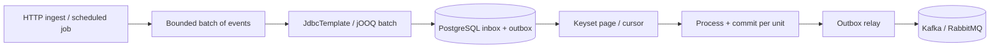
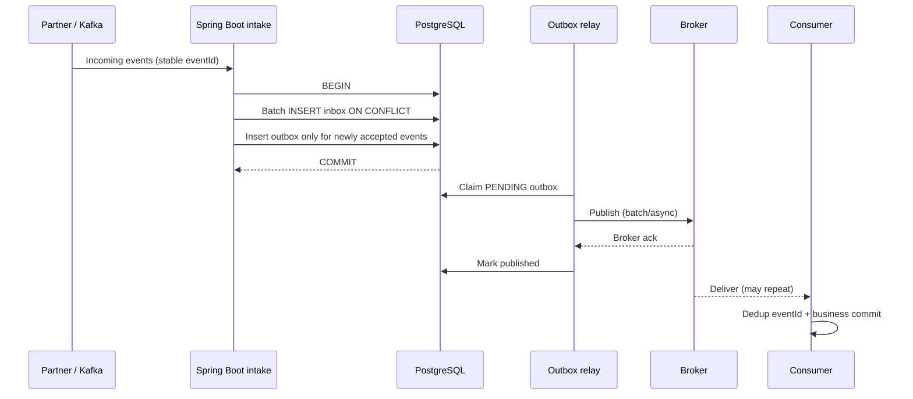

# Batch update, khóa sinh tự động và truy vấn dữ liệu lớn

> **Chương:** JDBC và jOOQ  
> **Module:** `SPRING_BOOT_INTEGRATION` — tổ chức tích hợp hệ thống trong Spring Boot qua HTTP client, cơ sở dữ liệu, cache, broker thông điệp và adapter của Spring Integration; trọng tâm là cấu hình, hợp đồng dữ liệu, giao dịch, lỗi, xử lý trùng lặp, kiểm thử và quan sát.
>
> **Phạm vi ví dụ:** Java 17+, Spring Boot 3+, Spring JDBC và jOOQ với PostgreSQL. Một số API, dialect và kiểu generated record thay đổi theo phiên bản, nên cần đối chiếu bộ dependency/code generation thực tế. SQL `ON CONFLICT`, `RETURNING`, `SKIP LOCKED` trong bài là cú pháp PostgreSQL; không coi là SQL portable cho mọi database.

## 1. Bài toán: hàng triệu webhook, một khóa ID và rủi ro đọc hết vào RAM

Dịch vụ tích hợp nhận sự kiện giao hàng qua HTTP và Kafka. Mỗi sự kiện có `eventId` do đối tác cấp, được lưu vào bảng inbox để tránh xử lý trùng. Một tác vụ định kỳ chọn những sự kiện còn chờ, cập nhật trạng thái và tạo outbox event để công bố sang broker.

Lúc dữ liệu còn nhỏ, cách viết sau có vẻ ổn:

```java
for (InboundEvent event : events) {
    jdbc.update("INSERT INTO integration_inbox ...", /* params */);
}

List<InboxRow> allRows = jdbc.query(
    "SELECT * FROM integration_inbox",
    inboxRowMapper
);
```

Nhưng khi có hàng trăm nghìn hoặc hàng triệu bản ghi, cách này nảy sinh nhiều vấn đề:

- Mỗi lệnh `update` riêng lẻ có chi phí round-trip/statement lớn; ingest chậm dù database còn dư khả năng xử lý.
- `query(...)` trả toàn bộ danh sách có thể giữ quá nhiều object trong bộ nhớ JVM.
- Nếu mỗi lần insert tự lấy ID bằng `SELECT MAX(id)`, nhiều writer chạy đồng thời có thể lấy **ID của hàng khác**.
- Nếu batch ghi một phần rồi lỗi, ứng dụng không biết rõ phần nào đã commit và phải retry thế nào.
- Nếu dùng `OFFSET 1000000` để đọc trang sâu, DB phải bỏ qua nhiều hàng và dữ liệu có thể trượt khi có insert/update đồng thời.
- Nếu JDBC transaction bao gồm cả lời gọi HTTP hoặc publish Kafka, pool connection có thể bị chiếm rất lâu và vẫn không đạt transaction nguyên tử xuyên hệ thống.

Bài học tập trung vào ba năng lực kết hợp với nhau:

1. **Batch update:** ghi nhiều hàng/lệnh SQL hiệu quả hơn nhưng vẫn kiểm soát transaction, kết quả từng hàng và giới hạn bộ nhớ.
2. **Khóa sinh tự động:** lấy ID ngay từ câu insert hoặc `RETURNING`, phân biệt ID kỹ thuật với ID nghiệp vụ dùng chống trùng.
3. **Truy vấn dữ liệu lớn:** dùng keyset pagination, chunk, cursor hoặc streaming có đóng tài nguyên; biết khi nào nên dùng mô hình job Spring Batch.

### Kết quả cần đạt

Sau bài này, bạn có thể chọn đúng API `JdbcTemplate.batchUpdate`, `NamedParameterJdbcTemplate.batchUpdate` và jOOQ batch, lấy generated key an toàn bằng `KeyHolder` hoặc SQL `RETURNING`, đọc dữ liệu theo trang/cursor, kiểm thử crash/retry và đánh giá giới hạn của các lựa chọn trong một ứng dụng Spring Boot nhiều instance.

## 2. Phân biệt JDBC batch, SQL multi-row insert và Spring Batch

Ba khái niệm có tên gần giống nhưng giải quyết các tầng khác nhau.

| Cơ chế | Bản chất | Tình huống dùng |
|---|---|---|
| **JDBC batch** | Gom nhiều bộ tham số/statement để driver thực thi theo API `addBatch/executeBatch` hoặc abstraction tương đương. | Ghi hàng trăm/hàng nghìn record trong một lần gọi. |
| **SQL multi-row insert** | Một câu SQL dạng `INSERT ... VALUES (...), (...), ...`. | Giảm số statement và dùng `RETURNING` trên một statement theo DB dialect. |
| **Spring Batch** | Framework `Job/Step`, chunk processing, checkpoint, restart và job metadata. | Import/đối soát theo lô có lịch sử và khả năng khởi động lại. |

Dùng Spring Batch có thể **bên trong một `ItemWriter` gọi JDBC batch**, nhưng Spring Batch không đồng nghĩa với `JdbcTemplate.batchUpdate`. JDBC batch không tự cấp JobInstance, StepExecution, checkpoint hoặc quy trình restart.



**Quy tắc nền:** Batch được dùng để giảm overhead, **không** loại bỏ yêu cầu transaction, khóa chống trùng và kiểm soát tài nguyên.

## 3. Chuẩn bị schema để ví dụ nhất quán

Dùng bảng inbox sau trên PostgreSQL:

```sql
CREATE TABLE integration_inbox (
    id BIGINT GENERATED BY DEFAULT AS IDENTITY PRIMARY KEY,
    partner VARCHAR(64) NOT NULL,
    event_id VARCHAR(160) NOT NULL,
    payload TEXT NOT NULL,
    status VARCHAR(24) NOT NULL DEFAULT 'RECEIVED',
    retry_count INTEGER NOT NULL DEFAULT 0,
    received_at TIMESTAMPTZ NOT NULL DEFAULT CURRENT_TIMESTAMP,
    processed_at TIMESTAMPTZ NULL,
    CONSTRAINT uq_inbox_partner_event UNIQUE (partner, event_id)
);

CREATE INDEX idx_inbox_status_id
    ON integration_inbox (status, id);

CREATE TABLE integration_outbox (
    id BIGINT GENERATED BY DEFAULT AS IDENTITY PRIMARY KEY,
    event_id VARCHAR(160) NOT NULL UNIQUE,
    topic VARCHAR(200) NOT NULL,
    payload TEXT NOT NULL,
    state VARCHAR(24) NOT NULL DEFAULT 'PENDING',
    created_at TIMESTAMPTZ NOT NULL DEFAULT CURRENT_TIMESTAMP
);
```

Bảng inbox dùng hai loại ID:

- `id`: khóa kỹ thuật `BIGINT IDENTITY` do database sinh; hỗ trợ join, truy vấn theo thứ tự và keyset cursor.
- `(partner, event_id)`: khóa nghiệp vụ **bắt buộc** và duy nhất để chống xử lý cùng webhook hai lần. Nó phải ổn định qua retry.

**Không** lấy `id` tự tăng thay cho `event_id` khi dedup. Nếu cùng event được publish lại, nó có thể được nhìn thấy dưới nhiều bản ghi vận chuyển; khóa nghiệp vụ vẫn phải giống nhau.

DTO đầu vào và projection phục vụ ví dụ:

```java
public record InboundEvent(
    String partner,
    String eventId,
    String payload
) {}

public record InboxPageRow(
    long id,
    String partner,
    String eventId,
    String status
) {}
```

Ví dụ giả định request đã được xác thực và validate `partner`/`eventId`/`payload` trước khi ghi. Payload và event ID có giới hạn kích thước; không cho phép mọi request ghi vô hạn.

### 3.1. Cấu hình Spring Boot tối thiểu

```gradle
dependencies {
    implementation("org.springframework.boot:spring-boot-starter-jdbc")
    implementation("org.springframework.boot:spring-boot-starter-jooq")
    runtimeOnly("org.postgresql:postgresql")

    testImplementation("org.springframework.boot:spring-boot-starter-test")
}
```

```yaml
spring:
  datasource:
    url: ${DB_JDBC_URL}
    username: ${DB_USERNAME}
    password: ${DB_PASSWORD}
    hikari:
      maximum-pool-size: 12
  jooq:
    sql-dialect: POSTGRES
```

Spring Boot có thể auto-configure `DataSource`, `JdbcTemplate`, `NamedParameterJdbcTemplate` và `DSLContext` khi dependency và bean conditions phù hợp. Khai báo datasource/template thủ công có thể khiến một phần cấu hình mặc định **back off**; nếu dùng nhiều datasource, cần explicit qualifiers, transaction manager và jOOQ connection provider.

Các class generated jOOQ trong bài là ví dụ; thêm starter **không tự sinh** `IntegrationInboxRecord` hoặc `INTEGRATION_INBOX`. Việc sinh type từ schema cần cấu hình build/code generation và chạy cùng migration version tương thích.

## 4. Ghi từng hàng: đơn giản nhưng không tối ưu cho volume lớn

Một vòng lặp đơn thuần:

```java
for (InboundEvent event : events) {
    jdbc.update(
        """
        INSERT INTO integration_inbox (partner, event_id, payload)
        VALUES (?, ?, ?)
        ON CONFLICT (partner, event_id) DO NOTHING
        """,
        event.partner(), event.eventId(), event.payload()
    );
}
```

có thể hợp lý khi chỉ có vài hàng. Nhưng với số lượng lớn, mỗi `update` tạo một operation JDBC riêng; tổng latency phụ thuộc driver, network và database. Các database khác nhau có khả năng chuẩn bị/caching statement khác nhau, nên hiệu quả phải được **đo** bằng workload thật.

Trước khi tối ưu, cần trả lời:

1. Bao nhiêu record mỗi giây/đợt?
2. Các record dùng **cùng SQL shape** và chỉ khác bind values không?
3. Có cần kết quả **riêng từng hàng** không?
4. Nếu một record vi phạm constraint, cần rollback **toàn batch** hay cách ly từng record?
5. Một transaction giữ lock bao lâu, có ảnh hưởng luồng HTTP/consumer khác không?
6. Có cần lấy generated ID ngay cho từng record không?

JDBC batch đặc biệt phù hợp với **nhiều lần thực thi cùng statement** khác bộ tham số.

## 5. JdbcTemplate.batchUpdate với BatchPreparedStatementSetter

`JdbcTemplate.batchUpdate(String, BatchPreparedStatementSetter)` cho phép chỉ rõ số record và cách bind bộ tham số của từng record.

```java
import java.sql.PreparedStatement;
import java.sql.SQLException;
import java.util.List;

import org.springframework.jdbc.core.BatchPreparedStatementSetter;
import org.springframework.jdbc.core.JdbcTemplate;
import org.springframework.stereotype.Repository;

@Repository
public class JdbcInboxBatchWriter {

    private static final String SQL = """
        INSERT INTO integration_inbox (partner, event_id, payload, status)
        VALUES (?, ?, ?, 'RECEIVED')
        ON CONFLICT (partner, event_id) DO NOTHING
        """;

    private final JdbcTemplate jdbc;

    public JdbcInboxBatchWriter(JdbcTemplate jdbc) {
        this.jdbc = jdbc;
    }

    public int[] insertPage(List<InboundEvent> events) {
        if (events.isEmpty()) {
            return new int[0];
        }

        return jdbc.batchUpdate(SQL, new BatchPreparedStatementSetter() {

            @Override
            public void setValues(PreparedStatement ps, int index)
                    throws SQLException {
                InboundEvent event = events.get(index);

                ps.setString(1, event.partner());
                ps.setString(2, event.eventId());
                ps.setString(3, event.payload());
            }

            @Override
            public int getBatchSize() {
                return events.size();
            }
        });
    }
}
```

Đây là **một page đã được giới hạn** `events`; không phải cách gọi với một `List` chứa hàng triệu record. `ON CONFLICT DO NOTHING` dựa trên unique constraint thật, khiến việc gửi lại cùng event không tạo thêm bản ghi.

### 5.1. int[] không phải luôn là số hàng chính xác của từng item

JDBC batch trả `int[]`, nhưng một phần tử không nhất thiết luôn `0` hoặc `1`. Theo JDBC, driver có thể trả:

- `0`, `1`, ...: số hàng bị ảnh hưởng khi được xác định.
- `Statement.SUCCESS_NO_INFO` = `-2`: thành công nhưng số hàng không rõ.
- `Statement.EXECUTE_FAILED` = `-3`: statement thất bại, tùy cách driver báo lỗi/batch.

Khi `BatchUpdateException` xảy ra, update counts có thể chỉ mô tả một phần hoặc các vị trí theo behavior của driver. **Đừng cộng thẳng mọi phần tử vào metric “event mới được ghi”** nếu chưa xử lý `-2` và failure semantics thực tế.

Với PostgreSQL, `INSERT ... ON CONFLICT DO NOTHING` thường trả `1` khi thêm và `0` khi bỏ qua conflict, nhưng batching/rewrite của driver vẫn có thể thay đổi cách báo counts. Nếu cần kết quả **chính xác theo từng event**, cân nhắc statement có `RETURNING` và association theo business key.

### 5.2. Batch JDBC không tự tạo transaction cho toàn khối

Một batch là **cách gửi SQL tới driver**, không phải cam kết nguyên tử xuyên toàn bộ business use case. Khi một câu lệnh thất bại, trạng thái đã commit và khả năng rollback phụ thuộc transaction boundary/autocommit/database.

Đặt `@Transactional` ở **application service** cho đơn vị công việc cần nguyên tử; đừng chỉ dựa vào việc gọi `batchUpdate`.

## 6. NamedParameterJdbcTemplate.batchUpdate

Named parameters dễ đọc khi insert có nhiều cột hoặc một field xuất hiện nhiều lần. Ví dụ:

```java
import java.sql.Types;
import java.util.List;

import org.springframework.jdbc.core.namedparam.MapSqlParameterSource;
import org.springframework.jdbc.core.namedparam.NamedParameterJdbcTemplate;
import org.springframework.jdbc.core.namedparam.SqlParameterSource;
import org.springframework.stereotype.Repository;

@Repository
public class NamedInboxBatchWriter {
    private final NamedParameterJdbcTemplate jdbc;

    public NamedInboxBatchWriter(NamedParameterJdbcTemplate jdbc) {
        this.jdbc = jdbc;
    }

    public int[] insertPage(List<InboundEvent> events) {
        String sql = """
            INSERT INTO integration_inbox (partner, event_id, payload)
            VALUES (:partner, :eventId, :payload)
            ON CONFLICT (partner, event_id) DO NOTHING
            """;

        SqlParameterSource[] args = events.stream()
            .map(event -> new MapSqlParameterSource()
                .addValue("partner", event.partner(), Types.VARCHAR)
                .addValue("eventId", event.eventId(), Types.VARCHAR)
                .addValue("payload", event.payload(), Types.VARCHAR))
            .toArray(SqlParameterSource[]::new);

        return args.length == 0 ? new int[0] : jdbc.batchUpdate(sql, args);
    }
}
```

Ưu điểm: tên tham số tránh sai thứ tự, dễ thêm field nullable và chỉ rõ `Types.*` khi JDBC driver cần SQL type. `MapSqlParameterSource` được tạo cho từng item; số lượng đối tượng cũng có chi phí khi batch quá lớn.

Với JavaBeans hoặc record mà các accessor được hỗ trợ, Spring cung cấp utility như `SqlParameterSourceUtils.createBatch(...)`; tuy nhiên mapping type/nullable vẫn phải được kiểm chứng. Với contract có `NULL` hoặc enum/JSONB đặc thù, binding tường minh thường an toàn hơn.

### 6.1. Không ghép dữ liệu vào SQL để “tăng tốc”

Cả `JdbcTemplate` và `NamedParameterJdbcTemplate` dùng prepared/bound parameters. Đừng tạo SQL bằng:

```java
// Không làm:
String sql = "INSERT INTO inbox(payload) VALUES ('"
    + userControlledPayload + "')";
```

Ghép input trực tiếp vào SQL gây injection, lỗi escaping và khiến statement shape khác nhau. Batch hiệu quả thường cần **cùng một statement và các bộ bind values khác nhau**.

## 7. Chia batch thành các page có giới hạn

Nếu upstream cung cấp 100.000 record, không nên build một mảng `SqlParameterSource[]` cho cả 100.000 nếu không có lý do. Có hai cấp chia lô:

- **Application page:** nạp tối đa N record từ HTTP/file/queue, xử lý và giải phóng, tránh giữ cả tập trong RAM.
- **JDBC batch size:** số statement/bộ tham số driver gửi trong một lần thực thi batch, thường được cấu hình tách biệt.

`JdbcTemplate` có overload chia Collection thành nhiều batch:

```java
import java.util.Collection;
import org.springframework.jdbc.core.JdbcTemplate;

public int[][] insertInDriverBatches(
        JdbcTemplate jdbc,
        Collection<InboundEvent> events,
        int jdbcBatchSize) {

    if (jdbcBatchSize <= 0 || jdbcBatchSize > 2_000) {
        throw new IllegalArgumentException("Invalid JDBC batch size");
    }

    String sql = """
        INSERT INTO integration_inbox (partner, event_id, payload)
        VALUES (?, ?, ?)
        ON CONFLICT (partner, event_id) DO NOTHING
        """;

    return jdbc.batchUpdate(
        sql,
        events,
        jdbcBatchSize,
        (ps, event) -> {
            ps.setString(1, event.partner());
            ps.setString(2, event.eventId());
            ps.setString(3, event.payload());
        }
    );
}
```

Kết quả là `int[][]` theo các batch con. Overload này **không làm Collection đầu vào tự trở thành stream**: nếu `events` đã chứa 1 triệu object, bộ nhớ vẫn đã bị chiếm. Với nguồn lớn, dùng iterator/page hoặc Spring Batch reader để chỉ giữ lượng record có giới hạn.

### 7.1. Chọn batch size theo đo đạc

Không tồn tại giá trị thần kỳ cho mọi ứng dụng. Có thể bắt đầu thử các mức như 100, 500 hoặc 1.000 item, sau đó đo:

- Round-trip và throughput thực tế.
- Thời gian transaction và lock duration.
- Payload size và RAM của producer/JDBC driver.
- Giới hạn bind parameters/packet/statement của database.
- Mức cạnh tranh của các writer và reader.
- Khả năng cô lập một record bị lỗi trong batch.

Một batch 1.000 payload nhỏ khác rất xa batch 1.000 payload JSON vài MB. Dùng **giới hạn cả số item và tổng bytes**, không chỉ đếm số item.

### 7.2. PostgreSQL JDBC có các tối ưu phụ thuộc driver

PostgreSQL JDBC driver có tùy chọn như `reWriteBatchedInserts` để tối ưu một số kiểu batch INSERT bằng cách rewrite. Tuy nhiên hành vi/hiệu quả và khả năng tương tác với `RETURNING`, `ON CONFLICT`, SQL shape khác nhau cần đo trên **driver/version thật**. Không bật tùy chọn rồi kết luận mọi batch sẽ được rewrite hoặc mọi row count vẫn giữ nguyên.

## 8. Transaction boundary và chiến lược cô lập lỗi

Ví dụ application service:

```java
import java.util.List;
import org.springframework.stereotype.Service;
import org.springframework.transaction.annotation.Transactional;

@Service
public class InboxImportService {
    private final JdbcInboxBatchWriter writer;
    private final OutboxBatchWriter outboxWriter;

    public InboxImportService(
            JdbcInboxBatchWriter writer,
            OutboxBatchWriter outboxWriter) {
        this.writer = writer;
        this.outboxWriter = outboxWriter;
    }

    @Transactional
    public void acceptPage(List<InboundEvent> events) {
        writer.insertPage(events);
        outboxWriter.prepareEventsForNewInboxRows(events);
    }
}
```

`OutboxBatchWriter` ở đây là **adapter do ứng dụng định nghĩa**. Method `prepareEventsForNewInboxRows` **phải xác định chỉ những event vừa insert thành công**, hoặc dùng SQL/điều kiện idempotent để tránh tạo outbox mới từ duplicate. Ví dụ trên chỉ cho thấy ranh giới service; không phải triển khai outbox hoàn chỉnh.

Để giữ **inbox + outbox** nguyên tử, hai writer phải dùng cùng database/transaction manager. Nếu outboxWriter dùng datasource khác, annotation `@Transactional` mặc định không tự biến hai DB thành một distributed transaction.

### 8.1. Có một record lỗi trong batch thì làm gì?

Ba chính sách phổ biến:

1. **All-or-nothing cho page:** rollback toàn page, sửa input rồi retry; hợp lý khi page là đơn vị nghiệp vụ không thể tách.
2. **Chia nhỏ để tìm record lỗi:** rollback, giảm batch size hoặc chia đôi page để cách ly dữ liệu lỗi; cần bounded retries và không ghi lặp side effect.
3. **Skip/quarantine record lỗi:** khi hợp đồng cho phép, ghi trạng thái reject cùng lý do, tiếp tục các record khác; tránh âm thầm bỏ qua sự kiện tài chính/quy trình quan trọng.

Với PostgreSQL, một statement lỗi trong transaction thường đưa transaction vào trạng thái aborted đến khi rollback (hoặc rollback savepoint phù hợp). **Không** bắt exception rồi tiếp tục câu lệnh khác trong cùng transaction một cách tùy ý.

### 8.2. Mức commit nên theo đơn vị nghiệp vụ

Một transaction kéo dài hàng triệu row có thể tạo lock contention, tăng log/WAL, giữ connection và làm rollback tốn kém. Tách page/chunk có kích thước phù hợp; commit mỗi page hoặc chunk cần bảo đảm:

- Key nghiệp vụ ổn định và unique constraint chống ghi trùng khi retry.
- Checkpoint/tiến độ được cập nhật sau khi ghi thành công.
- Outbox event có ID ổn định, nằm trong transaction thích hợp.
- Operator hiểu “đã hoàn thành 300/500 page” **không đồng nghĩa** toàn job hoàn tất.

## 9. Khóa sinh tự động: identity/sequence khác event ID

PostgreSQL hỗ trợ `GENERATED ... AS IDENTITY`, sequence và các phương pháp cấp khóa khác. Ở tầng JDBC, driver có thể trả generated keys ngay sau insert.

### 9.1. Những điều không được suy ra từ ID tăng dần

- **ID không nhất thiết liên tục:** sequence có thể tạo khoảng trống khi rollback, crash hoặc có session khác lấy giá trị.
- **ID không biểu diễn thứ tự commit tuyệt đối:** transaction A có thể lấy ID nhỏ rồi commit muộn hơn transaction B lấy ID lớn.
- **ID không phải khóa chống trùng webhook:** đối tác gửi lại cùng event có thể tạo thêm ID nếu thiếu business unique constraint.
- **ID từ bảng A không có liên hệ với ID từ bảng B** nếu không có foreign key/hợp đồng rõ.
- **Không dùng `SELECT MAX(id)` để tìm hàng vừa insert:** writer khác có thể chen vào giữa hai câu lệnh.

ID tự sinh phục vụ quản lý record nội bộ và truy vấn theo index; xác định sự kiện vẫn phải dựa vào `partner,event_id`.

## 10. Lấy generated key với GeneratedKeyHolder

Spring JDBC cung cấp `KeyHolder` để nhận khóa được driver trả về sau một lệnh insert thích hợp.

```java
import java.sql.PreparedStatement;
import java.util.Objects;

import org.springframework.jdbc.core.JdbcTemplate;
import org.springframework.jdbc.support.GeneratedKeyHolder;
import org.springframework.jdbc.support.KeyHolder;
import org.springframework.stereotype.Repository;

@Repository
public class JdbcInboxSingleWriter {

    private final JdbcTemplate jdbc;

    public JdbcInboxSingleWriter(JdbcTemplate jdbc) {
        this.jdbc = jdbc;
    }

    public long insertAndGetId(InboundEvent event) {
        KeyHolder keys = new GeneratedKeyHolder();

        int updated = jdbc.update(connection -> {
            PreparedStatement ps = connection.prepareStatement(
                """
                INSERT INTO integration_inbox
                    (partner, event_id, payload)
                VALUES (?, ?, ?)
                """,
                new String[] {"id"}
            );
            ps.setString(1, event.partner());
            ps.setString(2, event.eventId());
            ps.setString(3, event.payload());
            return ps;
        }, keys);

        if (updated != 1) {
            throw new IllegalStateException("Expected exactly one inserted row");
        }

        Number id = Objects.requireNonNull(
            keys.getKey(), "Database returned no generated id");
        return id.longValue();
    }
}
```

Trong ví dụ này **không có `ON CONFLICT DO NOTHING`**: nếu `(partner,event_id)` trùng, unique constraint sẽ làm insert thất bại; không sinh ID mới cho duplicate.

### 10.1. Vì sao chỉ định new String[]{"id"}?

Nếu gọi `getGeneratedKeys()` mà không xác định cột, một số driver/database có thể trả nhiều cột hoặc metadata khác kỳ vọng. `GeneratedKeyHolder.getKey()` chỉ phù hợp khi kết quả có **một khóa số**. Khi cần nhiều trường hoặc database-specific output, dùng `getKeys()`/`getKeyList()` theo hợp đồng, hoặc SQL `RETURNING` tường minh.

**Không** coi mọi generated key là `Long`: driver có thể trả kiểu `Number` khác hoặc ID không phải numeric. Với hệ thống cần bảo vệ overflow, xem xét kiểm tra phạm vi thay vì luôn gọi `longValue()` không điều kiện.

### 10.2. Generated key được trả sau insert, không sau commit

Một insert có thể trả ID nhưng transaction enclosing **vẫn rollback** về sau. Việc đã biết ID không chứng minh entity tương ứng tồn tại ở trạng thái committed.

Nếu ứng dụng trả HTTP `201` ngay sau khi lấy ID nhưng transaction chưa commit, cần xác định rõ ranh giới. Thông thường service tạo record và hoàn tất commit trước khi controller trả kết quả thành công; trong trường hợp xử lý async, trả trạng thái tiếp nhận một cách chính xác.

## 11. NamedParameterJdbcTemplate và KeyHolder

Nếu statement có nhiều field, named parameters giúp giảm nhầm vị trí và Spring JDBC hỗ trợ update đi kèm generated keys.

```java
import org.springframework.jdbc.core.namedparam.MapSqlParameterSource;
import org.springframework.jdbc.core.namedparam.NamedParameterJdbcTemplate;
import org.springframework.jdbc.support.GeneratedKeyHolder;

public long insertAndGetId(
        NamedParameterJdbcTemplate jdbc, InboundEvent event) {

    String sql = """
        INSERT INTO integration_inbox (partner, event_id, payload)
        VALUES (:partner, :eventId, :payload)
        """;

    var args = new MapSqlParameterSource()
        .addValue("partner", event.partner())
        .addValue("eventId", event.eventId())
        .addValue("payload", event.payload());

    var keys = new GeneratedKeyHolder();

    int updated = jdbc.update(sql, args, keys, new String[] {"id"});

    if (updated != 1 || keys.getKey() == null) {
        throw new IllegalStateException("No inserted id");
    }

    return keys.getKey().longValue();
}
```

Câu lệnh không có `ON CONFLICT`: nếu duplicate, nó ném lỗi constraint. Khi business contract muốn “insert nếu chưa có; nếu đã có trả ID hiện tại”, phải **thiết kế thêm đường đọc theo business key**, chứ không kỳ vọng `KeyHolder` tự trả ID cho statement `DO NOTHING` đã không insert.

### 11.1. Race condition khi lấy ID của event đã tồn tại

Một flow hay gặp:

1. Thử `INSERT ... ON CONFLICT DO NOTHING RETURNING id`.
2. Nếu không có row trả về, `SELECT id WHERE partner=? AND event_id=?`.

Trong `READ COMMITTED` của PostgreSQL, điều này thường là cách xử lý hợp lý khi làm **hai statement trong điều kiện transaction phù hợp** và sau khi conflict với transaction khác đã được phân giải. Nhưng đừng suy luận rằng một **single statement CTE** nào cũng nhìn thấy hàng vừa commit bởi transaction cạnh tranh: snapshot và cơ chế conflict có thể tạo tình huống “conflict được nhận biết nhưng row không hiện trong SELECT cùng statement”. Nếu cần chặt chẽ dưới concurrency, kiểm thử và thiết kế retry cho đường lookup bị rỗng bất ngờ.

## 12. PostgreSQL INSERT ... RETURNING để lấy ID rõ ràng

PostgreSQL hỗ trợ `RETURNING` trên lệnh DML. Dùng nó khi muốn kết quả được truy vấn/ánh xạ tường minh.

```sql
INSERT INTO integration_inbox (partner, event_id, payload)
VALUES (:partner, :eventId, :payload)
RETURNING id, partner, event_id;
```

Với `NamedParameterJdbcTemplate`, đây là câu trả về result set, có thể gọi `queryForObject` với mapper:

```java
public long insertReturningId(
        NamedParameterJdbcTemplate jdbc, InboundEvent event) {

    String sql = """
        INSERT INTO integration_inbox (partner, event_id, payload)
        VALUES (:partner, :eventId, :payload)
        RETURNING id
        """;

    var args = new MapSqlParameterSource()
        .addValue("partner", event.partner())
        .addValue("eventId", event.eventId())
        .addValue("payload", event.payload());

    Long id = jdbc.queryForObject(
        sql, args, (rs, rowNum) -> rs.getLong("id"));

    return java.util.Objects.requireNonNull(id);
}
```

Đây là PostgreSQL-specific SQL, không phải chức năng được JDBC bảo đảm cho mọi dialect.

### 12.1. DO NOTHING RETURNING có thể không trả hàng

```sql
INSERT INTO integration_inbox (partner, event_id, payload)
VALUES (:partner, :eventId, :payload)
ON CONFLICT (partner, event_id) DO NOTHING
RETURNING id;
```

Nếu conflict xảy ra, statement **không insert** nên `RETURNING` không trả row cho event đó. Đừng gọi `queryForObject` rồi luôn mong nhận đúng một hàng. Dùng `query(...)` và xử lý list rỗng, hoặc một abstraction optional result.

### 12.2. Multi-row RETURNING: không map bằng vị trí khi có conflict

Ví dụ một statement chứa ba event nhưng event thứ hai đã tồn tại; `DO NOTHING RETURNING id,event_id` chỉ trả **hai hàng mới insert**. Nếu code giả định kết quả thứ 2 tương ứng item thứ 2, ID sẽ bị gán cho sai event.

**An toàn hơn:** trả `event_id` (và `partner`) cùng `id`, xây ánh xạ theo business key. Nếu một event có thể xuất hiện lặp trong input batch, validate/dedup batch trước khi xây statement hoặc dùng câu SQL xử lý đúng tình huống.

### 12.3. Đừng dùng RETURNING để nhét toàn bộ payload vào RAM

Một bulk insert trả hàng trăm nghìn row `RETURNING *` có thể tiêu tốn nhiều RAM/network. Chỉ lấy `id` và các business key cần thiết, chia lô, và cân nhắc chiến lược phục hồi khi thiếu response hoặc transaction rollback.

## 13. jOOQ: DSLContext và generated keys với returning()

jOOQ có DSL typed và hỗ trợ `RETURNING` theo khả năng SQL dialect. Ví dụ giả định build đã code generate bảng `INTEGRATION_INBOX`; tên Java field đúng theo schema ở mục 3.

```java
import static com.example.jooq.tables.IntegrationInbox.INTEGRATION_INBOX;

import org.jooq.DSLContext;
import org.springframework.stereotype.Repository;

@Repository
public class JooqInboxWriter {
    private final DSLContext dsl;

    public JooqInboxWriter(DSLContext dsl) {
        this.dsl = dsl;
    }

    public long insertAndReturnId(InboundEvent event) {
        var row = dsl.insertInto(INTEGRATION_INBOX)
            .set(INTEGRATION_INBOX.PARTNER, event.partner())
            .set(INTEGRATION_INBOX.EVENT_ID, event.eventId())
            .set(INTEGRATION_INBOX.PAYLOAD, event.payload())
            .set(INTEGRATION_INBOX.STATUS, "RECEIVED")
            .returning(INTEGRATION_INBOX.ID)
            .fetchOne();

        if (row == null) {
            throw new IllegalStateException("Insert returned no row");
        }

        Long id = row.get(INTEGRATION_INBOX.ID);
        return java.util.Objects.requireNonNull(id);
    }
}
```

Ở PostgreSQL, jOOQ có thể render `INSERT ... RETURNING id`. `.fetchOne()` ở đây chỉ hợp lý vì statement dự kiến insert một row. Nếu dùng `onConflict(...).doNothing()` và trùng khóa, kết quả có thể rỗng:

```java
var inserted = dsl.insertInto(INTEGRATION_INBOX)
    .set(INTEGRATION_INBOX.PARTNER, event.partner())
    .set(INTEGRATION_INBOX.EVENT_ID, event.eventId())
    .set(INTEGRATION_INBOX.PAYLOAD, event.payload())
    .set(INTEGRATION_INBOX.STATUS, "RECEIVED")
    .onConflict(
        INTEGRATION_INBOX.PARTNER,
        INTEGRATION_INBOX.EVENT_ID
    )
    .doNothing()
    .returning(INTEGRATION_INBOX.ID)
    .fetchOne();

if (inserted == null) {
    // Duplicate theo business key: không có ID mới được sinh.
}
```

**Code generation giúp bắt một số lỗi tên cột/type tại compile time**, nhưng không thay unique constraint, migration, transaction hoặc kiểm thử trên database thật.

## 14. jOOQ batch: lặp bind values trên cùng SQL

jOOQ hỗ trợ nhiều kiểu batch. Với statement cố định và các bộ tham số khác nhau, có thể dùng `BatchBindStep`:

```java
import java.util.List;
import org.jooq.BatchBindStep;
import org.jooq.DSLContext;

public int[] insertBatch(DSLContext dsl, List<InboundEvent> events) {
    if (events.isEmpty()) {
        return new int[0];
    }

    BatchBindStep batch = dsl.batch("""
        INSERT INTO integration_inbox (partner, event_id, payload)
        VALUES (?, ?, ?)
        ON CONFLICT (partner, event_id) DO NOTHING
        """);

    for (InboundEvent event : events) {
        batch.bind(event.partner(), event.eventId(), event.payload());
    }

    return batch.execute();
}
```

Ví dụ nhận trực tiếp `DSLContext` đã được Spring cấu hình, sử dụng SQL cố định với bind values và không nhận tên bảng/cột từ dữ liệu người dùng. Trong ứng dụng thực, nên inject `DSLContext` vào repository qua constructor và đặt transaction ở application service.

### 14.1. batchInsert(records) khác batch với DO NOTHING

Khi có jOOQ generated `UpdatableRecord`/`TableRecord`, bạn cũng có thể thấy:

```java
var r = dsl.newRecord(INTEGRATION_INBOX);
r.setPartner(event.partner());
r.setEventId(event.eventId());
r.setPayload(event.payload());
r.setStatus("RECEIVED");

int[] counts = dsl.batchInsert(r).execute();
```

API `batchInsert` phù hợp với các record muốn insert, nhưng nó **không mặc nhiên thêm `ON CONFLICT DO NOTHING`**. Nếu business yêu cầu chống trùng, phải chọn câu SQL/DSL có conflict policy phù hợp hoặc dựa vào unique constraint và xử lý lỗi theo hợp đồng.

Cần nhớ thêm: `batchInsert` không tự hứa trả generated ID cho mọi record theo một cách portable. Khi cần **ID của từng row**, nên phân biệt giữa batch tốc độ cao và cơ chế `RETURNING`/key association rõ ràng; chạy integration test cho driver/dialect thực.

### 14.2. Khi nào dùng DSL thay plain SQL batch?

- Query thay đổi theo cấu trúc schema và muốn compiler phát hiện tên field/kiểu.
- Cần compose condition/CTE/RETURNING phức tạp.
- Cần hỗ trợ một SQL dialect cụ thể rõ ràng.
- Nhóm đã đầu tư vào code generation và test schema migration.

Dù dùng DSL hay plain SQL, batch size, transaction, generated keys, lock và side effects đều cần thiết kế ở tầng ứng dụng.

## 15. Một batch INSERT trả ID cho nhiều hàng: chọn đúng contract

Có ba yêu cầu dễ bị trộn:

| Yêu cầu | Hướng tiếp cận |
|---|---|
| “Ghi nhanh tất cả event, không cần ID kỹ thuật ngay” | JDBC/jOOQ batch + unique constraint/upsert |
| “Mỗi lần tạo một entity, trả ID được sinh” | `KeyHolder` hoặc jOOQ `returning(ID)` |
| “Ghi nhiều event và map chính xác event → ID mới” | Multi-row `RETURNING id, partner, event_id`, xử lý result theo business key |

Một cách kết hợp thường an toàn là: **không đòi generated ID trong bước ingest**, mà dùng `eventId` làm định danh xuyên hệ thống; sau commit, tra DB theo business key khi thật sự cần ID nội bộ.

### 15.1. Dùng SQL nhiều VALUES khi cần RETURNING hàng loạt

Ví dụ PostgreSQL:

```sql
INSERT INTO integration_inbox (partner, event_id, payload)
VALUES
    (:partner1, :eventId1, :payload1),
    (:partner2, :eventId2, :payload2)
ON CONFLICT (partner, event_id) DO NOTHING
RETURNING id, partner, event_id;
```

Ví dụ trên có hai hàng cố định để minh họa. Khi tạo SQL động với N hàng, cần:

- Giới hạn N và tổng số bind parameters.
- Tạo placeholder theo số lượng N **được kiểm soát**; mọi giá trị vẫn phải bind.
- Không tạo tên placeholder/cột từ dữ liệu không tin cậy.
- Khi N bằng 0, không chạy `VALUES` rỗng.
- Dùng result `partner,event_id,id` để map thay vì dựa vào vị trí output.

Không coi SQL multi-row INSERT và JDBC batch là một API đồng nhất; khi benchmark, đo cả hai trên driver/dialect cụ thể.

## 16. Truy vấn dữ liệu lớn: vì sao queryForList/fetch() dễ gây OOM?

Với:

```java
List<InboxPageRow> all = jdbc.query(
    "SELECT id, partner, event_id, status FROM integration_inbox",
    (rs, rowNum) -> new InboxPageRow(
        rs.getLong("id"),
        rs.getString("partner"),
        rs.getString("event_id"),
        rs.getString("status")
    )
);
```

`JdbcTemplate.query(...)` ở dạng mapper trả `List` sẽ materialize các object. jOOQ `fetch()` cũng thường tạo kết quả trong bộ nhớ. Nếu select trả hàng triệu row, hệ thống gặp:

- Heap tăng và GC pause.
- Thời gian giữ JDBC connection dài.
- Tắc network/DB vì tải kết quả không cần thiết.
- Timeout và khó resume khi process chết giữa chừng.
- Hệ thống khác chờ connection từ pool.

**Một hàm callback xử lý từng row không luôn đồng nghĩa driver đang stream từ database**: driver vẫn có thể fetch trước nhiều hoặc toàn bộ row. Cần phân biệt **cách ứng dụng tạo object** và **cách JDBC driver vận chuyển result set**.

### 16.1. Ba chiến lược chính

| Chiến lược | Memory | Khả năng resume | Điểm cần lưu ý |
|---|---|---|---|
| **Keyset pagination** | Giới hạn theo page | Lưu last key/checkpoint | Cần khóa sort ổn định, index và chính sách dữ liệu thay đổi |
| **Cursor/streaming** | Có thể giới hạn, tùy driver/fetch size | Khó resume chính xác nếu cursor mất | Giữ connection/transaction lâu; phải đóng tài nguyên |
| **OFFSET pagination** | Theo page | Offset dễ thay đổi khi dữ liệu biến động | Trang sâu tốn chi phí bỏ qua row, dễ trùng/bỏ sót |

Với một **job tích hợp cần restart**, keyset pagination kết hợp writer idempotent và checkpoint bền vững thường dễ vận hành hơn một cursor mở hàng giờ.

## 17. OFFSET pagination: dễ viết nhưng không phù hợp mọi trường hợp

Ví dụ:

```sql
SELECT id, partner, event_id, status
FROM integration_inbox
WHERE status = 'RECEIVED'
ORDER BY id
LIMIT :limit OFFSET :offset;
```

Nhược điểm:

1. DB có thể phải quét/duyệt và bỏ qua nhiều row ở trang sâu; chi phí tăng theo offset.
2. Nếu row bị xóa hoặc đổi trạng thái giữa hai lần query, trang kế tiếp có thể **bỏ sót** hoặc **đọc lặp**.
3. `ORDER BY` phải đủ xác định thứ tự; nếu chỉ sort theo một cột trùng giá trị, trang có thể thiếu ổn định.
4. Muốn restart từ offset N phải biết tập dữ liệu chưa thay đổi, điều thường không đúng với inbox đang được xử lý.

OFFSET vẫn hữu ích cho màn hình nhỏ, dữ liệu ít thay đổi hoặc một snapshot ổn định; không phải luôn sai. Nhưng không nên mặc định chọn nó để export/đối soát vài triệu hàng.

## 18. Keyset pagination: đọc trang sau theo khóa đã thấy

Với khóa `id` tăng dần, câu SQL tiếp theo:

```sql
SELECT id, partner, event_id, status
FROM integration_inbox
WHERE status = 'RECEIVED'
  AND id > :afterId
ORDER BY id ASC
LIMIT :pageSize;
```

Bắt đầu `afterId = 0` nếu ID dương. Sau khi xử lý **thành công** một trang, cập nhật `afterId` bằng ID lớn nhất trong trang vừa đọc. DB tận dụng index theo `(status,id)` ở schema ví dụ.

### 18.1. Mã Spring JDBC đọc một page

```java
import java.util.List;
import org.springframework.jdbc.core.namedparam.MapSqlParameterSource;
import org.springframework.jdbc.core.namedparam.NamedParameterJdbcTemplate;
import org.springframework.stereotype.Repository;

@Repository
public class InboxPageReader {
    private final NamedParameterJdbcTemplate jdbc;

    public InboxPageReader(NamedParameterJdbcTemplate jdbc) {
        this.jdbc = jdbc;
    }

    public List<InboxPageRow> nextPage(long afterId, int pageSize) {
        if (pageSize < 1 || pageSize > 1_000) {
            throw new IllegalArgumentException("Invalid page size");
        }

        return jdbc.query(
            """
            SELECT id, partner, event_id, status
            FROM integration_inbox
            WHERE status = 'RECEIVED'
              AND id > :afterId
            ORDER BY id
            LIMIT :pageSize
            """,
            new MapSqlParameterSource()
                .addValue("afterId", afterId)
                .addValue("pageSize", pageSize),
            (rs, rowNum) -> new InboxPageRow(
                rs.getLong("id"),
                rs.getString("partner"),
                rs.getString("event_id"),
                rs.getString("status")
            )
        );
    }
}
```

Đoạn này trả **một page giới hạn**, không trả toàn bộ bảng. Khi service xử lý page, phải cập nhật tiến độ theo **transaction/job state**. Không cập nhật checkpoint trước khi business write/outbox commit, vì crash có thể làm mất các row chưa xử lý.

### 18.2. Lưu ý quan trọng về concurrent commits

`id > afterId` **không tự tạo snapshot nhất quán**. Một transaction A có thể lấy ID nhỏ nhưng commit muộn hơn transaction B có ID lớn. Nếu crawler đã tăng `afterId` vượt ID của A trước khi A commit, row của A có thể bị bỏ qua trong lượt quét hiện tại.

Với một bảng inbox **đang được ghi đồng thời**, cần chọn chiến lược rõ:

- Chỉ đọc một tập input đã được snapshot/đóng băng cho job.
- Quét lại `status='RECEIVED'` theo đợt để thu các row đến trễ, có checkpoint và idempotency.
- Dùng claim queue qua `FOR UPDATE SKIP LOCKED` nếu mục tiêu là phân phối việc còn chờ, thay vì xem keyset cursor là hàng đợi.
- Với báo cáo cần consistent snapshot, cân nhắc transaction isolation phù hợp nhưng phải đánh giá chi phí giữ snapshot lâu.

Đặt một high-water mark `MAX(id)` giúp giới hạn khối lượng **phần lớn** dữ liệu mới trong một lượt, nhưng **không tự giải quyết** tình huống transaction lấy ID sớm rồi commit muộn. Không tuyên bố “không bao giờ bỏ sót” khi chỉ có một numeric cursor.

## 19. jOOQ keyset với generated field

Giả định đã generate bảng `INTEGRATION_INBOX`:

```java
import static com.example.jooq.tables.IntegrationInbox.INTEGRATION_INBOX;

import java.util.List;
import org.jooq.DSLContext;

public List<InboxPageRow> loadPage(
        DSLContext dsl, long afterId, int pageSize) {

    if (pageSize <= 0 || pageSize > 1_000) {
        throw new IllegalArgumentException("Invalid page size");
    }

    return dsl.select(
            INTEGRATION_INBOX.ID,
            INTEGRATION_INBOX.PARTNER,
            INTEGRATION_INBOX.EVENT_ID,
            INTEGRATION_INBOX.STATUS)
        .from(INTEGRATION_INBOX)
        .where(INTEGRATION_INBOX.STATUS.eq("RECEIVED"))
        .and(INTEGRATION_INBOX.ID.gt(afterId))
        .orderBy(INTEGRATION_INBOX.ID.asc())
        .limit(pageSize)
        .fetch(record -> new InboxPageRow(
            record.get(INTEGRATION_INBOX.ID),
            record.get(INTEGRATION_INBOX.PARTNER),
            record.get(INTEGRATION_INBOX.EVENT_ID),
            record.get(INTEGRATION_INBOX.STATUS)
        ));
}
```

DSL typed có lợi thế đổi tên/kiểu cột khi codegen; logic phân trang vẫn là **keyset do ứng dụng thiết kế**. Cần cùng một thứ tự/khóa khi lưu checkpoint và truy vấn lại.

### 19.1. Keyset với nhiều cột sort

Nếu sort theo `received_at` và `id` để ổn định khi timestamp trùng, điều kiện trang kế tiếp phải so sánh **từ điển** hai cột:

```sql
WHERE (received_at, id) > (:lastReceivedAt, :lastId)
ORDER BY received_at, id
LIMIT :pageSize
```

Đây là **row value comparison của PostgreSQL**. Đối với hệ khác, có thể diễn đạt:

```sql
WHERE received_at > :lastReceivedAt
   OR (received_at = :lastReceivedAt AND id > :lastId)
```

Cả cột sort và checkpoint cần được lưu; index thích hợp là `(received_at,id)` với filter/status phù hợp. Nếu sort key có giá trị NULL hoặc bị thay đổi sau khi đọc, phải điều chỉnh quy tắc so sánh và contract.

## 20. Cursor/streaming bằng Spring JDBC

`JdbcTemplate` có thể xử lý mỗi hàng qua `RowCallbackHandler` mà không tích lũy một `List`. Để giới hạn lượng dữ liệu được driver fetch mỗi đợt, có thể đặt `fetchSize` lên `PreparedStatement`:

```java
import java.sql.PreparedStatement;
import java.sql.ResultSet;

import org.springframework.jdbc.core.JdbcTemplate;
import org.springframework.jdbc.core.RowCallbackHandler;
import org.springframework.stereotype.Service;
import org.springframework.transaction.annotation.Transactional;

@Service
public class InboxExportService {
    private final JdbcTemplate jdbc;

    public InboxExportService(JdbcTemplate jdbc) {
        this.jdbc = jdbc;
    }

    @Transactional(readOnly = true)
    public void exportToBoundedSink(InboxRowSink sink) {
        jdbc.query(
            connection -> {
                PreparedStatement ps = connection.prepareStatement(
                    """
                    SELECT id, partner, event_id, status
                    FROM integration_inbox
                    ORDER BY id
                    """);
                ps.setFetchSize(500);
                return ps;
            },
            (RowCallbackHandler) rs -> sink.accept(
                new InboxPageRow(
                    rs.getLong("id"),
                    rs.getString("partner"),
                    rs.getString("event_id"),
                    rs.getString("status")
                )
            )
        );
    }
}
```

`InboxRowSink` là interface/adapter do ứng dụng định nghĩa và **phải có khả năng tiêu thụ với bộ nhớ giới hạn**. Ví dụ này minh họa API, chưa có cấu hình output file/S3/HTTP stream.

### 20.1. fetchSize là hint, không phải cam kết luôn streaming

Các driver có điều kiện khác nhau. Với **PostgreSQL JDBC**, server-side cursor/fetch từng đợt thường yêu cầu connection **không ở auto-commit**, `fetchSize > 0` và một result set phù hợp; `@Transactional(readOnly = true)` thường giúp có transaction và connection được Spring quản lý, nhưng phải kiểm chứng với datasource/transaction manager thực tế.

Có driver vẫn buffer kết quả hoặc hành vi khác theo setting. Một callback chạy từng hàng **không bảo đảm** JDBC driver không nạp trước toàn bộ result set.

### 20.2. Không gọi HTTP chậm trong RowCallbackHandler

Trong khi cursor còn mở, ứng dụng thường giữ connection và có thể giữ transaction/snapshot. Nếu `sink.accept(...)` gọi API đối tác mất vài giây mỗi row, pool sẽ bị chiếm rất lâu.

Tốt hơn là:

- Ghi nhanh dữ liệu ra file/buffer có giới hạn hoặc một batch nội bộ.
- Phân tách DB scan khỏi network I/O bằng queue/outbox/job table bền vững.
- Dùng keyset pages và transaction ngắn hơn nếu cần resume/retry.
- Bảo đảm đóng `ResultSet`, `Statement` và connection kể cả khi sink lỗi (Spring template quản lý khi dùng đúng API).

### 20.3. @Transactional(readOnly=true) không phải phép màu

Read-only thường là tín hiệu cho transaction/driver và giúp mô hình đọc rõ hơn; **không** bảo đảm database chặn mọi write theo cùng cách ở tất cả engine. Nó cũng không tự tạo consistent snapshot cho nhiều page chạy trong nhiều transaction khác nhau.

## 21. jOOQ fetchLazy(): cursor có vòng đời rõ ràng

jOOQ `fetch()` materialize dữ liệu. Khi muốn đọc lười, có thể dùng `fetchLazy()` và đóng `Cursor`:

```java
import static com.example.jooq.tables.IntegrationInbox.INTEGRATION_INBOX;

import org.jooq.DSLContext;

public void exportWithCursor(DSLContext dsl, InboxRowSink sink) {
    try (var cursor = dsl.select(
            INTEGRATION_INBOX.ID,
            INTEGRATION_INBOX.PARTNER,
            INTEGRATION_INBOX.EVENT_ID,
            INTEGRATION_INBOX.STATUS)
        .from(INTEGRATION_INBOX)
        .orderBy(INTEGRATION_INBOX.ID)
        .fetchLazy()) {

        for (var record : cursor) {
            sink.accept(new InboxPageRow(
                record.get(INTEGRATION_INBOX.ID),
                record.get(INTEGRATION_INBOX.PARTNER),
                record.get(INTEGRATION_INBOX.EVENT_ID),
                record.get(INTEGRATION_INBOX.STATUS)
            ));
        }
    }
}
```

`try-with-resources` đảm bảo cursor được đóng khi hoàn thành hoặc có exception. Nhưng để có **server-side streaming thật**, vẫn phải xem JDBC driver, connection/transaction và fetch size. `fetchLazy()` không bảo đảm mọi hệ DB đều có cùng lượng memory buffer.

Nếu stream/cursor được trả ra ngoài method/service rồi transaction đã đóng, việc đọc tiếp có thể lỗi hoặc giữ tài nguyên lâu ngoài dự tính. Nên xử lý cursor trong một ranh giới được quản lý và đóng rõ, hoặc chuyển sang keyset pages để dễ resume.

### 21.1. Chọn keyset hay cursor?

| Nhu cầu | Nên cân nhắc |
|---|---|
| Export một snapshot nhanh, xử lý liền mạch, không cần resume giữa chừng | Cursor/fetchLazy có quản lý transaction và resource |
| Job kéo dài nhiều giờ, phải restart sau crash | Keyset + persisted checkpoint + idempotent writer |
| Lấy các task PENDING cho nhiều worker | Claim bằng DB locking/lease, không chỉ cursor |
| HTTP endpoint trả trang cho người dùng | Keyset pagination/opaque cursor token |
| Tính toán báo cáo lớn nhưng DB tối ưu aggregate | Đẩy aggregation xuống SQL, đừng đọc mọi row lên Java |
| Source phải được bảo đảm nhất quán tại một thời điểm | Snapshot/isolation hoặc kết xuất input bất biến được thiết kế rõ |

## 22. Nhiều worker: SKIP LOCKED và cơ chế claim công việc

Trong một hệ thống có nhiều instance, hai worker cùng query `WHERE status='RECEIVED'` có thể nhìn thấy cùng event trước khi một trong số chúng cập nhật trạng thái. Nếu mục tiêu là **phân phối công việc**, chỉ keyset pagination không đủ.

PostgreSQL hỗ trợ một mẫu claim công việc ngắn bằng `FOR UPDATE SKIP LOCKED`:

```sql
WITH picked AS (
    SELECT id
    FROM integration_inbox
    WHERE status = 'RECEIVED'
    ORDER BY id
    LIMIT :batchSize
    FOR UPDATE SKIP LOCKED
)
UPDATE integration_inbox AS i
SET status = 'PROCESSING'
FROM picked
WHERE i.id = picked.id
RETURNING i.id, i.partner, i.event_id;
```

**Ý tưởng vận hành:**

1. Trong một transaction ngắn, chọn và khóa một tập hàng đang chờ mà worker khác chưa khóa.
2. Đánh dấu `PROCESSING` và commit claim.
3. Xử lý nghiệp vụ theo ID/event ID với cơ chế idempotency.
4. Cập nhật `PROCESSED` hoặc `FAILED`/retry khi hoàn thành.

`SKIP LOCKED` phù hợp với **kiểu hàng đợi công việc**, nhưng nó **không** cung cấp snapshot dữ liệu đầy đủ. Một row bị khóa bởi worker khác sẽ bị bỏ qua ở lần scan đó; có thể quay lại trong lượt tiếp theo.

### 22.1. Phải có lease/recovery cho worker chết

Nếu worker claim thành công rồi crash, record có thể kẹt ở `PROCESSING` mãi. Production cần thêm cột như `locked_until`, `attempt_count`, `worker_id` hoặc trạng thái retry, kèm job thu hồi lease khi quá hạn.

Không giữ DB lock trong lúc gọi HTTP đối tác hàng phút. Claim ngắn + lease + retry bounded + idempotency thường tốt hơn giữ transaction/lock trong suốt network call.

### 22.2. Thứ tự claim và thứ tự hoàn tất khác nhau

`ORDER BY id` giúp chọn ưu tiên theo thứ tự ở mức query, nhưng khi nhiều worker, **thứ tự xử lý hoàn tất không được bảo đảm**. Nếu cùng một aggregate cần xử lý theo phiên bản, dùng `aggregateId`, version/checkpoint hoặc cơ chế định tuyến tuần tự phù hợp; không dựa riêng vào ID tự tăng.

## 23. Ghi inbox và outbox nguyên tử, publish sau commit

Một batch của webhook có thể cần ghi **inbox + trạng thái nghiệp vụ + outbox** trong cùng transaction database:



Cần giải quyết hai tình huống:

- **Duplicate inbound:** cùng `partner,event_id` tới lần nữa. Không tạo outbox side effect mới chỉ vì request vừa đến; unique constraint là điểm phân xử.
- **Publish bị lặp:** relay đã publish nhưng crash trước khi đánh dấu outbox đã gửi. Lần retry có thể publish lại cùng event. Consumer phải dedup theo ID nghiệp vụ.

Nếu cần bảo đảm outbox được tạo **chỉ từ những inbox row mới insert**, trên PostgreSQL có thể thiết kế SQL `INSERT ... RETURNING`/CTE theo transaction để lấy `event_id` của những row vừa được thêm. Không dựa vào update counts `SUCCESS_NO_INFO` để suy ra chính xác item nào mới nếu driver không cho kết quả từng hàng.

### 23.1. Đừng batch HTTP/broker như thể chúng nằm trong JDBC transaction

`@Transactional` quản lý transaction của datasource tương ứng. Một lần gọi `RestClient` hoặc `KafkaTemplate`/`RabbitTemplate` trong cùng Java method **không tự tham gia commit nguyên tử** với PostgreSQL.

Dùng outbox/inbox, retry có giới hạn, idempotency key và reconciliation. Điều này đặc biệt quan trọng khi batch size lớn: một lỗi ở cuối batch **không thể undo** hàng trăm HTTP side effects đã được phía đối tác thực hiện.

## 24. Performance: thông số cần đo thay vì đoán

### 24.1. Metric kỹ thuật

| Thành phần | Metric cần xem | Khi nào đáng lo |
|---|---|---|
| Batch insert | Rows/sec, batch latency, driver update-count flags | Batch lớn nhưng throughput không tăng |
| JDBC pool | Active/idle/pending, wait time | Pool cạn, HTTP request chờ connection |
| Database | Transaction duration, WAL, lock wait, deadlock | Page quá lớn hoặc cùng row bị tranh chấp |
| Query lớn | p95/p99 duration, rows scanned/returned, bytes | OFFSET sâu, thiếu index, đọc quá nhiều cột |
| JVM | Heap, GC pause, allocation rate | Materialize hàng triệu DTO |
| Cursor | Số connection giữ lâu, transaction age | Streaming chiếm pool quá lâu |
| Inbox | Received/duplicate/processed count, oldest pending age | Retry storm hoặc worker backlog |
| Outbox | Oldest pending age, publish failures/retries | DB commit nhưng event chưa tới broker |
| Consumer | Lag, retry, dead-letter, dedup count | Downstream xử lý không kịp |

### 24.2. Query plan và index

Trước khi đổ lỗi cho Java mapping, kiểm tra `EXPLAIN (ANALYZE, BUFFERS)` ở môi trường an toàn và với dữ liệu đại diện. Index `(status,id)` hỗ trợ truy vấn `status='RECEIVED' AND id>... ORDER BY id`, nhưng các query khác có thể cần index/strategy khác.

Đừng thêm index vô hạn: mỗi index cũng làm INSERT/UPDATE tốn chi phí. Batch ghi rất nhiều row có thể nhanh hơn nếu giảm số round-trip, nhưng vẫn bị giới hạn bởi WAL, index maintenance, disk và lock.

### 24.3. Chi phí payload và network

- Chỉ `SELECT` những cột cần: không kéo `payload TEXT` về nếu chỉ cần ID và status.
- Giới hạn kích thước page và record, không chỉ count.
- Không bật SQL bind-value logging với webhook chứa dữ liệu nhạy cảm.
- Cấu hình timeout ở cả JDBC/network/database theo policy; không nhầm timeout truy vấn với HTTP timeout.
- Khi nhiều pod, tổng số connection = pool mỗi pod × số pod, phải nằm trong ngân sách database.

## 25. Kiểm thử: row counts, generated keys, pagination và crash

Unit test có thể kiểm tra mapper và logic checkpoint. Nhưng những hành vi sau cần **integration test với PostgreSQL driver thật**: generated keys, `RETURNING`, `ON CONFLICT`, server-side cursor, `SKIP LOCKED` và update counts của JDBC batch.

### 25.1. Matrix kiểm thử tối thiểu

| Tình huống | Điều cần xác minh |
|---|---|
| Batch 0 item | Không gửi statement, trả kết quả rỗng |
| Batch 1/100/1000 item | Tất cả row được ghi đúng theo SQL/transaction |
| Trong batch có cùng `eventId` hai lần | Unique constraint loại trùng; outbox không nhân đôi |
| Hai batch đồng thời cùng event | Chỉ một hàng nghiệp vụ; không xảy ra check-then-insert race |
| Một item vi phạm `NOT NULL` hoặc schema | Transaction/rollback đúng, không đánh dấu hoàn tất giả |
| Driver trả `SUCCESS_NO_INFO` | Logic không cộng sai row counts |
| Generated key single insert | Key thuộc chính row vừa thêm, không dùng `MAX(id)` |
| Duplicate với `DO NOTHING RETURNING` | Không có generated row; xử lý optional đúng |
| Multi-row `RETURNING` có conflict | ID được map theo `partner,event_id`, không theo index |
| Chunk/page writer lỗi sau commit một số page | Retry idempotent, checkpoint đúng |
| OFFSET khi dữ liệu đổi | Test minh họa trượt trang; không dùng cho job yêu cầu đúng tuyệt đối |
| Keyset sau crash | Đọc tiếp từ persisted cursor; không mất/nhân đôi side effect |
| Transaction lấy ID nhỏ commit muộn | Có cơ chế quét lại/claim hoặc snapshot, không tuyên bố keyset hoàn hảo |
| Cursor/fetchLazy | Đóng tài nguyên khi hoàn tất, khi exception và khi cancel |
| Nhiều worker claim | Không xử lý một row đồng thời; lease hết hạn được thu hồi |
| Outbox publish sau DB commit | Broker outage không mất ý định publish; retry giữ event ID |

### 25.2. Ví dụ integration test generated key và duplicate

```java
import static org.assertj.core.api.Assertions.assertThat;

import org.junit.jupiter.api.Test;
import org.springframework.beans.factory.annotation.Autowired;
import org.springframework.boot.test.context.SpringBootTest;
import org.springframework.jdbc.core.JdbcTemplate;

@SpringBootTest
class InboxGeneratedKeyTest {

    @Autowired
    private JdbcInboxSingleWriter writer;

    @Autowired
    private JdbcTemplate jdbc;

    @Test
    void generatedKeyPointsToInsertedRow() {
        InboundEvent event = new InboundEvent(
            "shipping-a", "evt-test-unique-101", "{}");

        long id = writer.insertAndGetId(event);

        String savedEventId = jdbc.queryForObject(
            "SELECT event_id FROM integration_inbox WHERE id = ?",
            String.class,
            id
        );

        assertThat(id).isPositive();
        assertThat(savedEventId).isEqualTo(event.eventId());
    }
}
```

Test giả định **PostgreSQL thật và schema đã migration**, database test được cô lập và event ID không xung đột với test khác. Có thể dùng Testcontainers theo quy trình dự án. Nếu chạy nhiều test song song, cấp key unique/test transaction/lifecycle rõ thay vì dựa vào database có sẵn.

### 25.3. Test phải đo cả tài nguyên

Ngoài kiểm tra kết quả:

- Benchmark batch size có payload và concurrency đại diện.
- Kiểm tra heap/GC khi query vài triệu hàng; xác nhận không tích lũy `List` vô hạn.
- Kiểm tra pool connection sau khi cursor throw exception; tài nguyên phải được trả.
- Test throughput khi broker unavailable, outbox backlog tăng và worker được backpressure.
- Chạy test schema migration + jOOQ codegen + compile để phát hiện generated field stale.

## 26. Lỗi thường gặp khi triển khai

| Triệu chứng | Nguyên nhân hay gặp | Hướng xử lý |
|---|---|---|
| `batchUpdate` nhanh ít hơn dự kiến | Quá ít row, SQL khác shape, driver/network bottleneck | Benchmark và xem driver settings |
| JDBC batch trả `-2` | `SUCCESS_NO_INFO` của driver | Không coi là số row âm; kiểm tra kết quả/DB khi cần |
| Một row sai làm cả page lỗi | Constraint/SQL violation, transaction aborted | Chính sách rollback, chia page/quarantine |
| KeyHolder không có ID | Driver/statement không trả key, câu SQL không insert | Chỉ định cột key, xem `RETURNING`/duplicate |
| KeyHolder trả nhiều cột | Không giới hạn generated columns | Dùng `new String[]{"id"}` hoặc map key list |
| Hai event khác nhau dùng cùng ID | Lấy `MAX(id)`, suy diễn generated keys theo vị trí | Dùng `getGeneratedKeys`/`RETURNING` đúng statement và business key |
| ID có khoảng trống | Sequence rollback/caching/concurrency | Bình thường, không dùng làm số thứ tự liên tục |
| Query OOM | `queryForList`/`fetch()` toàn bảng | Keyset page/cursor với giới hạn bộ nhớ |
| Cursor vẫn chiếm RAM lớn | Driver fetch all vì autocommit/fetchSize | Kiểm tra driver, tx, fetchSize, test thực |
| Connection pool cạn | Cursor/transaction giữ connection lâu | Rút ngắn page/transaction, đo pool |
| Trang OFFSET thiếu record | Concurrent INSERT/UPDATE/DELETE | Keyset/snapshot/claim phù hợp |
| Keyset không thấy row commit muộn | ID order khác commit order | Re-scan/lease/consistent snapshot |
| Nhiều worker cùng xử lý row | Chỉ SELECT pending mà không claim | Claim lock/lease + unique/idempotent |
| Inbox đã commit nhưng event mất | Publish broker ngoài DB transaction | Transactional outbox + relay/retry |
| Outbox gửi trùng | Relay crash sau publish trước mark | Consumer idempotency theo event ID |
| jOOQ code lỗi field type | Codegen/migration không khớp | Đồng bộ schema, regenerate và test |
| Status báo thành công nhưng consumer chưa xử lý | Nhầm DB commit/publish ACK với business ACK | Quan sát trạng thái theo từng ranh giới |

## 27. Chọn kỹ thuật theo yêu cầu

| Nhu cầu | Giải pháp khởi điểm | Điều kiện để tin cậy |
|---|---|---|
| Ghi ít bản ghi, cần ID ngay | `JdbcTemplate.update` + `KeyHolder` | Unique key và transaction phù hợp |
| Ghi nhiều record giống SQL | `JdbcTemplate.batchUpdate` / named batch | Batch size bounded, rollback/retry |
| Viết SQL phức tạp, typed DSL | jOOQ DSL và batch/`returning()` | Generated schema, dialect đúng |
| Cần ID cho những row mới trong bulk INSERT | `INSERT ... RETURNING id, business_key` | Không map kết quả theo vị trí khi conflict |
| Truy vấn page lớn, restart được | Keyset + checkpoint | Key ổn định, input/commit semantics rõ |
| Xuất dữ liệu theo stream liền mạch | JDBC fetchSize/callback hoặc jOOQ `fetchLazy` | Tx/driver/close resource đúng |
| Phân phối việc cho nhiều worker | `FOR UPDATE SKIP LOCKED` + lease | Recovery khi worker chết, idempotency |
| Nhiều giờ, có retry/skip/monitor | Spring Batch Job/Step | JobRepository, reader/writer restartable |
| Ghi DB rồi phát Kafka/Rabbit | Outbox sau DB commit | Stable event ID, retry và consumer dedup |

## 28. Checklist trước khi đưa vào production

1. **Schema:** identity/sequence, unique business key, index và constraint đã qua migration?
2. **Tham số:** mọi giá trị đầu vào đều bind; không ghép SQL từ payload hoặc field tên động?
3. **Batch size:** có giới hạn record count và bytes, dựa trên benchmark thay vì đoán?
4. **Transaction:** page/chunk được commit theo đơn vị nghiệp vụ đúng, tránh transaction quá dài?
5. **Lỗi giữa batch:** đã quyết định rollback cả page, chia nhỏ hay quarantine rõ ràng?
6. **Counts:** có xử lý `SUCCESS_NO_INFO`, partial failure và driver behavior?
7. **Generated keys:** trả từ statement/`RETURNING`, không `MAX(id)` hoặc dựa vào thứ tự output sai?
8. **Duplicate:** unique constraint, `ON CONFLICT`/upsert, event ID ổn định khi retry?
9. **Cursor/page:** không load mọi row vào List, đóng connection/cursor và giới hạn thời gian giữ connection?
10. **Pagination:** chọn keyset có index, biết rủi ro concurrent commit và yêu cầu snapshot?
11. **Workers:** nếu claim, có lease/reclaim và logic chống trùng sau crash?
12. **Outbox:** database commit và intent publish nguyên tử, relay retry an toàn?
13. **Downstream:** consumer dedup, ACK đúng ranh giới, không coi publish ACK là nghiệp vụ hoàn thành?
14. **Testing:** PostgreSQL thật, generated keys, batch counts, cursor, concurrency, rollback và crash injection?
15. **Observability:** throughput, p95 batch, DB pool, cursor lifetime, inbox duplicate, outbox age, consumer lag?
16. **Security:** không log payload/secret, có quyền SQL/broker tối thiểu và giới hạn input?

## 29. Tự kiểm tra kiến thức

**Câu 1:** `JdbcTemplate.batchUpdate` có bảo đảm một transaction cho toàn bộ 100.000 record không?  
**Trả lời:** Không chỉ nhờ API batch. Phải đặt transaction boundary rõ và thường chia thành các page/chunk phù hợp, có checkpoint và writer idempotent.

**Câu 2:** Vì sao `SELECT MAX(id)` không thể lấy ID của hàng vừa insert trong hệ nhiều writer?  
**Trả lời:** Một transaction khác có thể insert ID lớn hơn; `MAX(id)` không gắn với statement/connection đã tạo hàng hiện tại. Dùng `KeyHolder`/`RETURNING`.

**Câu 3:** Batch có ba event và event thứ hai bị `ON CONFLICT DO NOTHING`. Có thể map ba ID theo vị trí kết quả không?  
**Trả lời:** Không. `RETURNING` chỉ trả những row thực sự được insert; phải map bằng `partner,event_id` hoặc business key ổn định.

**Câu 4:** `getGeneratedKeys` trả ID có nghĩa row đã commit không?  
**Trả lời:** Không. Transaction có thể rollback sau đó; ID sequence cũng có thể có khoảng trống.

**Câu 5:** `JdbcTemplate.query(..., RowCallbackHandler)` có chắc database chỉ gửi từng row không?  
**Trả lời:** Không. Callback tránh tạo List, nhưng driver có thể fetch/buffer kết quả; với PostgreSQL cần kiểm tra `fetchSize` và transaction/autocommit để có server-side cursor.

**Câu 6:** Vì sao keyset `WHERE id > :lastId` có thể bỏ sót một row commit muộn?  
**Trả lời:** Thứ tự cấp identity không bảo đảm thứ tự commit. Một transaction có ID nhỏ có thể xuất hiện sau khi cursor đã vượt ID đó; cần snapshot/re-scan hoặc claim phù hợp.

**Câu 7:** `SKIP LOCKED` tự giải quyết worker crash chưa?  
**Trả lời:** Chưa. Cần lease/timeout, thu hồi task `PROCESSING`, giới hạn retry và idempotency.

**Câu 8:** Khi batch insert inbox và publish Kafka trong cùng method `@Transactional`, có thể coi cả hai nguyên tử không?  
**Trả lời:** Không. JDBC transaction không bao trùm broker theo mặc định. Dùng outbox ghi trong DB transaction, publish sau commit và consumer dedup.

**Câu 9:** Khi nào chọn Spring Batch thay vì chỉ gọi `batchUpdate`?  
**Trả lời:** Khi cần mô hình Job/Step, restart sau crash, checkpoint, skip/retry policy và job metadata cho một quy trình xử lý lớn, kéo dài.

---

Trong chương **JDBC và jOOQ** của `SPRING_BOOT_INTEGRATION`, cần tách rõ: **batch update tối ưu cách gửi SQL; generated key xác định record vừa tạo ở database; keyset/cursor quyết định cách đọc tập dữ liệu lớn**. Không cơ chế nào tự thay thế transaction, unique key, checkpoint, outbox, retry và observability. Khi kết hợp chúng đúng ranh giới, hệ thống có thể xử lý lưu lượng lớn mà vẫn biết **hàng nào được ghi, công việc nào đã commit và event nào còn phải phát lại**.
