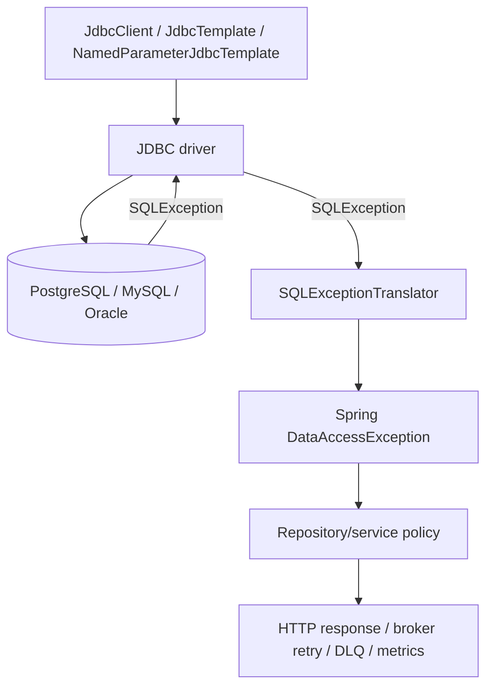
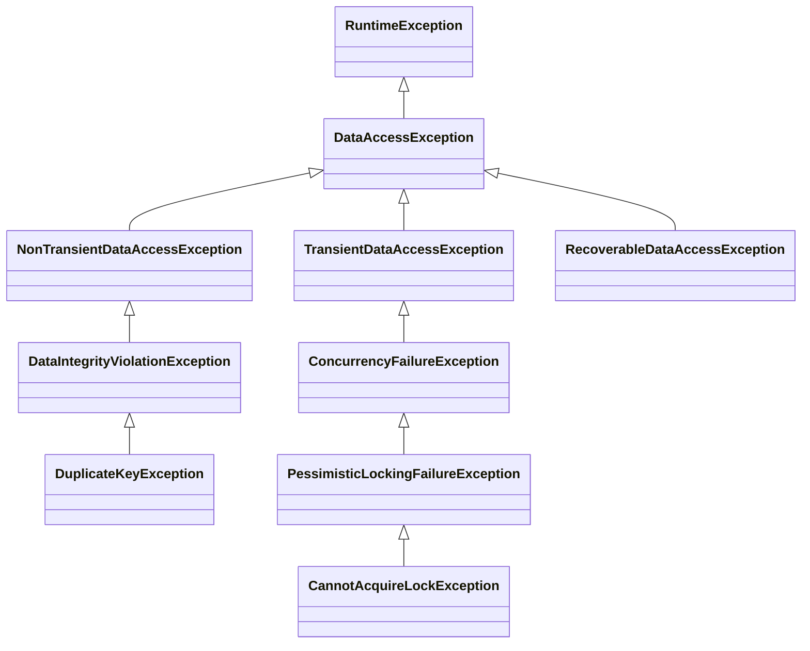
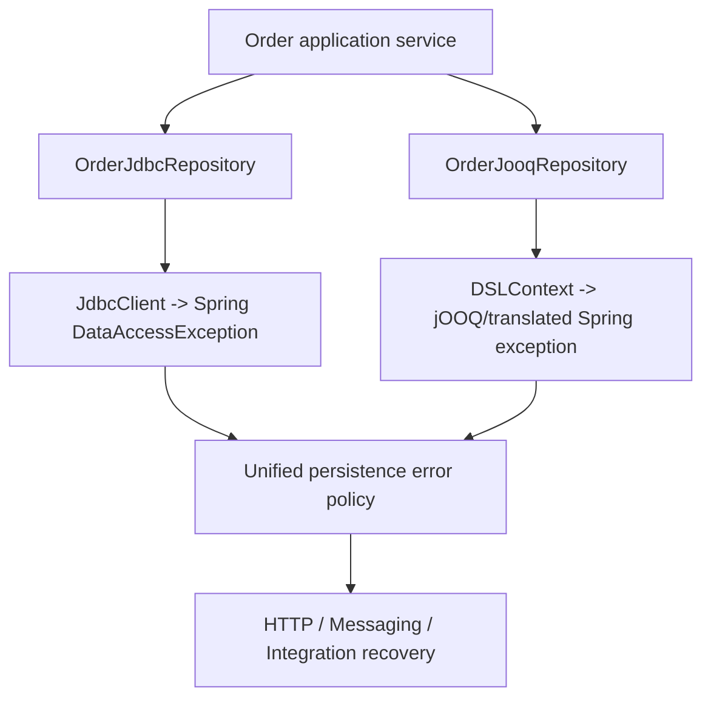
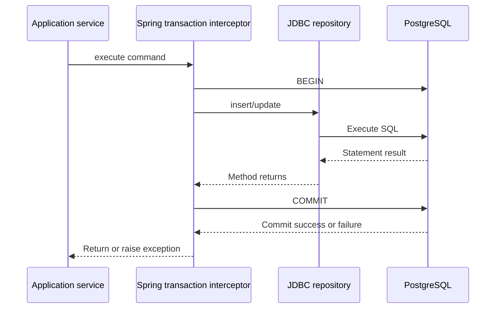
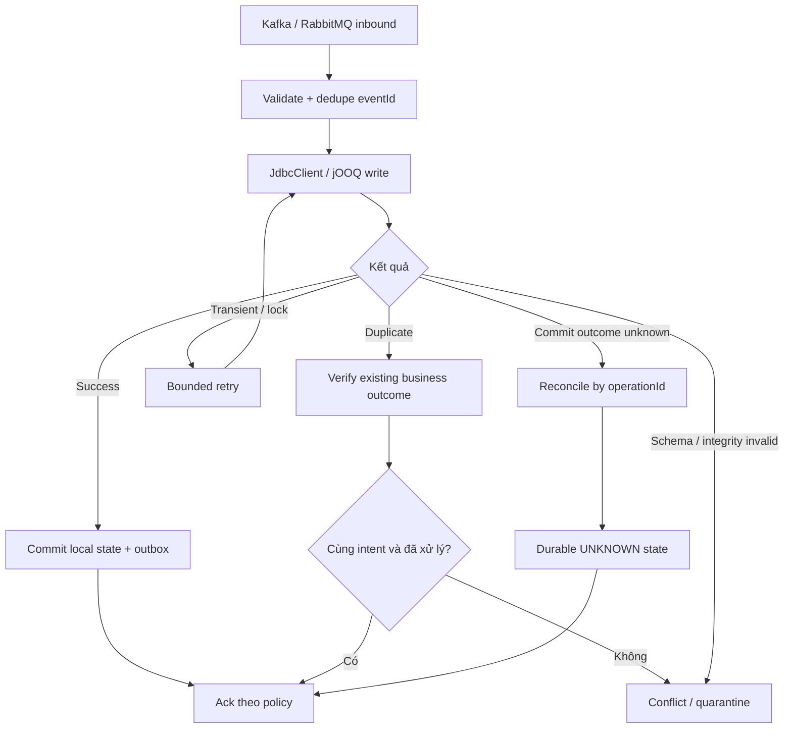

# Dịch ngoại lệ SQL thành `DataAccessException`

## 1. Bài toán: cùng một lỗi SQL nhưng ứng dụng không nên phụ thuộc vào driver

Ứng dụng Spring Boot có thể dùng `JdbcTemplate`, `JdbcClient` hoặc jOOQ để ghi trạng thái đơn hàng vào PostgreSQL, tra cứu dữ liệu từ hệ thống nội bộ, cập nhật bảng outbox rồi phát sự kiện sang Kafka/RabbitMQ. Khi truy vấn thất bại, driver JDBC có thể ném `SQLException` với SQLState, mã lỗi nhà cung cấp và chuỗi mô tả riêng. Nếu toàn bộ service, HTTP controller và consumer đều phải hiểu các mã lỗi PostgreSQL/MySQL, logic xử lý lỗi sẽ bị **gắn chặt với database**.

Ví dụ: hai request cùng tạo đơn có business ID `O-42`. Cơ sở dữ liệu từ chối lần insert thứ hai vì unique constraint. Một nơi bắt `SQLException` rồi trả HTTP 500, nơi khác kiểm tra thông báo có chữ “duplicate”, còn consumer Kafka lại retry mãi mãi. Ba cách phản ứng khác nhau đối với một lỗi có thể **không thể khắc phục bằng retry**.

Spring cung cấp hệ phân cấp exception **`org.springframework.dao.DataAccessException`** và các **`SQLExceptionTranslator`** để mô tả lỗi ở mức khái niệm: sai cú pháp SQL, vi phạm tính toàn vẹn dữ liệu, không lấy được connection, timeout, xung đột khóa hoặc lỗi chưa phân loại. Đây là trọng tâm bài học thuộc chương **JDBC và jOOQ** của module **SPRING_BOOT_INTEGRATION** — tích hợp Spring Boot qua HTTP client, cơ sở dữ liệu, cache, message broker và các adapter Spring Integration; chú trọng cấu hình, hợp đồng dữ liệu, lỗi, xử lý trùng lặp, kiểm thử và khả năng quan sát thực tế.

**Ý chính:** việc dịch ngoại lệ giúp tầng ứng dụng xử lý theo **nhóm lỗi ổn định hơn**, không có nghĩa nó tự biết nghiệp vụ nên trả `409`, retry một khoản thanh toán hay đánh dấu message đã xử lý. Chính sách nghiệp vụ phải được quyết định **sau bước phân loại lỗi kỹ thuật**.

Sau bài này, bạn có thể:

- Phân biệt `SQLException`, SQLState, vendor error code và `DataAccessException`.
- Hiểu translator của Spring JDBC được gọi ở đâu, khi nào cần dịch thủ công.
- Viết repository với `JdbcTemplate`/`JdbcClient` và xử lý những subclass quan trọng.
- Nhận diện **hai class khác nhau cùng tên `DataAccessException`** trong Spring và jOOQ.
- Thiết kế retry/idempotency, thông báo HTTP/broker, rollback và đối soát an toàn.
- Kiểm thử ánh xạ lỗi với PostgreSQL thật, không chỉ mock Java exceptions.
- Quan sát lỗi bằng thông tin kỹ thuật hữu ích nhưng không làm lộ SQL parameters/bí mật.

## 2. Từ driver JDBC đến ngôn ngữ lỗi chung

Một `SQLException` có thể mang:

- `getSQLState()`: mã SQLSTATE chuẩn hóa ở mức SQL/JDBC, nhiều database bổ sung mã riêng.
- `getErrorCode()`: mã số theo nhà cung cấp, **không thống nhất** giữa PostgreSQL, MySQL, Oracle hay SQL Server.
- `getMessage()`: mô tả có thể thay đổi theo driver, ngôn ngữ, version và nội dung SQL.
- `getCause()` và `getNextException()`: chuỗi nguyên nhân hoặc các lỗi bổ sung, đặc biệt với batch.
- Subclass JDBC 4 như `SQLIntegrityConstraintViolationException`, `SQLTransientConnectionException`, `SQLTimeoutException` nếu driver phát sinh chúng.

Spring dịch sang một exception phù hợp trong `org.springframework.dao`:



Không nên đọc sơ đồ như thể mọi `SQLException` đều luôn trở thành subclass chính xác: **mức độ nhận diện phụ thuộc driver, loại exception, translator, SQLState, vendor code và version framework**. Nếu không có ánh xạ cụ thể, ứng dụng có thể nhận `UncategorizedSQLException` hoặc exception rộng hơn.

### 2.1. Ba lợi ích của sự trừu tượng

1. **Giảm phụ thuộc vendor:** service bắt `DataIntegrityViolationException` thay vì phải biết `23505` của PostgreSQL hoặc mã lỗi riêng của từng database.
2. **Exception unchecked:** `DataAccessException` là runtime exception; không bắt buộc khai báo `throws SQLException` trên mọi repository API.
3. **Cùng giao diện xử lý:** có thể tập trung log, HTTP error mapping, retry classification và telemetry trên các nhóm lỗi thuộc tầng persistence.

Lợi ích này **không xóa đi khác biệt** giữa database. Khi cần phân biệt một unique constraint cụ thể, deadlock hay kiểu dữ liệu JSONB, ứng dụng vẫn phải hiểu hợp đồng SQL/schema của mình và có integration test với đúng database.

## 3. Phân cấp `DataAccessException` quan trọng trong thiết kế

Spring có một hệ phân cấp khá rộng. Bảng sau chọn những nhóm thường gặp:

| Lớp/nhóm Spring | Ý nghĩa gần đúng | Hướng xử lý ban đầu |
|---|---|---|
| `DataAccessException` | Base class unchecked cho lỗi truy cập dữ liệu. | Dùng làm ranh giới kỹ thuật; không retry tất cả. |
| `NonTransientDataAccessException` | Lỗi thường không tự biến mất nếu thử lại y nguyên. | Xem lỗi hợp đồng/schema/dữ liệu. |
| `TransientDataAccessException` | Lỗi có thể tạm thời về mặt tài nguyên/khóa. | Cân nhắc retry **có điều kiện** và deadline. |
| `RecoverableDataAccessException` | Có thể phục hồi sau hành động thích hợp, ví dụ kết nối lại hoặc can thiệp. | Không đồng nghĩa tự retry nóng. |
| `DataIntegrityViolationException` | Vi phạm ràng buộc toàn vẹn, có thể do unique, FK, NOT NULL, CHECK. | Phân loại conflict/validation theo ràng buộc. |
| `DuplicateKeyException` | Trường hợp chuyên biệt của vi phạm khóa unique. | Kiểm tra idempotency/business key; không tự coi là thành công. |
| `BadSqlGrammarException` | SQL không hợp lệ theo cách translator phân loại. | Kiểm tra code/query/migration, thường không retry. |
| `CannotGetJdbcConnectionException` | Không lấy được kết nối JDBC. | Kiểm tra DB/pool/network, điều tiết tải. |
| `DataAccessResourceFailureException` | Phụ thuộc lưu trữ/resource thất bại. | Kiểm tra availability, timeout và circuit breaker. |
| `CannotAcquireLockException` | Không lấy được lock khi truy cập dữ liệu. | Có thể retry bounded khi thao tác an toàn. |
| `QueryTimeoutException` | Truy vấn vượt ngưỡng timeout theo nguồn phát hiện. | Kiểm tra SQL/index/load; timeout không chứng minh không có side effect. |
| `UncategorizedSQLException` | `SQLException` chưa có ánh xạ tốt hơn. | Giữ nguyên nhân SQL, cảnh báo và phân loại thêm. |

**Phân biệt:** `DuplicateKeyException` kế thừa `DataIntegrityViolationException`. Nếu một `catch (DataIntegrityViolationException)` đặt trước `catch (DuplicateKeyException)` trong cùng chuỗi, nhánh chuyên biệt bị che khuất và Java có thể báo catch không thể tới được.

Các class concurrency như `OptimisticLockingFailureException`, `PessimisticLockingFailureException` và `CannotSerializeTransactionException` mô tả các tình huống khác nhau. Nhưng không phải mọi trường hợp “cập nhật không thành công” đều đến từ `SQLExceptionTranslator`: **zero rows updated** ở optimistic lock do ứng dụng tự kiểm tra là một trường hợp riêng.

### 3.1. Sơ đồ rút gọn của các nhánh tiêu biểu



Sơ đồ chỉ thể hiện **một phần** cây exception để dễ học, không phải toàn bộ API; hãy xem class hierarchy của phiên bản Spring Framework đang dùng khi cần bắt một subclass cụ thể.

## 4. `SQLException`, SQLState và mã lỗi nhà cung cấp

SQLState là chuỗi thường có **5 ký tự**. Hai ký tự đầu thể hiện nhóm lỗi; ba ký tự sau biểu diễn tình huống chi tiết. SQLState không chứa mọi bối cảnh nghiệp vụ mà ứng dụng cần.

Một số ví dụ phổ biến ở PostgreSQL:

| SQLState | Ý nghĩa ở PostgreSQL | Nhóm Spring có thể nhận |
|---|---|---|
| `23505` | Unique violation. | `DuplicateKeyException` hoặc `DataIntegrityViolationException`. |
| `23503` | Foreign key violation. | `DataIntegrityViolationException`. |
| `23502` | Not-null violation. | `DataIntegrityViolationException`. |
| `23514` | Check constraint violation. | `DataIntegrityViolationException`. |
| `40001` | Serialization failure. | Nhóm concurrency/transient theo translator. |
| `40P01` | Deadlock detected. | Nhóm lock/concurrency theo translator. |
| `55P03` | Lock not available. | Nhóm không lấy được lock hoặc fallback tùy mapping. |
| `42P01` | Undefined table. | Nhóm SQL grammar/resource usage. |
| `08006` | Connection failure. | Nhóm resource/connection. |
| `57014` | Query canceled. | Timeout/cancellation hoặc fallback tùy nguồn phát sinh. |

Các bảng trên là **mã PostgreSQL để hiểu nguyên nhân**, không phải cam kết Spring luôn trả đúng một subclass cho mỗi SQLState. Cách dịch còn phụ thuộc vendor error codes, JDBC subclass, translator fallback và việc exception thực tế có chứa SQLState nào.

### 4.1. Nhóm SQLState cấp lớp

- `23`: integrity constraint violation.
- `08`: connection exception.
- `40`: transaction rollback.
- `42`: syntax error or access rule violation.

Ở SQL Server/Oracle/MySQL, vendor error code và loại `SQLException` có thể là nguồn thông tin phù hợp hơn để phân loại trường hợp cụ thể. **Đừng hard-code `23505` trong business service** nếu mục tiêu là trừu tượng dữ liệu; đặt logic vendor-specific ở adapter/translator và kiểm thử bằng DB tương ứng.

### 4.2. Đừng parse chuỗi `getMessage()` để quyết định

Phản mẫu:

```java
catch (SQLException ex) {
    if (ex.getMessage().contains("duplicate key")) {
        return "already processed";
    }
    throw ex;
}
```

Message có thể thay đổi, bị localize hoặc bao gồm tên bảng và dữ liệu. Đúng hơn là dựa trên subclass đã dịch, metadata constraint có cấu trúc khi thật cần, và **unique business key** do schema bảo vệ. SQLState/vendor code dùng để chẩn đoán và hỗ trợ translator, không phải thay mọi chính sách nghiệp vụ.

## 5. Tại sao Spring có nhiều `SQLExceptionTranslator`?

Spring JDBC hỗ trợ interface:

```java
package org.springframework.jdbc.support;

public interface SQLExceptionTranslator {
    org.springframework.dao.DataAccessException translate(
        String task, String sql, java.sql.SQLException ex);
}
```

Đoạn trên thể hiện **chữ ký khái niệm**, không phải mã source cần copy vào dự án. Kết quả translator có thể là một `DataAccessException` cụ thể **hoặc `null` khi translator không phân loại được**, nên hạ tầng sử dụng thường có fallback.

Các implementation cần biết:

| Translator | Nguồn thông tin chính | Trường hợp sử dụng |
|---|---|---|
| `SQLExceptionSubclassTranslator` | Subclasses `SQLException` theo JDBC 4, fallback khi cần. | Driver phát loại exception chuẩn tương đối tốt. |
| `SQLStateSQLExceptionTranslator` | SQLState từ `SQLException`. | Khi SQLState có ý nghĩa, ít phụ thuộc mã vendor. |
| `SQLErrorCodeSQLExceptionTranslator` | Bảng mã lỗi theo database/vendor; có fallback. | Muốn nhận diện lỗi đặc thù tốt hơn, có `DataSource`/database product metadata. |
| Custom `SQLExceptionTranslator` | Quy tắc riêng từ SQLState/vendor code/ngữ cảnh. | Khi mặc định chưa phân loại đúng một trường hợp quan trọng. |

Trong Spring Framework 6.x, hành vi chọn translator mặc định có các điều kiện liên quan tới sự hiện diện của bảng error codes và cấu hình `JdbcAccessor`/`JdbcTemplate`; không nên giả định **mọi phiên bản** mặc định dùng một lớp duy nhất. Điều cần kiểm tra là **Spring JDBC component đang sử dụng translator nào**, rồi xác nhận bằng integration test.

### 5.1. Chuỗi fallback là một cơ chế quan trọng

Một translator dùng vendor codes có thể không biết mã cụ thể; khi đó có thể thử JDBC subclass/SQLState rồi cuối cùng trả kết quả rộng hơn. Do vậy:

- Nhận được `UncategorizedSQLException` không nhất thiết là lỗi Spring; có thể driver cung cấp metadata không đủ hoặc mapping chưa có.
- Chuyển từ driver/library version A sang B có thể đổi subclass của cùng một lỗi.
- Business service nên bắt **nhóm đủ rộng**, chỉ dùng subclass rất cụ thể khi contract/mapping đã được test.

## 6. `JdbcTemplate` tự dịch lỗi ở ranh giới thực thi SQL

`JdbcTemplate` thường bắt `SQLException` trong vòng đời JDBC operation, sau đó chuyển sang `DataAccessException` qua translator. Repository gọi `JdbcTemplate` không cần `catch(SQLException)` ở mỗi truy vấn.

Ví dụ domain:

```java
public record OrderCommand(
        String orderId, String customerId, String status) {}

public record OrderRow(
        String orderId, String customerId,
        String status, long version) {}
```

Repository:

```java
import org.springframework.jdbc.core.JdbcTemplate;
import org.springframework.stereotype.Repository;

@Repository
public class OrderJdbcRepository {
    private final JdbcTemplate jdbc;

    public OrderJdbcRepository(JdbcTemplate jdbc) {
        this.jdbc = jdbc;
    }

    public int insert(OrderCommand command) {
        return jdbc.update("""
            INSERT INTO orders(order_id, customer_id, status, version)
            VALUES (?, ?, ?, 0)
            """,
            command.orderId(),
            command.customerId(),
            command.status());
    }

    public OrderRow findById(String id) {
        return jdbc.queryForObject("""
            SELECT order_id, customer_id, status, version
            FROM orders
            WHERE order_id = ?
            """,
            (rs, rowNum) -> new OrderRow(
                rs.getString("order_id"),
                rs.getString("customer_id"),
                rs.getString("status"),
                rs.getLong("version")),
            id);
    }
}
```

Giả định database đã có bảng `orders` đúng schema (tạo bằng Flyway/Liquibase), Spring Boot đã cấu hình `DataSource` và `JdbcTemplate`. Nếu insert vi phạm unique constraint, `jdbc.update(...)` thường ném một `DataIntegrityViolationException` hoặc subclass như `DuplicateKeyException`, không yêu cầu repository xử lý `SQLException` checked.

### 6.1. Lỗi do JDBC khác lỗi do quy ước kết quả

`findById` với `queryForObject` yêu cầu đúng một dòng. Nếu không có dòng, Spring có thể ném `EmptyResultDataAccessException` (một subclass của `IncorrectResultSizeDataAccessException`). **Đây không phải lỗi SQLSTATE do DB từ chối truy vấn**; nó phản ánh quy ước số dòng của API JDBC.

Đừng gom tất cả `DataAccessException` thành “DB down”. Một `EmptyResultDataAccessException` ở lookup có thể được ứng dụng map thành `Optional.empty()`, còn một `CannotGetJdbcConnectionException` lại đòi xử lý sự cố tài nguyên.

Ví dụ an toàn khi không tìm thấy là bình thường:

```java
public java.util.Optional<OrderRow> findOptional(String id) {
    var rows = jdbc.query("""
        SELECT order_id, customer_id, status, version
        FROM orders WHERE order_id = ?
        """,
        (rs, rowNum) -> new OrderRow(
            rs.getString("order_id"),
            rs.getString("customer_id"),
            rs.getString("status"),
            rs.getLong("version")),
        id);

    return rows.stream().findFirst();
}
```

Giả định `order_id` có unique constraint; nếu không, việc chỉ lấy dòng đầu có thể che giấu dữ liệu trùng. Một query trả danh sách tránh sử dụng exception làm control flow cho trường hợp **không tìm thấy** thông thường.

## 7. `JdbcClient` và `NamedParameterJdbcTemplate` cũng hưởng translation

Từ Spring Framework 6.1+, `JdbcClient` cung cấp API fluent dựa trên hạ tầng JDBC của Spring. Nếu Spring Boot version tương thích auto-configure bean `JdbcClient`, bạn có thể inject vào repository:

```java
import org.springframework.jdbc.core.simple.JdbcClient;
import org.springframework.stereotype.Repository;

@Repository
public class OrderJdbcClientRepository {
    private final JdbcClient jdbc;

    public OrderJdbcClientRepository(JdbcClient jdbc) {
        this.jdbc = jdbc;
    }

    public int insert(OrderCommand command) {
        return jdbc.sql("""
                INSERT INTO orders(order_id, customer_id, status, version)
                VALUES (:orderId, :customerId, :status, 0)
                """)
            .param("orderId", command.orderId())
            .param("customerId", command.customerId())
            .param("status", command.status())
            .update();
    }

    public java.util.Optional<String> findStatus(String orderId) {
        return jdbc.sql("""
                SELECT status FROM orders WHERE order_id = :id
                """)
            .param("id", orderId)
            .query(String.class)
            .optional();
    }
}
```

Các lỗi JDBC thực thi bởi `JdbcClient`/`NamedParameterJdbcTemplate` dựa trên infrastructure `JdbcTemplate` tương ứng được dịch sang hệ `DataAccessException`. Không cần tạo một translator riêng chỉ vì repository chuyển từ `JdbcTemplate` sang API fluent.

**Chú ý:** chuyển API không thay đổi transaction isolation, SQL schema, driver behavior hay meaning của mã lỗi. Nếu code chuyển từ query một dòng sang `optional()`, đó là thay đổi **ngữ nghĩa của trường hợp không có kết quả**, không phải một lỗi translation.

### 7.1. Hợp đồng giữa repository và service

Repository nên thể hiện các hành động đúng ngôn ngữ dữ liệu:

- `insertOrder(...)`: vi phạm unique constraint sẽ là lỗi persistence.
- `findOrderById(...)`: absence hợp lệ có thể là `Optional.empty()`.
- `updateStatusIfVersionMatches(...)`: trả số dòng cập nhật để service đánh giá optimistic concurrency.
- `recordConsumedEvent(...)`: dùng unique business key cho idempotency.

Đừng ép repository trả boolean “thành công hay không” cho mọi loại failure; mất thông tin về deadlock, pool exhaustion và schema mismatch sẽ khiến recovery không còn an toàn.

## 8. Khi dùng raw JDBC: tự dịch tại tầng adapter

Nếu ứng dụng gọi `Connection.prepareStatement(...)` trực tiếp, JDBC driver vẫn ném `SQLException`. `@Repository` **không tự biến mọi `SQLException` thô thành `DataAccessException`**. Có thể sử dụng `SQLExceptionTranslator` của Spring một cách tường minh.

Ví dụ triển khai raw JDBC có quản lý connection tương thích Spring transaction:

```java
import java.sql.Connection;
import java.sql.PreparedStatement;
import java.sql.SQLException;
import javax.sql.DataSource;

import org.springframework.dao.DataAccessException;
import org.springframework.jdbc.UncategorizedSQLException;
import org.springframework.jdbc.datasource.DataSourceUtils;
import org.springframework.jdbc.support.SQLErrorCodeSQLExceptionTranslator;
import org.springframework.jdbc.support.SQLExceptionTranslator;
import org.springframework.stereotype.Repository;

@Repository
public class RawOrderJdbcGateway {

    private final DataSource dataSource;
    private final SQLExceptionTranslator translator;

    public RawOrderJdbcGateway(DataSource dataSource) {
        this.dataSource = dataSource;
        this.translator =
                new SQLErrorCodeSQLExceptionTranslator(dataSource);
    }

    public void insert(String orderId, String status) {
        String sql = """
            INSERT INTO orders(order_id, customer_id, status, version)
            VALUES (?, 'unknown', ?, 0)
            """;

        Connection connection = DataSourceUtils.getConnection(dataSource);

        try (PreparedStatement ps = connection.prepareStatement(sql)) {
            ps.setString(1, orderId);
            ps.setString(2, status);
            ps.executeUpdate();
        } catch (SQLException ex) {
            DataAccessException mapped =
                    translator.translate("insert order", sql, ex);

            throw mapped != null
                    ? mapped
                    : new UncategorizedSQLException("insert order", sql, ex);
        } finally {
            DataSourceUtils.releaseConnection(connection, dataSource);
        }
    }
}
```

Đây là **ví dụ về cơ chế dịch lỗi**: giá trị `customer_id='unknown'` chỉ để code ngắn, không phải khuyến nghị nghiệp vụ; schema thực tế phải phù hợp. `DataSourceUtils` giúp lấy và release connection theo transaction synchronization của Spring. Không dùng `try (Connection connection = dataSource.getConnection())` tùy tiện rồi cho rằng nó luôn tham gia transaction do Spring quản lý.

Nếu Spring cung cấp template phù hợp, **ưu tiên `JdbcTemplate`/`JdbcClient`** thay vì viết lặp xử lý connection/translation. Chỉ dùng raw JDBC khi có lý do cụ thể như API driver/vendor đặc biệt.

### 8.1. Những lỗi không phát sinh dưới dạng `SQLException`

`DataSourceUtils.getConnection(...)` có thể đã ném một `DataAccessException` do không lấy được connection. Các lỗi Java như `NullPointerException`, lỗi bind DTO hay vi phạm hợp đồng service không nên được “dịch thành SQL lỗi” bằng cách catch `Exception` rồi giả dạng `BadSqlGrammarException`.

Một translator dành riêng cho `SQLException`, không phải bộ phân loại mọi exception của ứng dụng.

## 9. `@Repository` và `PersistenceExceptionTranslationPostProcessor`: hiểu đúng giới hạn

Spring có cơ chế exception translation cho persistence beans như các repository dùng Hibernate/JPA hoặc công nghệ có `PersistenceExceptionTranslator` phù hợp. `@Repository` là một stereotype quan trọng để cơ chế này nhận diện bean trong context.

Nhưng có hai tình huống khác nhau:

1. **`JdbcTemplate`/`JdbcClient` tự dịch `SQLException` trong lúc thực thi.** Không phụ thuộc việc bạn tự bắt `SQLException` hay không; hạ tầng Spring JDBC làm việc này.
2. **Exception translation ở ranh giới repository proxy** có thể xử lý những native runtime exceptions do provider ném ra **khi có bộ dịch được đăng ký và proxy áp đúng**.

Không suy ra rằng chỉ cần đặt `@Repository` lên một class tự viết JDBC là tất cả lỗi SQL checked hay lỗi Java đều được map tự động. Để kiểm tra, hãy thử **lỗi thật** qua bean Spring proxy và assert exception type, không chỉ xem class annotation.

### 9.1. Self-invocation và lỗi được nuốt

Nếu code DAO tự catch rồi trả `null`:

```java
try {
    return executeJdbc();
} catch (SQLException ex) {
    return null; // Phản mẫu: mất loại lỗi, mất khả năng retry/alert đúng.
}
```

Không lớp translation nào bên ngoài còn thấy nguyên nhân. Tương tự, một method nội bộ không đi qua proxy của repository có thể không hưởng advice được áp ở proxy boundary. Cách giảm mơ hồ: dùng template Spring JDBC cho thao tác SQL và dịch lỗi **ngay ở data-access boundary**.

## 10. jOOQ có một `DataAccessException` khác với Spring

Đây là nguồn nhầm lẫn quan trọng nhất của chương **JDBC và jOOQ**:

| Hệ sinh thái | Class | Ý nghĩa |
|---|---|---|
| Spring | `org.springframework.dao.DataAccessException` | Base runtime exception của Spring data access. |
| jOOQ | `org.jooq.exception.DataAccessException` | Runtime exception do jOOQ phát sinh khi thao tác jOOQ thất bại. |
| JDBC | `java.sql.SQLException` | Checked exception của API JDBC/driver. |

Hai `DataAccessException` **không cùng class và không nên import nhầm**. Trong Java không thể có hai imports cùng simple name ở một file; khi cần phân biệt, dùng fully-qualified class name.

```java
// Spring:
org.springframework.dao.DataAccessException springFailure;

// jOOQ:
org.jooq.exception.DataAccessException jooqFailure;
```

Đoạn trên chỉ minh họa tên class, không phải một method có logic. Một `catch (org.springframework.dao.DataAccessException ex)` sẽ **không tự bắt** một `org.jooq.exception.DataAccessException` chưa được dịch.

### 10.1. jOOQ không nhất thiết đi qua Spring JDBC translator

jOOQ dùng `DSLContext`, `org.jooq.Configuration` và cơ chế execute listeners của riêng nó. Khi chạy jOOQ **ngoài Spring Boot auto-configuration**, JDBC exceptions thường được jOOQ bao thành các exception của jOOQ. Khi chạy theo **cấu hình tự động của Spring Boot** với listener translation phù hợp, một số lỗi SQL có thể được chuyển tiếp sang hệ `org.springframework.dao`.

Điều cốt lõi không phải “jOOQ luôn trả Spring exception” hay “jOOQ không bao giờ trả Spring exception”, mà là **kiểm tra `DSLContext`/`Configuration` được tạo thế nào và listener nào được đăng ký**.

## 11. Spring Boot + jOOQ: xem đúng đường tạo `DSLContext`

Một ứng dụng Boot 3.x tương thích có thể thêm:

```kotlin
dependencies {
    implementation("org.springframework.boot:spring-boot-starter-jooq")
    runtimeOnly("org.postgresql:postgresql")
}
```

Ví dụ repository đơn giản, dùng bind parameters của jOOQ thay vì nối SQL strings:

```java
import org.jooq.DSLContext;
import org.springframework.stereotype.Repository;

@Repository
public class OrderJooqRepository {

    private final DSLContext dsl;

    public OrderJooqRepository(DSLContext dsl) {
        this.dsl = dsl;
    }

    public int insert(String orderId, String customerId) {
        return dsl.execute("""
            INSERT INTO orders(order_id, customer_id, status, version)
            VALUES (?, ?, 'NEW', 0)
            """,
            orderId, customerId);
    }
}
```

Ví dụ chạy được khi có schema `orders` và `DSLContext` được Boot hoặc ứng dụng cấu hình. Nếu Boot auto-configuration sở hữu `DSLContext` và register listener dịch ngoại lệ phù hợp theo version, lỗi SQL trong jOOQ có thể đi ra dưới dạng Spring `DataAccessException`. Nếu ứng dụng tự tạo:

```java
DSLContext custom = org.jooq.impl.DSL.using(
        jdbcConnection, org.jooq.SQLDialect.POSTGRES);
```

thì **đừng mặc định** cùng bộ listeners/transaction integration đã được Boot áp dụng. Một DSLContext tự tạo có thể bỏ qua exception translator, connection provider, transaction provider và observation configuration của ứng dụng.

### 11.1. Kiểm tra thay vì đoán

Với ứng dụng dùng jOOQ, hãy xác định:

1. Ai tạo `DSLContext`: Spring Boot auto-configuration hay factory tự viết?
2. `Configuration` có `ExecuteListenerProvider` dịch exception hay không?
3. Exception từ duplicate key thực tế là **Spring** hay **jOOQ** ở repository boundary?
4. SQLState, vendor code và root `SQLException` còn được bảo toàn trong cause chain không?
5. `@Transactional` có sử dụng cùng `DataSource`/Spring transaction manager không?
6. Khi thay driver, jOOQ hoặc Boot version, integration test có còn bắt cùng loại exception?

Không catch cứng một class Spring ở tầng service nếu data access path hiện tại có thể ném jOOQ exception chưa được dịch. Chuẩn hóa **tại adapter** trước khi business logic dựa trên lỗi.

### 11.2. Có cần tự cài một listener dịch lỗi không?

Không nhất thiết. Với Boot quản lý jOOQ phù hợp, bạn thường muốn giữ cấu hình exception translation sẵn có. Nếu đã custom `org.jooq.Configuration`, cần kiểm tra nó có bảo toàn hoặc đăng ký listener tương ứng. Một lời giải “thêm `@Repository`” chưa đủ chứng minh jOOQ exceptions được dịch.

Khi cần tự triển khai listener/adaptor, phải phân biệt jOOQ exception có thể là lỗi logic/cấu hình của jOOQ **không chứa `SQLException`**. Chỉ chuyển sang Spring SQL exception khi có nguồn SQL hợp lệ; không ép mọi jOOQ exception thành `DuplicateKeyException` hoặc `TransientDataAccessException`.

## 12. Chọn một ranh giới exception nhất quán giữa JDBC và jOOQ

Một service có thể sử dụng cả `JdbcClient` và jOOQ:



Nếu app chủ trương expose Spring `DataAccessException` ở repository boundary, cần bảo đảm mọi adapter thực sự tuân thủ. Có hai cách hợp lý:

- **Ưu tiên Spring Boot-managed integration** cho `JdbcClient` và jOOQ, giữ translator/listener của Boot khi được hỗ trợ.
- **Viết adapter/wrapper tường minh** ở nơi dùng jOOQ tùy chỉnh, kiểm tra và dịch JDBC nguyên nhân theo chính sách đã định. Với lỗi không thuộc SQL, giữ riêng type hoặc map thành một exception adapter được đặt tên chính xác.

Không nên để API controller bắt cả `org.jooq.exception.DataAccessException` và Spring `DataAccessException` chỉ để đoán DB đang dùng loại nào. Đó là dấu hiệu data access boundary chưa được chuẩn hóa.

### 12.1. Bảo toàn cause và message an toàn

Khi cần đóng gói lại exception:

- Giữ `cause` gốc để chẩn đoán SQLState/vendor code.
- Ghi operation name và dependency, không in toàn bộ SQL bind values/PII ra log.
- Không tạo exception vô nghĩa như “Internal server error” rồi bỏ mất nguyên nhân.
- Đừng giữ nguyên thông báo từ database trong HTTP response cho người dùng cuối.

`DataAccessException` không phải business DTO. API nên map từ mã lỗi đã phân loại sang response công khai có cấu trúc ổn định.

## 13. Khi mapping mặc định chưa đủ: custom translator

Giả sử với một DB hoặc driver cụ thể, lỗi tranh chấp khóa được biểu diễn bằng vendor code/SQLState mà translator hiện tại chưa nhận đúng. Bạn có thể cài `SQLExceptionTranslator` theo policy, thường bằng một wrapper hoặc custom translator được gắn vào `JdbcTemplate`/DAO phù hợp.

Ví dụ chỉ thể hiện cách custom hóa cho **PostgreSQL**:

```java
import javax.sql.DataSource;
import org.springframework.dao.CannotAcquireLockException;
import org.springframework.jdbc.support.SQLErrorCodeSQLExceptionTranslator;
import org.springframework.jdbc.support.SQLExceptionTranslator;

public final class SqlTranslationPolicy {

    public static SQLExceptionTranslator postgres(DataSource source) {
        SQLErrorCodeSQLExceptionTranslator translator =
                new SQLErrorCodeSQLExceptionTranslator(source);

        translator.setCustomTranslator((task, sql, exception) -> {
            if ("55P03".equals(exception.getSQLState())) {
                return new CannotAcquireLockException(
                        "Cannot acquire PostgreSQL lock during " + task,
                        exception);
            }
            return null; // Để translator xử lý bằng policy có sẵn.
        });

        return translator;
    }
}
```

Đây là ví dụ **narrow mapping**, không phải yêu cầu phải custom hóa mọi hệ thống. `55P03` là mã PostgreSQL; nếu chuyển sang database khác, cần thay hoặc bỏ rule ấy. Phải kiểm tra `setCustomTranslator`/extension point trên phiên bản Spring đang dùng và test nó bằng exception thực tế.

Không gắn custom translator vào một `JdbcTemplate` của test rồi cho rằng jOOQ hoặc tất cả repositories đã dùng cùng translator. Customization cần được áp vào **data access path thực tế**. Nếu Spring Boot auto-configured template đã được tạo, thay template khác cần giữ transaction, settings, observation và binding được quản lý.

### 13.1. Custom mapping nên dùng khi nào?

Nên cân nhắc khi:

- Một lỗi vendor được nhận thành `UncategorizedSQLException` nhưng policy của hệ thống cần phân biệt lock contention.
- Driver version có metadata đặc thù mà translator mặc định không hiểu.
- Có một constraint/domain error quan trọng phải được phân loại tại adapter để tránh parse string ở service.

Không nên custom chỉ để biến mọi `DataIntegrityViolationException` thành `DuplicateKeyException`: không phải mọi integrity violation đều do duplicate key; làm thế khiến API/consumer phản ứng sai.

## 14. Chi tiết exception cần giữ lại để chẩn đoán

Bất kể Spring đã dịch hay chưa, `Throwable.getCause()` có thể chứa `SQLException` hoặc wrapper của driver. Với batch, `BatchUpdateException` có thể có `getUpdateCounts()` và `getNextException()` cho biết những statement đã được driver thực thi/từ chối.

Một helper chỉ để chẩn đoán trong log nội bộ:

```java
import java.sql.SQLException;
import org.springframework.dao.DataAccessException;

static SQLException findSqlCause(DataAccessException failure) {
    Throwable cursor = failure;
    while (cursor != null) {
        if (cursor instanceof SQLException sql) {
            return sql;
        }
        cursor = cursor.getCause();
    }
    return null;
}
```

Helper duyệt `cause`, chưa duyệt `SQLException.getNextException()` và không giải quyết toàn bộ dạng exception graph. Nếu cần chẩn đoán batch, phải xem các exception lồng nhau một cách có giới hạn, tránh vòng tham chiếu và log payload nhạy cảm.

### 14.1. Thông tin nên log và không nên log

| Nên giữ | Nên tránh |
|---|---|
| `operation=insert-order`, `repository=orders`, dependency, exception class. | Full SQL có literal chứa PII/token. |
| SQLState và vendor error code nếu có. | Raw request body, payment reference nhạy cảm. |
| Constraint identifier đã được kiểm duyệt, nếu cần. | Full database server message trả thẳng cho user. |
| Transaction/attempt count, duration, pool saturation. | ID đơn hàng/khách hàng dùng làm metric tag. |
| Correlation ID trong log/trace có quyền truy cập. | Password, JDBC URL có credentials hoặc query params bí mật. |

Một câu log như “SQL failed: `INSERT INTO users VALUES ('email@example.com', ...)`” có thể tạo lỗ hổng dữ liệu. Tránh string-concatenate SQL từ input ngay từ đầu; luôn dùng bind parameters.

## 15. `DuplicateKeyException` không phải lệnh “coi như thành công”

Trong luồng consumer xử lý lại event `OrderPaid`, unique key `(consumer_name, event_id)` có thể giúp idempotency. Nhưng một `DuplicateKeyException` có thể do:

- Event ID đã được xử lý trước đó.
- Business key `order_id` trùng với **payload khác**.
- Một unique constraint khác trên external reference/email.
- Hai workers cùng tranh insert nhưng một worker chưa hoàn tất business effect.

**Không nên chỉ catch `DuplicateKeyException` rồi ack message**. Phải xác minh **constraint nào bị vi phạm** và bản ghi hiện có có cùng ý định/payload hash, trạng thái và side effect hay không.

Ví dụ schema:

```sql
CREATE TABLE consumed_events (
    consumer_name VARCHAR(80) NOT NULL,
    event_id VARCHAR(100) NOT NULL,
    payload_hash VARCHAR(64) NOT NULL,
    processed_at TIMESTAMPTZ NOT NULL DEFAULT now(),
    PRIMARY KEY (consumer_name, event_id)
);
```

Một cách idempotency rõ ràng ở PostgreSQL:

```java
int inserted = jdbc.sql("""
        INSERT INTO consumed_events(
            consumer_name, event_id, payload_hash)
        VALUES (:consumer, :eventId, :hash)
        ON CONFLICT (consumer_name, event_id) DO NOTHING
        """)
    .param("consumer", consumerName)
    .param("eventId", eventId)
    .param("hash", payloadHash)
    .update();

if (inserted == 0) {
    // Đọc lại record cùng key để so khớp hash và outcome,
    // không mặc định duplicate nghĩa là đã xử lý thành công.
}
```

Ví dụ giả định `jdbc` là `JdbcClient`. `ON CONFLICT` là cú pháp PostgreSQL, không phải SQL tiêu chuẩn có mặt giống nhau ở mọi vendor. Khi dùng SQL này, unique constraint là **một phần của business contract và migration**, cần test với PostgreSQL thật.

### 15.1. Trường hợp insert marker trước business update

Nếu ghi marker `consumed_events` rồi commit trước khi cập nhật đơn, process có thể chết giữa chừng; lần redelivery thấy marker trùng và bỏ qua nghiệp vụ chưa hoàn tất. Cần ghi marker và business update trong **cùng transaction** khi chúng thuộc cùng datasource, hoặc dùng state machine/inbox rõ ràng với `PROCESSING`/`SUCCEEDED` và cơ chế recovery.

Việc dịch lỗi chỉ giúp nhận biết duplicate; **điểm commit** quyết định idempotency có thật sự an toàn hay không.

## 16. `DataIntegrityViolationException` và hợp đồng HTTP API

Không nên trả nguyên class/SQLSTATE cho client ngoài. Tầng HTTP có thể map lỗi thành API error code theo context:

| Tình huống nghiệp vụ | Lỗi persistence có thể thấy | HTTP mapping có thể phù hợp |
|---|---|---|
| Tạo resource trùng business ID đã tồn tại. | `DuplicateKeyException` hoặc integrity violation. | `409 Conflict`, kèm mã lỗi ổn định. |
| Foreign key `customer_id` không tồn tại. | `DataIntegrityViolationException`. | `400/422` nếu request invalid theo contract; có thể `409` nếu state race. |
| DB/mạng không khả dụng. | `CannotGetJdbcConnectionException`/resource failure. | `503 Service Unavailable` nếu thích hợp. |
| SQL schema/migration sai. | `BadSqlGrammarException` hoặc resource usage. | `500` và cảnh báo developer/operator. |
| Optimistic version không khớp. | 0 updated hoặc concurrency exception do adapter ném. | `409 Conflict`/`412 Precondition Failed` theo HTTP contract. |
| Query không tìm thấy bản ghi. | `Optional.empty()` hoặc `EmptyResultDataAccessException`. | `404` nếu đó là truy vấn resource. |

Không có bảng map “mọi `DataAccessException` đều là HTTP 409” đáng tin cậy. Một lỗi unique trên bảng **outbox** nội bộ khác với user cố tạo resource trùng; cần ngữ cảnh operation và constraint để quyết định response.

Ví dụ lớp application/gateway nên chuyển database technical error sang domain exception riêng:

```java
public record ApiError(String code, String message) {}
```

```java
public class OrderAlreadyExistsException extends RuntimeException {
    public OrderAlreadyExistsException(String orderId, Throwable cause) {
        super("Order already exists: " + orderId, cause);
    }
}
```

Response bên ngoài nên dùng thông báo công khai đã kiểm duyệt, không dựa vào `getMessage()` của exception vốn chứa ID nội bộ. Không bắt `DuplicateKeyException` ở mọi controller nếu có thể dịch tại service/gateway gần ngữ nghĩa operation hơn.

## 17. Transient không có nghĩa mọi ghi đều retry an toàn

Một lỗi có vẻ tạm thời, ví dụ connection reset hoặc query timeout, khiến ứng dụng muốn retry. Nhưng với **lệnh ghi**, client có thể không biết database đã commit hay chưa khi mất response/connection.

Ví dụ:

```text
Consumer nhận event E42
  -> INSERT outbox/UPDATE order
  -> database commit thành công
  -> network lỗi trước khi client nhận kết quả
  -> caller thấy connection failure
  -> retry INSERT với một key mới
  -> duplicate business effect
```

Vì vậy, retry cần **cả hai điều kiện**:

1. Lỗi có khả năng biến mất sau khi chờ (theo exception, SQLState và bối cảnh).
2. **Thao tác có thể thử lại an toàn** nhờ transaction rollback đã biết, key idempotent, unique constraint, CAS/version hoặc reconciliation.

### 17.1. Những nhóm lỗi nên xử lý khác nhau

| Nhóm | Retry? | Điều kiện |
|---|---|---|
| `DuplicateKeyException` | Thường không. | Kiểm tra duplicate là cùng business intent, không phải data corruption. |
| `BadSqlGrammarException` | Không retry nóng. | Sửa query/migration/permission, deploy/rollback. |
| `CannotAcquireLockException` | Có thể retry bounded. | Rollback attempt trước, backoff/jitter, deadline và idempotency. |
| `QueryTimeoutException` trên read-only query | Có thể tùy SLO. | Kiểm tra DB load/SQL plan, không tạo storm. |
| Connection failure trong write/commit | Cẩn trọng, kết quả có thể `UNKNOWN`. | Tra cứu status theo business key trước khi phát lại. |
| `UncategorizedSQLException` | Không tự retry. | Phân loại metadata/root cause và bổ sung rule/test. |

**`TransientDataAccessException` là gợi ý kỹ thuật, không phải giấy phép retry vô hạn**. Tầng tích hợp còn có HTTP client retry, Spring Integration advice và broker redelivery; nếu mỗi tầng thử ba lần, số attempts nhân lên ngoài dự tính.

### 17.2. Retry phải có giới hạn tổng

Thiết kế policy gồm:

- Số attempts tối đa, tính cả attempt đầu.
- Backoff tăng dần, jitter và quota dependency.
- Ngân sách thời gian còn lại từ request/deadline nghiệp vụ.
- Số retries ở **từng lớp**, tránh lồng nhau.
- Unique `operationId` và `eventId` ổn định.
- Phân biệt `RETRY_WAIT`, `FAILED_FINAL`, `UNKNOWN` và `SUCCEEDED`.
- Recovery/DLQ/inbox và người sở hữu replay.

Không giữ database transaction hoặc connection quá lâu chỉ để ngủ backoff khi gặp outage dài; dùng durable retry queue/job table khi phù hợp.

## 18. Transaction boundaries và thời điểm lỗi xuất hiện

`DataAccessException` xuất hiện ở thời điểm `JdbcTemplate`/jOOQ gọi JDBC, nhưng **commit có thể xảy ra sau khi repository method trả về**. Nếu Spring `@Transactional` bao quanh service, exception commit-time có thể được phát sinh khi transaction interceptor kết thúc, không nằm trong try/catch ở repository.



Thực tế, caller/transaction proxy arrangement có thể khác sơ đồ rút gọn; ý chính là **lỗi ở statement execution không phải lỗi duy nhất**. Deferred constraint có thể báo lỗi lúc commit; database network mất trong lúc commit cũng có thể tạo outcome không chắc chắn.

### 18.1. Spring transaction rollback

Thông thường `@Transactional` của Spring rollback khi runtime exception/`Error` thoát khỏi transaction method, và `DataAccessException` thuộc runtime exception nên phù hợp mặc định. Nhưng cần phân biệt:

- Catch exception **bên trong method** rồi trả về bình thường có thể khiến transaction vẫn đi tới commit nếu không đánh dấu rollback.
- Một transaction tham gia transaction ngoài có thể bị `rollback-only`, dẫn tới `UnexpectedRollbackException` về sau.
- Ràng buộc DB deferred hoặc network commit failure có thể xuất hiện ngoài điểm repository dự đoán.
- Không thể rollback HTTP/SOAP side effect hoặc Kafka publish chỉ vì JDBC transaction rollback.

Nếu service cần cập nhật DB và phát event, dùng **transactional outbox** để giữ ý định phát cùng local commit. Không cho rằng translator giúp tạo distributed transaction.

### 18.2. Lỗi batch và partial success

Với JDBC batch, `BatchUpdateException` có thể chứa update counts cho những statements đã hoàn tất trước lỗi. Tùy auto-commit/transaction, một số side effects có thể đã tồn tại. **Không retry toàn batch bằng business IDs mới** trước khi xác định transaction và trạng thái đã commit.

Khi batch cần xử lý lặp an toàn, chọn unique keys, chunk boundaries và per-item status rõ ràng. Với Spring Batch, retry/skip policy còn chịu tác động của job repository và transaction chunk; không bắt tất cả `DataIntegrityViolationException` rồi skip vì như vậy có thể che dữ liệu lỗi.

## 19. Optimistic locking: không phải lúc nào có `SQLException`

Một update có điều kiện:

```sql
UPDATE orders
SET status = :status,
    version = version + 1
WHERE order_id = :id
  AND version = :expected_version;
```

Nếu bị người khác cập nhật trước, statement thường **thực thi hợp lệ** và trả `0 rows updated`. Không có SQLSTATE hay SQLException để dịch!

Ví dụ kiểm tra:

```java
int updated = jdbc.sql("""
        UPDATE orders
        SET status = :status, version = version + 1
        WHERE order_id = :id AND version = :version
        """)
    .param("status", newStatus)
    .param("id", orderId)
    .param("version", expectedVersion)
    .update();

if (updated == 0) {
    throw new org.springframework.dao.OptimisticLockingFailureException(
            "Order version changed");
}
```

Ở đây ứng dụng **chủ động ném một Spring concurrency exception** để biểu thị xung đột hợp đồng, không phải `SQLExceptionTranslator` tạo ra nó. Nếu `updated > 1`, schema thiếu unique key hoặc query sai, phải coi là invariant violation.

**Đừng dùng SQLState để giải quyết một xung đột không tạo ra lỗi SQL.** Điều đó sẽ che giấu vấn đề thật nằm ở row count và business version.

## 20. Khi tích hợp với Kafka/RabbitMQ và Spring Integration

Một consumer có thể gọi repository, nhận `DataAccessException` rồi phải quyết định acknowledgment:



Sơ đồ là **kiến trúc quyết định**, không khẳng định một listener container tự thực hiện tất cả nhánh. Cần cấu hình transaction/ack/error handler tại Kafka/RabbitMQ adapter và Spring Integration flow tương ứng.

### 20.1. Ack sau bước bền vững

- Nếu DB update/outbox đã commit nhưng offset Kafka chưa commit, event có thể được giao lại; cần idempotency.
- Nếu ack trước khi DB commit, crash có thể làm **mất công việc**.
- Nếu một exception được chuyển vào error channel trong RAM rồi recovery callback trả thành công, container có thể ack dù chưa có failure record bền vững.
- Nếu record đã xử lý trùng, kiểm tra đúng business intent trước khi ack; không chỉ dựa vào `DuplicateKeyException`.

### 20.2. Retry ở một lớp chủ sở hữu

Spring Integration có `RequestHandlerRetryAdvice`; Kafka/RabbitMQ có container error handler và delayed retry/DLT/DLQ. Hãy chọn nơi sở hữu retry chính để không nhân cấp số lần gọi database. Một `DataAccessException` thuộc nhóm transient có thể được retry **nếu operation an toàn**, còn schema/constraint corruption nên quarantine và cảnh báo.

### 20.3. Cache không sửa được lỗi source of truth

Nếu đọc order qua Redis cache, một lỗi `DataIntegrityViolationException` từ PostgreSQL vẫn phải được xử lý ở tầng ghi. Không trả cache hit và coi database ghi thành công. Khi DB commit thành công nhưng invalidation Redis thất bại, đó là **một lỗi consistency khác**, không thể “dịch” thành duplicate key.

## 21. Kiểm thử đơn vị của `SQLExceptionTranslator`

Có thể test mapping độc lập mà không khởi động database bằng cách tạo `SQLException` có SQLState rõ. Ví dụ:

```java
import java.sql.SQLException;
import org.junit.jupiter.api.Test;
import org.springframework.dao.DataIntegrityViolationException;
import org.springframework.dao.DataAccessException;
import org.springframework.jdbc.support.SQLStateSQLExceptionTranslator;

import static org.junit.jupiter.api.Assertions.assertInstanceOf;

class SqlStateTranslatorTest {

    @Test
    void integrityClassBecomesSpringDataAccessFailure() {
        SQLException sql = new SQLException(
                "synthetic unique violation", "23505", 0);

        DataAccessException translated =
                new SQLStateSQLExceptionTranslator()
                        .translate("insert event",
                                   "INSERT INTO consumed_events ...",
                                   sql);

        assertInstanceOf(
                DataIntegrityViolationException.class, translated);
    }
}
```

Test này xác minh **một translator được gọi trực tiếp** với SQLState `23505`, không chứng minh PostgreSQL driver thực tạo exception như vậy hoặc `JdbcTemplate`/jOOQ production đang dùng đúng translator ấy.

Không assert thông báo exact string của driver, vì nó có thể thay đổi giữa versions. Nếu test mapping dựa vào subclass `DuplicateKeyException`, xác minh translator/driver/version đã cấu hình để mapping chi tiết đúng mức ấy; với nghiệp vụ chỉ cần nhóm toàn vẹn, assert superclass sẽ ít giòn hơn.

### 21.1. Test exception translator trả `null`

Nếu tự viết custom translator chỉ xử lý một số SQLStates, cần test **fallback** khi rule không match. Đừng ném `NullPointerException` do chưa xử lý `null` từ `SQLExceptionTranslator.translate(...)` khi dùng interface thủ công. Spring JDBC template chuẩn xử lý các trường hợp fallback theo hạ tầng của nó.

## 22. Integration test với PostgreSQL và Testcontainers

Để kiểm tra full path **driver → Spring JDBC → repository → service**, dùng PostgreSQL thật trong Testcontainers. Ví dụ phù hợp với Spring Boot hỗ trợ `@ServiceConnection`:

```kotlin
dependencies {
    implementation("org.springframework.boot:spring-boot-starter-jdbc")
    runtimeOnly("org.postgresql:postgresql")

    testImplementation("org.springframework.boot:spring-boot-starter-test")
    testImplementation("org.springframework.boot:spring-boot-testcontainers")
    testImplementation("org.testcontainers:junit-jupiter")
    testImplementation("org.testcontainers:postgresql")
}
```

Ví dụ test yêu cầu application migrations tạo bảng `orders` với unique key `order_id`:

```java
import java.util.UUID;
import org.junit.jupiter.api.Test;
import org.springframework.beans.factory.annotation.Autowired;
import org.springframework.boot.test.context.SpringBootTest;
import org.springframework.boot.testcontainers.service.connection.ServiceConnection;
import org.springframework.dao.DataIntegrityViolationException;
import org.springframework.jdbc.core.JdbcTemplate;
import org.testcontainers.containers.PostgreSQLContainer;
import org.testcontainers.junit.jupiter.Container;
import org.testcontainers.junit.jupiter.Testcontainers;

import static org.junit.jupiter.api.Assertions.assertThrows;

@SpringBootTest
@Testcontainers
class JdbcSqlExceptionTranslationIT {

    @Container
    @ServiceConnection
    static PostgreSQLContainer<?> postgres =
            new PostgreSQLContainer<>("postgres:16-alpine");

    @Autowired
    JdbcTemplate jdbc;

    @Test
    void duplicateOrderIdIsIntegrityFailure() {
        String id = "it-" + UUID.randomUUID();

        jdbc.update("""
            INSERT INTO orders(order_id, customer_id, status, version)
            VALUES (?, ?, ?, 0)
            """, id, "customer-it", "NEW");

        assertThrows(DataIntegrityViolationException.class, () ->
            jdbc.update("""
                INSERT INTO orders(order_id, customer_id, status, version)
                VALUES (?, ?, ?, 0)
                """, id, "customer-it", "NEW"));
    }
}
```

Dùng `DataIntegrityViolationException` trong assertion để chấp nhận subclass chuyên biệt như `DuplicateKeyException`. Test này yêu cầu schema thật, không tự sinh bảng. `@ServiceConnection` cần Spring Boot testcontainers module/connection factory tương thích, và `@Testcontainers`/`@Container` quản lý vòng đời container ở JUnit Jupiter.

**Không chỉ assert `SQLException` do raw driver ném.** Mục tiêu là chứng minh **Spring template đang trả một `DataAccessException` có nhóm đúng**, vì đó mới là hợp đồng repository/service sử dụng.

### 22.1. Khi chưa có `@ServiceConnection`

Có thể dùng `@DynamicPropertySource`:

```java
@DynamicPropertySource
static void jdbcProperties(DynamicPropertyRegistry registry) {
    registry.add("spring.datasource.url", postgres::getJdbcUrl);
    registry.add("spring.datasource.username", postgres::getUsername);
    registry.add("spring.datasource.password", postgres::getPassword);
}
```

Đây là phương án thay thế khi service connection chưa được hỗ trợ; test class phải có imports `DynamicPropertyRegistry`/`DynamicPropertySource` và container lifecycle đúng. Không tạo hai nguồn kết nối cạnh tranh tới hai PostgreSQL containers khác nhau.

### 22.2. Test jOOQ translation thực tế

Nếu ứng dụng dùng `DSLContext`, thêm test tương tự nhưng gọi **repository jOOQ production bean** thay cho `JdbcTemplate`. Assert exception type phù hợp contract đã thống nhất:

- Nếu Spring Boot-managed jOOQ translation được cấu hình và thực thi, kỳ vọng Spring `DataIntegrityViolationException` (hoặc subclass).
- Nếu DSLContext tự tạo chỉ phát jOOQ exception, test phải phát hiện sai khác đó; **không sửa test bằng cách catch cả hai rồi cho qua** nếu thiết kế mong muốn một loại duy nhất.
- Kiểm tra cả SQLState/cause, nhưng không để SQL error message thành API response.

## 23. Kiểm thử concurrency, transaction và failure windows

Một bài test duplicate key đơn lẻ chưa đủ cho luồng tích hợp chịu tải.

| Kịch bản | Cần chứng minh |
|---|---|
| Hai workers insert cùng business key đồng thời. | Database unique constraint ngăn duplicate, chỉ một effect hợp lệ. |
| Transaction ghi order và outbox bị rollback. | Không còn một nửa trạng thái. |
| Xung đột optimistic version. | `0 rows updated` được map thành conflict, không đợi translator. |
| Deadlock/serialization failure trên DB thật. | Exception được phân loại phù hợp, retry bounded và rollback attempt lỗi. |
| Connection pool exhausted. | Resource failure không bị coi là duplicate/validation. |
| Mất kết nối ở thời điểm commit write. | Hệ thống coi outcome có thể UNKNOWN, không retry bằng key mới. |
| Kafka redelivery sau DB commit trước ack. | Idempotency/inbox tránh duplicate side effect. |
| Event sai thứ tự. | Version check không cho ghi ngược trạng thái. |
| jOOQ tùy chỉnh khác Boot-managed DSLContext. | Exception type khác biệt bị phát hiện sớm. |
| Migration thay đổi unique constraint. | Repository và business error mapping vẫn đúng. |
| Batch update có một phần thao tác thành công. | Recovery không làm mất hoặc nhân đôi record. |

Trong tests concurrency, dùng `CountDownLatch`/barrier có timeout và transaction độc lập, không rely vào `Thread.sleep(...)` để may mắn tạo deadlock. Với `@Transactional` trên test method, nhớ rằng Spring Test có thể tự rollback và che khuất after-commit logic; muốn xác minh event/outbox sau commit phải chủ động để transaction của service commit thật.

## 24. Observability: phân loại lỗi có ích cho vận hành

Một lớp translation tốt cho phép metric/log dùng **tên nhóm lỗi** thay vì parse chuỗi driver. Nhưng không mặc định Spring Boot/Micrometer tự cung cấp một metric cho từng subclass `DataAccessException`; nếu cần chỉ số riêng, instrument tại repository/adapter/business boundary hoặc dựa vào JDBC pool/observation hiện có.

| Tín hiệu | Mục đích |
|---|---|
| Error class (`DataIntegrityViolationException`, `CannotAcquireLockException`...) | Phân biệt lỗi dữ liệu và lỗi hạ tầng. |
| SQLState class (`23`, `40`, `08`, `42`) | Điều tra nguyên nhân liên quan DB. |
| Vendor error code | Phân biệt DB-specific errors khi support. |
| Operation name (`insert-order`, `claim-outbox`...) | Biết bước thất bại mà không lộ dữ liệu. |
| Hikari active/idle/pending/timeout | Xác định nghẽn connection pool. |
| DB lock wait/deadlock/slow-query metrics | Xem tranh chấp và query performance. |
| Retry attempts/exhausted | Phát hiện retry storm. |
| Kafka lag/Rabbit queue depth/outbox backlog | Đánh giá ảnh hưởng tới processing pipeline. |
| Business state `PENDING/UNKNOWN/FAILED` | Biết số operation đang bị kẹt cần đối soát. |

Không dùng `orderId`, `customerId`, `eventId` hoặc raw SQL làm **metric labels**. Dùng tags hữu hạn như `operation=insert-order`, `database=orders`, `errorType=integrity`; lưu correlation/business ID trong logs/traces với quyền và retention phù hợp.

### 24.1. Phân biệt nguồn đo

- HTTP 500 không cho biết DB deadlock, unique conflict hay ERP timeout.
- Hikari pending cao không chứng minh database schema sai.
- Kafka consumer lag tăng có thể do DB lock contention, nhưng cần trace/metric liên kết.
- Một `DataIntegrityViolationException` tăng mạnh sau deployment có thể do migration/contract drift, không phải traffic tăng.

Alert dựa trên **tỷ lệ lỗi, độ trễ, số backlog và business state**; không chỉ đếm exception logs.

## 25. Troubleshooting: từ triệu chứng tới lớp dịch lỗi

| Triệu chứng | Nguyên nhân thường gặp | Cách điều tra |
|---|---|---|
| `SQLException` lộ qua service API. | Raw JDBC chưa có translator, bypass Spring template. | Xem repository path và catch boundary. |
| `@Repository` có mà lỗi vẫn là jOOQ exception. | DSLContext tự tạo, listener translation không được áp. | Kiểm tra Boot jOOQ configuration/listeners và test bean production. |
| Duplicate key thành `UncategorizedSQLException`. | Translator/vendor code/driver metadata không khớp. | Xem SQLState, error code, driver and translator choice. |
| Một số unique violations thành `DataIntegrityViolationException` chứ không phải `DuplicateKeyException`. | Mapping chỉ phân loại nhóm integrity. | Test theo superclass hoặc custom hóa đúng nếu bắt buộc. |
| API trả `409` cho mọi lỗi DB. | Map `DataAccessException` quá rộng. | Phân biệt conflict, resource failure và server bug. |
| Kafka consumer retry mãi payload sai schema. | Bắt mọi `DataAccessException` như transient. | Phân loại nontransient/contract và DLQ/quarantine. |
| Replay tạo lệnh trùng dù đã bắt duplicate key. | Bỏ qua constraint identity/payload hash/outcome. | Kiểm tra idempotency key và DB transaction. |
| Timeout SQL nhưng database vẫn có row mới. | Side effect/commit xảy ra dù caller nhận lỗi. | Đối soát theo business key trước retry. |
| Test H2 pass, PostgreSQL fail. | SQL dialect/constraints/lock semantics khác. | Dùng Testcontainers với DB production-like. |
| Deadlock retry không thành công. | Transaction đã rollback-only hoặc retry trong cùng boundary. | Retry ở boundary mới, backoff và test concurrency. |
| Lỗi phát sinh sau khi repository trả về. | Deferred constraint/transaction commit failure. | Kiểm tra transaction interceptor và commit logs. |
| Error metrics không có SQLState. | Chỉ log top-level Spring exception, không đọc cause chain. | Instrument an toàn, duyệt cause có giới hạn. |
| Mất SQLSTATE khi wrap exception. | Adapter ném exception mới không giữ cause. | Bảo toàn cause; tránh làm rò message ra API. |

### 25.1. Một quy trình điều tra ngắn

1. Xác định thao tác: insert/update/query/batch/commit và database đang dùng.
2. Thu exception class ngoài cùng và nguyên nhân `SQLException` (SQLState/vendor error code) nếu có.
3. Xác định data path: raw JDBC, `JdbcTemplate`, `JdbcClient` hay jOOQ.
4. Xác định translator/listener/connection provider thực sự đang hoạt động.
5. Đối chiếu schema/constraint/migration và transaction/connection boundaries.
6. Phân biệt lỗi có thể retry với lỗi hợp đồng và outcome write chưa xác định.
7. Thêm test với driver + DB thật tái hiện vấn đề, không chỉ mock message string.
8. Chỉ sau đó mới chỉnh translator, retry policy hay cách map HTTP/broker.

## 26. Những phản mẫu cần tránh

1. Bắt `SQLException` trực tiếp trong mọi business service rồi so sánh message text.
2. Catch mọi `DataAccessException` rồi trả `null`/`false`, làm mất nguyên nhân.
3. Catch `DuplicateKeyException` và ack Kafka mà **không** kiểm tra same business intent.
4. Bắt `DataIntegrityViolationException` rồi mặc định mọi trường hợp đều do duplicate key.
5. Retry `BadSqlGrammarException` hoặc validation errors vô hạn.
6. Retry mọi `TransientDataAccessException` trên write mà không kiểm tra idempotency/UNKNOWN outcome.
7. Dùng jOOQ `DataAccessException` và Spring `DataAccessException` như thể cùng class.
8. Tự tạo `DSLContext` ngoài Boot rồi giả định các listeners/transaction wiring vẫn còn.
9. Tin `@Repository` tự dịch mọi `SQLException` mà code đã catch/nuốt.
10. Tạo `SQLErrorCodeSQLExceptionTranslator` nhưng không gắn vào repository/template thực.
11. Bắt mọi exception và đổi thành `BadSqlGrammarException` để thống nhất logging.
12. Log raw SQL với literal, bound params, driver message chứa thông tin nhạy cảm.
13. Coi `0 rows updated` ở optimistic locking là SQL translation failure.
14. Ghi inbox marker trước business update ở transaction riêng rồi dedupe sai.
15. Ack broker khi failure recovery chỉ nằm trong in-memory error channel.
16. Test chỉ với H2/mocks cho SQL dialect, constraint và transaction cần PostgreSQL.
17. Chỉ xem exception ở repository mà bỏ qua deferred error phát sinh tại commit.
18. Mặc định đổi database/driver sẽ giữ chính xác mọi subclass mapping như cũ.

## 27. Checklist triển khai exception translation trong Spring Boot Integration

- [ ] Đã xác định source of truth, SQL dialect, driver, schema và ràng buộc nghiệp vụ.
- [ ] `JdbcTemplate`/`JdbcClient`/`NamedParameterJdbcTemplate` dùng hạ tầng Spring đã cấu hình.
- [ ] Nếu dùng raw JDBC, translator và `DataSourceUtils` được dùng đúng ranh giới.
- [ ] Phân biệt Spring `org.springframework.dao.DataAccessException` và jOOQ `org.jooq.exception.DataAccessException`.
- [ ] Với jOOQ, đã xác minh `DSLContext`/`Configuration`/listeners của bean production.
- [ ] Biết translator mặc định thực tế, không giả định cùng subclass trên mọi version.
- [ ] Các lỗi integrity, SQL grammar, connection, lock, timeout và uncategorized có policy riêng.
- [ ] Unique business keys và constraint names được quản lý qua migration.
- [ ] Duplicate event xử lý theo event ID/consumer name/payload hash/outcome, không chỉ catch exception.
- [ ] Trường hợp không tìm thấy được biểu diễn theo API, không coi là DB outage.
- [ ] Optimistic locking kiểm tra row count hoặc version, kể cả khi không có `SQLException`.
- [ ] Có giới hạn retry/backoff/deadline, chỉ retry khi operation an toàn.
- [ ] Ghi write/commit outcome UNKNOWN khi không đủ bằng chứng side effect chưa xảy ra.
- [ ] Local DB state + outbox commit cùng nhau khi broker publish cần tin cậy.
- [ ] Consumer ack sau durable handoff, có inbox/unique key cho redelivery.
- [ ] HTTP API map technical errors sang domain/API codes, không lộ SQLSTATE/driver message.
- [ ] Test translator đơn vị và integration bằng đúng database/driver production-like.
- [ ] Test concurrency, transaction rollback, commit failure, batch partial success và duplicate processing.
- [ ] Logs/traces bảo toàn cause nhưng che SQL parameters/PII/secrets.
- [ ] Metric labels chỉ chứa operation/error category hữu hạn, không chứa orderId/eventId.
- [ ] Có runbook phân biệt schema regression, dependency outage, lock contention và retry storm.

## 28. Tổng kết

**`SQLExceptionTranslator` giúp chuyển lỗi JDBC/driver thành hệ phân cấp `org.springframework.dao.DataAccessException`, để repository và service xử lý nhất quán hơn với các lỗi toàn vẹn, truy vấn, connection hoặc tranh chấp dữ liệu.** `JdbcTemplate` và những API Spring JDBC dựa trên nó đã có cơ chế này; với raw JDBC phải dịch ở adapter. Khi dùng jOOQ, cần nhớ **`org.jooq.exception.DataAccessException` không phải class Spring cùng tên**, và phải xác minh exception translation wiring của `DSLContext` thực tế.

Trong **SPRING_BOOT_INTEGRATION**, dịch lỗi chỉ là **bước đầu của chính sách phục hồi**. Một hệ thống tích hợp đáng tin cậy còn cần constraint và business key chính xác, idempotency khi broker giao lại, retry bounded, phân biệt kết quả ghi UNKNOWN, HTTP error contract, transaction/outbox, integration tests với database thật và observability không làm lộ dữ liệu. Khi các ranh giới ấy rõ ràng, ứng dụng có thể phản ứng đúng trước duplicate, lock conflict, database outage hoặc lỗi migration mà không phụ thuộc các chuỗi thông báo riêng của SQL driver.
