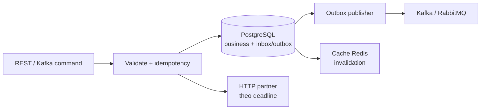

# Kiểm thử SQL với hệ quản trị thực tế và khác biệt dialect

## 1. Vì sao kiểm thử SQL trên H2 có thể cho kết quả sai?

Trong một hệ thống **Spring Boot Integration**, việc ghi dữ liệu qua JDBC hoặc jOOQ thường nằm giữa các bước gọi HTTP đối tác, cập nhật Redis, tiêu thụ Kafka/RabbitMQ hay phát sự kiện qua transactional outbox. Một câu SQL chạy đúng trên database giả lập nhưng thất bại trên PostgreSQL/MySQL ở production có thể làm hỏng cả luồng: giao dịch rollback ngoài ý muốn, sự kiện không được ghi, consumer xử lý trùng hoặc dữ liệu được đối soát sai.

Ví dụ một service nhận lệnh `ReserveStock` từ Kafka:

1. Đọc record và lấy `eventId`, `orderId`, `tenantId`.
2. Dùng JDBC/jOOQ kiểm tra event đã xử lý chưa và cập nhật tồn kho trong transaction.
3. Ghi outbox để công bố `StockReserved` sau khi DB commit.
4. Consumer hoặc HTTP API có thể retry cùng thao tác khi response/ACK thất lạc.

Điều quan trọng là **unique constraint, transaction isolation, row locking, SQL dialect và driver thật** phải làm đúng công việc. H2 chạy chế độ giả lập PostgreSQL hoặc một mock `JdbcTemplate` không chứng minh được những đặc tính đó.

**Nguyên tắc:** Với SQL có tác động nghiệp vụ, hãy kiểm thử ít nhất một lớp integration test trên **đúng DBMS và major version tương thích production**, dùng schema/migration thật và đường truy cập JDBC/jOOQ thật. Unit test với mock hay H2 vẫn có ích cho một phần logic nhanh, nhưng không thay thế được các kiểm thử xác nhận SQL semantics.

### Mục tiêu học tập

- Biết loại lỗi mà unit test và in-memory database không phát hiện.
- Dùng Testcontainers với Spring Boot để chạy JDBC/jOOQ test trên PostgreSQL hoặc MySQL thật.
- Kiểm chứng migration, schema, unique constraint, transaction, isolation và concurrency.
- Phân biệt **dialect SQL**, **khả năng render SQL của jOOQ** và **hành vi thực tế của DBMS**.
- Thiết kế bài test cho JSON, UPSERT, pagination, timestamp/time zone, locking và error mapping.
- Áp dụng vào HTTP–database–outbox–broker mà không khẳng định sai về tính nhất quán.

## 2. Các mức kiểm thử và bằng chứng mỗi mức cung cấp

| Mức | Dụng cụ | Chứng minh tốt | Không chứng minh |
| --- | --- | --- | --- |
| Unit test | Mockito, fake repository, mock DSL wrapper | Branch logic, mapping thuần, lỗi nghiệp vụ | SQL thực thi hay transaction/locking thật |
| SQL render test | jOOQ `DSL.using(SQLDialect.POSTGRES)`, SQL snapshot | SQL được jOOQ sinh theo một dialect | Query có thực sự chạy đúng trên server |
| DB integration test | Testcontainers PostgreSQL/MySQL, JdbcTemplate, DSLContext | DDL, constraint, codec, transaction và driver thực | Mạng production, backup, failover của cluster thật |
| Integration flow test | Spring Boot + DB container + broker/HTTP test server | Lối đi từ API/message tới DB/outbox, rollback và retry | Mọi trường hợp lỗi hạ tầng ở production |
| Staging/rehearsal | DBMS, version, collation, extension và topology gần production | Hiệu năng và đặc tính hạ tầng gần thực tế | Không bảo đảm tuyệt đối dưới toàn bộ traffic thực |

H2 "PostgreSQL compatibility mode" là **chế độ tương thích cú pháp/hành vi có giới hạn**, không phải PostgreSQL thật. Nó có thể chấp nhận một số câu lệnh nhưng khác ở JSONB, toán tử, lỗi unique constraint, lock contention, kiểu thời gian và query planner. Với jOOQ, việc nhìn thấy SQL được render thành công cũng không có nghĩa database sẽ chấp nhận hoặc trả kết quả đúng.

### 2.1. Dialect gồm những thứ gì?

*Dialect* không chỉ là từ khóa khác nhau. Một DBMS còn định nghĩa:

- Kiểu dữ liệu: `UUID`, `JSONB`, `TIMESTAMPTZ`, `BOOLEAN`, array, generated column.
- DDL và migration: identity/autoincrement, partial index, functional index, constraint.
- DML: `INSERT ... ON CONFLICT`, `ON DUPLICATE KEY UPDATE`, `MERGE`, `RETURNING`.
- Locking: `FOR UPDATE`, `SKIP LOCKED`, isolation, deadlock detection, gap/next-key lock.
- Matching/collation: so sánh hoa–thường, accent, trailing spaces, locale.
- NULL và ba giá trị logic; thứ tự NULL trong `ORDER BY`, tính duy nhất khi giá trị NULL.
- Hàm/thao tác trên thời gian, JSON, chuỗi, UUID và tìm kiếm.
- JDBC metadata, exception/SQLSTATE, batch behavior, generated keys và connection/session settings.

Một câu SQL "trông giống ANSI SQL" vẫn có thể khác về hành vi dưới engine và cấu hình khác. Đó là lý do test cần kiểm tra **kết quả, trạng thái cuối và cạnh tranh**, không chỉ xem có exception hay không.

## 3. Chọn DBMS cho môi trường test

Nếu production dùng PostgreSQL 16, điểm xuất phát hợp lý là image PostgreSQL 16.x được pin theo chính sách của dự án. Nếu production dùng MySQL 8, test SQL thật trên MySQL 8 tương ứng. Với hệ thống **hỗ trợ cả hai**, phải chạy một test matrix cho **mỗi dialect được hỗ trợ**, không chỉ render cùng jOOQ query dưới hai enum.

| Bối cảnh | Cấu hình test gợi ý |
| --- | --- |
| App dùng một PostgreSQL production | PostgreSQL container phiên bản phù hợp + migrations thật |
| App dùng một MySQL production | MySQL container phiên bản phù hợp + migrations/schema thật |
| Thư viện hỗ trợ PostgreSQL và MySQL | Hai nhóm test hoặc CI jobs độc lập, một nhóm cho mỗi engine |
| SQL thao tác outbox/lock/UPSERT | Chạy test transaction/concurrency trên DBMS đích |
| Kiểm tra parser/mapping thuần | Unit test nhanh, không cần khởi động container |
| Kiểm thử mạng/failover/HA | Môi trường chuyên biệt có cluster/replica, không chỉ một container |

Container không bắt buộc phải dùng trong mọi test. Nhưng **một container thực** giúp tạo dữ liệu có thể tái lập, độc lập với máy developer và không cần kết nối trực tiếp một database dùng chung có nguy cơ bị phá dữ liệu. Không dùng tài khoản có quyền vào DB production khi chạy test.

## 4. Spring Boot + Testcontainers + JDBC/jOOQ

Ví dụ tiếp theo dùng **Spring Boot 3.3+**, Java 17+, PostgreSQL và JUnit Jupiter. Nội dung minh họa API của Spring Boot Testcontainers, Spring JDBC và Spring jOOQ; khi áp dụng cần dùng BOM tương thích của đúng dự án.

### 4.1. Dependencies

```kotlin
// build.gradle.kts — versions do Spring Boot dependency management quản lý
implementation("org.springframework.boot:spring-boot-starter-jdbc")
implementation("org.springframework.boot:spring-boot-starter-jooq")
runtimeOnly("org.postgresql:postgresql")

// Ví dụ migration. Với Flyway mới cần kiểm tra module hỗ trợ PostgreSQL.
implementation("org.flywaydb:flyway-core")
implementation("org.flywaydb:flyway-database-postgresql")

testImplementation("org.springframework.boot:spring-boot-starter-test")
testImplementation("org.springframework.boot:spring-boot-testcontainers")
testImplementation("org.testcontainers:junit-jupiter")
testImplementation("org.testcontainers:postgresql")
```

Spring Boot có thể tự cấu hình `DataSource`, `JdbcTemplate` và `DSLContext` khi dependencies và cấu hình phù hợp. Nếu ứng dụng khai báo nhiều DataSource, transaction manager hoặc jOOQ Configuration riêng thì cần xác định bean nào tham gia test; tránh tưởng đang test PostgreSQL container nhưng thực tế DAO lại dùng embedded datasource khác.

### 4.2. Phụ thuộc thật qua @ServiceConnection

```java
import org.junit.jupiter.api.Test;
import org.springframework.beans.factory.annotation.Autowired;
import org.springframework.boot.test.context.SpringBootTest;
import org.springframework.boot.testcontainers.service.connection.ServiceConnection;
import org.springframework.jdbc.core.JdbcTemplate;
import org.testcontainers.containers.PostgreSQLContainer;
import org.testcontainers.junit.jupiter.Container;
import org.testcontainers.junit.jupiter.Testcontainers;

import static org.junit.jupiter.api.Assertions.assertEquals;

@SpringBootTest
@Testcontainers
class PostgreSqlSmokeIT {

    @Container
    @ServiceConnection
    static PostgreSQLContainer<?> postgres =
            new PostgreSQLContainer<>("postgres:16.4");

    @Autowired JdbcTemplate jdbc;

    @Test
    void connectsToRealPostgreSql() {
        String version = jdbc.queryForObject(
                "SELECT version()", String.class);
        org.junit.jupiter.api.Assertions.assertTrue(
                version.contains("PostgreSQL"));
        assertEquals(1, jdbc.queryForObject(
                "SELECT 1", Integer.class));
    }
}
```

Trong Spring Boot 3.1+, `@ServiceConnection` có thể tạo connection details từ container và để auto-configuration kết nối đúng DB. Phải có hỗ trợ Spring Boot Testcontainers trên classpath và container chạy được từ môi trường test. Nếu không dùng `@ServiceConnection`, có thể dùng `@DynamicPropertySource` để cung cấp `spring.datasource.url`, `username` và `password`; không nên đồng thời cấu hình hai nguồn khác nhau rồi dựa vào thứ tự ưu tiên ngẫu nhiên.

Smoke test này chỉ xác nhận **kết nối đúng PostgreSQL**. Nó chưa kiểm tra schema, jOOQ, transaction hoặc nghiệp vụ. Với Testcontainers phải bảo đảm Docker/runtime container sẵn sàng trong CI; nếu môi trường không cho phép Docker, dùng DB service cô lập được dựng sẵn và thông tin kết nối rõ, không âm thầm chuyển về H2.

### 4.3. Migration và jOOQ dialect

Ví dụ cấu hình dành cho những test có schema được tạo bằng Flyway:

```yaml
# Ví dụ application-test.yml
spring:
  jooq:
    sql-dialect: POSTGRES
  flyway:
    enabled: true
  sql:
    init:
      mode: never
```

`spring.jooq.sql-dialect` chọn cách jOOQ render SQL; nó **không biến PostgreSQL thành MySQL** hoặc ngược lại. Trong production, nên đồng bộ dialect với DBMS thật. Nếu không khai báo dialect, ứng dụng có thể suy ra từ JDBC metadata trong một số cấu hình, nhưng với nhiều datasource/driver cần xác minh rõ.

Migrations là **nguồn sự thật của schema**. Cấu trúc ví dụ, trong một migration PostgreSQL được quản lý bởi dự án:

```sql
CREATE TABLE purchase_orders (
    id BIGINT GENERATED BY DEFAULT AS IDENTITY PRIMARY KEY,
    order_id VARCHAR(80) NOT NULL UNIQUE,
    tenant_id VARCHAR(64) NOT NULL,
    external_ref VARCHAR(120) NOT NULL,
    status VARCHAR(24) NOT NULL,
    created_at TIMESTAMPTZ NOT NULL DEFAULT CURRENT_TIMESTAMP,
    CONSTRAINT uk_purchase_orders_tenant_ref
        UNIQUE (tenant_id, external_ref)
);

CREATE INDEX idx_purchase_orders_tenant_created
    ON purchase_orders (tenant_id, created_at, id);
```

Đây là **mẫu SQL nằm trong bài học**, không tạo file migration mới. Dự án thực tế nên đặt nó trong luồng migration tương ứng, chạy Flyway khi khởi tạo test context, rồi để JDBC/jOOQ truy cập cùng schema. Không để test tự gọi `CREATE TABLE IF NOT EXISTS` khác với migration production: nó dễ che giấu migration thiếu hoặc lệch cấu trúc.

Trong hệ thống dùng jOOQ code generation, generated classes phải được sinh từ **schema/version đúng**; có thể dùng database/schema đã migrate để sinh code trong pipeline build. Khi schema thay đổi, cần xác minh cả generated classes lẫn migration, không tự sửa generated code cho qua compile.

## 5. Kiểm thử unique constraint thực với JdbcTemplate

Một contract quan trọng trong tích hợp là **cùng một yêu cầu có idempotency key không được tạo hai đơn hàng**. Ràng buộc này nên được thực thi bằng unique constraint bền vững, không chỉ bằng `SELECT` trước khi `INSERT` trong ứng dụng.

Ví dụ test dưới đây giả định bảng `purchase_orders` đã được tạo bởi Flyway như phần 4:

```java
import org.junit.jupiter.api.BeforeEach;
import org.junit.jupiter.api.Test;
import org.springframework.beans.factory.annotation.Autowired;
import org.springframework.boot.test.context.SpringBootTest;
import org.springframework.boot.testcontainers.service.connection.ServiceConnection;
import org.springframework.dao.DuplicateKeyException;
import org.springframework.jdbc.core.JdbcTemplate;
import org.testcontainers.containers.PostgreSQLContainer;
import org.testcontainers.junit.jupiter.Container;
import org.testcontainers.junit.jupiter.Testcontainers;

import static org.junit.jupiter.api.Assertions.assertEquals;
import static org.junit.jupiter.api.Assertions.assertThrows;

@SpringBootTest
@Testcontainers
class PurchaseOrderJdbcIT {

    @Container
    @ServiceConnection
    static PostgreSQLContainer<?> postgres =
            new PostgreSQLContainer<>("postgres:16.4");

    @Autowired JdbcTemplate jdbc;

    @BeforeEach
    void reset() {
        jdbc.update("DELETE FROM purchase_orders");
    }

    @Test
    void enforcesIdempotencyKeyWithinTenant() {
        String sql = """
                INSERT INTO purchase_orders
                    (order_id, tenant_id, external_ref, status)
                VALUES (?, ?, ?, ?)
                """;

        jdbc.update(sql, "ORD-101", "tenant-a", "checkout-42", "NEW");

        assertThrows(DuplicateKeyException.class,
                () -> jdbc.update(sql,
                        "ORD-102", "tenant-a", "checkout-42", "NEW"));

        jdbc.update(sql, "ORD-103", "tenant-b", "checkout-42", "NEW");

        Integer count = jdbc.queryForObject(
                "SELECT count(*) FROM purchase_orders",
                Integer.class);
        assertEquals(2, count);
    }
}
```

Ở PostgreSQL, ràng buộc `UNIQUE (tenant_id, external_ref)` cho phép cùng `external_ref` ở **tenant khác**, nhưng từ chối trùng trong cùng tenant. `JdbcTemplate` thường chuyển lỗi unique constraint từ JDBC driver thành `DuplicateKeyException` thông qua Spring exception translation. Đây là một **assertion về hợp đồng xử lý lỗi**: khi chuyển DBMS hoặc Spring version, phải kiểm tra SQLSTATE và lớp exception thực tế.

Không đánh đồng unique constraint với idempotency hoàn chỉnh. Muốn trả lại **kết quả lần đầu** cho cùng idempotency key, service phải lưu/truy vấn trạng thái, fingerprint payload và response/operation state theo chính sách; không đơn giản bắt mọi `DuplicateKeyException` rồi trả thành công.

### 5.1. Vì sao SELECT rồi INSERT không đủ?

```text
Request A                    Request B
SELECT key K -> chưa có       SELECT key K -> chưa có
INSERT key K                 INSERT key K
COMMIT                       -> unique constraint từ chối
```

Hai request có thể cùng thấy "chưa tồn tại" nếu không khóa/constraint phù hợp. Một test tuần tự không phát hiện cuộc đua này. Hãy test nhiều request đồng thời, dùng connection/transaction thật và assertion cuối về số dòng. Với nghiệp vụ phức tạp, cần xử lý lỗi cạnh tranh thành kết quả idempotent phù hợp thay vì để lỗi DB lan ra HTTP 500 không được giải thích.

## 6. jOOQ: render SQL theo dialect nhưng luôn thực thi trên DBMS thật

jOOQ giúp xây SQL theo DSL có kiểu và có khả năng chuyển một số cấu trúc giữa nhiều dialect. Tuy nhiên, việc **render thành chuỗi SQL** không phải kiểm thử hành vi; phải chạy câu lệnh trên engine tương ứng.

### 6.1. Query JDBC và jOOQ trên cùng schema

Ví dụ dùng `DSLContext` được Spring Boot inject; để bài minh họa tự chứa, đặt field/table bằng `DSL.name(...)` thay vì dựa vào các class được codegen:

```java
import org.jooq.DSLContext;
import org.jooq.Field;
import org.jooq.Table;
import org.jooq.impl.DSL;
import org.springframework.jdbc.core.JdbcTemplate;

import static org.junit.jupiter.api.Assertions.assertEquals;

void verifyJooqQuery(DSLContext dsl, JdbcTemplate jdbc) {
    jdbc.update("""
            INSERT INTO purchase_orders
                (order_id, tenant_id, external_ref, status)
            VALUES (?, ?, ?, ?)
            """, "ORD-201", "tenant-a", "ref-201", "NEW");

    Table<?> orders = DSL.table(DSL.name("purchase_orders"));
    Field<String> orderId =
            DSL.field(DSL.name("order_id"), String.class);
    Field<String> status =
            DSL.field(DSL.name("status"), String.class);

    String actual = dsl.select(status)
            .from(orders)
            .where(orderId.eq("ORD-201"))
            .fetchSingle(status);

    assertEquals("NEW", actual);
}
```

Đây là **test body minh họa**, có thể đặt trong test class `@SpringBootTest` dùng container ở phần 4 hoặc 5. Test production-quality nên ưu tiên generated jOOQ tables/fields để có schema typing và phát hiện lỗi đổi tên cột khi compile. Nhưng ngay cả generated code khớp schema, dữ liệu runtime vẫn có thể gây lỗi constraint hoặc type conversion mà chỉ DB integration test mới chỉ ra.

### 6.2. Render test để theo dõi SQL mà jOOQ sinh

```java
import org.jooq.SQLDialect;
import org.jooq.impl.DSL;

String sqlForPostgres = DSL.using(SQLDialect.POSTGRES)
        .select(DSL.field(DSL.name("order_id")))
        .from(DSL.table(DSL.name("purchase_orders")))
        .where(DSL.field(DSL.name("status")).eq("NEW"))
        .getSQL();
```

Render test giúp phát hiện SQL bị đổi khi nâng cấp jOOQ, thay cấu trúc DSL hoặc thay dialect. Nó **không chứng minh** query hoạt động trên server, index phù hợp, trường hợp NULL đúng hoặc transaction có hành vi mong muốn. Ngoài ra SQL có bind parameters, tên identifier/quotation và cách format phụ thuộc Settings, dialect và phiên bản; snapshot test nên chú ý những phần này và tránh so sánh whitespace không cần thiết.

Trong dự án hỗ trợ cả PostgreSQL/MySQL, có thể render cùng query dưới `SQLDialect.POSTGRES` và `SQLDialect.MYSQL`, nhưng vẫn phải **thực thi mỗi biến thể trên DBMS tương ứng**. Không nên coi mọi phép chuyển đổi jOOQ đều tương đương về semantics và hiệu năng.

## 7. Khác biệt dialect quan trọng cần đưa vào test matrix

| Chủ đề | PostgreSQL | MySQL (ví dụ 8.x) | Kiểm thử cần có |
| --- | --- | --- | --- |
| UPSERT | `INSERT ... ON CONFLICT ... DO UPDATE` | `INSERT ... ON DUPLICATE KEY UPDATE` | Chọn đúng unique key, số dòng và kết quả |
| Returning | `INSERT/UPDATE ... RETURNING` | Không tương đương hoàn toàn với PostgreSQL `RETURNING` trong MySQL 8 thông dụng | Lấy generated ID/giá trị cập nhật thế nào |
| JSON | `JSONB`, toán tử `->`, `->>` và hàm tương ứng | `JSON`, `JSON_EXTRACT` và JSON path | Parse, truy vấn nested fields, null/missing |
| UUID | Kiểu `UUID` native | Thường `CHAR(36)` hoặc `BINARY(16)` tùy thiết kế | Serialize/bind/collation/index |
| Thời gian | `TIMESTAMPTZ`, `TIMESTAMP` | `TIMESTAMP`, `DATETIME` với semantics/time zone riêng | Chuyển UTC và precision |
| Identity | `GENERATED ... AS IDENTITY` / sequence | `AUTO_INCREMENT` | Generated key và sequence semantics |
| Lock | `FOR UPDATE`, `SKIP LOCKED` | `FOR UPDATE`, `SKIP LOCKED` có hành vi engine/isolation riêng | Cạnh tranh worker và lock timeout |
| Identifier case | Quy tắc folding/quoted identifier của PostgreSQL | Còn chịu ảnh hưởng hệ điều hành và biến như `lower_case_table_names` | Đặt tên/case trong migration và jOOQ |
| Collation | Theo collation/ICU/locale được cấu hình | Theo charset/collation của schema/cột | So sánh email/username/Unicode |
| NULL ordering | Mặc định tùy ASC/DESC; có `NULLS FIRST/LAST` | Mặc định khác; có thể cần biểu thức điều chỉnh | Pagination/sort ổn định |
| DDL và transaction | Nhiều DDL có thể chạy trong transaction | Nhiều DDL gây implicit commit | Migration rollback/failure |
| Deadlock/serialization | SQLSTATE và exception theo PostgreSQL | Error code/SQLSTATE theo MySQL | Chọn retry policy đúng |

Đây là bảng định hướng; **từng phiên bản và database mode** có thể bổ sung/giới hạn tính năng. Ví dụ MariaDB và MySQL không phải cùng một sản phẩm dù nhiều câu SQL giống nhau; SQL Server, Oracle và H2 còn có các semantics khác. Với phiên bản jOOQ cụ thể, kiểm tra cả license/edition và dialect được hỗ trợ theo nhu cầu dự án.

## 8. UPSERT: syntax khác và phạm vi conflict khác

Một outbox consumer hoặc command handler thường muốn thêm bản ghi nếu chưa tồn tại và xử lý trùng có chủ đích.

### 8.1. PostgreSQL

```sql
INSERT INTO purchase_orders
    (order_id, tenant_id, external_ref, status)
VALUES ('ORD-301', 'tenant-a', 'checkout-301', 'NEW')
ON CONFLICT (tenant_id, external_ref)
DO UPDATE SET status = EXCLUDED.status
RETURNING order_id, status;
```

### 8.2. MySQL

```sql
INSERT INTO purchase_orders
    (order_id, tenant_id, external_ref, status)
VALUES ('ORD-301', 'tenant-a', 'checkout-301', 'NEW')
ON DUPLICATE KEY UPDATE
    status = 'NEW';
```

**Không coi hai câu này tương đương tuyệt đối.** PostgreSQL chỉ định conflict target cụ thể. MySQL `ON DUPLICATE KEY UPDATE` có thể kích hoạt khi va chạm **bất kỳ UNIQUE/PRIMARY KEY phù hợp** và cách báo affected rows có quy tắc riêng. Nếu bảng có nhiều unique constraints, dữ liệu va chạm có thể cập nhật bản ghi **khác dự kiến**. Hệ thống idempotency nên tìm đúng bản ghi theo khóa nghiệp vụ sau conflict và kiểm tra payload fingerprint, không dựa hoàn toàn vào số dòng được update.

### Những test UPSERT nên có

1. Insert lần đầu.
2. Insert lại cùng idempotency key với payload giống hệt.
3. Insert cùng key nhưng payload khác — **phải từ chối theo hợp đồng**, không âm thầm ghi đè.
4. Va chạm một unique constraint khác, ví dụ `order_id`, ngoài key idempotency.
5. Hai transaction đồng thời cùng key.
6. Transaction rollback/retry và kiểm tra cuối cùng chỉ có một nghiệp vụ hợp lệ.

Với jOOQ, DSL `onConflict(...)` có thể render khác nhau tùy dialect; test **render** chỉ giúp xem SQL, test **DB thật** mới chứng minh side effects và conflict target đúng. Không thiết kế nghiệp vụ dựa trên một behavior chỉ tình cờ đúng với PostgreSQL nhưng sai ở MySQL.

## 9. Transaction, isolation và concurrency phải kiểm tra dưới tải cạnh tranh

### 9.1. Transaction local và @Transactional trong Spring

`@Transactional` điều khiển transaction của datasource/manager được chọn, ví dụ `DataSourceTransactionManager`. JDBC/jOOQ chỉ tham gia cùng transaction khi chúng dùng cùng `DataSource`/connection được Spring quản lý và wiring tương thích. Một lệnh Redis, HTTP request hoặc Kafka send **không mặc nhiên rollback cùng JDBC transaction**.

Trong Spring Boot Integration, một pattern an toàn là cập nhật business table và outbox cùng transaction DB, sau đó publisher riêng gửi Kafka. Khi Kafka ACK mất, publisher có thể phát lại cùng `eventId`; consumer cần dedup.

### 9.2. Không lạm dụng @Transactional trên test

Với Spring Test, `@Transactional` trên test method thường khiến dữ liệu **rollback sau test**. Điều này tiện vệ sinh nhưng có thể che khuất lỗi chỉ xuất hiện ở **commit time**, ví dụ deferred constraints hoặc transaction boundary sai. Nó cũng có thể làm lệnh test và ứng dụng thực thi trong cùng một transaction không giống production.

Khi kiểm thử **commit/rollback thực**:

- Để service under test tự mở transaction theo production.
- Không mặc định gắn `@Transactional` cho toàn test.
- Làm sạch bằng fixture có kiểm soát, schema riêng hoặc transaction chuyên dụng.
- Xác minh dữ liệu từ một **connection/transaction mới** sau khi service return.
- Kiểm tra cả timeout, exception và trạng thái sau rollback.

### 9.3. Lost update và row locking

Một test tuần tự:

```text
T1 đọc stock=10 -> T1 ghi stock=9 -> commit
T2 đọc stock=9  -> T2 ghi stock=8 -> commit
```

không phát hiện lost update. Tình huống race:

```text
T1 đọc stock=10       T2 đọc stock=10
T1 tính 9             T2 tính 9
T1 UPDATE stock=9     T2 UPDATE stock=9
Kết quả: 9, đáng lẽ là 8 nếu hai reservation đều thành công
```

Cách giảm rủi ro:

- Cập nhật nguyên tử: `UPDATE stock SET quantity=quantity-1 WHERE sku=? AND quantity>=1` rồi kiểm tra affected rows.
- Optimistic locking với `version`: `UPDATE ... WHERE version=?`, xử lý zero rows thành conflict/retry có giới hạn.
- Pessimistic locking: `SELECT ... FOR UPDATE` trong transaction khi cần.
- Isolation/serializable phù hợp và retry serialization failure đúng cách.

Chạy test concurrency thật với hai connection/transaction và đồng bộ thời điểm chúng truy cập DB. Tránh dùng `Thread.sleep()` làm chứng cứ chính vì dễ flaky; dùng `CountDownLatch`/`CyclicBarrier`, executor có giới hạn, timeout test và xác nhận trạng thái cuối. Đặt isolation level/lock timeout phù hợp DBMS đích; PostgreSQL và MySQL có semantics về snapshot, gap locks, predicate locks khác nhau.

### 9.4. SKIP LOCKED cho outbox worker

PostgreSQL cho phép một publisher chọn một batch outbox chưa được worker khác giữ khóa:

```sql
BEGIN;
SELECT event_id, aggregate_id, payload
FROM outbox_events
WHERE published_at IS NULL
ORDER BY created_at, event_id
LIMIT 50
FOR UPDATE SKIP LOCKED;
-- Claim/đổi trạng thái xử lý theo thiết kế rồi COMMIT.
COMMIT;
```

`SKIP LOCKED` giúp nhiều worker tránh chờ cùng hàng đang khóa, nhưng **không cam kết fairness hoặc thứ tự phát toàn cục**. Câu lệnh cần nằm trong transaction đủ để việc chọn và claim có hiệu lực; nếu đọc rồi commit mà chưa đánh dấu claim, worker khác có thể lấy lại cùng event. Đừng giữ transaction DB mở xuyên một lần gửi Kafka chậm nếu không cần; dùng claim/lease có thời hạn và publisher idempotent, kiểm soát thứ tự aggregate theo thiết kế.

MySQL cũng có `SKIP LOCKED` trong các phiên bản hỗ trợ nhưng hành vi isolation/locking phải được kiểm thử thực tế. Nếu dùng jOOQ cho câu truy vấn này, phải xem SQL được render và tính đúng đắn khi nhiều worker đọc song song.

## 10. Kiểu dữ liệu, null và thời gian: bug chỉ lộ trên DB thật

### 10.1. Kiểu thời gian

- PostgreSQL `TIMESTAMPTZ` lưu mốc thời gian, hiển thị tùy session time zone; không lưu nguyên tên múi giờ người dùng.
- PostgreSQL `TIMESTAMP WITHOUT TIME ZONE` không hàm ý UTC; ứng dụng phải định nghĩa rõ ý nghĩa.
- MySQL `TIMESTAMP` và `DATETIME` có cách chuyển đổi theo time zone, range và precision khác nhau.
- JDBC/jOOQ dùng `Instant`, `OffsetDateTime`, `LocalDateTime` tùy mapping/column/driver; chọn kiểu theo **ngữ nghĩa** chứ không đoán từ tên Java.

Nên test các mốc giờ quanh midnight, daylight saving time, timestamp có fractional seconds và session time zone khác nhau. Khi lưu sự kiện tích hợp, thường chuẩn hóa một mốc UTC cho `occurredAt`, nhưng vẫn cần quy định độ chính xác (milliseconds/microseconds) và serialization JSON.

### 10.2. JSON, NULL và giá trị thiếu

`JSONB` PostgreSQL không giống hoàn toàn `JSON` MySQL. Test riêng:

- JSON object chứa key thiếu, key có giá trị JSON `null` và cột SQL `NULL`.
- So sánh/tìm kiếm nested field và array.
- Index JSON/functional index và chi phí query.
- Deserialization qua JDBC/jOOQ, xử lý encoding Unicode, số rất lớn và enum/version.
- Schema migration với payload cũ; consumer hoặc outbox không được hiểu sai trường thiếu.

Trong SQL, điều kiện `col = NULL` không trả TRUE; dùng `IS NULL` hoặc DSL tương ứng. Với unique constraint chứa nullable fields, hành vi NULL có thể khiến nhiều hàng có "giá trị khóa" trùng logic mà DB vẫn chấp nhận. Nếu key idempotency bắt buộc, cột cần `NOT NULL` và unique constraint phù hợp.

### 10.3. Collation, Unicode và chữ hoa–thường

Một email hoặc mã khách hàng có thể so sánh khác nhau tùy collation. Chẳng hạn một DB so sánh case-insensitive, DB khác mặc định case-sensitive; MySQL collation phụ thuộc schema/cột, PostgreSQL có các lựa chọn collation/extension khác. Không suy ra rằng `Alice` và `alice` được coi là cùng một khóa ở mọi DBMS.

Nếu nghiệp vụ cần mã chuẩn hóa:

1. Định nghĩa canonicalization rõ ràng (case/Unicode/trim) theo hợp đồng dữ liệu.
2. Lưu giá trị chuẩn hóa/unique key riêng khi phù hợp.
3. Dùng index/constraint tương ứng.
4. Kiểm thử trên DB có **collation thực tế** và các ví dụ Unicode, accent, trailing spaces.

Không tự coi "lowercase tất cả" là giải pháp cho tên người dùng quốc tế hoặc địa chỉ email; tính đúng đắn phụ thuộc quy tắc nhận diện của hệ thống.

## 11. Pagination, ORDER BY và kết quả không ổn định

Một endpoint GET `/orders` có thể được Spring MVC gọi qua JDBC/jOOQ. Lệnh:

```sql
SELECT order_id, created_at, status
FROM purchase_orders
WHERE tenant_id = ?
LIMIT 20 OFFSET 40;
```

**không bảo đảm thứ tự** nếu thiếu `ORDER BY`. Hai lần chạy có thể trả hai tập hàng khác khi query plan thay đổi, đặc biệt sau insert/compact/index updates. Khi thêm `ORDER BY created_at` mà nhiều dòng trùng timestamp, thứ tự vẫn chưa ổn định. Nên dùng tie-breaker:

```sql
SELECT order_id, created_at, status
FROM purchase_orders
WHERE tenant_id = ?
ORDER BY created_at DESC, id DESC
LIMIT 20 OFFSET 40;
```

Với trang dữ liệu biến động mạnh hoặc offset lớn, cân nhắc keyset/cursor pagination và xác định ngữ nghĩa snapshot. Test chèn bản ghi giữa hai lần phân trang, xử lý NULL, timezone, sort direction và giới hạn số hàng. jOOQ có DSL cho `orderBy`/`limit`/`offset` và seek pagination, nhưng phải xác minh order/NULL semantics ở DBMS mục tiêu.

Đừng dùng thứ tự trả về "trên máy tôi luôn đúng" làm hợp đồng tích hợp giữa DB và broker: thứ tự Kafka theo partition cũng cần thiết kế record key và version ở cấp aggregate riêng.

## 12. JDBC exception translation và xử lý lỗi xuyên dialect

SQL driver trả `SQLException` với SQLSTATE, vendor error code và thông điệp riêng. Spring JDBC có thể dịch những lỗi này thành hierarchy `DataAccessException`, ví dụ `DuplicateKeyException` hoặc `DeadlockLoserDataAccessException` trong những cấu hình/tình huống phù hợp.

**Tuyệt đối không dựa vào text thông báo lỗi của server** để quyết định retry hay hiện lỗi ra HTTP. Ngôn ngữ, phiên bản và chi tiết lỗi có thể thay đổi; log nguyên SQL/value còn có thể lộ dữ liệu cá nhân.

Ví dụ phân loại ở tầng repository/service:

| Loại lỗi | Hành vi |
| --- | --- |
| Unique constraint của idempotency key | Tìm kết quả đã xử lý hoặc trả conflict theo hợp đồng |
| Validation/foreign key/not-null | Sửa dữ liệu/hợp đồng, thường không retry |
| Deadlock/serialization failure | Có thể retry **toàn transaction** với backoff, giới hạn attempts và idempotency |
| Query timeout / connection failure | Tạm thời; chưa biết transaction đã commit hay chưa → kiểm tra trạng thái |
| Lỗi migration/schema | Lỗi triển khai; không retry nóng liên tục như lỗi mạng |
| Out-of-disk/permission | Can thiệp vận hành, circuit breaker/fail có kiểm soát |

PostgreSQL có mã SQLSTATE như `23505` cho unique violation, `40001` cho serialization failure và `40P01` cho deadlock. MySQL có error code/vendor convention khác, ví dụ duplicate key `1062`, deadlock `1213`. Những con số này hữu ích để hiểu log/test, nhưng code ứng dụng nên dùng abstraction/translation nhất quán đã được kiểm chứng trên **từng DBMS** mà nó thực sự hỗ trợ.

Retry một transaction có `INSERT`, `UPDATE`, outbox write thường an toàn khi business key và constraint được thiết kế đúng; nhưng **không** retry một transaction đã gọi HTTP payment/email mà chưa xác định tác dụng phụ bên ngoài. Khi cần nghiệp vụ đúng sau timeout, dùng command ID và đối soát thay vì đoán commit dựa trên exception.

## 13. Tích hợp DB, HTTP, cache và broker: test kịch bản thay vì từng query



Nên có ít nhất các integration tests sau:

1. **HTTP POST retry:** client gửi cùng idempotency key sau timeout; database chỉ có một business record. Nếu payload khác với key cũ, hệ thống trả conflict.
2. **Kafka redelivery:** consumer nhận lại cùng `eventId`; unique constraint ở inbox/processed_events chặn side effect lặp.
3. **DB rollback:** khi insert outbox lỗi hoặc constraint fail, business update cùng transaction rollback; không có record nửa vời.
4. **Outbox publisher crash:** sau Kafka ACK nhưng trước mark published, event có thể được gửi lại cùng ID; downstream dedup.
5. **Redis lỗi:** cache miss hoặc invalidation failure không làm service kết luận sai đơn đã commit; chính sách degraded được định nghĩa rõ.
6. **Hai workers đồng thời:** cạnh tranh claim outbox hoặc cập nhật tồn kho, kiểm tra locking/version và số side effects.
7. **Migration nâng cấp:** dữ liệu cũ được đọc/ghi sau migration, các instance cũ/mới tương thích trong giai đoạn rollout nếu đó là yêu cầu.

Không dùng `@Transactional` để kéo Kafka, Redis hoặc HTTP vào cùng transaction DB theo suy luận. Spring transaction manager chỉ điều khiển những resource có cơ chế tham gia tương ứng; sự nhất quán xuyên hệ thống cần outbox/inbox, idempotency, saga hoặc đối soát.

## 14. Thiết kế Testcontainers và CI chạy được lâu dài

### 14.1. Tách test nhanh và test có DB

| Nhóm | Chạy khi nào | Gợi ý |
| --- | --- | --- |
| Unit | Mỗi commit/PR | Mock domain dependencies, không cần Docker |
| DB integration | Mỗi PR hoặc pipeline được xác định | Testcontainers, migration, JDBC/jOOQ thật |
| Multi-dialect matrix | Mỗi PR nếu hỗ trợ nhiều DB; nếu đắt thì lịch rõ và trước release | Jobs riêng cho PostgreSQL/MySQL |
| Load/concurrency | Staging hoặc CI chuyên biệt | Dataset lớn, contention, EXPLAIN/locks |
| Failover/upgrade | Theo đợt và trước thay DB version | Backup/restore, replication, network faults |

### 14.2. Các nguyên tắc ổn định

- Pin DB image/version theo chính sách và cập nhật có kiểm thử; không dựa vào `latest` không xác định.
- Mỗi test hoặc test class có dữ liệu độc lập, cleanup đáng tin; tránh dùng DB test chung giữa nhiều nhánh CI.
- Đừng dùng `Thread.sleep()` để kiểm soát race; dùng synchronization primitives và timeout rõ.
- Không lạm dụng `@DirtiesContext` vì restart toàn context tốn thời gian; ưu tiên dữ liệu test riêng và cleanup.
- TestContainers shared/static container chỉ dùng khi phù hợp; bảo đảm DB state không rò giữa test classes chạy song song.
- Dùng migration thật trước fixture; phát hiện schema drift sớm.
- Test SQL có thứ tự yêu cầu phải có `ORDER BY`, không phụ thuộc physical row order.
- Capture SQL/driver error đủ chẩn đoán nhưng mask bind values, token hoặc dữ liệu cá nhân.
- Cấu hình session time zone, search_path/schema, collation, SQL mode và JDBC URL sát production khi chúng ảnh hưởng hành vi.
- Khi DB production có extension (PostGIS, pg_trgm, custom collation...) thì image test phải có extension tương ứng, không dùng vanilla image rồi bỏ test đặc thù.

### 14.3. Ví dụ lệnh chạy trong dự án

```bash
# Ví dụ lệnh cho môi trường đã cấu hình Docker và Gradle.
# Tên task là quy ước dự án; có thể là test hoặc integrationTest.
./gradlew test
./gradlew integrationTest
```

Đây là **minh họa cho bài học**, không phải lệnh Worker thực thi trong Step 4. Dự án có thể dùng Maven, Gradle hoặc CI job riêng. Nếu chưa có task `integrationTest`, cần cấu hình task/source set tương ứng thay vì giả định task tự tồn tại. Không chạy một test mất trạng thái trên database sản xuất.

## 15. Kịch bản thực hành tổng hợp

Một API `POST /orders` nhận `tenantId` đã xác thực, `idempotencyKey` và dữ liệu đơn; transaction ghi `purchase_orders` và `outbox_events`. Sau commit, publisher gửi event sang Kafka. Ứng dụng phải chạy trên PostgreSQL; về sau đội phát triển muốn thêm khả năng hỗ trợ MySQL.

Hãy xây dựng bộ test:

1. Tạo schema theo Flyway migrations thực, bật container PostgreSQL và xác minh version từ `SELECT version()`.
2. Test `UNIQUE(tenant_id, external_ref)` với dữ liệu trùng trong một tenant và hợp lệ ở tenant khác.
3. Dùng JDBC và jOOQ đọc cùng record, xác minh mapping `TIMESTAMPTZ`/Java time và sort ổn định.
4. Chạy hai transaction đồng thời với cùng idempotency key, khẳng định chỉ một business record và một outbox event logic.
5. Ép outbox insert lỗi, xác minh business row rollback khi transaction commit thất bại.
6. Cho publisher phát lại cùng event ID sau giả lập mất ACK; consumer có inbox dedup.
7. Render jOOQ DSL theo PostgreSQL/MySQL, nhưng **chạy hai nhóm test độc lập với PostgreSQL và MySQL thật** trước khi tuyên bố support.
8. Trên MySQL, tập trung vào UPSERT khác conflict target, timestamp/JSON/collation, generated ID và lock behavior.
9. Kiểm tra query plan với dữ liệu có kích thước tương đối thực tế; một câu SQL đúng về logic vẫn có thể gây full scan và nghẽn pool khi lưu lượng tăng.

**Câu hỏi phản biện:** Nếu jOOQ render được cùng một query dưới `SQLDialect.MYSQL`, có đủ căn cứ nói ứng dụng hỗ trợ MySQL không? **Không.** Còn cần schema/migration tương thích, thực thi và kiểm tra lỗi, concurrency, transaction, type mapping, hiệu năng và tất cả đường tích hợp phụ thuộc query đó.

## 16. Checklist trước khi đưa SQL tích hợp lên production

- [ ] DB integration tests chạy trên DBMS và major version tương thích production, không chỉ H2.
- [ ] Test context dùng đúng datasource/container; schema được tạo bởi migrations thực.
- [ ] jOOQ dialect, generated code, JDBC driver và cấu hình session/schema được xác minh.
- [ ] Unique/foreign key/not-null/check constraints được test bằng lỗi thật; idempotency không chỉ là `SELECT-before-INSERT`.
- [ ] UPSERT conflict target, generated keys, `RETURNING` và affected rows được test ở từng dialect.
- [ ] Test JSON/JSONB, UUID, NULL, timestamp/time zone, Unicode, collation và precision theo dữ liệu thực tế.
- [ ] Các query phân trang/sắp xếp dùng `ORDER BY` ổn định, có tie-breaker và test concurrent writes.
- [ ] Có test hai transaction cạnh tranh, deadlock/serialization failure, lock timeout và optimistic/pessimistic locking.
- [ ] Giao dịch DB business + outbox/inbox đúng boundary; HTTP/Redis/Kafka không bị hiểu nhầm là cùng transaction.
- [ ] Retry thực thi lại toàn transaction khi an toàn, với backoff/idempotency và không nhân đôi side effect bên ngoài.
- [ ] Error mapping từ JDBC/jOOQ được kiểm chứng trên DB thực; không dựa vào chuỗi message lỗi.
- [ ] CI quản lý image/version, cleanup/isolation, giới hạn concurrency và khả năng container runtime.
- [ ] Metrics theo dependency/operation/outcome có cardinality thấp; SQL logs mask dữ liệu nhạy cảm và trace đủ điều tra.
- [ ] Khi thêm DB dialect mới, chạy đầy đủ test matrix và migration compatibility thay vì chỉ đổi `SQLDialect`.

**Kết quả mong muốn:** SQL do JDBC hoặc jOOQ thực hiện phải được chứng minh trên **engine, schema và driver thực tế**, dưới cả đường chạy bình thường lẫn cạnh tranh/lỗi. Khi cùng logic được triển khai trên nhiều DBMS, các khác biệt về cú pháp, kiểu dữ liệu, transaction, locking và error handling phải trở thành **test case có bằng chứng**, không phải giả định dựa trên vẻ ngoài giống nhau của SQL.
