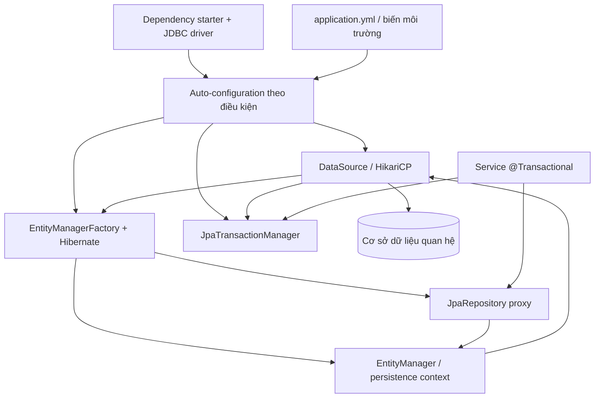

# spring-boot-starter-data-jpa và các thành phần được cấu hình tự động

> **Chương:** JPA và Hibernate  
> **Phạm vi:** Trong module **SPRING_BOOT_INTEGRATION**, Spring Data JPA là một adapter kết nối ứng dụng Spring Boot với cơ sở dữ liệu quan hệ. Bài này tập trung vào những thành phần được tạo tự động, cách chúng phối hợp khi đọc/ghi dữ liệu và cách vận hành an toàn trong các luồng tích hợp HTTP, cơ sở dữ liệu, cache và broker thông điệp.

## 1. Starter giải quyết vấn đề gì?

Khi xây dựng một dịch vụ tích hợp, ứng dụng thường phải ghi lại trạng thái xử lý, đối chiếu mã nghiệp vụ từ hệ thống ngoài, hoặc lưu bản ghi chống xử lý trùng lặp. Tự cấu hình JDBC connection pool, JPA provider, `EntityManagerFactory`, transaction manager và repository cho mỗi dịch vụ rất dễ dẫn đến cấu hình thiếu hoặc không đồng nhất.

Thêm dependency **`spring-boot-starter-data-jpa`** giúp Spring Boot nhận diện các thư viện liên quan và kích hoạt *auto-configuration* khi thỏa điều kiện. Từ đó lập trình viên tập trung định nghĩa **entity**, **repository**, **ranh giới giao dịch** và quy tắc nghiệp vụ.

Cần phân biệt bốn lớp trách nhiệm:

| Thành phần | Vai trò | Có phải cùng một thứ? |
| --- | --- | --- |
| **JPA / Jakarta Persistence** | Đặc tả ánh xạ đối tượng–quan hệ: `@Entity`, `EntityManager`, persistence context, JPQL | Là API/đặc tả, không tự triển khai truy vấn SQL |
| **Hibernate ORM** | JPA provider thường được starter chọn; quản lý entity, dirty checking, sinh SQL, lazy loading | Là implementation của JPA, có thêm tính năng riêng |
| **Spring Data JPA** | Tạo implementation cho repository interface, hỗ trợ `JpaRepository`, derived query, `@Query`, phân trang | Dùng JPA provider ở tầng dưới |
| **Spring Boot auto-configuration** | Dựa trên classpath, properties và bean hiện có để khởi tạo hạ tầng | Là cơ chế cấu hình, không thay thế thiết kế dữ liệu |

`spring-boot-starter-data-jpa` **không** tự cung cấp một máy chủ cơ sở dữ liệu, không tự quyết định mô hình dữ liệu nghiệp vụ, và không tự tích hợp HTTP client, Redis hay message broker. Những phần đó cần dependency, cấu hình và hợp đồng riêng.

## 2. Dependency và điều kiện khởi động

Ví dụ ứng dụng Maven sử dụng PostgreSQL:

```xml
<dependencies>
    <dependency>
        <groupId>org.springframework.boot</groupId>
        <artifactId>spring-boot-starter-data-jpa</artifactId>
    </dependency>
    <dependency>
        <groupId>org.postgresql</groupId>
        <artifactId>postgresql</artifactId>
        <scope>runtime</scope>
    </dependency>
</dependencies>
```

Starter thông thường đưa vào classpath Spring Data JPA, Hibernate ORM, Spring ORM, Spring Transaction, Spring JDBC và một JDBC connection pool (thường là HikariCP). Các module con cụ thể có thể khác nhau giữa các phiên bản Spring Boot; dùng dependency tree của dự án để kiểm chứng khi nâng cấp.

Trong tình huống điển hình, Spring Boot cần:

1. Thư viện liên quan có mặt trên classpath.
2. Có driver JDBC và thông tin kết nối, hoặc một embedded database được nhận diện.
3. Ứng dụng chưa định nghĩa bean tùy biến thay thế một số bean mà auto-configuration định tạo.
4. Package chứa entity và repository nằm trong phạm vi quét, hoặc được khai báo rõ.

Auto-configuration sử dụng các điều kiện như `@ConditionalOnClass`, `@ConditionalOnBean` và `@ConditionalOnMissingBean`. Vì vậy, **thêm starter không bảo đảm mọi bean trong bảng dưới đây đều xuất hiện** nếu điều kiện chưa đáp ứng.

## 3. Những thành phần được cấu hình tự động

| Thành phần | Chức năng | Nguồn cấu hình / điều kiện đáng chú ý |
| --- | --- | --- |
| `DataSource` | Cung cấp JDBC connection tới DB | `spring.datasource.*`, driver trên classpath; thường sử dụng HikariCP |
| `EntityManagerFactory` | Tạo `EntityManager` và quản lý metadata ánh xạ entity | Entity được quét, Hibernate, các thuộc tính `spring.jpa.*` |
| `JpaVendorAdapter` và Hibernate JPA provider | Kết nối cơ chế JPA với Hibernate, điều chỉnh các thiết lập phù hợp | Thư viện Hibernate và cấu hình JPA |
| `JpaTransactionManager` / `PlatformTransactionManager` | Bắt đầu, commit, rollback giao dịch JPA, liên kết `EntityManager` với luồng thực thi | Hạ tầng JPA và bean transaction manager hiện có |
| Spring Data repository proxy | Triển khai interface kế thừa `Repository` / `JpaRepository`; thực thi CRUD, query method | Repository scan, JPA infrastructure |
| `EntityManager` dùng qua `@PersistenceContext` | Điểm truy cập persistence context do Spring quản lý | `EntityManagerFactory`, ngữ cảnh giao dịch |
| Dịch vụ chuyển đổi ngoại lệ persistence | Chuyển một số ngoại lệ tầng dữ liệu sang hệ `DataAccessException` của Spring | Tầng Spring ORM / repository |
| Open EntityManager in View (nếu bật và phù hợp ứng dụng web) | Giữ `EntityManager` có thể dùng trong giai đoạn dựng response web | `spring.jpa.open-in-view`; không kéo dài một transaction xuyên suốt request |

Các lớp auto-configuration thường gặp trong Spring Boot 3.x gồm `DataSourceAutoConfiguration`, `HibernateJpaAutoConfiguration` và `JpaRepositoriesAutoConfiguration`. Tên/lát cắt cấu hình có thể thay đổi theo dòng phiên bản; điều cần nắm là **điều kiện tạo bean và hành vi thực tế**.

### Luồng phụ thuộc từ lúc khởi động đến lúc xử lý truy vấn



**Đường đi khi ứng dụng chạy:** Controller hoặc message handler gọi service → interceptor của `@Transactional` mở hoặc tham gia transaction → repository proxy dùng `EntityManager` → Hibernate chuẩn bị SQL → JDBC lấy connection từ `DataSource` → cơ sở dữ liệu thực thi → transaction commit/rollback. Hibernate có thể trì hoãn SQL đến thời điểm *flush*, vì vậy `save()` không đồng nghĩa mọi thay đổi đã được commit.

## 4. Cấu hình mẫu cho một hệ thống tích hợp

Giả sử dịch vụ nhận đơn hàng từ một hệ thống đối tác và lưu một bản ghi theo `externalId`. Sử dụng PostgreSQL với schema được quản lý bằng migration (Flyway/Liquibase hoặc một cơ chế migration đã chọn):

```yaml
spring:
  datasource:
    url: ${DB_URL}
    username: ${DB_USER}
    password: ${DB_PASSWORD}
    hikari:
      maximum-pool-size: 10
  jpa:
    open-in-view: false
    hibernate:
      ddl-auto: validate
    properties:
      hibernate:
        jdbc:
          time_zone: UTC
  sql:
    init:
      mode: never
```

- `spring.datasource.*` thiết lập nguồn kết nối. Lưu credential trong biến môi trường hoặc secret store; không đưa mật khẩu thật vào mã nguồn.
- `spring.datasource.hikari.maximum-pool-size` giới hạn connection tối đa của pool; giá trị phải được tính theo concurrency, thời gian giữ connection và giới hạn DB, không sao chép máy móc giữa các môi trường.
- `spring.jpa.hibernate.ddl-auto=validate` yêu cầu Hibernate kiểm tra schema phù hợp entity khi khởi động. Với hệ thống production, nên dùng migration có phiên bản thay vì để Hibernate tự `create` / `update` schema.
- `spring.jpa.open-in-view=false` giúp bộc lộ rõ ranh giới truy cập dữ liệu. Nếu response cần quan hệ lazy, hãy fetch và ánh xạ sang DTO trong service transaction.
- `spring.sql.init.mode=never` tắt cơ chế khởi tạo bằng `schema.sql` / `data.sql` khi dùng pipeline migration riêng. Đây là lựa chọn của ví dụ, không phải yêu cầu của JPA.
- `spring.jpa.properties.hibernate.*` chuyển thuộc tính provider cho Hibernate; tránh lạm dụng cấu hình gắn chặt vào vendor nếu không có nhu cầu thực tế.

Nếu chỉ thử nghiệm nhanh, có thể dùng H2 và một chiến lược DDL thích hợp cho môi trường test. Không suy ra rằng truy vấn chạy với H2 chắc chắn sẽ có cùng hành vi với PostgreSQL, đặc biệt về kiểu dữ liệu, khóa, isolation và cú pháp SQL.

## 5. Ví dụ từ entity đến repository và transaction

**Bước 1 — Schema có ràng buộc ở DB.** Với migration của PostgreSQL:

```sql
CREATE TABLE external_orders (
    id BIGINT GENERATED BY DEFAULT AS IDENTITY PRIMARY KEY,
    external_id VARCHAR(64) NOT NULL,
    status VARCHAR(24) NOT NULL,
    CONSTRAINT uk_external_orders_external_id UNIQUE (external_id)
);
```

Ràng buộc `UNIQUE (external_id)` là nơi bảo vệ dữ liệu khi hai request cùng đến, kể cả khi ứng dụng chạy nhiều instance. Kiểm tra `existsBy...` trước khi insert có thể hữu ích cho trải nghiệm nhưng **không thay thế** unique constraint vì có race condition.

**Bước 2 — Định nghĩa entity.** Spring Boot 3.x trở lên sử dụng namespace `jakarta.persistence` (không dùng `javax.persistence` cũ của Spring Boot 2.x):

```java
package com.example.integration.order;

import jakarta.persistence.Column;
import jakarta.persistence.Entity;
import jakarta.persistence.GeneratedValue;
import jakarta.persistence.GenerationType;
import jakarta.persistence.Id;
import jakarta.persistence.Table;
import jakarta.persistence.UniqueConstraint;

@Entity
@Table(
    name = "external_orders",
    uniqueConstraints = @UniqueConstraint(
        name = "uk_external_orders_external_id",
        columnNames = "external_id"
    )
)
public class ExternalOrder {
    @Id
    @GeneratedValue(strategy = GenerationType.IDENTITY)
    private Long id;

    @Column(name = "external_id", nullable = false, length = 64)
    private String externalId;

    @Column(nullable = false, length = 24)
    private String status;

    protected ExternalOrder() {
        // JPA cần constructor không tham số.
    }

    public ExternalOrder(String externalId) {
        this.externalId = externalId;
        this.status = "RECEIVED";
    }

    public Long getId() {
        return id;
    }
}
```

**Bước 3 — Định nghĩa repository interface.** Spring Data JPA dựng proxy triển khai các thao tác cơ bản và phân tích tên phương thức `findByExternalId` để sinh truy vấn:

```java
package com.example.integration.order;

import java.util.Optional;
import org.springframework.data.jpa.repository.JpaRepository;

public interface ExternalOrderRepository
        extends JpaRepository<ExternalOrder, Long> {

    Optional<ExternalOrder> findByExternalId(String externalId);
}
```

**Bước 4 — Đặt giao dịch ở service.** Mục tiêu là một thao tác nghiệp vụ có ranh giới rõ, thay vì để từng lời gọi repository tự quyết định vòng đời giao dịch:

```java
package com.example.integration.order;

import java.util.Optional;
import org.springframework.stereotype.Service;
import org.springframework.transaction.annotation.Transactional;

@Service
public class ExternalOrderService {
    private final ExternalOrderRepository repository;

    public ExternalOrderService(ExternalOrderRepository repository) {
        this.repository = repository;
    }

    @Transactional
    public Long register(String externalId) {
        ExternalOrder saved =
                repository.saveAndFlush(new ExternalOrder(externalId));
        return saved.getId();
    }

    @Transactional(readOnly = true)
    public Optional<Long> lookupId(String externalId) {
        return repository.findByExternalId(externalId)
                .map(ExternalOrder::getId);
    }
}
```

`saveAndFlush()` yêu cầu đồng bộ SQL xuống DB trước khi phương thức kết thúc, **không phải lệnh commit**. Transaction chỉ commit khi phương thức đi qua transaction interceptor thành công. Nếu DB phát hiện `external_id` trùng, thao tác có thể ném `DataIntegrityViolationException` (hoặc một exception persistence đã được chuyển đổi); API cần ánh xạ lỗi này thành response phù hợp, ví dụ HTTP 409 khi định nghĩa hợp đồng là “không được tạo trùng”.

Nếu hợp đồng yêu cầu **idempotency** (“gửi lại cùng request phải trả cùng kết quả”), thiết kế thêm cách nhận diện payload tương đương và lấy kết quả đã hoàn tất **sau khi transaction bị lỗi đã rollback**; không tiếp tục query và coi đó là hồi phục giao dịch bên trong một transaction đã bị đánh dấu rollback-only. Khóa nghiệp vụ duy nhất, hợp đồng phản hồi và chính sách retry phải khớp nhau.

### Package scanning

Với `@SpringBootApplication` đặt ở package `com.example.integration`, các entity/repository dưới `com.example.integration.order` thường được phát hiện tự động. Nếu đặt ngoài cây package, có thể cần `@EntityScan` và `@EnableJpaRepositories` với package tương ứng. Chỉ thêm hai annotation này khi thực sự cần để tránh vô tình thu hẹp hoặc mở rộng vùng quét.

## 6. Transaction, persistence context và ranh giới với hệ thống khác

Một persistence context theo dõi entity đang được quản lý. Hibernate có thể phát hiện thay đổi thuộc tính (*dirty checking*) rồi sinh `UPDATE` khi flush; gọi `save()` lại cho mỗi thuộc tính đổi thường không cần khi entity đã managed trong transaction.

| Trường hợp | Hành vi / lưu ý |
| --- | --- |
| `@Transactional` trên service public method được gọi qua Spring proxy | Mở/join giao dịch theo propagation, mặc định `REQUIRED` |
| `@Transactional(readOnly = true)` | Là gợi ý tối ưu cho tầng persistence; không phải một cơ chế phân quyền hoặc bảo đảm DB từ chối mọi câu lệnh ghi |
| Runtime exception hay `Error` thoát khỏi transaction | Mặc định transaction được rollback; checked exception có thể cần `rollbackFor` |
| Một method trong cùng class gọi method khác có `@Transactional` | *Self-invocation* thường bỏ qua proxy nên annotation ở method được gọi có thể không có hiệu lực như mong đợi |
| Gọi HTTP API hoặc gửi broker message bên trong transaction DB | Giao dịch JPA không tự rollback thao tác ở hệ thống từ xa |
| Xử lý ở thread khác hoặc sau khi message đã ack | Transaction và persistence context ở thread ban đầu không tự truyền sang thread mới |

Trong luồng tích hợp thực tế, một thông điệp có thể đến hơn một lần; nên thiết kế xử lý trùng lặp ở DB bằng business key, khóa duy nhất hoặc bảng inbox. Đối với yêu cầu “ghi DB rồi phát sự kiện”, xem xét **transactional outbox**: ghi cả dữ liệu nghiệp vụ và bản ghi outbox trong **cùng transaction DB**, sau đó worker riêng publish tới broker và đánh dấu trạng thái. Publish có thể lặp lại nên consumer vẫn cần idempotency; outbox không tạo ra transaction phân tán giữa DB và broker.

Lưu ý rằng cache của Spring (`@Cacheable` / cache manager) và Hibernate second-level cache là hai cơ chế khác nhau. Starter JPA không tự bật một tầng cache phân tán đảm bảo tính nhất quán khi nhiều dịch vụ cùng sửa dữ liệu.

## 7. Điểm dễ gây lỗi và cách xác minh

| Triệu chứng | Nguyên nhân thường gặp | Hướng kiểm tra |
| --- | --- | --- |
| `Failed to configure a DataSource` hoặc thiếu JDBC driver | Chưa có driver, URL/credential sai, không có embedded DB | Kiểm tra runtime dependency và `spring.datasource.*` |
| Không tạo được `EntityManagerFactory` | Không kết nối DB, entity mapping sai, schema validation lỗi | Đọc *root cause* của startup log và migration |
| `Not a managed type` | Entity thiếu `@Entity` hoặc nằm ngoài vùng quét | Kiểm tra namespace Jakarta và phạm vi `@EntityScan` |
| Không tìm thấy repository bean | Repository nằm ngoài vùng quét, thiếu hạ tầng JPA | Kiểm tra package chính và repository scanning |
| `LazyInitializationException` | Truy cập association lazy khi persistence context đã đóng | Fetch dữ liệu cần thiết trong service, ánh xạ DTO, cân nhắc `@EntityGraph` / join fetch |
| Nhiều câu SQL ngoài dự kiến (N+1) | Truy cập quan hệ lazy trong vòng lặp | Theo dõi SQL, dùng projection, fetch join, `@EntityGraph` hoặc batching phù hợp |
| `TransactionRequiredException` hoặc ghi không được commit như kỳ vọng | Method không đi qua proxy, không có transaction thích hợp | Kiểm tra service boundary, self-invocation, transaction manager |
| `DataIntegrityViolationException` | Vi phạm unique/foreign key/not-null | Kiểm tra dữ liệu, constraint và hợp đồng xử lý duplicate |
| Nghẽn hoặc timeout connection | Pool quá nhỏ, transaction kéo dài, DB quá tải hoặc connection leak | Theo dõi pool, thời gian query, số transaction đồng thời |

Để xác định vì sao auto-configuration có hoặc không có hiệu lực, xem *Condition Evaluation Report* khi chạy ứng dụng với chế độ debug. Nếu dùng Spring Boot Actuator, endpoint `conditions` và `health` có thể giúp kiểm tra cấu hình/DB, nhưng cần giới hạn quyền truy cập vì có thể lộ thông tin vận hành.

Ở môi trường development có thể bật logging SQL có kiểm soát; không để log chứa credential, PII hoặc bind parameters nhạy cảm. Trong production, ưu tiên số liệu latency truy vấn, transaction, lỗi DB, connection-pool saturation và trace liên kết request/message với thao tác dữ liệu.

## 8. Kiểm thử lớp tích hợp dữ liệu

**Repository slice test:** `@DataJpaTest` tải phần hạ tầng JPA cần thiết, thường chạy transaction rồi rollback sau mỗi test. Nó rất phù hợp cho kiểm tra entity mapping, derived query, unique constraint và truy vấn tùy biến.

**Integration test với DB thật:** Khi ứng dụng dùng PostgreSQL, nên kiểm thử các hành vi phụ thuộc PostgreSQL bằng Testcontainers hoặc DB kiểm thử tương đương. Các test này cần chạy migration giống môi trường triển khai và xác minh điều kiện cạnh tranh với constraint/transaction khi nghiệp vụ yêu cầu.

Ví dụ bộ ca kiểm thử có giá trị:

1. Ghi một đơn với `externalId` mới rồi đọc lại bằng repository.
2. Ghi cùng `externalId` lần nữa và xác nhận vi phạm constraint hay phản hồi idempotent đúng như hợp đồng.
3. Gây ngoại lệ sau khi ghi hai bảng trong cùng service transaction; xác nhận cả hai thao tác rollback.
4. Kiểm tra truy vấn nhiều bản ghi để phát hiện N+1 và việc tải association ngoài transaction.
5. Khởi động ứng dụng với schema thiếu cột để xác nhận `ddl-auto=validate` phát hiện drift.

Kiểm thử logic nghiệp vụ bằng mock repository có thể bổ trợ unit test, nhưng **không chứng minh** rằng mapping, SQL, transaction và unique constraint hoạt động đúng với DB.

## 9. Checklist khi dùng trong production

- **Xác định đúng trách nhiệm:** starter cấu hình adapter JPA; hợp đồng HTTP, event schema, retry và trạng thái nghiệp vụ vẫn cần thiết kế riêng.
- **Quản lý schema có phiên bản:** migration rõ ràng, `ddl-auto=validate`, thống nhất entity và database constraint.
- **Đặt transaction tại service:** vừa đủ ngắn, tránh giữ connection trong lúc gọi API ngoài hoặc chờ broker.
- **Chống trùng lặp tại DB:** unique key hoặc inbox/outbox theo contract; xử lý retry và phản hồi sau rollback.
- **Kiểm soát truy cập dữ liệu:** tắt open-in-view khi phù hợp, trả DTO, đo N+1, dùng pagination cho tập lớn.
- **Quan sát và kiểm thử:** kiểm tra condition report, pool metric, lỗi commit/rollback; chạy test với DB thực cho hành vi phụ thuộc vendor.

### Câu hỏi tự kiểm tra

1. Tại sao thêm `spring-boot-starter-data-jpa` mà vẫn có thể gặp lỗi “Failed to configure a DataSource”?
2. `JpaRepository` khác gì `EntityManager` và Hibernate?
3. Khi nào dữ liệu đã `flush` nhưng vẫn có thể bị rollback?
4. Vì sao `findByExternalId` trước `save` không đủ để chống hai request tạo trùng?
5. Nếu ghi DB thành công nhưng publish broker thất bại, cơ chế nào giúp phát lại mà không phá vỡ transaction DB?

**Điểm cần nhớ:** Spring Boot giúp dựng `DataSource`, hạ tầng JPA/Hibernate, repository proxy và transaction manager khi thỏa điều kiện. Sự đúng đắn của luồng tích hợp vẫn phụ thuộc vào mô hình dữ liệu, ranh giới giao dịch, ràng buộc DB, chiến lược xử lý trùng lặp và khả năng quan sát.
