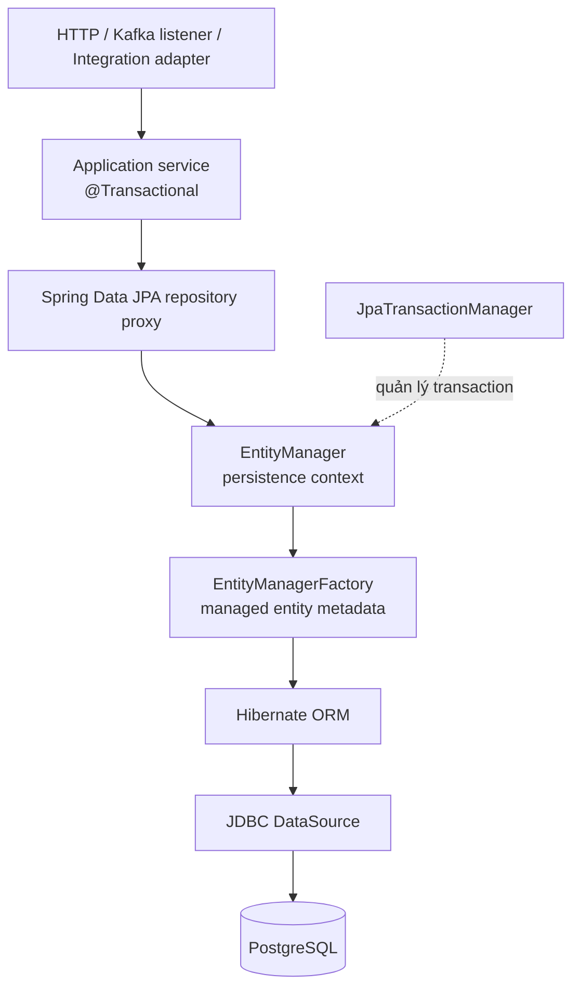
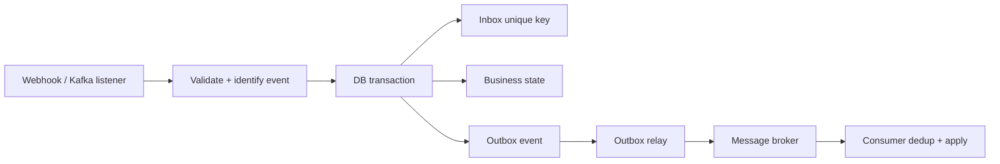

# EntityManagerFactory, entity scanning và repository scanning

> **Chương:** JPA và Hibernate  
> **Module:** `SPRING_BOOT_INTEGRATION` — tích hợp HTTP client, cơ sở dữ liệu, cache, broker thông điệp và adapter Spring Integration trong Spring Boot, với trọng tâm về cấu hình, hợp đồng dữ liệu, giao dịch, lỗi, xử lý trùng lặp, kiểm thử và quan sát.

## 1. Bài toán: có Entity và Repository nhưng ứng dụng vẫn không khởi động

Giả sử một dịch vụ Spring Boot nhận webhook từ đối tác thanh toán. Để tránh ghi lại cùng một event, hệ thống lưu payload và khóa sự kiện vào bảng `integration_inbox` trong PostgreSQL. Nhóm phát triển tạo một class có `@Entity` và một interface kế thừa `JpaRepository`, nhưng khi chạy ứng dụng lại gặp một trong hai lỗi:

- `Not a managed type: class ...InboxMessage` — repository được phát hiện, nhưng entity tương ứng chưa thuộc persistence unit mà nó sử dụng.
- `No qualifying bean of type '...InboxRepository' available` — interface repository không được đăng ký thành bean trong Spring context, hoặc cấu hình repository thất bại.

Đây là hai lỗi **khác nhau**. Lỗi thứ nhất liên quan đến **entity scanning và EntityManagerFactory**. Lỗi thứ hai thường liên quan đến **repository scanning** hoặc cấu hình bean. Việc thêm `@ComponentScan` một cách tùy tiện khó giải quyết tận gốc vì ba loại quét có trách nhiệm riêng.

Trong chương **JPA và Hibernate**, bài học này giải thích:

1. `EntityManagerFactory` là gì, liên hệ với `EntityManager`, Hibernate và transaction ra sao.
2. Spring Boot mặc định xác định vị trí entity và repository từ package nào.
3. Khi nào nên khai báo `@EntityScan` và `@EnableJpaRepositories`; tác động độc lập của chúng.
4. Cách cấu hình nhiều persistence unit và nhiều datasource để tránh gắn nhầm repository.
5. Cách kiểm thử và chẩn đoán lỗi quét package trên luồng tích hợp thực tế.

## 2. Các thành phần chính trong Spring Data JPA

JPA là **đặc tả Jakarta Persistence** mô tả mô hình entity, persistence context và cách ứng dụng làm việc với dữ liệu quan hệ. **Hibernate ORM** là một provider phổ biến triển khai các khả năng JPA. **Spring Data JPA** thêm cơ chế repository giúp tạo nhiều thao tác truy cập dữ liệu từ interface. **Spring Boot** chủ yếu lắp ghép, cấu hình và quản lý phụ thuộc cho các thành phần này.

| Thành phần | Vai trò | Ai cung cấp? |
|---|---|---|
| `@Entity`, `@Id`, `EntityManager`, `EntityManagerFactory` | Mô hình thực thể và API quản lý persistence context | Jakarta Persistence API |
| Hibernate ORM | Thực hiện mapping, tạo SQL, dirty checking, quản lý session | JPA provider |
| `JpaRepository<T, ID>` | Interface repository cung cấp CRUD, paging và những cơ chế Spring Data | Spring Data JPA |
| `@Transactional`, `JpaTransactionManager` | Ranh giới transaction trong ứng dụng Spring | Spring Framework |
| `@EntityScan`, auto-configuration JPA | Xác định package entity và lắp ghép bean theo điều kiện | Spring Boot |
| `@EnableJpaRepositories` | Chỉ định package tìm repository, factory và transaction manager liên quan | Spring Data JPA |
| `DataSource` | Nguồn JDBC connection tới database | JDBC; Boot có thể auto-configure |

Sơ đồ quan hệ điển hình:



Trong thực tế, repository làm việc với một `EntityManager` được Spring quản lý và gắn với transaction khi phù hợp. Sơ đồ chỉ thể hiện trách nhiệm; `EntityManagerFactory` không phải đối tượng tự thực thi từng câu SQL cho mỗi repository invocation.

## 3. EntityManagerFactory là gì?

`jakarta.persistence.EntityManagerFactory` (**EMF**) là factory để tạo `EntityManager`. EMF đại diện cho cấu hình và metadata của **một persistence unit**: tập entity được quản lý, mapping, provider, các thuộc tính JPA/Hibernate và kết nối tới database.

Các thuộc tính cần nhớ:

- **Khởi tạo tương đối tốn kém:** Hibernate cần xây dựng metadata, kiểm tra mapping, tạo infrastructure; thường có một EMF được dùng lại cho mỗi persistence unit trong suốt vòng đời ứng dụng.
- **Quản lý tập entity:** nếu class không được đăng ký trong persistence unit, JPA không thể thực hiện các thao tác entity đối với class đó, dù bảng SQL đã tồn tại.
- **Không phải connection pool:** EMF sử dụng `DataSource`/provider để làm việc với JDBC; pool connection do datasource hoặc hạ tầng liên quan quản lý.
- **Không đồng nghĩa với EntityManager:** EMF là factory dùng lại; một `EntityManager` gắn với persistence context cho một đơn vị công việc, **không tự an toàn để chia sẻ tùy ý giữa các thread**.
- **Có thể có nhiều EMF:** một ứng dụng truy cập hai database hoặc hai persistence unit độc lập có thể cần EMF và transaction manager riêng.

Trong ứng dụng Spring, `LocalContainerEntityManagerFactoryBean` là factory bean tích hợp EMF vào container; Hibernate thường là JPA provider được cấu hình. Khi điều kiện auto-configuration thích hợp, Spring Boot tạo các bean liên quan nên bạn không cần tự viết lớp factory cho một database thông thường.

### 3.1. Persistence context và trạng thái entity

Entity đi qua những trạng thái thường gặp:

- **Transient:** object mới tạo, chưa thuộc persistence context.
- **Managed:** entity được EntityManager theo dõi; thay đổi field có thể được phát hiện và đồng bộ xuống database tại thời điểm flush.
- **Detached:** object từng được quản lý nhưng đã tách khỏi persistence context.
- **Removed:** entity được đánh dấu xóa trong persistence context.

`EntityManager.persist(...)`, `find(...)`, `merge(...)`, `remove(...)` và `flush()` làm việc với persistence context. Hibernate thực hiện dirty checking cho managed entity; **flush không đồng nghĩa với commit**. SQL có thể được gửi xuống DB lúc flush nhưng transaction vẫn có thể rollback.

Không nên truyền entity đang managed sang worker `@Async` khác rồi dựa vào persistence context của request thread. Với tác vụ ngoài luồng hoặc consumer broker, nên truyền ID/DTO và thực hiện transaction mới theo ranh giới công việc.

### 3.2. EntityManagerFactory so với EntityManager

| Tiêu chí | `EntityManagerFactory` | `EntityManager` |
|---|---|---|
| Chức năng | Khởi tạo EntityManager từ cấu hình/persistence unit | Quản lý entity và thao tác persistence context |
| Vòng đời thường gặp | Tạo khi khởi động, dùng lại đến shutdown | Gắn với transaction hoặc một đơn vị công việc |
| Chia sẻ thread | Factory được thiết kế để có thể được sử dụng lại | EntityManager thực tế không nên dùng đồng thời từ nhiều thread |
| Nội dung quản lý | Metadata mapping và cấu hình provider | Entity đang managed, thay đổi chờ flush |
| Spring integration | Boot có thể cấu hình EMF bean | `@PersistenceContext`/repository sử dụng proxy thích hợp |

Một ví dụ truy cập EntityManager qua Spring:

```java
import jakarta.persistence.EntityManager;
import jakarta.persistence.PersistenceContext;
import org.springframework.stereotype.Repository;

@Repository
public class InboxLookupAdapter {

    @PersistenceContext
    private EntityManager entityManager;

    public InboxMessage find(Long id) {
        return entityManager.find(InboxMessage.class, id);
    }
}
```

Ví dụ giả định `InboxMessage` là entity được quản lý. Spring inject một reference phù hợp để phối hợp với persistence context của transaction; tránh tự tạo một `EntityManager` rồi lưu vào singleton và tái sử dụng qua các request.

## 4. Ba cơ chế scanning dễ bị nhầm nhất

Spring Boot thường định nghĩa **base package mặc định** từ vị trí package của class có `@SpringBootApplication`. Trong dự án cấu trúc chuẩn, đặt class khởi động ở package gốc chung giúp các nhóm quét hoạt động theo kỳ vọng.

Ba phạm vi:

| Cơ chế | Đối tượng được tìm | Nguồn cấu hình chính |
|---|---|---|
| **Component scanning** | `@Component`, `@Service`, `@Controller`, `@Configuration`, các stereotype Spring khác | `@SpringBootApplication`/`@ComponentScan` |
| **Entity scanning** | Entity/mapping type do persistence provider quản lý, điển hình `@Entity` | Auto-configuration theo package mặc định hoặc `@EntityScan` |
| **Repository scanning** | Interface repository Spring Data được tạo thành bean/proxy | Auto-configuration repository hoặc `@EnableJpaRepositories` |

**Chốt lại:** `@Entity` không phải `@Component`. Một entity nằm ngoài component scan vẫn có thể được quản lý nếu nằm trong entity scan. Một interface kế thừa `JpaRepository` có thể trở thành repository bean qua repository scanning mà không cần `@Repository` trên interface.

### 4.1. Package mặc định trong dự án chuẩn

Ví dụ cấu trúc:

```text
com.example.integration
├── IntegrationApplication.java            // @SpringBootApplication
├── web
│   └── InboxController.java                // @RestController
├── application
│   └── InboxService.java                   // @Service
└── persistence
    ├── entity
    │   └── InboxMessage.java               // @Entity
    └── repository
        └── InboxRepository.java            // JpaRepository
```

Class khởi động:

```java
package com.example.integration;

import org.springframework.boot.SpringApplication;
import org.springframework.boot.autoconfigure.SpringBootApplication;

@SpringBootApplication
public class IntegrationApplication {
    public static void main(String[] args) {
        SpringApplication.run(IntegrationApplication.class, args);
    }
}
```

Trong cấu hình Boot phổ biến với auto-configuration JPA và repository, các package con của `com.example.integration` là vùng được tìm kiếm mặc định. Với cách tổ chức này, bạn thường **không cần** thêm `@EntityScan` hoặc `@EnableJpaRepositories`.

Đặt main class vào `com.example.integration.web` trong khi repository/entity ở `com.example.integration.persistence` lại có thể khiến auto-scanning mặc định không bao gồm các package ngang hàng.

### 4.2. Package gốc là quy ước thiết kế, không phải tên bảng

Entity scan xét **class và package trên classpath**, không quét tên bảng trong database. Tạo bảng `integration_inbox` không khiến Hibernate tự tìm ra `InboxMessage`. Ngược lại, entity được scan nhưng bảng chưa tồn tại có thể gây lỗi schema validation hoặc SQL runtime tùy cấu hình.

Đặt `@SpringBootApplication` vào **default package** (không khai báo `package`) là ý tưởng không tốt: việc quét có thể mở rộng ngoài dự kiến, khó chẩn đoán và tăng chi phí khởi động.

## 5. Ví dụ đầy đủ: PostgreSQL inbox chống trùng webhook

Bài toán liên hệ trực tiếp tới tích hợp trong Spring Boot: đối tác có thể gửi lại webhook khi timeout. Ta cần ràng buộc idempotency bằng khóa `(partner, message_id)` và transaction.

### 5.1. Dependency và application.yml

Ví dụ Gradle Groovy DSL; dự án áp dụng dependency management theo Spring Boot:

```gradle
dependencies {
    implementation("org.springframework.boot:spring-boot-starter-web")
    implementation("org.springframework.boot:spring-boot-starter-data-jpa")
    implementation("org.springframework.boot:spring-boot-starter-validation")
    runtimeOnly("org.postgresql:postgresql")
    testImplementation("org.springframework.boot:spring-boot-starter-test")
}
```

Cấu hình database minh họa:

```yaml
spring:
  datasource:
    url: ${DB_JDBC_URL}
    username: ${DB_USERNAME}
    password: ${DB_PASSWORD}
  jpa:
    hibernate:
      ddl-auto: validate
    open-in-view: false
    properties:
      hibernate:
        format_sql: true
```

- `spring.datasource.*` cung cấp JDBC connection settings.
- `ddl-auto: validate` yêu cầu mapping khớp schema hiện có; không tự tạo/migrate bảng.
- `open-in-view: false` khuyến khích đóng persistence context ở ranh giới service/transaction, tránh dựa vào lazy load trong lúc render HTTP response.
- `format_sql` chỉ phục vụ trình bày SQL nếu SQL logging được bật; **không nên log bind values nhạy cảm** trong production.

Cần cung cấp các biến môi trường thật và driver phù hợp. Trong triển khai thực tế, dùng Flyway/Liquibase hoặc quy trình migration có phiên bản, **không dựa vào `ddl-auto: update` để thay schema production**.

### 5.2. Schema do migration quản lý

```sql
CREATE TABLE integration_inbox (
    id BIGINT GENERATED BY DEFAULT AS IDENTITY PRIMARY KEY,
    partner VARCHAR(80) NOT NULL,
    message_id VARCHAR(160) NOT NULL,
    payload TEXT NOT NULL,
    received_at TIMESTAMPTZ NOT NULL DEFAULT CURRENT_TIMESTAMP,
    CONSTRAINT uq_inbox_partner_message UNIQUE (partner, message_id)
);
```

Ràng buộc UNIQUE bảo đảm hai request đồng thời không thể cùng ghi thành công cùng một khóa. Kiểm tra `existsByPartnerAndMessageId(...)` rồi `save(...)` **không đủ** chống race condition nếu bỏ ràng buộc này.

### 5.3. Entity Hibernate/JPA

```java
package com.example.integration.persistence.entity;

import java.time.Instant;
import jakarta.persistence.Column;
import jakarta.persistence.Entity;
import jakarta.persistence.GeneratedValue;
import jakarta.persistence.GenerationType;
import jakarta.persistence.Id;
import jakarta.persistence.Table;

@Entity
@Table(name = "integration_inbox")
public class InboxMessage {

    @Id
    @GeneratedValue(strategy = GenerationType.IDENTITY)
    private Long id;

    @Column(nullable = false, length = 80)
    private String partner;

    @Column(name = "message_id", nullable = false, length = 160)
    private String messageId;

    @Column(nullable = false, columnDefinition = "text")
    private String payload;

    @Column(name = "received_at", nullable = false,
            insertable = false, updatable = false)
    private Instant receivedAt;

    protected InboxMessage() {
        // Constructor không tham số để JPA provider khởi tạo.
    }

    public Long getId() {
        return id;
    }

    public String getPartner() {
        return partner;
    }

    public String getMessageId() {
        return messageId;
    }

    public String getPayload() {
        return payload;
    }

    public Instant getReceivedAt() {
        return receivedAt;
    }
}
```

Lưu ý:

- Với Spring Boot/JPA hiện đại dùng Jakarta Persistence, import là `jakarta.persistence.*`. Codebase Spring Boot cũ hơn có thể còn `javax.persistence.*`; **không trộn hai hệ annotation giữa các phiên bản**.
- Class phải khai báo `@Entity`, có định danh `@Id` và constructor không tham số theo yêu cầu của JPA. `@Table` chỉ định tên bảng; nó không đăng ký entity nếu class bị bỏ qua khỏi entity scanning.
- Định nghĩa ví dụ dùng PostgreSQL `TIMESTAMPTZ` và column `TEXT`; nếu dùng database khác phải đổi DDL và có thể đổi mapping.
- Field `receivedAt` được database đặt giá trị mặc định. Với native insert bên dưới, JPA có thể cần refresh/load lại entity mới để thấy giá trị do database tạo.

### 5.4. Repository interface

```java
package com.example.integration.persistence.repository;

import com.example.integration.persistence.entity.InboxMessage;
import org.springframework.data.jpa.repository.JpaRepository;
import org.springframework.data.jpa.repository.Modifying;
import org.springframework.data.jpa.repository.Query;
import org.springframework.data.repository.query.Param;

public interface InboxRepository extends JpaRepository<InboxMessage, Long> {

    @Modifying
    @Query(value = """
        INSERT INTO integration_inbox (partner, message_id, payload)
        VALUES (:partner, :messageId, :payload)
        ON CONFLICT (partner, message_id) DO NOTHING
        """, nativeQuery = true)
    int insertIfAbsent(@Param("partner") String partner,
                       @Param("messageId") String messageId,
                       @Param("payload") String payload);
}
```

Spring Data JPA tạo repository bean từ interface này **nếu package thuộc repository scanning** và `InboxMessage` thuộc tập entity được EMF quản lý. Không cần thêm `@Repository` vào interface để Spring Data JPA nhận diện một repository kế thừa `JpaRepository`.

`INSERT ... ON CONFLICT DO NOTHING` là SQL **riêng PostgreSQL**; với database khác cần biến thể tương đương. `@Modifying` chỉ ra đây là lệnh DML, còn ranh giới transaction được đặt ở service.

### 5.5. Service transaction và kết quả HTTP

```java
package com.example.integration.application;

import com.example.integration.persistence.repository.InboxRepository;
import org.springframework.stereotype.Service;
import org.springframework.transaction.annotation.Transactional;

@Service
public class InboxService {
    private final InboxRepository inboxRepository;

    public InboxService(InboxRepository inboxRepository) {
        this.inboxRepository = inboxRepository;
    }

    @Transactional
    public boolean acceptOnce(String partner, String messageId, String payload) {
        return inboxRepository.insertIfAbsent(partner, messageId, payload) == 1;
    }
}
```

Ví dụ controller:

```java
package com.example.integration.web;

import com.example.integration.application.InboxService;
import jakarta.validation.Valid;
import jakarta.validation.constraints.NotBlank;
import org.springframework.http.HttpStatus;
import org.springframework.http.ResponseEntity;
import org.springframework.web.bind.annotation.PostMapping;
import org.springframework.web.bind.annotation.RequestBody;
import org.springframework.web.bind.annotation.RequestMapping;
import org.springframework.web.bind.annotation.RestController;

record InboxRequest(
    @NotBlank String partner,
    @NotBlank String messageId,
    @NotBlank String payload
) {}

@RestController
@RequestMapping("/integration/inbox")
public class InboxController {
    private final InboxService inboxService;

    public InboxController(InboxService inboxService) {
        this.inboxService = inboxService;
    }

    @PostMapping
    public ResponseEntity<Void> receive(@Valid @RequestBody InboxRequest body) {
        boolean inserted = inboxService.acceptOnce(
            body.partner(), body.messageId(), body.payload());

        return inserted
            ? ResponseEntity.status(HttpStatus.CREATED).build()
            : ResponseEntity.ok().build();
    }
}
```

Ví dụ cố ý đơn giản hóa xác thực webhook và chính sách HTTP; production phải có signature/auth, giới hạn payload, contract version và trạng thái phản hồi phù hợp. `201 Created` có nghĩa inbox ghi thành công; **không** tự khẳng định downstream đã hoàn tất nghiệp vụ. Tác vụ phát message sang broker cần ranh giới riêng, ví dụ outbox.

Nếu làm đúng package như mục 4 và Spring Boot tự cấu hình JPA, các bean được nối như sau: controller/service qua **component scan**, repository qua **repository scan**, entity qua **entity scan**, EMF qua cấu hình JPA. Nhầm bất cứ bước nào đều có thể làm ứng dụng khởi động thất bại.

## 6. @EntityScan: chỉ rõ nơi Hibernate/JPA tìm entity

Nếu các entity nằm **ngoài package gốc mặc định** của ứng dụng, có thể dùng `@EntityScan` để khai báo package cần quét.

Ví dụ entity được tách sang thư viện chung:

```text
com.example.integration
└── IntegrationApplication.java
com.example.shared.persistence
└── SharedAuditRecord.java             // @Entity
```

Cấu hình:

```java
package com.example.integration;

import com.example.integration.persistence.entity.InboxMessage;
import com.example.shared.persistence.SharedAuditRecord;
import org.springframework.boot.autoconfigure.SpringBootApplication;
import org.springframework.boot.autoconfigure.domain.EntityScan;

@SpringBootApplication
@EntityScan(basePackageClasses = {
    InboxMessage.class,
    SharedAuditRecord.class
})
public class IntegrationApplication {
}
```

Phần class rút gọn chỉ minh họa annotation; method `main` vẫn dùng như mục 4 nếu chạy trực tiếp.

Tại sao chỉ rõ **cả hai** class? `@EntityScan` xác định các package quét entity theo cấu hình này. Không nên giả định việc thêm một package bằng `@EntityScan` sẽ luôn cộng dồn với tất cả package mặc định trước đó. Nếu ứng dụng có nhiều nhóm entity, hãy cấu hình đủ các package cần thiết.

Các lưu ý:

- `@EntityScan(basePackageClasses = ...)` dùng **class làm mốc package**; nó không chỉ đăng ký đúng class đó, mà quét các entity trong package tương ứng. Nếu cần độ chính xác cao, dùng marker class/interface đặt trong package phù hợp.
- `@EntityScan(basePackages = "...")` hỗ trợ tên package dạng chuỗi nhưng kém an toàn khi refactor.
- `@EntityScan` **không** thay `@ComponentScan` và **không** tự tạo repository bean.
- `@EntityScan` là annotation của Spring Boot, có tác động đến packages được dùng để scan một số kiểu mapping context Spring Data khác tùy module; tránh thêm tùy tiện khi ứng dụng có nhiều công nghệ persistence.
- `@Entity` trên class ngoài classpath hoặc class không được load bởi classloader vẫn không thể được scan; annotation không thay thế dependency đúng.

### 6.1. Không sửa bằng @ComponentScan khi lỗi là entity

Ví dụ lỗi:

```text
Not a managed type: class com.example.shared.persistence.SharedAuditRecord
```

Thêm `@ComponentScan("com.example.shared.persistence")` thường không xử lý đúng nguyên nhân: entity do JPA provider quản lý, không phải bean Spring thông thường. Cần xác nhận entity thuộc persistence unit và import `@Entity` đúng hệ Jakarta/Javax đang dùng.

## 7. @EnableJpaRepositories: chỉ rõ nơi Spring Data tạo repository

`@EnableJpaRepositories` là annotation của **Spring Data JPA**. Nó thiết lập package tìm các interface repository JPA và có thể chỉ rõ EMF/transaction manager để repository sử dụng.

Ví dụ repository nằm ngoài package mặc định:

```text
com.example.integration
└── IntegrationApplication.java
com.example.shared.persistence.repo
└── SharedAuditRepository.java         // extends JpaRepository
```

Cấu hình:

```java
import com.example.integration.persistence.repository.InboxRepository;
import com.example.shared.persistence.repo.SharedAuditRepository;
import org.springframework.boot.SpringBootApplication;
import org.springframework.data.jpa.repository.config.EnableJpaRepositories;

@SpringBootApplication
@EnableJpaRepositories(basePackageClasses = {
    InboxRepository.class,
    SharedAuditRepository.class
})
public class IntegrationApplication {
}
```

Annotation này yêu cầu Spring Data JPA tạo repository proxy trong những package chỉ định. Nó **không** chuyển `SharedAuditRecord` vào persistence unit; nếu entity ở package bên ngoài, cần xử lý entity scanning riêng.

Trong ví dụ trên, class `SharedAuditRepository` cũng cần có dependency đúng trên classpath. Một `@EnableJpaRepositories` tùy chỉnh có thể thay phạm vi repository scanning tự động được kỳ vọng; hãy liệt kê đủ các package repository cần được tạo.

### 7.1. Phân biệt ba lỗi cấu hình

| Dấu hiệu | Nên kiểm tra trước |
|---|---|
| `No qualifying bean of type InboxRepository` | Repository package có nằm trong repository scan không, interface có kế thừa đúng repository gốc và module Spring Data JPA có hoạt động không? |
| `Not a managed type: InboxMessage` | Entity thuộc entity scan/persistence unit của EMF mà repository dùng không? Có `@Entity` và import đúng phiên bản không? |
| `No qualifying bean of type InboxService` | Class có `@Service` không, component scan có bao phủ package không, bean có bị condition/profile loại ra không? |

`@Repository` trên một interface không thay thế cơ chế repository factory của Spring Data JPA; chỉ mở rộng component scan để bắt interface cũng không khiến `JpaRepository` được triển khai tự động.

### 7.2. Repository base interface và @NoRepositoryBean

Một interface generic chung như `BaseRepository<T, ID> extends JpaRepository<T, ID>` có thể chỉ nhằm cung cấp contract cho các repository cụ thể. Khi đó nên dùng `@NoRepositoryBean`:

```java
import org.springframework.data.jpa.repository.JpaRepository;
import org.springframework.data.repository.NoRepositoryBean;

@NoRepositoryBean
public interface BaseRepository<T, ID> extends JpaRepository<T, ID> {
}
```

Điều này tránh yêu cầu Spring Data tạo repository bean từ interface generic chưa có entity cụ thể. Repository cụ thể vẫn có thể mở rộng interface chung.

## 8. Khi nào Spring Boot tự tạo EntityManagerFactory?

Với một datasource JPA phổ biến, Spring Boot có thể cấu hình `DataSource`, JPA vendor adapter, EMF, transaction manager và repository infrastructure khi các điều kiện classpath/property/bean phù hợp. Việc khởi tạo EMF xảy ra trong quá trình xây dựng Spring application context.

Các điều kiện thực tế cần có:

1. Dependency JPA và Hibernate/provider tương thích với phiên bản Spring Boot.
2. JDBC driver và `DataSource` kết nối được database.
3. Entity được scan và mapping hợp lệ.
4. Repository được scan và khai báo đúng entity/ID.
5. Các tùy chỉnh EMF/transaction manager không vô tình thay thế auto-configuration mong muốn.

Ví dụ các property thường gặp:

```yaml
spring:
  jpa:
    hibernate:
      ddl-auto: validate
    show-sql: false
    properties:
      hibernate:
        jdbc:
          batch_size: 30
  datasource:
    hikari:
      maximum-pool-size: 20
```

`spring.jpa.properties.*` truyền property cho JPA provider khi phù hợp; ví dụ `hibernate.jdbc.batch_size` chỉ phát huy tác dụng với mô hình thao tác và chiến lược định danh phù hợp. Không suy diễn giá trị pool hoặc batch càng cao càng tốt: nhiều instance cùng dùng database phải chia sẻ ngân sách connection và tải SQL.

### 8.1. Chẩn đoán EMF khởi tạo thất bại

Thông báo “Failed to initialize JPA EntityManagerFactory” là **triệu chứng chung**, không phải một nguyên nhân duy nhất. Cần xem exception gốc, thường rơi vào các nhóm:

- Không kết nối được database hoặc credential/driver sai.
- Entity mapping sai: thiếu identifier, quan hệ không hợp lệ, tên column không khớp.
- Schema validation không đạt: bảng/cột/kiểu dữ liệu khác mapping.
- Hai entity trùng tên entity hoặc cấu hình persistence unit xung đột.
- Bean EMF/transaction manager bị khai báo chồng chéo hay sai qualifier.

Hãy đọc **cause chain**, tên bean và managed type được nhắc tới trong startup log. Không nên sửa bằng `ddl-auto: update` cho tới khi hiểu sai lệch schema, nhất là trong production.

### 8.2. EntityManagerFactory không phải một bean cho mỗi repository

Nhiều repository của **cùng một database/persistence unit** thường cùng dùng một EMF. Không cần tạo một EMF cho từng bảng hoặc repository. Việc chia nhỏ thành nhiều EMF chỉ hợp lý khi cần tách persistence unit, datasource, schema/tenant hoặc cấu hình provider độc lập có lý do rõ ràng.

## 9. Nhiều DataSource và nhiều EntityManagerFactory

Một dịch vụ tích hợp có thể lưu inbox/outbox trong PostgreSQL A, nhưng vẫn đọc dữ liệu kế toán từ PostgreSQL B. Khi đó ứng dụng có thể cần **hai datasource**, **hai EMF** và **hai transaction manager**.

Một cách tổ chức package:

```text
com.example.integration
├── inbound
│   ├── entity
│   │   └── InboxMessage.java
│   └── repository
│       └── InboxRepository.java
└── billing
    ├── entity
    │   └── InvoiceSnapshot.java
    └── repository
        └── InvoiceSnapshotRepository.java
```

Mỗi bộ repository phải được gắn với đúng EMF và transaction manager. Ví dụ cấu hình **phần khai báo repository cho một persistence unit**:

```java
import org.springframework.context.annotation.Configuration;
import org.springframework.data.jpa.repository.config.EnableJpaRepositories;

@Configuration
@EnableJpaRepositories(
    basePackages = "com.example.integration.inbound.repository",
    entityManagerFactoryRef = "inboundEntityManagerFactory",
    transactionManagerRef = "inboundTransactionManager"
)
public class InboundJpaRepositoriesConfig {
}
```

Một cấu hình tương ứng cho `billing.repository` sẽ tham chiếu `billingEntityManagerFactory` và `billingTransactionManager`. Mỗi EMF phải quét **đúng entity** của database mà nó chịu trách nhiệm, ví dụ `inbound.entity` và `billing.entity`.

Ví dụ trên chỉ là **phần mapping repository**; để chạy được cần khai báo đầy đủ các bean datasource, `LocalContainerEntityManagerFactoryBean` và `JpaTransactionManager` tương ứng, thường với `@Qualifier` và (nếu cần) `@Primary` được đặt có chủ đích. Có thể tạo EMF từ `EntityManagerFactoryBuilder` theo cấu hình phù hợp. **Không** dựa vào một `@EntityScan` toàn ứng dụng để suy ra rằng mọi EMF đều tự nhận đúng tập entity khi có nhiều persistence unit.

### 9.1. Các giới hạn cần biết

- `@Transactional` mặc định chọn transaction manager theo cơ chế resolution của Spring. Khi có nhiều manager, cần chỉ rõ tên, ví dụ `@Transactional("inboundTransactionManager")`, và bảo đảm method được gọi qua proxy.
- Hai transaction JDBC ở **hai datasource** không trở thành một transaction nguyên tử chỉ vì đều có `@Transactional`. Cần thiết kế consistency, saga/bù trừ hoặc cơ chế transaction phân tán được hỗ trợ và triển khai rõ ràng khi thật sự cần.
- Repository thuộc EMF A nhưng entity thuộc EMF B thường gây `Not a managed type` dù entity class có mặt trên classpath.
- Migration phải chạy trên đúng database; tránh để Flyway/Liquibase vô tình áp schema ở một datasource khác.
- Nếu cần chung một transaction database cho inbox + outbox, nên để hai bảng và repository tham gia **cùng transaction manager/cơ sở dữ liệu** phù hợp.

## 10. Ranh giới giao dịch trong luồng tích hợp

JPA thường dùng transaction đồng bộ dựa trên JDBC. Khi nhận webhook hoặc message từ broker, nên đặt transaction ở **application service**, đủ rộng để bao trùm những thay đổi database cần nguyên tử, nhưng tránh giữ transaction trong lúc chờ network lâu.

Ví dụ:



Với inbox/outbox:

1. Nhận message từ đối tác, kiểm tra chữ ký/contract và nhận diện `eventId` ổn định.
2. Trong **một transaction database**, ghi inbox nếu chưa tồn tại, cập nhật trạng thái nghiệp vụ và thêm outbox record.
3. Commit transaction; nếu thất bại thì rollback các thay đổi DB tương ứng.
4. Relay đọc outbox rồi publish broker; có thể retry và publish lặp.
5. Consumer dùng event ID/unique constraint để chống side effect trùng và ACK theo khả năng của broker.

`@Transactional` không tự gộp database với Kafka/RabbitMQ hoặc HTTP API. Nếu ghi DB thành công rồi gọi network và process chết ở khoảng giữa, trạng thái các hệ thống có thể lệch. Transactional outbox giúp giảm khoảng hở giữa **thay đổi database** và **ý định phát message**, nhưng không loại bỏ nhu cầu dedup tại consumer.

### 10.1. @Async và thread-bound EntityManager

Một lời gọi `@Async` thực thi trên worker thread khác, không tự kế thừa transaction/persistence context của thread HTTP. Không truyền managed entity với lazy association sang worker rồi kỳ vọng worker truy cập liên kết sau khi transaction ban đầu đã đóng.

Nên truyền ID hoặc DTO bất biến, mở transaction thích hợp bên worker (nếu cần), tải lại entity theo ID và ghi kết quả bằng transaction mới. Nếu bắt buộc công việc không mất sau crash, sử dụng job table, outbox hoặc broker thay vì chỉ `@Async` trong RAM.

## 11. Lỗi entity scan và repository scan nhìn từ stack trace

### 11.1. Not a managed type

Thông báo thường thấy:

```text
java.lang.IllegalArgumentException:
  Not a managed type: class com.example.shared.persistence.SharedAuditRecord
```

Checklist chẩn đoán:

1. Class có `@Entity` không và import đúng `jakarta.persistence.Entity`/`javax.persistence.Entity` theo bộ thư viện thực tế không?
2. Package entity có được EMF mà repository dùng quét không?
3. Nếu có `@EntityScan`, danh sách package đã bao gồm các entity cũ lẫn mới chưa?
4. Nếu có nhiều EMF, repository có tham chiếu đúng `entityManagerFactoryRef` và entity có nằm trong tập managed classes của EMF đó không?
5. Entity class có trong module/JAR được đưa lên runtime classpath không?
6. Nếu class là DTO hoặc `@MappedSuperclass`, nó có đang bị khai báo nhầm như entity của repository không?

Đừng sửa lỗi này bằng cách thêm `@Repository` vào entity.

### 11.2. Repository bean không được tạo

Triệu chứng:

```text
No qualifying bean of type 'com.example.integration.persistence.repository.InboxRepository'
```

Kiểm tra:

1. Package có nằm trong vùng repository scanning không?
2. Interface có mở rộng `JpaRepository` hoặc loại repository được Spring Data hỗ trợ không?
3. Có vô tình đặt `@EnableJpaRepositories` chỉ giới hạn một package khác không?
4. Spring Data JPA dependency và repository auto-configuration có được kích hoạt không?
5. Có config profile, exclusions hoặc bean name conflict khiến việc tạo proxy thất bại không?
6. Nếu có nhiều EMF, các bean được tham chiếu bởi `entityManagerFactoryRef` và `transactionManagerRef` đã tồn tại chưa?

Không nhầm với việc service chưa được component scan: cả hai đều có thể báo thiếu bean, nhưng đối tượng và cách đăng ký khác nhau.

### 11.3. Lỗi bảng/cột không tồn tại

Ví dụ database báo `relation "integration_inbox" does not exist` hoặc `column ... does not exist` sau khi application context đã khởi tạo. Khi đó cần xem kết nối đang vào **đúng database/schema** hay không, migration đã chạy chưa, naming strategy và quyền của DB user có phù hợp không.

Đổi `@EntityScan` không tạo ra bảng. Đổi `@EnableJpaRepositories` không sửa được SQL sai. Phải chẩn đoán đúng tầng.

## 12. Kiểm thử ba lớp scanning và transaction

Các bài test hữu ích nên kiểm tra ít nhất hai mức: repository/JPA slice và ứng dụng thật với đầy đủ wiring.

### 12.1. @DataJpaTest cho mapping và repository

```java
import static org.assertj.core.api.Assertions.assertThat;
import org.junit.jupiter.api.Test;
import org.springframework.beans.factory.annotation.Autowired;
import org.springframework.boot.test.autoconfigure.orm.jpa.DataJpaTest;

@DataJpaTest
class InboxRepositoryTest {

    @Autowired
    private InboxRepository repository;

    @Test
    void repositoryBeanExists() {
        assertThat(repository).isNotNull();
    }
}
```

Đoạn này minh họa cách kiểm tra repository bean trong **test slice**. `@DataJpaTest` tập trung vào lớp JPA, nên không tự chứng minh controller, toàn bộ component scanning hoặc mọi bean của ứng dụng production đều đã được wiring đúng. Tùy classpath và cấu hình, slice có thể dùng embedded database thay cho datasource thật.

### 12.2. Test trên PostgreSQL thật cho idempotency

SQL `ON CONFLICT DO NOTHING` là đặc thù PostgreSQL, vì vậy nên kiểm thử trên PostgreSQL cùng loại môi trường production, ví dụ Testcontainers:

- Bắt đầu với database/schema được migration khởi tạo.
- Gọi `insertIfAbsent("partner-a", "evt-1", payload)` một lần trong transaction và kiểm tra kết quả bằng `1`.
- Gửi lại cùng khóa, kiểm tra kết quả `0` và chỉ một hàng tồn tại.
- Chạy hai request có khóa giống nhau đồng thời để xác nhận unique constraint loại bỏ race condition.
- Kiểm tra rollback khi cập nhật nghiệp vụ hoặc ghi outbox thất bại trong cùng transaction.
- Test với database/schema và user quyền hạn giống triển khai thực.

Nếu dùng `@DataJpaTest` kết hợp Testcontainers cần bảo đảm test sử dụng PostgreSQL thay vì embedded DB, ví dụ cấu hình `@AutoConfigureTestDatabase(replace = AutoConfigureTestDatabase.Replace.NONE)` theo phiên bản Spring Boot được dùng. Với Boot và Testcontainers, kết nối có thể được cung cấp qua các cơ chế như `@ServiceConnection` hoặc `@DynamicPropertySource` tùy dự án.

### 12.3. @SpringBootTest cho wiring thực tế

```java
import static org.assertj.core.api.Assertions.assertThat;
import jakarta.persistence.EntityManagerFactory;
import org.junit.jupiter.api.Test;
import org.springframework.beans.factory.annotation.Autowired;
import org.springframework.boot.test.context.SpringBootTest;

@SpringBootTest
class JpaWiringTest {

    @Autowired
    private EntityManagerFactory entityManagerFactory;

    @Autowired
    private InboxRepository inboxRepository;

    @Test
    void entityAndRepositoryAreRegistered() {
        assertThat(inboxRepository).isNotNull();
        assertThat(entityManagerFactory.getMetamodel()
            .entity(InboxMessage.class)).isNotNull();
    }
}
```

Lưu ý test này giả định **một EMF** và entity `InboxMessage` nằm trong persistence unit mặc định. Với nhiều EMF, inject đúng bean bằng qualifier và kiểm tra từng repository thuộc đúng factory/transaction manager. Test cần datasource thực hoặc hạ tầng test phù hợp mới khởi tạo context được; ví dụ mang tính hướng dẫn, chưa chạy trong repository hiện tại.

### 12.4. Kiểm thử failure mode ngoài JPA

Đối với luồng webhook → DB → broker, phải kiểm thử thêm: broker tạm ngừng sau DB commit, outbox relay publish lại, consumer nhận lặp, kết quả HTTP đã gửi nhưng partner retry, mapping DTO/schema lỗi. Kiểm thử quét entity và repository là cần thiết nhưng **không chứng minh toàn bộ tích hợp đáng tin cậy**.

## 13. Quan sát và hiệu năng khi EntityManagerFactory đã hoạt động

Sau khi các bean được tạo đúng, vẫn phải quan sát chất lượng truy vấn và resource:

| Tín hiệu | Ý nghĩa |
|---|---|
| EMF startup time / lỗi bootstrap | Entity scanning quá rộng, mapping sai, database/schema validation lỗi |
| Pool JDBC active/idle/pending | Cạn connection, query chậm, transaction giữ connection lâu |
| SQL duration/count | Query chậm, N+1 queries, batch không hiệu quả |
| Transaction duration/rollback | Giao dịch kéo dài hoặc thất bại |
| Inbox duplicate count | Số event nhận lại từ đối tác/broker |
| Outbox oldest pending age | Độ trễ lan truyền dữ liệu sang broker |
| Deadlock/lock wait | Cạnh tranh cập nhật ở database |
| Trace/correlation/event ID | Ghép webhook, service, database, relay và downstream consumer |

Spring Boot Actuator và Micrometer có thể hỗ trợ quan sát datasource và các thành phần liên quan, tùy dependency/bean/instrumentation. Không tự động có tất cả metric nghiệp vụ: cần instrument inbox duplicate, outbox backlog và kết quả giao tiếp ngoài.

Các lưu ý hiệu năng:

- **Entity scan đúng package** giúp tránh quản lý nhầm entity và giảm nhiễu lúc bootstrap, nhưng hiệu năng runtime còn phụ thuộc SQL, index và mapping.
- **N+1 query** là vấn đề truy vấn/mapping, không phải repository scanning; kiểm tra fetch plan, projection, `JOIN FETCH` hoặc `@EntityGraph` phù hợp.
- **LazyInitializationException** thường xuất hiện khi truy cập lazy association sau persistence context. Map DTO trong service transaction, thiết kế fetch query rõ ràng và tránh trả entity trực tiếp ra JSON.
- **Connection pool** cần tính theo số instance và hạn mức DB, không dựa vào số entity/repository.
- **SQL logging** có thể giúp debug nhưng tránh để bật ồ ạt hoặc log dữ liệu nhạy cảm production.

## 14. Bảng chọn cấu hình theo cấu trúc dự án

| Cấu trúc ứng dụng | Cách cấu hình nên cân nhắc |
|---|---|
| Một DB, main class tại package gốc, entity/repo ở package con | Để Spring Boot auto-configure, thường không cần annotation scanning bổ sung |
| Entity ở JAR/package ngoài phạm vi mặc định | `@EntityScan(basePackageClasses = ...)` cho tất cả nhóm entity cần quét |
| Repository ở JAR/package ngoài phạm vi mặc định | `@EnableJpaRepositories(basePackageClasses = ...)` bao phủ các nhóm repository cần tạo |
| Chỉ service/controller nằm ngoài component scan | Điều chỉnh package của main class hoặc `@ComponentScan` phù hợp; không nhầm với entity scan |
| Hai DB/persistence unit độc lập | Datasource + EMF + transaction manager riêng; chia repository theo `entityManagerFactoryRef`/`transactionManagerRef` |
| WebFlux kết hợp JPA | Nhớ JDBC/JPA blocking; cô lập tác vụ blocking có giới hạn hoặc dùng R2DBC khi kiến trúc yêu cầu |
| Bài toán inbox/outbox | Đặt entity/repo đúng EMF và **cùng transaction DB** cho các thay đổi nguyên tử |

## 15. Checklist khi thêm entity hoặc repository mới

1. **Đúng module/dependency chưa?** Entity/repository nằm trên runtime classpath, Spring Data JPA và JDBC driver phù hợp?
2. **Đúng package chưa?** Main class ở package gốc; nếu ở ngoài, đã khai báo entity/repository scan phù hợp?
3. **Đúng annotation chưa?** `@Entity`, `@Id`, Jakarta/Javax nhất quán với phiên bản, mapping table/column đúng?
4. **Đúng EMF chưa?** Repository dùng persistence unit chứa entity đó, nhất là trong multi-datasource?
5. **Đúng transaction manager chưa?** Service giao dịch trỏ đúng database và có ranh giới phù hợp?
6. **Đúng schema chưa?** Migration đã chạy, unique/index/kiểu dữ liệu tồn tại ở database đúng?
7. **Đúng idempotency chưa?** Có unique constraint và SQL xử lý conflict an toàn với request đồng thời?
8. **Đúng độ tin cậy chưa?** Outbox, retry, consumer dedup và reconciliation được thiết kế nếu tích hợp broker/HTTP?
9. **Đúng kiểm thử chưa?** Repository slice, startup context, PostgreSQL thực, rollback/duplicate và failure injection?
10. **Đúng vận hành chưa?** Có metric pool/SQL, log phân loại lỗi, correlation ID và cảnh báo outbox backlog?

### Câu hỏi tự kiểm tra

**Câu 1:** `@Entity` được Spring component scan phát hiện là đủ để JPA quản lý?  
**Trả lời:** Không. Entity phải nằm trong persistence unit được EMF quản lý qua entity scanning/configuration.

**Câu 2:** Interface `JpaRepository` có cần `@Repository` để tạo bean?  
**Trả lời:** Thông thường không; repository scanning của Spring Data JPA nhận diện và tạo proxy cho interface phù hợp.

**Câu 3:** `@EnableJpaRepositories` có tự quét entity của những repository đó không?  
**Trả lời:** Không. Repository scanning và entity scanning độc lập; EMF phải quản lý entity được repository sử dụng.

**Câu 4:** Hai database có thể dùng một `@Transactional` mặc định để commit nguyên tử không?  
**Trả lời:** Không thể mặc nhiên suy ra điều đó. Mỗi transaction manager có phạm vi riêng; cần chiến lược nhất quán phù hợp nếu cập nhật xuyên DB.

**Câu 5:** Khi nhận cùng webhook đồng thời, `findBy...` rồi `save` đã đủ chống trùng chưa?  
**Trả lời:** Chưa. Hai transaction có thể cùng thấy chưa tồn tại; phải dựa vào unique constraint và thao tác/điều khiển xung đột phù hợp.

---

Trong `SPRING_BOOT_INTEGRATION`, **`EntityManagerFactory` quyết định tập entity JPA được quản lý**, **entity scanning tìm model persistence**, còn **repository scanning tạo bean truy cập dữ liệu qua Spring Data**. Spring Boot đơn giản hóa cấu hình mặc định, nhưng kiến trúc package, ranh giới transaction, tính nhất quán với broker/HTTP, idempotency và khả năng quan sát vẫn cần được thiết kế và kiểm chứng rõ ràng.
