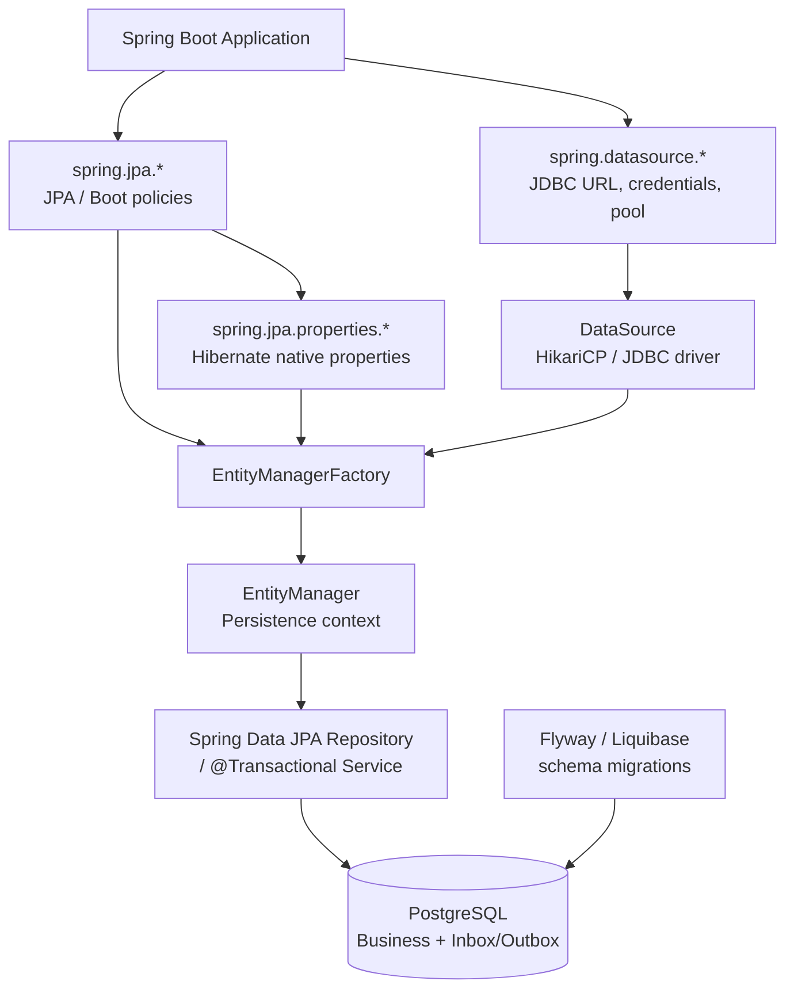
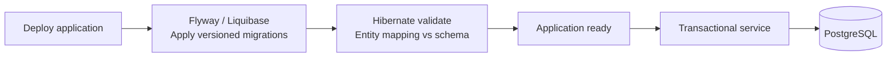
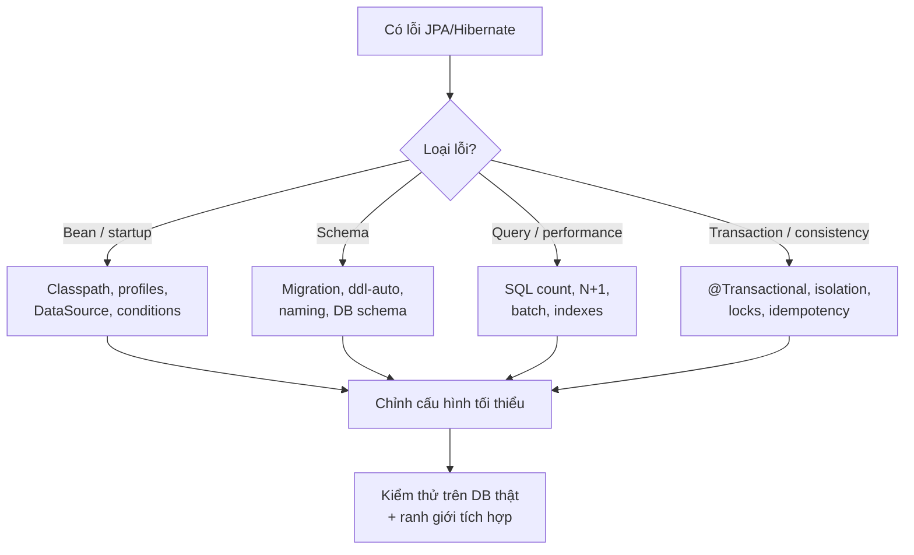

# spring.jpa.* và cấu hình riêng của Hibernate

## 1. Vì sao phải phân biệt cấu hình Spring Boot, JPA và Hibernate?

Trong module **SPRING_BOOT_INTEGRATION**, cơ sở dữ liệu không chỉ chứa thông tin nghiệp vụ. Nó còn có thể lưu trạng thái **inbox/outbox**, khóa chống xử lý trùng sự kiện, thông tin retry, checkpoint của tác vụ nền và dữ liệu đối soát với HTTP client hoặc message broker. Một cấu hình ORM không phù hợp có thể làm chậm luồng tích hợp, phát sinh truy vấn bất ngờ hoặc gây lỗi transaction ngay lúc dịch vụ cần phục hồi sau sự cố.

Ba lớp thường bị gọi chung là “JPA” nhưng có vai trò khác nhau:

1. **Jakarta Persistence (JPA)** là đặc tả và API như `@Entity`, `EntityManager`, `@PersistenceContext`, JPQL và các quy tắc persistence context.
2. **Hibernate ORM** là một nhà cung cấp JPA phổ biến. Hibernate thực thi việc ánh xạ entity, dirty checking, SQL generation, lazy loading, batching, flush và có nhiều thuộc tính riêng bắt đầu bằng `hibernate.*`.
3. **Spring Boot + Spring Data JPA** tạo và nối hạ tầng: `DataSource`, `EntityManagerFactory`, transaction manager, repository, auto-configuration và externalized configuration thông qua `spring.datasource.*`, `spring.jpa.*`.

Khi thêm `spring-boot-starter-data-jpa`, Spring Boot thường chọn Hibernate làm persistence provider nếu classpath và điều kiện tự cấu hình phù hợp. Tuy nhiên, **cấu hình của Spring Boot không đồng nghĩa tập thuộc tính gốc của Hibernate**.

Bài học đi sâu vào **`spring.jpa.*` và cấu hình riêng của Hibernate**: những khóa nào được Boot xử lý, những khóa nào được chuyển tiếp xuống ORM, cách quản lý schema bằng migration, tối ưu SQL đúng chỗ, đóng ranh giới transaction, và kiểm thử các luồng tích hợp có kết nối HTTP, cache hoặc broker.

> Ví dụ thiên về Spring Boot 3.x, Jakarta Persistence 3.x, Hibernate 6 và PostgreSQL. Với Spring Boot 4 hoặc các phiên bản khác, hãy kiểm tra tài liệu và dependency management đúng phiên bản, vì tên starter, package auto-configuration hoặc một số khóa Hibernate có thể thay đổi. Các cấu hình hiệu năng chỉ là điểm khởi đầu cần đo đạc.

## 2. Bản đồ cấu hình từ ứng dụng tới database



| Nhóm | Ai xử lý chủ yếu? | Dùng để làm gì? | Ví dụ |
| --- | --- | --- | --- |
| `spring.datasource.*` | Spring Boot, DataSource/pool và JDBC driver | URL, tài khoản, pool, timeout kết nối | `spring.datasource.url` |
| `spring.jpa.*` | Spring Boot JPA auto-configuration | Chọn dialect, SQL logging cơ bản, Open Session in View, DDL policy | `spring.jpa.open-in-view` |
| `spring.jpa.hibernate.*` | Spring Boot integration cho Hibernate | Các tùy chọn Hibernate mà Boot cung cấp khóa riêng | `spring.jpa.hibernate.ddl-auto` |
| `spring.jpa.properties.*` | Boot chuyển tiếp tới persistence provider | Thuộc tính Hibernate gốc không có khóa Boot riêng | `hibernate.jdbc.batch_size` |
| Annotation JPA/Hibernate | JPA provider và mapping metadata | Entity, quan hệ, fetch, version, generator | `@Entity`, `@Version` |
| Flyway/Liquibase | Công cụ migration | DDL/DML có phiên bản và quy trình nâng cấp | `V1__create_outbox.sql` |

Ví dụ: tăng `spring.datasource.hikari.maximum-pool-size` điều chỉnh số connection pool, **không** tự tăng kích thước JDBC batch; tăng `hibernate.jdbc.batch_size` điều chỉnh batching ở Hibernate, **không** tự thay số connection pool. Tương tự, `spring.jpa.show-sql` điều chỉnh cách xuất SQL chứ không tạo index hoặc làm truy vấn tự chạy nhanh hơn.

## 3. Dependency và điều kiện tự cấu hình

### Maven

Khi Spring Boot parent/BOM đã quản lý version:

```xml
<dependencies>
    <dependency>
        <groupId>org.springframework.boot</groupId>
        <artifactId>spring-boot-starter-data-jpa</artifactId>
    </dependency>

    <dependency>
        <groupId>org.postgresql</groupId>
        <artifactId>postgresql</artifactId>
        <scope>runtime</scope>
    </dependency>

    <dependency>
        <groupId>org.flywaydb</groupId>
        <artifactId>flyway-core</artifactId>
    </dependency>
</dependencies>
```

Với những thế hệ Flyway mới, PostgreSQL có thể cần **module hỗ trợ database** riêng bên cạnh `flyway-core`. Kiểm tra tài liệu Flyway/BOM của phiên bản dự án và thêm module cần thiết; không giả định một dependency luôn đủ cho mọi phiên bản.

### Gradle

```groovy
dependencies {
    implementation 'org.springframework.boot:spring-boot-starter-data-jpa'
    implementation 'org.flywaydb:flyway-core'
    runtimeOnly 'org.postgresql:postgresql'
}
```

Starter cung cấp Spring Data JPA, Spring ORM, Hibernate và hạ tầng transaction theo dependency management. PostgreSQL JDBC driver là một dependency khác. Flyway là công cụ quản lý schema, không phải bộ phận của Hibernate ORM.

Để `EntityManagerFactory` được tự cấu hình, ứng dụng còn cần DataSource phù hợp, các class JPA/Hibernate đúng phiên bản, entity được phát hiện và không có bean custom khiến cấu hình mặc định bị thay thế. Nếu có nhiều DataSource mà không chọn được ứng viên duy nhất, JPA auto-configuration có thể không biết dùng DataSource nào.

**Phân biệt lỗi từ startup:**

- `No qualifying bean of type EntityManagerFactory`: tìm thiếu dependency/auto-configuration hoặc thiếu DataSource thích hợp.
- `Not a managed type`: thường kiểm tra entity scanning, `@Entity`, package hoặc generic repository.
- `Unable to determine Dialect`: kiểm tra JDBC URL, khả năng kết nối, driver và cấu hình metadata/dialect.
- `Schema-validation: missing table`: bean JPA đã khởi tạo đến bước validate nhưng schema thực khác kỳ vọng.
- `Connection refused`: lỗi database/network, không đồng nghĩa Hibernate không có class.

Dùng `--debug` hoặc endpoint `/actuator/conditions` được bảo vệ để xem điều kiện tự cấu hình; đọc nguyên nhân sâu nhất của exception trước khi sửa ngẫu nhiên nhiều thuộc tính.

## 4. Cấu hình tối thiểu cho PostgreSQL với migration

Ví dụ `application.yml` cho môi trường có PostgreSQL và schema do Flyway/Liquibase quản lý:

```yaml
spring:
  datasource:
    url: ${DB_URL}
    username: ${DB_USERNAME}
    password: ${DB_PASSWORD}
    hikari:
      maximum-pool-size: 12
      connection-timeout: 5s

  jpa:
    open-in-view: false
    show-sql: false
    hibernate:
      ddl-auto: validate
    properties:
      "[hibernate.jdbc.time_zone]": "UTC"

  flyway:
    enabled: true
```

Ý nghĩa:

- **`spring.datasource.*`** chỉ vào database thật và cấu hình connection pool. `DB_URL` là biến môi trường, ví dụ một JDBC URL dạng `jdbc:postgresql://db.internal:5432/orders`.
- **`open-in-view: false`** giới hạn truy cập lazy data ngoài ranh giới transaction/service, tránh việc tầng HTTP view vô tình phát sinh SQL.
- **`show-sql: false`** không in tất cả SQL trực tiếp ra output của ORM.
- **`ddl-auto: validate`** yêu cầu Hibernate kiểm tra mapping so với schema có sẵn khi khởi động; không để Hibernate tự sửa bảng production.
- **`hibernate.jdbc.time_zone=UTC`** tác động tới một số xử lý timestamp qua JDBC của Hibernate; đây không phải cách thay thế hợp đồng `Instant`/`OffsetDateTime` hoặc cấu hình timezone của database.
- **Flyway** áp dụng migration có phiên bản trước khi ORM được sử dụng theo cơ chế quản lý initialization phù hợp.

Cấu hình trên **không bảo đảm production đã sẵn sàng** chỉ vì context tạo bean. Database có thể mất kết nối sau khi start, query có thể chậm và migration có thể không tương thích với dữ liệu cũ. Cần kiểm thử và quan sát các hoạt động thực.

## 5. spring.jpa.*: những thuộc tính Spring Boot xử lý

Những khóa thường gặp:

| Thuộc tính | Ý nghĩa | Lưu ý |
| --- | --- | --- |
| `spring.jpa.hibernate.ddl-auto` | Chính sách Hibernate schema management | Chọn chủ động; production thường `validate` hoặc `none` với migrations |
| `spring.jpa.show-sql` | Bật in SQL của provider qua cơ chế cấu hình Boot | Hữu ích dev; production ưu tiên structured logging/metrics |
| `spring.jpa.open-in-view` | Bật/tắt Open EntityManager in View trong ứng dụng web thích hợp | Nên quyết định có chủ đích |
| `spring.jpa.database-platform` | Chỉ định dialect class cho JPA provider | Thường để Hibernate tự phát hiện từ JDBC metadata |
| `spring.jpa.database` | Gợi ý loại database theo abstraction Boot | Không thay cho JDBC URL/driver |
| `spring.jpa.generate-ddl` | Yêu cầu JPA provider sinh DDL theo mức abstraction | Tránh dùng song song mâu thuẫn với `ddl-auto` |
| `spring.jpa.properties.*` | Chuyển tiếp native provider properties | Khóa Hibernate phải chính xác; không phải Boot-specific flags |
| `spring.jpa.hibernate.naming.physical-strategy` | Chọn physical naming strategy của Hibernate | Có thể làm thay đổi bảng/cột SQL được ánh xạ |
| `spring.jpa.hibernate.naming.implicit-strategy` | Chọn implicit naming strategy | Khác với physical naming |
| `spring.jpa.defer-datasource-initialization` | Điều chỉnh thứ tự JPA initialization và SQL script initialization của Boot | Không dùng như giải pháp migration production |

Một số thuộc tính và mặc định thay đổi theo Spring Boot version, classpath hay môi trường web. Cần tra metadata của bản đang chạy. Ví dụ trong ứng dụng servlet có JPA, Open EntityManager in View có thể được bật mặc định ở một số phiên bản, nhưng **không nên dựa vào mặc định** khi yêu cầu transaction rõ ràng.

### Một lỗi phổ biến: đặt nhầm prefix

```properties
# Sai: Hibernate không tự thấy key này từ Spring Environment.
hibernate.jdbc.batch_size=30

# Đúng: thông qua Spring Boot -> Hibernate.
spring.jpa.properties.hibernate.jdbc.batch_size=30

# Đúng: khóa do Spring Boot quản lý.
spring.jpa.hibernate.ddl-auto=validate
```

Trừ khi ứng dụng tự chuyển các property khác vào Hibernate, việc đặt `hibernate.jdbc.batch_size` ở root `application.properties` không phải cách phổ biến để Boot truyền nó cho JPA provider.

## 6. Truyền thuộc tính Hibernate bằng spring.jpa.properties.*

Một phần đáng chú ý trong Spring Boot JPA là `spring.jpa.properties.*`. Boot đưa các key/value nằm trong nhóm này cho persistence provider; riêng Hibernate đọc các key bắt đầu bằng `hibernate.*` mà nó hỗ trợ.

Ví dụ `application.properties`:

```properties
spring.jpa.properties.hibernate.format_sql=true
spring.jpa.properties.hibernate.jdbc.batch_size=30
spring.jpa.properties.hibernate.order_inserts=true
spring.jpa.properties.hibernate.order_updates=true
spring.jpa.properties.hibernate.default_batch_fetch_size=32
spring.jpa.properties.hibernate.query.fail_on_pagination_over_collection_fetch=true
spring.jpa.properties.hibernate.generate_statistics=false
```

Các property gốc Hibernate **không áp dụng relaxed binding theo cùng cách như những property Spring Boot tự định nghĩa**. Vì vậy nên viết đúng tên Hibernate hỗ trợ, ví dụ `hibernate.jdbc.batch_size`, không tùy ý đổi thành `hibernate.jdbc.batch-size` hoặc viết sai chữ hoa/chữ thường.

### Giữ nguyên dấu chấm trong key YAML

Cách minh bạch để khai báo map properties:

```yaml
spring:
  jpa:
    properties:
      "[hibernate.format_sql]": "true"
      "[hibernate.jdbc.batch_size]": "30"
      "[hibernate.order_inserts]": "true"
      "[hibernate.order_updates]": "true"
      "[hibernate.default_batch_fetch_size]": "32"
      "[hibernate.query.fail_on_pagination_over_collection_fetch]": "true"
```

Bracket notation dưới `properties` làm rõ key của map được giữ nguyên, bao gồm dấu chấm; YAML cần quote key dạng bracket. Đây là lựa chọn an toàn khi diễn đạt các khóa provider có dấu chấm. Không đặt `spring.jpa.properties.hibernate.ddl-auto`: Hibernate dùng `hibernate.hbm2ddl.auto` ở tầng gốc; trong Spring Boot hãy ưu tiên khóa `spring.jpa.hibernate.ddl-auto` để tránh mâu thuẫn.

**Không bật toàn bộ cấu hình trên cho mọi ứng dụng một cách máy móc.** Batching phù hợp ghi theo lô; batch fetching có tác động tới kiểu SQL; query pagination guard có thể làm một truy vấn vốn chỉ cảnh báo nay ném exception để phát hiện lỗi. Mỗi cấu hình cần một phép đo/kiểm thử cụ thể.

## 7. ddl-auto: validate, none, update, create, create-drop

`spring.jpa.hibernate.ddl-auto` là một trong những thuộc tính có hậu quả lớn nhất:

| Giá trị | Hành vi chủ yếu | Khuyến nghị |
| --- | --- | --- |
| `none` | Không yêu cầu Hibernate quản lý/kiểm tra DDL theo cơ chế này | Có thể dùng với migrations và kiểm tra schema ở bước khác |
| `validate` | Kiểm tra mapping so với schema hiện hữu khi khởi động | Thường phù hợp sau Flyway/Liquibase |
| `update` | Hibernate cố điều chỉnh schema theo entity mapping | Không xem là migration production an toàn |
| `create` | Tạo lại schema do Hibernate quản lý khi bootstrap | Chỉ dùng trong môi trường có thể bỏ dữ liệu |
| `create-drop` | Tạo schema khi khởi động và dọn khi đóng session factory | Phù hợp một số test/demo, không cho database quan trọng |

**Không dựa vào default.** Boot có thể suy ra DDL policy theo database embedded/external, công cụ schema migration hiện diện và phiên bản framework. Production nên đặt rõ `validate` hoặc `none` theo chính sách.

### Vì sao update nguy hiểm trong production?

`update` không phải hệ thống migration quản lý lịch sử. Nó không cung cấp quy trình review, rollback và dữ liệu chuyển đổi an toàn cho mọi trường hợp:

- Đổi tên cột có thể bị xem như thêm cột mới, làm dữ liệu ở cột cũ không được chuyển.
- Đổi `VARCHAR` sang kiểu phức tạp có thể lỗi hoặc mất dữ liệu.
- Thêm ràng buộc `NOT NULL` có thể thất bại vì bản ghi lịch sử chưa có giá trị.
- Thêm index/constraint trên bảng lớn ảnh hưởng lock và throughput.
- Nhiều replica khởi động cùng lúc có thể cố thay schema đồng thời.

Đối với một dịch vụ lưu **outbox** hoặc **processed_event**, sai migration còn có thể làm mất khả năng khôi phục sự kiện và khóa idempotency. Vì vậy ưu tiên migration có phiên bản, review và chạy trước khi nhận traffic.

### Validate không thay thế migration

`validate` phát hiện một số khác biệt schema/entity quan trọng, nhưng **không thay thế kiểm tra nghiệp vụ** về unique index, FK, performance index, policy, dữ liệu chuyển đổi hoặc tương thích giữa nhiều bản ứng dụng chạy song song. Migration vẫn phải được test trên dữ liệu có cấu trúc tương tự production.

## 8. Flyway/Liquibase và thứ tự khởi tạo

Một pipeline schema an toàn thường là:



Ví dụ migration PostgreSQL cho bảng outbox:

```sql
CREATE TABLE outbox_event (
    id BIGINT GENERATED BY DEFAULT AS IDENTITY PRIMARY KEY,
    event_id VARCHAR(120) NOT NULL,
    event_type VARCHAR(80) NOT NULL,
    payload_json TEXT NOT NULL,
    status VARCHAR(24) NOT NULL DEFAULT 'PENDING',
    version BIGINT NOT NULL DEFAULT 0,
    created_at TIMESTAMPTZ NOT NULL DEFAULT CURRENT_TIMESTAMP,
    CONSTRAINT uq_outbox_event_id UNIQUE (event_id)
);

CREATE INDEX idx_outbox_status_created
    ON outbox_event(status, created_at);
```

Tập tin migration thực tế được Flyway nhận diện theo quy ước như `db/migration/V1__create_outbox.sql` khi đã cấu hình plugin/dependency phù hợp.

Bảng này là **ví dụ cho luồng Spring Boot Integration**: event ID ổn định là cơ sở chống trùng, `status` giúp dispatcher biết event nào còn chờ, `version` hỗ trợ optimistic locking khi cần. Trước khi đưa vào production, cần bổ sung `attempt_count`, `next_attempt_at`, retry metadata, retention và claim/lease nếu worker nhiều replica.

### Không trộn nhiều cơ chế tạo schema vô thức

Nếu dùng Flyway/Liquibase:

- Đừng để `ddl-auto=create` chạy sau migration rồi xóa schema của bạn.
- Đừng dùng `schema.sql` một cách cạnh tranh với migration scripts.
- `spring.jpa.defer-datasource-initialization` chủ yếu liên quan tới việc Boot sắp thứ tự SQL script initialization và JPA startup; không phải giải pháp tổng quát cho Flyway/Liquibase.
- Nếu một migration thay đổi kiểu dữ liệu hoặc rename cột, cần kế hoạch **expand-and-contract** để bản cũ và mới có thể chạy đồng thời trong rolling deployment.
- Luôn kiểm tra index phục vụ truy vấn inbox/outbox, không chỉ kiểm tra table tồn tại.

## 9. Entity mapping minh họa cho outbox

Một entity có thể ánh xạ vào bảng ở mục trước:

```java
import java.time.OffsetDateTime;

import jakarta.persistence.Column;
import jakarta.persistence.Entity;
import jakarta.persistence.GeneratedValue;
import jakarta.persistence.GenerationType;
import jakarta.persistence.Id;
import jakarta.persistence.Table;
import jakarta.persistence.Version;

@Entity
@Table(name = "outbox_event")
public class OutboxEvent {

    @Id
    @GeneratedValue(strategy = GenerationType.IDENTITY)
    private Long id;

    @Column(name = "event_id", length = 120,
            nullable = false, unique = true)
    private String eventId;

    @Column(name = "event_type", length = 80, nullable = false)
    private String eventType;

    @Column(name = "payload_json", nullable = false,
            columnDefinition = "text")
    private String payloadJson;

    @Column(name = "status", length = 24, nullable = false)
    private String status;

    @Version
    @Column(name = "version", nullable = false)
    private long version;

    @Column(name = "created_at", nullable = false,
            insertable = false, updatable = false)
    private OffsetDateTime createdAt;

    protected OutboxEvent() {
        // JPA requires a non-public or public no-arg constructor.
    }

    public OutboxEvent(
            String eventId, String eventType, String payloadJson) {
        this.eventId = eventId;
        this.eventType = eventType;
        this.payloadJson = payloadJson;
        this.status = "PENDING";
    }

    public Long getId() { return id; }
    public String getEventId() { return eventId; }
    public String getStatus() { return status; }
}
```

Lưu ý:

- `GenerationType.IDENTITY` tương thích identity column PostgreSQL nhưng có thể **hạn chế batching INSERT** của Hibernate vì phải lấy generated ID từng lần. Nếu hiệu năng ghi theo lô rất quan trọng, cân nhắc sequence-based ID với allocation/pooling và migration tương ứng.
- `@Version` dùng để phát hiện cập nhật đồng thời theo optimistic locking, **không thay** unique constraint của `eventId`.
- `payloadJson` là chuỗi JSON đã được ứng dụng tạo theo hợp đồng; annotation `columnDefinition="text"` chỉ phù hợp nếu migration thực sự dùng `TEXT`. Nếu chuyển sang `JSONB`, cần cập nhật cả Hibernate mapping lẫn migration.
- Giá trị `createdAt` được database cấp mặc định; mapping `insertable=false, updatable=false` tránh Hibernate ghi nó. Muốn thấy giá trị mới ngay trong entity có thể cần `refresh` hoặc mapping generated value phù hợp, tùy Hibernate version.
- Đối với SQL schema dùng `TIMESTAMPTZ`, đọc và ghi `OffsetDateTime` cần test với driver/version/timezone thật; không suy từ Java type rằng mọi database xử lý múi giờ giống nhau.

Đây là entity **minh họa**, không đại diện cho toàn bộ outbox dispatcher. Nó giúp quan sát ảnh hưởng của DDL, naming, batching, optimistic locking và schema validation khi cấu hình Hibernate.

## 10. Repository, persistence context và transaction

Repository có thể rất đơn giản:

```java
import java.util.Optional;
import org.springframework.data.jpa.repository.JpaRepository;

public interface OutboxRepository
        extends JpaRepository<OutboxEvent, Long> {

    Optional<OutboxEvent> findByEventId(String eventId);
}
```

Spring Data JPA tạo implementation dựa trên `EntityManager` được quản lý. Trong service:

```java
import org.springframework.stereotype.Service;
import org.springframework.transaction.annotation.Transactional;

@Service
public class OutboxWriteService {

    private final OutboxRepository repository;

    public OutboxWriteService(OutboxRepository repository) {
        this.repository = repository;
    }

    @Transactional
    public Long saveEvent(
            String eventId, String type, String payloadJson) {
        OutboxEvent event = repository.save(
            new OutboxEvent(eventId, type, payloadJson)
        );
        return event.getId();
    }
}
```

`@Transactional` tạo transaction theo transaction manager thích hợp khi gọi qua Spring proxy. Trong cùng transaction, `EntityManager` theo dõi managed entities và thực hiện dirty checking. Hibernate có thể trì hoãn SQL cho tới flush, nhưng **flush không đồng nghĩa commit**: một câu SQL đã được gửi tới database vẫn có thể bị rollback.

Trong ví dụ dùng identity ID, `save` có thể cần INSERT sớm để lấy ID. Thời điểm SQL cụ thể phụ thuộc ID strategy và trạng thái persistence context; đừng dùng một timing giả định làm hợp đồng.

### Tại sao không làm mọi việc trong entity?

Entity nên mô tả business state và mapping. Logic gọi HTTP client, publish RabbitMQ, invalidate Redis hoặc gửi email thuộc **service/adapter layer**. Đặt side effect mạng trong `@PostPersist`/`@PostUpdate` có thể gây tác động ngoài trước khi database transaction commit, làm khó retry, test và xử lý lỗi.

## 11. @Transactional và những điều Hibernate không tự giải quyết

Một giao dịch cơ sở dữ liệu có thể bảo vệ những thay đổi **trong cùng database/resource**. Nó không tự mở rộng sang HTTP client, RabbitMQ, Kafka, Redis hoặc SMTP.

Ví dụ nguy hiểm:

```java
@Transactional
public void createOrder(CreateOrderCommand command) {
    orderRepository.save(command.toEntity());

    rabbitTemplate.convertAndSend(
        "integration.orders.events",
        "order.created",
        command.toJson()
    );
}
```

Lưu ý ví dụ giả định các kiểu `CreateOrderCommand`, `orderRepository` và `rabbitTemplate` do ứng dụng định nghĩa. Ý chính: nếu broker nhận message rồi transaction SQL rollback, consumer có thể thấy sự kiện không khớp dữ liệu đã commit. Nếu database commit nhưng ứng dụng chết trước publish, message có thể bị mất.

**Transactional outbox** là cách thường dùng:

1. Ghi business entity và `OutboxEvent` **trong cùng database transaction**.
2. Worker lấy outbox `PENDING` theo batch và claim/lease nếu có nhiều instance.
3. Publish RabbitMQ/Kafka với `eventId` ổn định và theo dõi confirm/return.
4. Cập nhật outbox `SENT`/`RETRY` theo kết quả.
5. Consumer chống trùng dựa vào unique key `(source, eventId)` khi xử lý trong transaction của nó.

Hibernate có thể giúp ghi entity và thực thi transaction, nhưng **không cung cấp exactly-once business effect xuyên broker** chỉ nhờ cấu hình `spring.jpa.*`.

### Propagation, rollback và ngoại lệ

Một số điểm cần test:

- Exception unchecked thường kích hoạt rollback theo quy tắc Spring transaction; checked exception có thể yêu cầu `rollbackFor` nếu chính sách cần.
- Gọi method `@Transactional` qua `this.method()` trong cùng bean thường không đi qua proxy, nên transaction advice có thể không được áp dụng theo cách mong đợi.
- `readOnly=true` là hint/cấu hình transaction có ích, không phải cơ chế bảo mật ngăn mọi ghi SQL.
- Lazy loading phải xảy ra trong persistence context/transaction phù hợp; mở session chỉ để tránh exception không giải quyết truy vấn dư.
- Nếu có nhiều transaction manager, phải chọn đúng manager cho database đích.

## 12. Open EntityManager in View: spring.jpa.open-in-view

Khi Open EntityManager in View (OSIV) được bật cho web application tương ứng, một `EntityManager` có thể được giữ trong phạm vi request, khiến truy cập quan hệ `LAZY` từ tầng controller hoặc serializer **vẫn phát sinh SQL sau khi service transaction kết thúc**.

Điều này có thể che giấu vấn đề:

```text
GET /orders/501
   |
   +-- Controller calls orderService.findById()
   |      +-- Repository loads Order
   |      +-- Service transaction ends
   |
   +-- Jackson serializes order.items
          +-- Lazy load runs SQL during response rendering
```

Hậu quả có thể là N+1 queries, latency biến động, giữ connection/tài nguyên lâu hoặc truy cập dữ liệu ngoài điểm kiểm soát transaction. Một số môi trường lại gặp `LazyInitializationException` khi OSIV bị tắt và serializer vẫn truy cập lazy association.

Cấu hình tường minh:

```yaml
spring:
  jpa:
    open-in-view: false
```

Khi tắt OSIV, giải pháp đúng **không phải** bật tất cả quan hệ thành `FetchType.EAGER`. Hãy thiết kế read model:

- Service transactional chọn đúng các trường cần cho API.
- Repository dùng DTO projection, JPQL projection hoặc `@EntityGraph`/fetch join có chủ đích.
- Controller trả DTO thay vì entity JPA còn quan hệ lazy ngoài transaction.
- Kiểm thử query count và serialization của endpoint dưới cấu hình OSIV thực tế.

Cách này giúp business transaction là ranh giới dễ quan sát và giảm SQL phát sinh khó dự đoán trong response serialization.

## 13. Naming strategies: tên entity không mặc nhiên bằng tên bảng

Hibernate ánh xạ tên logic thành tên vật lý. Có hai ý niệm quan trọng:

- **ImplicitNamingStrategy**: xác định tên logic mặc định khi annotation không khai báo tên cụ thể.
- **PhysicalNamingStrategy**: biến tên logic thành tên vật lý dùng trong SQL, ví dụ quy tắc đổi `orderEvent` sang `order_event`.

Spring Boot cung cấp:

```properties
spring.jpa.hibernate.naming.implicit-strategy=...
spring.jpa.hibernate.naming.physical-strategy=...
```

Ở đây `...` đại diện cho **tên class strategy do dự án lựa chọn**, không phải giá trị có thể chạy nguyên văn. Tên strategy mặc định và package class cụ thể phụ thuộc phiên bản Boot/Hibernate.

Trong luồng tích hợp có database được quản lý bởi migration, cách tránh mơ hồ là đặt tên rõ khi cần:

```java
@Entity
@Table(name = "outbox_event")
class OutboxEvent {
    @Column(name = "event_id")
    private String eventId;
}
```

Đoạn rút gọn minh họa annotation; entity đầy đủ ở mục 9.

Không thay naming strategy đồng loạt trên production mà không đối chiếu DDL, vì một chiến lược mới có thể đổi hàng trăm tên bảng/cột/constraint; ORM có thể báo thiếu bảng dù dữ liệu thật còn nguyên. Cũng cần tránh tên SQL reserved words và vấn đề case sensitivity/quoted identifiers theo dialect.

## 14. Hibernate dialect và lựa chọn database

Hibernate dialect quyết định cách tạo và diễn giải SQL phù hợp database: pagination, identity/sequence, một số kiểu dữ liệu, hàm SQL và syntax. Spring Boot có khóa:

```properties
# Chỉ minh họa khi bắt buộc phải chỉ rõ:
spring.jpa.database-platform=org.hibernate.dialect.PostgreSQLDialect
```

Với Hibernate hiện đại và JDBC connection đủ metadata, **thường để Hibernate tự phát hiện dialect** thay vì hardcode. Nếu database dùng phiên bản/dialect đặc biệt, xác minh tên class dialect còn tồn tại trong Hibernate release của dự án.

Tránh đặt đồng thời những cấu hình khác nhau như:

```properties
spring.jpa.database-platform=org.hibernate.dialect.PostgreSQLDialect
spring.jpa.properties.hibernate.dialect=org.hibernate.dialect.MySQLDialect
```

Hai giá trị trái nhau tạo hành vi khó suy luận. Đừng chỉnh dialect để “sửa” `Connection refused`; lỗi đó phải sửa ở JDBC URL, network, credential hoặc database availability.

Nếu dùng PostgreSQL nhưng integration tests chạy H2, test có thể bỏ sót SQL JSONB, `SKIP LOCKED`, unique index, timestamp, isolation level và advisory lock. Ưu tiên PostgreSQL container cho những hành vi này.

## 15. JDBC batching: hibernate.jdbc.batch_size và giới hạn thực tế

Hibernate hỗ trợ gom nhiều lệnh SQL cùng mẫu thành JDBC batch để giảm round trips:

```yaml
spring:
  jpa:
    properties:
      "[hibernate.jdbc.batch_size]": "30"
      "[hibernate.order_inserts]": "true"
      "[hibernate.order_updates]": "true"
```

- `hibernate.jdbc.batch_size` chọn kích thước batch tối đa ở cấp ORM.
- `hibernate.order_inserts` giúp nhóm INSERT có cấu trúc tương tự, nhưng việc reorder có thể ảnh hưởng thứ tự và chi phí sorting.
- `hibernate.order_updates` giúp nhóm UPDATE, có thể hữu ích với batch update và giảm một số xung đột lock, nhưng phải đo tải thực.

### Batching không luôn diễn ra

Các lý do thường gặp:

1. Entity dùng `GenerationType.IDENTITY`, Hibernate có thể phải thực thi từng INSERT để lấy ID nên không batching theo kỳ vọng.
2. SQL có nhiều dạng khác nhau do dynamic insert/update hoặc mapping.
3. Batch quá nhỏ hoặc chỉ lưu một entity mỗi transaction.
4. Sử dụng API native/JDBC khác không đi qua batch setting của Hibernate.
5. Flush/transaction boundary và driver behavior không hỗ trợ gom như dự đoán.

Trong ví dụ `OutboxEvent` dùng IDENTITY, đừng đo performance rồi vội tăng `batch_size` lên 1000. Nếu cần high-throughput insert, cân nhắc strategy SEQUENCE với pooled allocation trong schema phù hợp, hoặc JDBC batch trực tiếp cho tác vụ bulk insert chuyên biệt.

### Flush/clear cho lô lớn

```java
import jakarta.persistence.EntityManager;
import org.springframework.stereotype.Service;
import org.springframework.transaction.annotation.Transactional;

import java.util.List;

@Service
public class OutboxBulkImporter {
    private final EntityManager entityManager;

    public OutboxBulkImporter(EntityManager entityManager) {
        this.entityManager = entityManager;
    }

    @Transactional
    public void persistAll(List<OutboxEvent> events) {
        for (int i = 0; i < events.size(); i++) {
            entityManager.persist(events.get(i));

            if ((i + 1) % 50 == 0) {
                entityManager.flush();
                entityManager.clear();
            }
        }
    }
}
```

Ví dụ chỉ minh họa việc hạn chế kích thước persistence context, **không** bảo đảm JDBC INSERT được batch khi IDENTITY vẫn được sử dụng. Khi gọi `clear()`, tất cả entity đang managed sẽ bị detach; không nên tiếp tục sửa chúng với giả định Hibernate sẽ tự lưu. Đoạn code cũng giả định input không quá lớn để cần streaming từng trang.

Batch size cần dựa vào số row, JDBC driver, network round trip, memory và contention. **Một batch lớn không đồng nghĩa hiệu năng tốt hơn vô hạn.**

## 16. N+1 query và hibernate.default_batch_fetch_size

Một truy vấn tải danh sách 100 đơn hàng rồi truy cập `order.getItems()` có thể dẫn tới **N+1**: một query lấy orders, nhiều query bổ sung lấy items theo từng order.

```text
SELECT ... FROM orders LIMIT 100;
SELECT ... FROM order_item WHERE order_id = 1;
SELECT ... FROM order_item WHERE order_id = 2;
...
SELECT ... FROM order_item WHERE order_id = 100;
```

Có nhiều cách giải quyết:

| Cách | Phù hợp khi | Rủi ro cần cân nhắc |
| --- | --- | --- |
| DTO projection | API chỉ cần một số cột hoặc aggregate đơn giản | Cần mapper/query tường minh |
| `@EntityGraph` | Biết trước quan hệ cần tải cho use case | Fetch quá nhiều dữ liệu hoặc join phình |
| JPQL `join fetch` | Tải một graph cần thiết với truy vấn định rõ | Duplicates, pagination collection khó đúng |
| `hibernate.default_batch_fetch_size` | Gom những lần lazy fetch theo batch | Giảm số query nhưng không triệt tiêu mọi N+1 |
| `@BatchSize` trên mapping | Tối ưu cục bộ một association/entity | Cần hiểu fetch behavior và cache |
| Thiết kế query/read model khác | Báo cáo hoặc đọc nhiều trang dữ liệu lớn | Tăng code nhưng dễ quản lý chi phí |

Ví dụ property native:

```properties
spring.jpa.properties.hibernate.default_batch_fetch_size=32
```

Khi được áp dụng, Hibernate có thể gộp một số lazy loads thành truy vấn `IN (...)` hoặc cơ chế tương tự, thay vì một query cho mỗi entity. Nhưng nó không thay thế việc xác định **dữ liệu nào thực sự cần cho endpoint**.

### Cảnh báo pagination trên collection fetch

Fetch join một collection rồi gọi `Pageable` có thể dẫn tới pagination trong bộ nhớ hoặc hành vi hiệu năng không mong đợi. Để phát hiện sớm:

```properties
spring.jpa.properties.hibernate.query.fail_on_pagination_over_collection_fetch=true
```

Thiết lập này khiến Hibernate từ chối một số truy vấn pagination-over-collection-fetch nguy hiểm, thay vì chỉ cảnh báo. Phương án thay thế thường là **hai bước**: page các order IDs trước, rồi tải items cho tập ID đã chọn, đồng thời giữ thứ tự và tránh duplicate.

Đừng dùng `FetchType.EAGER` trên mọi quan hệ để chữa `LazyInitializationException`. EAGER có thể tạo những truy vấn nặng ngay cả khi API không cần dữ liệu đó.

## 17. Flush mode, dirty checking và bulk update

Hibernate theo dõi entity đang managed và tự phát hiện thay đổi. Điều này tiện cho CRUD nhưng cũng tạo một số rủi ro khi worker xử lý nhiều event:

- Nếu một entity thay đổi trong persistence context, Hibernate có thể flush UPDATE ở thời điểm phù hợp (ví dụ trước một số query hoặc trước commit).
- `flush()` gửi SQL đang chờ xuống DB nhưng **không commit transaction**.
- `clear()` xóa trạng thái managed hiện tại; sửa entity sau clear mà không merge/persist lại sẽ không tự được lưu.
- Bulk JPQL `UPDATE`/`DELETE` có thể bỏ qua cơ chế dirty checking, lifecycle callbacks và trạng thái entity đang nằm trong persistence context.
- Sau bulk update, entity đã tải trước có thể giữ **trạng thái cũ** trong bộ nhớ; cần clear/refresh hoặc thiết kế repository API phù hợp.

Ví dụ cập nhật trạng thái outbox bằng bulk query:

```java
import org.springframework.data.jpa.repository.JpaRepository;
import org.springframework.data.jpa.repository.Modifying;
import org.springframework.data.jpa.repository.Query;
import org.springframework.data.repository.query.Param;

interface OutboxRepository
        extends JpaRepository<OutboxEvent, Long> {

    @Modifying(clearAutomatically = true, flushAutomatically = true)
    @Query("""
        update OutboxEvent e
           set e.status = :status
         where e.id = :id
    """)
    int updateStatus(
        @Param("id") Long id,
        @Param("status") String status
    );
}
```

Đây là ví dụ một phương thức bổ sung cho repository cùng tên ở mục 10; không định nghĩa hai interface khác nhau khi sao chép vào dự án. Khi gọi cần có transaction phù hợp, thường ở service. **Bulk JPQL update như trên không tự tăng `@Version`** theo cách dirty checking thông thường; nếu dùng optimistic locking hoặc claim concurrent, cần đưa điều kiện/UPDATE version tương ứng hoặc dùng giải pháp lock có chủ đích.

Đối với outbox worker nhiều replica, không chỉ dựa vào một method `updateStatus` theo ID. Cần atomic claim/lease, lock/version và trạng thái hợp lệ để tránh hai worker cùng gửi một event.

## 18. Isolation, optimistic locking và chống xử lý trùng

Trong tích hợp hệ thống, cùng một webhook hoặc message có thể được nhận nhiều lần. JPA/Hibernate hỗ trợ transaction và optimistic locking, nhưng **idempotency** vẫn là một thiết kế nghiệp vụ.

Một số cơ chế:

| Cơ chế | Bảo vệ điều gì | Không bảo vệ điều gì |
| --- | --- | --- |
| `@Version` | Phát hiện update đồng thời lên cùng entity có version | Không tự nhận biết hai record khác ID cùng event |
| Unique constraint `(source, eventId)` | Không thể commit hai dấu xử lý trùng khóa nghiệp vụ | Không tự hoàn tác HTTP/broker side effect đã xảy ra ngoài DB |
| Pessimistic lock | Điều phối quyền sửa một số rows trong transaction | Không giữ được khóa sau transaction/qua crash |
| Claim/lease | Phân phối công việc outbox cho nhiều worker | Lease hết hạn có thể khiến xử lý lặp |
| Transactional outbox | Không mất ý định publish khi business DB commit | Không ngăn broker/consumer thấy message trùng sau retry |
| Consumer idempotency | Tránh áp dụng business effect lặp khi nhận cùng event | Phải thống nhất ID và boundary commit |

Ví dụ PostgreSQL tạo bảng dấu xử lý:

```sql
CREATE TABLE processed_event (
    source_system VARCHAR(80) NOT NULL,
    event_id VARCHAR(120) NOT NULL,
    processed_at TIMESTAMPTZ NOT NULL DEFAULT CURRENT_TIMESTAMP,
    PRIMARY KEY (source_system, event_id)
);
```

Trong listener xử lý RabbitMQ, nên lưu dấu đã xử lý và business state trong **cùng transaction database** nếu có thể. Nếu insert gặp unique constraint, phân loại đó là replay đã xử lý hay lỗi dữ liệu thật. Bên ngoài transaction, consumer ack/retry theo kết quả; không giả định broker ack tham gia cùng transaction SQL.

Spring Data JPA repository save/find không tự tạo chiến lược chống race condition. Kiểm thử cần gửi hai event trùng **đồng thời** vào PostgreSQL thực để xác nhận unique index và transaction behavior.

## 19. Caching: Spring Cache khác Hibernate second-level cache

Trong module tích hợp có thể đồng thời dùng Redis, Spring Cache và Hibernate cache. Chúng không đồng nghĩa:

| Cơ chế | Vị trí và phạm vi | Điều cần lưu ý |
| --- | --- | --- |
| **Hibernate first-level cache** | Persistence context/`EntityManager` | Tồn tại trong vòng đời context; luôn là phần cốt lõi của JPA |
| **Hibernate second-level cache (L2)** | Cache region theo `SessionFactory` và provider | Cần cache provider, mapping và invalidation phù hợp |
| **Hibernate query cache** | Cache kết quả query khi bật đúng | Dễ sai kỳ vọng nếu dữ liệu thay đổi qua hệ thống khác |
| **Spring Cache abstraction** | Cache theo method/`@Cacheable` | Cache key/TTL/eviction do ứng dụng quản lý |
| **Redis cache / external state** | Store ngoài tiến trình, có thể chia sẻ nhiều replica | Không tự nhất quán với Hibernate transaction |

Không bật `hibernate.cache.use_second_level_cache=true` rồi cho rằng hệ thống sẽ tự chia sẻ cache an toàn trên mọi pod. L2 cache cần **region factory/provider phù hợp** và chiến lược coherence khi nhiều node truy cập dữ liệu. Khi một hệ thống khác ghi thẳng vào cùng database, Hibernate cache có thể bị stale nếu không có cơ chế invalidation.

Với outbox/inbox và trạng thái đang thay đổi liên tục, caching tùy tiện có thể làm worker không thấy event mới hoặc cập nhật sai. Ưu tiên truy vấn transactionally consistent, index phù hợp và chỉ dùng cache nếu có lý do rõ ràng.

## 20. Logging SQL, bind parameters và thống kê Hibernate

Để chẩn đoán SQL phát sinh:

```yaml
spring:
  jpa:
    show-sql: false
    properties:
      "[hibernate.format_sql]": "true"
      "[hibernate.generate_statistics]": "false"

logging:
  level:
    org.hibernate.SQL: DEBUG
    org.hibernate.orm.jdbc.bind: TRACE
```

Trong Hibernate 6, logger `org.hibernate.orm.jdbc.bind` thường được dùng để xem bind parameter. Với Hibernate 5, logger bind có tên khác, ví dụ `org.hibernate.type.descriptor.sql.BasicBinder`. Điều chỉnh theo release đang chạy.

**Cảnh báo quan trọng:** TRACE của JDBC bind có thể ghi **PII, token, payload nhạy cảm, email hoặc thông tin thanh toán**. Chỉ bật tạm thời trong môi trường cho phép, có redaction/quyền truy cập và thời hạn thu hồi. Trong production nên ưu tiên đo query duration/slow queries, số lượng SQL, connection pool saturation, lock wait và business metrics, không log toàn bộ giá trị bind.

`hibernate.generate_statistics=true` có thể cung cấp thống kê ORM phục vụ điều tra, nhưng có overhead. Khi bật, cần xác định nơi metric được thu thập và cách vô hiệu hóa khi không còn cần. Tên metric Hibernate/Spring Boot Actuator còn phụ thuộc phiên bản và instrumentation thực tế; không giả định tất cả biểu đồ có sẵn chỉ nhờ bật property.

### Đo N+1 thay vì phỏng đoán

Một quy trình đo:

1. Bật SQL/count trong môi trường test.
2. Gọi endpoint với 1, 10 và 100 bản ghi có liên kết.
3. So số SQL và thời gian; nếu SQL tăng theo N thì xem fetch plan.
4. Áp dụng DTO projection, fetch join, entity graph hoặc batch fetch phù hợp.
5. Chạy lại test so query count và kích thước dữ liệu trả về.
6. Tắt bind TRACE trước khi đưa cấu hình vào môi trường chứa dữ liệu thật.

## 21. Multi-DataSource, EntityManagerFactory và transaction manager

Một ứng dụng **SPRING_BOOT_INTEGRATION** có thể dùng:

- PostgreSQL A để quản lý đơn hàng và inbox/outbox.
- PostgreSQL B để lưu cấu hình của đối tác hoặc analytics.
- Database riêng cho Quartz scheduler.
- Redis dùng làm cache, không phải JPA datasource.

Nếu có nhiều `DataSource`, không thể mặc định mọi repository đều tự biết chọn database đúng. Một cấu hình đa datasource thường cần khai báo rõ:

1. Tên và properties cho từng DataSource.
2. `EntityManagerFactory` tương ứng với từng nhóm entity (nếu cần JPA ở cả hai).
3. `PlatformTransactionManager` cho từng persistence unit.
4. `@EnableJpaRepositories` chỉ rõ `entityManagerFactoryRef` và `transactionManagerRef`.
5. `@Transactional(transactionManager = "...")` hoặc `@Transactional("...")` ở service cần truy cập đúng manager.
6. `@Primary`/`@Qualifier` rõ ràng khi nhiều ứng viên cùng type.

**Không dùng JPA transaction manager của database A để kỳ vọng commit resource B atomically.** Hai local transactions khác nhau không tự thành distributed transaction. Nếu phải đồng bộ thay đổi xuyên database/broker, dùng saga, outbox hoặc cơ chế giao dịch phân tán có cân nhắc kỹ, tùy yêu cầu thực tế.

### Tùy biến HibernatePropertiesCustomizer

Khi các thuộc tính `spring.jpa.properties.*` không đủ, Spring Boot có extension point như `HibernatePropertiesCustomizer` để bổ sung properties/programmatic Hibernate customizations mà không phải dựng toàn bộ `EntityManagerFactory` thủ công. Package của class này có thể thay đổi theo thế hệ Spring Boot, nên kiểm tra phiên bản trước khi import.

Một customizer có thể cấu hình `StatementInspector` cho quan sát SQL hoặc tích hợp multi-tenancy theo provider API phù hợp. Không để logic inspector chặn thread, ghi dữ liệu nhạy cảm hoặc sửa SQL một cách tùy tiện.

Nếu tự tạo `LocalContainerEntityManagerFactoryBean`, bạn cũng phải xét lại packagesToScan, JPA properties, persistence unit, DataSource, transaction manager, entity listeners, schema validation và cơ chế cấu hình mặc định mà Boot trước đó đã giúp nối.

## 22. Kiểm thử spring.jpa.* với database thật

Một test repository chạy H2 có thể bỏ sót nhiều khác biệt PostgreSQL như SQL `JSONB`, `TIMESTAMPTZ`, identity/sequence, unique constraint, transaction isolation, locking và `SKIP LOCKED`. Với hành vi tích hợp có transaction và idempotency, nên ưu tiên PostgreSQL test container.

Ví dụ cấu hình kiểm thử theo Spring Boot version hỗ trợ `@ServiceConnection`:

```java
import static org.assertj.core.api.Assertions.assertThat;

import org.junit.jupiter.api.Test;
import org.springframework.beans.factory.annotation.Autowired;
import org.springframework.boot.test.autoconfigure.jdbc.AutoConfigureTestDatabase;
import org.springframework.boot.test.autoconfigure.orm.jpa.DataJpaTest;
import org.springframework.boot.testcontainers.service.connection.ServiceConnection;
import org.testcontainers.containers.PostgreSQLContainer;
import org.testcontainers.junit.jupiter.Container;
import org.testcontainers.junit.jupiter.Testcontainers;

@DataJpaTest(properties = {
    "spring.jpa.hibernate.ddl-auto=validate",
    "spring.jpa.open-in-view=false"
})
@AutoConfigureTestDatabase(
    replace = AutoConfigureTestDatabase.Replace.NONE
)
@Testcontainers
class OutboxRepositoryIT {

    @Container
    @ServiceConnection
    static PostgreSQLContainer<?> postgres =
        new PostgreSQLContainer<>("postgres:16-alpine");

    @Autowired
    OutboxRepository repository;

    @Test
    void savesAndFindsEvent() {
        repository.saveAndFlush(
            new OutboxEvent(
                "evt-001", "order.created", "{\"orderId\":\"ORD-501\"}"
            )
        );

        assertThat(repository.findByEventId("evt-001"))
            .isPresent();
    }
}
```

Ví dụ giả định migration tạo bảng outbox ở mục 8, Spring Boot phiên bản có `@ServiceConnection` và các test dependencies như `spring-boot-testcontainers`, `spring-boot-starter-test`, `org.testcontainers:postgresql`, JUnit integration cho Testcontainers. Với Spring Boot lớn hơn có thể có khác biệt package annotation; kiểm tra API phiên bản đang dùng.

### Test này chứng minh và chưa chứng minh điều gì?

- **Chứng minh khi chạy pass**: entity mapping, repository save/find, JDBC driver, migration và một phần kết nối PostgreSQL hoạt động với điều kiện test.
- **Chưa chứng minh**: throughput của batch, concurrency trên nhiều replica, broker publish confirm, cache TTL, race condition hoặc cấu hình credential/TLS production.
- `@DataJpaTest` thường rollback transaction của test sau mỗi method. Đó là cơ chế cô lập test, không chứng minh transaction commit thực sự phát sinh sau một luồng bất đồng bộ.
- Để kiểm tra migration trong test, phải đảm bảo Flyway/Liquibase đã được kích hoạt và các migration files thực có trên classpath.

### Test quan trọng khác

| Kịch bản | Bằng chứng mong muốn |
| --- | --- |
| Schema thiếu cột so với entity | `ddl-auto=validate` phát hiện mismatch trước khi nhận traffic |
| Thêm entity mới trong release | Migration chạy đúng và mapping không tự tạo bảng |
| Hai sự kiện trùng ID | Unique constraint chặn bản ghi thứ hai trong DB thực |
| Hai worker update version cũ | Optimistic lock conflict được phát hiện và retry có giới hạn |
| Bulk update sau khi entity đã load | `clear`/`refresh` tránh state stale |
| Truy vấn danh sách 100 đơn hàng | Query count được giới hạn, không N+1 ngoài ý muốn |
| Pagination kết hợp collection fetch | Guard property phát hiện truy vấn nguy hiểm |
| Outbox DB commit, RabbitMQ unavailable | Bản ghi vẫn PENDING/RETRY để phục hồi |
| Rolling upgrade schema | Bản cũ và mới đọc/ghi được trong giai đoạn tương thích |

Với câu hỏi về hiệu năng, cần thực hiện benchmark/load test có kích thước dữ liệu và cardinality tương tự production; một test đơn vị vài dòng dữ liệu không chứng minh tuning `batch_size=30` phù hợp.

## 23. Troubleshooting: lỗi cấu hình thường gặp

| Triệu chứng | Nguyên nhân có thể | Kiểm tra ưu tiên |
| --- | --- | --- |
| `EntityManagerFactory` không được tạo | Thiếu starter, DataSource hoặc điều kiện auto-config | Runtime classpath, conditions report, DataSource bean |
| `Not a managed type` | Entity không được scan, thiếu `@Entity`, package khác | Package main class, `@EntityScan`, repository generic |
| `Unable to determine Dialect` | JDBC metadata không truy cập được, sai URL/driver | JDBC URL, kết nối DB, dependency driver |
| `Schema-validation: missing table` | Flyway chưa chạy, schema search path sai | Migration history, schema, connection user |
| Hibernate tự xóa bảng sau startup | `ddl-auto=create/create-drop` trong môi trường có dữ liệu | Effective config/profile/property precedence |
| `LazyInitializationException` | Truy cập quan hệ lazy sau transaction/context | Service DTO projection, fetch plan, OSIV |
| Endpoint list chậm theo số bản ghi | N+1, fetch không kiểm soát | SQL count, DTO/EntityGraph/batch fetch |
| Outbox INSERT không batching | IDENTITY ID generator, SQL khác mẫu, batching chưa bật | ID strategy, batch property, Hibernate SQL/batch metrics |
| Connection pool cạn | Transaction quá dài, query chậm, nhiều request đồng thời | Hikari active/pending, slow SQL, lock wait |
| `OptimisticLockException` | Cập nhật entity với version đã cũ | Retry policy, concurrency, stale data |
| `DataIntegrityViolationException` | Unique/FK/not-null constraint bị vi phạm | Ràng buộc DB, input/event ID, transaction |
| SQL tên cột sai sau nâng cấp | Naming strategy hoặc quoted identifiers thay đổi | Entity mapping, migration, strategy hiệu lực |
| Sai timezone | Java/SQL type, JDBC driver hoặc timezone policy không thống nhất | UTC policy, `Instant`/`OffsetDateTime`, test round trip |
| Thay `spring.jpa.*` nhưng không có tác dụng | Đặt sai prefix hoặc key native Hibernate | Effective property source, typo, Hibernate logs |
| Repository kết nối nhầm DB | Multi-datasource/transaction manager thiếu qualifier | EMF bean, datasource URL thực, `@EnableJpaRepositories` |

### Quy trình chẩn đoán ngắn



Đừng thay `ddl-auto` thành `update` để che lỗi migration trong production. Đừng tăng Hikari pool size khi nguyên nhân thực là query N+1 hoặc transaction giữ connection quá lâu. Và đừng bật OSIV chỉ để serializer không còn ném `LazyInitializationException` mà chưa kiểm soát truy vấn phát sinh.

## 24. Khi nâng cấp Hibernate/Spring Boot cần kiểm tra gì?

Trong nâng cấp lớn, đặc biệt khi chuyển từ Spring Boot 2.x/Spring Framework 5.x sang Boot 3.x/Framework 6.x, chú ý:

1. **Namespace**: entity/JPA imports chuyển từ `javax.persistence.*` sang `jakarta.persistence.*`.
2. **Hibernate major version**: dialect, type mapping, SQL generation, function API, implicit/physical naming và một số cấu hình cũ có thể thay đổi.
3. **Dependency BOM**: JDBC driver, Spring Data JPA, Hibernate ORM và migration tool phải tương thích.
4. **Schema validation**: chạy với PostgreSQL test đã migrate; không lấy dev H2 để kết luận production an toàn.
5. **Mapping timestamps/JSON/enums**: đối chiếu SQL types, Java types, serialization và dữ liệu đang lưu.
6. **Native properties**: kiểm tra key `hibernate.*` còn được hỗ trợ trong version mới; thuộc tính bị bỏ có thể không còn hiệu lực như mong đợi.
7. **Logging categories**: các logger SQL bind khác nhau giữa Hibernate 5 và 6.
8. **Multi-datasource custom beans**: package auto-configuration, extension point và transaction manager được lựa chọn chính xác.
9. **N+1 / batching benchmark**: query plan và SQL phát sinh có thể đổi khi nâng Hibernate.
10. **Rolling deployment**: migrations phải tương thích khi hai phiên bản ứng dụng cùng chạy; index/constraints phải phục vụ cả luồng cũ và mới.

Khi migrate class import, không để đồng thời các thư viện JPA cũ và mới không tương thích chỉ để lấp lỗi `ClassNotFoundException`. Lỗi ở lớp mapping/types cần được sửa theo API mới và kiểm thử.

## 25. Checklist cấu hình vận hành

- [ ] Starter Data JPA, JDBC driver và migration tool tương thích với Spring Boot BOM đang dùng.
- [ ] `spring.datasource.url/username/password` externalized; pool sizing và timeout dựa trên tải thực.
- [ ] `spring.jpa.hibernate.ddl-auto` được đặt chủ động, không dùng `create/update` trên dữ liệu production không thể bỏ.
- [ ] Flyway/Liquibase chạy đúng thứ tự; schema validation phù hợp và migration có rollback/forward plan.
- [ ] `spring.jpa.open-in-view` được quyết định rõ; controller trả DTO theo fetch plan đã đo.
- [ ] Native Hibernate properties được đặt đúng qua `spring.jpa.properties.*`, không nhầm với Spring Boot property.
- [ ] Dialect/naming strategy được kiểm chứng với DDL thật và schema search path.
- [ ] Batching, N+1, lazy fetch, collection pagination và indexes được kiểm tra bằng SQL/metrics thực tế.
- [ ] Không dùng Java serialization trong entity/payload hoặc mapping provider-specific mà thiếu contract/version.
- [ ] Transaction boundary rõ; HTTP/broker side effect không được coi là một phần của DB transaction.
- [ ] Inbox/outbox có event ID ổn định, unique constraints, replay/retry và xử lý song song an toàn.
- [ ] SQL bind logging được bảo vệ, không lộ credential, token, PII hoặc payload tích hợp.
- [ ] Testcontainers/database thật xác minh migration, transaction, idempotency, query count và phiên bản driver.
- [ ] Khi nâng cấp, đã kiểm thử `jakarta.persistence`, Hibernate version, SQL mapping và chạy song song phiên bản cũ/mới nếu có rolling upgrade.

## 26. Tình huống tự đánh giá

Một đội xây dựng dịch vụ Spring Boot nhận sự kiện thanh toán qua RabbitMQ và ghi trạng thái xử lý trong PostgreSQL bằng Spring Data JPA. Sau khi mở rộng lên nhiều pod, nhóm quan sát:

- Startup production đôi lúc tự tạo bảng do `ddl-auto=update`, dù dự án đã dùng Flyway.
- Endpoint truy vấn lịch sử chậm tuyến tính theo số đơn hàng và xuất hiện nhiều SELECT vào bảng `order_items`.
- Tăng `spring.datasource.hikari.maximum-pool-size` không cải thiện nhiều.
- Dù đã bật `hibernate.jdbc.batch_size`, INSERT outbox vẫn chạy từng câu khi dùng IDENTITY.
- Có hai message trùng `eventId` được xử lý đồng thời từ hai consumer.
- Một lần DB commit thành công nhưng publish message kết quả sang broker thất bại.

Cách giải thích và hướng sửa:

1. **Schema**: dùng Flyway/Liquibase làm nguồn quản lý DDL; chuyển `ddl-auto` thành `validate` hoặc `none` theo chính sách. Migration và test phải có cùng bảng/constraint như production.
2. **N+1**: đo query count, dùng projection/fetch plan có chủ đích; `hibernate.default_batch_fetch_size` có thể giúp nhưng không giải quyết mọi tình huống. Tăng connection pool không xử lý nguyên nhân nhiều SQL.
3. **Batching**: xác nhận native property được truyền đúng, xem IDENTITY generation có cản batching không; nếu cần hãy cân nhắc sequence-based ID hoặc JDBC batch theo use case.
4. **Concurrency**: unique index theo `(source, eventId)`, transaction thích hợp và logic phát hiện replay. `@Version` không thay thế khóa idempotency.
5. **Broker và database**: transaction JPA không commit atomically với RabbitMQ; dùng outbox, publisher confirms, retry và consumer deduplication.
6. **Kiểm thử**: PostgreSQL container cho migration/locking, RabbitMQ container cho routing/confirm, test hai consumer cùng event, test crash giữa DB commit và publish.
7. **Observability**: đo query count, transaction duration, Hikari pool saturation, outbox backlog, publisher failure và thời gian hoàn tất business flow.

**Ghi nhớ:** `spring.jpa.*` là lớp cấu hình tích hợp do Spring Boot xử lý, còn những tùy chọn chuyên sâu của Hibernate đi qua `spring.jpa.properties.hibernate.*` với **tên native chính xác**. Chọn đúng thuộc tính chỉ là bước đầu; một hệ thống **SPRING_BOOT_INTEGRATION** đáng tin cậy còn cần migration có phiên bản, transaction boundary rõ, idempotency ở database, retry cho broker/HTTP, đo hiệu năng thực và integration test với tài nguyên đúng loại.

## Tài liệu tham khảo

- [Spring Boot Reference – SQL Databases](https://docs.spring.io/spring-boot/reference/data/sql.html): Spring Data JPA, Hibernate, DataSource, schema initialization và migrations.
- [Spring Boot – Common Application Properties](https://docs.spring.io/spring-boot/appendix/application-properties/): kiểm tra các khóa `spring.jpa.*` theo phiên bản.
- [Hibernate ORM User Guide](https://docs.jboss.org/hibernate/orm/current/userguide/html_single/Hibernate_User_Guide.html): native properties, batching, fetch strategies, transactions, caches và schema tools.
- [Spring Data JPA Reference](https://docs.spring.io/spring-data/jpa/reference/): repositories, projections, `@EntityGraph` và transaction.
- [Jakarta Persistence Specification](https://jakarta.ee/specifications/persistence/): JPA API và semantics độc lập với Hibernate.

Các URL tham khảo dẫn tới tài liệu khái quát hoặc bản hiện hành; khi triển khai, ưu tiên đúng major/minor version của Spring Boot và Hibernate trong dự án để tránh sử dụng property hoặc API không còn tương thích.
