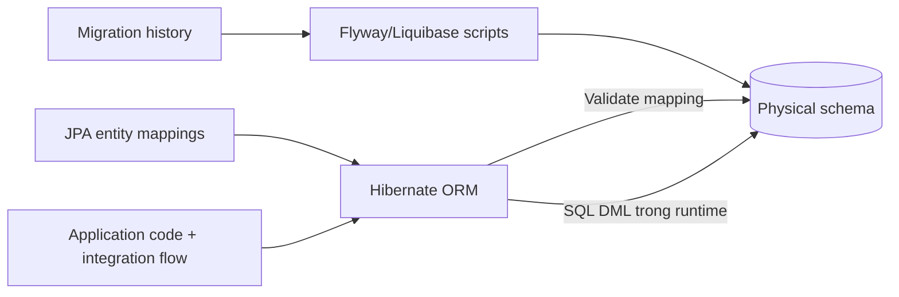
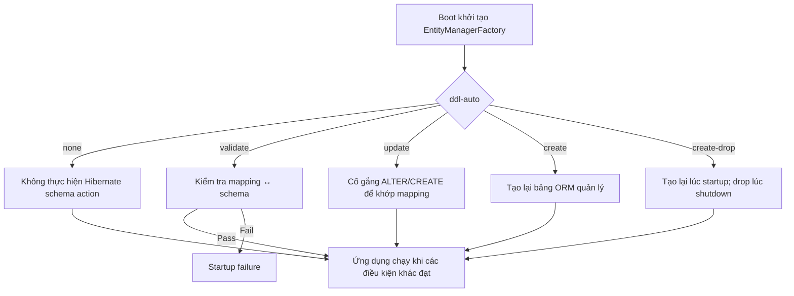
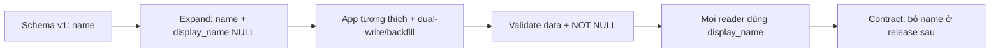
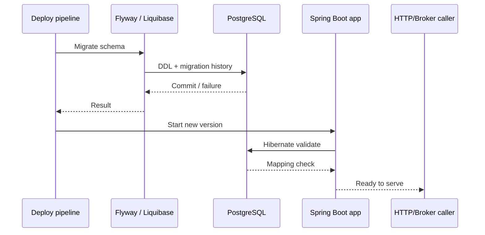
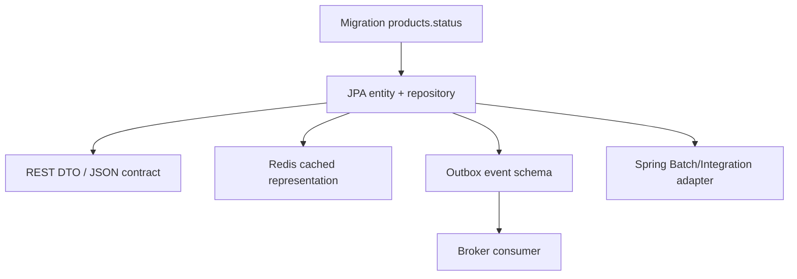
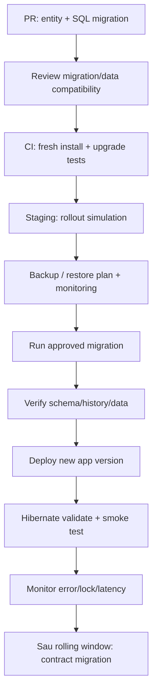
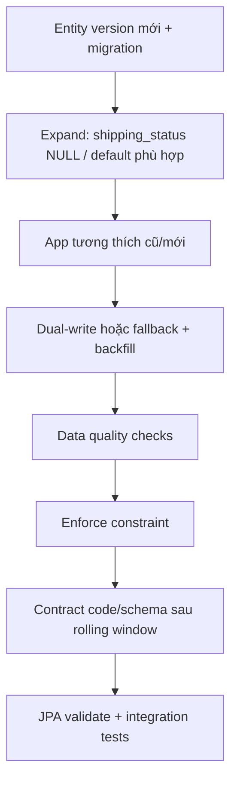

# Lựa chọn chiến lược quản lý schema và giới hạn ddl-auto

## 1. Vì sao schema phải được quản lý như một hợp đồng tích hợp?

Trong **SPRING_BOOT_INTEGRATION**, ứng dụng Spring Boot thường kết nối HTTP client, database, Redis cache, broker thông điệp và các adapter của Spring Integration. Một đơn hàng được lưu qua JPA/Hibernate có thể đồng thời tạo outbox event, sau đó được consumer khác đọc và làm mới cache. Nếu cấu trúc database thay đổi không có kế hoạch, lỗi có thể xuất hiện ở nhiều lớp:

- Hibernate khởi động nhưng một câu truy vấn gặp lỗi `column does not exist`.
- Một API đã bắt đầu ghi trường mới trong khi consumer hoặc job cũ chưa hiểu dữ liệu.
- Schema mới thêm ràng buộc `NOT NULL` trong lúc các instance phiên bản cũ vẫn đang ghi giá trị thiếu.
- Một migration giữ lock quá lâu, khiến HTTP request timeout và broker consumer tăng số lần redelivery.
- Một developer dùng `ddl-auto=create` trên database có dữ liệu thật, làm mất các bảng được Hibernate quản lý.
- Test chạy với H2 tự sinh schema nên xanh, nhưng production PostgreSQL thiếu index, constraint hoặc khác loại cột.

**Schema database là hợp đồng lưu trữ và trao đổi dữ liệu giữa các phiên bản ứng dụng, job và tích hợp khác nhau**, không chỉ là hình dạng tự động suy ra từ các class `@Entity`. Việc chọn ai sở hữu schema sẽ quyết định độ an toàn khi triển khai, khả năng audit, cách rollback và độ tin cậy của toàn bộ hệ thống.

Bài này tập trung vào chủ đề **“Lựa chọn chiến lược quản lý schema và giới hạn ddl-auto”** của chương **JPA và Hibernate**:

1. Các chế độ `spring.jpa.hibernate.ddl-auto` hoạt động ra sao?
2. Khi nào Boot tự suy luận giá trị mặc định, và vì sao mặc định khác giữa H2 với PostgreSQL?
3. Vì sao `update`, `create` và `create-drop` không thích hợp làm chiến lược migration production?
4. Cách dùng Flyway/Liquibase như nguồn sự thật, kết hợp `validate`.
5. Thiết kế thay đổi schema tương thích khi rolling deployment, batch job và broker consumer cùng hoạt động.
6. Cách kiểm thử và quan sát lỗi migration trong môi trường gần production.

Ví dụ dùng **Spring Boot 3.x, Hibernate 6.x, Jakarta Persistence và PostgreSQL**. Tên property và hành vi mặc định cần được kiểm tra theo đúng phiên bản Spring Boot/Hibernate của dự án; không suy luận từ một bài học khác mà chưa đối chiếu môi trường chạy.

## 2. Phân biệt entity model, database schema và migration history

Ba lớp có trách nhiệm riêng:

| Lớp | Cấu trúc thể hiện | Ai quản lý? | Ví dụ |
| --- | --- | --- | --- |
| **Entity mapping** | Java class, annotation, quan hệ và metadata JPA | Nhóm viết ứng dụng | `@Entity`, `@Table`, `@Column`, `@Version` |
| **Physical schema** | Bảng, cột, index, constraint, view, trigger, quyền DB | Database + quy trình triển khai | `products(id, sku, price)`, unique index |
| **Migration history** | Những thay đổi schema đã chạy, thứ tự và checksum | Flyway/Liquibase hoặc quy trình DBA | `V1__create_products.sql`, `DATABASECHANGELOG` |



Khi `ddl-auto=validate`, Hibernate đối chiếu một phần mapping với schema đang tồn tại. Khi dùng Flyway/Liquibase, **migration** tạo và biến đổi schema. Hai cơ chế bổ trợ: migration **thực hiện thay đổi**, validation **phát hiện một số sai lệch**.

**Một entity không mô tả hết database.** Nó có thể thiếu các quy tắc như partial index, check constraint phức tạp, trigger, stored procedure, quyền truy cập, partition, retention policy hoặc online index strategy. Dựa hoàn toàn vào entity để “sinh schema” có thể bỏ qua những ràng buộc vận hành quan trọng.

### 2.1. Một ví dụ mapping rõ tên cột

```java
package example.integration.catalog;

import java.math.BigDecimal;
import jakarta.persistence.Column;
import jakarta.persistence.Entity;
import jakarta.persistence.GeneratedValue;
import jakarta.persistence.GenerationType;
import jakarta.persistence.Id;
import jakarta.persistence.Table;
import jakarta.persistence.Version;

@Entity
@Table(name = "products")
public class ProductEntity {

    @Id
    @GeneratedValue(strategy = GenerationType.IDENTITY)
    private Long id;

    @Column(name = "sku", nullable = false, length = 64)
    private String sku;

    @Column(name = "display_name", nullable = false, length = 200)
    private String displayName;

    @Column(name = "price", nullable = false, precision = 19, scale = 2)
    private BigDecimal price;

    @Version
    @Column(name = "version", nullable = false)
    private Long version;

    protected ProductEntity() {
        // Constructor cho JPA.
    }

    public ProductEntity(
            String sku,
            String displayName,
            BigDecimal price) {
        this.sku = sku;
        this.displayName = displayName;
        this.price = price;
    }

    public Long getId() { return id; }
    public String getSku() { return sku; }
    public String getDisplayName() { return displayName; }
    public BigDecimal getPrice() { return price; }
    public Long getVersion() { return version; }
}
```

Đây là Java entity; **nó chưa tự chứng minh bảng đã tồn tại hoặc các ràng buộc đã được triển khai**. `@Column(nullable=false)` diễn đạt metadata mapping, nhưng nếu để `ddl-auto=none` hoặc `validate`, Hibernate không tự thêm `NOT NULL` vào database. Quy tắc dữ liệu cần được khai báo trong migration vật lý.

`@Version` hỗ trợ optimistic locking tại ORM; điều đó không thay thế unique business key hay kiểm soát idempotency khi consumer nhận lại broker event.

## 3. Hibernate ddl-auto thực chất kiểm soát điều gì?

Spring Boot có property phổ biến:

```yaml
spring:
  jpa:
    hibernate:
      ddl-auto: validate
```

Thuộc tính `spring.jpa.hibernate.ddl-auto` điều khiển cơ chế **schema management của Hibernate** khi xây dựng `EntityManagerFactory`. Nó không thay thế Flyway/Liquibase, không chạy theo batch business, và không tự tạo quy trình versioning để review, deploy hay rollback.

Các giá trị thường dùng trong Boot 3.x:

| Giá trị | Hành vi cơ bản | Tình huống phù hợp |
| --- | --- | --- |
| `none` | Hibernate không tự tạo, cập nhật, xóa hay validate schema bằng hành động DDL đó | Production nơi schema do migration/DBA quản lý, hoặc lúc muốn Hibernate không chạm schema |
| `validate` | Kiểm tra một phần schema hiện tại có phù hợp entity mapping hay không; sai thì fail startup | CI, staging, production có schema migration trước đó |
| `update` | Hibernate thử thay đổi schema để gần với entity mapping | Thử nghiệm local rất giới hạn; **không** dùng làm migration production |
| `create` | Xây lại schema được ORM quản lý khi startup, thường làm mất dữ liệu của các bảng tương ứng | Demo/test dùng database dùng một lần |
| `create-drop` | Tạo lại schema lúc startup và cố gắng drop khi `SessionFactory` đóng | Demo/test ephemeral, không dùng với dữ liệu cần giữ |

**Cảnh báo lớn:** `create` và `create-drop` là các lựa chọn có tác động phá hủy dữ liệu. Không bật chúng trên database dùng chung hoặc môi trường có dữ liệu cần bảo tồn. Đừng nghĩ `create-drop` chỉ xóa bảng sau khi test thành công: nó có thể drop/recreate **ngay lúc khởi động**.



Sơ đồ là mô hình logic. Với `update`/`create`, nếu database không cho phép hoặc DDL thất bại, việc startup có thể gặp exception; **không mặc định xem đường từ E/F/G tới H là chắc chắn thành công**.

### 3.1. ddl-auto không phải schema version

`ddl-auto` không lưu lịch sử có cấu trúc như “migration V12 đã chạy và checksum hợp lệ”. Hibernate có thể suy luận một số thay đổi schema từ entity mới, nhưng không biết ý định nghiệp vụ khi bạn:

- Đổi tên cột `name` thành `display_name`.
- Chuyển chuỗi trạng thái sang enum.
- Tách một bảng thành hai bảng.
- Hợp nhất hai cột thành một.
- Chuyển đổi định dạng tiền tệ/đơn vị thời gian.
- Cần backfill dữ liệu cũ theo logic business.
- Cần giữ tương thích với instance ứng dụng phiên bản trước trong rolling deployment.

Đó là việc của **migration được thiết kế**, không phải “auto update mapping”.

## 4. Mặc định ddl-auto của Spring Boot có thể gây bất ngờ

Không khai báo `ddl-auto` **không có nghĩa mọi môi trường cùng một hành vi**.

Trong Spring Boot 3.x, khi Hibernate schema management được auto-configure theo cơ chế thông dụng:

- Nếu datasource là **embedded database** mà Boot nhận diện (như H2/HSQLDB/Derby) **và không có một schema manager như Flyway/Liquibase**, Boot thường mặc định `create-drop`.
- Với database không embedded như PostgreSQL/MySQL, hoặc khi một schema manager phù hợp có mặt, mặc định thông dụng là `none`.

Hệ quả: dự án chỉ dùng H2 trong unit/integration test có thể tự tạo bảng từ entity, nhưng chuyển sang PostgreSQL production thì Boot **không tự tạo schema** nữa.

| Môi trường | Tình huống | Dự đoán an toàn |
| --- | --- | --- |
| Demo H2 in-memory không migration tool | Có thể dùng mặc định `create-drop` | Schema được tạo rồi bỏ, không chứng minh production migration đúng |
| Local PostgreSQL không Flyway | Mặc định thường `none` | Cần tạo schema bằng công cụ khác hoặc cấu hình dev có chủ đích |
| PostgreSQL có Flyway/Liquibase | Migration tool sở hữu DDL | Đặt `validate`/`none` tường minh để rõ trách nhiệm |
| Production nhiều replica | Không để mỗi instance tự quyết định DDL | Chạy migration được điều phối, app validate |
| CI dùng Testcontainers PostgreSQL | Chạy cùng migration như production | Kết hợp `validate` và test contract |

**Đề xuất:** với ứng dụng thực tế, ghi rõ `ddl-auto` trong profile quan trọng thay vì dựa vào mặc định. Khi tăng major version Spring Boot hoặc thêm Flyway/Liquibase, hãy kiểm tra condition report và cấu hình đã resolve.

### 4.1. Đừng suy từ biến JPA sang thực tế database

`spring.jpa.show-sql=true` chỉ hỗ trợ xem SQL do Hibernate phát ra; nó không làm schema được tạo hay cập nhật. `spring.jpa.hibernate.ddl-auto` khác `spring.sql.init.mode` và khác `spring.flyway.enabled`. Ba nhóm có vai trò riêng sẽ được phân biệt ở phần sau.

## 5. Vì sao update đặc biệt nguy hiểm ở production?

`ddl-auto=update` nghe hấp dẫn vì có thể thêm cột mới sau khi thay entity. Nhưng trong một hệ thống cần dữ liệu bền vững và rolling deployment, đây là một chiến lược rủi ro.

### 5.1. Rename không phải “drop cũ + add mới”

Trước khi sửa:

```sql
CREATE TABLE products (
    id BIGINT PRIMARY KEY,
    name VARCHAR(200) NOT NULL
);
```

Entity phiên bản mới có thuộc tính `displayName` ánh xạ tới `display_name`. Hibernate không có một migration business xác định rằng `name` **được đổi tên** thành `display_name`; nó có thể coi đây là một cột mới thay vì chuyển dữ liệu.

Kết quả có thể là dữ liệu cũ không được backfill, application đọc `null` ở cột mới, hoặc DDL thất bại vì ràng buộc `NOT NULL`. Việc `update` có tạo/giữ/bỏ một cột cụ thể như thế nào phụ thuộc phiên bản Hibernate, dialect và trạng thái database; **không thể sử dụng nó làm cam kết an toàn dữ liệu**.

### 5.2. Không có quy trình review thay đổi dữ liệu

Các rủi ro:

- Thay đổi loại cột, kích thước, precision có thể cần chuyển đổi dữ liệu có kiểm soát.
- Một unique constraint mới có thể không tạo được vì dữ liệu cũ đã trùng.
- Các index lớn có thể giữ lock hoặc gây tăng I/O khi tạo.
- Một DDL chạy lâu có thể làm connection pool cạn, ảnh hưởng HTTP/broker consumer.
- Không có versioned history cho biết trạng thái nào đã áp dụng vào DB nào.
- Không có script rollback hoặc kế hoạch forward-fix được review.

**Quy tắc production:** không dùng Hibernate `update` để làm migration. Hãy giữ entity mapping là mô hình runtime và quản lý DDL bằng công cụ/schema pipeline có version.

## 6. create và create-drop: chỉ cho database dùng một lần

`create` và `create-drop` hữu ích cho demo cực nhỏ hoặc một số test ngắn, nhưng phải biết chúng có thể phá hủy dữ liệu.

Ví dụ **chỉ trong test profile ephemeral**:

```yaml
# application-local-ephemeral.yml — chỉ dùng DB tạm, không có dữ liệu cần giữ
spring:
  jpa:
    hibernate:
      ddl-auto: create-drop
```

Đừng đặt file này làm mặc định cho shared development, staging hoặc production. Một container PostgreSQL local có named volume cũng có thể giữ dữ liệu có giá trị đối với developer; container chạy local **không tự nghĩa disposable**.

### 6.1. import.sql của Hibernate là một bẫy khác

Khi Hibernate tự tạo schema theo một số chế độ như `create`/`create-drop`, resource `import.sql` trên classpath có thể được Hibernate chạy để nạp dữ liệu. Điều đó phù hợp demo/test nhưng không phải cơ chế seed data được quản lý phiên bản cho production.

Nếu dự án vô tình đóng gói `import.sql` chứa dữ liệu mẫu hay thao tác phá hủy, việc bật `create` có thể gây tác động ngoài ý muốn. Với dữ liệu nền nghiệp vụ, nên đưa seed/reference-data phù hợp vào migration có phiên bản hoặc một quy trình import có kiểm soát.

### 6.2. Test xanh nhờ create-drop chưa chứng minh migration đúng

Một bài test chỉ có:

```yaml
spring:
  datasource:
    url: jdbc:h2:mem:testdb
  jpa:
    hibernate:
      ddl-auto: create-drop
```

có thể khởi động thành công dù dự án **thiếu toàn bộ file Flyway/Liquibase production**. Khi deploy sang PostgreSQL, ứng dụng sẽ fail vì bảng không tồn tại hoặc thiếu constraint.

Giữ loại test H2 này cho logic ORM nhanh khi phù hợp; dùng PostgreSQL container và chạy migration thực trong lớp test tích hợp để bảo vệ contract schema production.

## 7. Chiến lược khuyến nghị theo môi trường

| Môi trường | Ai sở hữu thay đổi schema? | ddl-auto | Giải thích |
| --- | --- | --- | --- |
| Unit test không cần DB | Không có schema thật | Không áp dụng | Mock repository hoặc test domain |
| Demo H2 dùng một lần | Hibernate có thể tạo tạm | `create-drop` | Dữ liệu có thể mất |
| Developer local có Flyway | Flyway/Liquibase | `validate` | Giữ parity với prod và phát hiện thiếu migration |
| Integration test Testcontainers | Chạy versioned migrations | `validate` | Kiểm tra với DB engine/version thực |
| Staging/UAT | Pipeline migration | `validate` | Fail sớm nếu entity/schema lệch |
| Production | Pipeline/DBA/chủ sở hữu schema | `validate` hoặc `none` có lý do | Không để ORM tự điều chỉnh DDL |
| Schema do hệ thống bên ngoài sở hữu | DBA/external platform | `validate` khi được, hoặc `none` | ORM phải phù hợp contract, không tự sửa |

**`validate` không phải một migration tool**, nhưng hữu ích để chặn phiên bản ứng dụng mới khởi động khi mapping đòi cột/bảng chưa có. Trong một số hệ thống phức tạp, validation có thể chưa bao quát mọi loại DB object hoặc không khả thi do mapping đặc biệt; khi dùng `none` phải có **schema compatibility checks khác**.

Một cấu hình production minh họa:

```yaml
spring:
  jpa:
    hibernate:
      ddl-auto: validate
  flyway:
    enabled: true
    locations: classpath:db/migration
```

Đặt `ddl-auto=validate` sau khi migration tương ứng đã chạy. Nếu Hibernate không thể validate một mapping nâng cao theo dialect, cần test các truy vấn thực tế, không nên tắt validation rồi xem vấn đề đã được xử lý.

## 8. Flyway: dùng migration SQL có version làm nguồn sự thật

**Flyway** là công cụ phổ biến để quản lý thay đổi schema qua các file migration. Thay vì để ORM tự suy ra DDL, nhóm phát triển review từng thay đổi SQL cùng ứng dụng.

### 8.1. Thêm dependency

Với Maven và Spring Boot BOM:

```xml
<dependency>
    <groupId>org.flywaydb</groupId>
    <artifactId>flyway-core</artifactId>
</dependency>
```

Đối với các phiên bản Flyway mới hỗ trợ PostgreSQL thông qua module database-specific, có thể cần thêm:

```xml
<dependency>
    <groupId>org.flywaydb</groupId>
    <artifactId>flyway-database-postgresql</artifactId>
</dependency>
```

Việc cần thêm module PostgreSQL tùy phiên bản Flyway/Spring Boot đang dùng; kiểm tra dependency resolution và khả năng nhận diện database. Spring Boot auto-configure Flyway khi dependency và datasource phù hợp, và thường chạy migration lúc khởi động ứng dụng trừ khi đã tách quy trình migration ra ngoài.

### 8.2. File SQL đầu tiên

Đặt trong source resource của ứng dụng:

```text
src/main/resources/
└── db/
    └── migration/
        ├── V1__create_products.sql
        ├── V2__add_product_status.sql
        └── V3__require_product_status.sql
```

Ví dụ `V1__create_products.sql` cho PostgreSQL, tương thích về mặt chủ đích với `ProductEntity` ở mục 2:

```sql
CREATE TABLE products (
    id BIGINT GENERATED BY DEFAULT AS IDENTITY PRIMARY KEY,
    sku VARCHAR(64) NOT NULL,
    display_name VARCHAR(200) NOT NULL,
    price NUMERIC(19, 2) NOT NULL,
    version BIGINT NOT NULL DEFAULT 0,
    CONSTRAINT uq_products_sku UNIQUE (sku),
    CONSTRAINT ck_products_price_non_negative CHECK (price >= 0)
);

CREATE INDEX idx_products_display_name
    ON products (display_name);
```

JPA `@Column` không mô tả tường minh hết các chi tiết trên. Unique/check constraints và index được bảo đảm bởi **database**, không chỉ bởi validation annotation ở Java.

**Vì sao có default cho version?** DDL chuẩn bị giá trị cho những nguồn ghi ngoài JPA theo contract. Hibernate có thể tự quản lý version khi persist/update entity; schema default không thay cơ chế optimistic locking của JPA.

### 8.3. Một migration phải có mục đích và dấu vết

Flyway ghi lịch sử vào bảng `flyway_schema_history` trong cấu hình mặc định phổ biến. Mỗi migration versioned được ghi trạng thái và checksum để phát hiện đã chạy hay file đã bị chỉnh sửa sau khi áp dụng.

Quy tắc:

1. Dùng quy ước tên `V<version>__<description>.sql` và review như source code.
2. **Không sửa một migration versioned đã chạy ở môi trường chia sẻ** chỉ để đổi kết quả. Tạo migration mới.
3. Chạy validate/checksum và phát hiện schema drift trong CI.
4. Tránh chạy lại migration không idempotent bằng script tay ngoài Flyway.
5. Ghi rõ điều kiện data backfill, estimated duration và khả năng rollback/forward-fix.

Một file kiểu `R__refresh_views.sql` có thể dùng cho repeatable migrations trong các trường hợp như tạo lại view/function. Repeatable migration có semantics chạy lại khi checksum thay đổi; **không** dùng tùy tiện cho thao tác backfill khối lượng lớn không thể chạy lại an toàn.

### 8.4. Flyway không tự đảm bảo zero downtime

Có bảng lịch sử và locking của migration tool giúp tránh nhiều tiến trình cùng áp DDL cạnh tranh trong một số trường hợp, nhưng **không bảo đảm migration tương thích ứng dụng đang chạy**. Thay đổi phá vỡ hợp đồng vẫn có thể khiến request cũ fail trong khi rolling deployment.

Flyway là công cụ thực thi/quản lý phiên bản; chiến lược **expand–migrate–contract** mới xử lý được vấn đề tương thích (phần 12).

## 9. Liquibase: changelog và changeset được quản lý

**Liquibase** là lựa chọn khác với Flyway. Nó quản lý **changelog** cùng các changeset có định danh, author, preconditions và khả năng mô tả thay đổi theo YAML/XML/JSON hoặc SQL.

Dependency Maven:

```xml
<dependency>
    <groupId>org.liquibase</groupId>
    <artifactId>liquibase-core</artifactId>
</dependency>
```

Ví dụ cấu hình:

```yaml
spring:
  liquibase:
    enabled: true
    change-log: classpath:db/changelog/db.changelog-master.yaml
  jpa:
    hibernate:
      ddl-auto: validate
```

Một changelog rút gọn:

```yaml
databaseChangeLog:
  - changeSet:
      id: "001-create-products"
      author: "integration-team"
      changes:
        - createTable:
            tableName: products
            columns:
              - column:
                  name: id
                  type: BIGINT
                  autoIncrement: true
                  constraints:
                    primaryKey: true
                    nullable: false
              - column:
                  name: sku
                  type: VARCHAR(64)
                  constraints:
                    nullable: false
```

Ví dụ Liquibase trên **chỉ minh họa cấu trúc changelog**, không tạo đủ bảng `products` tương ứng với `ProductEntity` ở mục 2. Một migration thật phải bổ sung các cột, constraint và index còn thiếu trước khi dùng `ddl-auto=validate`.

Liquibase thường ghi lịch sử vào các bảng `DATABASECHANGELOG` và `DATABASECHANGELOGLOCK`. Cơ chế precondition có thể giúp kiểm tra điều kiện môi trường, nhưng không thể thay thế việc xem xét data contract hoặc rollback phức tạp.

### 9.1. Flyway hay Liquibase?

| Tiêu chí | Flyway | Liquibase |
| --- | --- | --- |
| Nơi mô tả thay đổi | Thường SQL có version | Changelog có changeset/SQL |
| Điểm mạnh điển hình | Quy trình SQL rõ ràng, dễ code review | Changelog, metadata và preconditions |
| Lịch sử | `flyway_schema_history` | `DATABASECHANGELOG` |
| Rollback | Phụ thuộc version/tool/quy trình, thường forward-fix | Có cơ chế rollback cho một số changeset, vẫn cần review |
| Phù hợp | Nhóm thích quản lý SQL trực tiếp | Nhóm cần DSL, preconditions, workflow changelog |

**Chọn một công cụ làm nguồn sự thật cho cùng một schema.** Đừng bật Flyway và Liquibase cùng chạy DDL lên các bảng giống nhau nếu không có một kiến trúc sở hữu/phân chia rõ ràng. Dù chọn công cụ nào, production cần mã migration được review, lịch sử đáng tin cậy và kế hoạch phục hồi.

## 10. Phân biệt ddl-auto, spring.sql.init và migration tool

Spring Boot còn có khả năng init database từ `schema.sql` và `data.sql`. Đây là nguồn gây nhầm lẫn khi triển khai.

| Cơ chế | Thuộc tính/điểm kích hoạt | Dùng làm gì? | Rủi ro khi trộn |
| --- | --- | --- | --- |
| Hibernate schema management | `spring.jpa.hibernate.ddl-auto` | Tạo/update/validate mapping | Có thể conflict với migration |
| Spring SQL initialization | `spring.sql.init.mode` và script `schema.sql`/`data.sql` | Script đơn giản, seed cho demo/test hoặc môi trường phù hợp | Thứ tự tạo bảng/nạp dữ liệu và chạy lặp |
| Flyway | `spring.flyway.*` | Versioned SQL migrations | Hai công cụ cùng tạo bảng hoặc chỉnh schema |
| Liquibase | `spring.liquibase.*` | Changelog/changesets | Chồng lấn ownership DDL |
| Hibernate `import.sql` | Có thể chạy khi Hibernate tạo schema | Demo data theo Hibernate | Vô tình nạp dữ liệu mẫu hoặc thao tác không mong muốn |

Ví dụ init mode:

```yaml
spring:
  sql:
    init:
      mode: never
```

`spring.sql.init.mode=never` vô hiệu việc Spring Boot tự chạy `schema.sql`/`data.sql` theo đường SQL initialization; **nó không tắt Flyway hoặc Hibernate ddl-auto**.

Nếu cần script `data.sql` chạy sau Hibernate tạo schema trong một trường hợp demo, Spring Boot có `spring.jpa.defer-datasource-initialization=true` để điều chỉnh trình tự tương ứng. **Không nên dùng kết hợp đó như chiến lược chính cho production**; việc mixing nhiều cơ chế schema/data initialization sẽ làm khó truy vết nguồn DDL.

### 10.1. Tránh “trôi qua” vì profile local

Một project có thể có:

```yaml
# application-dev.yml
spring:
  jpa:
    hibernate:
      ddl-auto: update
```

Nếu CI chỉ kiểm tra dev profile, migration SQL bị thiếu mà không ai biết. Tốt hơn: cho local integration test chạy cùng migrations; nếu muốn một profile demo disposable, đặt tên rõ và cô lập tuyệt đối khỏi datasource thật.

## 11. Khi nào Hibernate validate là đủ và khi nào không?

`ddl-auto=validate` thường giúp phát hiện mapping tham chiếu đến bảng/cột chưa có hoặc một số kiểu dữ liệu không tương thích. Nó **không phải chứng thư toàn diện cho tính đúng đắn của database**.

Các thứ validation có thể không bao quát đầy đủ, tùy dialect/version:

- Index nào đang tồn tại, b-tree/GIN/GiST/covering/partial index và hiệu năng truy vấn.
- `CHECK` constraint, uniqueness theo biểu thức, deferrable constraint, trigger.
- Quyền `SELECT`/`INSERT`/`UPDATE`/`DELETE` của database user.
- Schema version, lịch sử migration và checksum.
- Data backfill đã hoàn tất hay chưa; số dòng chứa giá trị không hợp lệ.
- Trạng thái replication/failover, lock contention và transaction isolation.
- Contract giữa DTO API, outbox event và những consumer đang chạy phiên bản cũ.

**Nên kết hợp ba loại kiểm tra:**

1. **Migration validation**: Flyway/Liquibase kiểm tra lịch sử/changesets.
2. **Mapping validation**: Hibernate `validate` phát hiện sai lệch ORM liên quan.
3. **Application/integration tests**: chạy query, insert/update, constraint và luồng nghiệp vụ trên DB engine thật.

Ví dụ một unique constraint được định nghĩa trong Flyway cần test bằng cách cố ghi hai `sku` trùng và xác minh database từ chối, thay vì chỉ nhìn `@Column(unique=true)` trong Java.

## 12. Expand–migrate–contract: thay đổi schema khi ứng dụng rolling deploy

Khi nhiều replica Spring Boot chạy đồng thời, bản cũ và bản mới có thể dùng chung database trong một khoảng thời gian. Một migration “đúng với entity mới” có thể **sai với bản cũ vẫn đang phục vụ request**.

Mẫu **expand–migrate–contract** chia thay đổi thành các bước tương thích.

### 12.1. Ví dụ đổi tên cột name thành display_name

Giả sử DB ban đầu có `products.name`. Mục tiêu là chuyển sang `products.display_name` mà không dừng toàn bộ Order/Catalog Service.

**Bước A – Expand:** thêm cột mới cho phép null, giữ cột cũ.

```sql
ALTER TABLE products
    ADD COLUMN display_name VARCHAR(200);
```

Trong giai đoạn này, các ứng dụng cũ vẫn ghi `name`. Bản mới có thể đọc fallback từ `name` khi `display_name` chưa có, hoặc có cơ chế dual-write đúng với hợp đồng. **Không thêm `NOT NULL` ngay** nếu còn dữ liệu cũ hoặc writer cũ chưa ghi cột mới.

**Bước B – Deploy ứng dụng tương thích:**

- Bản mới hiểu **cả hai cột** và có chiến lược chuyển tiếp đã được kiểm thử.
- Các đường ghi mới cập nhật cả cột cũ và cột mới trong cùng transaction nếu cần.
- Các job batch, CDC consumer, import/export và reporting SQL được cập nhật theo từng giai đoạn.
- Không được để một writer cũ tiếp tục cập nhật `name` nhưng bản mới chỉ đọc `display_name` mà không có đồng bộ/fallback; điều đó tạo dữ liệu lệch.

**Bước C – Backfill theo lô có kiểm soát:**

```sql
UPDATE products
SET display_name = name
WHERE display_name IS NULL;
```

Câu SQL trên minh họa logic. Với bảng lớn, không chạy một transaction UPDATE toàn bảng giữa giờ cao điểm; hãy chia keyset chunks, giới hạn transaction, đo lock/replication lag và cho phép resume. Cần rà soát trường hợp `name` null hoặc vượt giới hạn `VARCHAR(200)`.

**Bước D – Ràng buộc và chuyển đọc:**

Khi toàn bộ data đã backfill và các writer đều ghi cột mới, có thể áp validation/constraint:

```sql
ALTER TABLE products
    ALTER COLUMN display_name SET NOT NULL;
```

Quy tắc trên cần kiểm tra trước bằng câu truy vấn đếm bản ghi null và lên lịch DDL phù hợp tải DB. Một số kiểu thay đổi constraint có kỹ thuật giảm lock riêng theo database.

**Bước E – Contract:** chỉ xóa `name` khi chắc chắn không còn ứng dụng, job, report, migration rollback path hoặc consumer cũ phụ thuộc vào nó.

```sql
-- Chỉ trong một đợt release sau khi xác minh đầy đủ:
ALTER TABLE products
    DROP COLUMN name;
```

**Không gom cả năm bước vào một migration chạy ngay trước rolling deployment**. Khi cần rollback application, schema phải tiếp tục tương thích với binary trước đó trong khoảng thời gian rollback đã cam kết.



### 12.2. Thay đổi kiểu dữ liệu cũng là migration business

Ví dụ đổi `price` từ `DOUBLE PRECISION` sang `NUMERIC(19,2)`: phải định nghĩa cách làm tròn, overflow, tiền tệ và dữ liệu lỗi. Tạo cột mới, backfill có kiểm soát rồi cutover có thể an toàn hơn một `ALTER COLUMN TYPE` trên bảng khổng lồ.

Đặc biệt trong tích hợp, DTO JSON, Redis cached value, Avro/Protobuf schema và outbox event version có thể vẫn chứa kiểu cũ. **Schema DB tương thích chưa đủ để hệ thống tích hợp tương thích.**

## 13. Data migrations, indexes và khóa bảng lớn

Một migration thay đổi cột chỉ là một phần công việc. Dữ liệu hiện có có thể cần chuyển đổi hoặc làm sạch trước khi thêm constraint.

Ví dụ thêm trạng thái cho `products`, với Flyway:

```sql
-- V2__add_product_status.sql
ALTER TABLE products
    ADD COLUMN status VARCHAR(16);
```

Sau đó backfill theo logic đã được thống nhất:

```sql
-- Logic minh họa; với bảng lớn cần batch/chunk.
UPDATE products
SET status = 'ACTIVE'
WHERE status IS NULL;
```

Chỉ sau khi kiểm tra không còn null và writer đã cập nhật mới áp constraint:

```sql
-- V3__require_product_status.sql
ALTER TABLE products
    ALTER COLUMN status SET NOT NULL;

ALTER TABLE products
    ADD CONSTRAINT ck_products_status
        CHECK (status IN ('ACTIVE', 'INACTIVE'));
```

**Các bước trên phải được phối hợp theo release.** Nếu V2/V3 chạy cùng một lần trước khi bản cũ ngừng ghi, một instance cũ có thể tiếp tục INSERT product không có `status`, khiến constraint mới gây lỗi. Có thể cần default tạm thời hoặc dual-write trước khi constraint; quyết định dựa trên rolling window và writer contract.

### 13.1. Tạo index cũng có rủi ro vận hành

Một câu `CREATE INDEX` trên bảng lớn có thể tiêu tốn I/O và ảnh hưởng lock/throughput. PostgreSQL hỗ trợ `CREATE INDEX CONCURRENTLY` trong các tình huống cần giảm blocking writes, nhưng câu lệnh đó **không thể chạy trong transaction block thông thường**. Khi dùng Flyway/Liquibase, phải cấu hình migration execution tương ứng và kiểm chứng khả năng rollback/cleanup nếu index creation fail.

Không mặc định tất cả DDL là atomic trên mọi hệ quản trị:

- PostgreSQL hỗ trợ transaction cho nhiều DDL, nhưng có các ngoại lệ như concurrent index operations.
- MySQL/MariaDB có ngữ nghĩa DDL/implicit commit khác.
- SQL Server/Oracle cũng có ràng buộc và locking behavior riêng.

**Không copy migration PostgreSQL sang H2/MySQL chỉ vì Hibernate entity tương tự.** Test migration trên cùng database engine và phiên bản tương thích với production.

### 13.2. Viết migration có thể giám sát và resume

Đối với backfill hàng triệu dòng, cân nhắc:

- Đánh dấu tiến độ theo primary key/keyset, không OFFSET toàn bảng nếu đắt.
- Chunk transaction nhỏ, có giới hạn lock duration và connection usage.
- Đặt timeout cho DDL theo chính sách DBA, không retry vô hạn khi lock.
- Theo dõi row count, replication lag, CPU/I/O và deadlock.
- Có checkpoint để chạy lại an toàn (idempotent update).
- Test với dữ liệu bẩn: duplicate, null, Unicode, overflow, orphan FK.
- Có đường dừng/khôi phục khi deployment giữa chừng.

## 14. Migration và @Transactional: hai ranh giới khác nhau

`@Transactional` trên service quản lý transaction business runtime, còn schema migration thường chạy **trước khi service nhận traffic** trong giai đoạn startup/deployment.



Cách sắp đặt trên có ưu điểm: migration failure có thể chặn rollout trước khi ứng dụng mới phục vụ traffic. Nhưng không phải hệ thống nào cũng có bước migration riêng: Spring Boot có thể **tự chạy Flyway/Liquibase lúc startup**. Nếu nhiều replica khởi động cùng lúc, migration tool có cơ chế phối hợp history/lock ở database, nhưng việc rollout vẫn phải tính đến DDL lock và compatibility của app cũ.

### 14.1. Không chạy create-drop trong transaction nghiệp vụ

`ddl-auto=create-drop` được thực hiện theo lifecycle của Hibernate/EntityManagerFactory, không phải “tự rollback khi một HTTP request thất bại”. Không xem việc xóa bảng của Hibernate như một câu lệnh thuộc transaction business của Order Service.

### 14.2. Thứ tự migration và JPA startup

Khi dùng Boot auto-configuration cho Flyway/Liquibase và JPA, framework có cơ chế sắp xếp startup dependencies để migration xảy ra trước các bean cần database trong các tình huống được hỗ trợ. Tuy nhiên nếu ứng dụng có **multiple datasources**, custom `EntityManagerFactory`, manual Flyway beans hoặc migration tool chạy bên ngoài, cần xác nhận thứ tự thật.

Không tự thêm một `@PostConstruct` gọi repository vào bean cấu hình rồi tin schema chắc chắn sẵn sàng. Startup ordering phải được test trên application context dự kiến.

## 15. Nhiều datasource, schema và quyền sở hữu database

Một hệ thống tích hợp có thể có:

- Database PostgreSQL của Order Service.
- Database phục vụ báo cáo/analytics.
- Database legacy chỉ được phép đọc.
- Schema riêng cho integration outbox/inbox.
- Nhiều tenant dùng schema khác nhau.

**Không dùng một `ddl-auto` duy nhất như phép bảo đảm mọi nguồn dữ liệu đã đúng.** Với multiple `DataSource`/`EntityManagerFactory`, mỗi factory có cấu hình Hibernate và transaction manager riêng; migration tool cũng cần biết nó chạy vào datasource/schema nào.

### 15.1. Tránh chạy migration nhầm database

Cần kiểm tra các nhóm cấu hình:

| Cấu hình | Câu hỏi |
| --- | --- |
| `spring.datasource.url`/credentials | Ứng dụng đang trỏ đến DB nào? |
| `spring.flyway.url` hoặc datasource Flyway tùy chỉnh | Flyway có chạy cùng DB của JPA không? |
| `spring.flyway.schemas`/`default-schema` | Migration history và objects được tạo trong schema nào? |
| `spring.jpa.properties.hibernate.default_schema` | ORM đang resolve tên bảng về schema nào? |
| Privileges của DB user | App có quyền đọc/ghi hay vô tình có quyền DDL production? |
| Tenant routing | Migration có áp cho mọi tenant chưa? |

Không tự đặt `spring.flyway.url` cho một database khác rồi để JPA dùng `spring.datasource.url` mà không có chủ đích. Có thể thấy Flyway “migrate successfully” nhưng Hibernate vẫn báo thiếu bảng vì hai thành phần đang kết nối **hai schema khác nhau**.

### 15.2. Quyền hạn nên được tách

Trong production, có thể sử dụng:

- **Migration identity**: quyền DDL có kiểm soát, chỉ hoạt động trong deployment.
- **Application runtime identity**: quyền DML tối thiểu cho những bảng cần thiết, không có quyền drop/alter nếu không cần.
- **Read-only integration identity**: chỉ quyền truy vấn cho hệ thống báo cáo.

Tách quyền giảm nguy cơ một lỗi cấu hình `ddl-auto=create` có thể thực thi DDL phá hủy trong production. Nhưng chỉ hạn chế privilege không đủ thay cho kiểm thử; application có thể fail startup nếu cố thực hiện DDL với tài khoản không có quyền.

## 16. JPA schema thay đổi ảnh hưởng HTTP, cache và broker ra sao?

Schema change là thay đổi nội bộ database nhưng có thể làm thay đổi hợp đồng các kênh tích hợp.



### 16.1. HTTP client và data contract

Nếu entity thêm trường `status`, không nên tự trả nguyên entity JPA qua REST API rồi vô tình đổi JSON schema. Dùng DTO có hợp đồng rõ, version/migration khi cần, validation ở controller và adapter.

Một consumer HTTP cũ có thể bỏ qua field mới, nhưng không nên mặc định mọi JSON serializer/client đều chịu được unknown field. Có contract tests ở cả provider và consumer.

### 16.2. Redis cached value và schema version

Redis key `products:sku-1` có thể chứa JSON/serialized object của entity cũ. Sau deploy, app mới có thể deserialize lỗi hoặc hiểu sai field thiếu. Cân nhắc:

- DTO cache riêng với schema version.
- Prefix key dạng `catalog:product:v2:sku-1` để tránh dùng giá trị cũ.
- TTL/eviction strategy và khả năng cache stampede khi invalidation hàng loạt.
- Không cache trực tiếp JPA entity với lazy proxies nếu không có chủ đích.

`ddl-auto=validate` **không kiểm tra** schema dữ liệu đang lưu trong Redis.

### 16.3. Broker events và outbox

Outbox có thể lưu JSON event. Một thay đổi DB column không tự migrate những event cũ đã phát hoặc còn nằm trong outbox. Nếu schema event thay đổi, cần:

- `eventType`, `eventId` và `schemaVersion` ổn định.
- Producer/consumer contract với khả năng đọc event version cũ.
- Không thay `eventId` khi retry/replay.
- Consumer inbox/unique constraint để chống side effect trùng.
- Quy trình reprocess nếu event cũ có representation không còn tương thích.

### 16.4. Batch jobs và read models

Spring Batch và JDBC/jOOQ queries có thể tham chiếu thẳng tên bảng/cột. Hibernate validate không phát hiện SQL viết tay trong job đọc `products.name` sau khi cột đã bị xóa. Vì vậy cần search/query contract tests, view compatibility hoặc giai đoạn contract được lên lịch sau khi tất cả jobs đã nâng cấp.

## 17. Kiểm thử migration với PostgreSQL và Testcontainers

### 17.1. Vì sao không chỉ dùng H2?

H2 hữu ích cho unit test nhanh, nhưng có khác biệt với PostgreSQL về:

- Kiểu dữ liệu `NUMERIC`, timestamp/timezone, JSONB, enum, identity.
- Case sensitivity, identifier quoting và naming.
- DDL transaction/lock, index, unique constraint và collations.
- SQL dialect, generated SQL và transaction isolation.
- Các tính năng riêng như `CREATE INDEX CONCURRENTLY`, partial index, constraint validation.

Đối với migration production, hãy chạy test trên PostgreSQL (cùng major version hoặc gần tương đương production) qua Testcontainers hoặc một DB test environment được quản lý.

### 17.2. Maven dependencies tối thiểu

```xml
<dependency>
    <groupId>org.springframework.boot</groupId>
    <artifactId>spring-boot-starter-data-jpa</artifactId>
</dependency>
<dependency>
    <groupId>org.postgresql</groupId>
    <artifactId>postgresql</artifactId>
    <scope>runtime</scope>
</dependency>
<dependency>
    <groupId>org.flywaydb</groupId>
    <artifactId>flyway-core</artifactId>
</dependency>
<dependency>
    <groupId>org.flywaydb</groupId>
    <artifactId>flyway-database-postgresql</artifactId>
</dependency>
<dependency>
    <groupId>org.springframework.boot</groupId>
    <artifactId>spring-boot-starter-test</artifactId>
    <scope>test</scope>
</dependency>
<dependency>
    <groupId>org.testcontainers</groupId>
    <artifactId>postgresql</artifactId>
    <scope>test</scope>
</dependency>
<dependency>
    <groupId>org.testcontainers</groupId>
    <artifactId>junit-jupiter</artifactId>
    <scope>test</scope>
</dependency>
```

Project dùng Spring Boot BOM để quản lý versions tương thích. Một số phiên bản Flyway có cách đóng gói database support khác; kiểm tra dependency graph thực tế và hướng dẫn version đang dùng, không copy máy móc giữa major versions.

### 17.3. Integration test: Flyway migrate trước, Hibernate validate sau

```java
package example.integration.catalog;

import static org.assertj.core.api.Assertions.assertThat;

import org.junit.jupiter.api.Test;
import org.springframework.beans.factory.annotation.Autowired;
import org.springframework.boot.test.context.SpringBootTest;
import org.springframework.jdbc.core.JdbcTemplate;
import org.springframework.test.context.DynamicPropertyRegistry;
import org.springframework.test.context.DynamicPropertySource;
import org.testcontainers.containers.PostgreSQLContainer;
import org.testcontainers.junit.jupiter.Container;
import org.testcontainers.junit.jupiter.Testcontainers;

@Testcontainers
@SpringBootTest(properties = {
    "spring.jpa.hibernate.ddl-auto=validate",
    "spring.flyway.enabled=true",
    "spring.sql.init.mode=never"
})
class SchemaMigrationIntegrationTest {

    @Container
    static PostgreSQLContainer<?> postgres =
        new PostgreSQLContainer<>("postgres:16");

    @DynamicPropertySource
    static void databaseProperties(
            DynamicPropertyRegistry registry) {
        registry.add("spring.datasource.url", postgres::getJdbcUrl);
        registry.add(
            "spring.datasource.username", postgres::getUsername
        );
        registry.add(
            "spring.datasource.password", postgres::getPassword
        );
    }

    @Autowired
    JdbcTemplate jdbc;

    @Test
    void migratedProductsTableIsAvailable() {
        Integer count = jdbc.queryForObject(
            "select count(*) from products",
            Integer.class
        );
        assertThat(count).isNotNull();
    }
}
```

Test giả định `src/main/resources/db/migration` chứa migrations đầy đủ cho entity đang được scan, app context không có datasource custom override, và Docker daemon sẵn sàng. Khi Boot auto-configure đúng, migrations chạy trước khi Hibernate validate; nếu migration thiếu cột hoặc kiểu mapping không tương thích, context có thể fail ngay khi startup.

**Mức bao phủ của test này chưa đủ nếu chỉ kiểm tra bảng tồn tại.** Nên thêm test insert/update JPA, unique constraint, nullable behavior, query index/query plan cần thiết và chạy migration từ **snapshot schema của phiên bản trước**, không chỉ từ database rỗng.

### 17.4. Ba kịch bản migration test tối thiểu

1. **Fresh install:** từ DB trống → chạy toàn bộ migrations → Hibernate validate → chạy các repository queries.
2. **Upgrade path:** từ schema/data của phiên bản cũ → apply migrations mới → kiểm tra dữ liệu cũ giữ nguyên và mapping mới hoạt động.
3. **Rolling compatibility:** sau bước expand, cho ứng dụng hoặc integration test mô phỏng **binary cũ và mới** cùng đọc/ghi, bảo đảm không bị ràng buộc schema làm lỗi.

Ngoài ra, kiểm tra migration đã chạy không bị chỉnh sửa checksum, script index/constraint tạo đủ, app runtime identity không cần quyền DDL ngoài phạm vi và các batch jobs cũ còn hoạt động trong rolling window.

## 18. Quy trình deploy schema an toàn

Một pipeline tiêu biểu:



### 18.1. Trước khi deploy

- Kiểm kê tất cả readers/writers: API, JPA, JDBC/jOOQ, Spring Batch, outbox publisher, broker consumer, reporting/ETL.
- Xác định thay đổi **additive** hay phá vỡ hợp đồng.
- Ước lượng thời gian lock, kích thước bảng, số dòng backfill và replication lag.
- Chạy migration từ bản schema cũ với dữ liệu gần thực tế.
- Kiểm tra thứ tự deploy, khả năng rollback application và forward-fix schema.
- Sao lưu và **thử khôi phục** nếu tác động dữ liệu đủ lớn.
- Thống nhất owner migration trong hệ thống nhiều replica/service.

### 18.2. Trong lúc deploy

- Giám sát migration status/history và logs.
- Theo dõi lock waits, DB CPU/I/O, deadlock, connection pool saturation.
- Không để một migration dài âm thầm giữ transaction trong khi autoscaler tăng replica.
- Dừng rollout và điều tra khi schema validation fail; không tự bật `ddl-auto=update` để “vá” production.
- Đảm bảo runtime application dùng credentials đúng quyền sau migration.

### 18.3. Sau deploy

- Chạy smoke test truy vấn và thay đổi dữ liệu cần thiết.
- So sánh lỗi HTTP 5xx, broker retry/DLQ, batch job failures và cache deserialization.
- Kiểm tra số lượng bản ghi đã backfill, dữ liệu null/duplicate còn lại.
- Chỉ contract/drop cột cũ ở một release sau khi xác minh không còn consumer/worker cũ.

## 19. Sự cố thường gặp và cách xử lý

| Triệu chứng | Nguyên nhân có thể | Kiểm tra/giải pháp |
| --- | --- | --- |
| H2 test chạy nhưng PostgreSQL thiếu bảng | H2 `create-drop` che việc thiếu migration | Test Flyway trên PostgreSQL container |
| `Schema-validation: missing table` | Migration chưa chạy, sai schema/datasource | Xem lịch sử migration, URL/schema, startup ordering |
| `Schema-validation: wrong column type` | Entity và SQL migration khác dialect/precision | So mapping/dialect và DDL thật |
| Production có bảng bị tạo lại | `ddl-auto=create`/`create-drop` vô tình được bật | Chặn cấu hình không an toàn, phân quyền DB |
| `ddl-auto=update` chạy lâu | DDL lock, bảng/index lớn, migration ngầm | Dùng migration review, đánh giá locks |
| Flyway checksum mismatch | File đã chạy bị chỉnh sửa | Điều tra drift, tạo migration mới; không repair bừa |
| Flyway báo non-empty schema without history | Database có sẵn nhưng chưa baseline | Lập kế hoạch baseline được xác minh, không bật đại |
| Liquibase lock kéo dài | Changeset hoặc tiến trình cũ gặp sự cố | Kiểm tra tiến trình thật và lock table, không xóa lock mù |
| App cũ lỗi khi rollout app mới | Migration drop/rename không tương thích | Expand–contract theo nhiều release |
| App fail sau thêm `NOT NULL` | Dữ liệu chưa backfill hoặc writer cũ chưa cập nhật | Backfill, dual-write, kiểm tra null rồi enforce |
| Migration chạy đúng nhưng JPA vẫn đọc schema cũ | Multi-datasource/default schema nhầm | So JDBC URL, current_schema và entity manager |
| Cache/consumer lỗi dù schema validate pass | Redis/wire event schema khác JPA | Kiểm tra DTO, serializer, event version |
| Batch job cũ fail vì cột đã bị xóa | SQL viết tay nằm ngoài entity validation | Kiểm tra dependency, hợp đồng SQL và rolling window |
| DB user không được phép DDL | Migration chạy bằng app identity quyền tối thiểu | Dùng migration identity tách riêng |
| Deploy nhiều replica cùng migrate gây chậm | Startup DDL/lock và tải đồng thời | Tách migration stage, rollout có kiểm soát |

### 19.1. Khi nào baseline-on-migrate phù hợp?

Flyway có cấu hình `spring.flyway.baseline-on-migrate` hỗ trợ tình huống tiếp nhận một **schema đã tồn tại** mà chưa có lịch sử Flyway. Bật tự động trong production khi chưa xác minh schema có thể khiến database khác mong đợi được xem như baseline hợp lệ và bỏ qua những migration phải chạy.

Chỉ baseline sau khi:

1. Xác minh schema đang có tương ứng chính xác với một phiên bản đã được chốt.
2. Backup và lập kế hoạch phục hồi.
3. Chọn baseline version được review.
4. Kiểm tra migration tiếp theo trên bản sao database.
5. Ghi lại quy trình DBA/đội vận hành.

### 19.2. Có nên dùng Flyway repair để sửa lỗi checksum?

`repair` là công cụ thao tác metadata lịch sử, **không phải cách tự động sửa schema đã chạy sai**. Khi checksum mismatch, cần biết vì sao file đổi, DB nào đã áp và trạng thái DDL/dữ liệu thực. Chỉ chạy repair sau khi phân tích và có quy trình kiểm soát; nếu không có thể che lỗi migration drift rất khó phục hồi.

## 20. Observability cho schema migration và ORM

Schema management không chỉ là một lần log thành công khi app startup. Những tín hiệu cần theo dõi:

- **Migration version**: phiên bản schema hiện tại theo Flyway/Liquibase, timestamp và thời gian chạy.
- **Startup failures**: lỗi validation, migration conflict, missing table/column.
- **Database**: lock waits, deadlocks, session count, connection pool saturation, replication lag.
- **Query behavior**: p95/p99 SQL latency, slow queries, index usage, rows scanned.
- **Data quality**: số bản ghi backfill còn lại, nulls/duplicates ngoài hợp đồng, constraint violations.
- **Integration effects**: HTTP error/timeout, Redis cache deserialize failures, broker redelivery/DLQ, job FAILED.
- **Deployment compatibility**: tỷ lệ instance version cũ/mới, thời điểm contract migration được phép chạy.

Một migration “success” không đồng nghĩa business flow đã đúng. Ví dụ thêm một index có thể chạy thành công nhưng query plan không sử dụng; backfill có thể hoàn tất về mặt SQL nhưng sai đơn vị tiền; một consumer vẫn đang dùng column cũ và liên tục thất bại.

**Log an toàn:** không dump credentials, personal data hoặc nội dung bảng lớn vào log migration. Với metric labels, không dùng ID từng row; dùng migration version, operation type và environment.

## 21. Tình huống tổng hợp: Order Service cần thêm trạng thái giao hàng

Giả sử Order Service đang dùng Spring Boot, JPA/Hibernate và PostgreSQL. Sau khi lưu đơn, nó ghi outbox event để phát qua RabbitMQ; consumer cập nhật Redis read model và một Spring Batch job đối soát đơn hàng theo ngày. Nhóm sản phẩm yêu cầu thêm `shipping_status` vào bảng `orders`.

**Phương án sai:** sửa entity thêm `@Column(nullable=false) shippingStatus` rồi bật `ddl-auto=update` trên production và deploy đồng thời nhiều instance. Cách này có thể khiến insert từ app cũ lỗi, dữ liệu cũ null hoặc migration giữ lock. Nó cũng không cập nhật Redis cache và event consumer.

**Phương án kiểm soát:**



### 21.1. Giai đoạn expand

Đầu tiên thêm cột cho phép null:

```sql
-- V12__add_order_shipping_status.sql
ALTER TABLE orders
    ADD COLUMN shipping_status VARCHAR(24);
```

Giữ ứng dụng phiên bản cũ hoạt động. Nếu logic không chấp nhận null, bản mới cần có fallback tương thích, và source of truth cho trạng thái phải được xác định. Trường hợp shipping status đã có từ Shipping Service, có thể cần backfill từ bảng sự kiện hoặc API hiện hữu, không được mặc định tất cả đơn là `PENDING`.

### 21.2. Giai đoạn dữ liệu và consumer

- Cập nhật DTO/internal mapping của JPA, nhưng chỉ đọc/ghi giá trị đã được chuẩn hóa.
- Cập nhật producer/consumer event schema có version; event cũ vẫn phải decode được.
- Cập nhật Spring Batch đối soát và JDBC query viết tay.
- Redis cache dùng schema version mới hoặc TTL/invalidation có chủ đích.
- Backfill dữ liệu cũ theo chunk, đo số row còn null và lỗi mapping.

### 21.3. Giai đoạn contract

Khi dữ liệu đã đúng và mọi writer/consumer cũ đã nâng cấp:

```sql
-- V13__require_order_shipping_status.sql
ALTER TABLE orders
    ALTER COLUMN shipping_status SET NOT NULL;

ALTER TABLE orders
    ADD CONSTRAINT ck_orders_shipping_status
        CHECK (
            shipping_status IN (
                'PENDING', 'IN_TRANSIT', 'DELIVERED', 'CANCELLED'
            )
        );
```

Không áp ràng buộc chỉ vì một batch backfill đã chạy; xác minh dữ liệu, writer compatibility và contract rollback. Nếu shipping status có thêm giá trị trong tương lai, quy trình schema/event compatibility phải có cách mở rộng enum/check constraint.

### 21.4. Kiểm thử và triển khai

1. Chạy migrations trên PostgreSQL Testcontainers từ DB trống và schema phiên bản cũ.
2. Đặt `spring.jpa.hibernate.ddl-auto=validate`, không dùng `update`.
3. Test request tạo đơn, cập nhật shipping status, outbox publish và consumer inbox.
4. Test Redis cached DTO version cũ và mới.
5. Test Spring Batch restart/đối soát trên dữ liệu lịch sử.
6. Mô phỏng deploy rolling: app cũ cùng app mới đọc/ghi trong giai đoạn expand.
7. Theo dõi DB locks, HTTP latency, consumer errors và số bản ghi backfill.
8. Chỉ drop hoặc siết ràng buộc sau khi cửa sổ tương thích kết thúc.

### Checklist quyết định schema management

- [ ] Schema đang do Flyway, Liquibase, DBA hay Hibernate sở hữu?
- [ ] `ddl-auto` có được đặt tường minh theo môi trường, không vô tình dùng `create`/`create-drop` ở DB có dữ liệu?
- [ ] Không dùng `update` như migration production?
- [ ] Mỗi thay đổi schema có file/changelog được version, review và test từ schema cũ?
- [ ] Hibernate `validate` cùng migration tool có kiểm tra tương thích trên PostgreSQL thật?
- [ ] Các constraints/index/backfill được thiết kế có cân nhắc lock/throughput?
- [ ] Có kế hoạch expand–migrate–contract tương thích khi rolling deploy?
- [ ] Có đánh giá API DTO, Redis cache, outbox event, broker consumer và Spring Batch job liên quan?
- [ ] Multi-datasource/schema/tenant và quyền DDL đã được kiểm soát?
- [ ] Có backup/restore rehearsal, rollback app và phương án forward-fix migration?
- [ ] Có theo dõi schema version, migration duration, DB health và lỗi tích hợp hậu deploy?

**Kết luận:** `spring.jpa.hibernate.ddl-auto` là công cụ **schema management ở mức Hibernate**, không phải một hệ thống migration production. `create`/`create-drop` chỉ phù hợp cho database tạm có thể mất dữ liệu; `update` không hiểu đầy đủ ý định chuyển đổi dữ liệu và không đủ an toàn cho rolling deployment. Với hệ thống Spring Boot tích hợp HTTP, database, cache và broker, nên quản lý schema bằng **Flyway/Liquibase có version**, dùng `ddl-auto=validate` để phát hiện lệch ORM khi thích hợp, triển khai **expand–migrate–contract**, kiểm thử trên DB engine thật và giám sát tác động lên toàn bộ data contract.
