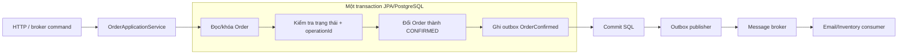
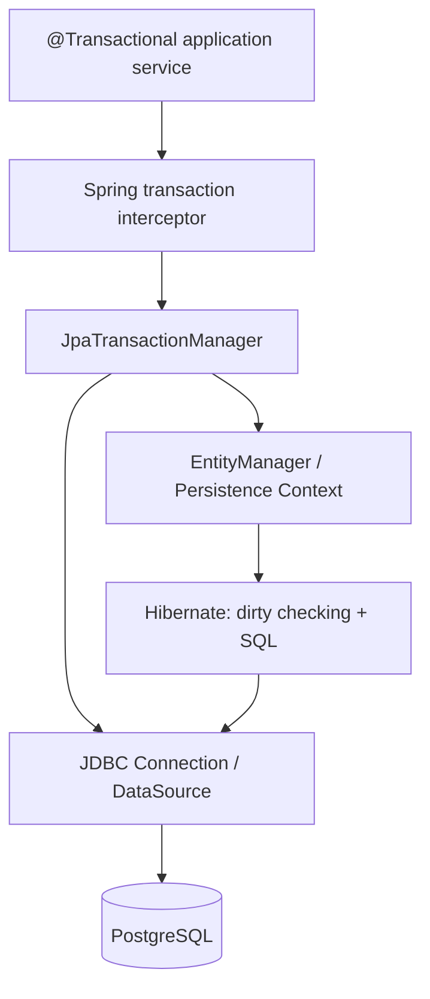
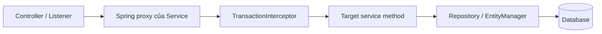
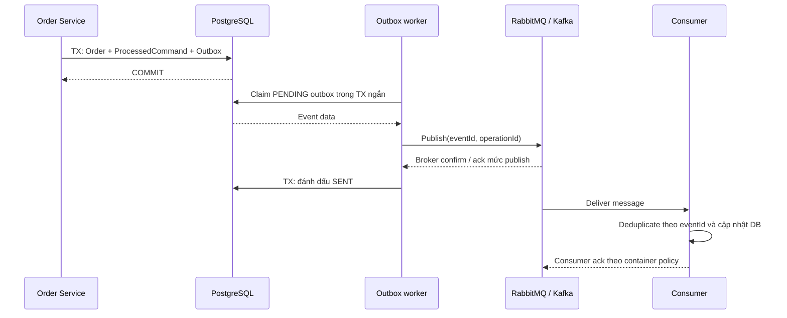

# Transaction manager và ranh giới giao dịch ở tầng dịch vụ

## 1. Bài toán: transaction nằm ở đâu trong luồng tích hợp?

Một request xác nhận đơn hàng trong Spring Boot thường phải thực hiện nhiều bước: kiểm tra đơn, thay đổi trạng thái trong PostgreSQL, tạo bản ghi để phát sự kiện, gọi Inventory Service qua HTTP hoặc broker, cập nhật Redis cache và gửi email. Nếu một bước hỏng, những thay đổi nào cần được rollback? Nếu database đã commit nhưng broker chưa nhận message thì sao? Nếu request được gửi lại, có ghi trùng đơn hoặc trừ tồn kho hai lần không?

**JPA/Hibernate** cung cấp cơ chế ánh xạ entity và làm việc với persistence context; **Spring transaction manager** điều phối transaction cho những tài nguyên mà nó quản lý. Annotation `@Transactional` thường được đặt ở **phương thức dịch vụ (service/use case)** để mô tả một thao tác nghiệp vụ cần nguyên tử trong phạm vi database. Nó không phải lệnh “làm mọi hệ thống trong luồng tích hợp trở thành một distributed transaction”.

Đây là bài thuộc chương **JPA và Hibernate** của module **SPRING_BOOT_INTEGRATION**: tích hợp hệ thống qua HTTP client, cơ sở dữ liệu, cache, message broker và Spring Integration, chú trọng cấu hình, hợp đồng dữ liệu, giao dịch, lỗi, xử lý trùng lặp, kiểm thử và quan sát. Trọng tâm không chỉ là cách viết `@Transactional`, mà là **chọn đúng phạm vi giao dịch, transaction manager, điểm commit và phương án xử lý các hệ thống nằm ngoài transaction**.

Sau bài học, bạn cần làm được:

1. Giải thích `PlatformTransactionManager`, `JpaTransactionManager`, `EntityManager`/persistence context và kết nối JDBC phối hợp ra sao.
2. Đặt transaction boundary ở application service, không trải dài qua HTTP, broker, email hoặc cache.
3. Hiểu `@Transactional` trong proxy mode: self-invocation, public method, exception/rollback và tình huống `UnexpectedRollbackException`.
4. Chọn `Propagation`, `Isolation`, `readOnly`, `timeout`, locking và idempotency phù hợp với use case.
5. Phân biệt `flush`, SQL execution, transaction commit và trạng thái có thể nhìn thấy từ transaction khác.
6. Làm việc có chủ đích với nhiều transaction manager (JPA/JDBC/R2DBC/JTA), transactional outbox và event sau commit.
7. Viết integration test chứng minh **commit thật, rollback thật, concurrency** thay vì chỉ kiểm tra method được gọi.

> **Ngữ cảnh phiên bản:** Ví dụ dùng Java 17+, Spring Boot 3.x, Spring Framework 6.x, Spring Data JPA/Hibernate 6.x và PostgreSQL. Với Spring Boot 3, import JPA từ `jakarta.persistence.*`, không dùng `javax.persistence.*` của Boot 2.x. `Propagation`, `Isolation`, quản lý transaction và mức cô lập thực tế phụ thuộc Spring, JDBC driver, database và cấu hình connection; cần kiểm tra phiên bản triển khai.

### 1.1. Luồng nghiệp vụ xuyên suốt

Giả sử **Order Service** nhận command xác nhận đơn đã được Inventory xác nhận giữ hàng thành công:

```json
{
  "schemaVersion": 1,
  "operationId": "confirm-O-1001",
  "orderId": "O-1001",
  "reservationId": "RES-991"
}
```

Yêu cầu:

- Đơn phải tồn tại và đang ở trạng thái `PENDING_RESERVATION`.
- Mỗi `operationId` được xử lý **idempotent**, không xác nhận cùng một lệnh hai lần.
- Chuyển order sang `CONFIRMED` và ghi sự kiện `OrderConfirmed` vào **outbox** trong **cùng transaction SQL**.
- Sau commit, một worker riêng phát event tới RabbitMQ/Kafka và một worker khác có thể tạo email; cập nhật Redis cache phải theo chính sách invalidation.
- Nếu HTTP client/broker/worker hỏng, bản ghi order đã commit vẫn đúng, có trạng thái pending/outbox để tiếp tục xử lý.



**Ranh giới quan trọng:** vùng transaction là phần thao tác **trên cùng cơ sở dữ liệu được quản lý**. Các nhánh sau commit không tự rollback cùng transaction JPA. Nếu downstream đã xử lý nhưng response bị mất, bên gửi phải có operation ID và cơ chế đối soát, không thử lại mù quáng.

## 2. Phân biệt transaction manager, transaction và persistence context

### 2.1. `PlatformTransactionManager` là gì?

Spring cung cấp abstraction `org.springframework.transaction.PlatformTransactionManager` cho **transaction imperative**. Nó bắt đầu/commit/rollback transaction theo `TransactionDefinition` và tài nguyên đang quản lý. Những implementation thường gặp:

| Implementation | Tài nguyên quản lý | Trường hợp sử dụng |
|---|---|---|
| `JpaTransactionManager` | `EntityManager`/JPA transaction cho một `EntityManagerFactory` | Spring Data JPA/Hibernate với database quan hệ |
| `DataSourceTransactionManager` | JDBC `Connection` từ một `DataSource` | JDBC/JdbcTemplate thuần |
| `JdbcTransactionManager` | JDBC connection; có xử lý chuyển đổi exception phù hợp | Các flow JDBC ở Spring Framework mới |
| `JtaTransactionManager` | JTA transaction từ môi trường/provider có hỗ trợ | Khi hệ thống thực sự được cấu hình distributed/XA transaction; không phải mặc định |
| `R2dbcTransactionManager` | Reactive R2DBC `ConnectionFactory` qua `ReactiveTransactionManager` | Reactive repository/`DatabaseClient`; khác transaction imperative |

Tên manager không chỉ là một label cấu hình. Manager phải phù hợp với **repository/connection factory/EntityManagerFactory** mà method sử dụng. Nếu một service dùng JPA nhưng `@Transactional` chọn nhầm transaction manager của datasource khác, câu lệnh JPA có thể không nằm trong transaction kỳ vọng.

### 2.2. Ai tham gia transaction JPA?

Trong ứng dụng Spring Data JPA phổ biến:



- **Transaction interceptor** bắt đầu hoặc tham gia transaction trước khi gọi logic service theo metadata `@Transactional`.
- **`JpaTransactionManager`** quản lý transaction JPA và gắn `EntityManager` thích hợp với luồng thực thi.
- **Persistence context** theo dõi các managed entity và thay đổi của chúng; Hibernate quyết định thời điểm `flush` phát SQL.
- **JDBC connection/transaction của database** quyết định commit/rollback dữ liệu.

Một persistence context **không tự là transaction**. Entity có thể ở trạng thái managed trong một khoảng thời gian mà transaction database đã kết thúc (ví dụ khi sử dụng Open EntityManager in View), nhưng thay đổi ngoài transaction không trở thành giao dịch nghiệp vụ an toàn chỉ vì object vẫn còn được truy cập.

### 2.3. `@Transactional` chọn transaction manager như thế nào?

Trong Spring Boot, khi có Spring Data JPA và `DataSource` phù hợp, auto-configuration thường cung cấp `JpaTransactionManager`. Ứng dụng đơn giản có một manager nên annotation:

```java
@Transactional
public void confirm(...) {
    // JPA read + write
}
```

có thể dùng manager mặc định. Trong ứng dụng nhiều manager, cần xác định **default manager** qua cấu hình Spring, lựa chọn bean `@Primary` hoặc cấu hình transaction management tương ứng; không đoán manager từ tên method. Khi cần chỉ rõ:

```java
@Transactional(transactionManager = "ordersTransactionManager")
public void confirm(...) {
    // ...
}
```

Tên `ordersTransactionManager` phải là **bean thực** được định nghĩa và liên kết đúng `EntityManagerFactory`/`DataSource`. Có thể dùng dạng `@Transactional("ordersTransactionManager")`; dùng tên rõ ràng khi có multi-datasource giảm nhầm lẫn.

### 2.4. Một transaction chỉ bao trùm tài nguyên đã được enlist

Nếu cùng `DataSource` và JPA transaction manager phù hợp, `JdbcTemplate` đôi khi có thể tham gia connection transaction được `JpaTransactionManager` quản lý, tùy datasource, dialect và cấu hình. **Điều đó cần được kiểm chứng**, không có nghĩa hai `DataSource` hoặc một `R2dbcConnectionFactory` khác cùng tự tham gia.

Redis, RabbitMQ, Kafka, email SMTP, HTTP, cache CDN không được tự động enlist vào JPA transaction chỉ vì lời gọi được thực hiện bên trong một method `@Transactional`. Giao dịch phân tán/XA (nếu thực sự dùng) đòi hỏi nhiều điều kiện hạ tầng và chi phí khác; trong phần lớn tích hợp microservice nên thiết kế idempotency, outbox, saga/compensation thay vì hứa atomic commit xuyên mọi hệ thống.

## 3. Đặt ranh giới transaction ở application service

### 3.1. Transaction nên mô tả một use case

Một service method thực hiện một **đơn vị nghiệp vụ nguyên tử** thích hợp là nơi đặt transaction:

```text
Controller / Message listener / Scheduler
    |
    +--> Application service  @Transactional
           |
           +--> Repository A (Order)
           +--> Repository B (ProcessedCommand)
           +--> Repository C (OutboxEvent)
           |
           +--> COMMIT hoặc ROLLBACK trong cùng database
```

Nếu chỉ đặt `@Transactional` ở từng repository method, lời gọi `save(order)` và `save(outbox)` có thể là **hai transaction tách biệt** khi không có transaction service bên ngoài: một cái commit còn cái kia thất bại. Ranh giới service bao cả hai thao tác giải quyết được tính nguyên tử đó.

**Đặt ở service không đồng nghĩa cứ service nào cũng có `@Transactional`:** một pure mapper/validator hoặc facade gọi HTTP không nên mở transaction database. Có thể tách hai bước:

1. Adapter gọi HTTP/kiểm tra phản hồi bên ngoài, với timeout và idempotency.
2. Một application service transaction ngắn quyết định và ghi database/outbox theo thông tin đã biết.

### 3.2. Domain model cho ví dụ đơn hàng

```java
// OrderStatus.java
public enum OrderStatus {
    PENDING_RESERVATION,
    CONFIRMED,
    CANCELLED
}

// OrderEntity.java — imports lược bỏ
@Entity
@Table(name = "customer_order")
public class OrderEntity {
    @Id
    @Column(length = 80, nullable = false)
    private String id;

    @Enumerated(EnumType.STRING)
    @Column(length = 32, nullable = false)
    private OrderStatus status;

    @Column(name = "reservation_id", length = 100)
    private String reservationId;

    @Version
    private long version;

    protected OrderEntity() {}

    public String getId() { return id; }
    public OrderStatus getStatus() { return status; }
    public long getVersion() { return version; }

    public void confirm(String reservationId) {
        if (status != OrderStatus.PENDING_RESERVATION) {
            throw new IllegalStateException(
                    "Không thể xác nhận ở trạng thái " + status);
        }
        if (reservationId == null || reservationId.isBlank()) {
            throw new IllegalArgumentException("Thiếu reservationId");
        }
        this.status = OrderStatus.CONFIRMED;
        this.reservationId = reservationId;
    }
}
```

`@Version` cung cấp optimistic locking cho entity theo cơ chế JPA: trong các update được Hibernate quản lý, version cho phép phát hiện một số tình huống transaction khác ghi trước và làm update stale. Nhưng `@Version` **không tự chống duplicate command**: nếu hai request giống nhau được xử lý lại, application vẫn cần operation ID/unique constraint và định nghĩa kết quả idempotent.

### 3.3. Repository cho Order, outbox và processed command

```java
// OrderRepository.java
public interface OrderRepository
        extends JpaRepository<OrderEntity, String> {
}

// ProcessedCommandRepository.java
public interface ProcessedCommandRepository
        extends JpaRepository<ProcessedCommandEntity, String> {
}

// OutboxRepository.java
public interface OutboxRepository
        extends JpaRepository<OutboxEventEntity, String> {
}
```

Hai entity `ProcessedCommandEntity` và `OutboxEventEntity` sẽ được định nghĩa ở ví dụ tiếp theo với `operationId` và `eventId` ổn định. Điểm quan trọng là cả ba repository cùng dùng **một EntityManagerFactory và một transaction manager** nếu ta muốn atomic commit.

### 3.4. Hai bảng hỗ trợ idempotency và outbox

```java
// ProcessedCommandEntity.java
@Entity
@Table(name = "processed_command")
public class ProcessedCommandEntity {
    @Id
    @Column(name = "operation_id", length = 120)
    private String operationId;

    @Column(name = "order_id", nullable = false, length = 80)
    private String orderId;

    @Column(name = "reservation_id", nullable = false, length = 100)
    private String reservationId;

    protected ProcessedCommandEntity() {}

    public ProcessedCommandEntity(
            String operationId, String orderId, String reservationId) {
        this.operationId = operationId;
        this.orderId = orderId;
        this.reservationId = reservationId;
    }

    public String getOrderId() { return orderId; }
    public String getReservationId() { return reservationId; }
}

// OutboxEventEntity.java
@Entity
@Table(name = "outbox_event")
public class OutboxEventEntity {
    @Id
    @Column(name = "event_id", length = 160)
    private String eventId;

    @Column(name = "order_id", nullable = false, length = 80)
    private String orderId;

    @Column(name = "reservation_id", nullable = false, length = 100)
    private String reservationId;

    @Column(name = "event_type", nullable = false, length = 40)
    private String eventType;

    @Column(nullable = false, length = 30)
    private String status;

    protected OutboxEventEntity() {}

    public OutboxEventEntity(
            String eventId, String orderId, String reservationId) {
        this.eventId = eventId;
        this.orderId = orderId;
        this.reservationId = reservationId;
        this.eventType = "ORDER_CONFIRMED";
        this.status = "PENDING";
    }
}
```

Đây là các entity tối giản để minh họa **một transaction**; hệ thống thật thường thêm `createdAt`, số lần phát, next attempt, lease owner và version của event contract. Các định danh `operationId`/`eventId` phải có **primary key/unique constraint trong database**; chỉ kiểm tra `existsById` trong Java trước khi ghi là chưa đủ chống race.

### 3.5. Application service làm chủ transaction

```java
// ConfirmOrderCommand.java
public record ConfirmOrderCommand(
        int schemaVersion,
        String operationId,
        String orderId,
        String reservationId
) {}

public enum ConfirmOutcome {
    CONFIRMED,
    ALREADY_PROCESSED
}

// OrderApplicationService.java
@Service
public class OrderApplicationService {
    private final OrderRepository orders;
    private final ProcessedCommandRepository commands;
    private final OutboxRepository outbox;

    public OrderApplicationService(
            OrderRepository orders,
            ProcessedCommandRepository commands,
            OutboxRepository outbox) {
        this.orders = orders;
        this.commands = commands;
        this.outbox = outbox;
    }

    @Transactional
    public ConfirmOutcome confirm(ConfirmOrderCommand cmd) {
        validate(cmd);

        var previous = commands.findById(cmd.operationId());
        if (previous.isPresent()) {
            var processed = previous.get();
            if (!processed.getOrderId().equals(cmd.orderId())
                    || !processed.getReservationId()
                            .equals(cmd.reservationId())) {
                throw new IllegalArgumentException(
                        "operationId đã được dùng với payload khác");
            }
            return ConfirmOutcome.ALREADY_PROCESSED;
        }

        OrderEntity order = orders.findById(cmd.orderId())
                .orElseThrow(() -> new IllegalArgumentException(
                        "Không tìm thấy đơn"));

        order.confirm(cmd.reservationId());
        // OrderEntity đang managed: Hibernate sẽ dirty-check.
        commands.save(new ProcessedCommandEntity(
                cmd.operationId(), cmd.orderId(),
                cmd.reservationId()));
        outbox.save(new OutboxEventEntity(
                "order-confirmed:" + cmd.operationId(),
                cmd.orderId(), cmd.reservationId()));

        return ConfirmOutcome.CONFIRMED;
    }

    private static void validate(ConfirmOrderCommand cmd) {
        if (cmd == null || cmd.schemaVersion() != 1
                || cmd.operationId() == null
                || cmd.operationId().isBlank()
                || cmd.orderId() == null
                || cmd.orderId().isBlank()
                || cmd.reservationId() == null
                || cmd.reservationId().isBlank()) {
            throw new IllegalArgumentException(
                    "ConfirmOrderCommand không hợp lệ");
        }
    }
}
```

**Điều gì được bảo đảm trong đường thành công?** Nếu cả ba repository dùng cùng transaction manager/database và transaction commit thành công, trạng thái order, processed-command và outbox cùng được commit. Nếu một thao tác SQL lỗi trước commit, transaction bị rollback theo quy tắc transaction manager; không có outbox event cho order chưa commit.

**Điều gì chưa được bảo đảm?** Hai request đồng thời với cùng operation ID có thể cùng quan sát `previous.isEmpty()` trước khi một bên insert. Unique constraint sẽ làm một transaction lỗi; với order update còn có optimistic locking. Do đó kết quả đối với cuộc đua **không mặc nhiên trả `ALREADY_PROCESSED` ngay lần thử đầu**. Ở lớp điều phối bên ngoài transaction, có thể bắt lỗi unique/optimistic conflict đã được phân loại, mở transaction **mới** để đọc kết quả đã commit và quyết định trả idempotent hay retry có giới hạn. Không catch `DataIntegrityViolationException` bên trong transaction lỗi rồi tiếp tục ghi SQL vào transaction PostgreSQL đã bị abort.

### 3.6. Dữ liệu trong database phải bảo vệ contract

Ví dụ schema PostgreSQL:

```sql
CREATE TABLE customer_order (
    id VARCHAR(80) PRIMARY KEY,
    status VARCHAR(32) NOT NULL,
    reservation_id VARCHAR(100),
    version BIGINT NOT NULL
);

CREATE TABLE processed_command (
    operation_id VARCHAR(120) PRIMARY KEY,
    order_id VARCHAR(80) NOT NULL,
    reservation_id VARCHAR(100) NOT NULL
);

CREATE TABLE outbox_event (
    event_id VARCHAR(160) PRIMARY KEY,
    order_id VARCHAR(80) NOT NULL,
    reservation_id VARCHAR(100) NOT NULL,
    event_type VARCHAR(40) NOT NULL,
    status VARCHAR(30) NOT NULL
);

CREATE INDEX idx_outbox_pending
    ON outbox_event (status, event_id);
```

Trong production dùng migration có version (Flyway, Liquibase hoặc công cụ tương đương) thay vì `hibernate.hbm2ddl.auto=create`/`update` làm chiến lược quản lý schema. Nếu event payload cần schema evolution, outbox nên chứa `schemaVersion` và dữ liệu sự kiện bất biến tại thời điểm commit, không tái tạo tùy tiện từ order đã thay đổi khi worker phát sau.

### 3.7. Ai là người gọi service transaction?

Controller, AMQP/Kafka/JMS listener, scheduler và Spring Integration endpoint đều có thể gọi method `confirm` của application service:

```java
@RestController
@RequestMapping("/internal/orders")
public class OrderCommandController {
    private final OrderApplicationService service;

    public OrderCommandController(OrderApplicationService service) {
        this.service = service;
    }

    @PostMapping("/confirm")
    public ConfirmOutcome confirm(
            @RequestBody ConfirmOrderCommand cmd) {
        return service.confirm(cmd);
    }
}
```

Endpoint `/internal/orders/confirm` chỉ minh họa luồng gọi. Production phải xác thực service-to-service, phân quyền, validate signature/operation ID và bảo vệ chống spam; không cho phép client tùy ý xác nhận đơn của tenant khác. Với listener broker, **ack message** xảy ra theo cơ chế listener/container sau khi service hoàn tất; broker ack không tự là transaction PostgreSQL và có thể xảy ra crash giữa commit và ack.

## 4. Cơ chế proxy của @Transactional: lỗi dễ gặp nhất

### 4.1. Transaction được kích hoạt qua proxy, không phải qua mọi lời gọi Java

Trong cấu hình Spring transaction management thông dụng, `@Transactional` được triển khai bằng **Spring AOP proxy**. Khi một component khác gọi vào method của bean qua proxy, interceptor có thể mở transaction, gọi target rồi commit/rollback.



Nhưng lời gọi **từ method này sang method khác trên cùng object qua `this`** không đi qua proxy trong proxy mode. Ví dụ sau thường **không tạo transaction mới** cho `persist`:

```java
@Service
public class IncorrectOrderService {
    public void process() {
        persist(); // self-invocation: không đi qua proxy
    }

    @Transactional
    public void persist() {
        // Không được mở transaction chỉ nhờ annotation này
        // khi gọi trực tiếp từ process() trên cùng instance.
    }
}
```

**Cách sửa được ưu tiên:** chuyển ranh giới transaction thành một public method trên bean application service **được gọi từ bean khác**, hoặc tách transaction worker thành bean riêng. Không khuyến khích tự inject proxy vào chính mình hay dựa vào `AopContext.currentProxy()` chỉ để “kích” annotation, vì làm thiết kế khó hiểu và dễ sai.

### 4.2. Public method, method không thể bị intercept và private method

Với proxy/JDK interface proxy hoặc CGLIB class-based proxy, điều kiện interception phụ thuộc visibility, final method/class và cách bean được tạo. Thực hành ổn định nhất cho application service là đặt `@Transactional` trên **public method, ở Spring-managed bean, được caller khác gọi qua proxy**:

```java
@Service
public class StockApplicationService {
    @Transactional
    public void adjustStock(...) {
        // ...
    }
}
```

Đừng mặc định `@Transactional` ở `private` method, method `final` không thể override hoặc object được khởi tạo bằng `new` bên ngoài Spring sẽ có hiệu lực. Trong các phiên bản Spring mới có hỗ trợ một số protected/package-private method với class-based proxy, nhưng điều đó không làm self-invocation trở thành proxy call. Nếu ứng dụng dùng AspectJ weaving thay proxy, semantics có thể khác và phải cấu hình rõ; không coi đó là hành vi mặc định.

### 4.3. Method trả về nhưng transaction chưa chắc commit xong trong body

Interceptor commit **sau khi target method trả về** thành công và trước khi trả kết quả cuối cùng cho caller qua proxy. Do đó:

```java
@Transactional
public String saveAndReturn() {
    orders.save(...);
    return "SAVED"; // chưa thể kết luận commit đã xong tại dòng này
}
```

Nếu commit phát sinh lỗi constraint, deadlock, connection hoặc optimistic locking, caller có thể nhận exception **mặc dù body đã return**. Đừng gửi email/HTTP response xác nhận không thể thu hồi từ bên trong method trước commit. Nếu controller gọi service qua proxy và nhận return thành công, transaction thường đã commit; vẫn cần xử lý lỗi sau commit của những hệ thống khác.

### 4.4. @Async, new thread, CompletableFuture và Reactor

Imperative transaction của `JpaTransactionManager` được gắn với **thread hiện tại** qua transaction context của Spring. Bắt đầu `new Thread(...)`, dùng một executor khác hoặc chạy tác vụ `@Async` không tự mang cùng transaction JPA sang thread mới.

```java
@Transactional
public void processBad() {
    orderRepository.save(...);
    CompletableFuture.runAsync(() -> {
        // Không tự tham gia transaction của thread gọi.
        outboxRepository.save(...);
    });
}
```

Hai thao tác có thể commit độc lập; lỗi trong `CompletableFuture` cũng không tự rollback transaction ban đầu. Nếu cần ghi outbox atomic, **ghi đồng bộ trong cùng transaction JPA**. Với reactive R2DBC, transaction context thường nằm trong **Reactor Context**, không phải có thể dùng `JpaTransactionManager` để bảo đảm transaction xuyên một chuỗi `Mono`/`Flux`.

## 5. Commit, rollback và ngoại lệ

### 5.1. Quy tắc rollback mặc định

Trong Spring Framework 6.x ở cấu hình thông thường, `@Transactional` **mặc định rollback khi một `RuntimeException` hoặc `Error` thoát ra khỏi method qua proxy**; với checked exception thì mặc định **không rollback**, trừ khi cấu hình `rollbackFor` hoặc quy tắc transaction khác.

| Trường hợp | Hành vi thông thường của `@Transactional` |
|---|---|
| Method hoàn tất bình thường | Thử commit; vẫn có thể fail lúc flush/commit |
| Ném `RuntimeException` ra ngoài proxy | Transaction được đánh dấu/tiến hành rollback |
| Ném `Error` ra ngoài proxy | Rollback theo mặc định |
| Ném checked exception | Mặc định không đánh dấu rollback do loại exception; có thể commit |
| Bắt exception rồi return bình thường | Interceptor không thấy lỗi; có thể commit |
| Transaction đã bị đánh dấu rollback-only | Dù code bên ngoài catch exception, outer commit vẫn có thể fail |

Vì vậy đoạn sau có thể **không rollback** chỉ vì exception là checked:

```java
@Transactional
public void importInvoice() throws IOException {
    invoiceRepository.save(...);
    throw new IOException("Không đọc được file");
}
```

Nếu nghiệp vụ muốn rollback khi file lỗi:

```java
@Transactional(rollbackFor = IOException.class)
public void importInvoice() throws IOException {
    invoiceRepository.save(...);
    throw new IOException("Không đọc được file");
}
```

**Lưu ý phiên bản:** Spring cho phép cấu hình rollback rules ở mức framework; trong các dòng Spring mới hơn có thể có cơ chế default rollback rules được tùy biến. Ở ví dụ này ta giả định quy tắc thông dụng của Spring Framework 6.x và chủ động chỉ rõ khi checked exception cần rollback.

### 5.2. Nuốt exception không có nghĩa lỗi đã được xử lý an toàn

```java
@Transactional
public void confirmBad(ConfirmOrderCommand command) {
    try {
        orders.findById(command.orderId())
                .orElseThrow()
                .confirm(command.reservationId());
        externalInventoryClient.notifyOrder(...);
    } catch (Exception ex) {
        log.warn("Đã lỗi nhưng vẫn trả thành công");
    }
}
```

Nếu exception bị bắt và method trả về bình thường, interceptor có thể commit thay đổi JPA đang pending. Ngược lại, nếu exception từ JDBC/JPA đã khiến transaction bị đánh dấu rollback-only hoặc database transaction không còn hợp lệ, việc catch cũng **không cứu được commit**.

Phải định nghĩa rõ chiến lược:

- Lỗi nghiệp vụ phải rollback: ném một unchecked domain exception hoặc thiết lập rollback rule phù hợp.
- Lỗi downstream sau DB commit: không làm phần SQL đã commit bị “đảo ngược” bằng cách ném exception; ghi outbox/retry.
- Lỗi có thể chấp nhận một phần: không nên nằm trong transaction cần all-or-nothing; chia use case hoặc dùng savepoint khi thực sự phù hợp và được kiểm chứng.
- Lỗi cần giữ kết quả `REJECTED` trong database: **không** ném exception làm rollback toàn transaction; lưu trạng thái từ chối như một kết quả nghiệp vụ và commit.

### 5.3. `UnexpectedRollbackException`: ngoài nghĩ commit, trong đã rollback-only

Ví dụ:

```java
@Service
class PaymentPolicyService {
    @Transactional
    public void validateAndRecord() {
        // Called qua bean proxy, tham gia transaction REQUIRED của caller.
        throw new IllegalStateException("Invalid payment policy");
    }
}

@Service
class CheckoutService {
    private final PaymentPolicyService paymentPolicy;

    @Transactional
    public void checkout() {
        try {
            paymentPolicy.validateAndRecord();
        } catch (IllegalStateException ex) {
            // Đã catch nhưng inner transaction interceptor
            // có thể đánh dấu shared transaction rollback-only.
        }
        // Khi outer transaction muốn commit, không còn được phép.
    }
}
```

Với propagation mặc định `REQUIRED`, cả hai method cùng tham gia **một physical transaction**. Inner interceptor thấy unchecked exception đi qua và đánh dấu rollback-only. Outer method bắt exception nên tưởng thành công, nhưng khi interceptor outer commit có thể ném `UnexpectedRollbackException` để báo rằng database đã rollback.

Cách sửa không phải `catch (UnexpectedRollbackException)` rồi coi như giao dịch thành công. Hãy xác định **lỗi có được phép hủy cả use case không**. Nếu có, để exception lan ra. Nếu cần một audit độc lập vẫn commit khi transaction chính rollback, cân nhắc `REQUIRES_NEW` ở một bean khác với giới hạn pool, hoặc chuyển audit qua hệ thống đáng tin cậy bên ngoài transaction theo hợp đồng riêng.

### 5.4. Chủ động đánh dấu rollback-only

Spring cho phép đánh dấu rollback-only trong tình huống nghiệp vụ đặc biệt:

```java
TransactionAspectSupport.currentTransactionStatus()
        .setRollbackOnly();
```

Đoạn này chỉ hợp lệ khi đang nằm trong transaction interceptor tương ứng. Dùng nó ít khi thật sự cần: code có thể vẫn return normally trong khi caller không nhìn thấy nguyên nhân nếu thiếu contract. Thông thường, ném domain exception rõ hoặc trả kết quả nghiệp vụ có chủ đích dễ hiểu hơn. Với validation failure cần lưu `REJECTED`, rollback-only lại đi ngược mục tiêu.

### 5.5. Commit lỗi sau khi service body return

Hibernate có thể hoãn SQL đến `flush`/commit. Unique constraint, version conflict hoặc transaction deadlock có thể chỉ xuất hiện ở cuối method:

```java
@Transactional
public void create() {
    repository.save(entity);
    // Chưa chắc INSERT đã chạy ở dòng này.
}
// Interceptor có thể fail lúc flush/commit.
```

Vì vậy không gửi Kafka/RabbitMQ/SMTP hoặc xóa Redis cache không thể bù từ **bên trong transaction**, rồi giả định lệnh `save` chắc chắn sẽ commit. Nếu cần xác nhận constraint sớm, `saveAndFlush`/`EntityManager.flush` có thể ép SQL sớm hơn, nhưng **flush không phải commit** và những lỗi khác vẫn có thể xảy ra về sau.

## 6. Propagation: transaction của caller và callee phối hợp ra sao?

`Propagation` là cách một method `@Transactional` xử lý transaction **đang tồn tại** khi được gọi qua proxy. Nó không quy định một microservice khác có tham gia cùng transaction SQL hay không.

| Propagation | Khi caller đã có transaction | Khi chưa có transaction | Tình huống phù hợp |
|---|---|---|---|
| `REQUIRED` (mặc định) | Tham gia transaction hiện tại | Tạo mới | Application service thông thường |
| `REQUIRES_NEW` | Tạm ngưng transaction hiện tại, tạo transaction độc lập | Tạo mới | Audit/outbox phụ đặc biệt cần commit độc lập, sau khi đánh giá consistency |
| `SUPPORTS` | Tham gia nếu có | Chạy không transaction | Method có thể chạy cả hai chế độ, không bảo đảm read-only transaction |
| `MANDATORY` | Tham gia | Báo lỗi | Helper chỉ được gọi trong một transaction đã có |
| `NOT_SUPPORTED` | Tạm ngưng transaction | Chạy không transaction | Công việc không nên giữ DB transaction |
| `NEVER` | Báo lỗi | Chạy không transaction | Guard chống bị gọi trong transaction |
| `NESTED` | Dùng nested/savepoint nếu manager hỗ trợ | Thường như REQUIRED khi không có outer | Partial rollback với savepoint, rất cần kiểm tra manager/driver |

### 6.1. `REQUIRED`: cùng một physical transaction

```java
@Service
public class OrderWriteService {
    @Transactional
    public void writeOrderAndOutbox() {
        orderRepository.save(...);
        outboxWriteService.writeEvent(...);
    }
}

@Service
public class OutboxWriteService {
    @Transactional(propagation = Propagation.REQUIRED)
    public void writeEvent(...) {
        outboxRepository.save(...);
    }
}
```

Giả sử hai bean được inject qua proxy và cùng dùng **một transaction manager**, `OutboxWriteService` tham gia transaction của `OrderWriteService`. Nếu cả hai repository ghi cùng database, chúng commit/rollback cùng nhau. Nếu gọi ngoài transaction, method thứ hai tự mở transaction.

Không nên lạm dụng nhiều lớp `@Transactional(REQUIRED)` rồi nghĩ mỗi lớp có một điểm commit riêng. Với REQUIRED lồng nhau, **outermost transaction** mới là điểm commit vật lý.

### 6.2. `REQUIRES_NEW`: một transaction độc lập có chi phí

```java
@Service
class AuditService {
    @Transactional(propagation = Propagation.REQUIRES_NEW)
    public void recordFailure(String operationId) {
        auditRepository.save(new AuditEvent(...));
    }
}
```

Khi caller đang có transaction JPA, Spring tạm ngưng resource/transaction hiện tại (theo khả năng manager) rồi tạo một transaction mới. Transaction audit có thể commit ngay cả khi outer transaction rollback. Điều này chỉ có ích khi đó là **yêu cầu rõ ràng**, vì audit có thể nói “đã xảy ra” trong khi dữ liệu nghiệp vụ cuối cùng không được commit.

**Rủi ro pool:** outer transaction có thể đang giữ một DB connection, inner `REQUIRES_NEW` cần **connection khác**. Nếu 20 request đồng thời đều giữ outer connection rồi cùng chờ connection cho inner transaction, pool có thể nghẽn hoặc deadlock tài nguyên. Cần tính pool size, concurrency, lock order và timeout; không xem `REQUIRES_NEW` là cách chung để “sửa rollback”.

### 6.3. `NESTED` không mặc nhiên giống REQUIRES_NEW

`NESTED` dùng **savepoint** trong cùng physical transaction khi manager/driver cho phép, nên partial rollback của nested scope không nhất thiết rollback toàn bộ outer transaction. Nhưng Spring `JpaTransactionManager` **không mặc định hỗ trợ nested JPA transaction** theo nghĩa persistence context có thể rollback một phần. Savepoint JDBC nếu được bật cũng không tự tua lại trạng thái managed entity của Hibernate.

Do đó không dựa vào `@Transactional(propagation=NESTED)` như một cách universal để rollback một nhóm entity JPA rồi tiếp tục dùng chúng trong cùng persistence context. Nếu thật sự cần nested/savepoint, kiểm tra database, JDBC driver, transaction manager, `nestedTransactionAllowed` và quản lý entity state; viết integration test. Thường dễ hiểu hơn nếu định nghĩa một use case atomic rõ ràng hoặc tách công việc cần thực thi độc lập.

### 6.4. `MANDATORY` và `NOT_SUPPORTED` để làm rõ contract

`MANDATORY` hợp lý cho một helper ghi audit/outbox **chỉ** được phép thực thi khi caller đã mở transaction:

```java
@Transactional(propagation = Propagation.MANDATORY)
public void recordOutbox(...) {
    // Nếu gọi không có transaction sẽ fail sớm.
}
```

Nhưng không được nghĩ annotation này tự ép các repository thuộc cùng datasource. Nó chỉ ràng buộc transaction context của manager đã được chọn.

`NOT_SUPPORTED` có thể buộc một method chạy ngoài transaction khi caller đang có, nhưng tạm ngưng transaction **không nhất thiết giải phóng mọi tài nguyên đã lấy** của outer transaction. Đừng mở một transaction dài ở controller rồi gọi HTTP client trong method NOT_SUPPORTED và cho rằng mọi DB lock/connection đã biến mất; đúng hơn là tổ chức lại thứ tự bước để transaction SQL chỉ mở **sau khi** HTTP hoàn tất.

## 7. Isolation, readOnly, timeout và kiểm soát đồng thời

### 7.1. Isolation giải quyết những hiện tượng khác nhau

Isolation là cách database cho phép transaction nhìn thấy dữ liệu của transaction khác, không phải cơ chế khóa nghiệp vụ idempotency tự động.

| Isolation | Ý nghĩa tổng quát | Điều cần lưu ý |
|---|---|---|
| `READ_UNCOMMITTED` | Cho phép đọc dữ liệu chưa commit trong mô hình SQL chung | PostgreSQL triển khai hành vi tương đương `READ_COMMITTED`; không giả định đọc bẩn xảy ra |
| `READ_COMMITTED` | Mỗi câu SQL thường chỉ thấy dữ liệu đã commit theo quy tắc DB | Hai câu SELECT trong cùng transaction có thể thấy kết quả khác nhau |
| `REPEATABLE_READ` | Bảo đảm mạnh hơn cho những lần đọc trong transaction | PostgreSQL dùng snapshot isolation với tính chất riêng; vẫn cần xử lý concurrency/serialization |
| `SERIALIZABLE` | Mục tiêu kết quả tương đương thứ tự tuần tự của transaction | Có thể phát sinh serialization failure cần retry **toàn transaction** |
| `DEFAULT` | Sử dụng mức mặc định của database/connection | Không đồng nghĩa mức cô lập cao nhất |

Ví dụ:

```java
@Transactional(
        isolation = Isolation.READ_COMMITTED,
        timeout = 5)
public void confirm(...) {
    // ...
}
```

Trước khi chọn mức cao hơn, hỏi **invariant nghiệp vụ** nào cần bảo vệ. Ví dụ “chỉ một lần giữ hàng được cấp cho cùng operation ID” thường giải quyết rõ hơn bằng unique constraint và update/lock đúng chỗ; nâng isolation có thể tăng tranh chấp, deadlock và transaction abort mà vẫn cần idempotency ở boundary message.

**Lưu ý với `REQUIRED`:** khi method tham gia một transaction **đang tồn tại**, các khai báo isolation/timeout của inner method không mặc nhiên khởi tạo một physical transaction mới để thay các thuộc tính đã chọn ở outer scope. Có thể cấu hình validation cho transaction hiện có để phát hiện mismatch theo chính sách; không suy rằng method annotated `SERIALIZABLE` chắc chắn chạy ở mức đó khi được gọi trong outer `READ_COMMITTED` transaction.

### 7.2. `readOnly=true` là hint/tối ưu, không phải bảo mật

```java
@Service
class OrderQueryService {
    private final OrderRepository orders;

    @Transactional(readOnly = true)
    public OrderView find(String orderId) {
        OrderEntity order = orders.findById(orderId)
                .orElseThrow();
        return new OrderView(
                order.getId(), order.getStatus());
    }
}

public record OrderView(
        String id, OrderStatus status) {}
```

`@Transactional(readOnly=true)` cho phép transaction manager/ORM tối ưu một số hành vi như flush mode và hint ở JDBC connection tùy môi trường. Nó **không** là cơ chế authorization và không bảo đảm mọi loại SQL write sẽ bị database từ chối. Trong Hibernate/Spring Data JPA, một số tối ưu read-only có thể làm dirty checking/flush khác với write transaction; đừng thay đổi entity rồi kỳ vọng update vẫn được lưu khi annotation đang read-only.

**Đặt ở query service** giúp thiết kế ranh giới rõ: query trả DTO/immutable projection thay vì trả entity managed cho controller sửa tùy ý. Nếu query đơn giản không cần transaction tại service, có thể dùng cấu hình repository mặc định phù hợp; với lazy relations, consistent multi-query read hoặc provider-specific behavior, xác định rõ transaction boundary thay vì chỉ dựa vào Open EntityManager in View.

### 7.3. `timeout` không tự là tổng deadline cho HTTP/broker

```java
@Transactional(timeout = 3)
public void doWork() {
    // DB work...
}
```

Timeout transaction được transaction manager cung cấp và có thể truyền xuống JDBC statement trong những thao tác được Spring quản lý, tùy driver và cấu hình. **Không được suy rằng** thread Java sẽ bị hủy đúng giây thứ 3 hoặc một `WebClient`/`RestClient`/SMTP call bên trong method chắc chắn bị ngắt. Với ngoại vi, đặt connect/read/response timeout và budget riêng. Với database, cân nhắc PostgreSQL `statement_timeout`/`lock_timeout` phù hợp, transaction timeout và pool acquire timeout theo SLO.

Một transaction dài dễ giữ connection, row locks và persistence context nhiều entity, dẫn tới bão hòa pool. Không đặt `timeout=120` làm mặc định để “khắc phục” query chậm mà không tìm nguyên nhân SQL/index/lock/HTTP.

### 7.4. Optimistic locking với @Version

`@Version` hoạt động tốt khi nhiều transaction có thể thay đổi cùng entity nhưng xung đột tương đối ít:

```text
Transaction A: đọc Order(version=3)
Transaction B: đọc Order(version=3)
B cập nhật CONFIRMED, version thành 4 và commit
A cố cập nhật từ version=3 -> version conflict
=> A không được ghi đè âm thầm phiên bản mới.
```

JPA provider có thể ném `OptimisticLockException`, Spring có thể chuyển thành `ObjectOptimisticLockingFailureException` hoặc subtype `OptimisticLockingFailureException`. Không catch rồi tiếp tục ghi trong cùng transaction đã fail; retry ở một **transaction mới**, đọc lại trạng thái và tính toán quyết định nghiệp vụ từ đầu.

Optimistic locking không thay thế unique constraint cho **operation ID trùng**, bởi hai command có thể không cùng chỉnh một entity hoặc một command có thể được redeliver sau khi version đã đổi nhiều lần.

### 7.5. Pessimistic locking khi cần tuần tự hóa quyết định

Ví dụ repository:

```java
public interface OrderRepository
        extends JpaRepository<OrderEntity, String> {

    @Lock(LockModeType.PESSIMISTIC_WRITE)
    @Query("select o from OrderEntity o where o.id = :id")
    Optional<OrderEntity> lockById(@Param("id") String id);
}
```

Gọi `lockById` bên trong `@Transactional` để giữ lock đến khi commit/rollback theo semantics database. Dùng khi một quyết định cần kiểm tra trạng thái và cập nhật ngay trên cùng row. Tuy nhiên:

- Lock giữ lâu làm giảm concurrency, có thể tạo deadlock khi nhiều giao dịch khóa các row theo thứ tự khác nhau.
- Nếu không tìm thấy row, lock không tự bảo vệ invariant về **việc insert cùng khóa**; unique constraint vẫn cần.
- Không giữ pessimistic lock trong khi chờ HTTP, SMTP, broker, Redis hoặc user thao tác.
- Với nhiều tables/tenants, định nghĩa lock order và kiểm thử contention trên database thật.

### 7.6. Bulk UPDATE/DELETE có thể bỏ qua persistence context

Spring Data JPA `@Modifying @Query` thường được dùng cho bulk update:

```java
@Modifying
@Query("""
    update OrderEntity o
       set o.status = :status
     where o.id = :orderId
       and o.status = :expected
    """)
int updateStatusIfExpected(
        @Param("orderId") String orderId,
        @Param("expected") OrderStatus expected,
        @Param("status") OrderStatus status);
```

Một JPQL bulk operation **bỏ qua cơ chế dirty checking/entity lifecycle thông thường và không tự cập nhật managed entity đang có trong persistence context**. Nó cũng không tự áp dụng optimistic version check/increment như khi Hibernate update entity qua `@Version`, trừ khi query/chiến lược tự xử lý. Nếu service đã load `OrderEntity` trước rồi bulk update cùng row, object trong persistence context có thể stale.

Để dùng bulk update an toàn, thiết kế row count, version condition, refresh/clear persistence context nếu phù hợp, kiểm tra transaction và test concurrency. Không thêm `clearAutomatically=true` vô thức vì có thể làm mất các thay đổi managed chưa flush. Với một entity update nhỏ có invariant domain, thao tác qua managed entity thường dễ hiểu hơn.

## 8. Flush, commit, LazyLoading và Open EntityManager in View

### 8.1. `save()`, `flush()` và `commit()` là ba chuyện khác nhau

| Hành động | Điều nó thường làm | Không được suy diễn |
|---|---|---|
| `repository.save(entity)` | Đưa entity vào persistence context/merge tùy entity new/existing | Chắc chắn SQL đã chạy hoặc transaction đã commit |
| `entityManager.flush()` / `saveAndFlush` | Đồng bộ các thay đổi pending với DB qua SQL | Những SQL đó đã commit và không thể rollback |
| Transaction commit | Yêu cầu DB commit physical transaction theo manager | HTTP/broker/cache đã commit nguyên tử cùng SQL |
| `entityManager.clear()` | Detach managed entities khỏi persistence context | Undo SQL đã chạy hoặc rollback transaction |
| `entityManager.refresh(entity)` | Nạp lại trạng thái từ DB theo provider/transaction | Giải quyết mọi xung đột multi-service |

Hibernate có thể tự flush trước một số query hoặc lúc commit tùy flush mode; không giả định mọi lệnh `INSERT` được phát đúng tại dòng `save`. Với identifier generation strategy như `IDENTITY`, SQL có thể xảy ra sớm hơn để nhận ID; **thời điểm phát SQL vẫn không phải commit**.

### 8.2. Lazy loading và transaction boundary

Quan hệ `@OneToMany(fetch=LAZY)`/`@ManyToOne(fetch=LAZY)` có thể chỉ được truy vấn khi ứng dụng truy cập field. Nếu controller serialize một entity sau khi service transaction kết thúc, có thể gặp `LazyInitializationException` khi cần load relation nhưng persistence context đã đóng.

**Giải pháp nên bắt đầu từ contract trả về:** query dùng fetch join, `@EntityGraph`, DTO projection hoặc mapping DTO trong transaction service có giới hạn, chỉ lấy đúng dữ liệu endpoint cần.

```java
@Transactional(readOnly = true)
public OrderSummary getSummary(String id) {
    OrderEntity order = orders.findById(id).orElseThrow();
    return new OrderSummary(order.getId(),
            order.getStatus());
}
```

Không sửa bằng cách đổi tất cả quan hệ sang `EAGER` hoặc mở transaction ở controller/web serialization chỉ để che lỗi; điều đó có thể gây N+1 query, tải database khó kiểm soát và transaction boundary quá dài.

### 8.3. Open EntityManager in View (OSIV) là một quyết định kiến trúc

Trong một số Spring Boot web/JPA application, `spring.jpa.open-in-view` có thể bật, giữ `EntityManager` mở trong phạm vi HTTP request. Nó có thể khiến lazy loading ngoài service transaction “vẫn chạy”, nhưng:

- Persistence context còn mở không đồng nghĩa business transaction còn active.
- Việc SQL phát sinh lúc render response khó quan sát và khó tối ưu.
- Controller/serializer dễ gây N+1 query, tương tác sau transaction có thể đọc dữ liệu ở các thời điểm khác nhau.
- Không giúp HTTP/broker có cùng transaction với JPA.

Với module tích hợp chú trọng transaction boundary rõ, thường nên cân nhắc:

```yaml
spring:
  jpa:
    open-in-view: false
```

Sau đó service/repository chủ động fetch dữ liệu và trả DTO. **Không coi cờ này là cách bật/tắt transaction**; nó quản lý phạm vi EntityManager trong web layer và cần thử lại các endpoint/serializer khi thay đổi.

### 8.4. Transaction ngắn còn giúp bảo vệ pool và khả năng phục hồi

Nếu một request giữ transaction trong lúc gọi Pricing API 10 giây, nó có thể chiếm connection/lock hàng chục lần lâu hơn một thao tác cập nhật SQL. Khi traffic tăng, những giao dịch dài dễ làm đầy HikariCP, tăng lock wait và gây timeout ở những request khác.

Do đó **đọc dữ liệu cần thiết → kết thúc bước đọc → gọi external service → mở transaction ngắn để cập nhật có điều kiện** thường hiệu quả hơn cho luồng HTTP integration. Tuy nhiên nếu dữ liệu dùng để quyết định có thể thay đổi trong khi đang gọi HTTP, phải kiểm tra lại invariant/version trong transaction ghi, không tin vào snapshot đã đọc trước đó.

## 9. Ranh giới với HTTP, Redis, broker, SMTP và Spring Integration

### 9.1. Vì sao `@Transactional` không biến HTTP call thành transaction SQL?

Giả sử:

```java
@Transactional
public void placeOrderBad(PlaceOrderCommand cmd) {
    orderRepository.save(...);
    inventoryHttpClient.reserveStock(cmd); // HTTP POST
    outboxRepository.save(...);
}
```

Có ít nhất bốn cửa sổ lỗi:

1. Database chưa commit, HTTP đã giữ hàng ở Inventory; sau đó outbox insert lỗi → Order rollback, Inventory **không tự rollback**.
2. HTTP request timeout sau khi Inventory đã commit nhưng trước khi trả response → Order **không biết** trạng thái thật.
3. Database transaction giữ connection/lock trong suốt latency HTTP.
4. Request được retry hoặc broker redeliver → cùng operation có thể gửi HTTP POST lần hai.

**Không** giải quyết bằng `@Transactional(rollbackFor=Exception.class)`: annotation chỉ điều khiển transaction của manager, không tạo được rollback từ xa qua HTTP. Cần đưa ra hợp đồng tích hợp phù hợp:

- **Command có idempotency key** cố định để downstream nhận biết request lặp.
- API tra cứu trạng thái theo `operationId` cho những kết quả timeout/không rõ.
- State machine `PENDING → RESERVED/REJECTED/CANCELLED` và quy tắc hết hạn/bù trừ.
- Transactional outbox ở nguồn phát, consumer idempotent và các bước compensation nếu là saga dài.

### 9.2. Transactional outbox: lưu thay đổi và ý định phát message cùng lúc

Trong ví dụ `OrderApplicationService.confirm`, transaction SQL ghi:

```text
BEGIN;
  UPDATE customer_order SET status='CONFIRMED', ...;
  INSERT INTO processed_command(operation_id, ...);
  INSERT INTO outbox_event(event_id, status='PENDING', ...);
COMMIT;
```

Một worker khác chạy bên ngoài transaction đó:



**Cửa sổ duplicate:** broker đã chấp nhận publish nhưng worker crash trước `UPDATE outbox SET status='SENT'`. Worker khác có thể publish lại. Do đó outbox hỗ trợ **at-least-once publication với cơ chế retry đúng**, không phải exactly-once effect trên consumer. Consumer phải có unique event/operation ID và cập nhật nghiệp vụ idempotent trong transaction riêng.

**Cửa sổ còn lại:** nếu worker đánh dấu `SENT` trước khi có xác nhận broker phù hợp, message có thể bị mất khi publish thất bại. Không đánh dấu `SENT` chỉ vì gọi `convertAndSend`/`send` mà chưa xử lý confirm/return/timeout theo contract.

### 9.3. Broker ack và commit JDBC không phải một transaction chung

Một Spring AMQP/JMS/Kafka listener có thể gọi application service transaction:

```java
@Component
class OrderConfirmedListener {
    private final OrderApplicationService service;

    @RabbitListener(queues = "orders.confirm.commands.v1")
    public void handle(ConfirmOrderCommand cmd) {
        service.confirm(cmd);
    }
}
```

Trong cấu hình listener ack tự động phù hợp, message được ack **sau** khi handler hoàn tất thành công. Nếu database commit xong rồi process chết **trước ack**, broker có thể redeliver và handler được gọi lại. `processed_command.operation_id` giúp nhận diện duplicate; không dựa vào việc broker chỉ giao một lần.

Không mặc định Spring Boot đã cấu hình đúng exchange/queue/serializer/retry/DLQ cho annotation trên: chúng là phần riêng của AMQP integration. Với Kafka, consumer offset commit cũng có ranh giới khác SQL commit; cần hiểu semantics của Kafka transaction (nếu có) và database idempotency riêng, không lấy `@Transactional` JPA thay cho toàn bộ phối hợp.

### 9.4. Redis/cache invalidation: sau commit chưa chắc hết race

Ví dụ không an toàn:

```java
@Transactional
public void changeStockBad(String sku) {
    stockRepository.update(...);
    stringRedisTemplate.delete("inventory:v1:stock:" + sku);
    // Nếu SQL rollback sau delete, cache đã bị xóa.
}
```

Xóa cache **trước commit** làm thay đổi Redis bên ngoài transaction SQL; nếu SQL rollback, cache miss dẫn tới đọc dữ liệu cũ và tạo tải không cần thiết. Một lựa chọn là phát sự kiện sau commit hoặc xử lý outbox để invalidate:

```java
public record StockChanged(String sku, long revision) {}

@Component
class CacheInvalidationListener {
    private final StringRedisTemplate redis;

    CacheInvalidationListener(StringRedisTemplate redis) {
        this.redis = redis;
    }

    @TransactionalEventListener(
            phase = TransactionPhase.AFTER_COMMIT)
    public void invalidate(StockChanged event) {
        redis.delete("inventory:v1:stock:" + event.sku());
    }
}
```

Trong cùng transaction service, có thể `ApplicationEventPublisher.publishEvent(new StockChanged(...))`, listener `AFTER_COMMIT` chỉ chạy sau transaction synchronization commit theo điều kiện mặc định của annotation. **Nhưng callback này không bền**: JVM crash giữa SQL commit và callback sẽ mất invalidation. Outbox và TTL/version-aware cache write giúp chịu được crash, còn Redis listener phải idempotent.

**Race khác:** một reader có thể đọc revision cũ trước commit, sau khi writer invalidate lại ghi cache cũ vì request của reader hoàn thành muộn. Vì vậy “delete cache after commit” **không bảo đảm strong consistency**. Với dữ liệu nhạy cảm (tồn kho để xác nhận bán, thanh toán), ưu tiên kiểm tra trực tiếp trong database/Inventory service có invariant mạnh thay vì chỉ tin cache.

### 9.5. `@TransactionalEventListener` không phải message broker

| Cơ chế | Khi nào chạy? | Bảo đảm |
|---|---|---|
| `ApplicationEventPublisher` + `@EventListener` | Theo dispatch của application event, thường trong process | Không có lưu bền hoặc replay mặc định |
| `@TransactionalEventListener(AFTER_COMMIT)` | Callback theo phase của transaction synchronization | Chỉ chạy nếu transaction commit và process còn sống; không bền qua crash |
| Transactional outbox | Một row event được commit cùng business state | Có điểm lưu bền để worker retry/phát lại |
| Broker consumer | Sau khi broker deliver theo cấu hình | Có ack, redelivery, retry/DLQ riêng; không tự chung SQL transaction |

Một lưu ý Spring quan trọng: trong `AFTER_COMMIT`, tài nguyên transaction có thể chưa được dọn hoàn toàn. Nếu callback cần **ghi tiếp database** như một giao dịch độc lập, hãy dùng một service/proxy riêng với `REQUIRES_NEW` (cùng caveat pool) hoặc tốt hơn là đưa công việc cần bảo đảm vào outbox đã ghi trong transaction gốc. Không giả định một repository `save` bên trong AFTER_COMMIT tự tạo transaction mới có commit độc lập.

### 9.6. SMTP và tệp đính kèm

`JavaMailSender.send(...)` là I/O ngoài JPA transaction. Nếu gọi SMTP bên trong `@Transactional`:

- JDBC connection có thể bị giữ trong lúc SMTP chờ.
- SMTP nhận mail nhưng SQL rollback sau đó → người nhận được email cho sự kiện không xảy ra.
- SQL commit nhưng SMTP gặp lỗi tạm thời → không có retry bền nếu không ghi trạng thái/outbox.

Sử dụng mail outbox/worker sau commit. Khi SMTP chấp nhận thư nhưng worker chưa đánh dấu `SENT` rồi crash, có thể gửi trùng; theo dõi `mailRequestId`, retry có giới hạn và provider idempotency nếu có. Không coi email accepted đồng nghĩa người nhận đã đọc thư.

### 9.7. Spring Integration flow không tự mở transaction phân tán

Spring Integration có channel, endpoint, gateway, poller, transaction advice, error channel và adapter khác nhau. Một flow `HTTP → transformer → JDBC → AMQP` không tự atomically commit JDBC và broker chỉ vì nằm trong cùng message flow. Cần xác định:

- Inbound adapter/poller có mở transaction nào, bằng transaction manager nào?
- JPA service được gọi qua proxy hay bị self-invocation?
- Outbound HTTP/AMQP/JMS có retry/ack và idempotency key không?
- Lỗi đi vào error channel, DLQ hay rollback transaction database?
- Source message đã ack trước hay sau khi service commit?

Thiết kế nên tách **phần nghiệp vụ atomic trong DB**, **hành vi phát/nhận message** và **hành vi retries/compensation** với trạng thái có thể quan sát. Không dùng một annotation ở flow adapter thay thế cho hợp đồng transaction của application service.

## 10. Nhiều transaction manager và transaction boundary khác nhau

### 10.1. Một service có hai DataSource thì chuyện gì xảy ra?

Giả sử Order Service có:

- `ordersDataSource` / `ordersEntityManagerFactory` / `ordersTransactionManager`.
- `billingDataSource` / `billingEntityManagerFactory` / `billingTransactionManager`.

```java
@Transactional(transactionManager = "ordersTransactionManager")
public void updateOrder(...) {
    ordersRepository.save(...);
    billingRepository.save(...); // dùng EMF/datasource khác
}
```

Annotation chỉ đặt **transaction của orders manager**. Nếu billing repository/manager tạo transaction riêng theo cách cấu hình, hai database **không tự có một atomic commit chung**. Kể cả code không ném exception, một database có thể commit và database kia fail. Cần phân định ownership dữ liệu, outbox, saga hoặc XA/JTA có cấu hình thực sự và rủi ro được đánh giá nếu yêu cầu distributed atomicity.

### 10.2. Multi-DataSource cần liên kết đúng bean

Một cấu hình nhiều JPA persistence unit cần xác định rõ:

| Thành phần | Orders | Billing |
|---|---|---|
| `DataSource` | `ordersDataSource` | `billingDataSource` |
| `EntityManagerFactory` | `ordersEntityManagerFactory` | `billingEntityManagerFactory` |
| `PlatformTransactionManager` | `ordersTransactionManager` | `billingTransactionManager` |
| Repository scan | Orders repositories | Billing repositories |
| `@Transactional` | Chọn orders manager | Chọn billing manager |

`@EnableJpaRepositories(entityManagerFactoryRef=..., transactionManagerRef=...)` có thể liên kết từng nhóm repository với đúng bean; các property/bean name phải đồng nhất. Đừng chỉ đặt `@Primary` lên một datasource rồi mong mọi repository thuộc datasource khác tự tìm đúng manager.

### 10.3. JPA và R2DBC không dùng chung transaction context

Một method imperative `@Transactional` do `JpaTransactionManager` quản lý không tự quản lý publisher reactive chạy bằng `R2dbcTransactionManager`. R2DBC transaction thường được gắn vào **Reactor Context và lúc subscribe**; JPA transaction dựa trên imperative thread-bound resources.

```java
@Transactional("ordersTransactionManager")
public Mono<Void> badHybrid() {
    jpaOrderRepository.save(...);
    return r2dbcRepository.save(...).then();
}
```

Đây là API nguy hiểm về expectation: subscription xảy ra sau khi imperative method return, ranh giới JPA có thể đã kết thúc trước reactive SQL. Nếu dự án thật sự cần cả JPA và R2DBC, thiết kế workflow/outbox có ranh giới rõ cho mỗi tài nguyên; không coi một `Mono` được return từ method JPA là bảo đảm commit chung.

### 10.4. Khi nào cần transaction programmatic?

`TransactionTemplate` phù hợp khi ranh giới SQL cần bao đúng một block và code muốn điều khiển thứ tự ngoại vi:

```java
@Service
class ReconciliationCoordinator {
    private final InventoryGateway inventory;
    private final TransactionTemplate transactions;
    private final OrderRepository orders;

    ReconciliationCoordinator(
            InventoryGateway inventory,
            @Qualifier("ordersTransactionManager")
            PlatformTransactionManager manager,
            OrderRepository orders) {
        this.inventory = inventory;
        this.transactions = new TransactionTemplate(manager);
        this.orders = orders;
    }

    public void reconcile(String orderId) {
        // HTTP bên ngoài transaction SQL.
        InventoryStatus status = inventory.lookup(orderId);

        // JPA transaction mở ngắn cho quyết định + ghi DB.
        transactions.executeWithoutResult(tx -> {
            OrderEntity order = orders.findById(orderId)
                    .orElseThrow();
            // Kiểm tra status, revision, idempotency rồi
            // cập nhật domain state và outbox nếu phù hợp.
        });
    }
}
```

`InventoryGateway`/`InventoryStatus` là abstraction minh họa: cần tạo DTO/adapter theo hợp đồng HTTP thực. Khi xử lý callback, **kiểm tra lại trạng thái/version tại transaction ghi**, vì order có thể thay đổi sau khi đọc HTTP. `TransactionTemplate` cho phép xác định ranh giới bằng code, nhưng nó không tốt hơn `@Transactional` một cách mặc định; thường application service declarative dễ bảo trì hơn.

## 11. Kiểm thử đúng transaction boundary

### 11.1. Unit test không chứng minh transaction thật

Mockito có thể xác minh `orders.save` và `outbox.save` được gọi, hoặc method có annotation `@Transactional`. Nhưng nó **không chứng minh**:

- Spring AOP proxy thực sự intercept method lúc runtime.
- `JpaTransactionManager` đã tạo transaction cho đúng EntityManagerFactory.
- Entity dirty checking được flush thành SQL.
- Unique constraint/optimistic lock của PostgreSQL phát huy tác dụng.
- Rollback/commit đã xảy ra tại database.
- JDBC transaction và outbox được ghi atomically.

Để kiểm thử các điều đó, cần integration test với **real database** và Spring context thật. H2 có thể hữu ích cho test đơn giản, nhưng khi có PostgreSQL-specific isolation, lock, enum, `ON CONFLICT`, transaction và deadlock, nên dùng Testcontainers PostgreSQL hoặc môi trường tương đương.

### 11.2. Dependency cho integration test PostgreSQL

```xml
<dependencies>
    <dependency>
        <groupId>org.springframework.boot</groupId>
        <artifactId>spring-boot-starter-data-jpa</artifactId>
    </dependency>
    <dependency>
        <groupId>org.postgresql</groupId>
        <artifactId>postgresql</artifactId>
        <scope>runtime</scope>
    </dependency>
    <dependency>
        <groupId>org.springframework.boot</groupId>
        <artifactId>spring-boot-starter-test</artifactId>
        <scope>test</scope>
    </dependency>
    <dependency>
        <groupId>org.springframework.boot</groupId>
        <artifactId>spring-boot-testcontainers</artifactId>
        <scope>test</scope>
    </dependency>
    <dependency>
        <groupId>org.testcontainers</groupId>
        <artifactId>junit-jupiter</artifactId>
        <scope>test</scope>
    </dependency>
    <dependency>
        <groupId>org.testcontainers</groupId>
        <artifactId>postgresql</artifactId>
        <scope>test</scope>
    </dependency>
</dependencies>
```

PostgreSQL schema cho test được tạo từ migration phù hợp, ví dụ ba bảng ở mục 3.6. `@ServiceConnection` trong Spring Boot 3.2+ cung cấp JDBC connection details từ container cho auto-configuration khi module hỗ trợ được nạp. Nếu dùng `@DynamicPropertySource` thay thế, không nên cấp hai cơ chế cho cùng một datasource khi không có chủ đích.

### 11.3. Test thành công: ba thay đổi cùng commit

```java
// OrderTransactionIT.java — imports/static imports rút gọn
@SpringBootTest(
    properties = {
        "spring.jpa.open-in-view=false",
        "spring.jpa.hibernate.ddl-auto=none"
    }
)
@Testcontainers
class OrderTransactionIT {

    @Container
    @ServiceConnection
    static PostgreSQLContainer<?> postgres =
            new PostgreSQLContainer<>("postgres:16-alpine");

    @Autowired
    OrderApplicationService service;

    @Autowired
    JdbcTemplate jdbc;

    @Test
    void commitsOrderProcessedCommandAndOutboxTogether() {
        String id = "O-" + UUID.randomUUID();
        String op = "confirm-" + id;

        jdbc.update("""
            INSERT INTO customer_order
                (id, status, reservation_id, version)
            VALUES (?, 'PENDING_RESERVATION', NULL, 0)
            """, id);

        ConfirmOutcome outcome = service.confirm(
                new ConfirmOrderCommand(
                        1, op, id, "RES-991"));

        assertEquals(ConfirmOutcome.CONFIRMED, outcome);
        assertEquals("CONFIRMED", jdbc.queryForObject(
                "SELECT status FROM customer_order WHERE id=?",
                String.class, id));
        assertEquals(1, jdbc.queryForObject(
                "SELECT count(*) FROM processed_command "
                + "WHERE operation_id=?",
                Integer.class, op));
        assertEquals(1, jdbc.queryForObject(
                "SELECT count(*) FROM outbox_event "
                + "WHERE event_id=? AND status='PENDING'",
                Integer.class, "order-confirmed:" + op));
    }
}
```

Test phải có schema/migration hoàn chỉnh và class `@SpringBootApplication` tương ứng để bootstrap context. Bản mẫu không gắn `@Transactional` cho test method, nên `service.confirm` đi qua transaction proxy và **commit trước khi dòng assertion JDBC chạy**; mỗi `JdbcTemplate` query bên ngoài service thực hiện theo connection context test riêng. Nếu các test chạy song song, dùng ID duy nhất và cleanup/migration fixture hợp lý; không đụng database production.

Một test tương tự gửi cùng command lần hai nên nhận `ALREADY_PROCESSED`, outbox không tăng và version order không bị cập nhật lần nữa. Đây là **idempotency tuần tự**; cần test race đồng thời riêng để xác minh behavior khi hai request cùng lúc đọc `processed_command` chưa có.

### 11.4. Test rollback: phải tạo lỗi sau khi JPA đã thay đổi

Để kiểm tra rollback, một fixture service riêng có thể cố ý thay đổi entity rồi ném unchecked exception:

```java
// Test-only fixture bean; không đưa vào source production.
public class RollbackFixtureService {
    private final OrderRepository orders;

    public RollbackFixtureService(OrderRepository orders) {
        this.orders = orders;
    }

    @Transactional
    public void modifyThenFail(String orderId) {
        OrderEntity order = orders.findById(orderId)
                .orElseThrow();
        order.confirm("RES-FORCED-ROLLBACK");
        throw new IllegalStateException("Simulated failure");
    }
}

@TestConfiguration
class RollbackFixtureConfiguration {
    @Bean
    RollbackFixtureService rollbackFixtureService(
            OrderRepository orders) {
        return new RollbackFixtureService(orders);
    }
}
```

Trong integration test, import fixture configuration, inject bean qua Spring proxy, tạo order ở trạng thái `PENDING_RESERVATION`, gọi `modifyThenFail` và dùng một connection/query **ngoài transaction test** để xác nhận status vẫn là `PENDING_RESERVATION`. Vì method ném exception trước `flush`, việc không thấy thay đổi có thể do JPA chưa flush chứ không chỉ rollback; muốn kiểm chứng **SQL đã phát rồi bị rollback**, thêm `EntityManager.flush()` trong fixture trước khi ném, miễn DB constraint hợp lệ.

```java
// Phần assertion trong test (đã có fixture và JdbcTemplate):
assertThrows(IllegalStateException.class,
        () -> rollbackFixtureService.modifyThenFail(id));

assertEquals("PENDING_RESERVATION", jdbc.queryForObject(
        "SELECT status FROM customer_order WHERE id=?",
        String.class, id));
```

Nếu test chưa có bean fixture/`@Import(RollbackFixtureConfiguration.class)` và schema tương ứng, code này chỉ là phần minh họa chứ chưa phải suite hoàn chỉnh. Cần kiểm tra cả rollback khi **outbox insert thất bại**, khi optimistic locking conflict và khi checked exception có/không có `rollbackFor`.

### 11.5. Vì sao `@DataJpaTest` có thể che lỗi commit?

`@DataJpaTest` thường mở transaction cho mỗi test và **rollback cuối test**. Đây là điều tốt khi kiểm tra JPA mappings/queries, nhưng một test chạy service trong transaction test sẵn có có thể khiến service `@Transactional(REQUIRED)` chỉ **tham gia transaction test**, không thực hiện commit thật tại điểm bạn nghĩ.

Các cách kiểm tra commit/after-commit:

- Dùng `@SpringBootTest` test method **không** `@Transactional`, gọi service qua proxy rồi query ở một transaction mới.
- Với test transactional có chủ đích, dùng `TestTransaction` để kết thúc/commit transaction test khi phù hợp và tạo transaction tiếp theo; chú ý cleanup.
- Dùng separate connection để kiểm tra visibility **sau commit**, không chỉ hỏi cùng persistence context.
- Không coi `repository.saveAndFlush` là bằng chứng commit; flush vẫn có thể rollback lúc test kết thúc.

Nếu listener `@TransactionalEventListener(AFTER_COMMIT)` được test trong một `@DataJpaTest` luôn rollback, callback có thể **không chạy**. Cần test commit thật hoặc fixture được điều khiển phù hợp.

### 11.6. Test concurrency thật, không chỉ hai lời gọi tuần tự

Một bài test tranh chấp cần ít nhất hai transaction độc lập, hai connection/thread phù hợp, và barrier/latch để tạo interleaving:

```text
TX A                       TX B
  đọc Order v=3               đọc Order v=3
  chờ barrier                chờ barrier
  confirm + flush             confirm + flush
  commit?                     commit?

Kỳ vọng: không có hai kết quả nghiệp vụ
khác nhau cùng commit nếu invariant yêu cầu độc quyền.
```

Với `@Version`, một transaction có thể thất bại optimistic locking. Với processed command primary key, insert trùng phải bị chặn. Test nên cho phép và phân loại một conflict hợp lệ, sau đó mở transaction mới đọc trạng thái đã commit. Nếu thực hiện retry, **retry toàn application operation** với giới hạn và backoff, không chỉ lặp `save` trong transaction đã abort.

Với pessimistic lock, test concurrency cần kiểm tra lock wait/timeout và deadlock dưới PostgreSQL, không dựa vào hành vi H2. Sử dụng timeout test hợp lý, tránh làm CI treo khi một thread giữ lock không được giải phóng.

### 11.7. Test mất kết nối downstream ở ranh giới sau commit

Với outbox:

1. Gọi `OrderApplicationService.confirm`; database commit order + outbox.
2. Cho RabbitMQ/Kafka test broker tạm unavailable.
3. Xác minh order **không bị rollback ngược**, outbox vẫn `PENDING` và worker retry đúng chính sách.
4. Cho broker hoạt động lại; worker publish, nhận confirm/đối soát rồi mark `SENT`.
5. Mô phỏng crash sau broker accept nhưng trước mark `SENT`; publish duplicate và consumer dùng unique event ID để tránh tác động hai lần.

Test này phải tách trách nhiệm **transaction JPA** với **retry/ack broker**. Không cần gói toàn workflow trong một `@Transactional` để làm test pass.

### 11.8. Ma trận kiểm thử tối thiểu

| Tình huống | Kỳ vọng |
|---|---|
| Order hợp lệ, outbox ghi thành công | Cả order/processed/outbox commit |
| Domain exception trước commit | Không có partial update |
| Exception sau flush nhưng trước commit | SQL đã phát vẫn rollback |
| Checked exception mặc định | Kiểm tra khả năng commit theo rollback rules đã chọn |
| Checked exception + `rollbackFor` | Rollback theo rule cụ thể |
| Self-invocation | Không trông đợi annotation callee mở transaction |
| Inner `REQUIRED` lỗi bị catch | Outer có thể nhận `UnexpectedRollbackException` |
| `REQUIRES_NEW` | Inner commit/rollback độc lập, tài nguyên pool có giới hạn |
| `@Version` conflict | Một transaction conflict, không ghi đè stale |
| Hai command cùng operation ID | Chỉ một state transition/outbox event có hiệu lực |
| Service method commit rồi broker fail | Outbox vẫn pending để retry |
| Duplicate message sau crash | Consumer idempotent, không tăng nghiệp vụ lần hai |
| OSIV disabled | Controller trả DTO, không lazy load ngoài service |
| Hai DataSource | Manager của mỗi repository đúng, không tự atomic cross-DB |

## 12. Quan sát transaction trong Spring Boot

### 12.1. Log/metric nào phản ánh tình hình?

| Tín hiệu | Mục đích | Cần chú ý |
|---|---|---|
| Thời lượng application service transaction | Tìm transaction quá dài | Phân biệt thời gian DB với latency HTTP bên ngoài |
| JDBC connection pool active/idle/pending | Phát hiện thiếu connection, nghẽn pool | `REQUIRES_NEW` và request đồng thời làm tăng nhu cầu connection |
| SQL/statement latency | Xác định query/index chậm | Kết hợp DB query plan, không chỉ log ORM |
| Lock wait/deadlock | Điều tra contention và thứ tự khóa | PostgreSQL metrics/diagnostics cần quyền phù hợp |
| Transaction commit/rollback outcome | Hiểu tỷ lệ lỗi theo use case | Không mặc định Actuator có sẵn metric mức từng method |
| Optimistic lock conflict | Đo tranh chấp cập nhật entity | Phân biệt conflict dự kiến với lỗi hệ thống |
| Outbox backlog và oldest pending age | Phát hiện đã commit DB nhưng chưa phát event | Theo dõi publisher confirm, retry, DLQ |
| Duplicate operation ID | Quan sát redelivery/retry | Không biến mỗi duplicate hợp lệ thành lỗi nghiêm trọng |
| Database transaction age | Tìm transaction mở quá lâu | Có thể do giữ lock chờ HTTP hoặc transaction idle |

Spring Boot Actuator, Micrometer, JDBC pool metrics và tracing có thể cung cấp **một phần** những tín hiệu trên tùy dependency/instrumentation đã bật. Không khẳng định `spring-boot-starter-data-jpa` tự sinh mọi metric transaction. Đặt metric label hữu hạn theo `operation=confirmOrder`, `result=commit/rollback`, `error_class`; tránh `orderId`, user ID, SKU hoặc `operationId` làm nhãn cardinality cao.

### 12.2. Có thể bật log transaction ở dev/test

Trong một môi trường chẩn đoán nội bộ:

```yaml
logging:
  level:
    org.springframework.transaction: DEBUG
    org.springframework.orm.jpa: DEBUG
    org.hibernate.SQL: DEBUG
```

Log transaction có thể giúp thấy thời điểm begin, join, commit, rollback; Hibernate SQL giúp biết câu lệnh đã được phát. Tuy nhiên:

- SQL được log **không chứng minh transaction đã commit**.
- Một số log DEBUG/TRACE có thể lộ dữ liệu nhạy cảm/bind parameters nếu bật không kiểm soát.
- Không bật verbose SQL logging dài hạn trên production tải lớn chỉ để điều tra một test.
- Connection pool, database logs và application tracing cần được đối chiếu cùng correlation ID.

Khi xem SQL, đừng kết luận `INSERT` đã commit chỉ vì câu lệnh xuất hiện trước một exception. Cần kiểm tra transaction outcome và trạng thái nhìn thấy ở connection/transaction mới.

### 12.3. Dùng TransactionSynchronizationManager khi chẩn đoán

Trong một method synchronous:

```java
boolean active =
        TransactionSynchronizationManager
                .isActualTransactionActive();
boolean readOnly =
        TransactionSynchronizationManager
                .isCurrentTransactionReadOnly();
```

Các API của `org.springframework.transaction.support.TransactionSynchronizationManager` hữu ích khi viết diagnostic/test có kiểm soát để xác định context imperative ở thread hiện tại. Chúng **không** thay thế test SQL commit thật và không bảo đảm tất cả lời gọi downstream dùng cùng connection. Trong R2DBC reactive context, không dùng kiểu kiểm tra thread-local này làm bằng chứng thay cho Reactor transaction context.

Nếu `active=false` trong method dự kiến `@Transactional`, kiểm tra method có được gọi qua Spring proxy, visibility/final, bean có do Spring quản lý, annotation có bị đặt sai vị trí, transaction management được bật và manager có tồn tại không.

## 13. Những lỗi thường gặp và cách xác định nguyên nhân

| Triệu chứng | Nguyên nhân có thể | Kiểm tra và khắc phục |
|---|---|---|
| `@Transactional` không có hiệu lực | Self-invocation, object tạo bằng `new`, method không intercept được | Kiểm tra call graph/proxy, tách bean, public method |
| Outer method trả bình thường nhưng ném `UnexpectedRollbackException` | Inner `REQUIRED` đánh dấu rollback-only, caller catch lỗi | Xem exception gốc; không nuốt lỗi; sửa contract rollback |
| Checked exception nhưng vẫn ghi dữ liệu | Quy tắc rollback mặc định không áp với checked exception | Dùng `rollbackFor` hoặc đổi domain error contract |
| `save` chạy nhưng không thấy data ngoài transaction | Chưa flush/commit, test rollback, đọc khác DB/schema | Kiểm tra manager, transaction completion và connection mới |
| SQL đã xuất hiện trong log nhưng record biến mất | SQL chưa commit rồi rollback | Xem commit/rollback outcome; test sau commit |
| `LazyInitializationException` ở controller | Entity lazy relation bị truy cập ngoài transaction/persistence context | Trả DTO/fetch đúng trong service; xem OSIV |
| DataSource pool cạn khi lưu đơn | Transaction giữ connection trong HTTP call hoặc `REQUIRES_NEW` lồng | Rút ngắn transaction, đo pool và concurrency |
| Hai request xác nhận cùng order | Race và thiếu version/lock/unique operation ID | `@Version`, constraint, lock có giới hạn, retry transaction mới |
| Outbox có event nhưng consumer chưa nhận | Publisher lỗi, broker unavailable, routing/confirm thất bại | Theo dõi outbox pending, retry/confirm/DLQ |
| Message broker redeliver làm xử lý lặp | DB commit xảy ra trước broker ack | Consumer idempotency theo operation/event ID |
| Cache stale sau confirm | Invalidation trước commit, crash sau commit hoặc stale repopulation | Outbox/TTL/version-aware cache; kiểm tra source of truth |
| `NESTED` không hoạt động trong JPA | Savepoint/manager/driver không hỗ trợ hoặc entity context không đồng bộ | Kiểm tra semantics, thử trên PostgreSQL, thiết kế lại nếu cần |
| `@Transactional(readOnly=true)` vẫn có write | Hint không phải enforcement ở mọi DB/driver | Quyền database, query layer và invariant rõ ràng |
| `@Transactional(timeout=...)` không ngắt HTTP | Timeout transaction khác HTTP client deadline | Đặt HTTP timeout và ranh giới riêng |
| Hai repository commit không đồng bộ | Khác DataSource/transaction manager | Map EMF/repository/manager rõ; outbox/saga khi cross-DB |
| Test `@DataJpaTest` pass nhưng runtime commit fail | Test mặc định rollback, không chạy commit thật | `@SpringBootTest` không transactional hoặc `TestTransaction` có commit |

### 13.1. Một quy trình xử lý sự cố theo lớp

**Bước 1: xác định invariant.** Ví dụ “Order=CONFIRMED thì phải có outbox row” là yêu cầu atomic SQL; “khách chỉ nhận email một lần” là yêu cầu cross-system khác và cần thảo luận mức bảo đảm thực tế.

**Bước 2: xác định transaction manager thật.** Spring Boot auto-configuration hay bean thủ công, có nhiều managers không, repository thuộc EntityManagerFactory nào? Kiểm tra `@Qualifier`, `@EnableJpaRepositories` và các bean transactions.

**Bước 3: xác định lời gọi đi qua proxy.** Controller/consumer gọi service bean hay method trên cùng object, có executor/thread khác không?

**Bước 4: theo dõi begin → SQL → flush → commit/rollback.** Sử dụng log/trace/DB query trong dev/test, không dựa vào số dòng `save`.

**Bước 5: tìm ranh giới ngoài transaction.** HTTP request, broker ack, Redis write, SMTP và outbox publisher có thể thành công/thất bại độc lập thế nào?

**Bước 6: tạo một phép thử tái hiện.** PostgreSQL Testcontainers với connection tách biệt; mô phỏng concurrency, rollback sau flush, broker unavailable, crash sau commit nhưng trước ack.

**Bước 7: sửa đúng lớp.** Thay transaction boundary, bổ sung unique constraint/lock/outbox/retry có hạn hoặc sửa proxy/config, rồi chạy regression test. Không chỉ tăng timeout hoặc mở isolation cao hơn cho mọi endpoint.

## 14. Bài thực hành và kiểm tra kiến thức

### Bài tập A — Đưa transaction về tầng dịch vụ

Một controller gọi:

```java
orderRepository.save(order);
outboxRepository.save(outbox);
```

Hai repository được gọi tuần tự, không có `@Transactional` ở service. Hãy giải thích vì sao một câu lệnh có thể commit còn câu kia lỗi, thiết kế lại thành một application service `confirmOrder` với transaction và thêm test gây lỗi outbox để chứng minh rollback cả order.

### Bài tập B — Self-invocation và rollback-only

Viết hai test:

1. Một method trong service gọi `this.inner()`, `inner()` có `@Transactional(REQUIRES_NEW)`; xác minh vì sao transaction mới không được tạo trong proxy mode.
2. Một bean outer `@Transactional(REQUIRED)` gọi bean inner `@Transactional(REQUIRED)`, inner ném unchecked exception và outer catch; kiểm tra `UnexpectedRollbackException` tại ranh giới outer. Phân biệt lỗi đã được catch và transaction vẫn bị rollback-only.

### Bài tập C — Xử lý duplicate bằng database

Hai message broker giống nhau cùng `operationId=confirm-O-1001` đến gần đồng thời. Hãy thêm primary key/unique constraint ở processed-command table, `@Version` cho order và viết test concurrency. Khi một transaction bị unique/optimistic conflict, ứng dụng phải tạo **transaction mới** đọc kết quả đã commit để trả idempotent response; không catch SQL exception rồi tiếp tục transaction PostgreSQL đã abort.

### Bài tập D — Transaction và HTTP timeout

Một service đang:

```java
@Transactional
public void confirm(...) {
    orderRepository.save(...);
    inventoryClient.reserveStock(...); // HTTP có thể timeout
    outboxRepository.save(...);
}
```

Hãy đổi sang mô hình **state machine + operation ID + outbox/đối soát**. Giải thích những trường hợp Inventory đã commit trước khi HTTP timeout và vì sao SQL rollback của Order không hủy reservation tại Inventory.

### Bài tập E — Read-only query và OSIV

Tắt `spring.jpa.open-in-view` trong một web application có entity lazy relation. Chuyển API trả entity sang DTO projection hoặc fetch join đúng phạm vi service read-only. So sánh SQL count, latency và số row trả về để tránh N+1/lấy thừa dữ liệu.

### Bài tập F — Nhiều transaction manager

Ứng dụng có `ordersTransactionManager` và `billingTransactionManager`. Một use case sửa cả hai database. Hãy trình bày vì sao đặt `@Transactional("ordersTransactionManager")` không bảo đảm atomic commit hai database; đề xuất một workflow với outbox và trạng thái bù trừ, mô tả cách replay an toàn sau crash.

### Câu hỏi tự kiểm tra

1. `JpaTransactionManager`, `EntityManager` và JDBC transaction khác nhau ở trách nhiệm nào?
2. Vì sao transaction boundary thường nên ở application service thay vì controller hay từng repository?
3. `save`, `flush` và `commit` khác nhau thế nào?
4. Spring proxy ảnh hưởng `@Transactional` khi self-invocation hoặc gọi method private như thế nào?
5. Khi checked exception thoát ra từ method, Spring Framework 6.x mặc định rollback không? Làm sao thay đổi?
6. Vì sao catch inner exception không luôn cứu outer transaction khỏi `UnexpectedRollbackException`?
7. `REQUIRED` khác `REQUIRES_NEW` khi caller đã có transaction ra sao?
8. `NESTED` có phải một transaction JPA độc lập như `REQUIRES_NEW` không?
9. `readOnly=true` có cấm mọi SQL write hoặc thay thế authorization không?
10. Isolation `SERIALIZABLE` có làm hệ thống không cần retry/idempotency key nữa không?
11. `@Version` phát hiện loại conflict nào, và vì sao unique `operationId` vẫn cần thiết?
12. Vì sao `@Modifying` bulk update cần chú ý trạng thái persistence context?
13. OSIV bật có đồng nghĩa controller đang chạy trong transaction SQL không?
14. Tại sao SMTP/broker/Redis call trong `@Transactional` không rollback cùng PostgreSQL?
15. Transactional outbox bảo đảm điều gì, và cửa sổ duplicate publish vẫn xảy ra ở đâu?
16. Tại sao `@DataJpaTest` có thể không phát hiện lỗi commit thật?
17. Khi hai DataSource dùng hai managers, một annotation `@Transactional` bảo vệ phạm vi nào?
18. HTTP timeout sau khi downstream đã commit cần phương án xử lý nào thay vì retry mù quáng?

### Checklist trước khi triển khai

- [ ] Một application use case có **transaction boundary ngắn và dễ giải thích**.
- [ ] Spring AOP proxy thực sự intercept public service method; không tự gọi `this.transactionalMethod()` rồi tin annotation có hiệu lực.
- [ ] `JpaTransactionManager` phù hợp `EntityManagerFactory`/`DataSource` của repository; multi-manager được chọn tường minh.
- [ ] Rollback rules và exception contract phù hợp nghiệp vụ; không nuốt rollback-only/SQL exception.
- [ ] Propagation `REQUIRED`/`REQUIRES_NEW` được chọn có chủ đích; nested/savepoint chỉ dùng khi đã test.
- [ ] Isolation/locking dựa trên invariant; có unique constraints, `@Version` và retry transaction mới khi conflict.
- [ ] Không giữ JPA transaction/row lock trong lúc chờ HTTP, Redis, broker hoặc SMTP.
- [ ] Cache invalidation/event/email chạy sau commit hoặc qua transactional outbox; không hứa atomic cross-system.
- [ ] Consumer broker idempotent theo event/operation ID, có ack/retry/DLQ phù hợp.
- [ ] Query trả DTO và fetch quan hệ trong service theo contract; OSIV được đánh giá có chủ đích.
- [ ] Test commit và rollback thật bằng PostgreSQL; test concurrency và lỗi sau flush/commit.
- [ ] Có metric/log an toàn cho transaction latency, pool usage, conflict, rollback, outbox pending và duplicate.

**Ghi nhớ:** `@Transactional` ở tầng dịch vụ diễn tả **đơn vị nghiệp vụ nguyên tử trên tài nguyên được transaction manager quản lý**, thường là JPA/Hibernate và một database. Spring proxy, quy tắc rollback, propagation, isolation, dirty checking và thời điểm flush/commit quyết định transaction có thực sự hoạt động như mong muốn. **HTTP, cache, broker, SMTP và database khác không tự tham gia** transaction JPA; muốn tích hợp an toàn phải có hợp đồng trạng thái, unique operation ID, transactional outbox, retry/đối soát và integration test với các ranh giới lỗi thực tế.
