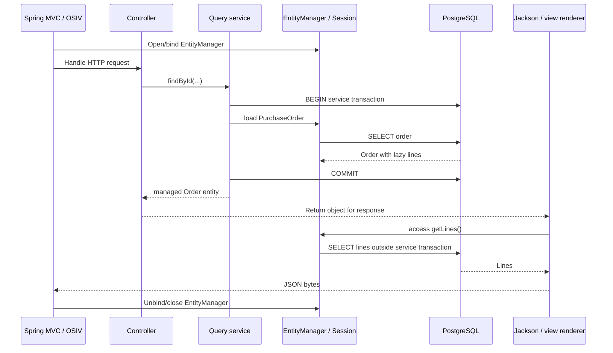
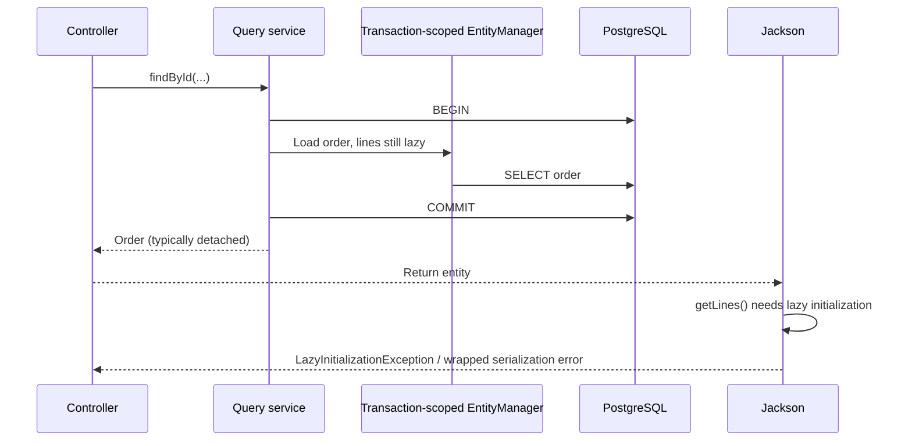
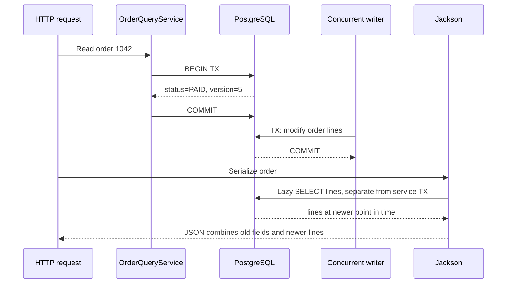
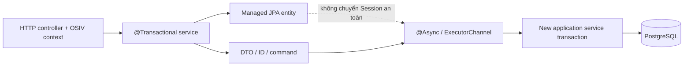
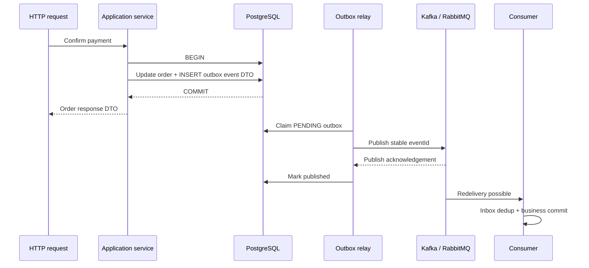
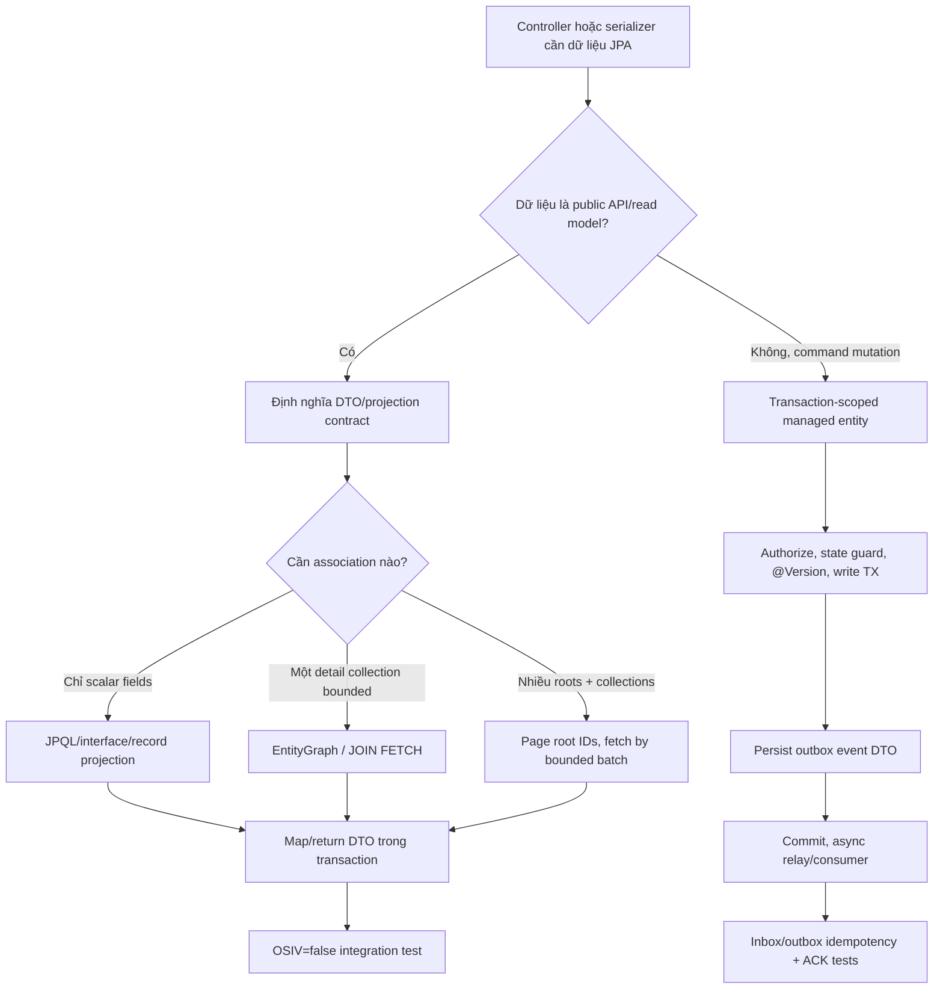

# Open EntityManager in View và ảnh hưởng tới truy vấn ngoài giao dịch

> **Chương:** JPA và Hibernate  
> **Module:** `SPRING_BOOT_INTEGRATION` — tổ chức tích hợp hệ thống trong Spring Boot qua HTTP client, cơ sở dữ liệu, cache, broker thông điệp và các adapter của Spring Integration. Trọng tâm là quản lý cấu hình, hợp đồng dữ liệu, giao dịch, lỗi, chống xử lý trùng lặp, kiểm thử và quan sát những luồng tích hợp thực tế.
>
> **Ngữ cảnh:** Java 17+, Spring Boot 3.x, Jakarta Persistence API (`jakarta.persistence.*`), Spring Data JPA và Hibernate 6.x; ví dụ chủ yếu dành cho **Spring MVC trên Servlet stack**. Tên property và chi tiết Hibernate có thể thay đổi theo phiên bản. Bài không khẳng định một cấu hình mặc định áp dụng cho WebFlux, worker bất đồng bộ hoặc mọi loại `EntityManagerFactory`.

## 1. Bài toán: API đã trả dữ liệu, vì sao SQL vẫn chạy sau service?

Một Order Service nhận webhook từ đối tác, lưu đơn hàng vào PostgreSQL, đồng bộ trạng thái sang Redis và phát sự kiện tới Kafka. Một endpoint nội bộ cung cấp chi tiết đơn:

```text
GET /tenants/shop-a/orders/1042
  -> OrderController
  -> OrderQueryService.findById(...)
  -> OrderRepository
  -> JSON serialization
```

Nhóm phát triển đặt `@Transactional(readOnly = true)` tại service và kỳ vọng mọi truy vấn SQL phục vụ response nằm **trong service transaction**. Tuy nhiên, log cho thấy:

```text
10:00:00.010  BEGIN transaction
10:00:00.018  SELECT * FROM purchase_orders WHERE id = 1042
10:00:00.021  COMMIT transaction
10:00:00.024  SELECT * FROM purchase_order_lines WHERE order_id = 1042
10:00:00.031  HTTP response completed
```

Lệnh `SELECT purchase_order_lines` xuất hiện **sau COMMIT**, khi Jackson đang truy cập association `order.getLines()`. Nếu ứng dụng đang bật **Open EntityManager in View (OSIV)**, truy vấn này có thể thực hiện thành công mà không có một transaction nghiệp vụ do Spring service chủ động quản lý.

Điều đáng chú ý:

- **Có EntityManager còn mở không đồng nghĩa có database transaction đang mở.**
- OSIV có thể giúp lazy loading trong giai đoạn render view/serialize JSON nhưng cũng **che việc tầng web đang truy cập database**.
- Tắt OSIV mà chưa sửa cách dựng response có thể tạo `LazyInitializationException`.
- Giữ OSIV cũng không tự giải quyết N+1, transaction isolation, quyền truy cập, memory hoặc connection pool.
- Không nên chọn cấu hình bằng cách chỉ hỏi “bật hay tắt có hết exception?”; phải xác định **ranh giới đọc dữ liệu và hợp đồng API**.

### Mục tiêu học tập

Sau bài này, bạn có thể:

1. Phân biệt `EntityManager`, Hibernate `Session`, persistence context và database transaction.
2. Giải thích cơ chế OSIV trên Spring MVC và vì sao truy vấn lazy có thể xuất hiện sau khi service transaction kết thúc.
3. Đọc log để tìm SQL sinh trong controller, Jackson serialization, template/view hoặc tầng mapping ngoài transaction.
4. Nhận diện `LazyInitializationException`, N+1 query, connection pressure và dữ liệu không nhất quán.
5. Tắt OSIV có kiểm soát và sửa API bằng DTO projection/`@EntityGraph`/fetch plan phù hợp.
6. Hiểu giới hạn của `@Transactional(readOnly = true)`, `join fetch`, pagination, async task và message listener.
7. Tách database state, cache, broker publish, inbox/outbox và HTTP response thành những ranh giới đúng.
8. Kiểm thử cả truy vấn, transaction, serialization, security và performance mà không để test transaction che lỗi.

## 2. Thuật ngữ: EntityManager, persistence context, Session và transaction

| Thuật ngữ | Vai trò | Điều **không** nên suy ra |
|---|---|---|
| `EntityManager` | API JPA quản lý entity, truy vấn và vòng đời persistence context | Không phải lúc nào cũng có DB transaction |
| Hibernate `Session` | Implementation Hibernate thường làm nền cho EntityManager | Không bảo đảm thread-safe hoặc phù hợp chia sẻ đa luồng |
| **Persistence context** | Bản đồ các entity đang được quản lý và trạng thái liên quan | Không tự là snapshot bất biến qua nhiều query ngoài transaction |
| **Entity managed** | Entity gắn với persistence context còn hoạt động | Không có nghĩa thay đổi luôn được tự động commit |
| **Entity detached** | Entity không còn được quản lý bởi persistence context đã dùng | Lazy proxy chưa khởi tạo có thể không tải được |
| **Lazy association** | Quan hệ/collection tải khi cần thay vì tải ngay | Không tự giảm số SQL; có thể gây N+1 |
| **Spring transaction** | Scope được transaction manager quản lý, thường quanh service method | Không tự bao gồm việc Jackson serialize response |
| **OSIV** | Giữ một EntityManager khả dụng trong lifecycle web request/view | Không mở một DB transaction kéo dài hết request |
| **Connection pool** | Cấp phát/tái sử dụng JDBC connections | EntityManager còn mở không chứng minh connection luôn bị giữ |

### 2.1. Hibernate Session không phải object để truyền qua thread

Một persistence context thường gắn với execution context do Spring quản lý. Hibernate Session **không thread-safe**. Không đưa cùng managed entity/session trực tiếp cho `@Async` task rồi tiếp tục lazy load ở thread khác; phải truyền DTO/ID ổn định và mở transaction riêng tại worker nếu cần truy vấn.

### 2.2. “Ngoài transaction” cần nói chính xác

Nếu service method `@Transactional` đã commit nhưng OSIV còn giữ EntityManager, Hibernate có thể thực hiện một truy vấn lazy **mà không có Spring-managed service transaction hiện hành**. Ở JDBC/database, từng SQL statement có thể chạy theo auto-commit/transaction handling do driver/provider quyết định. Đừng gọi đó là “không có transaction ở bất kỳ tầng nào”; ý quan trọng là truy vấn **không còn thuộc cùng transaction nghiệp vụ và isolation snapshot** với service query trước đó.

## 3. Hai vòng đời khác nhau: web request và service transaction

Với OSIV bật trên một Spring MVC Servlet request:



Sơ đồ minh họa một execution path; thời điểm thu hồi JDBC connection có thể phụ thuộc Hibernate connection handling, pool và transaction boundaries. Không suy ra OSIV **luôn** chiếm connection trong suốt request.

**Ranh giới OSIV:** web request/view rendering.  
**Ranh giới `@Transactional`:** phần service method được Spring transaction proxy quản lý.  
Hai ranh giới thường **khác nhau**, dù có thể cùng sử dụng persistence context trong một request.

### 3.1. OSIV tắt thì sao?



Tắt OSIV không “phá Hibernate”; nó phơi ra việc **tầng web đang kỳ vọng truy vấn DB sau service transaction**. Cách sửa là thiết kế fetch plan và response contract tại service, thay vì bật lại OSIV chỉ để exception biến mất.

## 4. Spring Boot cấu hình OSIV ở đâu?

Trong các ứng dụng Spring Boot **Servlet web + JPA** thỏa điều kiện auto-configuration, Boot thường bật OSIV theo mặc định nếu chưa cấu hình rõ. Nó có thể cảnh báo rằng `spring.jpa.open-in-view` đang bật và truy vấn có thể thực thi trong quá trình render view.

Cấu hình khuyến nghị để xác định rõ policy:

```yaml
spring:
  jpa:
    open-in-view: false
```

Hoặc nếu ứng dụng chủ động chấp nhận OSIV:

```yaml
spring:
  jpa:
    open-in-view: true
```

**Không có quy tắc OSIV mặc định áp dụng giống nhau cho mọi Spring WebFlux, ứng dụng console, Spring Batch, Kafka consumer, RSocket hoặc WebSocket.** Cơ chế OSIV quen thuộc của Spring MVC dựa trên Servlet request và việc bind EntityManager vào request thread/transaction synchronization.

### 4.1. Không chỉ nhìn application.yml trong Git

Các property có thể bị override bởi profile, environment, command-line arguments hoặc deployment config. Trong Spring Boot, tên biến môi trường thông dụng có thể là:

```text
SPRING_JPA_OPEN_IN_VIEW=false
```

Cần xác nhận effective property của instance đang chạy theo cách an toàn, không dựa vào cấu hình local. Nếu một team khai báo `OpenEntityManagerInViewFilter` hoặc `OpenEntityManagerInViewInterceptor` thủ công, một property auto-configuration có thể không điều khiển bean tùy chỉnh đó. Kiểm tra bean/filter registration thật ở ứng dụng.

### 4.2. “Tắt OSIV” không tắt JPA hay @Transactional

`spring.jpa.open-in-view=false` không tắt `EntityManagerFactory`, Spring Data JPA repository, Hibernate lazy associations hay `@Transactional`. Nó chủ yếu loại bỏ cơ chế giữ EntityManager mở cho web view lifecycle do Boot tạo. Repository/service vẫn hoạt động trong transaction/persistence context được quản lý bình thường.

## 5. OSIV được hiện thực bằng gì?

Spring Framework có hai thành phần quen thuộc:

- `OpenEntityManagerInViewFilter`: Servlet filter quản lý EntityManager gắn với request/dispatch phù hợp.
- `OpenEntityManagerInViewInterceptor`: Spring MVC interceptor có vai trò tương tự trong ngữ cảnh MVC.

Mục đích là cho view/serialization truy cập lazy associations sau khi service transaction kết thúc. Khi một transaction service bắt đầu trong request đó, Spring transaction manager có thể tham gia EntityManager đã được bind; sau commit, EntityManager có thể **vẫn mở** cho view.

### 5.1. OSIV không tự mở @Transactional quanh controller

Đây là khác biệt cốt lõi:

```text
OSIV begins:        [------------------------------------]
Service @TX:                 [-----------]
Controller+JSON:     [--------------][----------------]
SQL in TX:                    SELECT order
SQL outside TX:                               SELECT lines
OSIV ends:                                        |
```

Controller không tự trở thành một transaction JPA chỉ vì OSIV bật. View code có khả năng chạy query, nhưng không nhận bảo đảm nhất quán của transaction service trước đó.

### 5.2. Trường hợp async servlet cần kiểm tra riêng

Spring có cơ chế xử lý async dispatch/context binding trong các thành phần OSIV theo phiên bản, nhưng không nên suy rằng một `@Async` worker, callback chạy thread tùy ý hay message broker listener tự thừa hưởng EntityManager của HTTP request. Servlet async lifecycle, executor, context propagation và thời điểm đóng session phải được **integration test** nếu thật sự dựa vào chúng.

## 6. Model dữ liệu: PurchaseOrder và OrderLine có lazy association

Một schema PostgreSQL tối giản:

```sql
CREATE TABLE purchase_orders (
    id BIGINT PRIMARY KEY,
    tenant_id VARCHAR(80) NOT NULL,
    status VARCHAR(32) NOT NULL,
    version BIGINT NOT NULL
);

CREATE TABLE purchase_order_lines (
    id BIGINT PRIMARY KEY,
    order_id BIGINT NOT NULL REFERENCES purchase_orders(id),
    sku VARCHAR(80) NOT NULL,
    quantity INTEGER NOT NULL
);

CREATE INDEX idx_order_lines_order_id
    ON purchase_order_lines(order_id);
```

Mapping JPA dùng `jakarta.persistence.*`:

```java
import jakarta.persistence.*;
import java.util.ArrayList;
import java.util.List;

@Entity
@Table(name = "purchase_orders")
public class PurchaseOrder {

    @Id
    private Long id;

    @Column(name = "tenant_id", nullable = false)
    private String tenantId;

    @Column(nullable = false)
    private String status;

    @Version
    private long version;

    @OneToMany(mappedBy = "order", fetch = FetchType.LAZY)
    private List<PurchaseOrderLine> lines = new ArrayList<>();

    protected PurchaseOrder() {}

    public Long getId() { return id; }
    public String getTenantId() { return tenantId; }
    public String getStatus() { return status; }
    public long getVersion() { return version; }
    public List<PurchaseOrderLine> getLines() { return lines; }
}
```

```java
import jakarta.persistence.*;

@Entity
@Table(name = "purchase_order_lines")
public class PurchaseOrderLine {

    @Id
    private Long id;

    @ManyToOne(fetch = FetchType.LAZY, optional = false)
    @JoinColumn(name = "order_id", nullable = false)
    private PurchaseOrder order;

    @Column(nullable = false)
    private String sku;

    @Column(nullable = false)
    private int quantity;

    protected PurchaseOrderLine() {}

    public Long getId() { return id; }
    public String getSku() { return sku; }
    public int getQuantity() { return quantity; }
}
```

Các entity này minh họa **đọc dữ liệu**; ví dụ không thêm constructor tạo aggregate hoặc sequence generator cho thao tác insert. `version` giúp optimistic locking khi update trong nghiệp vụ, nhưng **không tự bảo đảm hai query thực thi ở thời điểm khác nhau cùng một snapshot**.

### 6.1. Vì sao đặt LAZY tường minh?

`@OneToMany` mặc định thường LAZY theo JPA; việc ghi rõ cho phép người đọc thấy fetch policy. `@ManyToOne` mặc định EAGER theo JPA, nên ví dụ ghi `fetch = LAZY` để tránh tải không cần thiết. LAZY chỉ là yêu cầu/chiến lược fetch; còn proxy/bytecode enhancement và khả năng thực thi phụ thuộc provider/association.

### 6.2. Entity không phải DTO response

Entity có persistence lifecycle, quan hệ hai chiều, proxy và field dành cho nội bộ. Dùng nó làm JSON response trực tiếp có thể gây:

- Lazy loading ngoài service transaction.
- Chu kỳ object `order → lines → order`.
- Lộ dữ liệu nội bộ qua getter mới.
- Coupling schema DB với public API.
- Query count phụ thuộc cách serializer duyệt object.

Dù cấu hình `@JsonIgnore` để né vòng lặp, việc trả entity vẫn khiến HTTP representation phụ thuộc persistence model.

## 7. Anti-pattern: controller trả entity được load bằng repository

```java
import org.springframework.http.HttpStatus;
import org.springframework.stereotype.Service;
import org.springframework.transaction.annotation.Transactional;
import org.springframework.web.server.ResponseStatusException;

@Service
public class OrderLookupService {

    private final PurchaseOrderRepository orders;

    public OrderLookupService(PurchaseOrderRepository orders) {
        this.orders = orders;
    }

    @Transactional(readOnly = true)
    public PurchaseOrder find(Long id, String tenantId) {
        return orders.findByIdAndTenantId(id, tenantId)
            .orElseThrow(() -> new ResponseStatusException(
                HttpStatus.NOT_FOUND, "Order not found"));
    }
}
```

```java
import org.springframework.web.bind.annotation.*;

@RestController
@RequestMapping("/tenants/{tenantId}/orders")
class OrderEntityController {

    private final OrderLookupService lookup;

    OrderEntityController(OrderLookupService lookup) {
        this.lookup = lookup;
    }

    @GetMapping("/{orderId}")
    PurchaseOrder get(@PathVariable String tenantId,
                      @PathVariable Long orderId) {
        return lookup.find(orderId, tenantId);
    }
}
```

Repository tương ứng:

```java
import java.util.Optional;
import org.springframework.data.jpa.repository.JpaRepository;

public interface PurchaseOrderRepository
        extends JpaRepository<PurchaseOrder, Long> {

    Optional<PurchaseOrder> findByIdAndTenantId(Long id, String tenantId);
}
```

Đây là **anti-pattern cố ý để phân tích**: controller trả entity, nên Jackson có thể duyệt `getLines()`. Với mô hình quan hệ hai chiều, có thể gặp lỗi vòng lặp JSON ngoài lỗi lazy; đoạn này không phải endpoint production hoàn chỉnh.

| Cấu hình | Điều có thể xảy ra |
|---|---|
| OSIV **bật** | Jackson gọi getter, Hibernate lazy SELECT lines ngoài transaction service, có thể sinh N+1 |
| OSIV **tắt** | Lazy collection chưa khởi tạo, session đã đóng; có thể gặp Hibernate `LazyInitializationException` |
| Association đã được fetch trước | Jackson không cần lazy SELECT bổ sung cho collection đó |
| Serializer bỏ qua collection | Không query collection; nhưng API thiếu data đó, chưa chắc đúng contract |
| Entity graph bị thay đổi | Số SQL và response shape biến đổi mà controller không hề sửa |

**Cẩn trọng:** Jackson không luôn đụng mọi getter khi có cấu hình ignore/filter/custom serializer; truy vấn lazy phát sinh **khi đường serialization/view thực tế truy cập proxy/collection chưa initialized**, không phải chỉ vì entity có một field LAZY.

## 8. LazyInitializationException: triệu chứng, không phải nguyên nhân sâu xa

Một lỗi phổ biến:

```text
org.hibernate.LazyInitializationException:
  failed to lazily initialize a collection of role:
  com.example.PurchaseOrder.lines:
  could not initialize proxy - no Session
```

Trong HTTP response path, có thể được framework wrap bởi `HttpMessageNotWritableException` hoặc Jackson mapping exception.

### 8.1. Lỗi này xuất hiện khi nào?

1. Entity/association chưa được load.
2. Code truy cập một lazy proxy/collection cần truy vấn.
3. Persistence context/session thích hợp đã đóng hoặc không sẵn.
4. Hibernate không thể lấy dữ liệu nên ném exception.

Một entity đã detached **không nhất thiết lỗi ngay**; scalar fields hoặc association đã được khởi tạo vẫn có thể đọc. Lỗi xảy ra ở thời điểm cần **lazy initialization** không còn session.

### 8.2. Giải pháp sai: bật OSIV để giấu đường SQL

Bật lại OSIV có thể khiến exception biến mất, nhưng bản chất:

- Dữ liệu vẫn được truy vấn ở nơi không có transaction nghiệp vụ dự kiến.
- Số query vẫn có thể tăng theo số entity/collection.
- HTTP latency phụ thuộc database trong giai đoạn render.
- Isolation có thể khác query đầu.
- Security/tenant filtering có thể không được áp đúng tại truy vấn lazy.

Giải pháp phải bắt đầu từ yêu cầu response: **cần những field/relations nào**? Fetch dữ liệu cần thiết và map DTO trong transaction.

## 9. Vì sao N+1 query thường bùng lên khi OSIV bật?

Giả sử controller trả danh sách 50 đơn:

```java
@GetMapping
List<PurchaseOrder> list() {
    return orderRepository.findAll();
}
```

Code này còn thiếu filter theo tenant và pagination nên **không dùng production**. Trong ví dụ, JPA có thể tải 50 orders bằng một query, còn Jackson truy cập `getLines()` cho từng order, làm thêm 50 queries.

```text
SELECT ... FROM purchase_orders;             -- 1 query
SELECT ... FROM purchase_order_lines WHERE order_id=1;
SELECT ... FROM purchase_order_lines WHERE order_id=2;
...
SELECT ... FROM purchase_order_lines WHERE order_id=50;
                                              -- 50 queries
TOTAL ~51 round trips
```

Số query thực tế phụ thuộc fetch strategy, batch settings, cache, các associations đã initialized và query plan; N+1 là **mẫu phổ biến**, không phải phép đếm bất biến.

### 9.1. N+1 không cần OSIV mới tồn tại

Nếu map DTO bên trong transaction mà code duyệt 50 orders và gọi `getLines()` từng cái, vẫn có thể N+1. OSIV **làm vấn đề khó phát hiện** vì query có thể chạy lúc serialize, sau khi service method đã kết thúc. Tắt OSIV không tự tối ưu SQL; cần fetch strategy và query budget đúng.

### 9.2. Tác hại

- Nhiều network round trips tới DB.
- Latency p95/p99 tăng khi collection lớn.
- Tăng DB connection/pool activity.
- Dễ gây lock contention hoặc tải I/O không cần thiết.
- Thông số performance phụ thuộc số phần tử JSON của response.
- Có thể bộc lộ khi một serializer/DTO getter được bổ sung dù repository code không đổi.

## 10. SQL phát sinh sau COMMIT có nhất quán với query ban đầu không?

Một query lấy `status="PAID"` trong service transaction; sau commit, Jackson mới lazy load `lines`. Trong khoảng đó, transaction khác có thể thêm/sửa/xóa line item.



Đây là nguy cơ **read skew/không cùng snapshot** giữa các phần của response. Dù tất cả query đều chạy trong một transaction, isolation như `READ COMMITTED` vẫn có thể cho phép mỗi statement nhìn dữ liệu đã commit tại thời điểm khác nhau; đừng tuyên bố `@Transactional(readOnly=true)` tự tạo snapshot bất biến.

### 10.1. Cách chọn consistency

- Với response thông thường: xây DTO đầy đủ trong một service transaction và chấp nhận isolation đã được chỉ định.
- Với yêu cầu snapshot mạnh: cấu hình isolation thích hợp, đọc theo version hoặc snapshot query theo nhu cầu nghiệp vụ; xác minh DB behavior.
- Với aggregate có version: đưa version vào contract và kiểm tra update optimistic locking khi ghi.
- Với hệ phân tán: database snapshot không bao trùm trạng thái Redis/broker/HTTP service khác. Cần event versions, reconciliation và API contract về eventual consistency.

### 10.2. EntityManager giữ entity cache cấp một không thay thế DB snapshot

Persistence context có thể giữ scalar fields đã đọc trước đó trong cùng managed entity, nhưng một association lazy chưa load vẫn có thể query dữ liệu mới hơn. Một JSON trộn hai thời điểm không tự mâu thuẫn theo Hibernate; nó chỉ không đáp ứng contract snapshot nếu nghiệp vụ yêu cầu.

## 11. OSIV có luôn chiếm JDBC connection suốt HTTP request?

**Không thể kết luận một cách tuyệt đối.** Một số bài viết mô tả OSIV “giữ connection suốt request” nhưng hành vi connection acquisition/release phụ thuộc Hibernate version, connection handling mode, JDBC provider, transaction boundaries và cách query.

Cần phân biệt:

1. **EntityManager/Session lifetime**: có thể kéo dài từ đầu đến cuối Servlet request.
2. **JDBC connection acquisition**: có thể bị trì hoãn tới query đầu tiên.
3. **Connection release**: có thể xảy ra tại transaction boundary hoặc theo provider/connection handling strategy.
4. **Transaction lifetime**: `@Transactional` thường ngắn hơn request.
5. **Session state/managed entities**: vẫn tồn tại khi session còn mở dù connection tạm được trả pool.

Đừng khẳng định mọi request với OSIV giữ đúng một connection tới lúc response kết thúc. Nhưng **OSIV tăng cơ hội DB I/O ở tầng render**, và trong một số cấu hình/trường hợp có thể góp phần giữ connection/pool resource lâu hơn.

### 11.1. Điều cần đo

| Chỉ số | Cho biết |
|---|---|
| Hikari active/idle/pending | Có connection bị giữ và người gọi đang đợi? |
| JDBC connection hold time | Connection bị chiếm bao lâu theo workload? |
| SQL count/request | View serialization có phát sinh nhiều query? |
| DB CPU/IO và round trips | Database bị kéo bởi lazy queries không? |
| HTTP response latency | Thời gian từ controller return đến response hoàn tất |
| Slow client / streaming response | Có tăng thời gian duy trì request/resources không? |

Tối ưu **dựa trên metric và trace**, không dựa trên giả định “OSIV luôn rò connection”.

## 12. OSIV và quyền truy cập: một truy vấn lazy có thể vượt thiết kế dữ liệu

Ví dụ hệ multi-tenant:

- Request đã xác thực tenant `shop-a`.
- Service repository có query `findByIdAndTenantId(orderId, tenantId)`.
- Controller trả entity.
- Serializer tự duyệt association `lines`, `customer`, `paymentRecords` hoặc `internalNotes`.

Ngay cả khi root query kiểm tra tenant, **không có nghĩa mọi relation được load về sau đã tuân thủ authorization boundary phù hợp**. Điều này còn phụ thuộc schema, foreign keys, mapping, tenant filter và policy.

### 12.1. DTO là hợp đồng tiết lộ dữ liệu

Với endpoint dành cho khách hàng, DTO chỉ nên có:

```json
{
  "orderId": 1042,
  "status": "PAID",
  "items": [
    {"sku": "A-101", "quantity": 2}
  ]
}
```

Không tự thêm `billingAddress`, `internalFraudFlag` hoặc `paymentToken` chỉ vì entity có getter đó. Dùng authorization check ở service, query scoped theo tenant và map các field được phép.

### 12.2. @JsonIgnore không phải authorization boundary duy nhất

`@JsonIgnore` hoặc Jackson View có thể chặn field tại serializer cụ thể, nhưng không thay row-level/tenant authorization và không chắc bảo vệ ở mọi adapter khác (message payload mapper, GraphQL resolver, log/toString). **Không để entity graph quyết định dữ liệu nhạy cảm được lộ ra ngoài**.

## 13. Controller, service và repository nên chịu trách nhiệm gì?

Một phân tách dễ bảo trì:

| Tầng | Trách nhiệm | Không nên |
|---|---|---|
| HTTP controller | Xác thực/nhận tenant identity, validate request, gọi service, trả DTO/status | Trực tiếp điều khiển lazy loading/EntityManager |
| Application service | Transaction, authorization, gọi repository, map DTO, business consistency | Trả managed entity ra ngoài cho serializer tự truy vấn |
| Repository/JPA | Query được phép, fetch graph/projection, persistence | Quyết định field public API |
| Serializer | Encode DTO đã hoàn chỉnh | Gọi database hoặc tự quyết định fetch |
| Outbox/message adapter | Publish sau commit/retry/ACK | Dựa vào Session của HTTP request |
| Metrics/tracing | Quan sát SQL count, latency và lỗi | Log full entity chứa PII |

**Service transaction là nơi rõ nhất để quyết định dữ liệu nào được load**. Tầng serializer nên làm việc trên DTO/snapshot, không cần Hibernate Session.

### 13.1. Tại sao không gắn @Transactional lên controller?

Đặt `@Transactional` trên controller để giữ DB transaction tới cuối request không chắc bao trùm việc Jackson serialize **sau khi controller method trả về**; proxy transaction thường hoàn tất khi method kết thúc. Ngoài ra, controller còn lo HTTP/validation, dễ làm transaction dài và gắn DB lock với thời gian mạng/serializer.

Đặt transaction tại application service thực hiện công việc dữ liệu. Với read endpoint, map DTO trước khi rời service method.

## 14. Dựng DTO trong transaction: đường khuyến nghị

Định nghĩa response **không chứa entity/proxy**:

```java
import java.util.List;

public record OrderLineView(
    Long lineId,
    String sku,
    int quantity
) {}

public record OrderDetailResponse(
    Long orderId,
    String status,
    long version,
    List<OrderLineView> lines
) {}
```

Service:

```java
import java.util.List;
import org.springframework.http.HttpStatus;
import org.springframework.stereotype.Service;
import org.springframework.transaction.annotation.Transactional;
import org.springframework.web.server.ResponseStatusException;

@Service
public class OrderDetailQueryService {

    private final PurchaseOrderRepository orders;

    public OrderDetailQueryService(PurchaseOrderRepository orders) {
        this.orders = orders;
    }

    @Transactional(readOnly = true)
    public OrderDetailResponse get(String tenantId, Long orderId) {
        PurchaseOrder order = orders.findDetailByTenantAndId(tenantId, orderId)
            .orElseThrow(() -> new ResponseStatusException(
                HttpStatus.NOT_FOUND, "Order not found"));

        List<OrderLineView> lines = order.getLines().stream()
            .map(line -> new OrderLineView(
                line.getId(), line.getSku(), line.getQuantity()))
            .toList();

        return new OrderDetailResponse(
            order.getId(),
            order.getStatus(),
            order.getVersion(),
            List.copyOf(lines)
        );
    }
}
```

Controller:

```java
import org.springframework.web.bind.annotation.*;

@RestController
@RequestMapping("/tenants/{tenantId}/orders")
class OrderDtoController {

    private final OrderDetailQueryService service;

    OrderDtoController(OrderDetailQueryService service) {
        this.service = service;
    }

    @GetMapping("/{orderId}")
    OrderDetailResponse get(
            @PathVariable String tenantId,
            @PathVariable Long orderId) {
        return service.get(tenantId, orderId);
    }
}
```

**Cách này giữ lazy initialization nếu có trong transaction** và trả về record DTO không còn phụ thuộc session. Tắt OSIV không ngăn controller serialize record này, vì nó không chứa JPA lazy proxy.

### 14.1. TenantId trong URL không tự đáng tin

Ví dụ dùng `tenantId` từ path để minh họa query scope; trong production phải đối chiếu nó với caller identity/authorization, không coi người dùng tự nhập `shop-b` là có quyền đọc dữ liệu shop-b.

### 14.2. Vì sao List.copyOf?

Nó tạo danh sách unmodifiable làm DTO an toàn hơn với accidental mutation. Nó **không** làm toàn hệ thống bất biến tuyệt đối nếu record chứa nested mutable object; ở ví dụ này `OrderLineView` cũng là record chỉ chứa scalar fields.

## 15. @EntityGraph: khai báo cần fetch gì cho response

Repository dùng một method riêng cho endpoint chi tiết:

```java
import java.util.Optional;
import org.springframework.data.jpa.repository.EntityGraph;
import org.springframework.data.jpa.repository.JpaRepository;
import org.springframework.data.jpa.repository.Query;
import org.springframework.data.repository.query.Param;

public interface PurchaseOrderRepository
        extends JpaRepository<PurchaseOrder, Long> {

    Optional<PurchaseOrder> findByIdAndTenantId(
        Long id, String tenantId);

    @EntityGraph(attributePaths = {"lines"})
    @Query("""
        select o from PurchaseOrder o
        where o.id = :orderId
          and o.tenantId = :tenantId
        """)
    Optional<PurchaseOrder> findDetailByTenantAndId(
        @Param("tenantId") String tenantId,
        @Param("orderId") Long orderId);
}
```

`@EntityGraph(attributePaths = {"lines"})` nói với provider rằng endpoint này cần tải association `lines`. Trong trường hợp phù hợp, Hibernate có thể tạo một join/đường fetch giảm lazy SELECT khi service map DTO.

### 15.1. EntityGraph không đồng nghĩa 1 SQL trong mọi trường hợp

SQL cụ thể phụ thuộc mapping/provider, graph, collection cardinality và query planner. Một fetch graph không cho phép giả định mọi query chỉ còn một round trip, đặc biệt khi có nested collections, batch/subselect hoặc restrictions. **Dùng SQL count test với dataset thực tế** để xác minh.

### 15.2. Chọn graph theo use case

- List endpoint: chọn những field đủ để hiển thị trang.
- Detail endpoint: có thể fetch một collection được giới hạn.
- Export/report: streaming/projection/batch theo volume.
- Command path: chỉ load aggregate cần sửa trong transaction.
- Audit: dùng projection/entity riêng và transaction rõ, không dựa vào serializers.

Không chuyển mọi association thành EAGER chỉ để OSIV off không ném exception; điều này thường khiến nhiều endpoint fetch dữ liệu không cần thiết.

## 16. DTO projection thẳng từ database: khi không cần entity

Với response tóm tắt, projection có thể hiệu quả hơn việc hydrate entity + lazy associations:

```java
public record OrderSummaryRow(
    Long orderId,
    String status,
    long version
) {}
```

Spring Data JPA repository:

```java
import java.util.Optional;
import org.springframework.data.jpa.repository.Query;
import org.springframework.data.repository.query.Param;

public interface OrderSummaryRepository
        extends org.springframework.data.repository.Repository<PurchaseOrder, Long> {

    @Query("""
        select new com.example.orders.OrderSummaryRow(
            o.id, o.status, o.version)
        from PurchaseOrder o
        where o.id = :id and o.tenantId = :tenantId
        """)
    Optional<OrderSummaryRow> findSummary(
        @Param("id") Long id,
        @Param("tenantId") String tenantId);
}
```

**Đoạn mã giả định `OrderSummaryRow` thuộc package `com.example.orders`**; đường dẫn trong JPQL constructor expression phải đúng tên fully qualified của type thật. Projection không tạo entity managed cần lazy initialization khi serializer chạy.

Một query projection khác có thể lấy join scalar fields; cần xem giới hạn constructor expression, alias, kiểu dữ liệu và native SQL mapping theo provider/version.

### 16.1. DTO projection có thể giải quyết cả bảo mật dữ liệu

Khi query chỉ chọn `id/status/version`, các field nhạy cảm khác không cần được load. Dù vậy, vẫn phải giữ điều kiện tenant/authorization trong query; projection **không tự chống lộ dữ liệu** nếu query scope sai.

### 16.2. Projection không phù hợp mọi mutation

Trong command path cần cập nhật aggregate, entity managed và optimistic locking có thể phù hợp hơn. Chọn cách load theo **read use case vs write use case**, không vì muốn tắt OSIV mà bỏ ORM hoàn toàn.

## 17. @Transactional(readOnly=true) giúp gì, và không giúp gì?

Ví dụ:

```java
@Transactional(readOnly = true)
public OrderDetailResponse getDetail(...) {
    // JPA queries + DTO mapping.
}
```

`readOnly=true` là một **hint/điều kiện cho transaction manager và provider**, có thể giúp tối ưu Hibernate flush/dirty checking tùy version. Nó không bảo đảm:

- DB luôn từ chối mọi lệnh UPDATE ở mọi driver/dialect.
- HTTP JSON serializer tự được chạy bên trong transaction.
- Mọi association đều đã được khởi tạo.
- Không có N+1.
- Không có lazy SQL ngoài transaction nếu OSIV còn bật.
- Snapshot là một trạng thái nhất quán theo mọi tiêu chí khi isolation chưa được định nghĩa.

### 17.1. Transaction từ Spring proxy

`@Transactional` thường cần lời gọi đi **qua Spring proxy**, không tự áp dụng khi một method trong cùng bean gọi một method `@Transactional` khác (`self-invocation`) trong proxy mode.

Ví dụ anti-pattern:

```java
@Service
class OrderService {
    private final PurchaseOrderRepository orders;

    OrderService(PurchaseOrderRepository orders) {
        this.orders = orders;
    }

    public PurchaseOrder get(Long id) {
        return loadTransactional(id); // Self-invocation, có thể bypass proxy.
    }

    @Transactional(readOnly = true)
    public PurchaseOrder loadTransactional(Long id) {
        return orders.findById(id).orElseThrow();
    }
}
```

Đây là **anti-pattern cố ý**: `get()` gọi `loadTransactional()` trên cùng đối tượng nên annotation của method đích có thể không được Spring proxy thực thi; trả entity lại tiếp tục có nguy cơ lazy query ngoài service. Giải pháp là đặt transaction trên **entrypoint được gọi từ bean khác** hoặc tách transactional component riêng, rồi map DTO trong transaction; test đảm bảo transaction thực sự active khi repository/mapping chạy.

### 17.2. Tránh transaction dài

Đừng mở DB transaction, rồi chờ REST API, Redis hoặc broker publish trong cùng method chỉ để giữ entity attached. Thời gian chờ I/O bên ngoài có thể làm connection/locks bị giữ lâu; một PostgreSQL transaction không bao trùm HTTP/Kafka/Redis side effect.

## 18. Fetch join, batch fetching và tối ưu N+1

Ngoài `@EntityGraph`, Hibernate/JPA còn có các cách điều khiển fetch phù hợp.

### 18.1. JPQL JOIN FETCH

```java
@Query("""
    select o
    from PurchaseOrder o
    left join fetch o.lines
    where o.id = :id
      and o.tenantId = :tenantId
    """)
Optional<PurchaseOrder> findOneWithLines(
    @Param("id") Long id,
    @Param("tenantId") String tenantId);
```

Ví dụ truy vấn **một order** với một collection. Không tự áp dụng fetch join collection cho mọi list endpoint có pagination.

### 18.2. Hibernate batch fetching

Spring Boot property chuyển cho Hibernate:

```yaml
spring:
  jpa:
    properties:
      hibernate:
        default_batch_fetch_size: 32
```

Hibernate có thể gom việc tải lazy associations của nhiều entity vào batch SELECT thay vì từng query. Đây là cách **giảm số round trips**, không thay việc chọn response contract hoặc bỏ nhu cầu transaction rõ ràng.

`@BatchSize(size = 32)` là annotation Hibernate-specific có thể khai báo trên entity/collection theo nhu cầu. Batch fetching có giới hạn theo mapping, số lượng ID, persistence context và version; test query count.

### 18.3. JOIN FETCH collection + pagination có bẫy

Một query fetch join collection cùng `Pageable` có thể khiến Hibernate khó áp dụng limit/offset ở DB đúng như kỳ vọng, hoặc cảnh báo/áp pagination trong memory tùy cấu hình/version. Hãy:

1. Page **IDs/roots** trước với query chỉ chọn orders thuộc tenant.
2. Load relations cho **tập ID có giới hạn**.
3. Map DTO trong transaction.
4. Bảo toàn thứ tự page theo specification.

Có thể bật cơ chế fail-fast cho collection fetch pagination trong Hibernate khi được hỗ trợ:

```yaml
spring:
  jpa:
    properties:
      hibernate:
        query:
          fail_on_pagination_over_collection_fetch: true
```

Property này thuộc Hibernate, cần xác minh tên/behavior theo version; nó ngăn một số truy vấn pagination nguy hiểm thay vì tự tối ưu SQL.

### 18.4. Không fetch nhiều bag collections bừa bãi

Hibernate có thể báo `MultipleBagFetchException` khi cố join fetch nhiều bag associations trong một query. Ngay cả khi chạy được, nhiều collection joins có thể tạo **cartesian multiplication** khiến result set khổng lồ. Chọn split queries, batch fetch, subselect hoặc projection; ưu tiên query budget và response size.

## 19. Pagination an toàn với collection fetch

Một endpoint trả danh sách nhiều đơn cần kiểm soát **số roots** và **số line items**. Không chọn `findAll()` rồi để Jackson tự lazy load vô hạn.

Một chiến lược hai bước:

1. Query một trang `order IDs` theo tenant và thứ tự ổn định.
2. Query dữ liệu cần thiết cho **chỉ những IDs đó**, có thể fetch một collection phù hợp.
3. Sắp xếp lại theo thứ tự của trang IDs vì SQL `IN (:ids)` không bảo đảm thứ tự.
4. Map từng order thành DTO **trước khi transaction đóng**.
5. Giới hạn kích thước trang và tổng lượng line items.

Ví dụ repository:

```java
import java.util.Collection;
import java.util.List;
import org.springframework.data.domain.Page;
import org.springframework.data.domain.Pageable;
import org.springframework.data.jpa.repository.Query;
import org.springframework.data.repository.query.Param;

public interface OrderPageRepository
        extends org.springframework.data.repository.Repository<PurchaseOrder, Long> {

    @Query(
        value = """
            select o.id from PurchaseOrder o
            where o.tenantId = :tenantId
            order by o.id desc
            """,
        countQuery = """
            select count(o) from PurchaseOrder o
            where o.tenantId = :tenantId
            """
    )
    Page<Long> pageOrderIds(
        @Param("tenantId") String tenantId,
        Pageable pageable);

    @Query("""
        select distinct o from PurchaseOrder o
        left join fetch o.lines
        where o.tenantId = :tenantId
          and o.id in :ids
        """)
    List<PurchaseOrder> findWithLines(
        @Param("tenantId") String tenantId,
        @Param("ids") Collection<Long> ids);
}
```

Ví dụ phần mapping trong service đã có `@Transactional(readOnly = true)`:

```java
Page<Long> pageIds = pageRepository.pageOrderIds(
    tenantId, org.springframework.data.domain.PageRequest.of(page, size));

List<Long> ids = pageIds.getContent();
if (ids.isEmpty()) {
    return List.of();
}

Map<Long, PurchaseOrder> ordersById =
    pageRepository.findWithLines(tenantId, ids).stream()
        .collect(java.util.stream.Collectors.toMap(
            PurchaseOrder::getId, java.util.function.Function.identity()));

return ids.stream()
    .map(ordersById::get)
    .filter(java.util.Objects::nonNull)
    .map(this::toDto)
    .toList();
```

`pageRepository` và `toDto` là field/method trong application service, không phải biến toàn cục; đây là **đoạn trích** của service. Việc `filter(nonNull)` chỉ phù hợp nếu API cho phép một row biến mất giữa hai queries; nếu contract yêu cầu snapshot đủ các IDs, cần isolation/version policy thay vì âm thầm lọc.

### 19.1. Hai query vẫn có thể gặp thay đổi concurrent

Nếu trang IDs được đọc ở thời điểm T1 và detail ở T2, có thể có row bị xóa hoặc đổi tenant. `@Transactional(readOnly = true)` ở isolation mặc định không tự bảo đảm snapshot cùng thời điểm. Nếu yêu cầu mạnh hơn, dùng transaction isolation được database hỗ trợ, version checks hoặc một snapshot query chuyên biệt.

### 19.2. Collection lớn vẫn là rủi ro

Ngay cả khi chỉ có 20 orders, một order có 50.000 lines cũng làm fetch graph/JSON response lớn. Với detail kiểu invoice nhiều dòng, cân nhắc **pagination riêng cho lines**, batch export hoặc stream có quota, không fetch không giới hạn.

## 20. View rendering, Jackson, template engine và ORM session

OSIV có tên “in View” vì ban đầu được dùng cho server-rendered HTML. Trong API JSON, **Jackson cũng là bước render response**; quá trình đó có thể xảy ra sau khi controller/service method trả về.

Những đường truy cập entity thường gặp:

- Thymeleaf/JSP expression `order.lines.size()`.
- Jackson getter traversal qua `@ResponseBody`/`@RestController`.
- Spring HATEOAS assembler truy cập association.
- GraphQL resolver gọi lazy getter (cần thiết kế DataLoader/transaction riêng).
- Templating email truy cập managed entity ngoài service.
- Logger `toString()`/`equals()`/`hashCode()` vô tình duyệt relations.
- Mapping libraries tự traverse association mà developer không kiểm soát.

### 20.1. Hibernate/Jackson modules không thay response design

Một số dự án cấu hình Jackson module hỗ trợ Hibernate proxy (ví dụ module theo Hibernate major version). Nó có thể làm serializer không buộc initialize proxy hoặc serialize ID/null tùy policy. Nhưng đó là **hành vi serialization**, không phải biện pháp chính xử lý:

- Dữ liệu API cần có field nào?
- Fetch plan và query count có được kiểm soát không?
- Request có thỏa tenant authorization không?
- Session đóng ở đâu?
- Response có phụ thuộc transaction/snapshot không?

Nếu chỉ ẩn lazy property để hết exception, có thể âm thầm làm mất dữ liệu mà frontend mong đợi.

### 20.2. Open EntityManager in View không chỉ gây lỗi khi JSON quá lớn

Một getter computed property có thể gọi repository hoặc lazy association, khiến controller return nhanh nhưng HTTP response chậm. Khi thêm field vào JSON contract, hãy xem **SQL trace đến thời điểm response bytes được viết**, không chỉ transaction service logs.

## 21. Hibernate.initialize và kiểm tra isInitialized(): dùng đúng mục đích

Hibernate có API:

```java
import org.hibernate.Hibernate;

boolean loaded = Hibernate.isInitialized(order.getLines());
Hibernate.initialize(order.getLines());
```

`Hibernate.initialize(...)` có thể chủ động khởi tạo một lazy collection **khi session phù hợp còn sẵn**. Có trường hợp migration cần khởi tạo một association tạm thời trong transactional service; nhưng đây là API phụ thuộc Hibernate và không phải fetch plan tối ưu.

### 21.1. Giải pháp “initialize tất cả” vẫn là N+1

```java
for (PurchaseOrder order : orders) {
    Hibernate.initialize(order.getLines());
}
```

Nếu `orders` có 100 phần tử và không có batching/fetch phù hợp, vẫn có thể sinh 100 SELECT lines. Bạn chỉ **chuyển N+1 từ serialization vào service**, chứ chưa tối ưu số SQL.

Ưu tiên:

- Query projection cho dữ liệu đọc.
- `@EntityGraph` cho detail use case.
- `JOIN FETCH` khi cardinality phù hợp.
- Batch/subselect fetching được benchmark.
- DTO mapping trong transaction, với test query count.

### 21.2. EntityManager.clear(), detach(), refresh() không phải thuốc chữa

- `clear()` detach mọi entities từ persistence context hiện tại.
- `detach(entity)` tách một entity.
- `refresh(entity)` reload state theo provider/transaction rules.

Các thao tác này có mục đích riêng; không tự làm association lazy đã được load. Nếu `clear()` rồi trả entity ra controller, lazy getter sau đó dễ lỗi hơn khi OSIV không còn quản lý entity phù hợp.

## 22. Cờ Hibernate enable_lazy_load_no_trans: đừng dùng để che nợ kiến trúc

Hibernate có thiết lập vendor-specific thường thấy:

```yaml
# Anti-pattern: không bật chỉ để chữa LazyInitializationException.
spring:
  jpa:
    properties:
      hibernate:
        enable_lazy_load_no_trans: true
```

Cờ này có thể cho phép tải lazy data ngoài transaction/persistence context ban đầu theo cơ chế Hibernate hỗ trợ. Nó dễ dẫn tới:

- Các session/connection/truy vấn ngầm không thuộc service transaction.
- N+1 phát sinh ở bất kỳ chỗ nào truy cập object.
- Read skew/không cùng snapshot.
- Khó quan sát transaction/query ownership.
- Khác biệt semantics khi upgrading provider.

**Không coi `enable_lazy_load_no_trans` là lựa chọn thay thế OSIV an toàn.** Nếu lý do duy nhất là hết `LazyInitializationException`, cần xác định fetch plan/DTO thay vì bật một cơ chế query ngầm khác.

### 22.1. Cờ này khác OSIV

OSIV giữ một EntityManager gắn với web request. `enable_lazy_load_no_trans` là khả năng xử lý lazy loading đặc thù Hibernate khi không có transaction/session ban đầu phù hợp. Chúng **không đồng nhất** về lifecycle/connection/identity map; không bật cả hai rồi mặc định vấn đề đã được giải quyết.

## 23. @Async, ExecutorChannel và job worker không có OSIV như HTTP request

Một worker xử lý event sau khi HTTP request hoàn tất không được phép dựa vào EntityManager của request đó.



Anti-pattern:

```java
@Async
public void sendReceipt(PurchaseOrder order) {
    // order có thể đã detached; getLines() có thể lỗi.
    emailService.renderAndSend(order.getLines());
}
```

Nó còn có rủi ro gửi email trước khi DB commit hoặc gửi trùng khi retry. Tốt hơn là truyền `orderId` và event ID ổn định, hoặc snapshot DTO đã được tạo trong transaction.

### 23.1. Worker đọc DB bằng transaction riêng

```java
import org.springframework.stereotype.Service;
import org.springframework.transaction.annotation.Transactional;

@Service
class OrderReceiptDataService {
    private final PurchaseOrderRepository orders;

    OrderReceiptDataService(PurchaseOrderRepository orders) {
        this.orders = orders;
    }

    @Transactional(readOnly = true)
    public OrderDetailResponse loadForReceipt(
            String tenantId, Long orderId) {
        PurchaseOrder order = orders
            .findDetailByTenantAndId(tenantId, orderId)
            .orElseThrow(() -> new IllegalArgumentException(
                "Order not found or inaccessible"));
        return OrderDtoMapper.toResponse(order);
    }
}
```

`OrderDtoMapper` là mapper thuần do ứng dụng định nghĩa, chỉ đọc fields đã fetch và trả DTO. Worker gọi service qua Spring bean/proxy, nhận DTO rồi render email sau transaction. Nếu muốn email phản ánh **state tại thời điểm order committed**, chỉ đọc bản hiện tại sau đó có thể không đủ; cần outbox lưu version/snapshot có hợp đồng.

### 23.2. @Async và @Transactional self-invocation

Nếu một method `@Async`/`@Transactional` gọi nội bộ từ cùng bean, proxy advice có thể không được áp dụng trong proxy mode. Khi cần async và transaction, tách bean worker và bean transactional service, kiểm thử thread/transaction active và lỗi/cancellation thực tế.

## 24. Spring Integration channels và broker listeners có transaction boundary riêng

Module `SPRING_BOOT_INTEGRATION` có nhiều ingress:

```text
HTTP controller
  -> Order service @Transactional
  -> Response DTO

Kafka/Rabbit/Pulsar listener
  -> Message adapter
  -> Order processing service @Transactional
  -> Inbox + state + outbox

Spring Integration polling adapter
  -> QueueChannel / DirectChannel
  -> Service activator
  -> Transactional service
```

OSIV chỉ gắn với một số **web request contexts**. Nó **không cấp** EntityManager cho Kafka consumer, RabbitMQ listener, Pulsar listener, Scheduled job hoặc Spring Integration poller.

### 24.1. DirectChannel vs ExecutorChannel

- `DirectChannel` thường dispatch đồng bộ trong caller thread. Một call bên trong service transaction có thể thấy context hiện có nếu các bean dùng đúng manager.
- `ExecutorChannel` chuyển execution sang thread khác; `ThreadLocal` transaction context của caller không tự đi theo.
- `QueueChannel` có polling consumer lấy message ở thời điểm khác; phải bắt đầu transaction riêng ở handler/poller.
- `PublishSubscribeChannel` có thể đồng bộ hoặc async tùy executor; không dựa OSIV để lazy load trong subscriber.

Đừng “sửa” `LazyInitializationException` của một message handler bằng `spring.jpa.open-in-view=true`; handler không phải HTTP MVC view, và cần transaction/fetch plan ở processing boundary của chính nó.

### 24.2. Message payload không nên chứa managed entity

Gửi một Hibernate-managed `PurchaseOrder` object trực tiếp qua Spring Integration channel/broker serializer có nguy cơ:

- Lazy access sau transaction.
- Serialization graph quá rộng/cyclic.
- Side effect query trong publisher.
- Producer/consumer bị ghép chặt với JPA class/version.
- Dữ liệu nhạy cảm vô tình đi vào broker.

Dùng event contract rõ ràng:

```java
import java.time.Instant;

public record OrderPaidEvent(
    String eventId,
    Long orderId,
    String tenantId,
    long aggregateVersion,
    Instant occurredAt
) {}
```

Nếu consumer cần chi tiết, nó đọc theo quyền và transaction của mình hoặc nhận snapshot DTO được hợp đồng hóa. Không dùng JPA entity làm giao thức liên dịch vụ.

## 25. Transactional outbox: tránh query ngầm trong event publishing

Luồng đáng tin cậy:



Outbox phải chứa **event contract có thể serialize được mà không cần Hibernate Session**. Không lưu reference tới live entity trong một in-memory event rồi để outbox relay serialize nó sau khi transaction/request kết thúc.

### 25.1. Ví dụ service ghi state và outbox cùng transaction

```java
import org.springframework.stereotype.Service;
import org.springframework.transaction.annotation.Transactional;

@Service
class OrderPaymentCommandService {
    private final OrderPaymentRepository orders;
    private final OutboxRepository outbox;

    OrderPaymentCommandService(
            OrderPaymentRepository orders,
            OutboxRepository outbox) {
        this.orders = orders;
        this.outbox = outbox;
    }

    @Transactional
    public void confirmPayment(PaymentConfirmedCommand command) {
        // Method này thực hiện kiểm tra tenant, idempotency và state.
        OrderPaidEvent event = orders.markPaidIfAllowed(command);
        outbox.insertIfAbsent(event.eventId(), event);
    }
}
```

`OrderPaymentRepository`, `OutboxRepository` và `PaymentConfirmedCommand` là các adapter/domain types do dự án triển khai. `orders.markPaidIfAllowed` phải trả event DTO chỉ gồm dữ liệu đã xác định rõ **trong transaction**; outbox insert phải dùng cùng datasource/transaction manager và unique key.

### 25.2. OSIV không giải quyết dual write

Ngay cả khi OSIV bật và có thể serialize entity sau commit, nếu publisher ghi Kafka thành công rồi DB transaction rollback, hai hệ vẫn không atomic. **OSIV giải quyết quyền truy cập lazy session ở tầng web, không tạo giao dịch chung HTTP–DB–broker.**

## 26. Từ JPA DTO tới Redis cache: không cache proxy/managed entity

Ví dụ cache-aside:

```text
GET /orders/{id}
    -> Redis GET order-summary:v2:tenant:id
    -> Miss -> @Transactional(readOnly=true) JPA query
            -> map OrderSummaryDto
            -> Redis SET with TTL
    -> HTTP response DTO
```

Không serialize trực tiếp Hibernate entity/proxy vào Redis:

- Serializer có thể đụng lazy association khi transaction đã đóng.
- Entity/proxy class và Jackson/Hibernate version thay đổi làm cache schema khó tương thích.
- Cache có thể chứa internal fields hoặc tenant data không mong muốn.
- Cached object không còn là entity managed có identity/dirty-checking semantics như JPA.
- Khi cache deserialize, một detached entity **không tự tái gắn** vào EntityManager.

**Mẫu khuyến nghị:** cache một DTO có version, khóa tenant-scoped và TTL rõ; database vẫn là source of truth.

### 26.1. Cache invalidation sau commit

Thay đổi đơn hàng trong transaction, rồi Redis invalidation có thể thất bại; OSIV không có tác dụng sửa chênh lệch này. Nếu cần durable invalidation, đưa event vào outbox và có worker/consumer retry, hoặc dùng versioned cache keys.

Một race có thể xảy ra:

```text
Reader lấy order version 5 từ DB (chưa ghi cache)
Writer commit version 6 và DEL cache
Reader ghi version 5 vào Redis sau DEL
```

TTL và version check/reconciliation giảm rủi ro; không kết luận “DB transaction + OSIV” làm cache nhất quán.

## 27. Đọc vs ghi: không dùng OSIV như cơ chế quản lý transaction

OSIV giữ EntityManager mở trong web request, nhưng JPA dirty checking/flush và commit phụ thuộc transaction hợp lệ.

### 27.1. Anti-pattern: sửa entity ở controller sau service return

```java
PurchaseOrder order = lookupService.find(orderId, tenantId);
order.getLines().clear(); // Anti-pattern: mutate collection ngoài write TX.
// Không có @Transactional write boundary rõ ràng hoặc commit được kiểm soát.
```

Đoạn này minh họa hành động sai ở tầng controller: `getLines()` có thể lazy load nhờ OSIV, nhưng `clear()` không có nghĩa một write transaction đã được mở hay thay đổi được commit hợp lệ. Dù entity còn managed bởi OSIV, không bảo đảm thao tác ghi được flush/commit một cách đúng đắn ngoài write transaction. Logic ghi phải ở application service `@Transactional` với authorization, state transition và optimistic locking.

### 27.2. @Version không thay transaction

`@Version` giúp detect concurrent updates qua optimistic locking khi provider thực hiện UPDATE, nhưng:

- Không khóa toàn bộ dữ liệu đã đọc trong view.
- Không bảo đảm lazy collection và root entity cùng snapshot.
- Không thay transaction consistency của nhiều SQL statements.
- Không giải quyết dual write Redis/Kafka.

### 27.3. Read-only transaction không cho phép viết ngoài ý muốn

Đừng hiểu `@Transactional(readOnly=true)` là “một khóa bảo mật” chống mọi UPDATE. Provider và DB có thể tối ưu hoặc thực thi read-only differently. Authorization và write transaction vẫn phải được kiểm soát bằng service/API policies, tài khoản database và các invariant.

## 28. Slow HTTP clients, JSON streaming và resource lifecycle

Một endpoint trả entity có thể mất nhiều thời gian để serialize và truyền body. Với OSIV, session lifetime gắn với web request/dispatch; lazy load trong view có thể làm các tài nguyên DB được sử dụng trong khi response đang dựng/truyền.

Ví dụ rủi ro:

- Client mạng chậm khiến request tồn tại lâu.
- Response có hàng nghìn entity + lazy collections.
- Jackson duyệt từng association và thực thi SQL xen kẽ.
- Connection pool bị tranh chấp khi traffic tăng.
- Lỗi SQL ở giữa serialization khiến response fail khi headers/body đã bắt đầu ghi.

### 28.1. Streaming response cần thiết kế riêng

Một `StreamingResponseBody` hay stream JSON sử dụng detached entities không tự truy cập lazy relationship sau transaction. Nếu stream cần truy vấn theo batches:

1. Thiết kế query cursor/pagination transaction rõ.
2. Map DTO/batch trong scope hợp lệ.
3. Đóng EntityManager/connection đúng thời điểm.
4. Giới hạn total bytes, timeout và cancellation.
5. Không kéo dài database transaction chỉ để chờ tốc độ client.

Một transaction mở trong suốt stream lớn có thể gây giữ connection, snapshot/bloat/locks lâu; chọn batching/export job nếu workload lớn.

### 28.2. OSIV không bảo đảm transaction trong response writer

Dù Session còn mở, việc Jackson chạm DB ngoài service transaction vẫn có thể ném lỗi. Nếu response đã commit headers, mapping exception có thể làm kết nối bị cắt hoặc body JSON không đầy đủ; error handler không luôn tạo được một `500 ProblemDetail` hoàn chỉnh.

## 29. Logging và observability: tìm SQL ngoài service transaction

Một cách tiếp cận có ích là bật SQL logging có kiểm soát trong test/staging:

```yaml
logging:
  level:
    org.hibernate.SQL: DEBUG
    # Không bật TRACE bind values ở production nếu có PII/secrets.
    # org.hibernate.orm.jdbc.bind: TRACE

spring:
  jpa:
    properties:
      hibernate:
        generate_statistics: true
```

Tùy version, Hibernate dùng các logging categories khác nhau cho SQL và bind values. `generate_statistics` có overhead, nên bật có mục đích và benchmark tác động.

### 29.1. Đo query count theo request

Các công cụ/chiến lược:

- Hibernate `Statistics`/`SessionFactory` cho dữ liệu tổng và một số scope phù hợp.
- Datasource proxy hoặc instrumentation JDBC để đếm SQL calls.
- Micrometer timer/counter cho repository/service.
- Correlation ID/tracing cho HTTP request và query spans.
- Trường log chỉ rõ `controller_returned_at` và `response_completed_at` để nhìn query ở giai đoạn serialize.

**Không chỉ nhìn tổng số SQL của JVM** trong test song song rồi tuyên bố một request sinh N+1. Cần cô lập test, reset counters đúng cách hoặc correlate spans.

### 29.2. Không log bind values nhạy cảm

Bind parameters có thể chứa tenant IDs, email, payment references, token hoặc dữ liệu cá nhân. `TRACE` cho Hibernate bind parameters có thể lộ PII/secrets vào logs. Dùng masked query traces, sampled SQL và test datasets giả định.

### 29.3. Metric hữu ích

| Metric/trace | Tác dụng |
|---|---|
| SQL SELECTs per endpoint/request | N+1 và lazy query ngoài service |
| HTTP controller duration vs response serialization duration | Latency phát sinh ở view |
| Hikari active/idle/pending | Pool pressure |
| DB query p95/p99 | Round trips và query plan |
| Entity/collection fetch count | Loading không dự kiến |
| JSON response size | Trả graph quá rộng |
| `LazyInitializationException` count | Fetch plan/transaction boundary sai |
| Outbox pending/oldest age | Event đã commit nhưng chưa publish |
| Cache hit/miss/stale read | Tác động database/cache consistency |

## 30. Kế hoạch tắt OSIV an toàn ở một ứng dụng đang chạy

Không nên chuyển `spring.jpa.open-in-view=false` rồi chỉ sửa các endpoint lập tức ném exception, bởi có thể có lazy queries ẩn trong controllers, views, exception handlers và JSON mapper.

Một rollout có kiểm soát:

1. **Inventory** các HTTP endpoints trả JPA entities, projections chứa entities, HATEOAS assemblers hoặc templates truy cập relations.
2. **Bật SQL telemetry** ở staging và tìm query phát sinh sau service transaction/ở view.
3. **Xác định response contract**: field nào thực sự được phép trả, tập associations và giới hạn payload.
4. **Chuyển controller** sang trả immutable DTO/snapshot được map trong service transaction.
5. **Thiết kế fetch plans** riêng: projection/list, entity graph/detail, paging IDs + bounded details cho collections.
6. **Thêm integration tests** với OSIV false, không dùng `@Transactional` ở test method để che lỗi.
7. **Đo SQL count và latency** của happy path, empty, paginated, large collection và concurrent writes.
8. **Kiểm thử authorization/tenant** với DTO, không dựa vào Jackson ignore để che field.
9. **Canary hoặc staging rollout**, xác nhận error rates và pool metrics.
10. **Triển khai OSIV false** theo môi trường/profiles được review, giữ rollback plan.
11. **Đối soát workflows** HTTP→DB→Redis→broker, tránh xử lý lazy proxy trong background jobs.
12. **Theo dõi sau deploy**: `LazyInitializationException`, `HttpMessageNotWritableException`, 5xx, slow response, SQL count, Hikari pressure.

### 30.1. Cấu hình mục tiêu

```yaml
spring:
  jpa:
    open-in-view: false
```

Khi chọn policy này, comment/README nội bộ nên ghi rõ **tại sao** và test nào bảo vệ nó. Đừng cho một profile ngoài ý muốn override thành true mà không có review.

### 30.2. Nếu chưa thể tắt ngay

Có thể tạm giữ OSIV trong một hệ thống legacy khi migration đang diễn ra, nhưng cần:

- Theo dõi SQL thực thi ở serialization/view.
- Hạn chế các entity được trả.
- Bật query budget/performance regression tests.
- Giới hạn response size và paging.
- Audit authorization/tenant filter.
- Đặt mốc chuyển sang DTO/fetch plan.

Coi đây là **quyết định kỹ thuật có chi phí**, không phải biện pháp bảo đảm tính đúng đắn.

## 31. Integration test HTTP thật với OSIV đã tắt

Một test unit trực tiếp gọi `OrderDetailQueryService.get(...)` **không kiểm tra JSON serialization**. Cần kiểm thử HTTP boundary qua `MockMvc` hoặc HTTP server thật.

Ví dụ test minh họa, giả định project có entity mapping, repository/DTO controller từ các mục trước và migration tạo hai bảng:

```java
import static org.springframework.test.web.servlet.request.MockMvcRequestBuilders.get;
import static org.springframework.test.web.servlet.result.MockMvcResultMatchers.*;

import org.junit.jupiter.api.BeforeEach;
import org.junit.jupiter.api.Test;
import org.springframework.beans.factory.annotation.Autowired;
import org.springframework.boot.test.autoconfigure.web.servlet.AutoConfigureMockMvc;
import org.springframework.boot.test.context.SpringBootTest;
import org.springframework.jdbc.core.JdbcTemplate;
import org.springframework.test.web.servlet.MockMvc;

@SpringBootTest(properties = "spring.jpa.open-in-view=false")
@AutoConfigureMockMvc
class OrderDtoMvcIntegrationTest {

    @Autowired MockMvc mvc;
    @Autowired JdbcTemplate jdbc;

    @BeforeEach
    void seedData() {
        // Dùng DB test cô lập, schema/migration giống production.
        jdbc.update(
            "DELETE FROM purchase_order_lines WHERE order_id = ?", 1042L);
        jdbc.update(
            "DELETE FROM purchase_orders WHERE id = ?", 1042L);

        jdbc.update("""
            INSERT INTO purchase_orders(id, tenant_id, status, version)
            VALUES (?, ?, ?, ?)
            """, 1042L, "shop-a", "PAID", 5L);

        jdbc.update("""
            INSERT INTO purchase_order_lines(
                id, order_id, sku, quantity)
            VALUES (?, ?, ?, ?)
            """, 9001L, 1042L, "A-101", 2);
    }

    @Test
    void returnsDetailWithoutLazyLoadingFromView() throws Exception {
        mvc.perform(get("/tenants/shop-a/orders/1042"))
            .andExpect(status().isOk())
            .andExpect(jsonPath("$.orderId").value(1042))
            .andExpect(jsonPath("$.status").value("PAID"))
            .andExpect(jsonPath("$.lines[0].sku").value("A-101"));
    }
}
```

Điều kiện:

- **Không thêm `@Transactional` vào test method/class** một cách vô thức: transaction của test có thể bao trùm controller execution trong cùng test thread và che lỗi mà production gặp.
- Test database phải được cô lập; ví dụ dùng ID cố định và DELETE/INSERT phù hợp một test container riêng.
- Nếu security bật, thiết lập test identity có quyền truy cập `shop-a`, không chỉ vô hiệu hóa security ở mọi test.
- Nếu cả `OrderEntityController` anti-pattern và `OrderDtoController` được copy vào cùng ứng dụng với route giống nhau, Spring sẽ báo ambiguous mapping: chúng là **hai phương án thay thế**, không phải cùng deploy.
- `@SpringBootTest`/`@AutoConfigureMockMvc` có wiring/version riêng; phải compile bằng dependency của dự án.

### 31.1. Vì sao @DataJpaTest có thể bỏ sót lỗi?

`@DataJpaTest` thường cấu hình transaction rollback quanh test method. Khi test gọi repository rồi truy cập lazy association ngay trong method test, EntityManager vẫn mở, nên không tái hiện **entity detached khi HTTP serializer chạy**. Dùng test MVC/HTTP với OSIV false, và tránh transaction test bao trùm request.

### 31.2. Test ở tầng nào là đủ?

- Repository test: xác minh query/filter/fetch graph.
- Service test: DTO mapping đúng trong transaction.
- MVC test: response JSON render được với OSIV false và không lộ field.
- Production-like integration test: SQL count, pagination, DB isolation, concurrency và tracing.

## 32. Kiểm thử fail case và query budget

### 32.1. Kiểm thử lazy failure có chủ đích

Một test học thuật có thể chứng minh entity trả ra ngoài transaction lỗi khi OSIV false và collection chưa initialized. Nhưng production regression test nên assert **API DTO luôn thành công**, thay vì phụ thuộc thông điệp `LazyInitializationException` cụ thể của Hibernate version.

Những trường hợp cần test:

| Kịch bản | Kết quả mong đợi |
|---|---|
| Detail endpoint trả order có lines | JSON đầy đủ; không query trong view |
| Detail endpoint trả order không có lines | JSON có `lines: []` theo contract |
| Order ID không tồn tại | 404, không expose SQL/internal exception |
| Tenant A đọc order tenant B | 403/404 theo policy; không leak relation |
| List 50 orders | Query count có giới hạn, không N+1 theo số rows |
| Page size vượt giới hạn | Reject/clamp theo API contract |
| Một order có nhiều line items | Payload quota/child pagination |
| Entity field nội bộ mới được thêm | Response DTO không tự lộ |
| Controller sau service commit | Không còn Hibernate lazy call |
| Outbox relay serialize event | Không phụ thuộc HTTP EntityManager |
| `@Async` worker nhận entity detached | Thiết kế bị test phát hiện, dùng ID/DTO |
| Concurrent update giữa root và lines | Consistency đúng isolation/version policy |

### 32.2. SQL count test: chọn cách đo đúng scope

Một cách bật Hibernate statistics trong test:

```yaml
spring:
  jpa:
    properties:
      hibernate:
        generate_statistics: true
```

Có thể lấy Hibernate `SessionFactory` và `getStatistics()` khi cần, nhưng counters thường **có phạm vi SessionFactory**, không phải riêng từng HTTP request. Với tests chạy song song, phép `clear()`/`getPrepareStatementCount()` có thể bị nhiễu. Một datasource proxy/correlation-based tracer hoặc test DB cô lập sẽ chắc chắn hơn cho SLA query budget.

**Không đặt một con số SQL cố định cho mọi Hibernate minor version** nếu query plan/fetch strategy có thay đổi có chủ đích. Thay vào đó, kiểm tra không tăng tuyến tính theo số orders và giới hạn được thống nhất theo endpoint.

### 32.3. Query budget có thể phát hiện regressions do serializer

Một endpoint trước đây trả 20 order summaries bằng 2 queries; sau thêm field `customerName`, một serializer truy cập `order.getCustomer().getName()` khiến 20 extra SELECT. Test count theo endpoint giúp phát hiện dù tất cả JSON assertions vẫn PASS với OSIV true.

## 33. Transaction, security và performance khi chạy đồng thời

Một hệ có 10 concurrent HTTP requests và 100 orders mỗi request có thể biến một truy vấn dự kiến thành hàng trăm hoặc hàng nghìn SELECT lazy.

### 33.1. Đo đạc cần song hành

- Workload: requests/sec, concurrency, response cardinality.
- Controller/service duration vs serialization duration.
- Số SQL statements/request, số round trips.
- Database CPU/I/O/locks và pool active/pending.
- HTTP p95/p99 và error rate.
- Số request fail vì `LazyInitializationException` hoặc timeouts.
- Message processing/backlog khi DB bị tranh chấp với HTTP lazy reads.

### 33.2. Tác động tới các luồng tích hợp khác

Nếu view N+1 tiêu thụ DB capacity, cùng database có thể phục vụ:

- Inbox insert từ Kafka/Rabbit/Pulsar consumer.
- Outbox relay claim/publish.
- JDBC scheduled polling.
- Transaction JPA ghi đơn hàng.
- Cache-miss refill từ Redis.
- API sync HTTP của đối tác.

Vì vậy, lỗi thiết kế của một endpoint đọc có thể làm tăng **consumer lag, outbox age và retry storm** trên toàn module Integration. Giải pháp không chỉ tăng Hikari pool, mà là giảm round trips và định nghĩa DB query ownership.

### 33.3. Khi nào tăng pool không giúp?

Nếu database đã gần max connections hoặc CPU/I/O saturation, tăng `maximumPoolSize` trên mỗi pod có thể làm DB quá tải hơn. Đo tổng số replicas × pool size, thời gian giữ connection và query latency trước khi nâng pool.

## 34. Troubleshooting: triệu chứng và hướng xử lý

| Triệu chứng | Nguyên nhân khả dĩ | Bước xác minh/khắc phục |
|---|---|---|
| `LazyInitializationException` trong response | Association lazy bị chạm sau khi session đóng | Map DTO trong transaction, fetch cần thiết |
| API chạy khi OSIV true nhưng lỗi khi false | Serializer/controller dựa lazy load ngoài service | Tìm getters/mapper/view và thiết kế fetch plan |
| SQL chạy sau COMMIT | OSIV giữ session cho serialization/view | Correlate SQL với request/transaction lifecycle |
| 1 query trở thành 101 khi trả 100 entities | N+1 lazy associations | Projection/entity graph/batch fetch, test count |
| Hikari pending cao khi HTTP response chậm | Query view/connection hold/DB bottleneck | Trace pool hold time và serialization |
| Response trộn status cũ và lines mới | Lazy queries ngoài service snapshot | DTO trong TX, isolation/version policy |
| Thêm `@Transactional` ở controller không sửa | Transaction proxy kết thúc trước serializer | Đặt mapping trong transactional service |
| `@Transactional` self-invocation không hoạt động | Lời gọi không qua Spring proxy | Tách bean/entrypoint, test transaction |
| `@Async` worker lỗi khi đọc entity | Không có OSIV/thread-bound session | Truyền ID/DTO và mở TX riêng |
| Kafka publisher JSON serialize lỗi lazy | Payload là JPA entity/proxy | Dùng event DTO đã materialize |
| Redis cache không đọc được sau deploy | Serialize JPA entity/proxy/schema cũ | Cache DTO versioned, test migration |
| Bật `enable_lazy_load_no_trans` hết lỗi nhưng nhiều SQL | Query ngầm ngoài transaction | Bỏ workaround, thiết kế fetch |
| Fetch join + Pageable gây chậm/OOM | Collection pagination trong memory/cartesian rows | Page root IDs trước rồi fetch bounded |
| MultipleBagFetchException | Join fetch nhiều bag collections | Split/batch/subselect queries |
| Một tenant thấy data tenant khác | Query scope/serialization graph sai | Authorization, tenant predicate và DTO contract |
| Response JSON lặp vô hạn | Quan hệ JPA hai chiều | DTO/serializer strategy, không expose entity |
| `@DataJpaTest` PASS nhưng endpoint FAIL | Test TX giữ session mở | MVC test OSIV false, không test-level TX |
| Outbox pending tăng do DB chậm | HTTP lazy reads tranh pool/CPU | Query budget, workload isolation, pool metrics |

Đừng xử lý mọi lỗi bằng cách bật OSIV, đổi tất cả association thành EAGER, gọi `Hibernate.initialize` trong vòng lặp hoặc dùng `hibernate.enable_lazy_load_no_trans=true`. Những thay đổi này có thể chỉ che dấu truy vấn hoặc tăng DB load.

## 35. Những anti-pattern cần nhận diện

| Anti-pattern | Hệ quả | Lựa chọn phù hợp hơn |
|---|---|---|
| Trả JPA entity trực tiếp qua REST JSON | Lazy SQL, dữ liệu thừa, coupling | Immutable DTO/projection |
| Để view tự truy cập mọi relation | N+1 và read skew ngoài transaction | Fetch plan tại service |
| Dùng OSIV như transaction manager | Lầm tưởng query sau commit có cùng isolation | Transaction service rõ |
| Tắt OSIV rồi chuyển mọi field thành EAGER | Graph quá lớn, tải DB thừa | EntityGraph/query riêng theo use case |
| `Hibernate.initialize` tất cả entity trong list | N+1 chuyển địa điểm | Batch/entity graph/projection |
| `enable_lazy_load_no_trans=true` để hết exception | Query ngầm không kiểm soát | Mapping trong transaction |
| `@Transactional` test class để “test real API” | Test transaction có thể che detached errors | HTTP integration test không test-level TX |
| Gửi managed entity vào Kafka hoặc Integration channel | Lazy/proxy/serialization coupling | Versioned event DTO |
| Cache Hibernate proxy trong Redis | Schema/serializer và lifecycle khó ổn định | Cache DTO theo version |
| Gọi email/HTTP/broker trong DB transaction chỉ để giữ Session | Transaction dài, dual-write | Outbox/worker |
| Dựa vào OSIV cho `@Async` worker | Không có request-bound session ở worker | Worker transaction riêng |
| Bật SQL bind TRACE trên production lâu dài | Lộ PII/secrets | Masked sampled tracing |
| Fetch join collection cùng pageable không test | In-memory pagination hoặc SQL rows quá lớn | Two-phase paged IDs + bounded fetch |
| Query theo ID mà không tenant authorization | Có thể lộ dữ liệu | Scoped repository/query và domain auth |
| Chỉ kiểm tra HTTP 200 | Bỏ sót N+1, stale data, response leak | Query/security/performance tests |

## 36. Sơ đồ lựa chọn giải pháp



Chọn theo **hợp đồng dữ liệu và độ tin cậy**, không theo việc code có ném `LazyInitializationException` hôm nay hay không.

### 36.1. Có trường hợp giữ OSIV hợp lý không?

Một ứng dụng MVC truyền thống nhỏ, render view server-side, không có dữ liệu nhạy cảm và hiểu rõ mọi query có thể quyết định giữ OSIV khi performance đã đo đạc và chấp nhận risk. Nhưng với **REST/microservice tích hợp nhiều hệ** nơi response/schema/transaction boundaries là contract, việc map DTO trong service và tắt OSIV thường giúp quan sát/truy vết dễ hơn.

Đây là lựa chọn kiến trúc chứ không phải câu hỏi đúng–sai tuyệt đối cho mọi hệ thống.

## 37. Checklist triển khai và code review

1. **Endpoint:** các controller có trả entity/proxy hoặc collection JPA không?
2. **OSIV policy:** `spring.jpa.open-in-view` được đặt tường minh và kiểm tra effective config chưa?
3. **Transaction:** mọi service query/mapping/command có đúng `@Transactional` proxy boundary?
4. **DTO:** response contract chỉ chứa field được phép; không có managed entities/lazy proxies?
5. **Fetch plan:** endpoint summary/detail/list/export có query/projection/graph riêng?
6. **N+1:** SQL count được đo trên data gần thực; không tăng tuyến tính ngoài ý muốn?
7. **Pagination:** không fetch join collection vô hạn/không làm pagination trong memory?
8. **Isolation:** đã hiểu read skew khi root và lazy relation đọc ở thời điểm khác nhau?
9. **Security:** tenant authorization nằm ở service/query, không chỉ ở Jackson filter?
10. **Resource:** Hikari active/pending, DB CPU, request serialization p95/p99 có dashboard?
11. **Legacy flags:** không bật `enable_lazy_load_no_trans` chỉ để che lỗi?
12. **Async:** `@Async`/ExecutorChannel/poller/listener có transaction và EntityManager riêng?
13. **Messaging:** event payload là DTO versioned, không gửi Hibernate entity/proxy?
14. **Cache:** Redis lưu DTO/key/version/TTL, không serialize JPA proxy?
15. **Outbox:** nghiệp vụ và event intent commit cùng DB; relay retry/dedup đúng?
16. **Tests:** HTTP serialization với OSIV=false và không có test transaction che lỗi?
17. **Failure modes:** negative, large page, concurrent updates, partial response, retry?
18. **Upgrade:** Hibernate/Spring Boot/Jackson changes được regression test về fetch và SQL?
19. **Observability:** SQL/collection fetch count, root causes, error class, query latency?
20. **Runbook:** biết cách rollback cấu hình, sửa fetch graph và đối soát dữ liệu sau sự cố?

## 38. Tự kiểm tra kiến thức

**Câu 1:** OSIV có mở một database transaction từ đầu đến cuối HTTP request không?  
**Trả lời:** Không. Nó giữ EntityManager sẵn trong web request lifecycle; service transaction vẫn có scope riêng.

**Câu 2:** Vì sao Hibernate có thể chạy SELECT sau khi `@Transactional(readOnly=true)` đã commit?  
**Trả lời:** Với OSIV, persistence context/session có thể còn mở, và view/Jackson truy cập association lazy chưa tải, phát sinh query ngoài service transaction.

**Câu 3:** Bật OSIV có tự sửa N+1 không?  
**Trả lời:** Không. Nó có thể làm N+1 diễn ra trong serialization mà không ném lỗi.

**Câu 4:** Tắt OSIV và gặp `LazyInitializationException` thì giải pháp tốt nhất là gì?  
**Trả lời:** Xác định response contract, fetch dữ liệu cần thiết và map DTO trong transaction; chọn projection/EntityGraph/batch phù hợp.

**Câu 5:** OSIV có luôn chiếm một JDBC connection suốt HTTP request không?  
**Trả lời:** Không thể kết luận tuyệt đối; phụ thuộc connection acquisition/release strategy, Hibernate/driver/transaction. Cần đo connection hold/pool metrics.

**Câu 6:** Vì sao JSON có thể trộn status cũ và lines mới khi OSIV bật?  
**Trả lời:** Root entity được load trong service transaction, còn collection lazy có thể được query sau commit ở thời điểm khác.

**Câu 7:** `@Transactional(readOnly=true)` có làm Jackson serializer chạy bên trong transaction không?  
**Trả lời:** Thông thường không; serializer chạy khi controller method đã trả về object.

**Câu 8:** Khi nào dùng DTO projection thay `@EntityGraph`?  
**Trả lời:** Khi endpoint chỉ cần vài scalar fields, projection tránh hydrate entity và kiểm soát dữ liệu rõ. Detail cần relation có thể dùng graph rồi map DTO trong transaction.

**Câu 9:** Có thể dùng `JOIN FETCH` collection với `Pageable` mà không kiểm tra gì không?  
**Trả lời:** Không. Có nguy cơ pagination trong memory/result set lớn; thường page root IDs trước.

**Câu 10:** `Hibernate.initialize(order.getLines())` trong vòng lặp có tối ưu N+1 không?  
**Trả lời:** Không mặc nhiên. Nó có thể chỉ chuyển các query từ view vào service mà vẫn chạy từng SELECT.

**Câu 11:** `hibernate.enable_lazy_load_no_trans=true` có tương đương OSIV không?  
**Trả lời:** Không. Đây là cơ chế Hibernate đặc thù cho lazy loading ngoài transaction/session ban đầu, với những rủi ro query ngầm riêng.

**Câu 12:** OSIV có giúp một Kafka listener lazy load JPA entity sau khi handler transaction đã đóng không?  
**Trả lời:** Không. OSIV của Spring MVC không phải transaction/session context cho message listener.

**Câu 13:** Gửi Hibernate entity qua Spring Integration/Kafka có rủi ro gì?  
**Trả lời:** Lazy serialization failure, object graph lớn/cyclic, schema coupling và dữ liệu nhạy cảm; nên dùng DTO event có version.

**Câu 14:** `@Version` có bảo đảm JSON root và lazy collection cùng một database snapshot không?  
**Trả lời:** Không. Nó hỗ trợ optimistic locking khi update, không thay transaction isolation cho read.

**Câu 15:** Tại sao `@DataJpaTest` có thể PASS nhưng REST response FAIL khi OSIV=false?  
**Trả lời:** Test slice có thể chạy trong transaction quanh test, giữ entity managed; serialization HTTP thật sau service transaction lại không có session.

**Câu 16:** Có nên chuyển tất cả associations sang `FetchType.EAGER` để tắt OSIV không?  
**Trả lời:** Không. Điều đó có thể tăng tải DB/graph; dùng fetch plan theo từng use case và query budget.

**Câu 17:** DB transaction của JPA có làm Redis cache và Kafka publish atomic không?  
**Trả lời:** Không. Cần outbox/inbox, idempotency, invalidation và reconciliation.

**Câu 18:** Khi nào xem migration OSIV false thành công?  
**Trả lời:** Khi HTTP endpoints serialize DTO đúng với OSIV false, query count/latency đạt yêu cầu, authorization đúng và các luồng async/broker/cache không còn phụ thuộc persistence context của view.

### Tài liệu tham khảo theo phiên bản

- [Spring Boot — SQL Databases & JPA](https://docs.spring.io/spring-boot/reference/data/sql.html).
- [Spring Framework — OpenEntityManagerInViewFilter](https://docs.spring.io/spring-framework/docs/current/javadoc-api/org/springframework/orm/jpa/support/OpenEntityManagerInViewFilter.html).
- [Spring Framework — OpenEntityManagerInViewInterceptor](https://docs.spring.io/spring-framework/docs/current/javadoc-api/org/springframework/orm/jpa/support/OpenEntityManagerInViewInterceptor.html).
- [Spring Framework — Transaction Management](https://docs.spring.io/spring-framework/reference/data-access/transaction.html).
- [Spring Data JPA — EntityGraph & projections](https://docs.spring.io/spring-data/jpa/reference/repositories/projections.html).
- [Hibernate ORM — User Guide](https://docs.jboss.org/hibernate/orm/current/userguide/html_single/Hibernate_User_Guide.html).
- [Jakarta Persistence Specification](https://jakarta.ee/specifications/persistence/).

Các liên kết dùng để tra cứu **theo phiên bản** Spring Boot/Spring Framework/Hibernate thực tế. Không sao chép cấu hình provider-specific qua major release mà không biên dịch và kiểm thử HTTP/JPA/broker integration.

---

Trong chương **JPA và Hibernate** của `SPRING_BOOT_INTEGRATION`, hãy nhớ: **Open EntityManager in View kéo dài khả năng truy cập persistence context vào giai đoạn render web request, nhưng không kéo dài service transaction thành một giao dịch nhất quán đến cuối response**. Lazy SELECT có thể phát sinh sau `COMMIT`, che N+1, làm tăng latency và trộn dữ liệu ở nhiều thời điểm. Với luồng tích hợp HTTP–database–cache–broker, cần chọn fetch plan theo API, map DTO trong transaction, tách event/outbox khỏi managed entity và kiểm thử khi `spring.jpa.open-in-view=false`.
