# Tải lười, N+1 và tác động tới tích hợp qua HTTP hoặc thông điệp

## 1. Tình huống thực tế: endpoint nhanh ở dev nhưng chậm khi có dữ liệu thật

Một dịch vụ Spring Boot quản lý đơn hàng dùng PostgreSQL qua Spring Data JPA/Hibernate. Endpoint `GET /api/v1/orders?status=PAID` trả một trang gồm 50 đơn hàng, kèm tên khách hàng và dòng hàng. Developer kiểm thử bằng hai đơn hàng và thấy mọi thứ ổn; ở production, khi 50 đơn có trung bình 5 dòng hàng, số câu SQL có thể tăng thành hàng trăm. Khi traffic đạt 100 requests/giây, pool JDBC bão hòa; endpoint HTTP chậm, WebClient của hệ thống gọi vào gặp read timeout, Kafka consumer khác xử lý event cũng trễ.

Một vấn đề khác xuất hiện khi controller trả thẳng JPA entity: Hibernate chỉ lấy `PurchaseOrder` trong transaction, nhưng Jackson truy cập `order.getCustomer().getDisplayName()` khi trả JSON. Nếu persistence context đã đóng, ứng dụng gặp `LazyInitializationException`; nếu OSIV vẫn mở EntityManager cho request, serialization có thể phát sinh **N+1 SQL ngoài service transaction**.

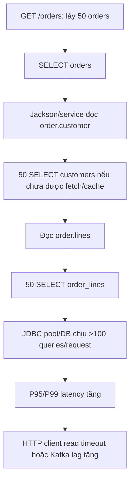

Bài thuộc chương **JPA và Hibernate** của module **SPRING_BOOT_INTEGRATION**: tổ chức tích hợp hệ thống bằng HTTP client, cơ sở dữ liệu, cache, broker thông điệp và Spring Integration, chú trọng cấu hình, hợp đồng dữ liệu, giao dịch, lỗi, xử lý trùng lặp, kiểm thử và quan sát thực tế.

**Mục tiêu học tập:**

1. Phân biệt persistence context, entity trạng thái managed/detached, lazy proxy và lazy collection.
2. Nhận diện N+1 với `@ManyToOne`, `@OneToMany` và quan hệ lồng nhau, không nhầm số SQL với số HTTP requests.
3. Hiểu vì sao `FetchType.EAGER` không phải thuốc chữa mọi N+1 và vì sao tăng JDBC pool không giải quyết gốc rễ.
4. Thiết kế fetch plan theo use case: DTO projection, `@EntityGraph`, `JOIN FETCH`, batch fetching, subselect và pagination hai pha.
5. Xử lý `LazyInitializationException` ở transaction boundary; quyết định có tắt Open Session in View (OSIV) hay không.
6. Tách JPA entities khỏi HTTP JSON contract và khỏi payload Kafka/RabbitMQ/JMS.
7. Không giữ DB transaction/locks qua HTTP remote call, Kafka publication hoặc retry dài.
8. Sử dụng transactional outbox/inbox, stable event ID, idempotency khi message được giao lại.
9. Đo query counts, JDBC durations, response latency, pool exhaustion và consumer lag.
10. Kiểm thử cả SQL shape/query count và failure windows trước khi triển khai.

> **Phiên bản:** Ví dụ dùng Java 17+, Spring Boot 3.x, Spring Data JPA 3.x, Hibernate ORM 6.x, Spring Framework 6.x và PostgreSQL. Khi sử dụng Spring Boot 4.x/Hibernate 7 hoặc provider JPA khác, kiểm tra Javadoc/APIs, annotation behaviors và query planner thực tế. Mã minh họa độc lập theo mục; nếu đưa vào một ứng dụng cần bổ sung project configuration, migrations và phiên bản dependencies tương ứng.

## 2. Bốn khái niệm phải tách bạch

| Khái niệm | Tác dụng | Rủi ro nếu hiểu sai |
| --- | --- | --- |
| **Persistence context / first-level cache** | `EntityManager` quản lý identity và trạng thái entities trong một scope. | Coi proxy còn đọc DB được sau khi scope đóng. |
| **Lazy loading** | Trì hoãn tải một association/collection cho tới khi code truy cập. | Tưởng `findAll()` luôn đã lấy mọi quan hệ. |
| **N+1 queries** | Một câu lấy N parents, sau đó nhiều câu SQL riêng cho related data. | Chậm theo số bản ghi mặc dù mỗi câu SQL nhỏ. |
| **Transaction boundary** | Phạm vi commit/rollback DB và nơi service hoàn tất work. | Tưởng HTTP serialization/async listener thuộc transaction vừa kết thúc. |

### 2.1. Persistence context không phải HTTP session

Hibernate `Session` thường là JPA provider backing cho `EntityManager`. Một persistence context giữ managed entities, dirty checking snapshots, lazy proxies, collection wrappers và first-level cache. Với mỗi entity type và primary key, trong một context Hibernate thường quản lý một entity instance logic.

```text
EntityManager / Hibernate Session
 ├─ managed PurchaseOrder(id=101)
 │    ├─ customer -> lazy proxy(Customer #21)
 │    └─ lines -> persistent collection (uninitialized)
 ├─ managed PurchaseOrder(id=102)
 └─ first-level cache / change tracking
```

Khi đóng context hoặc entity bị detach, lazy proxy chưa được initialized thường không còn context để phát sinh SELECT. Không suy rằng đối tượng Java còn tồn tại nghĩa là database connection hoặc transaction cũng còn.

### 2.2. Lazy là chiến lược tải dữ liệu, không phải serialization strategy

Một field `@ManyToOne(fetch = FetchType.LAZY)` có thể là proxy chỉ biết khóa ngoại. Truy cập `order.getCustomer().getId()` trong một số trường hợp Hibernate có thể lấy identifier không cần initialize toàn bộ proxy; nhưng gọi `getDisplayName()` sẽ cần dữ liệu và có thể phát SQL. Hành vi chính xác phụ thuộc mapping, provider, bytecode enhancement và trạng thái entity.

Một `@OneToMany(fetch = FetchType.LAZY)` dùng Hibernate persistent collection wrapper. Gọi `order.getLines().size()`, duyệt for-loop, hoặc stream trên collection **có thể** kích hoạt SQL; cấu hình `EXTRA_LAZY` có thêm tối ưu riêng nhưng không nên dựa vào nó nếu chưa cấu hình/đo đạc.

### 2.3. Managed, detached và transient

```text
transient -> persist() -> managed -> transaction/context closed -> detached
                           |
                           +-- change field -> dirty checking at flush

detached lazy association chưa initialized
  -> truy cập sau khi context đóng
  -> có thể LazyInitializationException
```

Truy cập trường bình thường đã được tải (như `order.getStatus()`) trên detached entity không đòi SQL. Nhưng truy cập một collection chưa được initialized thì không thể tự mở transaction mới an toàn. `EntityManager.merge(detached)` cũng không phải một cách “magic” để sửa fetch plan, vì có thể tạo thêm loads/updates và yêu cầu hiểu trạng thái entity.

## 3. FetchType.LAZY và FetchType.EAGER: defaults và ngộ nhận

Theo JPA:

- `@ManyToOne` và `@OneToOne` mặc định **EAGER** nếu không chỉ định khác.
- `@OneToMany` và `@ManyToMany` mặc định **LAZY**.
- `FetchType.LAZY` được JPA xem là hint trong một số tình huống/provider; behavior cụ thể tùy implementation.
- `FetchType.EAGER` là yêu cầu phải fetch dữ liệu liên quan, **không chỉ định phải dùng SQL JOIN**.

Ví dụ:

```java
@ManyToOne  // mặc định EAGER theo JPA!
private Customer customer;

@OneToMany(mappedBy = "order")  // mặc định LAZY
private List<OrderLine> lines = new ArrayList<>();
```

**EAGER không bảo đảm hết N+1.** Hibernate có thể tải entities liên quan bằng các câu secondary SELECT, nhất là khi dùng JPQL query không có fetch join phù hợp. EAGER còn có thể fetch dư dữ liệu cho những use cases chỉ cần khóa ngoại/tổng tiền.

**Khuyến nghị:** Với nhiều quan hệ to-one trong business entities, cân nhắc khai báo `LAZY` rõ ràng và định nghĩa fetch plan **theo từng truy vấn**. Không đổi mọi quan hệ sang EAGER chỉ để tránh `LazyInitializationException`; nó chuyển lỗi dễ thấy thành chi phí SQL/heap âm thầm.

### 3.1. Những yếu tố ảnh hưởng lazy behavior

- Entity/proxy phải tương thích với cơ chế lazy Hibernate sử dụng (ví dụ class final/constructor/access pattern, bytecode enhancement, identifier strategy).
- `@OneToOne` có những tình huống cần enhanced bytecode/provider behavior để lazy thực sự hiệu quả.
- `optional=false` và schema FK có thể giúp tối ưu xác định association tồn tại, nhưng không biến mọi field thành đã tải.
- Cấu hình second-level cache có thể giảm số SQL ở lần sau **nếu hit**, nhưng không loại bỏ design N+1; cache miss/redeploy sẽ làm lỗi xuất hiện lại.
- Database index quyết định chi phí từng secondary SELECT, nhưng 101 queries vẫn có network round trips/connection overhead cao hơn một kế hoạch query hợp lý.

## 4. Mô hình dữ liệu đơn hàng dùng xuyên suốt bài

Ta thiết kế ba entities: `Customer`, `PurchaseOrder`, `OrderLine`. Khách hàng có nhiều đơn; một đơn có nhiều dòng hàng.

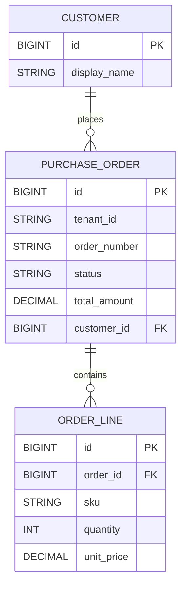

### 4.1. Mapping JPA với các quan hệ LAZY

```java
// OrderStatus.java
package com.example.integration.orders;

public enum OrderStatus {
    DRAFT, PAID, CANCELLED, FULFILLED
}
```

```java
// Customer.java
package com.example.integration.orders;

import jakarta.persistence.*;

@Entity
@Table(name = "customers")
public class Customer {
    @Id
    private Long id;

    @Column(name = "display_name", nullable = false, length = 200)
    private String displayName;

    protected Customer() {}

    public Long getId() { return id; }
    public String getDisplayName() { return displayName; }
}
```

```java
// PurchaseOrder.java
package com.example.integration.orders;

import java.math.BigDecimal;
import java.util.ArrayList;
import java.util.List;
import jakarta.persistence.*;

@Entity
@Table(name = "purchase_orders")
public class PurchaseOrder {
    @Id
    @GeneratedValue(strategy = GenerationType.IDENTITY)
    private Long id;

    @Column(name = "tenant_id", nullable = false, length = 80)
    private String tenantId;

    @Column(name = "order_number", nullable = false, length = 100)
    private String orderNumber;

    @Enumerated(EnumType.STRING)
    @Column(nullable = false, length = 30)
    private OrderStatus status;

    @Column(name = "total_amount", nullable = false,
            precision = 19, scale = 2)
    private BigDecimal totalAmount;

    @Version
    @Column(nullable = false)
    private long version;

    @ManyToOne(fetch = FetchType.LAZY, optional = false)
    @JoinColumn(name = "customer_id", nullable = false)
    private Customer customer;

    @OneToMany(mappedBy = "order", fetch = FetchType.LAZY)
    private List<OrderLine> lines = new ArrayList<>();

    protected PurchaseOrder() {}

    public Long getId() { return id; }
    public String getTenantId() { return tenantId; }
    public String getOrderNumber() { return orderNumber; }
    public OrderStatus getStatus() { return status; }
    public BigDecimal getTotalAmount() { return totalAmount; }
    public long getVersion() { return version; }
    public Customer getCustomer() { return customer; }
    public List<OrderLine> getLines() { return lines; }
}
```

```java
// OrderLine.java
package com.example.integration.orders;

import java.math.BigDecimal;
import jakarta.persistence.*;

@Entity
@Table(name = "order_lines")
public class OrderLine {
    @Id
    @GeneratedValue(strategy = GenerationType.IDENTITY)
    private Long id;

    @ManyToOne(fetch = FetchType.LAZY, optional = false)
    @JoinColumn(name = "order_id", nullable = false)
    private PurchaseOrder order;

    @Column(nullable = false, length = 100)
    private String sku;

    @Column(nullable = false)
    private int quantity;

    @Column(name = "unit_price", nullable = false,
            precision = 19, scale = 2)
    private BigDecimal unitPrice;

    protected OrderLine() {}

    public Long getId() { return id; }
    public String getSku() { return sku; }
    public int getQuantity() { return quantity; }
    public BigDecimal getUnitPrice() { return unitPrice; }
}
```

Các mappings trên chỉ phục vụ bài đọc; để tạo objects trong integration tests cần bổ sung constructors/factory methods, fixtures hoặc SQL inserts. Trong production cần migrations cho bảng, index, unique constraints theo tenant, và tenant-aware authorization trước khi trả kết quả. Không để `hibernate.hbm2ddl.auto=update` tự chỉnh schema production.

### 4.2. SQL schema minh họa

```sql
CREATE TABLE customers (
    id BIGINT PRIMARY KEY,
    display_name VARCHAR(200) NOT NULL
);

CREATE TABLE purchase_orders (
    id BIGINT GENERATED BY DEFAULT AS IDENTITY PRIMARY KEY,
    tenant_id VARCHAR(80) NOT NULL,
    order_number VARCHAR(100) NOT NULL,
    status VARCHAR(30) NOT NULL,
    total_amount NUMERIC(19, 2) NOT NULL,
    version BIGINT NOT NULL DEFAULT 0,
    customer_id BIGINT NOT NULL REFERENCES customers(id),
    UNIQUE (tenant_id, order_number)
);

CREATE INDEX idx_purchase_orders_tenant_status_id
    ON purchase_orders(tenant_id, status, id);

CREATE TABLE order_lines (
    id BIGINT GENERATED BY DEFAULT AS IDENTITY PRIMARY KEY,
    order_id BIGINT NOT NULL REFERENCES purchase_orders(id),
    sku VARCHAR(100) NOT NULL,
    quantity INTEGER NOT NULL CHECK (quantity > 0),
    unit_price NUMERIC(19, 2) NOT NULL
);

CREATE INDEX idx_order_lines_order_id
    ON order_lines(order_id);
```

Index `order_lines(order_id)` làm secondary loads rẻ hơn; tuy nhiên nó **không** loại bỏ số round trips khi Hibernate tải collection từng order. Với pagination, index theo tenant/status/id hỗ trợ query sắp xếp ổn định, nhưng cần kiểm tra `EXPLAIN ANALYZE` theo dữ liệu và database statistics thực tế.

## 5. N+1 hình thành như thế nào?

Một repository trả N orders:

```java
// PurchaseOrderRepository.java - phần cơ bản
import org.springframework.data.jpa.repository.JpaRepository;

public interface PurchaseOrderRepository
    extends JpaRepository<PurchaseOrder, Long> {
    // findAll() inherited from JpaRepository.
}
```

Service có thể làm:

```java
// Phác thảo anti-pattern chạy trong transaction.
List<PurchaseOrder> orders = repository.findAll();

for (PurchaseOrder order : orders) {
    String customer = order.getCustomer().getDisplayName();
    int lineCount = order.getLines().size();
    // ... build DTO ...
}
```

Nếu `findAll()` trả N orders và hai associations chưa có trong persistence context/cache:

```sql
SELECT ... FROM purchase_orders;              -- #1
SELECT ... FROM customers WHERE id = ?;       -- #2...
SELECT ... FROM order_lines WHERE order_id=?; -- #3...
SELECT ... FROM customers WHERE id = ?;
SELECT ... FROM order_lines WHERE order_id=?;
-- lặp theo các orders/unique foreign keys...
```

**N+1** được gọi như vậy khi có một truy vấn gốc + N truy vấn đi theo một mối quan hệ. Với hai quan hệ, số câu SQL có thể gần `1 + N + N`; nhưng đây **không phải công thức bắt buộc**:

- Nhiều orders tham chiếu **cùng Customer ID**: first-level cache có thể làm ít hơn N SELECT customers.
- Nếu entities/collections được batch-fetch hoặc second-level cached, số câu có thể giảm.
- Một association `EAGER` có thể dùng join hoặc secondary selects.
- Nếu code không truy cập `order.getLines()` thì lazy collection **không cần SELECT**.
- Nếu code lặp qua nhiều nested associations (order→line→product→vendor), truy vấn có thể tăng qua nhiều tầng.

### 5.1. Vì sao N+1 nguy hiểm trong tích hợp HTTP?

Giả sử một request tải 50 orders và cần 101 SQL statements. Nếu mỗi statement tốn trung bình 3 ms network+DB work, chỉ riêng DB có thể ~303 ms theo đường chạy nối tiếp; concurrent requests còn tranh JDBC connections, DB CPU, indexes và network. Đó là **ví dụ minh họa**, không dự đoán production. Cần đo p95/p99 và câu SQL thực để thấy mức độ.

Nếu endpoint trả 200 orders và mỗi request tạo vài trăm SQL, HTTP client khác dễ chạm read timeout. **Tăng HTTP client read timeout không khắc phục N+1**: nó chỉ kéo dài thời gian chờ, có thể giữ HTTP slots và worker threads lâu hơn.

### 5.2. Vì sao N+1 nguy hiểm với message consumer?

Một Kafka consumer xử lý `OrderPaid`, load order rồi truy cập lines, customer, product cho từng dòng. Nếu 1 event tạo 80 SELECT:

```text
Kafka poll -> listener
  -> load order
  -> lazy lines
  -> for each line: lazy product + vendor
  -> 80 SQL
  -> HTTP warehouse
  -> DB commit
  -> offset commit / ACK
```

Tăng số events/second làm consumer lag tăng; processing có thể vượt deadline của listener/poller, gây rebalance/redelivery, rồi chạy lại cùng expensive SQL. Cần **fetch plan đúng + idempotent handler + bounded work**, không chỉ tăng Kafka `max.poll.interval.ms` vô hạn.

### 5.3. LazyInitializationException không đồng nghĩa N+1

- `LazyInitializationException` xảy ra khi code cố initialize một lazy association/collection mà không có Hibernate Session/persistence context phù hợp.
- N+1 xảy ra khi session **đang hoạt động** và Hibernate thực hiện nhiều SELECT riêng.

Tắt OSIV có thể làm một N+1 “ẩn” trong serialization lộ ra thành `LazyInitializationException`, giúp thấy boundary sai; **điều đó không có nghĩa OSIV là cách sửa N+1**. Cách sửa là chọn query/fetch plan và mapping DTO trong transaction.

## 6. Open Session in View (OSIV): vì sao JSON serialization có thể âm thầm gọi SQL?

Trong ứng dụng Spring MVC/JPA, Spring Boot có thể cấu hình **Open EntityManager in View** để giữ `EntityManager` gắn với request trong cả pha view rendering/serialization. Tùy cấu hình và phiên bản Boot, nếu `spring.jpa.open-in-view` không được set, Boot có thể bật mặc định và đưa ra cảnh báo vì query có thể chạy trong view rendering.

### 6.1. Khi OSIV bật

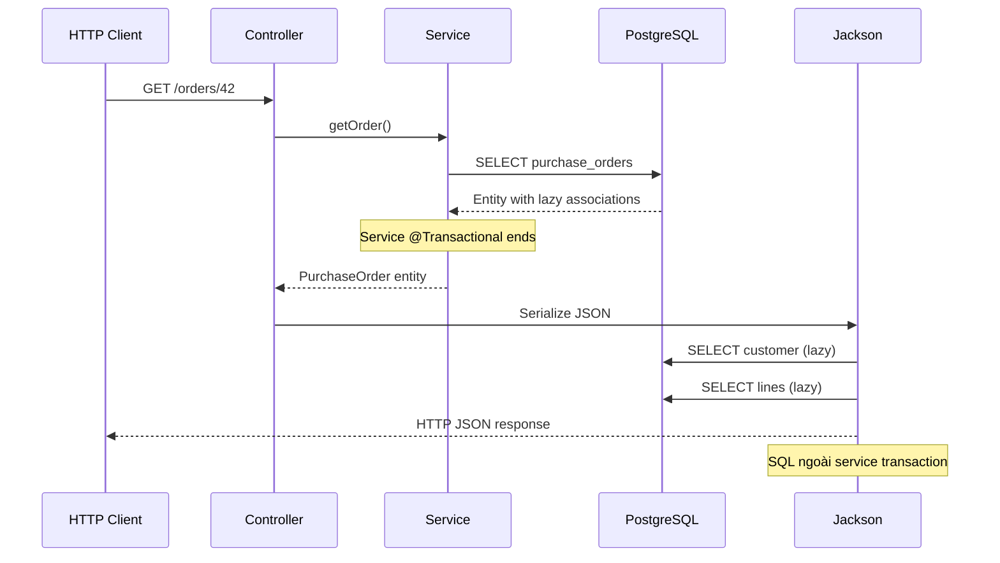

Nếu entity serialization duyệt lazy fields, DB queries có thể chạy **sau business transaction**, thường ngoài transaction quản lý service. Điều đó có thể làm response chậm, phá giả định tính nhất quán, tăng JDBC pool pressure và khó truy vết SQL về đúng service method. OSIV không bảo đảm một transaction mở từ controller tới khi trả JSON.

**OSIV giữ persistence context** có thể được bind vào request, nhưng **không đồng nghĩa giữ JDBC connection liên tục** hoặc một local transaction kéo dài cùng scope trong mọi trường hợp. Connection acquisition/release phụ thuộc Hibernate/provider, transaction và connection handling mode. Điểm rủi ro ở đây là **SQL có thể xuất hiện tại một pha không được chủ ý**.

### 6.2. Khi OSIV tắt

```yaml
spring:
  jpa:
    open-in-view: false
```

Service trả JPA entity chưa initialized, rồi Jackson truy cập lazy association sau khi method transactional đã hoàn tất:

```text
org.hibernate.LazyInitializationException:
  could not initialize proxy / collection - no Session
```

Đây là tín hiệu **boundary sai**, không phải lý do mở rộng transaction qua toàn HTTP request hoặc bật `hibernate.enable_lazy_load_no_trans` để Hibernate tự thực hiện queries lẻ ngoài transaction.

### 6.3. Khuyến nghị cho REST API tích hợp

**Mẫu rõ ràng:** controller nhận request → application service transaction read-only → repository query fetch đúng dữ liệu → map thành DTO hoàn chỉnh → service return DTO → Jackson serialize DTO.

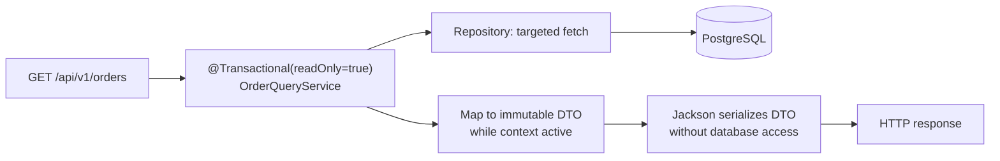

Để dễ kiểm soát, nhiều đội chọn `spring.jpa.open-in-view=false` cho REST APIs. Đây là **quyết định kiến trúc cần kiểm chứng với ứng dụng hiện tại**, không phải chuyển đổi mặc định an toàn cho một ứng dụng legacy đang phụ thuộc vào view lazy loading. Khi tắt, cần cập nhật toàn bộ endpoint để DTO fetching đúng cách trước khi rollout.

### 6.4. Không dùng annotation JSON để che thiết kế sai

Các workaround như:

```java
@JsonIgnore
private List<OrderLine> lines;
```

có thể giúp ngăn serialization truy cập một association nhưng cũng **thay đổi HTTP contract** và dễ giấu N+1 ở các field khác. Module Jackson Hibernate có behavior hỗ trợ proxies theo phiên bản, nhưng không tự làm DTO schema, authorization hoặc fetch plan đúng. Không đưa raw entity graph ra public API rồi dựa vào `@JsonManagedReference`/`@JsonBackReference` chỉ để chống vòng lặp.

## 7. Thiết kế DTO: ranh giới giữa persistence model và integration contract

Entity phục vụ thay đổi trạng thái DB; HTTP DTO và message event là **hợp đồng tích hợp**. Chúng có lifecycle/phiên bản/dữ liệu nhạy cảm và tải dữ liệu khác nhau.

Ví dụ DTO chỉ lấy dữ liệu client thực sự cần:

```java
// OrderLineView.java
package com.example.integration.orders;

import java.math.BigDecimal;

public record OrderLineView(
    Long lineId,
    String sku,
    int quantity,
    BigDecimal unitPrice
) {}
```

```java
// OrderDetailsView.java
package com.example.integration.orders;

import java.math.BigDecimal;
import java.util.List;

public record OrderDetailsView(
    Long orderId,
    String orderNumber,
    String customerName,
    String status,
    BigDecimal totalAmount,
    List<OrderLineView> lines
) {
    public OrderDetailsView {
        lines = List.copyOf(lines);
    }
}
```

Một danh sách đơn hàng chỉ cần tóm tắt có thể dùng record nhỏ hơn:

```java
// OrderSummaryView.java
package com.example.integration.orders;

import java.math.BigDecimal;

public record OrderSummaryView(
    Long orderId,
    String orderNumber,
    String customerName,
    BigDecimal totalAmount
) {}
```

**Không** dùng DTO chi tiết cho mọi use case: nếu danh sách 1.000 đơn hàng chỉ hiện total, fetch 50.000 dòng hàng là over-fetching. Tạo fetch plan riêng cho **list/summary**, **details**, **batch export**, **event construction**.

### 7.1. Mapping entity → DTO phải diễn ra khi dữ liệu cần thiết đã sẵn sàng

```java
// Chỉ dùng khi repository đã fetch customer và lines rõ ràng.
private static OrderDetailsView toDetails(PurchaseOrder order) {
    return new OrderDetailsView(
        order.getId(),
        order.getOrderNumber(),
        order.getCustomer().getDisplayName(),
        order.getStatus().name(),
        order.getTotalAmount(),
        order.getLines().stream()
            .map(line -> new OrderLineView(
                line.getId(),
                line.getSku(),
                line.getQuantity(),
                line.getUnitPrice()
            ))
            .toList()
    );
}
```

Đoạn `toDetails` **có thể kích hoạt lazy SQL** nếu gọi với association chưa fetch bên trong transaction. Nó không tự bảo vệ khỏi N+1. Bảo đảm DTO mapping theo **quyền sở hữu fetch plan** của service method, và dùng tests để phát hiện query count regression.

### 7.2. Nguyên tắc bảo mật

- Không đưa `customer.email`/credential/tenant-private fields vào DTO nếu client không cần.
- Kiểm tra tenant/row authorization trong repository query/service, không chỉ lọc JSON sau khi đã tải dữ liệu toàn tổ chức.
- Đừng dùng `Hibernate5Module`/serializer để chuyển proxy thành ID như thay thế cho authorization; schema API phải explicit.
- Message event không nên chứa toàn bộ entity/collection lazy: event cần stable event ID, schema version, aggregate key và fields đã được định nghĩa trong contract.
- Khi thay đổi entity mapping/column, không nhất thiết phải thay event schema hoặc API version; đó là lợi ích của DTO boundary.

## 8. Cách 1 — DTO projection: query trả đúng fields cần

Với endpoint danh sách chỉ cần ID, số đơn, tên khách hàng và tổng tiền, **DTO projection** thường là lựa chọn dễ dự đoán nhất. Không cần materialize đầy đủ entity graph để rồi serialize vài trường.

### 8.1. JPQL constructor projection

```java
// PurchaseOrderRepository.java
package com.example.integration.orders;

import java.util.List;
import org.springframework.data.jpa.repository.JpaRepository;
import org.springframework.data.jpa.repository.Query;
import org.springframework.data.repository.query.Param;

public interface PurchaseOrderRepository
    extends JpaRepository<PurchaseOrder, Long> {

    @Query("""
        select new com.example.integration.orders.OrderSummaryView(
            o.id,
            o.orderNumber,
            c.displayName,
            o.totalAmount
        )
        from PurchaseOrder o
        join o.customer c
        where o.tenantId = :tenantId
          and o.status = :status
        order by o.id asc
        """)
    List<OrderSummaryView> findSummaries(
        @Param("tenantId") String tenantId,
        @Param("status") OrderStatus status
    );
}
```

JPQL projection tạo `OrderSummaryView` trực tiếp từ selected fields (constructor tương ứng với record canonical constructor). Với simple summary, Hibernate không cần tạo 50 `PurchaseOrder` entities rồi lazy-load customer. Query có join tới customer vì cần display name, nhưng **đây là một query có join chứ không phải N secondary SELECTs**.

**Hạn chế:** method trả `List` không có page limit trong ví dụ. Production nên thêm pagination/cursor hoặc giới hạn số records theo contract; ngay cả một SQL statement có thể trả hàng triệu rows và gây memory pressure.

### 8.2. Page projection cho summary

```java
import org.springframework.data.domain.Page;
import org.springframework.data.domain.Pageable;

@Query(
    value = """
        select new com.example.integration.orders.OrderSummaryView(
            o.id, o.orderNumber, c.displayName, o.totalAmount
        )
        from PurchaseOrder o join o.customer c
        where o.tenantId = :tenantId and o.status = :status
        order by o.id asc
        """,
    countQuery = """
        select count(o)
        from PurchaseOrder o
        where o.tenantId = :tenantId and o.status = :status
        """
)
Page<OrderSummaryView> findSummaryPage(
    String tenantId, OrderStatus status, Pageable pageable
);
```

Đoạn này là **method bổ sung bên trong repository interface**, không phải file Java độc lập. `Pageable` phải được giới hạn `pageSize` và dùng sort ổn định theo business contract. Spring Data có thể tối ưu bỏ COUNT trong một số tình huống; khi cần count, nó là câu SQL riêng và **không phải N+1**. Với bảng quá lớn, `Slice`/keyset pagination có thể tránh total count tốn kém.

### 8.3. Projection không tự khử mọi N+1

Một interface-based projection của Spring Data JPA có thể truy cập nested properties; nested association projections đôi lúc dẫn đến join hoặc materialization rộng hơn mong đợi. Một repository method tên `findProjectedBy...` không bảo đảm query tối ưu nếu projection bọc entity thật hoặc sau đó gọi lazy getters.

**Cách kiểm tra:** bật SQL diagnostics trong test, xem generated query và query count với nhiều rows; xác minh contract fields. Đừng suy ra “đã trả record” nghĩa là bất kỳ nested collection nào cũng được lấy đúng một query.

## 9. Cách 2 — `@EntityGraph` cho association cụ thể

Khi cần entity để xử lý một aggregate và mapping DTO, Spring Data JPA hỗ trợ `@EntityGraph` để điều chỉnh fetch plan theo method.

### 9.1. Fetch to-one customer cho một trang summaries

```java
import org.springframework.data.jpa.repository.EntityGraph;
import org.springframework.data.domain.Page;
import org.springframework.data.domain.Pageable;

@EntityGraph(attributePaths = {"customer"})
Page<PurchaseOrder> findByTenantIdAndStatus(
    String tenantId,
    OrderStatus status,
    Pageable pageable
);
```

Đoạn method nằm trong `PurchaseOrderRepository`. Vì `customer` là **to-one**, fetching nó cùng root entities thường không nhân số root rows theo cardinality như một collection join. Dù vậy, SQL thực do Hibernate chọn còn tùy entity graph semantics, query shape/provider; test query counts.

Sau đó service có thể:

```java
// Đặt trong @Transactional(readOnly=true) service.
return repository.findByTenantIdAndStatus(
        tenantId, OrderStatus.PAID, pageable
    )
    .map(order -> new OrderSummaryView(
        order.getId(),
        order.getOrderNumber(),
        order.getCustomer().getDisplayName(),
        order.getTotalAmount()
    ));
```

`Page.map(...)` được thực thi ngay khi gọi map ở service trong transaction (không phải lazy Publisher); DTO không giữ JPA proxy. Không return `Page<PurchaseOrder>` ra controller rồi để Jackson initialize relations.

### 9.2. EntityGraph cho một đơn chi tiết

```java
import java.util.Optional;
import org.springframework.data.jpa.repository.EntityGraph;
import org.springframework.data.jpa.repository.Query;

@EntityGraph(attributePaths = {"customer", "lines"})
@Query("""
    select o from PurchaseOrder o
    where o.id = :id and o.tenantId = :tenantId
    """)
Optional<PurchaseOrder> findDetails(
    Long id,
    String tenantId
);
```

Đây là truy vấn theo **một ID**, nên fetch một to-one và một collection thường hợp lý khi số lines có upper bound. Nếu một đơn có hàng triệu lines, vẫn cần pagination riêng cho lines; một fetch graph không có giới hạn dữ liệu hợp đồng có thể gây OOM.

### 9.3. Không dùng EntityGraph to-many bừa bãi với Pageable

```java
// CẢNH BÁO: collection fetching trên Page có thể nguy hiểm.
@EntityGraph(attributePaths = {"lines"})
Page<PurchaseOrder> findByStatus(
    OrderStatus status, Pageable pageable
);
```

SQL join từ 20 parents mỗi parent 100 lines tạo khoảng 2.000 rows. Áp limit trên joined SQL có thể cắt ngang collection; Hibernate có thể áp pagination **trong memory** hoặc cảnh báo/fail tùy config và phiên bản. Đây là một nguồn bug hiệu năng/tính đúng đắn, không phải cách sửa N+1 chung cho mọi endpoint.

**Cách sửa:** pagination theo **parent IDs** trước, sau đó fetch associations cho đúng IDs trong một hoặc vài câu SQL, rồi map DTO và giữ thứ tự trang.

## 10. Cách 3 — JPQL `JOIN FETCH`: hữu ích nhưng phải hiểu row multiplication

`JOIN FETCH` bảo Hibernate load association cùng root query. Ví dụ:

```java
// Bên trong PurchaseOrderRepository.
@Query("""
    select o from PurchaseOrder o
    join fetch o.customer
    where o.id = :id and o.tenantId = :tenantId
    """)
Optional<PurchaseOrder> findWithCustomer(
    Long id, String tenantId
);
```

Ở đây `join fetch o.customer` thường lấy to-one cùng root row, tránh secondary SELECT khi đọc `getCustomer().getDisplayName()`. Nếu quan hệ customer optional, dùng `left join fetch` để không loại orders có customer NULL (ví dụ mapping `optional=true`); với mapping `optional=false` có FK hợp lệ, inner join là nhất quán.

### 10.1. Fetch một collection bằng join

```java
@Query("""
    select distinct o
    from PurchaseOrder o
    left join fetch o.lines
    where o.id = :id and o.tenantId = :tenantId
    """)
Optional<PurchaseOrder> findWithLines(
    Long id, String tenantId
);
```

Với một order có 10 lines, SQL trả có thể chứa 10 joined rows cùng order columns. Hibernate khôi phục 1 parent và collection tương ứng. `distinct`/Hibernate 6 dedup root entity references trong Java **không làm biến mất chi phí row multiplication của SQL**. Đối với query nhiều orders, memory/network overhead có thể lớn.

### 10.2. Hai collections tạo tích Descartes

Giả sử Order có `lines` 20 phần tử và `discounts` 10 phần tử; nếu fetch join đồng thời:

```text
1 order × 20 lines × 10 discounts = 200 SQL rows

50 orders có cardinality tương tự:
50 × 20 × 10 = 10,000 joined rows
```

Trường hợp nhiều bag collections trong Hibernate còn có thể phát sinh `MultipleBagFetchException` hoặc duplicate/Cartesian explosion, tùy mapping. **Đừng sửa bằng cách đổi `List` thành `Set` bừa bãi** nếu domain cần order/duplicates; hãy tách fetches và xây DTO có chủ đích.

### 10.3. Fetch join không thay schema contract

Một fetch join chỉ giải quyết **cách Hibernate tải dữ liệu** cho use case hiện tại. Nó không thay:

- giới hạn page size,
- tenant isolation,
- API DTO/schema version,
- dữ liệu nhạy cảm được phép trả,
- transaction boundary,
- HTTP timeout,
- idempotency của Kafka consumer.

Tối ưu fetch là một phần của thiết kế tích hợp, không phải thay thế những kiểm soát đó.

## 11. Cách 4 — Batch fetching, subselect và second-level cache

Khi logic bắt buộc duyệt lazy associations của nhiều roots, batching có thể giảm số secondary SELECTs mà không ép mọi association vào một Cartesian JOIN.

### 11.1. Hibernate default batch fetch size

```yaml
spring:
  jpa:
    properties:
      hibernate.default_batch_fetch_size: 32
```

Với Hibernate 6, property này có thể cho phép batch initialize nhiều lazy entity proxies/collections bằng câu SQL có nhiều IDs (SQL cụ thể phụ thuộc dialect/query strategy):

```sql
SELECT ... FROM order_lines
WHERE order_id IN (?, ?, ?, ...);
```

Nếu đang có 50 uninitialized collections, batch size 32 **có thể** giảm nhiều loads từ 50 thành một số batch selects. Số câu chính xác phụ thuộc session state, access order, cache, batch fetch style và provider; **đừng công bố công thức 1+ceil(50/32) như guarantee tuyệt đối** khi chưa đo.

### 11.2. `@BatchSize` đặt theo association

```java
// Mapping bổ sung trên PurchaseOrder.lines:
@OneToMany(mappedBy = "order", fetch = FetchType.LAZY)
@org.hibernate.annotations.BatchSize(size = 32)
private List<OrderLine> lines = new ArrayList<>();
```

Đây là **thay thế** cho declaration `lines` ở entity mục 4, không để đồng thời hai fields giống tên. `@BatchSize` thuộc Hibernate, không phải JPA portable annotation; quan sát generated queries và memory. Chọn kích thước theo database bind parameters, network round trips, số rows mỗi collection và concurrency.

### 11.3. FetchMode.SUBSELECT

```java
// Alternative Hibernate-specific mapping:
@OneToMany(mappedBy = "order", fetch = FetchType.LAZY)
@org.hibernate.annotations.Fetch(
    org.hibernate.annotations.FetchMode.SUBSELECT
)
private List<OrderLine> lines = new ArrayList<>();
```

Hibernate có thể tải collections cho nhiều owners trong cùng persistence context bằng **subselect** liên quan đến root query. Tùy câu query gốc, context size và Hibernate version, subselect có thể tải nhiều parents/collections hơn số DTO thực sự cần, đặc biệt khi context giữ nhiều entities. Chỉ chọn sau benchmark, không bật mặc định cho mọi collection.

### 11.4. Second-level cache không chữa logic N+1

Nếu `Customer` hoặc `OrderLine` được cache theo provider, cache hit có thể giảm SQL trong một lần gọi. Nhưng:

- Cold start/cache eviction vẫn làm nhiều database lookups.
- Cache invalidation/consistency với business writes là vấn đề riêng.
- Cache có overhead heap/distributed store/network.
- Một use case yêu cầu 5 fields vẫn không nên materialize entity graph lớn chỉ vì “đã cache”.

**Tối ưu trước tiên** bằng query shape/DTO/fetch plan đúng; chỉ sau đó cân nhắc cache dựa trên workload, không dựa vào việc N+1 “trông biến mất” ở lần truy vấn thứ hai trong cùng test transaction.

## 12. Phân trang hai pha: lấy parent IDs rồi fetch đúng associations

Một endpoint yêu cầu trả một **trang 20 orders, kèm lines**, không nên kết hợp `Pageable` với fetch join collection trực tiếp. Ta chọn kế hoạch:

1. Query parent IDs trong một trang có thứ tự ổn định, theo tenant/status.
2. Fetch roots + to-one Customer cho đúng danh sách IDs.
3. Fetch lines của đúng danh sách IDs để initialize collections của managed roots.
4. Map thành DTO **trong cùng persistence context**.
5. Sắp xếp DTO theo thứ tự IDs từ bước 1; `WHERE id IN (...)` không hứa giữ thứ tự.
6. Return DTOs, không return JPA proxies hay `PersistentCollection`.

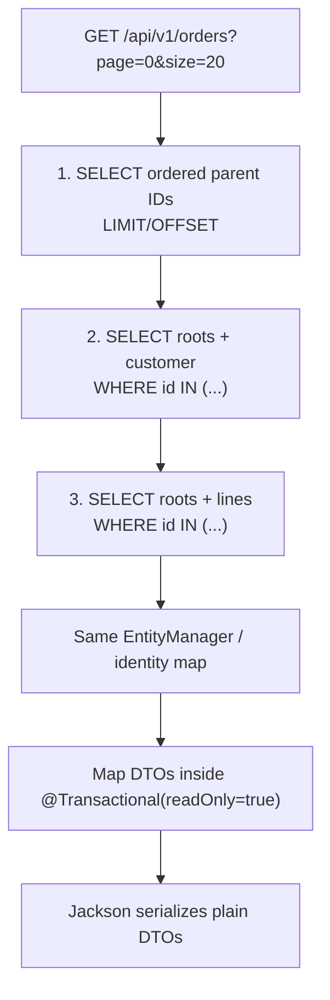

### 12.1. Repository cho hai bước fetch associations

Thêm các methods vào cùng `PurchaseOrderRepository` đã định nghĩa ở mục 8:

```java
// Các import nằm trong PurchaseOrderRepository.java
import java.util.Collection;
import java.util.List;
import org.springframework.data.domain.Page;
import org.springframework.data.domain.Pageable;
import org.springframework.data.jpa.repository.Query;
import org.springframework.data.repository.query.Param;

@Query(
    value = """
        select o.id
        from PurchaseOrder o
        where o.tenantId = :tenantId
          and o.status = :status
        order by o.id asc
        """,
    countQuery = """
        select count(o)
        from PurchaseOrder o
        where o.tenantId = :tenantId
          and o.status = :status
        """
)
Page<Long> findPageIds(
    @Param("tenantId") String tenantId,
    @Param("status") OrderStatus status,
    Pageable pageable
);

@Query("""
    select o
    from PurchaseOrder o
    join fetch o.customer
    where o.tenantId = :tenantId and o.id in :ids
    """)
List<PurchaseOrder> fetchPageRootsAndCustomers(
    @Param("tenantId") String tenantId,
    @Param("ids") Collection<Long> ids
);

@Query("""
    select distinct o
    from PurchaseOrder o
    left join fetch o.lines
    where o.tenantId = :tenantId and o.id in :ids
    """)
List<PurchaseOrder> initializePageLines(
    @Param("tenantId") String tenantId,
    @Param("ids") Collection<Long> ids
);
```

**Tại sao query cuối chỉ trả orders mà không return trực tiếp từ đó?** Vì Hibernate persistence context quản lý một managed entity instance cho mỗi primary key. Sau query `fetchPageRootsAndCustomers`, query `initializePageLines` trong **cùng EntityManager** sẽ initialize `lines` trên cùng managed objects. Ta vẫn cần đảm bảo 2 queries chạy trong cùng transaction/context và không dùng `entityManager.clear()` ở giữa.

Với empty IDs, không gửi JPQL `IN ()` vì một số DB/dialects xử lý khác nhau. Return empty page ngay nếu `findPageIds(...).isEmpty()`.

### 12.2. Service read-only transaction và mapping DTO

```java
// OrderQueryService.java
package com.example.integration.orders;

import java.util.HashMap;
import java.util.Comparator;
import java.util.List;
import java.util.Map;
import java.util.Objects;
import org.springframework.data.domain.Page;
import org.springframework.data.domain.PageImpl;
import org.springframework.data.domain.PageRequest;
import org.springframework.stereotype.Service;
import org.springframework.transaction.annotation.Transactional;

@Service
public class OrderQueryService {
    private final PurchaseOrderRepository repository;

    public OrderQueryService(PurchaseOrderRepository repository) {
        this.repository = repository;
    }

    @Transactional(readOnly = true)
    public Page<OrderDetailsView> listPaid(
        String tenantId, int page, int size
    ) {
        if (tenantId == null || tenantId.isBlank()
            || page < 0 || size < 1 || size > 100) {
            throw new IllegalArgumentException(
                "Invalid tenant/page/size"
            );
        }

        Page<Long> idPage = repository.findPageIds(
            tenantId,
            OrderStatus.PAID,
            PageRequest.of(page, size)
        );

        if (idPage.isEmpty()) {
            return new PageImpl<>(
                List.of(), idPage.getPageable(),
                idPage.getTotalElements()
            );
        }

        List<Long> ids = idPage.getContent();
        List<PurchaseOrder> roots =
            repository.fetchPageRootsAndCustomers(tenantId, ids);

        // Query này initialize lines cho managed root entities.
        repository.initializePageLines(tenantId, ids);

        Map<Long, PurchaseOrder> byId = new HashMap<>();
        for (PurchaseOrder order : roots) {
            byId.put(order.getId(), order);
        }

        Map<Long, OrderDetailsView> dtoById = new HashMap<>();
        for (Long id : ids) {
            PurchaseOrder order = Objects.requireNonNull(
                byId.get(id), "Order vanished during page fetch"
            );
            dtoById.put(id, toDetails(order));
        }

        return idPage.map(dtoById::get);
    }

    private static OrderDetailsView toDetails(
        PurchaseOrder order
    ) {
        return new OrderDetailsView(
            order.getId(),
            order.getOrderNumber(),
            order.getCustomer().getDisplayName(),
            order.getStatus().name(),
            order.getTotalAmount(),
            order.getLines().stream()
                .sorted(Comparator.comparing(OrderLine::getId))
                .map(line -> new OrderLineView(
                    line.getId(),
                    line.getSku(),
                    line.getQuantity(),
                    line.getUnitPrice()
                ))
                .toList()
        );
    }
}
```

**Quan trọng:** Phương thức này yêu cầu Spring proxy thực thi `@Transactional`, và repository methods sử dụng **cùng datasource/entity manager**. Đừng gọi `listPaid(...)` qua `this.listPaid(...)` bên trong cùng class rồi giả định transaction proxy đã chạy; Spring proxy mode thông thường không intercept self-invocation.

Trong nhánh empty page, `PageImpl<>(List.of(), idPage.getPageable(), idPage.getTotalElements())` giữ metadata của trang và tổng số records; không gửi truy vấn `IN ()` với danh sách rỗng. DTO lines được sắp theo ID để JSON output ổn định. Nếu API cần định dạng pagination JSON lâu dài, cân nhắc một response DTO/PagedModel riêng thay vì phụ thuộc trực tiếp serialization shape của `PageImpl` qua các phiên bản Spring Data.

### 12.3. Controller chỉ trả DTO

```java
// OrderController.java
package com.example.integration.orders;

import org.springframework.data.domain.Page;
import org.springframework.http.ResponseEntity;
import org.springframework.web.bind.annotation.GetMapping;
import org.springframework.web.bind.annotation.RequestMapping;
import org.springframework.web.bind.annotation.RequestParam;
import org.springframework.web.bind.annotation.RestController;

@RestController
@RequestMapping("/api/v1/orders")
public class OrderController {
    private final OrderQueryService service;

    public OrderController(OrderQueryService service) {
        this.service = service;
    }

    @GetMapping
    public ResponseEntity<Page<OrderDetailsView>> list(
        @RequestParam String tenantId,
        @RequestParam(defaultValue = "0") int page,
        @RequestParam(defaultValue = "20") int size
    ) {
        return ResponseEntity.ok(
            service.listPaid(tenantId, page, size)
        );
    }
}
```

**Cảnh báo bảo mật:** `@RequestParam String tenantId` ở đây giúp bài học tập trung vào query plan. Trong production, tenant phải lấy từ **authenticated principal/token và authorization context**, không tin tenantId do caller bất kỳ gửi. Thay controller parameter bằng tenant context đã xác minh để ngăn IDOR/cross-tenant data disclosure. Service/repository vẫn giữ predicate tenant để defense in depth.

### 12.4. Số SQL có thể dự kiến

Với 20 parent IDs:

```text
Query 1:  SELECT id ... LIMIT 20 OFFSET ...
Query 1b: SELECT COUNT(*) ...       (khi Spring Data cần total)
Query 2:  SELECT orders JOIN customer WHERE id IN (...)
Query 3:  SELECT orders LEFT JOIN lines WHERE id IN (...)
```

Thay vì 1 + 20 customer + 20 lines (~41 câu), thường chỉ cần một số query có giới hạn, ví dụ 3–4 statements tùy count query optimization và JPA dialect. **Không** cam kết 3–4 trong mọi mapping/config: associations khác có thể vẫn EAGER, entity listeners có thể gọi lazy getters, và count query có thể được bỏ qua hoặc phát thêm. Test SQL count trên dataset đại diện.

### 12.5. Không có guarantee snapshot nhất quán nếu nhiều queries

Giữa query IDs và query associations, một order có thể bị update/xóa bởi transaction khác:

```text
Query IDs thấy Order 42 thuộc PAID
Concurrent transaction đổi status -> CANCELLED
Query details thứ hai thấy dữ liệu mới hơn
```

`@Transactional(readOnly=true)` là hint về ý định read-only/flush behavior, **không tự tăng isolation level lên repeatable read/snapshot**. PostgreSQL READ COMMITTED có thể đọc snapshot mới ở mỗi statement. Nếu API cần một snapshot nhất quán, chọn transaction isolation/snapshot version/query shape phù hợp, hiểu chi phí lock/version retention. Không mở transaction kéo dài qua outbound HTTP để “giữ nhất quán”.

### 12.6. Giới hạn kích thước collections

Một page 100 orders, mỗi order 10.000 lines = 1 triệu lines; dù chỉ có 3–4 SQL queries, payload và heap có thể quá lớn. **N+1 fix không thay thế capacity limit.** Khi collections có cardinality lớn, trả summary page và endpoint riêng `GET /orders/{id}/lines?cursor=...` hoặc stream/export có quota.

## 13. Pagination đúng: offset, keyset và thứ tự ổn định

### 13.1. Tại sao fetch join + pagination cần cảnh giác?

Nếu DB áp `LIMIT 20` lên rows sau join, các rows đó có thể chỉ đại diện cho 2 orders lớn, không phải 20 orders. Hibernate đôi khi đưa pagination lên memory để giữ correctness, tạo warning/large data load. Một số Hibernate versions có property:

```yaml
spring:
  jpa:
    properties:
      hibernate.query.fail_on_pagination_over_collection_fetch: true
```

Thiết lập này khiến query collection fetch pagination không hợp lệ **fail thay vì âm thầm paginate trong memory** theo Hibernate behavior phù hợp. Property này hữu ích cho test/staging và nhiều ứng dụng production, nhưng cần rà các query hiện hữu trước khi bật. Không suy rằng `DISTINCT` hoặc chỉ đổi JPQL syntax đã loại bỏ mọi row explosion.

### 13.2. Offset pagination

```sql
SELECT id
FROM purchase_orders
WHERE tenant_id = 'tenant-a' AND status = 'PAID'
ORDER BY id
LIMIT 20 OFFSET 10000;
```

Với offset rất lớn, DB có thể vẫn phải scan/sort nhiều rows. Nếu concurrent inserts/deletes làm thay đổi vị trí, client đi qua các trang có thể **bị trùng/bỏ sót items** dù query từng trang đúng tại thời điểm đó.

### 13.3. Keyset pagination

Nếu mục đích là duyệt theo ID tăng, có thể dùng:

```sql
SELECT id
FROM purchase_orders
WHERE tenant_id = 'tenant-a'
  AND status = 'PAID'
  AND id > :last_seen_id
ORDER BY id
LIMIT 20;
```

`last_seen_id` là cursor từ page trước. Với sort nhiều fields, dùng composite cursor ổn định (ví dụ `created_at, id`) và tie-breaker; cần index và snapshot consistency policy phù hợp. ID không phản ánh business event ordering, và một order đổi status giữa pages vẫn có thể ảnh hưởng kết quả; keyset giảm chi phí offset lớn chứ không hứa snapshot bất biến.

### 13.4. Khi nào dùng `Slice` thay `Page`?

Nếu UI chỉ cần biết “còn trang tiếp không” mà không cần tổng count, `Slice<T>` hoặc cursor response có thể tránh query COUNT lớn. Tuy nhiên query planning, joined rows và transaction boundary vẫn cần đúng. Thay kiểu trả về từ `Page` sang `Slice` **không** sửa lỗi lazy serialization hay authorization.

## 14. Chọn chiến lược fetch bằng ma trận use case

| Use case | Fetch strategy ưu tiên | Điều cần tránh |
| --- | --- | --- |
| List 20 orders, 4 fields/order | DTO projection với join to-one. | Fetch toàn bộ lines/product chỉ để hiển thị tổng. |
| Order details một ID, vài dòng hàng | `@EntityGraph(customer, lines)` hoặc fetch join có giới hạn. | Return entity rồi để Jackson lazy-load. |
| Page 20 orders + lines | Two-phase IDs + targeted fetch trong một service transaction. | `Pageable + JOIN FETCH collection` trực tiếp. |
| Export triệu records | Cursor/streaming projection, controlled batch/connection. | `findAll().collectList()` hoặc một persistence context vô hạn. |
| Kafka event cần ID/status/version | DTO projection hoặc query entity tối thiểu trong transactional handler. | Serialize entire entity graph vào event. |
| Scheduled reconciliation nhiều aggregates | Keyset/batch fetching + clear EntityManager theo batch. | Giữ 1 persistence context cho hàng triệu entities. |
| Nhiều lazy to-one cùng được truy cập | EntityGraph/fetch joins hoặc batch proxies. | Chỉ thêm EAGER vào mapping toàn hệ thống. |
| Một số collections có thể lớn | Dedicated endpoint/batch query, bounded rows. | Join fetch nhiều bags/Cartesian explosion. |

**Thứ tự quyết định đề xuất:** Xác định DTO contract và page/byte bounds → thiết kế repository query → đo SQL/statements và row counts → xét cache/batching → tải thử với concurrency → tối ưu thêm nếu cần.

## 15. Transaction boundary: không kéo managed entity vượt qua service

Trong ứng dụng Spring Boot imperative thông thường, `@Transactional` qua Spring AOP/proxy điều phối EntityManager và JDBC transaction cho method đã được intercept. Một pattern rõ ràng:

```text
HTTP Controller
   -> OrderQueryService (@Transactional(readOnly=true))
      -> repository query
      -> targeted fetch associations
      -> map to detached *value DTO*
   <- return DTO; transaction ends
   -> Jackson serialization (no lazy SQL)
```

**Không** trả JPA entities sang asynchronous callbacks/HTTP response serializer/message broker rồi giả định `@Transactional` ở method trước đó vẫn hiệu lực.

### 15.1. Proxy/self-invocation pitfall

```java
@Service
public class WrongOrderService {

    public OrderDetailsView outer(Long id) {
        return this.innerTransactional(id);
    }

    @Transactional(readOnly = true)
    public OrderDetailsView innerTransactional(Long id) {
        // Trong Spring AOP proxy mode thông thường,
        // self invocation "this." không đi qua proxy.
        return /* repository fetch + map DTO */ null;
    }
}
```

Đây là **anti-pattern minh họa**, `null` không phải business return hợp lệ. Nếu repository methods vẫn có transaction riêng, mỗi repository call có thể hoạt động, nhưng chúng **không nhất thiết chia sẻ persistence context/transaction của service**. Two-phase fetch có thể hỏng vì query thứ hai không initialize cùng entities mà query thứ nhất đã trả.

Sửa bằng một `OrderQueryService` bean độc lập, public transactional method được gọi qua Spring proxy; không dùng tự gọi `this.method()` để kích hoạt transaction. Với AspectJ weaving hoặc reactive transactions có behavior khác, nhưng phải kiểm tra cụ thể.

### 15.2. `@Transactional(readOnly=true)` có ý nghĩa gì?

- Thể hiện ý định read-only và có thể tác động flush mode/driver transaction hints tùy manager/provider.
- **Không** làm lazy associations tự được fetch.
- **Không** cấm mọi SQL UPDATE một cách portable tuyệt đối nếu code tự thực hiện writes.
- **Không** bảo đảm snapshot isolation nếu DB vẫn READ COMMITTED.
- **Không** giữ transaction còn sống khi callback `CompletableFuture`/`@Async` chạy sau khi method kết thúc.
- **Không** làm Hibernate entities thread-safe.

Nếu cần một boundary phục vụ HTTP read, hãy map DTO xong trước khi method return. Nếu cần external HTTP call, thường lấy stable IDs/data snapshot trong transaction ngắn, thoát transaction rồi mới gọi network.

### 15.3. Thread boundary với `@Async` và CompletableFuture

```java
// ANTI-PATTERN: truyền managed entity tới async worker.
@Transactional(readOnly = true)
public void enqueueExport(Long orderId) {
    PurchaseOrder order = repository.findById(orderId)
        .orElseThrow();
    exportWorker.exportAsync(order); // @Async background method
}
```

Worker chạy trên thread khác không được mặc định thừa hưởng ThreadLocal transaction/EntityManager. Nếu method `exportAsync` truy cập `order.getLines()` sau khi caller transaction đóng, có thể gặp `LazyInitializationException`; ngay cả khi context vẫn mở, entity/Session **không nên được truy cập đồng thời qua threads**.

Sửa:

```java
// Gửi immutable reference, worker tự mở transaction fetch DTO.
exportWorker.exportAsync(new OrderExportJob(
    tenantId, orderId, exportRequestId
));
```

Trong worker, tạo một transactional query service fetch snapshot DTO rồi đóng DB transaction; sau đó stream sang file/object storage. Nếu job cần bền vững qua process crash, **không chỉ dùng `@Async`** mà ghi job vào DB/outbox/queue có acknowledgment và replay policy.

### 15.4. Reactive WebFlux không biến JPA thành non-blocking

JPA/Hibernate ORM thông thường sử dụng JDBC blocking APIs và persistence context/transaction gắn với thread của imperative model. `WebClient` trả `Mono` không khiến JPA call tự trở thành reactive database operation.

```java
// RỦI RO: query JPA blocking trực tiếp khi chạy trên Netty event-loop.
public Mono<OrderDetailsView> wrong(Long orderId) {
    return Mono.just(
        blockingOrderService.fetchDetails(orderId)
    );
}
```

`Mono.just(...)` đánh giá argument **ngay lập tức**, có thể block event loop trước khi tạo Publisher. Nếu buộc kết hợp JPA với WebFlux, có thể cô lập blocking operation:

```java
import reactor.core.publisher.Mono;
import reactor.core.scheduler.Schedulers;

public Mono<OrderDetailsView> findDetailsAsync(
    Long orderId
) {
    return Mono.fromCallable(
            () -> blockingOrderService.fetchDetails(orderId)
        )
        .subscribeOn(Schedulers.boundedElastic());
}
```

`blockingOrderService` là **Spring-managed bean riêng** có method `@Transactional(readOnly=true)`, mapping DTO hoàn toàn bên trong. Phải giới hạn concurrency, không biến `boundedElastic` thành nơi chạy vô hạn JDBC calls; cân đối Hikari max pool, downstream backpressure, overall HTTP deadline và cancellation semantics. Với reactive stack end-to-end và throughput phù hợp, cân nhắc R2DBC thay vì tự nhận JPA là non-blocking.

## 16. HTTP integration: N+1 SQL dễ nhân thành N+1 remote calls

Nếu API được yêu cầu hiển thị tồn kho tức thời cho mỗi dòng hàng, developer có thể viết:

```java
// CẢNH BÁO: minh họa cách làm gây N+1 DB + N HTTP.
@Transactional(readOnly = true)
public List<OrderWithStock> loadAndCallWarehouse() {
    List<PurchaseOrder> orders = repository.findAll();
    return orders.stream().map(order -> {
        var lines = order.getLines(); // có thể 1 SQL/order
        return new OrderWithStock(
            order.getId(),
            lines.stream().map(line -> {
                StockView stock =
                    warehouseRestClient.getStock(line.getSku()); // HTTP/line
                return new StockLine(line.getSku(), stock.available());
            }).toList()
        );
    }).toList();
}
```

`OrderWithStock`, `StockLine` và `StockView` ở đây là DTO minh họa, `warehouseRestClient` là adapter application tự định nghĩa. Phương thức trên là **anti-pattern**, không phải production implementation:

- Query JPA có thể phát N+1 SQL.
- Mỗi line gọi một remote HTTP request, gây **N HTTP calls**; nếu 50 orders × 5 lines = 250 HTTP calls.
- DB read-only transaction có thể giữ persistence context/DB resources trong thời gian chờ remote network; tùy connection handling mà giữ connection/locks, gây Hikari pressure.
- HTTP client connection pool có thể cạn, tạo pool acquisition timeout; retries làm fanout tăng nữa.
- Nếu remote response timeout, toàn request có thể fail dù DB đã fetch nhiều dữ liệu.

### 16.1. Thiết kế tách hai pha

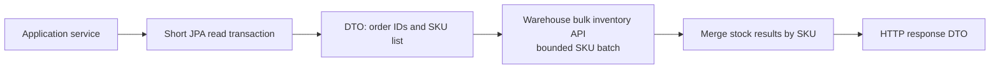

1. Query đúng trang orders, DTO các lines/SKUs cần thiết **trong local DB transaction**.
2. Đóng transaction và release database resources.
3. Gom unique SKUs thành batch có giới hạn theo provider contract, dùng bulk endpoint nếu upstream hỗ trợ.
4. Đặt HTTP pool/concurrency/deadline riêng; đừng chạy mỗi SKU vô hạn song song.
5. Merge theo stable SKU và tenant context; xử lý missing stock như business error/degraded value có quy tắc.
6. Không gửi raw JPA entities qua HTTP adapter.

**Trade-off:** dữ liệu stock có thể thay đổi giữa lúc DB snapshot và warehouse response. Nếu checkout cần reservation mang tính giao dịch, hãy dùng command ID/provider idempotency và workflow rõ; không coi một GET stock sau JPA query là khóa tồn kho nguyên tử.

### 16.2. HTTP DTO và cache có TTL riêng

Nếu danh sách chỉ hiển thị availability không cần realtime tuyệt đối, có thể dùng cache Redis hoặc read-model snapshot có TTL. Tuy nhiên cache invalidation, accuracy và tenant isolation phải theo business contract. Cache **không sửa** N+1 Hibernate nếu mapper vẫn dereference 50 lazy associations trước khi tra cache.

### 16.3. N+1 và timeout có thể tạo vòng lặp sự cố

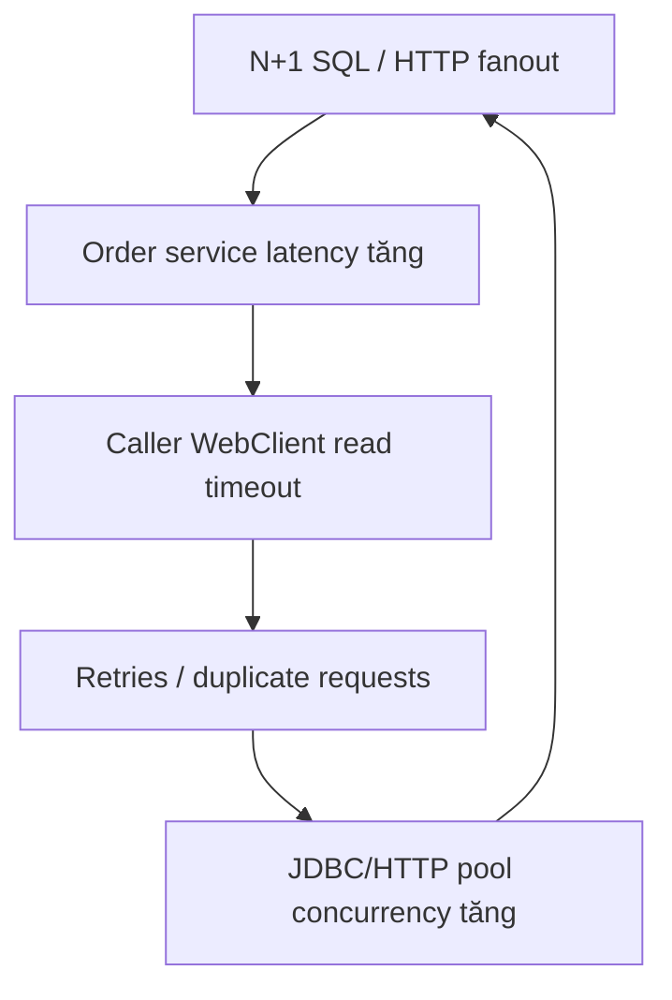

Tăng timeout chỉ trì hoãn failure; tăng cả JDBC và HTTP pools có thể dồn quá nhiều công việc lên DB/upstream. Giải quyết bằng query plan, bulk API, concurrency/bulkhead, cache đúng chỗ và deadline/retry budget có chủ đích.

## 17. Không serialize JPA entities thành message

Một cách publish event nguy hiểm:

```java
// ANTI-PATTERN: đối tượng JPA có lazy associations/proxies.
kafkaTemplate.send(
    "orders.events",
    order.getId().toString(),
    objectMapper.writeValueAsString(order)
);
```

Có ít nhất năm vấn đề:

1. Jackson có thể chạm lazy `order.getCustomer()` và `order.getLines()`, gây N+1 SQL.
2. Nếu transaction đã kết thúc, có thể có `LazyInitializationException`.
3. Entity graph có thể chứa vòng tham chiếu order→lines→order.
4. Event schema vô tình phụ thuộc JPA mappings, tên fields và Hibernate proxies, phá consumer compatibility.
5. Event có thể vô ý chứa attributes nhạy cảm (email, address, internal identifiers, audit fields).

### 17.1. Message contract tường minh

```java
// OrderPaidEvent.java
package com.example.integration.orders;

import java.math.BigDecimal;
import java.time.Instant;

public record OrderPaidEvent(
    String eventId,
    int schemaVersion,
    String tenantId,
    Long orderId,
    String orderNumber,
    long aggregateVersion,
    BigDecimal totalAmount,
    Instant occurredAt
) {}
```

Không có Hibernate entity/collection trong event. Consumer có thể nhận snapshot fields đủ dùng hoặc nhận reference ID rồi fetch thêm theo contract; hai cách có đánh đổi khác nhau.

### 17.2. Event-carried state transfer vs ID-only notification

| Event style | Ưu điểm | Nhược điểm |
| --- | --- | --- |
| **Reference event**: chỉ `orderId/version` | Payload nhỏ, ít PII, độc lập lazy entities. | Consumer có thể gọi HTTP/DB để fetch, tạo chatty integration/N+1 remote calls. |
| **Event-carried state**: fields cần dùng, snapshot version | Consumer xử lý độc lập, giảm GET fanout. | Contract phải version; có nguy cơ stale/sensitive data hoặc payload lớn. |
| **Batch event / cursor-based export** | Giảm per-record overhead khi dữ liệu lớn. | Cần bounds, checkpoints, retry và handling partial success. |

Với Kafka, record key theo `tenantId:orderId` giúp ordering theo aggregate trong cùng partition strategy; `eventId` xác định logical event để deduplicate. Không dùng Hibernate object identity/proxy class name làm Kafka key. Nếu consumer cần 100 IDs rồi gọi REST mỗi ID, đó có thể là **N+1 HTTP pattern**; cân nhắc batch endpoint hoặc đưa đủ fields trong event.

### 17.3. Tại sao JPA transaction không bảo đảm Kafka event đã publish?

```text
BEGIN PostgreSQL
  UPDATE purchase_orders
COMMIT PostgreSQL   <-- thành công
Application crash
Kafka SEND           <-- không xảy ra
```

Nếu đảo thứ tự (publish trước DB commit), consumer có thể thấy event cho order chưa commit, hoặc DB rollback sau publish. Spring transaction synchronization có thể điều phối thứ tự, nhưng hai local commits không tạo atomic distributed transaction với Kafka.

Với business integration cần đảm bảo eventual publication sau DB commit, dùng **transactional outbox**.

## 18. Transactional outbox: capture event từ dữ liệu đã biết, không từ lazy entity ở relay

**Nguyên tắc:** trong transaction thay đổi order, lưu **event payload hoặc immutable snapshot** cùng transaction vào bảng outbox. Sau commit, relay worker đọc outbox và publish broker có retry; không đợi relay giữ JPA entity managed từ transaction tạo order.

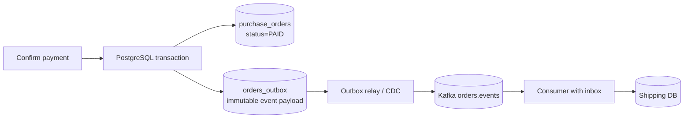

### 18.1. Schema outbox tối thiểu

```sql
CREATE TABLE orders_outbox (
    event_id VARCHAR(160) PRIMARY KEY,
    tenant_id VARCHAR(80) NOT NULL,
    aggregate_id BIGINT NOT NULL,
    aggregate_version BIGINT NOT NULL,
    event_type VARCHAR(80) NOT NULL,
    schema_version INTEGER NOT NULL,
    payload_json TEXT NOT NULL,
    state VARCHAR(20) NOT NULL DEFAULT 'PENDING',
    created_at TIMESTAMPTZ NOT NULL DEFAULT CURRENT_TIMESTAMP,
    published_at TIMESTAMPTZ,
    CHECK (state IN ('PENDING','CLAIMED','PUBLISHED','FAILED'))
);

CREATE INDEX idx_orders_outbox_state_created
    ON orders_outbox(state, created_at);
```

Đây chỉ là schema outbox tối thiểu; production relay có thể cần lease/claim fields, attempts, next_attempt_at, payload fingerprint và retention/archiving. Event payload cần được xác định tại write transaction từ dữ liệu đã có/được fetch một cách có chủ đích, không deferred serialize từ `PurchaseOrder` detached.

### 18.2. Transactional update + outbox insert

```java
// OrderPaymentWriter.java
package com.example.integration.orders;

import java.util.UUID;
import org.springframework.jdbc.core.JdbcTemplate;
import org.springframework.stereotype.Service;
import org.springframework.transaction.annotation.Transactional;

@Service
public class OrderPaymentWriter {
    private final JdbcTemplate jdbc;
    private final OrderEventSerializer serializer;

    public OrderPaymentWriter(
        JdbcTemplate jdbc,
        OrderEventSerializer serializer
    ) {
        this.jdbc = jdbc;
        this.serializer = serializer;
    }

    @Transactional
    public void markPaid(
        String tenantId, long orderId, long expectedVersion
    ) {
        int rows = jdbc.update("""
            UPDATE purchase_orders
            SET status = 'PAID', version = version + 1
            WHERE id = ? AND tenant_id = ?
              AND status = 'DRAFT' AND version = ?
            """, orderId, tenantId, expectedVersion);

        if (rows != 1) {
            throw new IllegalStateException(
                "Order not eligible for PAID transition"
            );
        }

        // expectedVersion được kiểm soát bằng optimistic guard ở UPDATE.
        String eventId = UUID.randomUUID().toString();
        String json = serializer.toJson(
            tenantId, orderId, expectedVersion + 1, eventId
        );

        jdbc.update("""
            INSERT INTO orders_outbox(
                event_id, tenant_id, aggregate_id,
                aggregate_version, event_type,
                schema_version, payload_json
            ) VALUES (?, ?, ?, ?, 'OrderPaid', 1, ?)
            """,
            eventId, tenantId, orderId,
            expectedVersion + 1, json
        );
    }
}
```

```java
// OrderEventSerializer.java — application-provided port
package com.example.integration.orders;

public interface OrderEventSerializer {
    String toJson(
        String tenantId,
        long orderId,
        long aggregateVersion,
        String eventId
    );
}
```

**Lưu ý quan trọng về ví dụ:** Method dùng JDBC để minh họa **cùng một local PostgreSQL transaction** cho state change và outbox. Predicate `version = expectedVersion` và phép tăng version tạo optimistic guard, phù hợp schema/entity có cột `version`. Khi thực hiện update JPA cùng aggregate, không để JDBC và Hibernate dirty checking ghi đè phiên bản nhau trong cùng persistence context mà thiếu `refresh`/flush strategy. Stable business command ID/idempotency ledger cũng cần có nếu upstream HTTP request retry sau timeout: `UUID.randomUUID()` trong mỗi call mới **không tự deduplicate một logical command được gửi lại**.

**Với ứng dụng dùng JPA:** Có thể cập nhật managed `PurchaseOrder` trong `@Transactional`, tạo outbox entity/repository trên **cùng DataSource/EntityManager**, và flush/commit cùng transaction. Nhưng event payload phải dùng fields đã tải rõ ràng, không lấy toàn bộ entity lazy qua Jackson. Nếu JDBC và JPA cùng tham gia, phải xác minh transaction manager/datasource và flush ordering; dùng nhiều transaction managers độc lập không tạo atomic local commit.

### 18.3. Đừng giữ managed entity cho relay gửi sau commit

```java
// SAI: entity được đưa vào async callback, rồi mới serialize.
afterCommit(() -> kafkaTemplate.send(
    "orders.events",
    objectMapper.writeValueAsString(purchaseOrder)
));
```

Khi callback chạy, persistence context có thể không còn trong trạng thái dự kiến. Event serialization có thể lazy-load sai phase hoặc lỗi. Ngoài ra, nếu process crash sau DB commit trước `afterCommit` callback, event intent có thể bị **mất**. Callback chỉ phù hợp best-effort side effects khi chấp nhận lost delivery; với critical events, dùng durable outbox.

### 18.4. Outbox vẫn có thể publish trùng

Nếu relay publish Kafka xong và broker ACK, rồi process chết trước khi đánh dấu row `PUBLISHED`, lần chạy sau có thể publish lại **cùng event ID** ở offset khác. Outbox thường mang tính **at-least-once delivery**; consumer cần inbox/unique business key. Kafka idempotent producer **không bảo đảm** khử mọi application-level republish sau restart.

## 19. Kafka consumer: lazy loading, DB commit và acknowledgment

Khi Spring Kafka consumer nhận `OrderPaid`, nó có thể:

1. Nhận event DTO.
2. Kiểm tra schema version, tenant, stable event ID.
3. Trong local DB transaction: deduplicate bằng inbox, load đúng dữ liệu cần thiết bằng fetch plan, cập nhật local read model.
4. Kết thúc/commit transaction.
5. ACK/commit Kafka offset theo listener/container policy.

**Không** giữ một JPA entity được lấy trong handler rồi đẩy sang thread khác/ Reactor Publisher mà vẫn mong lazy association hoạt động. Không ACK record chỉ vì đã enqueue công việc vào volatile in-memory queue.

### 19.1. Ví dụ schema inbox và read model

```sql
CREATE TABLE processed_events (
    consumer_name VARCHAR(80) NOT NULL,
    event_id VARCHAR(160) NOT NULL,
    payload_hash CHAR(64),
    processed_at TIMESTAMPTZ NOT NULL DEFAULT CURRENT_TIMESTAMP,
    PRIMARY KEY (consumer_name, event_id)
);

CREATE TABLE shipping_orders (
    tenant_id VARCHAR(80) NOT NULL,
    order_id BIGINT NOT NULL,
    last_event_version BIGINT NOT NULL,
    status VARCHAR(30) NOT NULL,
    PRIMARY KEY (tenant_id, order_id)
);
```

Marker `processed_events` và read-model update cần được **commit atomically trong cùng PostgreSQL transaction**. Nếu marker commit trước, rồi DB update fail, redelivery có thể bị bỏ qua sai. Nếu DB update commit trước marker, crash có thể nhân business effect.

### 19.2. Consumer cập nhật read model dựa trên event DTO

```java
// ShippingProjectionWriter.java
package com.example.integration.orders;

import org.springframework.jdbc.core.JdbcTemplate;
import org.springframework.stereotype.Service;
import org.springframework.transaction.annotation.Transactional;

@Service
public class ShippingProjectionWriter {
    private final JdbcTemplate jdbc;

    public ShippingProjectionWriter(JdbcTemplate jdbc) {
        this.jdbc = jdbc;
    }

    @Transactional
    public void apply(OrderPaidEvent event) {
        if (event.eventId() == null || event.eventId().isBlank()
            || event.tenantId() == null || event.tenantId().isBlank()
            || event.orderId() == null
            || event.aggregateVersion() <= 0
            || event.schemaVersion() != 1) {
            throw new IllegalArgumentException(
                "Invalid OrderPaid contract"
            );
        }

        int inserted = jdbc.update("""
            INSERT INTO processed_events(
                consumer_name, event_id
            ) VALUES ('shipping-projection', ?)
            ON CONFLICT (consumer_name, event_id) DO NOTHING
            """, event.eventId());

        if (inserted == 0) {
            // Một transaction trước đã commit cùng eventId.
            return;
        }

        jdbc.update("""
            INSERT INTO shipping_orders(
                tenant_id, order_id,
                last_event_version, status
            ) VALUES (?, ?, ?, 'PAID')
            ON CONFLICT (tenant_id, order_id)
            DO UPDATE SET
                last_event_version =
                    EXCLUDED.last_event_version,
                status = EXCLUDED.status
            WHERE shipping_orders.last_event_version
                < EXCLUDED.last_event_version
            """,
            event.tenantId(),
            event.orderId(),
            event.aggregateVersion()
        );
    }
}
```

Ví dụ dùng **absolute state** `PAID` và monotonic `aggregateVersion`. Với domain có nhiều status (PAID, CANCELLED, FULFILLED), cần validate transition graph; cập nhật version cũ bị từ chối vì version mới hơn **không luôn thay thế được side effect event cũ**. Với `inventory.decrement(5)` dạng delta, bỏ qua event version cũ chỉ vì event mới đã tới có thể **mất business change**; cần strict ordering/version gap handling.

Đoạn code cũng chỉ minh họa inbox marker theo event ID. Production nên lưu payload fingerprint và phát hiện **same eventId/different payload** là contract violation, không coi đó là duplicate hợp lệ.

### 19.3. Listener: ACK sau service transaction

```java
// ShippingKafkaListener.java
package com.example.integration.orders;

import com.fasterxml.jackson.databind.ObjectMapper;
import org.apache.kafka.clients.consumer.ConsumerRecord;
import org.springframework.kafka.annotation.KafkaListener;
import org.springframework.kafka.support.Acknowledgment;
import org.springframework.stereotype.Component;

@Component
public class ShippingKafkaListener {
    private final ObjectMapper mapper;
    private final ShippingProjectionWriter writer;

    public ShippingKafkaListener(
        ObjectMapper mapper,
        ShippingProjectionWriter writer
    ) {
        this.mapper = mapper;
        this.writer = writer;
    }

    @KafkaListener(
        topics = "orders.events.v1",
        groupId = "shipping-projection"
    )
    public void onMessage(
        ConsumerRecord<String, String> record,
        Acknowledgment ack
    ) throws Exception {
        OrderPaidEvent event = mapper.readValue(
            record.value(), OrderPaidEvent.class
        );

        // Kết thúc local PostgreSQL transaction trước ACK.
        writer.apply(event);

        ack.acknowledge();
    }
}
```

```yaml
spring:
  kafka:
    consumer:
      group-id: shipping-projection
      properties:
        enable.auto.commit: false
        isolation.level: read_committed
    listener:
      ack-mode: manual_immediate
```

Ví dụ này mô tả **manual ACK mode không đồng thời sử dụng container Kafka transactions**. Khi muốn Kafka consume-transform-produce EOS, container transactions/offset commits có semantics riêng; không gộp hai ví dụ rồi giả định ACK hoạt động giống hệt. Với manual listener, nếu DB commit thành công nhưng process crash trước ACK, Kafka có thể redeliver; inbox bảo vệ business effect.

**Không** đặt `@Transactional` trên listener method rồi gọi `ack.acknowledge()` trước khi method return: transaction interceptor có thể chưa commit lúc ACK. Tách transactional writer thành Spring bean riêng như ví dụ giúp thứ tự commit → ACK dễ review. ACK không đồng nghĩa offset commit đã chắc chắn durable trong mọi failure window; redelivery vẫn là tình huống phải xử lý.

### 19.4. Nếu consumer vẫn cần load JPA entity từ DB

Một số event chỉ có `orderId` nên consumer phải fetch details. Chọn:

```java
@Transactional(readOnly = true)
public OrderDetailsView loadForEvent(
    long orderId, String tenantId
) {
    PurchaseOrder order = repository
        .findDetails(orderId, tenantId)
        .orElseThrow();
    return toDetails(order); // DTO trước khi transaction kết thúc
}
```

Phác thảo method này dùng `repository.findDetails(...)` ở mục 9 và mapper `toDetails(...)` ở mục 12; đặt trong một Spring service bean có các members tương ứng. Không sử dụng JPA lazy associations sau khi đã ACK event và chỉ tạo asynchronous work volatile.

**Hệ quả hiệu năng:** Nếu event stream 500 messages/s, mỗi event query fetch root+children và một số external IDs là được; nếu mỗi event N+1 vài trăm SQL, consumer có thể không theo kịp. Khi đó thay event payload/fetch plan, batch các IDs trong cùng poll khi semantics cho phép hoặc xây read model riêng; không chỉ tăng concurrency vô hạn (sẽ gây tranh JDBC connections).

### 19.5. Poison message, retries và DLT

Một event JSON không parse được hoặc referencing entity không còn tồn tại có thể bị retry nhiều lần, gây backlog. Cần phân biệt:

- **Transient DB failure:** deadlock/connection mất; retry với bounded attempts/backoff, transaction mới.
- **Permanent contract error:** unknown schema version, missing required fields; DLT/quarantine với audit.
- **Missing related entity do ordering:** park/schedule later hoặc trigger reconciliation, không tự ACK as success.
- **Unknown remote HTTP side effect:** inquiry/idempotency theo command ID, không retry command khác ID.

Nếu event được gửi sang DLT, đảm bảo việc lưu DLT bền vững trước khi commit offset nguồn theo error handler/container policy. DLT có unresolved owner/retention, **không đồng nghĩa đã xử lý business xong**.

### 19.6. JPA DTO projection trong listener nên ngắn gọn

Nếu event chỉ cần verify customer/amount, tránh `findById(...)` rồi duyệt tất cả lines để tính lại dữ liệu không cần thiết. Dùng query scalar/DTO cho kiểm tra cần thiết, unique/event ID guards và transaction ngắn.

| Event cần làm | Query/data tối thiểu |
| --- | --- |
| Mark shipping projection PAID | Event ID/order ID/version/status trong event, có thể không cần JPA load root. |
| Recalculate amount | SQL aggregate có predicate hoặc DTO lines với bounds, không load customer address. |
| Produce read-model card | Projection selected fields. |
| Validate order version | SELECT id/version trong local transaction hoặc optimistic guard UPDATE. |
| Full fulfillment plan | Explicit fetch graph cho một aggregate và số lines có giới hạn. |

## 20. RabbitMQ, JMS và Spring Integration: các boundary tương tự

Message adapters thay đổi cách nhận/ACK, nhưng **JPA entity lifecycle và N+1 không thay đổi**.

### 20.1. RabbitMQ manual acknowledgment

```text
Rabbit message delivery
 -> deserialize immutable event DTO
 -> transactional DB service fetch/update (bounded query plan)
 -> local DB COMMIT
 -> basicAck

Crash sau DB COMMIT nhưng trước basicAck:
 -> RabbitMQ redelivery
 -> inbox/unique constraint ngăn duplicate side effect
```

Nếu listener dùng `@RabbitListener` và `Channel.basicAck(...)`, phải hiểu container `acknowledge-mode=manual`, negative acknowledgment/requeue/DLX, prefetch và error handler. Cấm trả JPA entity vào async task rồi basicAck trước khi task commit.

Nếu `prefetch=50` nhưng mỗi message N+1 100 SQL, một consumer có thể giữ rất nhiều unacked messages, tạo burst redelivery khi process chết. Điều chỉnh prefetch, concurrency, JDBC pool và fetch plan cùng nhau.

### 20.2. JMS transacted session không bao toàn JDBC/HTTP

JMS session transaction có thể commit/rollback nhận/gửi messages **trong scope JMS provider**. Một JPA transaction trên PostgreSQL không tự tham gia JMS transaction; muốn XA/2PC cần coordinator và XA-capable participants, với chi phí/điều kiện vận hành riêng. Với kiến trúc thông thường, dùng idempotent consumer + outbox/inbox thay vì giả định “JMS transaction = DB transaction”.

### 20.3. Spring Integration DirectChannel và ExecutorChannel

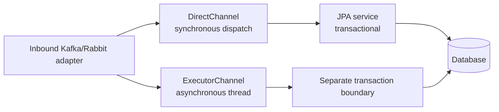

`DirectChannel` thường dispatch đồng bộ trên sender thread, nên một transaction đang mở có thể bao một handler synchronous nếu Spring wiring được cấu hình như vậy. `ExecutorChannel` chạy trên thread khác; imperative transaction context (ThreadLocal) không tự được chuyển. Một `QueueChannel` mặc định trong memory có thể mất pending work khi process crash.

**Nguy cơ:** inbound adapter ACK sau khi enqueue vào `ExecutorChannel`/`QueueChannel`, trước khi DB service hoàn thành. Khi đó event có thể bị mất dù code có `@Transactional` ở async handler. Cần thiết kế acknowledgment gắn với durable completion hoặc durable handoff/outbox.

### 20.4. Retry advice và số lần chạy lazy queries

`RequestHandlerRetryAdvice` có thể retry handler khi ném exception. Nếu handler thực hiện:

```text
1 SELECT orders
50 secondary SELECT lines
HTTP POST warehouse
read timeout
retry handler
1 SELECT orders
50 secondary SELECT lines
HTTP POST warehouse lần nữa
```

N+1 làm mỗi attempt đắt hơn và retry có thể nhân side effect. Refactor thành short DB transaction + DTO snapshot/bulk query và remote idempotent command; xác định có một retry owner và limit attempts/deadlines.

## 21. `@TransactionalEventListener`, `AFTER_COMMIT` và lazy loading

Spring hỗ trợ application events và `@TransactionalEventListener(phase=AFTER_COMMIT)`. Nó hữu ích cho một số callback **best-effort** nhưng phải hiểu thời điểm:

```java
// SAI nếu event chứa JPA entity với lazy graph:
public record OrderPaidInternalEvent(PurchaseOrder entity) {}

@TransactionalEventListener(
    phase = TransactionPhase.AFTER_COMMIT
)
public void publish(OrderPaidInternalEvent internal) {
    // Không serialize nguyên entity/proxy ở đây.
    kafkaTemplate.send("orders.events",
        internal.entity().getId().toString(),
        objectMapper.writeValueAsString(internal.entity()));
}
```

Các import/wiring và checked exception handling được lược bỏ vì đây là **anti-pattern**. Tránh suy rằng AFTER_COMMIT listener có một transaction mới hoặc entity context còn khả dụng bền vững; resource có thể vẫn bound trong một số pha nhưng transaction chính đã commit, và lazy SQL có thể hoạt động khác nhau theo OSIV/implementation. Async listeners lại chạy trên thread khác.

### 21.1. Đúng: event nội bộ chứa giá trị và ID

```java
public record OrderPaidInternalEvent(
    String eventId,
    String tenantId,
    long orderId,
    long aggregateVersion
) {}
```

Listener sau commit có thể gửi một best-effort notification nhỏ theo contract. Nhưng nếu process chết **sau DB commit và trước listener thực hiện**, callback in-memory bị mất. Với event quan trọng, ghi durable outbox trong cùng transaction và để relay publish/retry. Đừng đưa lời hứa at-least-once vào một implementation chỉ dựa trên AFTER_COMMIT callback.

### 21.2. Ghi DB trong AFTER_COMMIT listener

Nếu AFTER_COMMIT listener cần tạo một bản ghi follow-up, resource context có thể vẫn tồn tại nhưng transaction gốc đã commit. Phải chọn một transaction mới phù hợp (ví dụ một method trên bean khác với `@Transactional(propagation=REQUIRES_NEW)`) nếu workflow thực sự yêu cầu; tuy nhiên nó vẫn là **một transaction tách biệt**, có cửa sổ crash giữa original commit và follow-up commit. Outbox khắc phục lost-intent trong workflow durable.

### 21.3. Không giữ lazy entity trong Reactor pipeline

```java
// Dễ lỗi nếu service return entity rồi map ở thread khác:
Mono.fromCallable(() -> repository.findById(id).orElseThrow())
    .subscribeOn(Schedulers.boundedElastic())
    .publishOn(Schedulers.parallel())
    .map(order -> order.getCustomer().getDisplayName());
```

Mỗi repository call có thể có transaction/context kết thúc trước `map(...)`, và entity có thể detached. Sửa bằng `Mono.fromCallable(() -> transactionalQueryService.fetchSummaryDto(id))`; method hoàn tất DTO trong một Spring transactional bean, không truyền managed entity qua scheduler.

## 22. Batch jobs và exports: tránh cả N+1 lẫn persistence-context phình to

Một scheduler cần export 2 triệu đơn hàng sang object storage. Developer gọi:

```java
// ANTI-PATTERN: chứa toàn bộ entities/collections trong heap.
List<PurchaseOrder> orders = repository.findAll();
List<OrderDetailsView> export = orders.stream()
    .map(this::toDetails)
    .toList();
```

Ở quy mô lớn, nguy cơ không chỉ là N+1. Hibernate persistence context giữ **managed entities, dirty-check snapshots, lazy wrappers**; Java List giữ thêm references/DTOs; driver có thể fetch nhiều rows; CSV/JSON serializer có thể gom toàn bộ bytes.

### 22.1. Chia công việc thành các batches có checkpoint

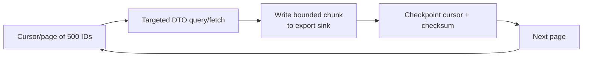

Mỗi batch cần:

- Một phạm vi IDs có thứ tự ổn định (keyset), tránh offset lớn khi có thể.
- Giới hạn số rows và kích thước dữ liệu per batch.
- Query DTO hoặc fetch graph phù hợp, tránh một collection khổng lồ.
- Short read-only transaction cho việc đọc/mapping; đóng trước khi network upload kéo dài nếu có thể.
- Checkpoint/continuation token; nếu batch retry, destination phải có idempotent key/chunk identity.
- Xử lý dữ liệu biến đổi trong lúc export: snapshot watermark/version hoặc khẳng định best-effort consistency.
- Cleanup partial files/object uploads khi error/cancel/crash.

### 22.2. `flush()/clear()` ở những batch ghi JPA

Nếu một import job persist hàng trăm nghìn entities trong một transaction/context, có thể dùng batching/periodic flush/clear theo chính sách:

```java
// Bản phác thảo bên trong một chunk transaction thích hợp.
int batchSize = 100;
for (int i = 0; i < entities.size(); i++) {
    entityManager.persist(entities.get(i));

    if ((i + 1) % batchSize == 0) {
        entityManager.flush();
        entityManager.clear();
    }
}
entityManager.flush();
entityManager.clear();
```

Đoạn này minh họa memory management **khi ghi batch entities**, không thay thuật toán N+1 của query đọc. Cẩn trọng: `clear()` detach entities, làm mọi lazy proxy chưa initialized không thể fetch qua persistence context cũ; không gọi nó giữa bước fetch roots và fetch lines ở pagination hai pha. Đối với `GenerationType.IDENTITY`, Hibernate JDBC insert batching có những giới hạn riêng vì cần nhận generated IDs; không suy rằng đặt `hibernate.jdbc.batch_size=100` sẽ luôn gom mọi INSERT thành một round trip.

### 22.3. Streaming database results cũng giữ tài nguyên

Spring Data JPA hỗ trợ `Stream<T>` từ repository queries trong những trường hợp phù hợp, nhưng **không có nghĩa “stream vô hạn mà không cần connection/transaction”**. Database cursor, Hibernate session và JDBC connection có thể phải sống khi stream được tiêu thụ. Phải close stream, quản lý transaction và fetch size; không trả `Stream<PurchaseOrder>` ra controller để Jackson duyệt sau transaction.

```java
// Ví dụ skeleton cho repository streaming (không trả stream ra HTTP).
@Query("""
    select o.id
    from PurchaseOrder o
    where o.tenantId = :tenantId and o.id > :cursor
    order by o.id
    """)
Stream<Long> streamIdsAfter(
    String tenantId, Long cursor
);
```

Nếu dùng method này, caller phải chạy trong transaction phù hợp và dùng try-with-resources, nhưng query trên **chưa có limit** nên vẫn có thể kéo hàng triệu IDs. Với batch export thông thường, keyset pages có limit rõ ràng và short transactions thường dễ phục hồi/quan sát hơn.

### 22.4. Một export không nên làm kẹt HTTP endpoint quan trọng

Để export dài, có thể dùng durable job ID, trạng thái `PENDING/RUNNING/COMPLETED/FAILED`, object storage key, retry/checkpoint và cleanup. Controller `POST /exports` trả 202 Accepted với job ID, không giữ HTTP client connection và PostgreSQL transaction mở hàng phút. Async job khi thực thi lại phải fetch DTO bằng transactional service theo batch, không tái dùng JPA entity proxy từ HTTP request tạo job.

## 23. Đo N+1: SQL logs, Hibernate Statistics và những sai lệch thường gặp

**Đo trước khi tối ưu.** Query count trong một request tốt cần được phân biệt với số returned rows, bytes, latency và DB CPU. Một `JOIN FETCH` giảm query count nhưng tạo 50.000 joined rows có thể tệ hơn nhiều câu SELECT nhỏ có batching và indexes tốt.

### 23.1. Bật SQL logging trong môi trường test

```yaml
spring:
  jpa:
    open-in-view: false
    properties:
      hibernate.generate_statistics: true
      hibernate.format_sql: true

logging:
  level:
    org.hibernate.SQL: DEBUG
    org.hibernate.orm.jdbc.bind: TRACE
```

**Cảnh báo:** Hibernate bind parameter TRACE có thể ghi PII, access tokens hoặc dữ liệu kinh doanh nhạy cảm. Chỉ dùng test/staging cô lập với dữ liệu không nhạy cảm, không bật mặc định trên production. `generate_statistics=true` cũng có overhead; có thể dùng scoped/test instrumentation và metrics đã được xét tải.

`spring.jpa.show-sql=true` in SQL ra console nhưng không nên là cơ chế quan sát duy nhất, và thường không hiển thị thời gian/parameters đầy đủ. Để biết các truy vấn chậm, kết hợp DB slow-query logs, normalized SQL fingerprints, `EXPLAIN (ANALYZE, BUFFERS)` trong môi trường phù hợp.

### 23.2. Hibernate Statistics API

```java
import jakarta.persistence.EntityManagerFactory;
import org.hibernate.SessionFactory;
import org.hibernate.stat.Statistics;

SessionFactory sessionFactory =
    entityManagerFactory.unwrap(SessionFactory.class);

Statistics stats = sessionFactory.getStatistics();
stats.clear();

// Thực hiện đúng operation cần đo...

long statements = stats.getPrepareStatementCount();
long entitiesLoaded = stats.getEntityLoadCount();
long collectionsFetched = stats.getCollectionFetchCount();
```

Đoạn code được viết như phần body của test; `entityManagerFactory` cần được inject. `getPrepareStatementCount()` đếm prepared statements theo Statistics trong scope SessionFactory, **không phải toàn bộ SQL của mọi library/driver**; số liệu còn phụ thuộc Hibernate/provider instrumentation. Nếu tests chạy song song và dùng một SessionFactory, stats là **shared/global** và có thể bị nhiễu. Hãy cách ly test hoặc dùng statement inspector/test-specific counting.

### 23.3. Số câu SQL không phải số JDBC connection leases

Một transaction có thể dùng một JDBC connection rồi thực hiện 100 SELECT nối tiếp; Hibernate Statistics thấy prepared statements cao, Hikari chỉ thấy **một active connection** trong thời gian đó. Không nên coi `Hikari connectionTimeout` là cách đo N+1. N+1 có thể làm **thời gian giữ connection** tăng, rồi các requests khác gặp Hikari pool wait.

### 23.4. Đếm statements chưa đủ

So sánh:

```text
Plan A:
  101 SELECT small queries
  total 250 ms, 150 KB rows

Plan B:
  1 SELECT with 4 collection joins
  total 900 ms, 25 MB duplicated joined rows

Plan C:
  4 SELECT bounded queries
  total 40 ms, 300 KB rows
```

Các con số chỉ để minh họa. Plan B có ít queries nhất nhưng tệ nhất. Thay đổi fetch strategy cần đo **DB duration, execution plan, rows read, network bytes, ORM allocations, latency p95/p99, concurrency** và tính đúng của pagination.

### 23.5. Không bị first-level cache che N+1 trong test

Nếu test tạo 50 orders bằng EntityManager, rồi gọi query service **trong cùng persistence context**, nhiều entities/customers đã managed và collections có thể initialized khi setup; test sẽ thấy ít SQL hơn production. Trước khi đo:

1. Flush fixture writes nếu cần.
2. `entityManager.clear()` để xóa managed entities khỏi first-level cache.
3. Clear Hibernate statistics counter sau fixture setup.
4. Thực thi operation thật với ít nhất 20–50 parent records và associations đa dạng.
5. Assert DTO content **và** statement-count bound.
6. Lặp với cold/warm second-level cache nếu nó được bật trong production.

**Không** dùng `Thread.sleep()` hoặc đếm log lines bằng regex làm kiểm thử chính. Nếu có custom Hibernate `StatementInspector`, nó phải được đăng ký đúng SessionFactory/test scope và thread-safe.

## 24. Integration test: chứng minh số queries không tăng tuyến tính theo N

Ví dụ JUnit 5/Spring Data JPA test dùng repository/service đã định nghĩa. Test có thể dùng H2 để nhận biết regression query count; với SQL dialect/pagination behavior quan trọng, ưu tiên PostgreSQL thật qua Testcontainers.

### 24.1. Dependencies kiểm thử

```xml
<dependency>
    <groupId>org.springframework.boot</groupId>
    <artifactId>spring-boot-starter-data-jpa</artifactId>
</dependency>
<dependency>
    <groupId>org.postgresql</groupId>
    <artifactId>postgresql</artifactId>
    <scope>runtime</scope>
</dependency>
<dependency>
    <groupId>org.springframework.boot</groupId>
    <artifactId>spring-boot-starter-test</artifactId>
    <scope>test</scope>
</dependency>
<dependency>
    <groupId>org.testcontainers</groupId>
    <artifactId>postgresql</artifactId>
    <scope>test</scope>
</dependency>
<dependency>
    <groupId>org.testcontainers</groupId>
    <artifactId>junit-jupiter</artifactId>
    <scope>test</scope>
</dependency>
```

Chọn Testcontainers 1.x/2.x artifact và API theo BOM/version dự án; ví dụ sau minh họa API quen thuộc Testcontainers 1.x. Migrations/schema production vẫn phải được test với PostgreSQL thực; auto-create schema trong test có thể che vấn đề index/dialect.

### 24.2. Test class dùng cùng repository và service

```java
// OrderQueryCountTest.java
package com.example.integration.orders;

import static org.junit.jupiter.api.Assertions.*;

import jakarta.persistence.EntityManager;
import jakarta.persistence.EntityManagerFactory;
import org.hibernate.SessionFactory;
import org.hibernate.stat.Statistics;
import org.junit.jupiter.api.BeforeEach;
import org.junit.jupiter.api.Test;
import org.springframework.beans.factory.annotation.Autowired;
import org.springframework.boot.test.autoconfigure.orm.jpa.DataJpaTest;
import org.springframework.context.annotation.Import;
import org.springframework.data.domain.Page;
import org.springframework.jdbc.core.JdbcTemplate;

@DataJpaTest(properties = {
    "spring.jpa.open-in-view=false",
    "spring.jpa.properties.hibernate.generate_statistics=true"
})
@Import(OrderQueryService.class)
class OrderQueryCountTest {
    @Autowired JdbcTemplate jdbc;
    @Autowired EntityManager em;
    @Autowired EntityManagerFactory emf;
    @Autowired PurchaseOrderRepository repository;
    @Autowired OrderQueryService queryService;

    private Statistics stats;

    @BeforeEach
    void setUp() {
        stats = emf.unwrap(SessionFactory.class).getStatistics();

        // Fixture SQL giả định bảng đã tồn tại qua migration
        // hoặc schema setup của @DataJpaTest.
        for (int id = 1; id <= 30; id++) {
            jdbc.update("""
                INSERT INTO customers(id, display_name)
                VALUES (?, ?)
                """, (long) id, "Customer " + id);

            jdbc.update("""
                INSERT INTO purchase_orders(
                    id, tenant_id, order_number,
                    status, total_amount, version, customer_id
                ) VALUES (?, 'tenant-a', ?, 'PAID', 100.00, 0, ?)
                """, (long) id, "ORD-" + id, (long) id);

            for (int line = 1; line <= 3; line++) {
                jdbc.update("""
                    INSERT INTO order_lines(
                        order_id, sku, quantity, unit_price
                    ) VALUES (?, ?, 1, 10.00)
                    """, (long) id, "SKU-" + line);
            }
        }
        em.flush();
        em.clear();
        stats.clear();
    }

    @Test
    void naiveLazyTraversalCanProduceNPlusOne() {
        var orders = repository.findAll();

        for (PurchaseOrder order : orders) {
            assertNotNull(
                order.getCustomer().getDisplayName()
            );
            assertEquals(3, order.getLines().size());
        }

        long statements = stats.getPrepareStatementCount();
        assertTrue(
            statements > 10,
            "Naive traversal should expose multiple selects"
        );
    }

    @Test
    void twoPhaseDtoPageHasBoundedSqlStatements() {
        Page<OrderDetailsView> page =
            queryService.listPaid("tenant-a", 0, 20);

        assertEquals(20, page.getContent().size());
        assertEquals(3, page.getContent().get(0).lines().size());
        assertNotNull(page.getContent().get(0).customerName());

        long statements = stats.getPrepareStatementCount();
        assertTrue(
            statements <= 5,
            "A page should not add one SELECT per order"
        );
    }
}
```

**Lưu ý để test chạy đúng môi trường:**

- `@DataJpaTest` thường chạy mỗi test method trong transaction rollback, và fixture trong `@BeforeEach` thuộc transaction test. Nó phù hợp đo SQL trong scope test, nhưng **chưa chứng minh HTTP request đã đóng EntityManager trước serialization**; có test HTTP riêng ở mục sau.
- Đây là phác thảo test cần **schema migrations** tương ứng. Nếu dùng in-memory H2, cột identity/SQL dialect có thể khác PostgreSQL; để độ tin cậy cao hãy dùng Testcontainers Postgres và service connection/DynamicPropertySource setup.
- Test `naiveLazyTraversalCanProduceNPlusOne` dựa trên không bật batch fetch/caching trong test profile; nếu production bật batching hoặc second-level cache, baseline có thể ít SQL hơn. Mục tiêu là minh họa và phát hiện regression, không bắt buộc giữ một bài test “naive phải tệ” trong CI.
- Fixture SQL INSERT với explicit IDs yêu cầu identity/schema cho phép; PostgreSQL `GENERATED BY DEFAULT AS IDENTITY` của ví dụ hỗ trợ explicit IDs nhưng cần quản lý sequence/rollback fixtures, tránh dùng trên production.
- Hibernate Statistics thuộc cả SessionFactory, cần test isolation để tránh interference từ parallel tests.
- Mốc `<=5` là kỳ vọng cho **chính fetch plan/schema/fixture này**, không đặt mốc này cho mọi query trong module. Nếu thêm query mới có business justification, cập nhật test kèm benchmark/SQL review.

### 24.3. Dùng PostgreSQL Testcontainers khi kiểm tra dialect thật

Test class có thể thêm:

```java
// Bổ sung trên OrderQueryCountTest, theo Testcontainers 1.x API.
@Testcontainers
@DataJpaTest(properties = {
    "spring.jpa.open-in-view=false",
    "spring.jpa.properties.hibernate.generate_statistics=true"
})
@Import(OrderQueryService.class)
class OrderQueryCountPostgresTest {
    @Container
    static PostgreSQLContainer<?> postgres =
        new PostgreSQLContainer<>("postgres:16-alpine");

    @DynamicPropertySource
    static void postgresProperties(
        DynamicPropertyRegistry registry
    ) {
        registry.add(
            "spring.datasource.url",
            postgres::getJdbcUrl
        );
        registry.add(
            "spring.datasource.username",
            postgres::getUsername
        );
        registry.add(
            "spring.datasource.password",
            postgres::getPassword
        );
    }

    // Các tests và fixtures triển khai như mục 24.2.
}
```

Đây là **biến thể riêng** minh họa annotations/connection setup, không phải class test hoàn chỉnh; cần imports Testcontainers/JUnit, fields, methods, và có thể cần `@AutoConfigureTestDatabase(replace = NONE)` tùy Spring Boot/test slice để Boot không thay datasource bằng embedded DB. Đặt migrations/Flyway/Liquibase trong test profile nếu project dùng, tránh Hibernate auto-ddl che schema drift.

## 25. Kiểm thử HTTP: không còn lazy SQL trong serialization

Một test query count ở repository chưa đủ chứng minh JSON API không gặp `LazyInitializationException`. Phải chạy qua **controller + HTTP serialization** với cấu hình OSIV giống production.

### 25.1. Cấu hình test

```yaml
spring:
  jpa:
    open-in-view: false
    properties:
      hibernate.generate_statistics: true
```

Với `@SpringBootTest` + `@AutoConfigureMockMvc` hoặc một HTTP integration test server, seed database có đơn hàng và lines, gọi endpoint:

```http
GET /api/v1/orders?page=0&size=20 HTTP/1.1
Accept: application/json
```

Kỳ vọng:

- Response 200, đúng 20 DTOs và số lines trong fixture.
- Không trả trường `customer.passwordHash`, raw entity metadata hay Hibernate proxy fields.
- Không ném `LazyInitializationException` trong Jackson serialization.
- Với 10 rồi 20 orders, số SQL có upper bound theo **số phases/batches**, không tăng ~1 query/order.
- Khi controller trả DTO từ một transaction service đã đóng, serialization **không phát SQL**.

### 25.2. Test MockMvc phác thảo

```java
// OrderHttpSerializationTest.java
package com.example.integration.orders;

import static org.springframework.test.web.servlet.request
    .MockMvcRequestBuilders.get;
import static org.springframework.test.web.servlet.result
    .MockMvcResultMatchers.jsonPath;
import static org.springframework.test.web.servlet.result
    .MockMvcResultMatchers.status;

import org.junit.jupiter.api.Test;
import org.springframework.beans.factory.annotation.Autowired;
import org.springframework.boot.test.autoconfigure.web.servlet.AutoConfigureMockMvc;
import org.springframework.boot.test.context.SpringBootTest;
import org.springframework.test.web.servlet.MockMvc;

@SpringBootTest(properties = {
    "spring.jpa.open-in-view=false"
})
@AutoConfigureMockMvc
class OrderHttpSerializationTest {
    @Autowired MockMvc mvc;

    @Test
    void returnsDtoWhenOsivIsDisabled() throws Exception {
        // Cần @Sql/Testcontainers fixture riêng đã seed tenant-a.
        mvc.perform(get("/api/v1/orders")
            .param("tenantId", "tenant-a")
            .param("page", "0")
            .param("size", "20"))
            .andExpect(status().isOk())
            .andExpect(jsonPath("$.content").isArray())
            .andExpect(jsonPath("$.content[0].orderId").exists())
            .andExpect(jsonPath("$.content[0].lines").isArray());
    }
}
```

Đoạn test này giả định fixture được provision trước (qua migration + SQL/Testcontainers). Trong production, controller tenant sẽ lấy từ authenticated principal, và test phải gửi principal/token đã được xác minh; ví dụ tạm dùng query parameter chỉ để minh họa data-fetch boundary.

**Không khẳng định “SQL sau service là 0” chỉ vì HTTP trả 200.** Đo với StatementInspector/SQL tracing hoặc đặt test hook tại service boundary và theo dõi Hibernate statistics/logs trong pha serialization. Nếu endpoint có security filters hoặc validation queries riêng, phân loại SQL của từng subsystem thay vì gộp thành một query count.

### 25.3. Test fail khi return entity trực tiếp

Trong một test riêng, có thể tạo một controller thí nghiệm trả `PurchaseOrder` với `lines` LAZY chưa initialized và `spring.jpa.open-in-view=false`; khi Jackson truy cập collection, có thể gặp `LazyInitializationException`. Bài học không khuyến nghị triển khai endpoint sai này; mục đích test là chứng minh **entity serialization phụ thuộc persistence context**.

Không nên assert exception message chính xác vì Hibernate/Jackson có thể wrap exceptions khác nhau qua versions. Assert error category/root cause phù hợp và không âm thầm enable OSIV trong test profile.

### 25.4. Contract test còn kiểm tra privacy

Một DTO trả nhiều fields chỉ vì entity có nhiều fields có thể vi phạm data minimization. Test explicit JSON schema field allowlist:

```text
Expected: orderId, orderNumber, customerName,
          status, totalAmount, lines[]

Forbidden: tenant internal ACL, customer password/recovery,
           hibernateLazyInitializer, handler, bytecode proxies
```

Với message DTO, áp tương tự vào Kafka/Rabbit serialized payload; không “fix” proxy serialization bằng cách bật `FAIL_ON_EMPTY_BEANS=false` rồi tuyên bố contract ổn định.

## 26. Kiểm thử message redelivery và expensive ORM query plan

### 26.1. Kịch bản DB commit rồi consumer crash trước ACK

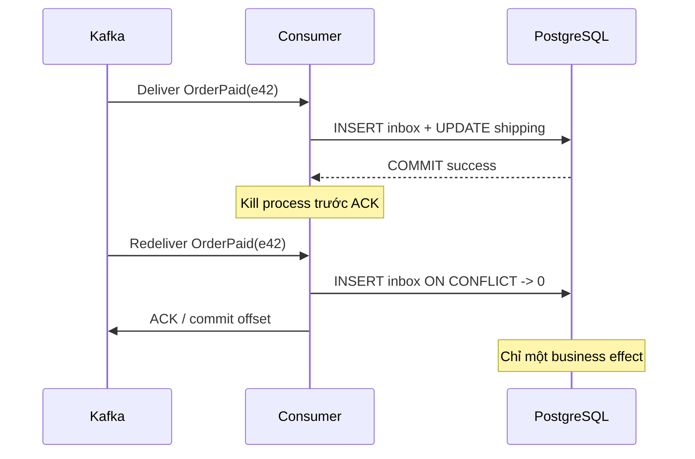

Test với broker thật nên:

1. Publish một event có `eventId=e42` và aggregate version hợp lệ.
2. Inject crash tại boundary **sau DB commit, trước ACK**.
3. Restart consumer cùng group.
4. Assert inbox marker count=1, read model không nhân đôi business effect.
5. Assert offset eventually progresses sau redelivery.
6. Đo số SQL của đường duplicate; tối ưu **inbox check trước khi load aggregate graph đắt tiền**, khi business semantics cho phép.

### 26.2. Vì sao thứ tự dedup trước ORM load rất quan trọng?

Bad path:

```text
Redelivery e42
  -> load order with 50 lines via N+1 (51 SQL)
  -> parse business graph
  -> check processed_events e42 -> already processed
  -> ACK
```

Good path:

```text
Redelivery e42
  -> attempt atomic inbox claim in local transaction
  -> conflict -> already processed -> ACK
  -> no expensive ORM aggregate load
```

Với first delivery, claim marker và business effect nằm **cùng transaction**, nên failure rollback marker. Nếu event payload khác nhưng cùng ID, cần fingerprint validation trước khi coi là duplicate. Nếu update yêu cầu external side effect, cần thêm provider idempotency key/status inquiry; inbox DB marker không tự rollback payment/email.

### 26.3. Concurrent duplicate processing

Nếu hai consumer instances xử lý cùng event ID gần đồng thời (do rebalance/relay republish), một `SELECT processed_events WHERE event_id=?` rồi `INSERT` không đủ. Dùng unique constraint/atomic claim; với PostgreSQL, `INSERT ... ON CONFLICT DO NOTHING` cùng transaction có thể bảo vệ việc chỉ một consumer thực hiện DB effect khi thiết kế đúng. Test concurrency bằng barriers và database thật; mock `Repository.existsById` không mô phỏng locking/race conditions.

### 26.4. Message payload chứa identifier nhưng entity bị xóa

Kafka event có `orderId`, nhưng khi consumer lookup, order đã bị xóa/soft-deleted:

- Nếu event nên mang đủ snapshot fields, consumer có thể xử lý mà không phụ thuộc order hiện tại.
- Nếu command cần kiểm tra trạng thái authority hiện hành, cần version guard/not-found policy.
- Nếu event đến sai thứ tự, park/reconcile thay vì ack như thành công.
- Nếu record thuộc tenant khác, không fetch bằng ID đơn độc, phải dùng tenant predicate.

Không biến `EntityNotFoundException` thành một `onErrorResume(e -> Mono.empty())` chung rồi commit Kafka offset; nó có thể che dữ liệu không nhất quán.

### 26.5. Fault matrix tích hợp JPA + broker

| Crash/failure | JPA/DB state | Broker state | Khôi phục |
| --- | --- | --- | --- |
| Trước source DB commit | Rollback order + outbox. | Chưa publish. | Retry command idempotently. |
| Sau source DB commit, trước publish | Order/outbox committed. | Chưa có event. | Relay outbox sau restart. |
| Broker ACK xong, trước mark outbox published | Outbox pending. | Event có thể đã tồn tại. | Relay có thể publish duplicate; consumer inbox. |
| Consumer chưa bắt đầu DB transaction, process chết | Chưa có effect. | Record chưa ACK. | Redelivery xử lý mới. |
| Consumer DB commit, ACK bị mất | Read model + inbox committed. | Record có thể redeliver. | Duplicate no-op, ACK lại. |
| Consumer bắt đầu N+1 rồi DB timeout/rollback | Transaction rollback. | Record chưa ACK. | Retry bounded, giảm query cost; không ack sai. |
| Consumer HTTP side effect commit, DB rollback | External effect đã xảy ra. | Record redeliver. | Provider idempotency/inquiry + durable workflow. |
| Event JSON invalid | Không commit business state. | Poison record. | DLT/parking với schema-aware replay. |
| Detached entity được serialize sau transaction | JSON/event serialization lỗi. | Publish có thể không xảy ra. | DTO snapshot trước boundary; outbox. |
| Fetch join collection với unbounded page | DB/heap pressure. | Consumer lag hoặc HTTP timeout. | Two-phase queries, page caps, slow-query diagnostics. |

**Ghi nhớ:** Kafka exactly-once consume-process-produce semantics áp dụng trong Kafka transaction scope được cấu hình đúng; nó **không** tự phối hợp atomic commit với PostgreSQL, Redis, remote HTTP hoặc file system.

## 27. Observability: đo N+1 theo request và theo message

| Chỉ số | Tín hiệu | Hành động |
| --- | --- | --- |
| SQL statements per HTTP operation | Query count tăng theo page size. | DTO projection/fetch plan, kiểm tra SQL logs. |
| Hibernate entity/collection load count | Lượng graph load vượt số fields cần. | Xem eager/lazy mappings và access paths. |
| JDBC connection active/idle/pending | Hikari pool bị giữ lâu. | Giảm N+1, transaction scope, connection leak. |
| DB p95/p99 query latency | Index/join/sort/batch query tốn kém. | EXPLAIN/ANALYZE, index/cardinality. |
| HTTP endpoint latency p95/p99 | N+1 tác động tới response. | Correlate DB query count/latency. |
| WebClient pending acquire/read timeout | Downstream callers bị ảnh hưởng. | Sửa endpoint N+1 và capacity/budgets, không chỉ timeout. |
| Kafka consumer lag by partition | Message handler không theo kịp. | N+1 in consumer, retry/poison/concurrency. |
| Rabbit ready/unacked | Broker backlog/handlers giữ lâu. | Prefetch, ack timing, DB query plan. |
| Outbox pending/oldest age | Event relay chậm sau DB commit. | Relay capacity, broker publish/errors. |
| Inbox duplicate prevented | Redelivery/republish được xử lý an toàn. | Phân loại overload/rebalance/retry. |
| Heap/GC, ORM allocations | Query fetch too many entities/collections. | DTO projection, page/batch caps. |
| Rows examined/returned per SQL | Join multiplication dù ít statements. | Split fetches, avoid multiple to-many joins. |

### 27.1. Nên đo query count ở đâu?

Query count nên được gắn với **bounded operation names** như `GET_orders_page`, `shipping_consume_OrderPaid`, `export_orders_batch`. Không dùng mỗi `orderId` hoặc `tenantId` thật làm metric tag cardinality cao; khi cần correlation theo ID, dùng traces/logs được bảo vệ dữ liệu.

Hibernate Statistics ở SessionFactory scope thường là aggregate, không mặc định request-local. Để đo per-operation, có thể dùng JDBC proxy/tracing instrumentation, scoped context, SQL fingerprint aggregator hoặc test-specific StatementInspector; quản lý thread/reactive context propagation đúng. Không lấy global stats delta trong multi-threaded production rồi khẳng định nó là query count của một request.

### 27.2. SQL logging trong production phải cẩn trọng

Hãy ưu tiên normalized SQL fingerprints/latency và sampling có kiểm soát. Bind parameters có thể chứa customer IDs, token hashes, shipping address hoặc payment references. Bật TRACE tất cả params trên production có thể tạo rủi ro privacy/security và lượng logs khổng lồ.

Các công cụ monitoring/JPA stats không thay thế hợp đồng API và DB constraints. Một query count đẹp nhưng trả dữ liệu tenant khác vẫn là lỗi nghiêm trọng.

### 27.3. Alert nên dựa trên xu hướng và SLO

Ví dụ điều kiện thiết kế:

```text
http_order_list_sql_statements_p95
    > (baseline_per_page + tolerance)

AND http_order_list_page_size <= 50

OR kafka_shipping_consumer_lag_age
    > integration_freshness_slo

OR outbox_oldest_unpublished_age
    > expected_publish_window
```

Đây **không phải PromQL có thể copy chạy ngay**. Các metric names/baselines phụ thuộc instrumentation. Cần phân biệt count do pagination COUNT query với N+1 association queries, và xem query duration/rows/heap song song.

### 27.4. “Thêm index là đủ” thường sai

Index có thể giảm thời gian mỗi SELECT khi N+1 xảy ra, nhưng số round trips vẫn tăng. Một endpoint đã có index mà vẫn phát 101 queries cho 50 orders thường cần fetch plan/DTO refactor. Ngược lại, đổi từ N+1 sang một join query mà thiếu index phù hợp có thể làm query còn chậm hơn. **Đo SQL plan và ứng dụng cùng nhau**.

## 28. Runbook: khi endpoint chậm hoặc consumer lag vì JPA

### 28.1. Nếu API GET/orders p99 tăng

1. Xác minh release/version, page size và volume dữ liệu thật; request có dùng detail DTO lớn bất thường không?
2. Bật scoped SQL tracing và thống kê **số statements/request** trên một sample an toàn.
3. Xem repeated SELECT theo `customer_id`, `order_id`, `product_id`; phân biệt query gốc/count query với secondary lazy loads.
4. Xác định JPA entity traversal ở service hoặc Jackson serialization; kiểm tra `spring.jpa.open-in-view`.
5. Nếu N+1, chọn DTO projection, EntityGraph to-one, targeted fetch, batch/subselect hoặc two-phase pagination theo use case.
6. Kiểm tra SQL row multiplication sau khi giảm query count; đừng join fetch nhiều collections bừa bãi.
7. Xác minh tenant filters, DTO field allowlist, pagination ordering và request byte bounds.
8. Chạy SQL count + HTTP tests với OSIV false, thêm 20/50/100 orders/lines.
9. So sánh endpoint p50/p95/p99, Hikari wait, DB CPU, heap/GC và caller WebClient timeouts trước/sau.
10. Rollout có quan sát và rollback plan; tránh bật EAGER toàn hệ thống như “quick fix”.

### 28.2. Nếu gặp LazyInitializationException

1. Đọc root stack trace: field/entity/proxy hoặc collection nào bị initialize khi Session đã đóng?
2. Xác định boundary: controller serialization, async method, event listener AFTER_COMMIT, Kafka serializer, Reactor map, scheduler?
3. Truy ngược service method đã load entity; có mapping DTO trước khi return không?
4. Nếu cần association đó, thêm đúng fetch plan/query hoặc initialize có chủ đích **trong transaction**.
5. Nếu không cần, loại field khỏi DTO contract — không serialize toàn entity.
6. Kiểm tra `spring.jpa.open-in-view` và transaction self-invocation/proxy.
7. Không bật `hibernate.enable_lazy_load_no_trans` hoặc đổi tất cả thành EAGER để che lỗi.
8. Tạo regression test HTTP/event với OSIV false và serialization sau service return.

### 28.3. Nếu Kafka consumer lag tăng

1. Xem lag theo partition và handler execution time; có retry/poison event làm kẹt một partition không?
2. Đếm SQL/event; phát hiện load aggregate/lines/products lặp.
3. Kiểm tra inbox dedup có chạy **trước expensive ORM fetch** cho duplicate events không?
4. Kiểm tra Hikari connection pool, transaction duration, DB locks và query plan.
5. Xác định listener đang gọi HTTP remote trong DB transaction hay không.
6. Cân đối consumer concurrency, poll interval, batch size và JDBC max pool (tăng một phía có thể làm phía khác nghẽn).
7. Chuyển event sang DTO đủ fields/targeted fetch; dùng bounded retry/DLT và idempotent replay.
8. Kiểm thử crash sau DB commit trước ACK, rồi xem duplicate effect và query cost trên redelivery.

### 28.4. Nếu Hikari pool exhausted

Một pool có 20 JDBC connections và endpoint giữ chúng khi lặp 200 SELECT có thể làm requests khác chờ `Hikari connectionTimeout`. Nhưng cũng có thể do DB query locks, unclosed streams, long transactions hoặc leak thực.

Kiểm tra:

- Active/idle/pending connections và thời gian giữ leases.
- Transaction durations và queries in transaction.
- N+1 SELECTs, row count, slow SQL, missing indexes.
- HTTP outbound calls nằm trong `@Transactional`.
- JDBC ResultSet/Stream/EntityManager resources chưa đóng.
- Thời gian streaming/serialization có làm DB context sống quá lâu không?
- Chỉ tăng `maximumPoolSize` khi DB capacity và workload cho phép; không dồn 200 connections vào DB vốn quá tải.

### 28.5. Nếu sự cố xuất hiện sau đổi JSON DTO/event schema

1. Kiểm tra serializer có bắt đầu truy cập association mới không.
2. Xem new DTO mapper/callback có chạy ngoài transaction không.
3. So sánh số SQL, output bytes và nesting depth.
4. Kiểm tra PII leakage/tenant data filtering khi fetch thêm graph.
5. Với Kafka, xem schema evolution và consumer deserializer failures/DLT.
6. Với remote HTTP, xem timeouts có tăng do payload lớn/thêm DB round trips.
7. Chỉ rollout khi contract tests và query-count regression tests đạt.

## 29. Các lỗi phổ biến và cách sửa

| Sai lầm | Hậu quả trong HTTP/message integration | Cách làm đúng |
| --- | --- | --- |
| Return `Page<PurchaseOrder>` thẳng từ controller | Jackson có thể dereference lazy associations, lộ dữ liệu/mapping. | Trả HTTP DTO với fetch plan và field allowlist. |
| Bật OSIV để “sửa” lazy serialization | SQL có thể chạy khi render JSON, ngoài service transaction. | Map DTO trong transaction; chọn OSIV policy rõ. |
| Tắt OSIV rồi bỏ qua `LazyInitializationException` | HTTP 500/event serializer lỗi. | Fetch association cần thiết trước khi transaction đóng. |
| Bật `hibernate.enable_lazy_load_no_trans` toàn hệ thống | Secondary queries ngoài transaction che thiết kế sai. | Explicit fetch plan, transaction boundary. |
| Đổi toàn bộ `@ManyToOne` sang EAGER | Over-fetching và có thể N+1 secondary SELECTs. | LAZY + projection/EntityGraph theo use case. |
| Giả định FetchType.EAGER = SQL JOIN | Provider có thể dùng secondary SELECTs. | Kiểm tra generated SQL/Statistics. |
| Dùng `findAll()` rồi truy cập `getLines()` cho mỗi order | N+1 lazy collection queries. | Page IDs + targeted fetch/batching. |
| Gọi `getLines().size()` chỉ để kiểm tra có dòng hàng | Có thể initialize collection không cần thiết. | Query `exists/count` hoặc projection khi phù hợp. |
| Dùng `Pageable + JOIN FETCH lines` | In-memory pagination hoặc row truncation/warnings. | Two-phase pagination và fail-on-pagination property. |
| Fetch join hai collections `List` cùng lúc | Cartesian product/MultipleBagFetchException. | Split fetches, bounded DTO mapping. |
| Nghĩ `DISTINCT` loại bỏ row explosion | Có thể vẫn vận chuyển nhiều joined rows. | Đo SQL rows/network và tách collections. |
| Chọn batch size 1.000 không đo DB constraints | Large IN clause, heap và query planner pressure. | Test 16/32/64/... theo workload/dialect. |
| Chỉ dựa vào L2 cache để khử N+1 | Cache miss/cold start làm lỗi quay lại. | Query shape đúng trước, cache như tối ưu bổ sung. |
| Test N+1 cùng persistence context đã seed fixtures | First-level cache che secondary SELECTs. | Flush/clear và reset Statistics trước operation. |
| Chỉ assert HTTP 200, không đo SQL/row counts | Hiệu năng suy giảm không bị test phát hiện. | Query-count + query-plan + latency regression tests. |
| Tăng Hikari maximumPoolSize để chữa N+1 | DB phải xử lý thêm connections/SQL, dễ quá tải. | Giảm SQL/request và transaction duration trước. |
| Mở `@Transactional` quanh HTTP remote call dài | Giữ JDBC resources/locks, kéo dài latency. | Short DB transaction, DTO snapshot rồi call remote. |
| Map DTO trong Reactor `map` sau khi repository method đóng transaction | Detached proxy, LazyInitializationException. | Transactional bean trả DTO; cách ly blocking call. |
| Dùng `Mono.just(repository.findById(...))` trên event loop | Chạy blocking SQL ngay trước Mono creation. | `Mono.fromCallable(...).subscribeOn(boundedElastic)` với bounded concurrency. |
| Truyền JPA entity qua `@Async` | Session không thread-safe/không được truyền transaction. | Truyền IDs hoặc immutable DTO. |
| Serialize raw JPA entity vào Kafka | N+1, payload schema không ổn định, circular graph, PII. | Explicit versioned event DTO. |
| `@TransactionalEventListener(AFTER_COMMIT)` được coi là durable outbox | Process crash trước callback làm mất event. | Ghi outbox row cùng DB transaction. |
| Relay publish rồi mark outbox trước ACK | Có thể mất event khi send future fail. | Chờ broker ACK, chấp nhận republish và dedup. |
| Chỉ dùng Kafka idempotent producer, không có consumer inbox | Event có thể được publish lại sau relay restart. | Stable event ID + DB unique/business idempotency. |
| Consumer commit Kafka offset trước DB commit | Crash làm mất business work. | DB commit rồi ACK; chịu redelivery + inbox. |
| Consumer load toàn bộ JPA graph trước khi check duplicate | Redelivery vẫn tạo N+1 SQL không cần thiết. | Atomic inbox claim trước expensive work. |
| ACK sau khi enqueue vào in-memory ExecutorChannel | Process crash làm mất task chưa commit. | Durable handoff, checkpoint sau commit. |
| Retry `OrderPaid` với event ID mới | Inbox coi là event mới, có thể duplicate effect. | Stable event ID/command ID và fingerprint. |
| Retry payment POST sau read timeout không inquiry | Remote effect có thể đã commit. | Provider idempotency key và UNKNOWN_OUTCOME. |
| Coi `@Transactional(readOnly=true)` là snapshot/serializable guarantee | Nhiều SELECT trong một tx có thể thấy dữ liệu khác nhau. | Chọn isolation/snapshot contract khi thực sự cần. |
| Bỏ tenant filter khỏi query thứ hai của two-phase fetch | Rủi ro cross-tenant data disclosure khi query/code sai. | Tenant predicate ở mọi query và principal-based auth. |
| Trả unbounded `Stream<PurchaseOrder>` qua HTTP | Connection/EntityManager sống qua serialization, memory leaks. | Stream DTO/bounded chunks, close resources, durable export jobs. |
| Chỉ nhìn SQL count, không đo số rows | Một join nhiều collections vẫn có thể rất chậm. | Query count + row count + DB time + memory. |
| Kết luận “N+1 đã hết” sau warm-cache local test | Cold cache/scale out tái phát. | Cold/warm tests, production-like cardinalities. |
| Dùng HTTP client read timeout lớn hơn để che endpoint SQL chậm | Tăng pending pool/remote resource hold time. | Sửa N+1 và đặt deadlines theo SLO. |

## 30. Checklist thiết kế tích hợp JPA/Hibernate

### 30.1. Trước khi viết repository

1. **Nêu rõ dữ liệu cần trả:** list/summary/details/event/export; field allowlist và size bound.
2. **Xác định entities/relations:** to-one/to-many, default EAGER/LAZY, nested associations.
3. **Tách DTO contract:** không trả entity/proxy trực tiếp cho HTTP, Kafka, RabbitMQ hay async job.
4. **Chọn fetch strategy:** projection, EntityGraph, fetch join một collection, batch/subselect hoặc two-phase pagination.
5. **Chọn pagination:** stable sort, parent ID page, count/Slice/keyset; không fetch join collection + Pageable thiếu kiểm chứng.
6. **Thiết kế tenant/authorization:** tenant ID đến từ authenticated context, repository predicates đúng ở mọi phase.
7. **Giới hạn lượng dữ liệu:** max page size, per-order lines count, export batch/bytes và time budget.

### 30.2. Trong service/transaction

8. **Đặt transaction boundary rõ:** public Spring bean method qua proxy, service chứa mapping DTO.
9. **Tắt OSIV có chủ đích:** kiểm thử HTTP serialization khi `spring.jpa.open-in-view=false`.
10. **Không phụ thuộc lazy ngoài tx:** không truyền managed entities qua @Async/Reactor/Kafka serializers.
11. **Không giữ DB transaction qua remote HTTP:** lấy snapshot DTO ngắn, call provider sau.
12. **Không dùng self-invocation:** hiểu `@Transactional` proxy/thread-local boundaries.
13. **Read-only không thay isolation:** cân nhắc consistency của multi-query pagination.
14. **Resource lifecycle:** streaming repositories/EntityManager/JDBC resources phải close; batch write flush/clear ở boundary đúng.
15. **ORM concurrency:** Hibernate Session/persistent collections không được shared giữa threads.

### 30.3. Ở message/outbox boundary

16. **Event DTO có identity/version:** eventId, aggregate key/version, tenantId và schemaVersion.
17. **Outbox:** business DB state + event intent commit cùng local transaction.
18. **Relay:** chờ broker ACK rồi mark published, retry giữ nguyên event ID.
19. **Inbox:** unique event ID + fingerprint và business effect trong cùng DB transaction.
20. **ACK:** broker offset/ACK sau durable business commit hoặc durable parking.
21. **Retry:** tránh poison/retry storm, không nhân remote side effects, xử lý UNKNOWN_OUTCOME.
22. **Ordering:** key/partition/aggregate version, retry topics và version-gap policy.
23. **No async entity:** jobs/events mang IDs hoặc immutable DTO và fetch lại ở transaction riêng.

### 30.4. Kiểm thử và vận hành

24. **SQL regression:** seeded 20–50 roots, first-level cache cleared, query count upper bound.
25. **Row-count/perf:** kiểm tra Cartesian multiplication, SQL EXPLAIN và p95/p99.
26. **HTTP contract:** MockMvc/HTTP integration với OSIV=false, JSON schema field allowlist.
27. **Message recovery:** crash DB commit→ACK, duplicate concurrent events, outbox republish.
28. **Cache effects:** cold/warm L1/L2, different customer IDs, variations in children cardinality.
29. **Instrumentation:** Hibernate stats/SQL tracing, Hikari, HTTP p99/timeout, Kafka lag, outbox/inbox metrics.
30. **Runbook:** phân biệt LazyInitializationException, N+1, pool saturation, missing event, duplicate side effect.

## 31. Bài tập thực hành

### Bài A — Phát hiện N+1 bằng query count

Tạo 30 orders thuộc cùng tenant, mỗi order có customer riêng và 3 lines. Trong một read-only transaction:

1. Gọi `repository.findAll()` rồi đọc `order.getCustomer().getDisplayName()` và `order.getLines().size()`.
2. Clear persistence context trước test để tránh first-level cache ảnh hưởng.
3. Dùng `Statistics.getPrepareStatementCount()` hoặc StatementInspector đếm SQL.
4. Giải thích vì sao số statements phụ thuộc unique Customer IDs, batch fetch và L2 cache.
5. Thêm EntityGraph cho to-one customer rồi so sánh.
6. Thêm DTO projection khi chỉ cần summary rồi so sánh.

**Yêu cầu nộp:** SQL count trước/sau, generated SQL, latency và giải thích vì sao ít SQL chưa chắc ít rows.

### Bài B — Tắt OSIV đúng cách

Với controller đang trả `PurchaseOrder`:

1. Bật `spring.jpa.open-in-view=false` trong integration test.
2. Reproduce lazy serialization failure với collection chưa initialized.
3. Tạo `OrderDetailsView` record và query fetch plan đúng.
4. Map DTO trong `@Transactional(readOnly=true)` service.
5. Test response JSON có đủ lines mà không có Hibernate proxy properties.
6. Kiểm tra không query DB ở pha serialization và không lộ PII ngoài contract.

**Yêu cầu nộp:** diagram transaction boundary, endpoint test và giải thích vì sao bật OSIV không phải cách sửa tối ưu.

### Bài C — Pagination hai pha

Giả sử có 1.000 orders, trung bình 10 lines/order. Hãy:

1. Thử `Pageable + @EntityGraph(lines)`, quan sát warning/failure hoặc in-memory pagination.
2. Bật `hibernate.query.fail_on_pagination_over_collection_fetch=true` trong test.
3. Sửa thành page IDs → fetch roots+customer → fetch lines theo danh sách IDs.
4. Map DTO và khôi phục thứ tự từ ID page.
5. Kiểm tra empty page, last page, page size cap, customer missing/nullable theo schema.
6. Đánh giá snapshot consistency ở READ COMMITTED và đề xuất cách xử lý nếu yêu cầu snapshot.

**Yêu cầu nộp:** SQL count, số rows, memory footprint và output ordering.

### Bài D — Batch fetching và Cartesian product

Tạo entity có hai collections: `lines` (20 phần tử) và `discounts` (10 phần tử). Thử fetch join cả hai, nhận diện `MultipleBagFetchException` hoặc row multiplication tùy mappings. Sau đó:

1. Dùng split fetches.
2. Thử `@BatchSize(size=16/32/64)` trên một association.
3. Thử `@Fetch(SUBSELECT)` trong môi trường test.
4. So sánh SQL count, rows returned, p95 latency, heap usage.
5. Giải thích khi nào nên tách endpoint/collection pagination thay vì tiếp tục tối ưu ORM fetch.

### Bài E — Kafka consumer với N+1 và duplicate delivery

Dùng PostgreSQL + Kafka test infrastructure:

1. Consumer nhận event `OrderPaid(e42)` với event DTO.
2. Trong local transaction, claim inbox marker và cập nhật read model.
3. Đặt fault injection sau DB commit trước Kafka ACK.
4. Restart consumer để broker redeliver e42.
5. Assert inbox một marker, business effect một lần.
6. Đo SQL count trên duplicate path: phải kiểm tra inbox trước expensive aggregate fetch.
7. Với first delivery, chỉ fetch fields thật cần, không duyệt lazy customer+lines vô hạn.

**Yêu cầu nộp:** test report về crash windows, số SQL/event, Kafka lag và idempotency scope.

### Bài F — Outbox và remote HTTP effect

Một HTTP POST chuyển order sang PAID và phải publish event:

1. Triển khai cùng local DB transaction cho status/version update và outbox insert.
2. Cho relay publish Kafka, crash sau ACK nhưng trước mark PUBLISHED.
3. Chứng minh relay có thể gửi duplicate cùng eventId.
4. Dùng inbox ở consumer để chỉ một business effect.
5. Thêm bước HTTP reservation tới Warehouse và mô phỏng response mất sau remote commit.
6. Thiết kế stable idempotency key + inquiry thay vì retry bằng command ID mới.

**Yêu cầu nộp:** failure matrix giải thích vì sao Kafka EOS không bảo đảm atomic commit với JDBC/remote API.

### Bài G — Batch export và tài nguyên

Export 1 triệu orders ra object storage với max 500 parent IDs mỗi batch. Thiết kế:

- Keyset cursor hoặc snapshot watermark.
- DTO projection, không giữ tất cả JPA entities.
- Transaction/read scope ngắn.
- Bounded concurrent uploads, multipart cleanup và checksum.
- Durable job status/idempotent chunk IDs.
- Retry khi process crash giữa hai batches.
- Test count/memory/query duration/connection lease.

Giải thích vì sao `findAll()` và `collectList()` thường không phù hợp, ngay cả khi đã giảm N+1 xuống một JOIN.

### Bài H — Tối ưu production có số liệu

Một API p99 tăng từ 300 ms lên 5 giây sau khi thêm field `product.vendor.name` vào response. Thu thập:

1. Diff DTO mapper và entity graph.
2. Hibernate statement count per request.
3. Generated SQL repeated by product/vendor FK.
4. DB query time/rows and indexes.
5. Hikari pool wait và HTTP client read timeouts.
6. Kafka lag nếu cùng query code được dùng trong listener.

Đề xuất ít nhất hai cách sửa (projection vs targeted fetch + batch) và so sánh theo tests/SLO, thay vì chỉ tăng `readTimeout` hoặc JDBC pool.

## 32. Câu hỏi tự kiểm tra

1. `PersistenceContext` của Hibernate khác một HTTP session hoặc một database connection như thế nào?
2. Khi nào một `PurchaseOrder` là managed, detached hoặc transient?
3. Một Hibernate lazy proxy còn đọc database được sau khi `EntityManager` đóng không?
4. JPA mặc định fetch type của `@ManyToOne` và `@OneToMany` là gì?
5. `FetchType.EAGER` có đồng nghĩa Hibernate luôn dùng SQL JOIN không?
6. Vì sao `getCustomer().getDisplayName()` có thể phát SELECT trong khi `getCustomer().getId()` có thể không cần?
7. N+1 được phát hiện từ số SQL như thế nào? Nếu 50 orders dùng chung 1 customer, số queries có nhất thiết là 51 không?
8. N+1 và `LazyInitializationException` khác nhau ở điều kiện nào?
9. Vì sao bật OSIV có thể che N+1 cho tới pha Jackson serialization?
10. Tại sao OSIV không bảo đảm mọi SQL trong request cùng một database transaction?
11. Vì sao `spring.jpa.open-in-view=false` không tự sửa tất cả lazy loading?
12. Lợi ích của DTO projection so với trả entity rồi map trong controller là gì?
13. Khi nào nên dùng `@EntityGraph(attributePaths={"customer"})`?
14. Khi nào fetch join một to-many collection là hợp lý?
15. Vì sao fetch join hai collections có thể tạo Cartesian product hoặc `MultipleBagFetchException`?
16. Tại sao `select distinct o` không làm mọi duplicated SQL rows biến mất?
17. Vì sao không nên kết hợp collection fetch join và `Pageable` trực tiếp?
18. Two-phase pagination gồm những bước nào và tại sao cần cùng persistence context?
19. Khi dùng `WHERE id IN (...)`, tại sao cần khôi phục thứ tự IDs từ page gốc?
20. Vì sao không gửi JPQL `IN ()` với danh sách IDs rỗng?
21. `hibernate.default_batch_fetch_size` có thể giảm N+1 theo cơ chế gì?
22. `@BatchSize` và `@Fetch(SUBSELECT)` có phải annotation JPA portable không?
23. Nếu second-level cache hit làm SQL count giảm, có thể tuyên bố N+1 đã được giải quyết triệt để không?
24. Tại sao query count ít nhưng SQL JOIN trả quá nhiều rows vẫn gây chậm?
25. `@Transactional(readOnly=true)` có tự cho snapshot isolation trong PostgreSQL READ COMMITTED không?
26. Tại sao Spring AOP self-invocation có thể làm transaction annotation không được áp dụng?
27. Vì sao không truyền managed entity vào `@Async` hoặc `CompletableFuture` callback?
28. `Mono.just(repository.findById(...))` khác `Mono.fromCallable(...).subscribeOn(boundedElastic())` ở điểm nào?
29. Vì sao JPA/Hibernate ORM không trở thành non-blocking chỉ vì controller dùng WebFlux?
30. Nếu 50 orders có 5 lines mỗi order, gọi Warehouse REST API một lần mỗi line tạo bao nhiêu remote calls?
31. Vì sao không nên giữ PostgreSQL transaction mở khi chờ 250 HTTP calls?
32. Nếu inventory GET dữ liệu thay đổi giữa DB fetch và HTTP response, tổng hợp DTO có bảo đảm snapshot nhất quán không?
33. Nguy cơ gì khi truyền `PurchaseOrder` entity trực tiếp cho Jackson Kafka serializer?
34. Ưu/nhược điểm của event ID-only so với event-carried snapshot là gì?
35. Tại sao một `@TransactionalEventListener(AFTER_COMMIT)` không thay được transactional outbox?
36. Tại sao relay publish xong vẫn có thể gửi duplicate sau crash?
37. Khi Kafka consumer đã DB commit nhưng chưa ACK, chuyện gì xảy ra khi process chết?
38. Inbox marker và business effect cần commit trong cùng transaction vì sao?
39. Vì sao check duplicate **trước** expensive JPA graph fetch có thể tiết kiệm rất nhiều SQL trên redelivery?
40. Khi cùng event ID có payload khác, consumer nên xử lý thế nào?
41. Tại sao một HTTP payment POST timeout không chứng minh provider chưa commit?
42. Vì sao Kafka exactly-once semantics không tự rollback PostgreSQL transaction?
43. Spring Integration `ExecutorChannel` thay đổi transaction/thread boundary như thế nào?
44. `QueueChannel` trong-memory có phải một durable message queue cho công việc critical không?
45. Vì sao một batch export nên dùng keyset cursor, DTO và checkpoints thay vì một `findAll()` lớn?
46. Cần làm gì trước khi đo N+1 để first-level cache không che số SQL?
47. Hibernate `getPrepareStatementCount()` có phải SQL count per HTTP request khi production đang có nhiều concurrent requests không?
48. Vì sao SQL count, DB row count, p99 latency, Hikari metrics và memory đều cần được xem?
49. Kiểm thử nào chứng minh Jackson không phát lazy SQL khi OSIV đã tắt?
50. Khi tăng Hibernate batch size hoặc đổi fetch join, phải kiểm thử thêm những failure/performance modes nào?

## 33. Tài liệu tham khảo

- [Spring Boot — SQL Databases and JPA](https://docs.spring.io/spring-boot/reference/data/sql.html): DataSource, JPA auto-configuration, OSIV và Hibernate customizations.
- [Spring Data JPA — Reference](https://docs.spring.io/spring-data/jpa/reference/): repositories, pagination, projections, entity graphs và transactionality.
- [Spring Data JPA — Projections](https://docs.spring.io/spring-data/jpa/reference/repositories/projections.html): interface/class/record projections, query derivation và nested projections.
- [Spring Data JPA — Fetching/EntityGraph](https://docs.spring.io/spring-data/jpa/reference/jpa/query-methods.html#jpa.entity-graph): dynamic/named entity graphs trên repository methods.
- [Hibernate ORM 6 — User Guide](https://docs.jboss.org/hibernate/orm/6.6/userguide/html_single/Hibernate_User_Guide.html): lazy fetching, proxies, entity graph, fetch join, batch fetching và Hibernate statistics. Phiên bản URL là nhánh tham khảo; đối chiếu đúng phiên bản Hibernate dự án đang dùng.
- [Hibernate ORM — Performance Tuning](https://docs.hibernate.org/orm/current/userguide/html_single/Hibernate_User_Guide.html#best-practices-fetching): fetch plans, batch/subselect và các khuyến nghị hiệu năng; lựa chọn theo version/provider.
- [Hibernate ORM — Javadocs](https://docs.hibernate.org/orm/current/javadocs/): `@BatchSize`, `@Fetch`, `SessionFactory` và `Statistics` APIs.
- [Jakarta Persistence 3.1 — Specification](https://jakarta.ee/specifications/persistence/3.1/): entity mappings, persistence context, transaction scope và fetch type.
- [Spring Framework — Transaction Management](https://docs.spring.io/spring-framework/reference/data-access/transaction.html): JDBC/JPA transaction managers, propagation và boundaries.
- [Spring Framework — Declarative Transaction Management](https://docs.spring.io/spring-framework/reference/data-access/transaction/declarative.html): `@Transactional`, Spring AOP proxy và self-invocation.
- [Spring Framework — Transaction-bound Events](https://docs.spring.io/spring-framework/reference/data-access/transaction/event.html): `@TransactionalEventListener` và AFTER_COMMIT semantics.
- [Spring Framework — Web MVC](https://docs.spring.io/spring-framework/reference/web/webmvc.html): controller response/serialization lifecycle.
- [Spring Framework — WebFlux](https://docs.spring.io/spring-framework/reference/web/webflux.html): reactive execution, blocking call considerations và data access boundaries.
- [Spring for Apache Kafka — Reference](https://docs.spring.io/spring-kafka/reference/): listener acknowledgment, error handling, transactions và exactly-once scope.
- [Spring for Apache Kafka — Exactly Once Semantics](https://docs.spring.io/spring-kafka/reference/kafka/exactly-once.html): consume-transform-produce atomicity trong Kafka và phạm vi bảo đảm.
- [Spring AMQP — Reference](https://docs.spring.io/spring-amqp/reference/): Rabbit listener containers, manual ACK/NACK, transactions và error handling.
- [Spring Integration — Transactions](https://docs.spring.io/spring-integration/reference/transactions.html): transaction boundary qua pollers, channels và handlers.
- [Spring Integration — Channels](https://docs.spring.io/spring-integration/reference/channel.html): `DirectChannel`, `ExecutorChannel` và `QueueChannel` semantics.
- [Testcontainers — PostgreSQL Module](https://java.testcontainers.org/modules/databases/postgres/): test SQL/dialect/locking/transactions với PostgreSQL thật.
- [Testcontainers — Kafka Module](https://java.testcontainers.org/modules/kafka/): test broker redelivery, offset commits và failure windows.
- [PostgreSQL — Transaction Isolation](https://www.postgresql.org/docs/current/transaction-iso.html): READ COMMITTED, REPEATABLE READ và snapshot behavior.
- [PostgreSQL — EXPLAIN](https://www.postgresql.org/docs/current/sql-explain.html): phân tích execution plans, row counts và query cost.
- [Microservices.io — Transactional Outbox Pattern](https://microservices.io/patterns/data/transactional-outbox.html): local DB commit cùng event intent và relay.
- [Microservices.io — Idempotent Consumer Pattern](https://microservices.io/patterns/communication-style/idempotent-consumer.html): deduplication and repeated delivery semantics.

**Kết luận trọng tâm:** Lazy loading là công cụ cho phép trì hoãn truy vấn, **không phải một cam kết truy vấn rẻ hoặc dữ liệu sẵn sàng ở mọi boundary**. N+1 xuất hiện khi ứng dụng lặp qua những lazy associations không được fetch có chủ đích. Khi tích hợp qua HTTP hoặc broker, hậu quả vượt xa tốc độ truy vấn: JSON serialization lỗi, timeout/cạn JDBC pool, Kafka lag, retry amplification và mất/tạo trùng side effects nếu transaction/ACK được đặt sai. Thiết kế đúng là **DTO tường minh + fetch plan phù hợp + transaction ngắn + đo SQL + outbox/inbox/idempotency ở những chặng không có transaction chung**.
